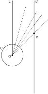
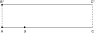

# 阿拉伯和伊斯兰数学哲学 Arabic and Islamic Philosophy of Mathematics (Mohammad Saleh Zarepour)

**首次发表于 2022 年 4 月 9 日。**

纯数学哲学处理两大类问题。一类关乎数学实体的存在论，另一类关乎数学概念与数学判断的认识论（Avigad 2007）[^avigad-2007]。数学对象（如数与几何图形）的本性与存在，无穷（如无限量与数或被数者的无限汇集）与连续体的存在与资格，都在数学哲学家最重要的存在论议题之列。另一方面，关于数学也有一些最重要也最棘手的认识论议题。其中包括：我们借以把握数学知识的机制，数学公理与原理的认识论地位。此外还有：数学证明（可写于纸上者）的本性及其与数学家心灵中发生之事的关联，以及数学知识在更好地理解物理世界一事上的作用。

众所周知，中世纪伊斯兰文明在数学技术层面的历史发展中起了关键作用。穆斯林数学家站在前伊斯兰时代的希腊、印度与波斯先辈的肩膀上，在数学诸分支中多有创新，并写下了大量引入数学概念、证明数学定理的书籍与论文（Al-Daffaʾ 1977；R. Rashed 1984b [1994]；1996 [2012]；2015；Berggren 2016）[^al-daffaʾ-1977][^berggren-2016][^rashed-1984b]。然而，很难（若非不可能）从中世纪伊斯兰时代找到一本专门用于全面而系统地研究数学哲学的书。尽管如此，前述许多关于数学的哲学议题，都曾被中世纪穆斯林伟大思想家在其中心主题为数学、物理学、形而上学乃至神学（*kalām*）的各种著作中处理过。把这些散见的投入汇总起来，可以看清一点。虽然数学哲学在中世纪伊斯兰世界从未被当作一门独立学科来对待，穆斯林思想家仍就至少某些与数学相关的哲学问题，提出了十分有趣而深刻的思想、洞见与论证。本词条简要回顾这类洞见与论证中最突出的例子，其中一些曾是穆斯林思想家之间长期争论与讨论的主题。据此，阿拉伯与穆斯林学者的技术性数学著作，只在其包含与数学 **哲学** 相关材料的范围内得到讨论。

## 1 数学的存在论

### 1.1 数学对象不是什么

穆斯林早期思想家著作中，可以找到毕达哥拉斯（Pythagoras）与柏拉图（Plato）关于数学对象本性的哲学观点的痕迹。这部分是由于毕达哥拉斯派与柏拉图派数学家著作的早期阿拉伯译本。尼科马霍斯（Nicomachus）、普罗克洛（Proclus）与扬布里柯（Iamblichus）传统中的数学家大多是毕达哥拉斯派与柏拉图派（Endress 2003）[^endress-2003]。他们最重要的一些著作已被译成阿拉伯文，并影响了穆斯林数学家与哲学家。例如，尼科马霍斯的《算术引论》先由哈比卜·伊本·巴里兹（Ḥabīb Ibn Bahrīz，卒于 9 世纪初）自叙利亚文译出，又由萨比特·伊本·库拉（Thābit Ibn Qurra，卒于 901 年）自希腊文译出（Brentjes 2022: sec. 1）[^brentjes-2022]。毕达哥拉斯主义与柏拉图主义进路对数学哲学的影响，在例如精诚兄弟会（*Ikhwān al-ṣafāʾ*）与早期穆尔太齐赖派的著作中易于辨认（The Brethren of Purity [Epistles]；Endress 2003: 132–33；Marquet 2006；Fazlıoğlu 2014: 2；El-Bizri 2018；Baffioni 2022）[^baffioni-2022][^el-bizri-2018][^endress-2003][^fazlıoğlu-2014][^marquet-2006]。毕达哥拉斯主义与柏拉图主义在数学存在论上的主要特征，可由以下两条论题概括（Zarepour 2019: 198）[^zarepour-2019]：

- **数学对象的分离性（SM）：** 数学对象是独立的非物质实体，完全分离（*mufāriq*）于质料与质料对象。
- **数学对象的本原性（PM）：** 数学对象是自然物的本原（*mabādiʾ*）。数学对象对自然形式有某种在先性，使后者依赖于（或奠基于、或被因果于）前者。

柏拉图同时承诺这两条论题。相比之下，毕达哥拉斯派只接受后者。至少若我们信任亚里士多德（Aristotle）的报道（《形而上学》987b23–987b25），情形如此。虽然毕达哥拉斯主义认为数是所有其他存在物的本原与原因，但它并不把数当作必然分离于质料的实体（Zhmud 1989；De Smet 2022）。从我们今天的视角看，这在某种程度上令人惊讶，因为与（PM）相比，（SM）在初看之下（*prima facie*）似乎享有更多可信性。但恰恰由于早期伊斯兰思想中存在强烈的毕达哥拉斯主义倾向（Brentjes 2022）[^brentjes-2022]，（PM）比（SM）得到更明确的辩护。阿维森纳（Avicenna，卒于 937 年）对这两条论题的猛烈批评，连同他对柏拉图式分离普遍形式理论更一般的批评，使毕达哥拉斯主义与柏拉图主义在后阿维森纳哲学中极不受欢迎。在《治疗论·形而上学》中，阿维森纳反驳（SM）与（PM），不仅通过拒斥归于这两条论题辩护者的论证（Avicenna [Mph]: chap. VII.2），也通过提出他自己的正面论证来反驳它们（Avicenna [MPh]: chap. VII.3）。

按阿维森纳归于（SM）辩护者的一个论证：一方面，数学对象在定义中（或在心灵中）是分离的。它们可以在不指涉质料或质料存在者的情况下得到定义（或设想）。另一方面，凡在定义中（或在心灵中）分离者，在存在中也分离。因此，论证结论道，数学对象在存在中分离。它们作为完全分离的存在者而存在，与质料或质料存在者没有任何关联（Avicenna [MPh]: chap. VII.2, sec. 5）。然而，阿维森纳认为这一论证有缺陷。他论证说，（a）在无质料性条件下定义（或设想）某物，与（b）在非物质性条件下定义（或设想）某物，二者有别。他说，数学对象仅在（a）的意义上在定义中分离。但所论论证的第二个前提，只有在按（b）的意义理解“定义中的分离”时才为真。某物可以在无质料性条件下被定义，这一单纯事实并不蕴涵：该物能在心灵外领域中完全分离于质料而存在。但数学对象不能在非物质性条件下被定义。把非物质性当作数学对象定义的本质成分并不可信，至少阿维森纳如此主张。因此，这一论证是谬误的，不能确立（SM）（Avicenna [MPh], chap. VII.2, secs. 16–17；Marmura 2006: 360–63；Porro 2011: 292–93；Zarepour 2019: sec. 4.1）[^marmura-2006][^porro-2011][^zarepour-2019]。

阿维森纳归于（PM）拥护者的一个简单论证如下：数学对象是分离的。换言之，（SM）为真。此外，质料之物的本原（或原因）不能自身是质料的。它们必定是分离的。因此，数学对象是质料（或自然）之物的本原（Avicenna [MPh]: chap. VII.2, sec. 7）。阿维森纳认为，这一论证不仅因（SM）为假而不健全，而且是无效的。即便我们同时接受这两点——数学对象是分离的，自然物的本原也必定是分离的——也推不出数学对象是自然物的本原。可能还存在其他分离的、非数学的东西构成自然存在者的本原。所论论证只有在预设数学对象是唯一的分离存在者时才有效。但这一点没有任何证明。因此，这一论证未能确立（PM）（Avicenna [MPh]: chap. VII.2, sec. 21；Marmura 2006: 365–66；Porro 2011: 294；Zarepour 2019: sec. 4.2）[^marmura-2006][^porro-2011][^zarepour-2019]。

阿维森纳本人反对数学对象之分离性或非物质性的论证可概括如下：感性世界中存在一些数学对象。否则，我们无法把握它们的概念（如三角形、圆、二等概念）（Avicenna [MPh]: sec. VII.3, sec. 1）。现在，如果还有一些完全分离的数学对象（完全脱离感性世界），那么这两组（感性的/非分离的与非感性的/分离的）数学对象必须共有相似的本质与定义（Avicenna [MPh]: chap. VII.3, sec. 2）。否则，我们无从认识分离的质料对象。这是因为，我们似乎没有任何直接通道通达一个完全非物质的数学对象领域（这令我们想起贝纳塞拉夫（Benacerraf）1973 年那项针对数学柏拉图主义的认识论挑战）。即便这类东西存在，我们也只是通过认识其感性对应物之中介而认识它们。我们没有任何理由断定存在在质料世界中没有感性对应物的分离数学对象。但这使数学对象可以在本质上是非物质且分离的这一主张失去辩护。阿维森纳以此论证确立（SM）不可信（Avicenna [MPh], chap. VII.3, sec. 3；Zarepour 2019: sec. 5）[^zarepour-2019]。我们后面会看到，这一论证揭示了阿维森纳数学认识论与存在论的一些有趣面向。

最后，阿维森纳论证：即便分离的数学对象存在，它们也不能是自然物的本原（或原因）。直觉上似乎可信的是：若一个分离的数学对象是任一质料存在者的本原，它必须首先是其自身感性对应物的本原。注意，按阿维森纳，一个分离的数学对象（比如说一个三角形）存在的主张，除非我们通过认识存在于质料世界中的一个感性对应物而认识了它，否则便无法得到辩护。那么，若那个分离三角形是任一质料之物的原因，它必须首先是其自身感性对应物的本原，至少阿维森纳如此认为。但如果感性三角形由分离三角形所引起，我们就可以正当地追问：前者为何需要后者？使感性三角形依赖于其分离对应物的，要么是它的本质，要么是它的（某些）偶性。然而，若这是由于感性三角形的本质，那么分离三角形自身也需要一个本原。这是因为分离三角形与感性三角形共有同一本质。于是，若正是感性三角形的本质使它需要分离三角形，那么分离三角形（与其感性对应物共有同一本质）必然自身由另一个分离三角形所引起。重复同样的论证线索，我们可以推出：必然存在一条由因果关联的三角形构成的无穷链条。由于这类无穷倒退不可接受，使感性数学对象需要其分离对应物的，就不是它们共享的本质。但感性数学对象的（某些）偶性使它依赖于其分离对应物，这也不可能。感性对象的偶性不存在，除非该对象自身存在。而又假定感性对象自身不存在，除非分离对象存在。这意味着分离对象对感性对象的偶性有某种解释上的在先性。因此，感性数学对象的偶性不能以非循环的方式解释该对象为何需要其分离对应物（Avicenna [MPh]: chap. VII.3, sec 4）。于是，对于分离数学对象为何必须是其次性对应物的原因，更不必说是任何其他自然物的原因（或本原），似乎没有令人信服的辩护。阿维森纳以此论证驳斥（PM）。

这些论证表明：数学对象既非完全脱离感性世界的分离实体，亦非自然物的原因。阿维森纳对数学对象上的柏拉图主义与毕达哥拉斯主义的驳斥如此令人信服、影响深远，以致这两种进路在后阿维森纳哲学中几乎完全消失。尽管在某些后阿维森纳思想家——如苏赫拉瓦尔迪（Suhrawardī，卒于 1191 年）——哲学的其他（即非数学的）方面仍有毕达哥拉斯式与/或柏拉图式元素的强烈存在，情形依然如此（Walbridge 2000；De Smet 2022）[^walbridge-2000]。阿维森纳对（SM）与（PM）的一些批评细节——它们通常被视为阿维森纳对普遍形式之柏拉图学说总批评的辅助部分——当然也受到后来哲学家的批评（Arnzen 2011；Benevich 2019）[^arnzen-2011][^benevich-2019]。这些批评并未在后阿维森纳伊斯兰哲学中复兴数学柏拉图主义与/或毕达哥拉斯主义。话虽如此，关于数学柏拉图主义之正反论证的弱点与力量的讨论，继续受到后阿维森纳哲学家的关注。汇集这类论证的也许最重要的著作，是一部题为《柏拉图式可智识形式》的书，写于 1329 至 1339 年间，作者不详（阿拉伯文本见 Badawī 1947: 1–145，德译见 Arnzen 2011: Appendix 1）[^badawī-1947][^arnzen-2011]。

### 1.2 数学对象是什么

既然我们已知数学对象在穆斯林哲学家看来不是什么，就必须追问它们是什么。亚里士多德在《形而上学》（VI.1, 1026a13–19）中按所研究对象的存在论地位对不同的理论科学分类（Cleary 1994）[^cleary-1994]。亚里士多德区分诸科学的主要判据，是各科学主题内容与运动及质料性之关联的范围与资格。采用类似进路，法拉比（al-Fārābī，卒于 950 年）在其《亚里士多德〈形而上学〉诸目的》（*Maqāla fī aghrāḍ kitāb mā baʿd al-ṭabīʿa*）中论证：数学的主题内容——即数学对象——是在估量（*wahm*）中、而非在心灵外世界中抽离（*mujarrad*）于质料的。一方面，数学对象不同于形而上学所研究的对象，因为后者无论在估量中还是在心灵外世界中都完全脱离质料。另一方面，数学对象不同于感性物理对象，因为它们无法与质料分离，无论在估量中还是在心灵外世界中。于是，数学占据形而上学与物理学之间的中间位置。数学对象与质料的关联强于形而上学对象与质料的关联，弱于物理学对象与质料的关联。（法拉比此书的阿拉伯原文见 al-Fārābi 1890: 34–38 与 Kiankhah 2015: 147–57。两个英译本见 Bertolacci 2006: 66–72 与 McGinnis & Reisman 2007: 78–81。）[^fārābi-1890][^mcginnis-2007][^bertolacci-2006][^kiankhah-2015]

在其《诸科学辑要》（*ʾIḥṣāʾ al-ʿulūm*）中，法拉比对数学存在论给出了更详细的讨论。他区分应用的/实践的（*ʿamalī*）数学与纯粹的/理论的（*naẓarī*）数学。应用算术的对象是与感性事物相关联的数。应用算术考虑质料世界中存在的感性事物的数目。相比之下，纯粹算术考虑数与多的绝对概念。它研究从感性世界中一切被数者抽象出来的数。类似地，应用几何考虑特定物理对象的几何性质，而纯粹几何处理几何形状，不论其是否附着于特定物理对象（al-Fārābi [Enum]: chap. 3；Endress 2003: 139–40）[^endress-2003]。

循法拉比进路的主线，阿维森纳发展出对科学划分更详细的讨论（Marmura 1980；Gutas 2003）[^gutas-2003][^marmura-1980]：按这一划分，数学对象在心灵外世界中与确定的质料种属（如木、金等）相结合而存在。通过估量官能的运作，数学对象可以在心灵中从它们在心灵外世界所附着的特定质料种属中抽象出来。尽管如此，它们仍必须被设想为质料之物。换言之，心灵中的数学对象与确定的质料种属分离，但不与质料性本身分离（Avicenna [MPh]: chap. I.2；Di Vincenzo 2021: 20–27）。阿维森纳论证：数（*aʿdād*）与量（*maqādīr*）——分别是算术对象与几何对象最一般的代表——是感性世界中存在的物理对象的偶性（*aʿrāḍ*）与属性（Avicenna [MPh]: chap. III.3–4）。数与量在心灵外世界中都没有独立的非物质持存。量（更具体地说，几何形状）甚至在心灵中也无法脱离质料性（Avicenna [MPh]: chap. III.4 sec.2 与 VII.2, sec. 21）。相比之下，数可以被设想为完全分离于质料与质料性。然而，对数的这样一种设想是形而上学的，而非数学的（Endress 2003: 142；Zarepour 2016: sec. 4）[^endress-2003][^zarepour-2016]。数，就其接受数学研究而言，必须能够接受减与增。因此，即便在心灵中，它们也必须被设想为质料之物的属性（Avicenna [MPh]: chap. I.3, secs. 17–19）。总之，数学对象在心灵外世界中作为由确定质料种属构成的物理事物的属性而存在。数学对象可以在心灵中从这些确定的质料种属中抽象出来。但它们仍必须被设想为质料之物的属性。否则，它们不能成为数学研究的主题。阿维森纳关于估量官能与抽象过程在数学研究中之作用的讨论，有两种不同的解释。一些学者（McGinnis 2006；2017；Ardeshir 2008；Fazlıoğlu 2014；Tahiri 2016；2018）[^ardeshir-2008][^fazlıoğlu-2014][^tahiri-2016]认为数学对象首先是心灵对象，抽象是构造数学对象的机制。另一些学者把一种字面主义观点归于阿维森纳（Marmura 1980；2005；Zarepour 2016；2021；McGinnis 2019）[^marmura-1980][^zarepour-2016]，主张数学对象字面地存在于物理世界中，抽象是把握数学概念——而非产出数学对象——的认知过程。这些不同解释令我们想起对亚里士多德数学存在论的字面主义解读（Mueller 1970；1990）[^mueller-1970]与抽象主义解读（Lear 1982；Hussey 1991）[^hussey-1991][^lear-1982]之间的对照。对字面主义观点最明显的反驳是：与不精确、不完善的物理对象不同，数学对象似乎是完善而精确的（或理想化的）。例如，似乎不存在任何周长不（至少在轻微程度上）呈锯齿状的完全圆形的物理对象。为反驳这一针对阿维森纳数学存在论之字面主义解读的异议，有论者主张他承认物理世界中存在完善的数学对象（Zarepour 2016: sec. 5；2021: sec. 4）[^zarepour-2016]。

这大概正是由于阿维森纳与法拉比强调估量（*wahm*）在设想数学对象中的作用，在后阿维森纳哲学中，数学常被称为一门估量性的（*wahmī* 或 *mawhūm*）科学（Pines 1974）[^pines-1974]。在阿维森纳之前或与之同时，许多穆斯林思想家已强调数学对象以某种方式存在于物理世界中。例如，在《指导之书》（*Kitāb al-tafhīm* ([Instr])）中，比鲁尼（al-Bīrūnī，约卒于 1048 年）为一种关于数学对象本性的观点辩护，该观点似乎与阿维森纳的字面主义解读有很强的亲缘性（Samian 2011；2014）[^samian-2011]。同理，伊本·海赛姆（Ibn al-Haytham，卒于 1040 年）在其《消解疑难》（*Ḥall shukūk*, [Doubts]）的最初几页论证：几何对象存在于感性世界中。它们可以通过想象官能（*takhayyul*）的活动从质料中抽象出来；在伊本·海赛姆的心灵理论中，这一官能的功能与阿维森纳心理学中估量的功能非常相似。然而，与阿维森纳及亚里士多德（《论灵魂》428a5–18）相反，伊本·海赛姆认为，从物理对象抽象出的被想象形式具有更实在的存在。对他而言，数学对象的实在（*ḥaqīqī*）存在例示于想象与辨识（*tamyīz*）之中——辨识是伊本·海赛姆心灵哲学中的另一认知官能，它经由被想象形式的中介在把握普遍概念上起关键作用。（见 Ighbariah & Wagner 2018: secs. 79–81。R. Rashed [1993: 2:8–19] 认为历史上曾有两位名为“伊本·海赛姆”的不同穆斯林思想家。Sabra [1998; 2003] 拒斥 Rashed 的观点，此处我依循 Sabra 的立场。）[^ighbariah-2018]

在后阿维森纳哲学中，数学对象是心灵的（或估量性的或想象性的）这一主张成为最流行的观点，并被不同思想家日益强调。对这一进路的倾向，部分是由于对阿维森纳数学存在论之说明的有力批评。例如，苏赫拉瓦尔迪对数作为感性事物之偶性存在于物理世界中的说法提出有力异议。考虑由四个个体组成的一组。阿维森纳认为，四性（*ʾarbaʿīya*）是这四个人的一个偶性。但苏赫拉瓦尔迪认为这站不住脚。他论证说：

> “四性”要么必须在每一个体中完全在场，而情形并非如此；要么每一个体中必须有四性的某物，而这只能是“单一性”。因此，四性之整体要么除智识外别无所在，要么每个个体中既无四性、亦无四性的一部分。在后一假设下，四性同样只在智识之中。（Suhrawardī *The Philosophy of Illumination* [1999: 48]）

他相信，唯有我们的心灵才能把单一性强加给四个不同感性实体的一个复多。心灵外世界中没有任何东西能自然地把四个分离的事物如此绑结在一起，使它们共同接受四性这一偶性。因此，对苏赫拉瓦尔迪而言，数（以及一般的数学对象）只是依赖心灵的（*iʿtibārī*）东西（Ziai 1990: 108；Walbridge 2000: 63 与 78–79）[^walbridge-2000][^ziai-1990]。毛拉·萨德拉（Mullā Ṣadrā，卒于 1640 年）发展了一条类似的论证线索。他接受心灵外世界中有复多存在。但他坚称，唯通过我们心灵的活动，一组不同的对象才能被视作一个单一体。心灵外世界中没有任何东西把单一性赋予任意一组不同对象（Mullā Ṣadrā, *Al-Shawāhid al-rubūbīya*, [1982: 65]）。这条反对把数视作物理对象之属性的论证线索，令我们想起弗雷格（Frege）对这一想法的批评（Frege 1884: §§ 21–25）[^frege-1884]。

把数学对象刻画为心灵对象的一个转折点，是诉诸 *nafs al-ʾamr* 概念来描述数学对象的存在论地位并澄清数学命题之真之制造者的本性。短语 *nafs al-ʾamr* 字面意为 **事情本身**。但其技术内涵难以在翻译中捕捉。尽管这一短语也见于阿维森纳的著作，但大概是纳西尔丁·图西（Naṣīr al-Dīn al-Ṭūsī，卒于 1274 年）首次在技术的、承载理论的意义上使用它。不同的哲学家把这一短语理解为指称不同的东西：神圣知识、能动智识、理念领域等（Kaş 2021；Spiker 2021）[^kaş-2021][^spiker-2021]。*nafs al-ʾamr* 理论对数学哲学的意义在于：它或许使我们即便在没有对象实在论的情况下也能保有判断实在论。一些哲学家（如赛义德·谢里夫·朱尔加尼（Sayyid al-Sharīf al-Jurjānī，卒于 1413 年））运用这一理论表明：虽然数学对象仅是估量性的（*wahmī*）而没有独立于心灵的存在，数学判断却是确然的（*yaqīnī*），其真值不依赖心灵。换言之，就数学而言，即便对象实在论被拒斥，判断实在论仍可得到辩护（Fazlıoğlu 2014；Hasan 2017）[^fazlıoğlu-2014][^hasan-2017]。

另一个与数学存在论相关的重要问题是代数对象的本性。一个代数未知量（即我们今天所说的代数变量）可以无差别地指数或指几何量。因此，代数对象的本性既不同于数，也不同于几何形状。遗憾的是，这类特殊数学对象的杂合存在论很少（若说有过的话）被当作一种不同于数与量的存在论来讨论。但有论者主张：法拉比与阿维森纳等哲学家熟悉花拉子米（al-Khwārizmī，卒于 850 年）在其《代数还原与对消之书》（*Kitāb al-jabr wa al-muqābala*）中提出的代数理论。正是这种熟悉，启发了他们发展出一种既非柏拉图式亦非亚里士多德式的一般事物（*ashyāʾ*）存在论（R. Rashed 1984a；2008；2015: 716–18；2018）[^rashed-1984a]。

### 1.3 无穷

无穷问题是中世纪伊斯兰哲学中讨论得最广泛的与数学相关的哲学话题之一。有许多论著论证没有数能是无限的。例如，在回应阿布·穆萨·伊萨·伊本·乌赛义德（Abū Mūsā ʿĪsā Ibn Usayyid）提出的一系列问题时，萨比特·伊本·库拉讨论了数的本性并论证不存在无限的数。而且，他表明数的无限汇集可以有不同的大小（Pines 1968；Sabra 1997；Mancosu 2009: sec. 2；M. Rashed 2009；Zarepour 2020b: sec. 4.2）[^mancosu-2009][^pines-1968][^rashed-2009][^sabra-1997][^zarepour-2020b]。叶海亚·伊本·阿迪（Yaḥyā Ibn ʿAdī，卒于 974 年）在其《论无限》（*Maqala fī ghayr al-mutanāhī*）中给出另一组论证，以确立无限不能述谓于数（McGinnis 2010: sec. 3）。但下面三个支持有限主义的论证大概是伊斯兰传统中讨论最多的：

(1) **照准论证**（*burhān al-musāmita*）：考虑从圆 $C$ 的圆心 $O$ 出发、与 $C$ 的圆周相交并无限延伸的直线 $L$。再设有一条与 $L$ 平行、沿两个方向无限延伸的相异直线 $L'$。现在设 $L$ 开始绕 $O$ 旋转并逐渐接近 $L'$，而 $L'$ 静止固定。结果，$L$ 与 $L'$ 相交。所以，有一个时刻这两条直线平行，也有一个时刻它们相交。因此，必定存在一个时刻 $T$ 与 $L'$ 上的一点 $P$，两条直线在此首次相交——论证如此进行。但显然不存在这样的 $T$ 与 $P$。对每一个 $L$ 与 $L'$ 相交的时刻 $T$，我们都能找到一个更早的时刻 $T'$（即 $T' < T$），此时两条直线已经相交。于是，我们似乎得到一个矛盾：一方面，必定有第一个相交的时刻（或如此是论证辩护者的预期）；另一方面，不可能有这样的时刻。因此，论证的初始假设——即无限直线的存在——必须被拒斥。不存在无限的一维量，从而一般也不存在无限的量。

图 1

上述情形的一个变体——它大概源自亚里士多德的《论天》（I.5, 272a8–20）——由阿布·萨赫尔·库希（Abū Sahl al-Qūhī，卒于 1000 年）提出，用以拒斥“无限距离不能在有限时间内被穿越”这一亚里士多德教条。这是因为上述论证表明：$L$ 可以在等于 $L$ 绕 *O* 旋转一整圈所需时间之半的有限时段内穿越 $L'$（R. Rashed 1999；McGinnis 2010: sec. 3）[^rashed-1999]。相比之下，阿维森纳在某些地方运用照准论证（Avicenna *Al-Najāt* [1985: 233–44]；[Ph1]: chap. II.8, [8]）来拒斥无限虚空中圆周运动的可能性，在另一些地方（Avicenna *ʿUyūn al-ḥikma*, chap. 3, 20）来拒斥量的现实无限性（Zarepour 2020b: sec. 3.1；R. Rashed 2016: 302–6；2018: sec. 11.2）[^rashed-2016][^zarepour-2020b]。照准论证受到批评，批评者中有阿布·巴拉卡特·巴格达迪（Abū al-Barakāt al-Baghdādī，卒于 1165 年，见其 *Al-Muʿtabar*，第 2 卷，第 83–84 与 86 页）、图西（见其 *Talkhīṣ al-Muḥassal*，[1985: 217]）与希利（al-Ḥillī，卒于 1325 年，见其 *Nihāya al-marām fī ʿilm al-kalām*，第 1 卷，第 256–258 页）。该论证也得到辩护，辩护者中有法赫尔丁·拉齐（Fakhr al-Dīn al-Rāzī，卒于 1209 年，见其 *Al-Mabāḥith al-mashriqīya*，第 1 卷，第 196 页）与毛拉·萨德拉（见其 *Asfār*，第 4 卷，第 21–23 页）。

(2) **阶梯论证**（*burhān al-sullam*）：如果无限直线能够存在，那么就可以有一个边为无限的锐角。设 $AB$ 与 $AC$ 是相交于 $A$ 并构成这样一个锐角的两条无限直线。$AB$ 与 $AC$ 分别沿 $B$ 与 $C$ 的方向无限延伸。现在考虑平行线 $B_{i} C_{i}$（对整数 $i ≥1$），它们与 $AB$ 和 $AC$ 相交，使得每两条相邻直线之间的距离等于 $B_{1} C_{1}$ 与 $A$ 的距离。于是，每条线都比前一条线长出一个固定长度，设为 $d$（即对每个整数 $i≥1$，$B_{i+1} C_{i+1} - B_{i}C_{i} = d$）。现在考虑 $BC$。它比任何 $B_{i}C_{i}$ 都离 $A$ 更远。因此，$BC$ 比任何 $B_{i}C_{i}$ 都长。这表明 $BC$ 必须是现实无限的。然而，$BC$ 被限制在两条直线（即 $AB$ 与 $AC$）之间。它终止于 $B$ 与 $C$。因此，它也必须是有限的。据此，$BC$ 必须既有限又无限。这是不可能的。所以，我们据以构建论证的初始假设为假。没有无限直线（更不必说无限的量）能够存在（R. Rashed 2016；2018: sec. 11.2；Zarepour 2020b: sec. 3.2）[^rashed-2016][^zarepour-2020b]。

图 2

阶梯论证是对《论天》（I.5, 271b26–272a7）中一个亚里士多德论证的复兴。阿维森纳在《治疗论·物理学》（Avicenna [Ph2]: chap. III.8, [7]）中讨论了这一论证。该论证在后阿维森纳哲学中是长期争论的主题（McGinnis 2018）。它受到批评，批评者中有阿布·巴拉卡特（见其 *Al-Muʿtabar*，第 2 卷，第 84–86 页）与纳吉姆丁·卡提比·卡兹维尼（Najm al-Dīn al-Kātibī al-Qazwīnī，卒于 1277 年，见其 *Ḥikma al-ʿayn*，[2002: 38–39]）。另一方面，阶梯论证的辩护见于图西对阿维森纳《指示与警示》的评注（见 Avicenna [Pointers]: namaṭ I, 183–191）与毛拉·萨德拉对阿卜哈里（al-Abharī）《指导书》的评注（*Sharḥ Al-Hidāya al-Athīrīya*, 65–69）等处。

(3) **映射论证**（*burhān al-taṭābuq* 或 *al-taṭbīq*）：考虑一条现实无限的直线 $AC$，它从 $A$ 出发沿 $C$ 的方向无限延伸。从 $AC$ 的起始处截去有限段 $AB$。设 $B^{*}C^{*}$ 是 $BC$ 的一个副本（因而与 $BC$ 等长）。把 $B^{*}C^{*}$ 映射于 $AC$ 之上以比较两者的大小，使两条线平行且 $B^{*}$ 恰在 $A$ 的正前方。$B^{*}C^{*}$ 必须沿 $C^{*}$ 的方向无限延伸。否则，$B^{*}C^{*}$ 将是有限的。这意味着 $BC$ 也会是有限的。结果是，$AC$——即 $BC$ 与有限段 $AB$ 之和——将是有限的。由于这与 $AC$ 是现实无限的这一初始假设矛盾，$B^{*}C^{*}$ 必须沿 $C^{*}$ 的方向无限延伸。但若如此，则 $B^{*}C^{*}$ 与 $AC$ 彼此对应，意即其中任何一方都不留下未被另一方覆盖的部分。于是，依据欧几里得《几何原本》第一卷的第四公理——按此公理，彼此对应的东西彼此相等（[1908: vol. 1, 155]）——我们可以推出 $AC$ 等于 $B^{*}C^{*}$。这表明 $AC$ 也将等于 $BC$，后者是 $AB$ 的一个真部分。然而，欧几里得第五公理断言：这类整体—部分相等是荒谬的（[1908: vol. 1, 155]）。因此，$AC$ 不能等于 $BC$。从而，$AC$ 可以是一条现实无限直线这一初始假设必须被拒斥。不可能有这样的现实无限的量。

图 3

映射论证的更早版本可在肯迪（al-Kindī）著述的不同地方找到（Rescher & Khatchadourian 1965；Shamsi 1975；Adamson 2007: chap. 4；Zarepour 2020b: n. 52）[^adamson-2007][^rescher-1965][^shamsi-1975][^zarepour-2020b]。更精确的论证版本由阿维森纳给出（Marmura 1960；McGinnis 2010: sec. 4；Zarepour 2020b）[^marmura-1960][^zarepour-2020b]。这些思想家所给论证版本的力度与精确性，至少部分取决于他们对几何量之相等概念的刻画的精确性。已有研究表明，一些穆斯林思想家对这一概念有相当详细的说明（R. Rashed 2019）[^rashed-2019]。

与另外两个论证一样，映射论证的首要目标是表明：没有无限连续量现实地存在。读过欧几里得《几何原本》（第 7–9 卷）的穆斯林思想家知道，数可以轻易地由量来表示。因此，任何关于无限量之不可能性的论证，都可以被当作一个反对数之无限性的论证。但无限汇集呢？三个论证没有一个可以直接适用于离散实体的无限汇集。尽管如此，有论者主张阿维森纳很可能意识到：映射论证稍加修改即可适用于离散被数者的无限汇集（Zarepour 2020b: sec. 4）[^zarepour-2020b]。两个离散实体汇集的大小，可以通过运用我们先前在连续量情形中使用的“映射”概念来比较。然而，在离散实体汇集的情形中，这一概念必须以所论两个汇集的元素之间的一一对应来兑现。若一个汇集的每个成员都能与另一个汇集的一个（且仅一个）成员配对，使得任何一个汇集都没有成员未被配对，则两个离散实体汇集彼此对应。阿维森纳似乎意识到：一个离散实体的无限汇集可以与其某些真子汇集建立一一对应。而且他觉得这与一个无限量同其真子量的对应同样荒谬。他明确提到，映射论证既能排除无限量的可能性，也能排除离散实体（如数与被数者）之无限汇集的可能性。但他本人并未明说这一论证在离散事物情形中究竟如何运作。他没有给出任何把映射论证应用于对象之无限汇集的具体例子。这类例子可以在后阿维森纳哲学家的著作中找到，如法赫尔丁·拉齐（*Sharḥ ʿUyun al-ḥikma, al-Ṭabīʿīyāt* [1994: 53]）。安萨里（al-Ghazālī，卒于 1111 年）在其 *Maqāṣid*（[2000: 97–98]）中提到过映射论证；该论证向拉丁传统的最早传播，大概就是通过 12 世纪下半叶 *Maqāṣid* 的拉丁译本。

这些论证通常在物理学的语境中得到讨论。这是因为它们起初就是为表明物理世界中没有无限能现实存在而设计的。但如果我们持字面主义，把数学对象当作物理对象的属性，那么物理世界中现实无限之不可能存在，就蕴涵无限延伸的几何直线与无限的数汇集之不可能存在。但对于拒斥数学存在论上字面主义的人来说，这类论证之于数学对象的适用性就有不同看法。例如，法赫尔丁·拉齐认为映射论证不能拒斥自然数汇集的无限性，因为他把数学对象当作依赖心灵的、完全非物质的实体（*Sharḥ ʿUyun al-ḥikma, al-Ṭabīʿīyāt* [1994: 53–57]）。我们固然可以诉诸映射论证拒斥心灵外世界中物理对象无限汇集的存在，但这一论证不能拒斥像数这类依赖心灵对象之无限多的存在——至少拉齐似乎如此认为（Zarepour 2020b: 4.1）[^zarepour-2020b]。

有趣的是，一些穆斯林哲学家论证：即便在感知无限之物方面，心灵也有其自身的限度。例如，伊本·海赛姆认为，虽然我们可以想象任意长度的有限直线（即无论它们有多长），我们不能想象一条现实无限的直线。据此，虽然我们可以想象一条比宇宙尺度还长的有限直线，我们却不能设想一条现实无限的直线。伊本·海赛姆主张，现实无限既不存在于心灵外世界中，甚至也不存在于心灵中（Masoumi Hamedani 2013；Ighbariah & Wagner 2018: 80）[^ighbariah-2018][^masoumi-2013]。

### 1.4 连续性

穆斯林思想家关于数学连续体的观点，与他们在关于物理世界本性的原子论与质形论之争中所持的立场交织在一起。对阿维森纳来说，物理世界与数学对象领域之间没有鸿沟。至少如果我们接受那些把阿维森纳理解为数学存在论上字面主义者的解释，情形如此。他认为几何量是连续的，意即它们没有现实的部分。相应地，物理维度是连续的且没有现实部分。我们当然可以把任何连续量分成更小的部分。在物理世界中，实践上存在一个下限，规定物理维度的长度能被实际破碎成更小的量。相比之下，在我们的估量官能中，这一下限消失了，所有量都潜在地可无限分割。尽管有这一实践差异，理论上看，几何直线与物理维度的结构没有差别。结果，几何连续性蕴涵物理原子论为假。的确，阿维森纳诉诸数学连续性来拒斥物理原子论（Avicenna [Ph2]: chap. III.3–5；Lettinck 1999；Dhanani 2015；McGinnis 2019: sec. 3）[^dhanani-2015][^lettinck-1999]。

与阿维森纳相反，有一些哲学家同时支持数学连续性与物理原子论。例如，舍拉斯塔尼（Shahrastānī，卒于 1153 年）坚称，估量官能的判断不足以可靠到让我们相信物理量能够承受潜在的无限分割。他认为物理量并非可无限分割。其部分的数目——无论现实还是潜在——都是有限的。舍拉斯塔尼提醒我们：虽然宇宙的大小可以被想象为无限，哲学家通常拒斥宇宙是无限的。依靠类似的进路，舍拉斯塔尼主张：虽然每个量都可以被想象为可无限分割的，但有强有力的论证表明估量官能在这一点上出错了，没有物理量是可无限分割的。宇宙大小在估量中的无限可延展性，与宇宙是有限的可相容。类似地，量在估量中的无限可分性，可以与它们在心灵外世界只有有限数目的（潜在）部分相容——至少舍拉斯塔尼似乎如此认为（al-Shahrastānī *Summa philosophiae*, 513；McGinnis 2019）。这意味着，如果我们把数学对象当作纯粹的估量构造，那么我们就可以使纯粹数学的连续性与物理原子论相调和。

法赫尔丁·拉齐（*Al-Manṭiq*，第 6 卷，第 6 章，第 63 页）提出一个精巧的修正，反驳德谟克利特（Democritus）：凡在想象中可分的东西，在心灵外世界中都可分。他相信，我们可以想象的量在长度上有一个下限。并非任何量无论多小都在估量中可分。他不拒斥欧几里得几何中量可无限分割这一主张。但他似乎不接受：对欧几里得几何语境中我们能谈论的每一个量，都能（通过估量官能）造出一个视觉图像。拉齐拥抱物理原子论（在其后期著作中），否认连续的欧几里得几何能够表示心灵外世界的实在结构（Setia 2006；Eftekhari 2018；2019）[^eftekhari-2018][^setia-2006]。连续性除在估量官能中别无实在性的主张，在后来原子论者如阿杜德丁·伊吉（ʿAḍūd al-Dīn al-ʾĪjī，卒于 1355 年）的著作中被反复重申（Hasan 2017: 233–35）[^hasan-2017]。

## 2 数学的认识论

### 2.1 把握数学概念

谈到数学概念认识论的穆斯林思想家大多认为，这些概念通过某些认知机制形成，而这些机制的第一个输入是我们经由外部感官接收的数据。这类机制的细节，不同哲学家依其一般的人类认知心理学图景而以不同方式阐明。例如，阿维森纳提出一个思想实验，表明在缺乏感官知觉的情况下任何数学概念都无法被把握（Avicenna [MPh], chap. VII.3, sec. 1；Zarepour 2019: sec. 5；2021, sec. 3）[^zarepour-2019]。这表明阿维森纳在数学上持有某种概念经验主义。按对阿维森纳数学存在论的字面主义解读，数学对象在感性世界中作为物理对象的非感性意涵属性（*maʿānī*）存在。与其他一切意涵属性一样，数学实体由估量官能知觉。例如，当我们看见两本书时，正是估量官能知觉到二性。在这样的经验中，由外部感官收集的感性数据，会经由共同感（*ḥiss mushtarak*）的中介传送给估量官能。估量使我们能够忽略已有经验的其余特征，而知觉到外部感官无法直接通达的二性。

即便按数学存在论的字面主义说明，仍有许多数学实体是数学家可能涉猎、却不存在于心灵外世界的（例如一个在感性世界中没有对应物的复杂而奇特的几何形状）。阿维森纳认为，想象力（*mutakhayyila*）可以通过分析、综合、分离与组合更简单项的图像，来构造这类对象的心灵图像，这些图像由我们的认知官能知觉并储存（Zarepour 2021: sec. 3）[^zarepour-2021]。但如果我们接受对阿维森纳数学存在论的抽象主义解读，那么 **所有** 数学对象都是心灵的构造。心灵外世界中不存在能被估量直接知觉的数学对象。按这一解释，估量官能与想象力协作以产出理想化对象，其中没有任何一个在我们心灵之外有对应物。正是这些官能所施行的心灵活动，使我们能够构造几何形状与数（Ardeshir 2008；Tahiri 2016；2018）[^ardeshir-2008][^tahiri-2016]。

无论如何，由于估量是一个身体性官能，它不能与完全非物质的东西打交道。所以，它把数学实体知觉为与质料相关联的东西（虽不与特定的质料种属相关联）。估量的对象不是可智识的普遍概念。所以，把握数学概念的认知过程，必须靠把能动智识加入我们的故事来完成（Zarepour 2021）[^zarepour-2021]。按对阿维森纳认识论的一种解读（Nuseibeh 1989；Davidson 1992: chap. 4；Goodman 1992 [2006]；Black 2014）[^black-2014][^davidson-1992][^goodman-1992][^nuseibeh-1989]，估量官能的活动使我们的灵魂准备好接收将由能动智识 **流溢** 出来的普遍概念。按阿维森纳认识论的另一说明（Hasse 2001；Gutas 2012）[^gutas-2012][^hasse-2001]，能动智识只是可智识概念的储备库，我们凭内部官能准备性而不可消除的功能通达它。总之，数学概念的习得是一个始于感官知觉、终于能动智识之运作的过程。在这两个阶段之间，内部官能一般、尤其估量与想象两官能的运作，是必要且不可回避的。

阿维森纳同时代科学家的著作，呈现了与阿维森纳非常相似（尽管远不那么精巧）的数学概念把握过程图景。例如，伊本·海赛姆只谈到两种官能：想象（*takhayyula*）与辨识（*tamyīz*）。想象是一种官能，它按感官知觉留下的印象来构造理想化的数学对象。例如，想象使我们能够从我们在外部世界中看见的感性物体中抽象出几何量。然而，从数学对象的图像到数学概念的过渡，必须由辨识官能来完成。这一官能起双重作用。一方面，它参与分析、综合、分离与组合先前知觉（或产出）的图像。这一角色在阿维森纳心理学中被分配给 *mutakhayyila*。另一方面，辨识官能是能动智识的替代者。在伊本·海赛姆的哲学中，概念化的最后一步由辨识官能完成。已有论者指出：能动智识与神圣之光在伊本·海赛姆的知识理论中不扮演任何重要角色（Ighbariah & Wagner 2018）[^ighbariah-2018]。

比鲁尼发展了一个与阿维森纳多少相似的说明。他接受线与点这类数学实体存在于物理世界中，但它们不能被我们的外部感官把握。尽管如此，我们经由感官经验接收的数据，使我们能够知觉这些对象，与/或产出在心灵外世界中不存在的理想化构造（Samian 2011）[^samian-2011]。然而，他似乎没有一个清晰的认知心理学图景，其中不同官能的角色得到明确区分。这就是为什么他在两幅图景之间摇摆：在其中一幅中，估量（*wahm*）是领悟数学对象的第一个官能；而在另一幅中，这一角色必须由智识（*ʿaql*）扮演。按后一观点，智识之下的任何东西都不能知觉数学对象。当我们接受《指导之书》的波斯文与阿拉伯文两个版本都出自其本人之手时，比鲁尼在两个对立观点之间的犹疑就变得更加明显。例如，在阿拉伯文版本中，他主张点不能被智识以外的任何官能设想（al-Bīrūnī [Astro]: 3）。相比之下，在波斯文版本中，他把这一角色归于估量（al-Bīrūnī [Instr]: 7）。他似乎不认为可智识的（*maʿqūl*）与被估量的（*mawhūm*）之间有任何清晰边界。

在后来穆斯林思想家提出的 *nafs al-ʾamr* 理论的语境中，外部感官、估量与智识彼此协作，给我们提供数学实体如其在 *nafs al-ʾamr* 中之所是的概念。然而，我们借以通达并认识 *nafs al-ʾamr* 领域的过程，绝非不比能动智识在阿维森纳哲学中的角色更神秘。

### 2.2 数学原理的认识论地位

每个命题都是由概念构成的一个有序结构。但要认识一个命题，仅认识其概念成分并不够。我们还需采取进一步的步骤。循亚里士多德与欧几里得（Euclid），大多数（若非全部）穆斯林哲学家持有基础主义/公理化的认识论说明。按这一说明，一切知识最终都奠基于基本概念与命题这些基础（*mabādiʾ*）之上，二者皆可直接而即时地认识。非基本的概念与命题，可以分别通过定义（*taʿārīf* 或 *ḥudūd*）与三段论（*qiyāsāt*）从基本者导出。这意味着，在获得一个命题 *P* 的概念成分之后，我们仍需采取以下三个步骤：

1. 把所获得的概念排序并组合，使 *P* 成形为一个有结构的统一体；
2. 断定基础命题之真（*taṣdīq*）；
3. 用一些从基础命题出发的三段论确立 *P* 的真。

对阿维森纳而言，想象力官能在步骤（1）与（3）中起关键作用。想象使我们能够通过探索我们先前把握概念的储存库、并把它们组合成各种概念的有序结构（并检验它们是否构成一个有意义的命题），从而到达有意义的命题。此外，想象使我们能够考虑命题的组合，以便找到能把我们引向目标命题的合适的（连续）三段论。这一过程最关键的部分，是为三段论找到能把我们引向目标结论的合适中项。在阿维森纳哲学中，想象官能承担这一搜索操作。针对这一观点的一个直接问题是：想象作为身体性官能，如何能持有被设想为完全非物质的可智识实体的普遍概念。对这一问题的各种可能回答已得到考察，考察者中有 Gutas（2001）、Adamson（2004）与 Black（2013）。在伊本·海赛姆的哲学中，就（1）与（3）起核心作用的是辨识官能。（关于（3）的更多内容将在下一节谈及。）

当我们转向（2）时，事情变得更复杂。循古希腊传统，穆斯林哲学家把论证性科学的基础原理分为三组：共同概念/公理（*al-uṣūl al-mutaʿārafa*）、假设（*al-uṣūl al-mawḍūʿa*）与公设（*muṣādarāt*）。粗略地说，共同概念是我们能认识的最明显的命题——我们把握的第一原理。假设与公设不像公理那样明显。它们原则上需要被证明。这两组原理通常依据学习它们的学生之认知态度来区分。假设是对学生来说显得可信的基础原理，即便她没有对它们的证明。相比之下，公设对学生来说显得可疑，意即她可能对这类原理的可信性怀有某些感受与想法。中世纪穆斯林思想家著作中最常重复的公设例子，大概是欧几里得几何的平行公设。这一分类得到辩护，辩护者中有奈里齐（al-Nayrīzī，卒于 922 年；见 Besthorn & Heiberg 1893: 14–26）[^besthorn-1893]、法拉比（*Al-Manṭiq*，第 87–90 章）、阿维森纳（*al-Burhān*，第 I.12 章）与图西（*Asās al-ʾiqtibās*，第 V.1.15 章）。

由于数学的假设与公设最终必须基于先前已知的命题得到证明，数学命题的认识论地位似乎最终取决于我们如何把握这些原理中最明显者。换言之，一切数学命题似乎都能通过论证性三段论这一完全 **先天的**（即独立于感官经验的）机制从公理导出。

穆斯林思想家对数学原理的认识论地位、以及我们借以断定这些原理之真的认知机制没有共识。例如，可以表明：按阿维森纳，数学的每个基本命题都包含于第一性命题（*awwalīyāt*）或天性命题（*fiṭrīyāt*；或更完整地说 *muqaddamāt fiṭrīyāt al-qiyās*，Gutas（2012）译为“内置三段论的资料”）之中。“整体大于部分”与“四是偶数”分别是第一性命题与天性命题最著名的两个例子。按阿维森纳，第一性命题没有中项，因此不能构造任何三段论来论证它们。它们太基本、太明显，不需要证明（或根本不可证明）。一旦我们把握了一个第一性命题所由构成的全部概念，我们就立即断定该命题为真。这些命题是自明的与必然的。没有人能对它们有理性上的怀疑。与第一性命题不同，天性命题有中项且必须被证明。然而，借以确立天性命题的三段论如此简单，以至于一旦小项（即主项）与大项（即谓项）得到把握，中项就出现在心灵中，该命题之真也随之得到断定。例如，在把握四与偶数这两个概念之后，“可被二整除”这一概念立即出现在我们心灵中，我们就能通过以下三段论确证“（每个）四是偶数”这一事实（Mousavian & Ardeshir 2018）[^mousavian-2018]：

（每个）四可被二整除。

（每个）可被二整除者是偶数。

所以：

（每个）四是偶数。

第一性命题与天性命题二者之真，都经由智识的自然运作（*fiṭra*）而得到断定。所以，在把握它们的概念成分之后，我们无需诉诸从感官经验接收的数据就能把握这些命题。这些命题由 **非先天的** 概念构成。但在我们把握它们的概念成分之后，这些命题可以通过 **先天的** 机制得到辩护。然而我们应当谨慎：先天性不蕴涵天赋性（意即与生俱来）。阿维森纳拒斥我们在出生时拥有任何命题性知识。（关于阿维森纳式第一性命题与天性命题之认识论地位的不同观点，见 Zarepour 2020a；2020c；Gutas 2020。）[^gutas-2020][^zarepour-2020a]

在法拉比与图西这类哲学家那里，可以找到与阿维森纳多少相似的基本数学命题说明。然而，阿维森纳的一些同时代人与一些后阿维森纳思想家，对数学命题之真采取了更经验主义与/或更怀疑主义的进路。例如，伊本·海赛姆在其对欧几里得《几何原本》的第一部评注（*Sharḥ musạ̄darāt*）中遵循主流观点：数学的基本命题是自明的、必然的、理性上无可怀疑的。但在其第二部评注《消解疑难》（[Doubts]）中，他采纳了一个更经验主义的立场，论证我们是经由在日常生活中的频繁使用而获得这些知识的。试考虑共同概念“彼此对应的东西彼此相等”。伊本·海赛姆说，我们接受这一命题，是因为我们反复看到如下情形：一个物体被映射或叠合于另一物体，且二者长度互不超出。此时，我们的智识（*ʿaql*）判断这些物体（或更精确地说，它们的长度）相等。没有这类经验，我们就无法断定这条公理为真。因此，我们对这类公理的知识在某种程度上依赖感官经验（Ibn al-Haytham [Doubts]: 31；R. Rashed 2019）[^rashed-2019]。

伊本·海赛姆在其《光学》（Sabra 1989）[^sabra-1989]中对“整体大于部分”原理提出了一个有趣的讨论，与阿维森纳对天性命题的处理有惊人的相似。他论证这一原理可以通过以下论证得到证明：

整体超出部分。

凡超出他物者大于该物。

所以：

整体大于部分。

这一论证的前提自身，必须通过智识或辨识官能（用伊本·海赛姆自己的术语）对我们经由感官接收的数据的运作而得到辩护（Sabra 1989: vol. I, 133–34；Ighbariah & Wagner 2018）[^ighbariah-2018][^sabra-1989]。这些对待公理与共同概念的态度的痕迹，可以在法赫尔丁·拉齐与一些后来教义学家（*mutikallimūn*）的著作中找到（Morrison 2014: 220–22；Hasan 2017: sec. 2.4.2；Ighbariah and Wagner 2018: 66–68）[^hasan-2017][^ighbariah-2018][^morrison-2014]。

### 2.3 分析术与发现术

值得一提：穆斯林思想家还发展出一套有趣的理论，说明我们如何能从已知的数学命题到达未知的数学命题。换言之，他们对步骤（3）——上一节引入者——如何在数学中一般、尤其在几何中被采取，给出了详细的说明。这一语境中的一个核心问题是：数学家发现（或发明）一条数学真理时其心灵中所发生之事，与她呈现在纸上作为该发现（或发明）之证明的东西之间是什么关系。二者是否对应、如何对应，又在多大程度上对应？特别是，对穆斯林思想家来说重要的是知道：数学家为发现一条数学真理而采取的诸步骤的次序，是否等同于她为该真理提供的辩护诸阶段的次序。

这一语境中最早的尝试之一，是萨比特·伊本·库拉的数学发明心理学理论。然而，大概是他孙子易卜拉欣·伊本·西南（Ibrāhīm Ibn Sinān，卒于 946 年）在其《论几何问题中的分析与综合方法》中，确立了一个与上述问题相关的独立研究领域（R. Rashed & Bellosta 2000: chap. I）[^rashed-2000]。他按不同判据把几何问题分成不同的组，并通过提供具体例证解释每组问题必须如何被分析（*taḥlīl*）、其解如何被综合（*tarkīb*）。他突出了人们在分析与综合过程中可能犯的错误与过失，并详述如何避免它们。这一领域的下一个重要人物是西吉齐（al-Sijzī，约卒于 1020 年），他写了一本书（*Geometrical Treatise on Problem Solving*）论可以促进几何问题求解之过程的各种方法。但这类研究中最成熟的著作，大概是伊本·海赛姆的《论分析与综合》（*Fī al-taḥlīl wa al-tarkīb*；R. Rashed 2006 [2017: 219–304]）[^rashed-2006]。数学哲学的这一领域中讨论过的一个有趣问题，是不可判定问题的本性：即我们对其真或假没有证明的主张。这一问题特别由萨马瓦尔（al-Samawʾal，卒于 1180 年）在其《代数之光辉》（*al-Bāhir fī al-jabr*）中、于几何问题分类的语境中讨论。他的分类方案可以被理解为对伊本·西南方案的继承（R. Rashed 1984b [1994: 41–43]；2008: sec. 3；2015: 726–32）[^rashed-1984b]。

### 2.4 数学的适用性与可靠性

如果我们把数学对象当作由抽象机制构造的纯粹心灵或估量对象（*mawhūm*），认定它们没有心灵外的实在。此时，数学与/或数学模型凭自身能给我们关于心灵外世界的可靠知识，就很难得到辩护。因此毫不奇怪：那些接受数学存在论的非柏拉图式、非字面主义说明的人，会觉得这门科学不如物理学与形而上学这类科学确定，也许价值也更低。这就是为什么一些把阿维森纳解读为捍卫纯粹抽象主义数学存在论的当代学者主张：对他而言，数学不如另外两门科学有用且低一等（Hasan 2017: 225–26；Fazlıoğlu 2014: 11–13）[^fazlıoğlu-2014][^hasan-2017]。如果我们把阿维森纳当作数学对象本性上的字面主义者，这一对阿维森纳观点的解读当然有问题。出于类似的关切，阿威罗伊（Averroes）认为：数学对象领域脱离心灵外实在这一事实，使数学在人类完善中起的作用不如物理学与形而上学重要（Endress 2003: 150）[^endress-2003]。

对数学能否准确表示心灵外世界的怀疑，在原子论者中更为流行（Dhanani 1994: 101–40；Pines 1936 [1997: 110]）[^dhanani-1994][^pines-1936]。例如，法赫尔丁·拉齐在其后期著作中支持物理原子论，他认为：既然欧几里得几何中量被假定为连续的，这门科学就不能呈现非连续的原子世界的准确图像（Setia 2006: 126–28）[^setia-2006]。

在其 *Al-Mawāqif* 中，伊吉挑战数学科学的可靠性，因为它们与比蛛网还脆弱的（*awhan*）估量实体打交道。这一类比指涉《古兰经》29:41（Fazlıoğlu 2014: 6–7）[^fazlıoğlu-2014]。舍姆斯丁·穆罕默德·布哈里（Shams al-Dīn Muḥammad al-Bukhārī，卒于 1429 年）在其对卡提比·卡兹维尼《灵魂之智》（*Ḥikma al-ʿayn*）的评注中，为一种对数学的类似怀疑观点辩护。与其许多前辈一样，布哈里主张：与物理学和形而上学相比，数学是关于具体存在事物的较不可靠的知识来源。正是为了回应这类观点，朱尔加尼诉诸 *nafs al-ʾamr* 的机制来为数学的可靠性辩护。他接受数学对象是估量性的与想象性的。但他相信它们被正确地想象、且与心灵外实在相符。在这方面，它们与虚构实体（如 **红宝石山** 或 **双头人**——它们不反映心灵外实在中的任何东西）完全不同（Hasan 2017: 7）[^hasan-2017]。虽然数学源于估量，它仍能表达关于事物如其在 *nafs al-ʾamr* 中之所是的重要真理。因此他相信，估量的判断原则上能够与智识的判断相符；尤其在数学中，估量的产物是按我们经由感官从心灵外世界知觉到的东西而构造的。虽然数学对象是估量实体，它们并不是与现实没有任何联系的奇想的产物——至少朱尔加尼似乎如此认为（Fazlıoğlu 2014；Hasan 2017）[^fazlıoğlu-2014][^hasan-2017]。*nafs al-ʾamr* 理论是穆斯林思想家调和数学存在论之反实在论说明与数学真理之实在论说明的最有希望的尝试。这一理论意在解释：作为对纯粹估量实体的研究，数学如何在物理世界的研究中有用。遗憾的是，这一方案的成功程度尚未得到全面研究。

## 3 结语

此处呈现的只是中世纪穆斯林思想家关于数学发展出的有趣哲学观点的一份简要报告。它绝非详尽无遗。我这里讨论的观点的许多方面，尚未在二手文献中得到研究。可以毫不夸张地说：许多穆斯林哲学家的数学哲学，尚未得到当代哲学史家的充分处理。但我希望本词条汇拢的内容已经表明：伊斯兰传统是与数学哲学相关的创新思想与理论的一座丰富资源（而且——与通常所想的不同——不只是数学技术方面的资源）。

## 参考文献（引用注释）

> 原文参考文献已转为脚注引用：文内“作者-年份”引用组后附 [^key] 标记，完整条目见本文末脚注定义。

## 学术工具

> | | [如何引用本词条](https://plato.stanford.edu/cgi-bin/encyclopedia/archinfo.cgi?entry=arabic-islamic-phil-math)。 |
> | --- | --- |
> | | 在 [Friends of the SEP Society](https://leibniz.stanford.edu/friends/) 预览本词条的 [PDF 版](https://leibniz.stanford.edu/friends/preview/arabic-islamic-phil-math/)。 |
> | | 在 Internet Philosophy Ontology Project (InPhO) [查找与本词条相关的主题与思想家](https://www.inphoproject.org/entity?sep=arabic-islamic-phil-math&redirect=True)。 |
> | | 在 [PhilPapers](https://philpapers.org/) 查阅本词条的[增强书目](https://philpapers.org/sep/arabic-islamic-phil-math/)，含数据库链接。 |

## 其他网络资源

[欢迎向作者提供补充建议。]

## 相关词条

法拉比 | 肯迪 | 阿拉伯和伊斯兰形而上学 | 阿拉伯和伊斯兰自然哲学与自然科学 | 亚里士多德论数学 | 连续性与无穷小 | 伊本·海赛姆 | 伊本·西那（阿维森纳） | 无限 | 数学哲学 | 数学哲学中的柏拉图主义

**（译注：相关词条的中文站内链接将由管线在对应词条重译完成后统一挂接。）**

[^abū-1939]: Abū al-Barakāt, *Al-Muʿtabar fī al-ḥikma*, ʿAbdallāh al-ʿAlawī al-Ḥaḍramī (ed.), Hyderabad: Dāʾira al-maʿārif al-ʿuthmānīya, 1939.

[^avicenna-1956]: Avicenna, [*al-Burhān*], *al-Shifāʾ, al-Manṭiq, al-Burhān* (*Healing. Logic. Book of Demonstration*), Abū l-ʿAlā ʿAfīfī (ed.), Cairo: al-Maṭbaʿa al-amīrīya, 1956.

[^avicenna-1957]: –––, [Pointers], *Al-Ishārāt wa al-tanbihāt, al-Ṭabī’īyāt, with Tūsī’s Commentary at the Bottom of Page* (*Pointers and Reminders*), Sulaymān Dunyā (ed.), Cairo: Dār al-Maʿārif, 1957.

[^avicenna-1980]: –––, *ʿUyūn al-ḥikma* (*Elements of Philosophy*), A. Badawī (ed.), Beirut: Dār al-ʿIlm, 1980.

[^avicenna-1985]: –––, *Al-Najāt*, Muhammad Taqī Danishpazhūh (ed.), Tehran: Tehran University Press, 1985.

[^avicenna-2005]: –––, [Mph], *The Metaphysics of “The Healing”*, Michael E. Marmura (ed. and trans.), Provo, UT: Brigham Young University Press, 2005.

[^avicenna-2009]: –––, *The Physics of “The Healing”*, 4 books. Translated in 2 volumes by Jon McGinnis (ed. and trans.), Provo, UT: Brigham Young University Press, 2009.

[^ph1-nd]: [Ph1], *Books I & II*

[^ph2-nd]: [Ph2], *Books III & IV*

[^badawī-1947]: Badawī, ʿAbd al-Raḥmān (ed.), 1947, *Al-muthul al-ʿaqlīya al-aflāṭūnīya*, Cairo: Printing House of the Egyption Library.

[^bīrūnī-1934]: al-Bīrūnī, [Astro], *Art of Astrology: Kitāb al-tafhīm li-ʾawaʾil ṣināʿa al-tanjīm*, translated by R. Ramsay Wright, London: LUZAC & co., 1934.

[^bīrūnī-1975]: –––, [Instr], *Kitāb al-tafhīm li-ʾawaʾil ṣināʿa al-tanġīm* (*The Book of Instruction*), Jalaluddin Homaei (ed.), Tehran: Anjuman āsār-e mellī, 1975.

[^di-2021]: Di Vincenzo, Silvia, 2021, *Avicenna, ›The Healing, Logic: Isagoge‹: A New Edition, English Translation and Commentary of the Kitāb al-Madḫal of Avicenna’s Kitāb al-Šifāʾ*, Berlin: De Gruyter. doi:10.1515/9783110726565

[^euclid-1908]: Euclid, *The Thirteen Books of Euclid’s Elements*, translated by Thomas Little Heath in 3 volumes, Cambridge: Cambridge University Press, 1908.

[^fārābi-1890]: al-Fārābi, 1890, *Alfārābi’s Philosophische Abhandlungen*, F. Dieterici (ed.), Leiden: E. J. Brill. Arabic versions.

[^fārābi-1987]: –––, [*Al-Manṭiq*], *Al-Manṭiq ʿinda al-Fārābī*, Majid Fakhry (ed.), Beirut: Dār al-mashriq, 1987.

[^fārābi-1996]: –––, [Enum], *ʾIḥṣāʾ al-ʿulūm* (*Enumeration of the Sciences*), Ali Bou-Melhem (ed.), Beirut: Dār wa maktaba al-hilāl, 1996.

[^ghazālī-2000]: al-Ghazālī, [*Maqāṣid*], *Maqāṣid al-falāsifa*, Maḥmūd Bījū (ed.), Damascus: Maṭbaʿa al-ṣabāḥ, 2000.

[^ibn-1998]: al-Ḥillī, Ibn al-Muṭahhar, *Nihāya al-marām fī ʿilm al-kalām*, Fāḍil al-ʿIrfān (ed.), Qum: Mu’assasa al-imām al-Ṣādiq, 1998.

[^khwārizmī-1937]: al-Khwārizmī, *Kitāb al-jabr wa al-muqābala*, Ali Moustafa Musharrafa and Muhammad Mursi Ahmad (eds), Cairo: Maṭbaʿa Būl Bārbiya, 1937.

[^ibn-1985]: Ibn al-Haytham, [Doubts], *Kitāb fī ḥall shukūk kitāb Uqlīdis fī al-ʾuṣūl wa sharḥ maʿānīh* (*Resolution of Doubts*), Fuat Sezgin (ed.), Frankfurt am Main: Institute for the History of Arabic-Islamic Science at the Johann Wolfgang Goethe University, 1985.

[^ibn-2005]: –––, *Sharḥ musạ̄darāt kitāb Uqlīdis*, Ahmed Azzab Ahmed (ed.), Cairo: Dār al-kutub wa al-wathāʾiq al-qawmīya, 2005.

[^ibn-1988]: Ibn ʿAdī, “Maqāla fī ghayr al-mutanāhī” (“Treatise on the Infinite”), in *Maqālāt Yaḥyā Ibn ʿAdī al-falsafīya*, Sahban Khalifat (ed.), Amman: The University of Jordan, 1988, 135–140.

[^kātibī-2002]: al-Kātibī al-Qazwīnī, Najm al-Dīn, *Ḥikma al-ʿayn*, Ṣāliḥ Āydīn Bin ʿAbd al-Ḥamīd al-Turkī (ed.), Cairo, 2002.

[^mcginnis-2007]: McGinnis, Jon and David C. Reisman, 2007, *Classical Arabic Philosophy: An Anthology of Sources*, Indianapolis, IN: Hackett Publishing Company.

[^mullā-1982]: Mullā Ṣadrā, *Al-Shawāhid al-rubūbīya*, Sayyed Jalal al-Din Ashtiani (ed.), Mashhad: Mashhad University Press, 1982.

[^mullā-1990]: –––, [*Asfār*], *Al-Ḥikma al-mutaʿāliya fī al-ʾasfār al-ʿaqliya al-arbaʿa*, Beirut: Dār iḥyā al-turāth al-ʿarabī, 1990.

[^mullā-2001]: –––, *Sharḥ Al-Hidāya al-Athīrīya*, M. M. Fūlādkār (ed.), Beirut: Dār iḥyā al-turāth al-ʿarabī, 2001.

[^nicomachus-1958]: Nicomachus, *Kitāb al-madkhal ilā ʿilm al-ʿadad* (كتاب المدخل الى علم العدد, Introduction to Arithmetic), translation from the original Greek by Thābit Ibn Qurrah, Wilhelm Kutsch (ed.), Beirut, 1958.

[^rāzī-1987]: al-Rāzī, Fakhr al-Dīn, 1987, *Al-Maṭālib al-ʿāliya fī ʿilm al-ʾilāhī*, Ahmad Hijazi al-Saqa (ed.), Cairo: Dār al-Kātib al-ʿArabī.

[^rāzī-1992]: –––, 1992, *Al-Mabāḥith al-mashriqīya*, Qum: Bīdār.

[^rāzī-1994]: –––, *Sharḥ ʿUyun al-ḥikma, al-Ṭabīʿīyāt*, M. Hejazi and A. A. Saqa (eds), Tehran, 1994.

[^samaw’al-1972]: al-Samaw’al, *al-Bāhir fī al-jabr* (The splendid book on algebra). Critical edition as *Al-Bahir en Algèbre d’As-Samaw’al*, Salah Ahmad and Roshdi Rashed (eds), Damascus: Presses de l’Université de Damascus, 1972.

[^shahrastānī-1937]: al-Shahrastānī, [*Summa philosophiae*], *The Summa Philosophiae of al-Shahrastānī: Kitāb nihāyatu l-iqdām fī ʿilmi ʾl-kalām*, Alfred Guillaume (ed.), London: Oxford University Press, 1937.

[^sijzī-1996]: al-Sijzī, *Geometrical Treatise on Problem Solving*, Jan P. Hogendijk (ed.), Muhammad Bagheri (trans.), Tehran: Fatemi, 1996.

[^suhrawardī-1999]: Suhrawardī, *The Philosophy of Illumination*, John Walbridge and Hossein Ziai (eds/), Provo, UT: Brigham Young University Press, 1999.

[^brethren-2012]: The Brethren of Purity, [Epistles], *Epistles of the Brethren of Purity: On Arithmetic and Geometry - An Arabic Critical Edition and English Translation of EPISTLES 1 & 2*, Nader El-Bizri (ed./trans.), Oxford: Oxford University Press, 2012.

[^naṣīr-1948]: al-Ṭūsī, Naṣīr al-Dīn, *Asās al-ʾiqtibās*, Mudarris Razavi (ed.), Tehran: Tehran University Press, 1948.

[^naṣīr-1985]: –––, *Talkhīṣ al-Muḥassal*, Beirut: Dār al-ʾaḍwāʾ, 1985.

[^adamson-2004]: Adamson, Peter, 2004, “Non-Discursive Thought in Avicenna’s Commentary on the Theology of Aristotle”, in *Interpreting Avicenna: Science and Philosophy in Medieval Islam, Proceedings of the Second Conference of the Avicenna Study Group*, Jon McGinnis and David Reisman (eds), Leiden: Brill, 87–111. doi:10.1163/9789047405818_008

[^adamson-2007]: –––, 2007, *Al-Kindī*, Oxford: Oxford University Press. doi:10.1093/acprof:oso/9780195181425.001.0001

[^al-daffaʾ-1977]: Al-Daffaʾ, Ali Abdullah, 1977, *The Muslim Contribution to Mathematics*, London: Croom Helm.

[^ardeshir-2008]: Ardeshir, Mohammad, 2008, “Ibn Sīnā’s Philosophy of Mathematics”, in Rahman, Street, and Tahiri 2008: 43–62. doi:10.1007/978-1-4020-8405-8_2

[^arnzen-2011]: Arnzen, Rüdiger, 2011, *Platonische Ideen in der arabischen Philosophie: Texte und Materialien zur Begriffsgeschichte von suwar aflatuniyya und muthul aflatuniyya*, Berlin: De Gruyter. doi:10.1515/9783110259827

[^avigad-2007]: Avigad, Jeremy, 2007, “Philosophy of Mathematics”, in *The Edinburgh Companion to Twentieth-Century Philosophies*, Constantin Boundas (ed.), Edinburgh: Edinburgh University Press, 234–251.

[^baffioni-2022]: Baffioni, Carmela, 2022, “The ‘Brethren of Purity’ and the Pythagorean Tradition”, in Caiazzo, Macris, and Robert 2022: 296–321. doi:10.1163/9789004499461_011

[^benacerraf-1973]: Benacerraf, Paul, 1973, “Mathematical Truth”, *The Journal of Philosophy*, 70(19): 661–679. doi:10.2307/2025075

[^benevich-2019]: Benevich, Fedor, 2019, “A Rebellion Against Avicenna? Suhrawardī and Abū l-Barakāt on ‘Platonic Forms’ and ‘Lords of Species’”, *Ishrāq: Islamic Philosophy Yearbook*, 9: 23–53.

[^berggren-2016]: Berggren, 2016, *Episodes in the Mathematics of Medieval Islam*, second edition, New York: Springer. doi:10.1007/978-1-4939-3780-6

[^bertolacci-2006]: Bertolacci, Amos, 2006, *The Reception of Aristotle’s Metaphysics in Avicenna’s Kitāb al-Šifāơ: A Milestone of Western Metaphysical Thought*, (Islamic Philosophy, Theology, and Science 63), Leiden: Brill.

[^besthorn-1893]: Besthorn, Rasmus O. and Johan L. Heiberg, 1893, *Codex Leidensis 399, I: Euclidis Elementa ex interpretatione Al-Hadschdschadschii cum commentariis Al-Narizii; Arabice et Latine ediderunt notisque instruxerunt*, Copenhagen: Libraria Gyldendaliana.

[^black-2013]: Black, Deborah L., 2013, “Rational Imagination: Avicenna on the Cogitative Power”, in *Philosophical Psychology in Arabic Thought and the Latin Aristotelianism of the Thirteenth Century*, Luis Xavier López-Farjeat and Jörg Alejandro Tellkamp (eds), Paris: Vrin, 59–81.

[^black-2014]: –––, 2014, “How Do We Acquire Concepts? Avicenna on Abstraction and Emanation”, in *Debates in Medieval Philosophy: Essential Readings and Contemporary Responses*, Jeffrey Hause (ed.), New York: Routledge, 126–144.

[^brentjes-2022]: Brentjes, Sonja, 2022, “Nicomachean Number Theory in Arabic and Persian Scholarly Literature”, in Caiazzo, Macris, and Robert 2022: 112–140. doi:10.1163/9789004499461_005

[^caiazzo-2022]: Caiazzo, Irene, Constantinos Macris, and Aurélien Robert (eds.), 2022, *Brill’s Companion to the Reception of Pythagoras and Pythagoreanism in the Middle Ages and the Renaissance*, Leiden: Brill. doi:10.1163/9789004499461

[^cleary-1994]: Cleary, John J., 1994, “Emending Aristotle’s Division of Theoretical Sciences”, *The Review of Metaphysics*, 48(1): 33–70.

[^davidson-1992]: Davidson, Herbert A., 1992, *Alfarabi, Avicenna, & Averroes, on Intellect: Their Cosmologies, Theories of the Active Intellect, and Theories of Human Intellect*, New York: Oxford University Press.

[^de-2022]: De Smet, Daniel, 2022, “Pythagoras’ Philosophy of Unity as a Precursor of Islamic Monotheism: Pseudo-Ammonius and Related Sources”, in Caiazzo, Macris, and Robert 2022: 277–295. doi:10.1163/9789004499461_010

[^dhanani-1994]: Dhanani, Alnoor, 1994, *The Physical Theory of Kalām*, Leiden: Brill.

[^dhanani-2015]: –––, 2015, “The Impact of Ibn Sīnā’s Critique of Atomism on Subsequent *Kalām* Discussions of Atomism”, *Arabic Sciences and Philosophy*, 25(1): 79–104. doi:10.1017/S0957423914000101

[^eftekhari-2018]: Eftekhari, Banafsheh, 2018, “The Inconsistency Between Geometrical Continuism and Kalām Atomism in Fakhr al-Dīn Rāzī”, *Philosophy of Science* (Iran), 8(15): 1–26. [[Eftekhari 2018 available online](https://philosophy.ihcs.ac.ir/article_3234.html?lang=en)]

[^eftekhari-2019]: –––, 2019, “Fakhr Rāzī’s Theory of Motion in Interaction with Aristotelian Physics”, *Philosophy of Science*, 9(17): 1–25. [[Eftekhari 2019 available online](https://philosophy.ihcs.ac.ir/article_4164.html?lang=en)]

[^el-bizri-2018]: El-Bizri, Nader, 2018, “The Occult in Numbers: The Arithmology and Arithmetic of the Ikhwān al-Ṣafā”, in *The Occult Sciences in Pre-Modern Islamic Cultures*, Nader El-Bizri and Eva Orthmann (eds), Beirut: Orient-Institut / Würzburg: Ergon Verlag, 17–40.

[^endress-2003]: Endress, Gerhard, 2003, “Mathematics and Philosophy in Medieval Islam”, in *The Enterprise of Science in Islam: New Perspectives*, Jan P. Hogendijk and Abdelhamid I. Sabra (eds), Cambridge MA: The MIT Press, 121–176.

[^fazlıoğlu-2014]: Fazlıoğlu, İhsan, 2014, “Between Reality and Mentality -Fifteenth Century Mathematics and Natural Philosophy Reconsidered-”, *Nazariyat İslam Felsefe ve Bilim Tarihi Araştırmaları Dergisi (Journal for the History of Islamic Philosophy and Sciences)*, 1(1): 1–39. doi:10.15808/Nazariyat.1.1.M0001

[^frege-1884]: Frege, Gottlob, 1884, *Die Grundlagen der Arithmetik: eine logisch-mathematische Untersuchung über den Begriff der Zahl*, Breslau: w. Koebner; translated by J. L. Austin as *The Foundations of Arithmetic: A Logic-Mathematical Enquiry into the Concept of Number*, Oxford: Blackwell, second revised edition, 1953.

[^goodman-1992]: Goodman, Lenn Evan, 1992 [2006], *Avicenna*, London: Routledge. Updated edition, Ithaca, NY: Cornell University Press, 2006

[^gutas-2001]: Gutas, Dimitri, 2001, “Intuition and Thinking: The Evolving Structure of Avicenna’s Epistemology”, in Wisnovsky 2001:, 1–38.

[^gutas-2003]: –––, 2003, “Medical Theory and Scientific Method in the Age of Avicenna”, in *Before and After Avicenna: Proceedings of the First Conference of the Avicenna Study Group*, David C. Reisman and Ahmed H. Al-Rahim (eds), Leiden: Brill, 145–162.

[^gutas-2012]: –––, 2012, “The Empiricism of Avicenna”, *Oriens*, 40(2): 391–436. doi:10.1163/18778372-00402008

[^gutas-2020]: –––, 2020, “The Myth of a Kantian Avicenna”, *Philosophy East and West*, 70(3): 833–840. doi:10.1353/pew.2020.0039

[^hasan-2017]: Hasan, Moiz, 2017, “Foundations of Science in the Post-Classical Islamic Era: The Philosophical, Historical, and Historiographical Significance of Sayyid Al-Sharīf Al-Jurjānī’s (d. 1413) Project”, PhD Dissertation, University of Notre Dame.

[^hasse-2001]: Hasse, Dag Nikolaus, 2001, “Avicenna on Abstraction”, in Wisnovsky 2001: 39–72.

[^hussey-1991]: Hussey, Edward, 1991, “Aristotle on Mathematical Objects”, *Apeiron*, 24(4): 105–133. doi:10.1515/APEIRON.1991.24.4.105

[^ighbariah-2018]: Ighbariah, Ahmad and Roy Wagner, 2018, “Ibn Al-Haytham’s Revision of the Euclidean Foundations of Mathematics”, *HOPOS: The Journal of the International Society for the History of Philosophy of Science*, 8(1): 62–86. doi:10.1086/695957

[^kaş-2021]: Kaş, Murat, 2021, “Apprehension and Existence, Appearance and Reality: The Reception of Nafs al-amr Debates after the 13th Century”, *Ilahiyat Studies*, 12(1): 7–39. doi:10.12730/13091719.2021.121.216

[^kiankhah-2015]: Kiankhah, Leila, 2015, “A Research on and a Critical Edition of ‘the Goals of Metaphysics’”, *Sophia Prennis*, 11(2): 119–157. [[Kiankhah 2015 available online](http://www.javidankherad.ir/article_32894.html)]

[^lear-1982]: Lear, Jonathan, 1982, “Aristotle’s Philosophy of Mathematics”, *The Philosophical Review*, 91(2): 161–192. doi:10.2307/2184625

[^lettinck-1999]: Lettinck, Paul, 1999, “Ibn Sina on Atomism: Translation of Ibn Sina’s Kitab Al-Shifa, Al-Tabi’iyyat I: Al-Sama’ Al-Tabi’i Third Treatise, Chapter 3-5”, *Al-Shajarah: Journal of the International Institute of Islamic Thought and Civilization (ISTAC)*, 4(1): 1–51.

[^mancosu-2009]: Mancosu, Paolo, 2009, “Measuring the Size of Infinite Collections of Natural Numbers: Was Cantor’s Theory of Infinite Number Inevitable?”, *The Review of Symbolic Logic*, 2(4): 612–646. doi:10.1017/S1755020309990128

[^marmura-1960]: Marmura, Michael E., 1960, “Avicenna and the Problem of the Infinite Number of Souls”, *Mediaeval Studies*, 22: 232–239. doi:10.1484/J.MS.2.305953

[^marmura-1980]: –––, 1980, “Avicenna on the Division of the Sciences in the ‘Isagoge’ of His ‘Shifa’”, *Journal for the History of Arabic Science*, 4(2): 239–251.

[^marmura-2005]: –––, 2005, “Translator’s Introduction”, in *The Metaphysics of the Healing*, Michael E Marmura (ed.), Provo, UT: Brigham Young University Press, xix–xxv.

[^marmura-2006]: –––, 2006, “Avicenna’s Critique of Platonists in Book VII, Chapter 2 of the Metaphysics of His Healing”, in *Arabic Theology, Arabic Philosophy: From the Many to the One: Essays in Celebration of Richard M. Frank*, James Montgomery (ed.), Louvain: Peeters Publishers, 355–369.

[^marquet-2006]: Marquet, Yves, 2006, *Les “Frères de la pureté”, Pythagoriciens de l’Islam: la marque du Pythagorisme dans la rédaction des épîtres des Iḫwān al-Ṣafāʾ*, Paris: S.E.H.A.

[^masoumi-2013]: Masoumi Hamedani, Hossein, 2013, “The Theologian and the Mathematician: Fakhr al-Dīn al-Rāzī and the Geometrical Works of Ibn al-Haytham”, *Journal for the History of Science* (Iran), 11(1): 139–157.

[^mcginnis-2006]: Mcginnis, Jon, 2006, “A Penetrating Question in the History of Ideas: Space, Dimensionality and Interpenetration in the Thought of Avicenna”, *Arabic Sciences and Philosophy*, 16(1): 47–69. doi:10.1017/S0957423906000233

[^mcginnis-2010]: –––, 2010, “Avicennan Infinity: A Select History of the Infinite through Avicenna”, *Documenti e Studi Sulla Tradizione Filosofica Medieval*, 21: 199–221.

[^mcginnis-2017]: –––, 2017, “Experimental Thoughts on Thought Experiments in Medieval Islam”, in *The Routledge Companion to Thought Experiments*, Michael T. Stuart, Yiftach Fehige, and James Robert Brown (eds), London: Routledge, 77–91.

[^mcginnis-2018]: –––, 2018, “Mind the Gap: The Reception of Avicenna’s New Argument against Actually Infinite Space”, in *Illuminationist Texts and Textual Studies: Essays in Memory of Hossein Ziai*, Ali Gheissari, Ahmed Alwishah, and John Walbridge (eds.), Leiden: Brill, 272–305. doi:10.1163/9789004358393_015

[^mcginnis-2019]: –––, 2019, “A Continuation of Atomism: Shahrastānī on the Atom and Continuity”, *Journal of the History of Philosophy*, 57(4): 595–619. doi:10.1353/hph.2019.0068

[^morrison-2014]: Morrison, Robert, 2014, “What Was the Purpose of Astronomy in Ījīʾs *Kitāb al-Mawāqif fī ʿilm al-kalām*?” in *Politics, Patronage and the Transmission of Knowledge in 13th–15th Century Tabriz*, Judith Pfeiffer (ed.), Leiden: Brill, 201–229. doi:10.1163/9789004262577_009

[^mousavian-2018]: Mousavian, Seyed N. and Mohammad Ardeshir, 2018, “Avicenna on the Primary Propositions”, *History and Philosophy of Logic*, 39(3): 201–231. doi:10.1080/01445340.2017.1408739

[^mueller-1970]: Mueller, Ian, 1970, “Aristotle on Geometrical Objects”, *Archiv Für Geschichte Der Philosophie*, 52(2): 156–171. doi:10.1515/agph.1970.52.2.156

[^mueller-1990]: –––, 1990, “Aristotle’s Doctrine of Abstraction in the Commentators”, in *Aristotle Transformed: The Ancient Commentators and Their Influence*, Richard Sorabji (ed.), Ithaca, NY: Cornell University Press, 463–480.

[^nuseibeh-1989]: Nuseibeh, Sari, 1989, “Al-’Aql al-Qudsi: Avicenna’s Subjective Theory of Knowledge”, *Studia Islamica*, 69: 39–54. doi:10.2307/1596066

[^pines-1968]: Pines, Shlomo, 1968, “Thābit b. Qurra’s Conception of Number and Theory of the Mathematical Infinite”, *Actes du XIe Congrès International d’Histoire des Sciences [1965], Sect. III: Histoire des Sciences Exactes (Astronomie, Mathématiques, Physique)*, Wroclaw, 160–166. Reprinted in *The Collected Works of Shlomo Pines*, volume 2, Leiden: Brill, 1986, 423–429.

[^pines-1974]: –––, 1974, “Philosophy, Mathematics and the Concepts of Space in the Middle Ages”, in *The Interaction Between Science and Philosophy*, Yehuda Elkana (ed.), Atlantic Highlands, NJ: Humanities Press, 75–90.

[^pines-1936]: –––, 1936 [1997], *Beiträge zur islamischen Atomenlehre*, Berlin: Heine. Translated as *Studies in Islamic Atomism*, Tzvi Langermann (ed.), Michael Schwarz (trans.), Jerusalem: The Magnes Press, 1997.

[^porro-2011]: Porro, Pasquale, 2011, “Immateriality and Separation in Avicenna and Thomas Aquinas”, in *The Arabic, Hebrew and Latin Reception of Avicenna’s Metaphysics*, Dag Nikolaus Hasse and Amos Bertolacci (eds), Berlin: De Gruyter, 275–307.

[^rahman-2008]: Rahman, Shahid, Tony Street, and Hassan Tahiri (eds.), 2008, *The Unity of Science in the Arabic Tradition: Science, Logic, Epistemology and Their Interactions*, Dordrecht: Springer Netherlands. doi:10.1007/978-1-4020-8405-8

[^rashed-2009]: Rashed, Marwan, 2009, “Thabit ibn Qurra sur l’existence et l’infini: les Rèponses aux questions posées par Ibn Usayyid”, in *Thābit ibn Qurra: Science and Philosophy in Ninth-Century Baghdad*, Berlin: Walter de Gruyter, 619–674.

[^rashed-1984a]: Rashed, Roshdi, 1984a, “Mathématiques et Philosophie Chez Avicenne”, in *Etudes Sur Avicenne*, Jean Jolivet and Roshdi Rashed (eds), Paris: Les Belles Lettres, 29–39.

[^rashed-1984b]: –––, 1984b [1994], *Entre arithmétique et algèbre: recherches sur l’histoire des mathématiques arabes*, Paris: Les Belles lettres. Translated as *The Development of Arabic Mathematics: Between Arithmetic and Algebra*, Angela F. W. Armstrong (trans.), Dordrecht: Springer, 1994.

[^rashed-1993]: –––, 1993, *Les mathématiques infinitésimales du IXe au XIe siècle: Ibn al-aytham, théorie des coniques, constructions géométriques et géométrie pratique*, vol. 2, London: Al-Furqān.

[^rashed-1996]: –––, 1996 [2012], *Fondateurs et commentateurs*, volume 1 of *Les mathématiques infinitésimales du IXe au XIe siècle*, London: Al-Furqān Islamic Heritage Foundation. Translated as *Founding Figures and Commentators in Arabic Mathematics*, volume 1 of *A History of Arabic Sciences and Mathematics*, Nader El-Bizri (ed.), Roger Wareham, Chris Allen, and Michael Barany (trans.), New York: Routledge, 2012. doi:10.4324/9780203636596

[^rashed-1999]: –––, 1999, “Al-Qūhī vs. Aristotle: On Motion”, *Arabic Sciences and Philosophy*, 9(1): 7–24. doi:10.1017/S0957423900002587

[^rashed-2006]: –––, 2006 [2017], *Ibn Al-Haytham: Astronomie, Géométrie sphérique et trigonométrie*, volume 5 of *Les mathématiques infinitésimales du IXe au XIe siècle*, London: Al-Furqān Islamic Heritage Foundation. Translated as *Ibn Al-Haytham’s Geometrical Methods and the Philosophy of Mathematics*, volume 5 of *A History of Arabic Sciences and Mathematics*, J. V. Field (trans.), New York: Routledge. doi:10.4324/9781315168456

[^rashed-2008]: –––, 2008, “The Philosophy of Mathematics”, in Rahman, Street, and Tahiri 2008: 153–182. doi:10.1007/978-1-4020-8405-8_6

[^rashed-2015]: –––, 2015, *Classical Mathematics from Al-Khwarīzmī to Descartes*, Michael H. Shank (trans.), New York: Routledge. doi:10.4324/9781315753867

[^rashed-2016]: –––, 2016, “Avicenne, « philosophe analytique » des mathématiques”, *Les Études philosophiques*, 2016/2(117): 283–306. doi:10.3917/leph.162.0283

[^rashed-2018]: –––, 2018, “Avicenna: Mathematics and Philosophy”, in *The Philosophers and Mathematics*, Hassan Tahiri (ed.), (Logic, Epistemology, and the Unity of Science 43), Cham: Springer International Publishing, 249–262. doi:10.1007/978-3-319-93733-5_11

[^rashed-2019]: –––, 2019, “Ibn al-Haytham, Ibn Sīnā, al-Ṭūsī: Égalité ou congruence”, *Arabic Sciences and Philosophy*, 29(2): 157–170. doi:10.1017/S0957423919000018

[^rashed-2000]: Rashed, Roshdi and Hélène Bellosta, 2000, *Ibrāhīm ibn Sinān. Logique et géométrie au Xe siècle*, Leiden: Brill.

[^rescher-1965]: Rescher, Nicholas and Haig Khatchadourian, 1965, “Al-Kindi’s Epistle on the Finitude of the Universe”, *Isis*, 56(4): 426–433. doi:10.1086/350044

[^sabra-1989]: Sabra, Abdelhamid Ibrahim, 1989, *The Optics of Ibn al-Haytham*, London: The Warburg Institute.

[^sabra-1997]: –––, 1997, “Thābit Ibn Qurra on the Infinite and Other Puzzles: Edition and Translation of His Discussions with Ibn Usayyid”, *Zeitschrift für Geschichte der Arabisch-Islamischen Wissenschaften*, 11: 1–33.

[^sabra-1998]: –––, 1998, “One Ibn al-Haytham or Two? An Exercise in Reading the Bio-Bibliographic Sources”, *Zeitschrift für Geschichte der Arabisch-Islamischen Wissenschaften*, 12: 1–40.

[^sabra-2003]: –––, 2003, “One Ibn al-Haytham or Two? Conclusion”, *Zeitschrift für Geschichte der Arabisch-Islamischen Wissenschaften*, 15: 95–108.

[^samian-2011]: Samian, A.L., 2011, “Reason and Spirit in Al-Biruni’s Philosophy of Mathematics”, in *Reason, Spirit and the Sacral in the New Enlightenment*, Anna-Teresa Tymieniecka (ed.), Dordrecht: Springer Netherlands, 137–146. doi:10.1007/978-90-481-9612-8_9

[^samian-2014]: –––, 2014, “The Question of Divinity in Newton’s and al-Biruni’s Philosophies of Mathematics: A Comparative Perspective”, in *Islamic Philosophy and Occidental Phenomenology in Dialogue*, Anna-Teresa Tymieniecka, Nazif Muhtaroglu, and Detlev Quintern (eds.), Dordrecht: Springer Netherlands, 113–123. doi:10.1007/978-94-007-7902-0_9

[^setia-2006]: Setia, ʿAdī, 2006, “Atomism versus Hylomorphism in the Kalām of al-Fakhr al-Dīn al-Rāzī: A Preliminary Survey of the Maṭālib al-ʿaliyyah”, *Islam & Science*, 4(2): 113–140. [[Setia 2006 available online](https://cis-ca.org/_media/pdf/2006/2/A_avhitkoaaaapstma.pdf)]

[^shamsi-1975]: Shamsi, F.A., 1975, “Al-Kindi’s Epistle: On What Cannot Be Infinite and of What Infinity May Be Attributed”, *Islamic Studies*, 14(2): 123–144.

[^spiker-2021]: Spiker, Hasan, 2021, *Things as They Are: Nafs Al-Amr & the Metaphysical Foundations of Objective Truth*, Abu Dhabi: Tabah Research.

[^tahiri-2016]: Tahiri, Hassan, 2016, *Mathematics and the Mind: An Introduction into Ibn Sīnā’s Theory of Knowledge*, (SpringerBriefs in Philosophy), Cham: Springer International Publishing. doi:10.1007/978-3-319-25238-4

[^tahiri-2018]: –––, 2018, “The Foundations of Arithmetic in Ibn Sīnā”, in *The Philosophers and Mathematics*, Hassan Tahiri (ed.), Cham: Springer, 297–314. doi:10.1007/978-3-319-93733-5_13

[^walbridge-2000]: Walbridge, John, 2000, *The Leaven of the Ancients: Suhrawardī and the Heritages of the Greeks*, Albany, NY: State University of New York Press.

[^wisnovsky-2001]: Wisnovsky, Robert (ed.), 2001, *Aspects of Avicenna*, Princeton, NJ: Markus Wiener.

[^zarepour-2016]: Zarepour, Mohammad Saleh, 2016, “Avicenna on the Nature of Mathematical Objects”, *Dialogue: Canadian Philosophical Review*, 55(3): 511–536. doi:10.1017/S0012217316000524

[^zarepour-2019]: –––, 2019, “Avicenna against Mathematical Platonism”, *Oriens*, 47(3–4): 197–243. doi:10.1163/18778372-04700100

[^zarepour-2020a]: –––, 2020a, “Avicenna’s Notion of Fiṭrīyāt: A Comment on Dimitri Gutas’ Interpretation”, *Philosophy East and West*, 70(3): 819–833. doi:10.1353/pew.2020.0038

[^zarepour-2020b]: –––, 2020b, “Avicenna on Mathematical Infinity”, *Archiv Für Geschichte Der Philosophie*, 102(3): 379–425. doi:10.1515/agph-2017-0032

[^zarepour-2020c]: –––, 2020c, “Non-Innate A Priori Knowledge in Avicenna”, *Philosophy East and West*, 70(3): 841–848. doi:10.1353/pew.2020.0040

[^zarepour-2021]: –––, 2021, “Avicenna on Grasping Mathematical Concepts”, *Arabic Sciences and Philosophy*, 31(1): 95–126. doi:10.1017/S0957423920000090

[^zhmud’-1989]: Zhmud’, Leonid Ja., 1989, “‘All Is Number’? ‘Basic Doctrine’ of Pythagoreanism Reconsidered”, *Phronesis*, 34(1–3): 270–292. doi:10.1163/156852889X00189

[^ziai-1990]: Ziai, Hossein, 1990, *Knowledge and Illumination: A Study of Suhrawardī’s Ḥikmat al-Ishrāq*, Atlanta, GA: Scholars Press.
