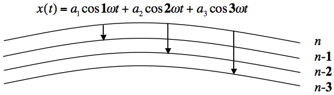
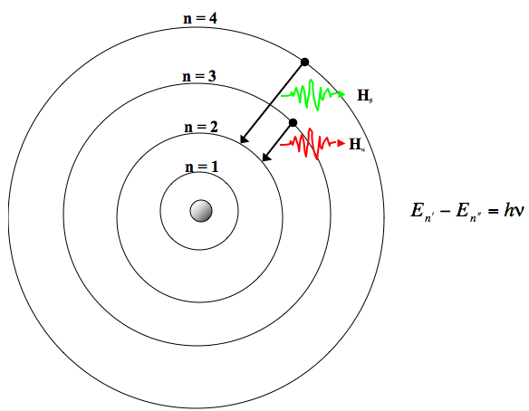
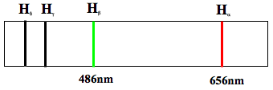

# 玻尔的对应原理 correspondence principle (Alisa Bokulich and Peter Bokulich)

*首次发表于 2010 年 10 月 14 日；2020 年 8 月 13 日实质修订。*

关于玻尔的对应原理，物理学史家马克斯·贾默（Max Jammer）写道：“在物理学史上，很少有一种综合性理论像量子力学得益于玻尔的对应原理那样，如此仰赖于一条原理”（Jammer 1966, p. 118）[^jammer-1966]。对应原理不仅在量子力学的发现中起了枢纽作用，而且是玻尔对量子力学所作哲学解释的基石，与更为人熟知的互补性论题以及哥本哈根诠释密切相关。

尽管玻尔对应原理的重要性大体上没有争议，但关于这条原理应当如何定义，分歧却大得多。重要的是区分玻尔本人对这条原理的理解，与它对更大范围物理学界逐渐具有的含义。然而，即便只限于玻尔的著作，玻尔研究者之间仍存在分歧：在玻尔所发现的古典力学与量子力学之间的若干关系中，究竟哪一条应当被称为对应原理。文献中有三种主要的候选定义。第一是 **频率解释**：按此，对应原理是在大量子数极限下，古典频率的傅里叶分解中某一成分与量子频率之间的统计性渐近一致。第二是 **强度解释**：按此，它是在大量子数极限下，以量子跃迁概率来理解的量子强度，与以古典运动某一成分振幅之平方来理解的古典强度之间的统计性一致。最后是 **选择定则解释**：按此，对应原理即如下陈述：定态之间每一条允许的量子跃迁，都对应于古典运动的一个谐波成分。

对应原理最早于 1913 年在旧量子理论的语境中被表述出来。尽管如此，玻尔主张这条原理在旧量子理论被现代量子力学取代之后仍然幸存。今日物理学文献仍把对应原理当作当前研究的主题来提及，不过其含义可以说与玻尔本人对这条原理的理解有所不同。对应原理的一个版本也在哲学文献中延续下来，在那里它被推广为一条广泛的方法论原理（即广义对应原理），用以约束新科学理论的发展。

## 1 背景与科学语境

尼尔斯·玻尔是丹麦物理学家，生于 1885 年，卒于 1962 年，出生地与逝世地都是哥本哈根。他以量子理论的创立者之一以及关于原子结构的研究最为知名，后者为他赢得了 1922 年的诺贝尔物理学奖。除科学工作之外，他毕生很大一部分精力投入量子力学的哲学解释。他曾与阿尔伯特·爱因斯坦就“量子力学是否是对原子现象的完备描述”展开著名的长期论战（“爱因斯坦—玻尔论战”）；他对量子理论之哲学解释的持久贡献包括哥本哈根诠释、互补性论题与对应原理。

对应原理最初是在旧量子理论的语境中引入的；旧量子理论发展于 1900 年至 1925 年之间。旧量子理论是一种“过渡性”理论，其产生源于人们认识到牛顿力学与古典电动力学不足以描述原子系统。尽管旧量子理论取得了引人注目的经验成功，它仍因基础被许多人视为不一致而受到批评。旧量子理论最终被现代量子力学取代：1925 年维尔纳·海森堡发展了矩阵力学，1926 年埃尔温·薛定谔发展了波动力学。

要理解对应原理的实质，必须先理解旧量子理论的基本框架。尼尔斯·玻尔于 1913 年在一篇题为《论原子与分子的构造》的三部分论文中首次表述了旧量子理论的公设（Bohr 1913）。玻尔采纳了欧内斯特·卢瑟福的原子模型：原子的绝大部分质量集中于一个小的中心核，电子则沿行星式轨道绕核运行。卢瑟福模型面临的关键难题是它不稳定：按古典电动力学，电子作为加速运动的带电体应当辐射能量，从而迅速坍缩入核。玻尔的解决办法是引入马克斯·普朗克的辐射理论。该理论假定：“原子系统发出的能量辐射并不像普通电动力学所假定的那样连续进行；相反，它是以明显分离的发射方式进行的”（Bohr 1913, p. 4; BCW 2, p. 164）。[^note-1]

玻尔通过两条假定或公设来概括其量子理论。按照第一条公设，电子不能沿绕核的任意路径运动；原子系统只能存在于一系列分立的“定态”之一，在定态中电子处于某一允许的稳定周期轨道，并且不辐射。直观上，可以把这些定态设想为一系列围绕原子核的同心圆轨道，电子沿之运动；这些定态用主量子数 $n$ 来标记，最低的允许轨道（“正常”态或基态）标为 $n = 1$，下一个能量更高的定态标为 $n = 2$，依此类推。玻尔假定：当电子处于这些定态之一时，其运动可以用古典力学充分描述；然而当电子从一个定态跃迁到另一个定态时，古典理论便不再适用。玻尔旧量子理论的第二条公设是：当在不同定态 $n'$ 与 $n''$ 之间发生跃迁时，所发射的辐射具有单一频率 $\nu$，由两态能量之差 $(E_{n'} - E_{n''})$ 除以普朗克常数给出。

$$\tag{1} \nu = \frac{E_{n'} - E_{n''}}{h} $$

这一公式通常被称为“玻尔—爱因斯坦频率条件”。第二条公设构成了对古典电动力学的重大突破：按古典电动力学，会发射多种辐射频率，而这些频率仅由辐射源的运动决定。

值得注意的是，尽管现在人们接受所发射的辐射是光子，玻尔本人却出人意料地对光子概念持怀疑态度，直到 1920 年代中期仍如此（Stachel 2009）[^stachel-2009]。玻尔宁愿把被发射或吸收的辐射设想为波，而不是粒子。玻尔在这一时期迟疑于接受光子的存在，似乎源于他的如下忧虑：这种关于光的粒子观念将与熟悉的干涉现象无法调和。例如，玻尔在 1921 年写道：

> 因此，按照这种光量子理论，来自原子的电磁辐射不应作为球面波系统扩散，而应作为一个浓缩的实体沿确定方向传播，在一个非常小的体积内包含能量 $h\nu$。一方面，如果我们坚持不加限制地应用能量守恒与动量守恒概念，那么这种观念似乎是解释光电作用现象的唯一简单可能。另一方面，它似乎无法与光的干涉现象相调和，而干涉现象是我们分析辐射的谐波成分、并确定其中每一成分的频率与偏振状态的唯一手段。（Bohr 1921a 未刊；BCW 3, pp. 412–413）

有趣的是，玻尔最初拒斥光子概念，也与他重视“把辐射分析为其谐波成分”这一点相关——而这对于应用他的对应原理至关重要（见下文）。正如约翰·施塔赫尔所指出的：“正是他对对应原理的依赖，似乎构成了玻尔不信任光子概念、并因此愿意放弃能量—动量守恒以保全古典电动力学辐射图景的主要动机”（Stachel 2009, p. 72）[^stachel-2009]。施塔赫尔主张，部分正是博特—盖格实验与康普顿—西蒙实验的结果，最终使玻尔接受了光子概念。由于这些历史原因，在讨论玻尔早期观点时需要谨慎地引入光子概念；不过，光子概念对于理解对应原理背后的物理学（以及玻尔在 1920 年代早期之后的观点）可以很有帮助，因此下文的阐述仍会用到它。

回到旧量子理论的纲要：玻尔的两条公设尚不足以从所有古典允许的轨道中挑出对应于定态的那些轨道。为了确定定态，还需要引入下述“量子条件”：

$$\tag{2} \oint p_{\theta} d\theta = nh \,. $$

其中积分沿电子轨道的一个周期取，$p_{\theta}$ 为角动量，$\theta$ 为电子轨道平面内的角，$n$ 为量子数。[^note-2] 正如马克斯·贾默所概括的，应用旧量子理论本质上包括三步：“第一，应用古典力学确定系统可能的运动；第二，施加某些量子条件以选出实际或允许的运动；第三，把辐射过程处理为受玻尔频率公式支配的、允许运动之间的跃迁”（Jammer 1966, p. 90）[^jammer-1966]。旧量子理论是古典观念与量子观念的混合：它假定电子在某一特定定态 **之内** 的运动仍可依古典理论描述，但在定态 **之间** 的跃迁（“量子跳跃”）中所发出的辐射则不能。

要理解对应原理的实质，考虑一个把原子简化为电子作简周期运动的一维系统是有帮助的。古典地说，电子的轨迹由 $x(t)$ 给出，它是牛顿运动方程的解，且是周期性的，也就是说它以称为基频的频率 $\omega$ 一遍又一遍地重复其路径。由于运动是周期性的，电子的位置可以用傅里叶级数表示如下：[^note-3]

$$\tag{3} x(t) = C_1\cos(\omega t) + C_2\cos(2\omega t) + C_3\cos(3\omega t) + \cdots\,. $$

和式中的每一项称为一个谐波，第 $\tau$ 个谐波由时间 $t$、振幅 $C_{\tau}$ 与频率 $\omega_{\tau}$ 给出，后者是基频 $\omega$ 的整数倍，即 $\omega_{\tau} = \tau \omega$（这些基频的倍数被称为“泛音”）。按照 **古典** 电动力学，这个原子发出的辐射频率应当正好由运动谐波中的频率给出：$\omega,$ $2\omega,$ $3\omega,$ 等等；因此这一古典系统的光谱应当是一系列分立的、等间距的谱线。

相反，按照玻尔的旧量子理论，辐射并不是电子在其轨道上加速运动的结果，而是电子从一个定态跳到另一个定态的结果；并且它不是把所有谐波“泛音”一起发出，而只发出单一频率 $\nu$，该频率的值由玻尔—爱因斯坦频率条件（方程 1）给出。谱线由大量在不同定态之间跃迁的原子所构成的整体集合建立起来；这些谱线虽然呈现出规则性图案，却并非等间距——除非在大量子数极限下。

按照玻尔的做法，可以用 $\tau$ 标记第 $n'$ 定态与第 $n''$ 定态之差；也就是说，若电子跳到最近的定态，$\tau = 1$；若跳过两个定态，$\tau = 2$；依此类推。尽管按古典定义，$\tau$ 指定古典运动的某一特定谐波成分，但按量子力学定义，$\tau$ 指定某次跳跃中量子数的变化。

## 2 对应原理的定义

当前玻尔研究者中有一项共识：玻尔并不打算让对应原理去指称某种“量子力学在古典极限下应当恢复古典力学预言”的一般要求。尽管如此，这种解释在物理学文献中颇为流行（见第 6 节）。然而，关于玻尔究竟打算用对应原理指称古典力学与量子力学之间的哪一条关系，分歧则大得多。文献中有三种主要竞争者，它们都能在玻尔的著作中找到支持。这三种解释可分别标为：频率解释、强度解释与选择定则解释。

按照 **频率解释**，对应原理被定义如下。在量子数很大的极限下，从态 $n'$ 到 $n''$、量子数差为 $\tau$ 的量子跃迁所发射辐射的（量子）频率 $\nu_{n' \rightarrow n''}$，与第 $n'$ 定态中古典运动第 $\tau$ 个谐波的（古典）频率 $(\omega_{\tau})$ 之间，存在统计性的渐近一致，即

$$\tag{4} \nu_{n' \rightarrow n''} = \omega_{\tau} = \tau \omega, \text{ for large } n, $$

其中 $n' - n'' = \tau$。

请注意，量子频率与古典频率某一成分之间的这一等式，只在 **大量子数** 极限下成立——对低量子数跃迁并不成立。此外，这只是统计性的一致：古典地说，所有频率会一起发出；而量子力学地说，在定态之间的任何一次给定跃迁中，只发出一个具有单一频率的光子。因此，必须考虑原子的统计集合，才能与古典光谱相比较。

按照 **强度解释**，对应原理被定义为：在大量子数极限下，相隔 $\tau$ 的两个定态之间跃迁的概率 $P_{n' \rightarrow n''}$，与古典运动第 $\tau$ 个谐波成分的振幅平方 $C_{\tau}$ 相一致：

$$\tag{5} P_{n' \rightarrow n''} \propto |C_{\tau}(n)|^2 \text{ for large } n. $$

因此，在 $n$ 很大的极限下，电子古典轨道的谐波成分振幅可用来计算谱线的强度。古典地说，辐射强度由其振幅决定；而量子力学地说，一条谱线的强度由在该特定频率上发出多少光子决定。因此，某一量子跃迁越可能发生，发出的光子就越多，强度也就越大。请注意，与频率解释一样，这是一种只在统计意义上、且只在大量子数极限下成立的一致。[^note-4]

按照 **选择定则解释**，玻尔的对应原理最好被理解为如下陈述：** 定态之间每一条允许的量子跃迁，都对应于古典运动的一个谐波成分 **。更确切地说，玻尔的选择定则规定：从定态 $n'$ 到另一定态 $n''$ 的跃迁是允许的，** 当且仅当* 在初始定态中电子的古典运动里存在一个第 $\tau$ 个谐波；如果古典运动中没有第 $\tau$ 个谐波，那么相隔 $\tau$ 的定态之间的跃迁在量子力学上就不被允许。玻尔对应原理的要旨如图 1 所示。

*Figure 1.*

图 1：一个古典周期轨道 $x(t)$ 可以表示为“谐波”的傅里叶和，这些谐波是基频 $\omega$ 的整数倍，代表运动的周期性。按照选择定则解释，对应原理是玻尔的如下洞见：定态之间每一条允许的跃迁，都对应于古典运动的一个谐波成分。（据 Fedak and Prentis 2002 图 3）[^fedak-2002]

玻尔的选择定则可以用下面这个简化例子来说明。[^note-5] 假设牛顿方程 $F = m d^2 x/dt^2$ 的解与量子条件 $\oint pdx = nh$ 给出[^note-6]

$$\tag{6} x(t,n) = n\cos(n^{\frac{1}{2}}t) + n^{\frac{1}{2}}\cos(3n^{\frac{1}{2}}t), $$

这就是电子在允许定态 $n$ 中古典周期运动的傅里叶分解。对这个定态 $n$，基频（即电子运动的周期频率）为 $\omega = n^{\frac{1}{2}}$。请注意，古典运动中只存在第一（$\tau = 1$）与第三（$\tau = 3$）谐波（方程 6）。按照玻尔的选择定则，这意味着只可能发生相隔一个或三个定态的量子跳跃。例如，可以发生从 $n = 100$ 定态到 $n = 99$ 或 $n = 97$ 定态的跃迁；但不可能发生从 $n = 100$ 定态到 $n = 98$ 定态的跃迁，因为古典电子轨道中没有第二谐波。

与频率解释和强度解释不同，选择定则解释不是一种渐近关系——它适用于 **一切** 量子数跃迁，包括小的 $n$。

重要的是要认识到，上述这些对应关系都是由玻尔发现并写下过的；玻尔研究者之间的分歧只在于：玻尔究竟打算把其中哪一条（如果有的话）称为对应原理。一些学者甚至怀疑，玻尔是否曾经有过一个界定明确且始终如一的对应原理定义。这些解释以及其他解释将在下文第 5 节中更详细地展开。

## 3 玻尔关于对应原理的著述（1918–1928）

玻尔关于对应原理的大部分著述收于《尼尔斯·玻尔文集》（此处简称 BCW）第 3 卷，该卷题为《对应原理（1918–1923）》。正如玻尔本人所述（Bohr 1922），对应原理的最初萌芽可见于他 1913 年的讲演《论分子与原子的构造》，尽管“对应原理”这一术语直到 1920 年才出现在他的著作中。在玻尔采用“对应原理”这一说法之前的几年里，他把这一关系描述为古典力学与量子力学之间的类比。例如，他 1918 年的论文《论线光谱的量子理论》被他自己称为“Q.o.L.”。在该文中玻尔写道：“看来有可能通过尽可能紧密地追溯量子理论与普通辐射理论之间的类比，来为那些突出的困难带来一些启发”。（Bohr 1918, p. 4; BCW 3, p. 70）然而在其后来的著作中，玻尔明确拒斥了这种认为对应原理可以被视为类比的看法。他写道：

> 在 Q.o.L［Bohr 1918］中尚未使用这一名称，但该原理的实质在那里被称为量子理论与古典理论之间的形式类比。这类表述可能引起误解，因为事实上——我们后面将会看到——这条对应原理必须被纯粹视为量子理论的一条定律，它丝毫不能缩小各项公设与电动力学理论之间的反差。（Bohr [1923] 1924, fn. p. 22）

玻尔不仅拒斥“对应原理是类比”的看法，而且，他称其为量子理论的 **定律** 这一事实表明：第一，他认为它是一条 **普遍** 原理（不只在有限领域内适用）；第二，它是量子理论本身的一个本质部分，而不是某种从量子理论之外而来的普遍方法论约束。

在 1920 年那篇首次出现“对应”与“对应原理”二词的论文中（Nielsen 1976, p. 21）[^nielsen-1976]，玻尔写道：

> ［尽］管辐射过程无法按普通电动力学理论来描述——按该理论，原子所发辐射的性质与系统中出现的谐波成分直接相关——然而人们发现，定态之间各种可能的跃迁类型与运动的各个谐波成分之间，仍然存在一种影响深远的 **对应**。这种对应的性质使得目前的光谱理论在某种意义上应被视为普通辐射理论的合理推广。（Bohr 1920, pp. 23–24; BCW 3, pp. 245–246）

玻尔在此描述的对应，是从一个定态到另一个定态的允许跃迁与古典运动谐波成分之间的对应。此外，他把这一对应当作“量子理论是古典力学的合理推广”这一看法的根据或辩护（关于后一看法的讨论，见 Bokulich and Bokulich 2005）[^bokulich-2005]。几页之后，在一节题为《对应原理》的文字中，玻尔进而同时描述了频率对应与强度对应：

> 由两种方法确定的频率之间的这种对应必定有更深的意义，我们因此预期它也适用于强度。这等价于如下陈述：当量子数很大时，某一特定跃迁的相对概率与运动中相应谐波成分的振幅以简单方式相联系。这一独特关系暗示了一条 **关于定态之间跃迁之发生的普遍定律**。因此我们将假定：即便量子数很小，两个定态之间发生跃迁的可能性也与系统运动中某一谐波成分的存在相联系。（Bohr 1920, pp. 27–28; BCW 3, pp. 249–250）

以玻尔典型的风格，他并未直截了当地说明：这些对应中的一条、全部还是全都不属于他所谓“对应原理”。

玻尔还主张，对应原理能解释为什么实验中只观察到某些谱线。他写道：

> 上述看法——或可称为对应原理——……为谱线组合原理之应用所涉及的表面反复无常提供了一种直接解释；所谓反复无常，指的是：若不加限制地应用这一［里德伯—里兹组合］原理，本可预期出现大量谱线，而实验中实际观察到的却只是其中一小部分。（Bohr 1921b 未刊；BCW 4, p. 150）

Bokulich（2008，以及 2009［其他网络资源］）主张：以选择定则来解释对应原理，可说明玻尔关于“它解释了谱线的反复无常”这一主张。同一解释也说明了他关于“对应原理是量子理论的一条定律”这一主张。的确，他称为“定律”的那种对应，正是选择定则对应；它对小的量子数也成立，而不只在古典极限下成立。它之所以是 **定律**，因为它是关于允许的量子跃迁的一条普遍限制（即适用于一切 $n$）。要理解它为何是 **量子理论的** 定律（而非古典电动力学的定律），可参玻尔的如下论述：

> ［辐］射跃迁的发生以原子运动中相应振动的存在为条件。至于我们是否有权把所得到的渐近关系视为量子理论关于辐射发生之普遍定律的提示——正如上述对应原理所假定的那样——让我们再次回想：在大量子数的极限区域，问题丝毫不在于量子理论对辐射现象的描述与古典电动力学观念之间的差别逐渐缩小，而只在于统计结果上的渐近一致。（Bohr [1923] 1924, p. 23; BCW 3, p. 480）

在这段话中，玻尔显然把量子力学视为一种普遍理论。尽管在这一极限下结果统计上一致，频率与强度的物理学却仍然不同，而玻尔坚持：严格正确的乃是量子说明——即便在 $n$ 很大即“古典”的极限下亦然。因此，当玻尔发现“可允许的量子跃迁是那些古典运动中有相应谐波的跃迁”时，他所发现的乃是关于量子理论的某种东西。

在 1922 年于哥廷根所作的关于原子理论的讲演中，玻尔再次强调对应原理即便对低量子数跃迁也成立。这一点尤其可见于他对氢光谱可见区巴尔末系那条著名的红、绿谱线的讨论。红色谱线（在约 656 nm 波长处确实呈红色）通常标为 $H_{\alpha}$，是电子从 $n = 3$ 跳到 $n = 2$ 定态时发出辐射的结果。绿色谱线（标为 $H_{\beta}$，波长约 486 nm）则是氢原子中的电子从 $n = 4$ 跳到 $n = 2$ 定态的结果。

*Figure 2.*

 

图 2：氢原子可见区巴尔末系的红、绿谱线

关于这些低量子数跃迁，玻尔写道：

> 我们可以把 $H_{\beta}$ 视为 $H_{\alpha}$ 的八度，因为 $H_{\beta}$ 对应于量子数变化 2 的跳跃，而 $H_{\alpha}$ 对应于变化 1 的量子跳跃。诚然，$H_{\beta}$ 的频率并非 $H_{\alpha}$ 的两倍，但它对应于八度。我们把这一关系称为“对应原理”。每一次跃迁都对应于机械运动的一个谐波成分。（Bohr 1922 未刊讲演；BCW4, p. 348）

换言之，尽管“频率对应”对这些低量子数并不成立（这些谱线的强度也不能直接经由“强度对应”从古典振幅算出），但玻尔在此所谓更一般的 **对应原理** 仍然成立；具体说，这些 $\tau = 1$ 与 $\tau = 2$ 的跃迁之所以被允许，是因为在初始定态中电子古典轨道的傅里叶分解里存在第一与第二谐波成分。这类段落对“把对应原理解释为古典极限下成立的某种渐近关系”的论者构成了挑战。

玻尔关于对应原理的陈述有惊人的连续性。1923 年，人们再次看到玻尔强调：定态之间允许的或可能的跃迁，与古典运动中存在的谐波成分相联系。

> ［在］一多重周期系统的两个态之间（例如量子数为 $n_1', \ldots, n_u'$ 与 $n_1'', \ldots, n_u''$ 的两态之间）发生伴随辐射的跃迁的可能性，以［古典电子运动傅里叶级数展开］所给表达式中某些谐波成分的存在为条件。这些谐波成分的频率 $\tau_1\omega_1 + \ldots + \tau_u\omega_u$ 由下式给出
>
> $$ \tau_1 = n_1' - n_1'' \quad\ldots\quad \tau_u = n_u' - n_u''. $$
>
> 因此我们称这些为运动中的“对应”谐波成分，并把上述陈述的实质称为“对应原理”。（Bohr [1923] 1924, p. 22; BCW 3, p. 479）

1925 年，维尔纳·海森堡发表了他那篇著名的“Umdeutung”论文，引入矩阵力学（Heisenberg 1925）。这成为现代量子力学的开端，它取代了旧量子理论。在 1925 年 12 月发表于《自然》的增补文章中，玻尔描述了他所理解的新量子力学与其对应原理的关系。他先陈述对应原理：

> 光谱与运动之间渐近一致的证明，促成了“对应原理”的表述：按照它，每一个伴随辐射发射的跃迁过程之所以可能，都以原子运动中相应谐波成分的存在为条件。相应谐波成分的频率不仅渐近地等于在定态能量趋于重合的极限下由频率条件所得的值；而且机械振动成分的振幅在这一极限下还为跃迁过程的概率提供了渐近度量，而可观察谱线的强度正取决于这些概率。（Bohr 1925, pp. 848–849; BCW 5, pp. 276–277）

在这段引文中，玻尔提到了全部三种对应关系：选择定则对应、渐近频率对应与渐近强度对应。随后玻尔转向讨论海森堡的矩阵力学论文，主张

> 它［新的矩阵力学］以量的流形来运算，这些流形取代了运动的谐波振动成分，并按照对应原理象征定态之间跃迁的可能性……简言之，量子力学的整套装置可以被视为对应原理所体现的那些倾向的精确表述。（Bohr 1925, p. 852; BCW 5, p. 280）

玻尔在这段话中似乎是在说：新量子力学按照他的选择定则，象征了允许的跃迁。

即便在现代量子力学问世之后，玻尔仍继续讨论对应原理。例如，在他 1928 年的科莫讲演中，他写道：

> 把量子理论视为古典理论之合理推广的这一目标，促成了所谓对应原理的表述。把这一原理用于解释光谱学结果，依据的是对古典电动力学的象征性应用：其中各个跃迁过程分别与按普通力学所预期的原子粒子运动中的某一谐波相联系。（Bohr 1928, p. 584; BCW 6, p. 152）

请注意，玻尔在此说的是对古典电动力学的“象征性”应用——例如，定态中的电子轨迹不可作字面的解释，甚至不可作“形式上”的解释。玻尔对对应原理中所用电子轨迹之地位的这一理解转变，尤其为奥利维耶·达里戈所强调（Darrigol 1997, p. 558）[^darrigol-1997]。

然而，正如 1920 年他首次引入“对应原理”一词时那样，1928 年的玻尔（在旧量子理论已被现代量子力学取代之后）仍把对应原理解释为跃迁过程与粒子古典运动中谐波之间的联系。此外，正如 1920 年那样，他明确把对应原理与“量子力学是古典力学的合理推广”这一看法联系起来。对应原理由此在古典力学（与电动力学）、旧量子理论与现代量子力学之间提供了一条概念纽带。这一“合理推广”论题又成为玻尔互补性观点、乃至其量子力学哥本哈根诠释的基础。因此，对应原理不仅在发现现代量子力学时具有技术上的重要性（正如贾默 1966, p. 118 所强调的），而且正是玻尔哲学的根本基础。

## 4 早期反响

玻尔对应原理的早期回应者大致可分为三类：一类误解该原理（如玻恩与罗森菲尔德）；一类接受并发展它（如克拉默斯与范弗莱克）；还有一类似乎理解它、却仍不信任它（如索末菲、泡利与海森堡）。

玻尔的同时代人中有多少人真正理解他所谓对应原理，并不清楚。例如，即便是玻尔最亲近的学生与合作者之一莱昂·罗森菲尔德，也回忆起玻尔曾因他未能正确理解该原理的实质而恼怒（Rosenfeld [1973] 1979, p. 690）。鉴于玻尔文风的晦涩，这也许并不全然令人意外。玻尔本人相当清楚，他密集的写作风格常常导致他人误解。在给阿诺德·索末菲的一封信中，玻尔慨叹道：

> 近几年来，我常在科学上感到十分孤独，因为我觉得，我尽最大努力系统地发展量子理论原理的工作所得到的理解甚少……我很清楚，事情迄今澄清得多么少，也清楚我在以易于接近的形式表达思想方面多么无能为力。（Bohr to Sommerfeld, April 30, 1922; BCW 3, p. 39）

的确，人们很快就在物理学文献中看到关于对应原理的形形色色的解释——这种多样性延续至今。因此，重要的是把玻尔本人关于对应原理的观点，与对应原理对更广泛物理学界逐渐具有的含义区分开来（关于这一时期对应原理如何推动研究与讨论的详细叙述，见 Jähnert 2019）[^jähnert-2019]。例如，亨德里克·克拉默斯与约翰·范弗莱克都把“对应原理”一词用于并扩展到范围广泛的对应式论证，而这些论证在量子力学的发展中很重要（例如见 Duncan and Janssen 2007; 2019）[^duncan-2007]。

在那些似乎正确理解了玻尔对应原理核心的人当中，真正接受它的人就更少了。的确，玻尔的许多同时代人都对这条原理心存疑虑，尽管他们乐于在其他方法失败时机会主义地利用它来获得具体结果。属于第三类的，是对应原理三位最重要的同时代批评者：阿诺德·索末菲、沃尔夫冈·泡利与维尔纳·海森堡。[^note-7]

### 4.1 索末菲

玻尔对应原理最早、也最强有力的批评者之一是阿诺德·索末菲（1868–1951）。正如达里戈详尽叙述的，索末菲从未对玻尔的对应原理感到自在，只是勉强承认它的丰产性（Darrigol 1992, pp. 138–145）[^darrigol-1992]。索末菲宁愿把量子理论视为一套自足的形式规则，并希望以“一种极其严格的演绎方式推导选择定则，令人想起数值计算那种无可置疑的逻辑”（Sommerfeld [1919] 1923, pp. 265–266）。在其《原子结构与谱线》（*Atombau und Spektrallinien*）第一版中，索末菲轻蔑地把玻尔的对应原理称为一根“魔杖”：

> 玻尔在其 **对应原理** 中发现了一根魔杖（他自己称之为形式原理），使我们能够立即在量子理论中利用古典波理论的结果。（Sommerfeld [1919] 1923, p. 275）[^note-8]

在《原子结构》第二版中，索末菲缓和了对对应原理的批评，指出它极具丰产性。在 1920 年 11 月写给玻尔的一封信中，索末菲写道：

> 在我书的附录中，你可以看到我费了些力气，比第一版更好地展示了你对应原理的价值……然而我必须承认，你这条原理的起源对量子理论而言是异质的，这仍令我苦恼，尽管我充分认识到，通过它揭示了量子理论与古典电动力学之间一项极其重要的联系。（Sommerfeld to Bohr, 11 November 1920; BCW 3, p. 690）

Suman Seth（2008）主张，索末菲对对应原理的不满，与其说源于达里戈所设想的那种对形式规则的执着，不如说更多源于两方面。其一是他对类比思维的一般不信任；其二是他认为量子概念与古典概念的混合不正当。例如，我们在索末菲 1924 年关于玻尔原子模型的文章中看到：

> 对应原理的魔力已通过量子数选择定则、在系列光谱与带状光谱中普遍地证明了自身……然而，由于其混合了量子理论与古典观点，我仍不能认为它最终令人满意。（Sommerfeld 1924, p. 1048; quoted also in Seth 2008, p. 345）[^sommerfeld-1924][^seth-2008]

索末菲对对应原理的批评态度，后来证明对沃尔夫冈·泡利与维尔纳·海森堡都有影响，二人都是他的博士生。

### 4.2 泡利

在领取诺贝尔奖的讲演中（该奖于 1945 年因其发现不相容原理而授予），沃尔夫冈·泡利描述了玻尔与索末菲在方法论上的根本差异：

> 当时，处理与量子作用相关的困难问题有两条进路。其一是努力为新观念带来抽象秩序，寻找一把把古典力学与电动力学翻译成量子语言的钥匙，而这种量子语言将成为二者的逻辑推广。这就是玻尔“对应原理”所采取的方向。然而索末菲宁愿——鉴于阻碍运动学模型概念之使用的那些困难——以尽可能独立于模型的方式，用整数直接解释光谱规律……（Pauli 1946, p. 27）[^pauli-1946]

尽管事后泡利声称两种方法论都影响过他，但在 1924 与 1925 年的通信中，人们看到泡利几乎完全站在索末菲式进路一边，同时贬抑对应原理以及更一般的基于模型的推理。泡利对玻尔对应原理的批评集中于两个问题。第一，泡利反对使用哪怕是“形式的”电子轨道概念，而这对应用对应原理至关重要（例如 Pauli to Bohr, February 21st 1924）。第二，泡利怀疑对应原理能否像玻尔所希望的那样解释电子壳层的闭合。1924 年泡利写信给玻尔说：

> 我已多次对你说过，我认为对应原理实际上与原子中群组的闭合问题毫无关系……这里所问的某些定态（**而非** 跃迁）之排除，在原理上更类似于氢原子中 $m = 0$ 或 $k = 0$ 态之排除，而不是例如选择定则 $\Delta k = \pm 1$。你仍坚持你……在此情形中对对应原理的应用吗？……此外，根本没有必要谈论谐波相互作用。（Pauli to Bohr, December 12th, 1924; quoted in Serwer 1977, p. 235）[^serwer-1977]

从字里行间看，泡利似乎把玻尔的对应原理理解为一条关于定态之间跃迁与古典运动中谐波相联系的选择定则。他所反对的并不是这条对应原理，而是试图把它扩展到解释原子中电子群组的闭合——泡利在别处把这种扩展称为“对应原理帝国主义”（*Imperialismus des Korrespondenzprinzips*）（Pauli to Heisenberg, February 28th, 1925; quoted in Serwer 1977, p. 233）[^serwer-1977]。电子壳层的闭合最终由泡利的不相容原理解释，尽管起初泡利对这种解释并不满意，因为他的排除规则无法得到更普遍的根据与辩护。当玻尔提出对应原理或许能为不相容原理提供这样的根据时，泡利回答说：

> 然而我个人并不相信对应原理会导致该规则的根据……对于需要明确定义的电子轨道与机械模型这类观念作拐杖的弱者而言，这条规则可以这样来奠定：‘如果不止一个电子在强场中具有相同量子数，它们就会具有相同的轨道，因而会相撞……’ 通过指出与核的碰撞来为氢原子中上述情形的排除作辩护，从来不太令我满意。如果我们能 **直接** 基于一种更普遍的量子力学（一种偏离古典力学的量子力学）来理解它，那会令人满意得多。（Pauli to Bohr December 31st, 1924; quoted in Heilbron 1983, p. 306 and Serwer 1977, p. 236）[^heilbron-1983][^serwer-1977]

在上述引文中，我们看到泡利站在索末菲一边：既不信任对应原理与一般意义上的基于模型的推理，也偏好依据新量子力学作“直接”解释。

### 4.3 海森堡

正如贾格迪什·梅赫拉与赫尔穆特·雷兴贝格（1982）所叙述的，当维尔纳·海森堡 1924 年首次抵达哥本哈根与玻尔共事时，他热情地接受了对应原理。他还承担起向更广泛物理学界捍卫这条原理的任务。这一点在 1924 年 9 月 30 日海森堡写给泡利的信中尤为清楚：

> 我与玻尔再次仔细考察了这个问题，我们得出的结论是：情况并非如索末菲所说，求和规则无法借助对应原理来理解；相反，它们是对应原理的 **必然推论**……我们对此解释非常高兴，因为现在针对对应原理的攻击已被完全驳倒……［由］于近来对应原理备受责难，发表它［你那些证实对应原理的结果］会是好事：*ad majorem correspondentiae principii gloriam*［为了对应原理更大的荣耀］。（Heisenberg to Pauli, September 30th, 1924; quoted in Mehra and Rechenberg pp. 156–157）

然而到 1925 年，海森堡开始日益与对应原理保持距离。Daniel Serwer 把海森堡观点的这一转变归因于泡利的影响：

> ［1］925 年 3 月初，泡利来到哥本哈根。这次访问对海森堡至关重要。在泡利的压力下，他开始在许多问题上改变观点……［包括］对应原理。……但在泡利来访之前，海森堡一直确信……对应原理会带来成果。（Serwer 1977, p. 222）[^serwer-1977]

尽管海森堡在发展矩阵力学时严重依赖对应原理，他不再公开为它辩护。[^note-9] 的确，正如 Mara Beller 所指出的，“海森堡［在 1925 年矩阵力学论文中］完全未引用玻尔的工作，尽管该文从根本上建立在玻尔的对应原理之上……相反，海森堡［不准确地］把自己的工作呈现为从消除不可观察量的实证主义原则中流出”（Beller 1999, p. 140）[^beller-1999]。[^note-10] 海森堡在其《量子论的物理原理》一书中表达了对对应原理日益增长的双重态度：

> 诚然，基于对应原理的论证之巧妙组合，可以使关于物质的量子理论连同古典辐射理论，为跃迁概率提供定量数值……然而，这种对辐射问题的表述远不令人满意，且容易导致错误结论。（Heisenberg 1930, p. 82）[^heisenberg-1930]

尽管海森堡愿意承认这条原理有限的效用，他并不像玻尔那样把它视为量子理论的根本原理。相反，海森堡主张：“必须强调，这［种对应］是一个纯粹形式的结果；它并不从量子理论的任何物理原理中推出”（Heisenberg 1930, p. 83）[^heisenberg-1930]。换言之，这种对应应被解释为一个纯粹数学的结果，而不是揭示了量子理论与古典理论之间的任何深刻联系，当然也不是量子理论本身的一条原理。对海森堡而言，量子力学是一门封闭理论［*Abgeschlossene Theorie*］，一个自身完备的公理系统，绝不以任何方式依赖古典力学。[^note-11]

## 5 历史学与哲学文献中的解释

可以说，任何对对应原理的解释都面临以下四项挑战：第一，确定玻尔打算用对应原理指称古典力学与量子力学之间各种类比或关系中的哪一项（或哪几项的组合）；第二，确定对应原理的适用范围（即它只适用于大量子数还是适用于一切量子数）；第三，解释为何玻尔认为对应原理应被视为量子理论的一条 **定律**；最后，解释为何玻尔认为对应原理在现代（矩阵）量子力学中已被形式化、因而得到保存。

关于玻尔对应原理最有影响的讨论之一见于马克斯·贾默 1966 年的著作《量子力学的概念发展》。贾默把对应原理视为电子运动学与所发辐射性质之间的一种关系。与许多对应原理的解释者一样，他主要聚焦频率关系。他指出，玻尔还发现了谱线强度与古典谐波成分振幅之间的渐近对应，以及所发辐射的偏振与古典运动性质之间的对应。尽管贾默提到这些其他对应，他似乎把频率对应当作首要的对应原理。关于这种对应作为原理的地位，贾默写道：

> 因此在极限下，量子论频率 $\nu_{qu}$ 与古典力学频率 $\nu_{cl}$ 相重合。玻尔要求这种对应对中等与小的量子数也近似成立，从而把在极限下可以形式上视为一条定理的东西，推广并修改为一条原理。（Jammer 1966, p. 111）[^jammer-1966]

按照贾默，被解释为频率关系的对应原理，凭命令适用于一切量子数，因而获得“原理”的地位，尽管它是一种“近似的”关系，只在大量子数时才精确。

贾默对玻尔“对应原理应被视为量子理论的一条定律”这一主张颇为不屑。他写道：

> 因为诉诸古典物理学来建立量子理论的预言，换言之，构建一个其确证依赖于与该理论实质相冲突的前提的理论，从逻辑观点看当然是严重的不一致。玻尔充分意识到这一困难，曾反复试图表明“对应原理必须被纯粹视为量子理论的一条定律”。（Jammer 1966, p. 116）[^jammer-1966]

在贾默看来，玻尔关于对应原理是定律的主张，不过是在掩盖旧量子理论不一致的基础。与玻尔“量子理论是古典力学的合理推广”这一主张相反。贾默把玻尔解释为认为量子力学与古典力学不可调和，因而把对应原理仅解释为“具有启发价值的形式类比”。在讨论对应原理的结尾，贾默总结道：“他［玻尔］从 1920 到 1961 年间关于对应原理之本质的众多且往往彼此冲突的陈述，使人难以、若非不可能，把一种清晰不变的对该原理的构想归给他”（Jammer 1966, p. 117）[^jammer-1966]。

也许正因如此，贾格迪什·梅赫拉与赫尔穆特·雷兴贝格（1982）在其关于量子理论发展的综合史著中，并未具体承诺哪一条对应关系应被称为对应原理。与贾默一样，他们难以理解玻尔为何认为对应原理适用于小的量子数、以及为何它应被视为量子理论的一条定律。他们写道：“把类比的‘某种方式’扩展到小的量子数，代表了一种极其大胆的假定……［玻尔］确信，他那些在大量子数极限下成立的频率与强度关系，最终也许能在涉及低量子数时也得到辩护”（Mehra and Rechenberg 1982, p. 250）[^mehra-1982]。尽管他们对对应原理的讨论在技术上相当细致，却既未讨论玻尔关于它应作为定律的主张，也未讨论对应原理已在新量子力学中获得形式化的主张。

奥利维耶·达里戈在其出色而可读性极强的量子理论史《从 $c$ 数到 $q$ 数》中，捍卫了对玻尔对应原理的另一种解释。他不把对应原理视为关于量子频率与古典频率的陈述，而把它解释为前文所谓 **强度对应**。按此，相隔 $\tau$ 的两个定态之间的量子跃迁概率，正比于第 $\tau$ 个谐波振动的古典振幅之模平方。这一振幅在古典意义上正是强度的量度（见方程 5）。

达里戈写道：

> 玻尔假定，即便对中等激发的态，某一给定量子跳跃的概率也近似地由初始定态中运动“对应”谐波成分的强度给出。这就是玻尔所谓的“对应原理”。（Darrigol 1997, p. 550; see also Darrigol 1992, p. 126）[^darrigol-1992][^darrigol-1997]

严格说来，这种强度对应只在大量子数极限下精确，不能扩展到小的量子数。唯一的例外是：当古典振幅为零时，量子跃迁概率也为零（这是前文所谓 **玻尔的选择定则** 的一个特例），而这一点对一切量子数都成立。

与某些对应原理的解释者不同，达里戈确实相信，可以依据强度对应就玻尔的对应原理给出融贯而合理的说明。他主张，玻尔称其为 **量子理论的定律** 是有道理的，因为“它确实是两个量子理论概念之间的关系：量子跳跃的概率与原子运动”（Darrigol 1997, p. 553）[^darrigol-1997]。此外，达里戈有力地论证：海森堡在 1925 年论文中把这一对应直接纳入矩阵力学，从而印证了玻尔的主张——新量子力学可被视为“对应原理所体现的那些倾向的精确表述”（Bohr 1925, p. 852; BCW 5, p. 280）。

尽管有这种连续性，达里戈仍主张玻尔对对应原理的理解发生了根本的、尽管是隐含的转变：

> 最初，“对应”所应用的“运动”，是定态中的运动，由沿轨道运行的电子形式地描述。最终，这种运动与定态的描述毫无关系，它纯粹是“象征性的”。（Darrigol 1997, p. 558）[^darrigol-1997]

达里戈所谓“形式地”，是指：在原子中电子运动的描述里，时空关系与动力学关系被保留下来，尽管人们承认实际上不可能观察这种运动。一旦它成为“象征性”关系，时空描述便完全丧失了。

汉斯·拉德也主张，玻尔对对应原理的理解在其生涯中不断演变。拉德（1991）区分了三个不同阶段。在第一阶段（约 1913 至 1915 年），对应原理仅仅是“数值对应”，即关涉古典力学（与电动力学）与旧量子理论中某些量的数值一致。在第二阶段（1916 至 1922 年），对应原理不只是数值一致，还涉及概念上的连续性：“据称，支配电子沿轨道运动的同一批基本概念 $\omega_{n,\tau}$ 与 $C_{n,\tau}$，以及决定跃迁概率的同一函数 $f$，构成两类理论的共同基础”（Radder 1991, p. 206）[^radder-1991]。在第三阶段（1923 年至 1925 年新矩阵（量子）力学引入），概念连续性被放弃，转而采取“形式的”对应。拉德在把对应原理描述为“形式的”时，所指与达里戈不同。他解释说：

> 如今，与机械轨道模型相联的概念对应，作为原子理论的基础遭到拒斥，轨道模型暂时被所谓“虚拟场模型”取代……［这］些词项之间的关系是 **形式的**（而非概念的）**对应**，表达某些数学同一或替换关系的存在。（Radder 1991, p. 207）[^radder-1991]

拉德的主要关切，是把玻尔对应原理的各种化身与科学哲学文献中更一般的对应与启发法论证联系起来（见下文第 7 节）。

晚近关于玻尔对应原理的其他解释，还包括罗伯特·巴特曼的解释：按此，“CP 是一条陈述，其要旨是：第二公设 $[h\nu = E' - E'']$ 所适用的辐射过程，与原子中带电粒子（电子）的机械振动或周期运动‘相关’或‘对应’”（Batterman 1991, p. 203）[^batterman-1991]。巴特曼正确地指出，对应原理并不是“量子力学必须把古典力学作为极限情形包含在内”这一主张；他并论证，古典频率与量子频率的渐近一致（频率解释）不是对应原理，而是被对应原理 **辩护并解释** 的东西。

类似地，Scott Tanona（2004）拒斥“玻尔的对应原理是关于量子理论与古典理论渐近一致”的看法。他反而主张，玻尔的对应原理主要应被理解为光谱（辐射）与轨道运动之间的联系。更广泛地说，Tanona 主张，对应原理不宜理解为理论建构的启发工具，而应理解为一种认识论工具。其“在玻尔经验进路中的主要目的，是通过把光谱的古典属性与原子属性联系起来，弥合经验现象与未知原子结构之间的认识论鸿沟……”（Tanona 2004, p. 683）[^tanona-2004]。

更晚近，Alisa Bokulich（2008，以及 2009［其他网络资源］）主张，玻尔的对应原理应依据她所谓 **玻尔的选择定则** 来理解。该选择定则规定：“从定态 $n'$ 到另一定态 $n''$ 的跃迁是允许的，**当且仅当** 在定态中电子的古典运动里存在一个第 $\tau$ 个谐波；如果古典运动中没有第 $\tau$ 个谐波，那么相隔 $\tau$ 的定态之间的跃迁在量子力学上就不被允许”（Bokulich 2008, p. 85）[^bokulich-2008]。因此，在这种对玻尔的解读中，对应原理被定义为如下陈述：定态之间每一条允许的量子跃迁，都对应于古典运动的一个谐波成分。她主张，贾默与达里戈分别强调的频率与强度渐近一致，是对应原理的应用或 **推论**，而不是对应原理本身。此外，她主张，选择定则解释最能说明玻尔的如下主张：对应原理适用于小的 $n$；它是量子理论的一条定律；它已在矩阵力学中被形式化并得到保存。

## 6 当前物理学文献中的解释

在当前的物理学文献中，人们通常会看到一种对玻尔对应原理颇为不同的理解。甚至早在马克斯·玻恩那部关于新量子理论的经典教材中——该书初版于 1933 年[^note-12]——人们就看到对应原理被定义如下：

> 主导观念（玻尔的 **对应原理**，1923）大致可以这样表述。以经验检验，古典物理学的定律在一切运动过程中都极为出色地证明了自己……因此必须把如下命题作为无条件必要的公设确定下来：新力学……在所有这些问题上都必须达到与古典力学相同的结果。换言之，必须要求：对于大质量与大规模轨道的极限情形，新力学过渡为古典力学。（Born [1933] 1957, p. 103）

玻恩对玻尔对应原理的重新解读有两条脉络，它们在物理学文献中已变得相当常见。其一，把对应原理视为一项非常一般的要求：量子力学应当能够恢复古典力学的经验成功。其二，一项更具体的要求：在质量大、轨道尺度大的极限下恢复古典力学的预言——后一极限通常表述为 $n \rightarrow \infty$。

在大卫·玻姆那部关于标准量子力学的经典教材中，人们同样把对应原理解释为两种理论之间的一般关系。玻姆写道：“玻尔首先给出的……对应原理指出，量子物理学的定律必须被如此选取，以致在古典极限下（其中涉及许多量子），量子定律作为平均结果导致古典方程”（Bohm 1951, p. 31）[^bohm-1951]。

在其 1984 年发表于《今日物理》的文章《对应原理重访》中，Richard Liboff 主张，玻尔的对应原理并不是“从量子力学恢复古典力学”这一一般主张。它毋宁是如下更受限的主张：“周期系统的量子频谱在 $n$ 很大的极限下趋近古典频谱”（Liboff 1984, p. 52）[^liboff-1984]。Liboff 进而指出，甚至这种受限形式的对应原理，对诸如箱中粒子与刚性转子之类的系统也不成立。他指出：“在这两种情形中，$h \rightarrow 0$ 的极限导致频率对应，而 $n \rightarrow \infty$ 的极限则不然”（Liboff 1984, p. 52）[^liboff-1984]。

继 Liboff 之后，Ghazi Hassoun 与 Donald Kobe（1989）主张，要获得量子力学本征值有意义的古典极限，必须“同时使用［对应原理的］两种表述，其意义是普朗克常数趋于零、而相应量子数趋于无穷……并满足约束 $nh = J$，其中 $J$ 是相应的古典作用量”（Hassoun and Kobe 1989, p. 658）[^hassoun-1989]。在这一解读中，玻尔的对应原理被简单地理解为极限 $n \rightarrow \infty$。尽管他们把这一极限称为“玻尔的对应原理”，他们指出，玻尔之所以能够获得正确的古典轨道频率，恰恰“是因为他并未取量子数趋于无穷时的数学极限。相反，玻尔认为对大量子数而言，量子结果非常接近古典结果。于是量子数 $n$ 可以说是 $n \gg 1$，但并非无穷”（Hassoun and Kobe 1989, p. 661）[^hassoun-1989]。他们结论说，对应原理“常被认为不精确，因为玻尔使用的是大而并非无穷的量子数。然而，当玻尔表述与普朗克表述被综合起来时（如本文所示），对应原理便具有精确的数学形式”（Hassoun and Kobe 1989, p. 661）[^hassoun-1989]。在这一解读中，人们宽泛地把对应原理理解为试图给古典极限一个数学上精确的表述。

当代物理学界对玻尔对应原理（以各种不同方式理解）的兴趣，很大一部分在于特定类别的物理系统对该原理的表面违反。例如，约瑟夫·福特与乔治·曼蒂卡在其文章《量子力学服从对应原理吗？它完备吗？》中，把对应原理定义为要求“任何两个在其有效域上有重叠的有效物理理论，都必须在相关精度上对物理观察给出相同预言”（Ford and Mantica 1992, p. 1087）[^ford-1992]。他们所关心的是量子力学能否解释混沌古典系统的行为。类似地，Wojciech Zurek 把对应原理定义为要求“量子期望值与古典期望值”之间的一致（Habib et al. 1998）[^habib-1998]，并主张若无退相干现象，对应原理便遭违反。

尽管当代物理学文献对对应原理的理解大体与马克斯·玻恩的诠释（见上）一致，它却并非玻尔本人所谓对应原理的意思。尽管玻尔同意量子力学应当能够恢复古典力学那些经经验确证的预言，他明确拒斥了对对应原理的这一解读。的确，莱昂·罗森菲尔德叙述了玻尔对其原理持续遭到误解的沮丧。当罗森菲尔德随口向玻尔提出，对应原理讲的是量子预言与古典预言的渐近一致时，玻尔激烈抗议并回答说：“这不是对应论证。要求量子理论在低频模式下过渡到古典描述，根本不是什么原理。那是理论的一项显然要求”（Rosenfeld 1973, p. 690）。

## 7 广义对应原理

最后，重要的是把玻尔的对应原理与某些科学哲学家所谓“广义对应原理”（或称“一般对应原理”）区分开来。

在其经典论文《对应、不变性与启发法：为保守归纳辩护》中，Heinz Post 如下定义这条原理：

> 最重要的启发法限制是 **一般对应原理**。粗略地说，它要求：任何可接受的新理论 $L$ 都应在 $S$ 已被检验充分确证的那些条件下“退化”为它，从而说明其前驱理论 $S$ 的成功。（Post 1971, p. 228）[^post-1971]

在这里，广义对应原理既是对新理论发展的一项约束，也是关于后继理论如何与其前驱相关联的一种说明。在物理学中，Post 所谓“退化”通常落实为某个参数的极限：后继理论的方程作为前驱理论方程的极限而得到恢复。关于量子—古典关系这一具体情形，Post 主张一般对应原理并不成立：

> 矛盾的是，我们所能找到的、针对一般对应原理的唯一反例，恰恰是量子力学与古典力学关系这一范例。与某些教科书可能给人的印象相反，把量子力学还原为古典力学是不可能的……这种未能建立量子力学与古典物理学之间的一般对应（在 $\Delta P\Delta Q \gg h$ 的极限下）在我们看来应被视为量子力学……在其声称具有 $L$ 理论地位方面的缺陷，而不是一般对应原理的破产。（Post 1971, pp. 233–234）[^post-1971][^note-13]

尽管 Post 的广义对应原理与物理学家对玻尔对应原理的构想有某种相似，它与玻尔本人的理解却相当不同。的确，按照 Post，广义对应原理甚至对玻尔所论的那一对具体理论也不成立。

与 Post 相反，拉德（1991）主张，广义对应原理确实适用于量子—古典关系这一情形（p. 215），而玻尔的对应原理（他主要把它解释为一种启发工具）可被视为广义对应原理的一个实例（p. 208）。

## 脚注

[^note-1]: 全文所谓“BCW”均指《尼尔斯·玻尔文集》，玻尔的大部分论文都可方便地在其中找到；其后所附数字为相应卷号。

[^note-2]: 这一表述量子条件的常见方式并未出现在 Bohr（1913）中。关于玻尔在旧量子理论上工作的出色历史综述（包括对玻尔量子条件的讨论），见 Darrigol（1992）第五、六章。

[^note-3]: 回想一下，傅里叶级数是用正弦成分（例如正弦与余弦）的加权和来表示函数 $F(x)$ 的一种方式。

[^note-4]: 关于这种 **统计性** 渐近一致，玻尔指出：“因此，就频率而言我们看到，在 $n$ 很大的极限下，普通辐射理论与基于［量子公设］的光谱理论之间存在紧密关系。然而可以注意到，按前一理论，对应于不同 $\tau$ 值的不同频率 $\tau \omega$ 的辐射是 **同时** 被发射或吸收的；而按现在的理论，这些频率将……与完全不同的过程相联系……对应于系统从某一给定态到不同邻近定态的跃迁”（Bohr 1918, p. 15; BCW 3, p. 81；强调为引者所加）。正如达里戈补充的：“考虑到这一区别，**单个** 原子所发辐射的光谱与相应古典系统所发光谱之间，即便渐近地，也不可能存在一致，因为处于某一给定态的单个原子只能发 **一条** 谱线。但按照爱因斯坦对辐射的概率式处理的精神，人们仍可把这类原子之统计集合的光谱与古典光谱相比较”（Darrigol 1992, p. 126；强调为原文所有）[^darrigol-1992]。

[^note-5]: 取自 Fedak and Prentis（2002, p. 337）。尽管 Fedak 与 Prentis 并不关心“玻尔所谓‘对应原理’何所指”这一历史问题，他们对对应原理背后物理学的讲述在教学上很有用。

[^note-6]: 把牛顿方程解 $x(t)$ 的傅里叶级数表示代入量子条件，可得到解 $x(t,n)$ 的如下“量子化”傅里叶级数表示：

$$ x(t,n) = \sum_{k=1}^{\infty} C_k(n)\cos(k\omega(n)t) $$

[^note-7]: 对玻尔对应原理一切重要反响的完整考察超出了本百科词条的范围。为节省篇幅，我仅聚焦这三位重要评论者。

[^note-8]: 此处及前引索末菲文字均见 Darrigol（1992, p. 140）。

[^note-9]: 关于海森堡在构建矩阵力学时如何使用对应原理，例如见 Bokulich 2008, pp. 90–93。

[^note-10]: 尽管 Beller 在此的核心论证之一是：还原到可观察量事实上 **并未** 在海森堡发现矩阵力学中起作用，这一点在她这段特定引文中并未清楚呈现；因此我在引用中加入“［不准确地］”，以反映她在前后文中所表达的意思。关于“还原到可观察量在海森堡的发现中未起作用”的进一步论证，见 Bokulich 2008, pp. 90–92。

[^note-11]: 关于海森堡的封闭理论，例如见 Bokulich（2004; 2006）。

[^note-12]: Rynasiewicz（2015）认定 Kramers（1924）是最早把对应原理描述为“量子理论应在大量子数领域与古典说明相匹配”这一约束的出版物。

[^note-13]: 主张一般对应原理对量子力学与古典力学不成立的主要动机之一，是测量问题（见“量子理论中的测量”词条）。

## 参考文献

**以下文献从原文照录，不作翻译；中国文献条目（古今）一律译为中文。**

### Works by Bohr

### Other Primary Literature

### Secondary Literature

[^born-1924]: Born, M., 1924, “Über Quantenmechanik,” *Zeitschrift für Physik*, 26: 379–395.
[^born-1927]: –––, 1927 [1925], *The Mechanics of the Atom*, London: Bell; translation of *Vorlesungen Über Atommechanik*, Berlin: Springer.
[^born-1957]: –––, 1957 [1933], *Atomic Physics*, 6ᵗʰ edition, J. Dougall and R. Blin-Stoyle (trans.), New York: Hafner Publishing Co.
[^heisenberg-1968]: Heisenberg, W., 1968 [1925], “Quantum-theoretical re-interpretation of kinematic and mechanical relations,” in B. van der Waerden (ed.), *Sources of Quantum Mechanics*, New York: Dover Publications, 261–276; translation of “Über quantentheorische Umdeutung kinematischer und mechanischer Beziehungen”, *Zeitschrift für Physik*, 33: 879–893.
[^heisenberg-1930]: –––, 1930, *The Physical Principles of the Quantum Theory*, translated by C. Eckart and F. C. Hoyt, Chicago: University of Chicago Press.
[^pauli-1946]: Pauli, W., 1946, “Exclusion Principle and Quantum Mechanics,” in *Nobel Lectures, Physics 1942–1962*, Amsterdam: Elsevier Publishing Co., 1964.
[^sommerfeld-1923]: Sommerfeld, A., 1923 [1919], *Atomic Structure and Spectral Lines*, translated by H. Brose, London: Methuen.
[^sommerfeld-1924]: –––, 1924, “Grundlagen der Quantentheorie und des Bohrschen Atommodelles,” *Die Naturwissenschaften*, 12(47): 1047–1049.
[^van-1924a]: Van Vleck, J. H., 1924a, “The Absorption of Radiation by Multiply Periodic Orbits, and Its Relation to the Correspondence Principle and the Rayleigh-Jeans law. Part I: Some Extensions of the Correspondence Principle,” *Physical Review*, 24: 330–346.
[^van-1924b]: –––, 1924b, “The Absorption of Radiation by Multiply Periodic Orbits, and Its Relation to the Correspondence Principle and the Rayleigh-Jeans law. Part II. Calculation of Absorption by Multiply Periodic Orbits,” *Physical Review*, 24: 347–365.
[^batterman-1991]: Batterman, R., 1991, “Chaos, quantization, and the correspondence principle,” *Synthese*, 89: 189–227.
[^beller-1999]: Beller, M., 1999, *Quantum Dialogue: The Making of a Revolution*, Chicago: University of Chicago Press.
[^bohm-1951]: Bohm, D., 1951, *Quantum Theory*, New York: Prentice Hall. Reprinted by Dover Publications, Inc.
[^bokulich-2004]: Bokulich, A., 2004, “Open or closed? Dirac, Heisenberg, and the relation between classical and quantum mechanics,” *Studies in History and Philosophy of Modern Physics*, 35: 377–396.
[^bokulich-2006]: –––, 2006, “Heisenberg meets Kuhn: Closed theories and paradigms,” *Philosophy of Science*, 73: 90–107.
[^bokulich-2008]: –––, 2008, *Reexamining the Quantum-Classical Relation: Beyond Reductionism and Pluralism*, Cambridge: Cambridge University Press.
[^bokulich-2005]: Bokulich, P. and A. Bokulich, 2005, “Niels Bohr’s generalization of classical mechanics,” *Foundations of Physics*, 35: 347–371.
[^darrigol-1992]: Darrigol, O., 1992, *From c-Numbers to q-Numbers: The Classical Analogy in the History of Quantum Theory*, Berkeley: University of California Press.
[^darrigol-1997]: –––, 1997, “Classical concepts in Bohr’s atomic theory (1913–1925),” *Physis: Riv. Internaz. di Storia della Scienza*, 34: 545–567.
[^duncan-2007]: Duncan, A. and M. Janssen, 2007, “On the verge of *Umdeutung* in Minnesota: Van Vleck and the Correspondence Principle, Part One,” *Archive for History of Exact Sciences*, 61(6): 553–624.
[^duncan-2019]: –––, 2019, *Constructing Quantum Mechanics* (Volume 1: The Scaffold 1900–1923), Oxford: Oxford University Press.
[^fedak-2002]: Fedak, W. A. and J. J. Prentis, 2002, “Quantum jumps and classical harmonics,” *American Journal of Physics*, 70: 332–344.
[^ford-1992]: Ford, J. and G. Mantica, 1992, “Does quantum mechanics obey the correspondence principle? Is it complete?” *American Journal of Physics*, 60: 1086–1098.
[^habib-1998]: Habib, S., K. Shizume, and W. Zurek, 1998, “Decoherence, Chaos and the Correspondence Principle,” *Physical Review Letters*, 80: 4361–4365.
[^hassoun-1989]: Hassoun, G. and D. Kobe, 1989, “Synthesis of the Planck and Bohr formulations of the correspondence principle,”, *American Journal of Physics*, 57(7): 658–662.
[^heilbron-1983]: Heilbron, J., 1983, “The Origins of the Exclusion Principle,” *Historical Studies in the Physical Sciences*, 13(2): 261–310.
[^jähnert-2019]: Jähnert, M., 2019, *Practicing the Correspondence Principle in the Old Quantum Theory: A Transformation through Implementation*, Archimedes 56, Cham: Springer.
[^jammer-1966]: Jammer, M., 1966, *The Conceptual Development of Quantum Mechanics*, New York: McGraw Hill Book Co.
[^liboff-1984]: Liboff, R., 1984, “The correspondence principle revisited,” *Physics Today*, 37: 50–55.
[^mehra-1982]: Mehra, J. and Rechenberg, H., 1982, *The Historical Development of Quantum Theory* (Volume I: *The Quantum Theory of Planck, Einstein, Bohr and Sommerfeld: Its Foundation and the Rise of Its Difficulties 1900–1925*; Volume II: *The Discovery of Quantum Mechanics 1925*), New York: Springer-Verlag.
[^nielsen-1976]: Nielsen, J. R., 1976, “Introduction to *Niels Bohr Collected Works* (Volume 3),” in Bohr (1976), pp. 3–46.
[^post-1971]: Post, H., 1971, “Correspondence, Invariance and Heuristics: In Praise of Conservative Induction,” *Studies in History and Philosophy of Science*, 2: 213–255; reprinted in *Correspondence, Invariance and Heuristics: Essays in Honour of Heinz Post* (Boston Studies in the Philosophy of Science, Volume 148), S. French and H. Kamminga (eds.), Boston: Kluwer Academic Publishers, 1993, pp. 1–43.
[^radder-1991]: Radder, H., 1991, “Heuristics and The Generalized Correspondence Principle,” *British Journal for the Philosophy of Science*, 42: 195–226.
[^rynasiewicz-2015]: Rynasiewicz, R., 2015, “The (?) Correspondence Principle,” in F. Aaserud and H. Kragh (eds.), *One Hundred Years of the Bohr Atom. Proceedings from a Conference*, Copenhagen: Det Kongelige Danske Videnskabernes Selskab, 175–199.
[^rosenfeld-1979]: Rosenfeld, L., 1979 [1973], “The Wave-Particle Dilemma,” in R. Cohen and J. Stachel (eds.), *Selected Papers of Léon Rosenfeld* (Boston Studies in the Philosophy of Science, Volume 21), Dordrecht: D. Reidel Publishing Co., 688–703; originally published in J. Mehra (ed.), *The Physicist’s Conception of Nature*, Dordrecht: D. Reidel Publishing Co., pp. 251–263.
[^serwer-1977]: Serwer, D., 1977, “*Unmechanischer Zwang*: Pauli, Heisenberg, and the Rejection of the Mechanical Atom, 1923–1925,” *Historical Studies in the Physical Sciences*, 8: 189–256.
[^seth-2008]: Seth, S., 2008, “Mystik and Technik: Arnold Sommerfeld and Early-Weimar Quantum Theory,” *Berichte zur Wissenschaftsgeschichte*, 31(4): 331–352.
[^stachel-2009]: Stachel, J., 2009, “Bohr and the Photon,” in W. Myrvold and J. Christian (eds.), *Quantum Reality, Relativistic Causality, and Closing the Epistemic Circle* (Western Ontario Series in Philosophy of Science, Volume 73), Dordrecht: Springer, pp. 69–83.
[^tanona-2004]: Tanona, S., 2004, “Idealization and Formalism in Bohr’s Approach to Quantum Theory,” *Philosophy of Science*, 71: 683–695.

## 学术工具

> | | [如何引用本词条](https://plato.stanford.edu/cgi-bin/encyclopedia/archinfo.cgi?entry=bohr-correspondence)。 |
> | --- | --- |
> | | 在 [Friends of the SEP Society](https://leibniz.stanford.edu/friends/) 预览本词条的 [PDF 版](https://leibniz.stanford.edu/friends/preview/bohr-correspondence/)。 |
> | | 在 Internet Philosophy Ontology Project (InPhO) [查找与本词条相关的主题与思想家](https://www.inphoproject.org/entity?sep=bohr-correspondence&redirect=True)。 |
> | | 在 [PhilPapers](https://philpapers.org/) 查阅本词条的[增强书目](https://philpapers.org/sep/bohr-correspondence/)，含数据库链接。 |

## 其他网络资源

* Bokulich, A., 2009, [《关于玻尔对应原理的三个谜题》](http://philsci-archive.pitt.edu/4826/)，PhilSci Archive 手稿。
* [尼尔斯·玻尔的诺贝尔奖讲演与简要传记](http://nobelprize.org/nobel_prizes/physics/laureates/1922/bohr-lecture.html)
* [尼尔斯·玻尔档案馆](http://www.nba.nbi.dk/)
* [尼尔斯·玻尔图书馆与档案馆](http://www.aip.org/history/nbl/index.html)
* [量子物理学史资料（量子物理学史档案馆指南）](http://www.amphilsoc.org/guides/ahqp/)

## 相关词条

物理学中的跨理论关系 | 量子力学的哥本哈根诠释 | 量子力学中退相干的作用 | 量子理论中的爱因斯坦—波多尔斯基—罗森论证 | 不确定性原理

**（译注：相关词条的中文站内链接将由管线在对应词条重译完成后统一挂接。）**
