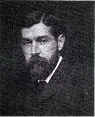

# 弗朗西斯·赫伯特·布拉德雷 Bradley, Francis Herbert (Stewart Candlish and Pierfrancesco Basile)

**首次发表于 1996 年 5 月 9 日；2021 年 2 月 23 日实质修订。**

 (*经 T.J. 温尼弗里思博士惠允复制*)

F. H. 布拉德雷（1846–1924）是英国唯心主义者中最著名、最富原创性且哲学上最具影响力的一位。这些哲学家在十九世纪最后几十年崭露头角，但他们对于英国哲学乃至整个社会——并且，通过其某些弟子在大英帝国机构中所占据的权力位置，对世界上许多地方——的影响，一直持续到二十世纪上半叶。他们之所以在同时代人当中显得突出，是因为他们有意识地拒斥了休谟、密尔等前辈同胞传统中的某些主要方面，并以一种既原创又批判的方式，转而回应康德与黑格尔的著作。

但若把英国唯心主义者描绘成不过是弃休谟而取黑格尔，正如“新黑格尔主义者”这一称谓极容易暗示的那样，则会造成相当大的歪曲。恰恰相反，他们对各种影响都保持开放，包括反唯心主义思想家如 J.F. 赫尔巴特，以及后来被遗忘但当时却颇负盛名的赫尔曼·洛采——一个独立的思想者，其思辨难以用唯心主义/实在主义对立来归类。总的说来，唯心主义者通过使英国哲学对丰富多样的欧陆观念保持通透，从而复兴了英国哲学。他们由此为分析哲学日后得以繁荣的土壤做了准备，因为大多数唯心主义者都非常熟悉弗雷格的同时代人（如 Sigwart）的著作，并在其逻辑论著中讨论他们的观念。布拉德雷是这个重新占有外来观念的原创运动中的领袖人物，他在《现象与实在》的“序言”中明确把这种重新占有宣扬为独断论与思想僵化的唯一解毒剂。他说：“当前这一代正在懂得，一个人要获得教养，就必须在不止一所学校里学习”（第 viii 页）。

布拉德雷最为人所知的是他的形而上学。他论证说，我们关于世界的日常概念（以及他的哲学前辈们所共有的那些更为精细的概念）含有隐藏的矛盾，当我们试图思考它们的后果时，这些矛盾便致命地显现出来。布拉德雷尤其据此拒斥了这样一种看法：实在可以被理解为由许多彼此独立存在的对象所组成（多元论），并且独立于我们对它们的经验（实在主义）。与此一致，他自己的看法把实体一元论——即主张实在是“一”，不存在真正彼此分离的事物——与形而上学唯心主义——即主张实在完全由观念或经验构成——结合起来。这种世界图景对 T.S. 艾略特的诗歌产生了深远影响，艾略特曾在哈佛学习哲学，并以布拉德雷为题撰写博士论文。

然而，对后世哲学家来说，布拉德雷在道德哲学与逻辑哲学方面的贡献，远比他的形而上学更具影响力。他对快乐主义——即认为道德的目标是一般快乐的最大化——的批判性考察具有开创性，构成对该学科的一项永久贡献，至今仍可从中获益地阅读。他逻辑学中的一些学说，经由伯特兰·罗素的接受而成为标准且不被注意的假定；这种接受在罗素后来抛弃唯心主义逻辑与形而上学之后依然留存。

英国唯心主义者中的其他著名人物还有伯纳德·鲍桑葵、爱德华·凯尔德、T.H. 格林、哈罗德·约阿希姆和 J.M.E. 麦克塔格特。

## 1 生平

布拉德雷于 1846 年 1 月 30 日生于克拉珀姆（当时属萨里郡，后并入大大扩展的伦敦）。他是查尔斯·布拉德雷——一位著名的福音派传道人——与其第二任妻子爱玛·林顿所生的第四个孩子、长子。这个家族才华横溢且人脉广泛：乔治·格兰维尔·布拉德雷，第一次婚姻所生的儿子，先后担任马尔伯勒学院院长、牛津大学学院院长、威斯敏斯特大教堂主任牧师；A.C. 布拉德雷，第二次婚姻所生的幼子，在牛津教哲学直至 1881 年，后转向文学研究，先后在利物浦和格拉斯哥任讲席教授，拒绝过剑桥的讲席，并成为他那个时代最杰出的莎士比亚批评家。查尔斯·布拉德雷的“克拉珀姆派”（这个活跃的福音派人道主义团体当时以此闻名）与帝国有着密切联系，其成员中包括一位孟加拉总督、一位塞拉利昂总督、几位议会议员以及一位殖民部常务次官。

1856 年，F.H. 布拉德雷在切尔滕纳姆学院开始学业；1861 年他转入马尔伯勒学院，当时该校由他的异母兄长担任院长。在切尔滕纳姆时他开始学习德语；他在求学期间至少阅读了康德的《纯粹理性批判》（*Critique of Pure Reason*）的一部分，尽管不清楚是否读的是原文。1862–3 年冬天，他染上伤寒热（一度被认为会致命），随后不久又患上肺炎。两场病都挺过来之后，他于 1863 年离开马尔伯勒，从而不再暴露于英国公学生活的严苛之中。

1865 年，布拉德雷以奖学金生身份进入牛津大学学院，1867 年在古典学初级考试（Mods）中获得第一名，但在 1869 年的《文学与人文学》（*literae humaniores*，即 Greats）中却出人意料地只获得第二名。著名的柏拉图学者 A.E. 泰勒，后来成为布拉德雷的仰慕者并同情其唯心主义，把他在 Greats 中的失利归因于“那些以其哲学圣典为约翰·斯图亚特·密尔著作的考官们，完全无力理解哲学对于这些不久即将彻底变革大不列颠哲学研究的杰出青年来说意味着什么”。不论这是否属实，布拉德雷的《逻辑原理》（*The Principles of Logic*）中无疑流露出对密尔及其追随者毫不掩饰的轻蔑。在多次未能获得学院研究员职位之后，他于 1870 年 12 月当选牛津默顿学院的研究员，终身保有，无教学职责，且仅因结婚而终止。他终身未婚，一直保有研究员职位直至去世。

1871 年 6 月，布拉德雷患上严重的肾脏炎症，似乎留下了永久性后果。有人曾提出，或许带有恶意，认为布拉德雷家族普遍有疑病症倾向；无论如何，此后他容易因受寒、身体疲惫或焦虑而丧失行动能力，因此过着隐退的生活。他积极参与学院的日常管理，但回避公开场合，例如甚至谢绝了成为英国学术院创始成员的邀请。柯林武德在其《自传》（*Autobiography*）中这样记述布拉德雷：“[虽]然我在距离他几百码之内住了十六年，但据我所知从未见过他一面。”这种相对的隐居给他的哲学声誉增添了神秘色彩，而他的几本书题献给一位仅以首字母“E.R.”标识的人物，更强化了这一神秘感。

不过，尽管布拉德雷献身哲学，以至于他的公共生活史大体上就是他的书与文章的历史，但显然他的生活并非狭隘的书斋生活。为了保护健康，他经常逃离牛津冬季的阴冷，前往英格兰南部和地中海海滨胜地的宜人气候。（在其中一次旅行中，布拉德雷遇见一位名叫拉德克利夫的美国工程师，并爱上了他的一位女儿，即题献中那位神秘的 E.R.。）他的形而上学，理性与神秘主义的惊人结合，为感官与情感生活留出了远非勉强的空间；而他的著作，尤其是身后出版的《箴言》（*Aphorisms*），不可能是经验局限于书斋的人所能写出的。他喜欢枪、讨厌猫，并以节俭的方式满足这两种偏好——在学院场地上夜间用前者射杀后者。

据说布拉德雷的政治观点是保守的，尽管并非狭隘的教条式保守。虽然他的著作流露出宗教气质，但他似乎（据 1922 年的一封信判断）觉得父亲家中那种福音派的虔诚令人压抑，也许正因如此，他后来著作中表现出的对基督教的态度带有某种矛盾心理；总的说来，他似乎是位自由思想者。（要想象在克拉珀姆派成员中成长的情形，我们可以采用约翰·萨瑟兰的提示：简·奥斯汀《曼斯菲尔德庄园》（*Mansfield Park*）中埃德蒙与范妮这两个人物，能让我们对他们的样子有所了解。）

布拉德雷获得的公共荣誉包括：格拉斯哥大学授予名誉法学博士学位（1883 年）、当选丹麦皇家学会会员（1921 年）、米兰的《林琴科学院》和《皇家伦巴第学会》（1922 年），以及当选英国学术院荣誉院士（1923 年）。1924 年，国王乔治五世授予他功绩勋章，他是首位获此殊荣的哲学家，这是非常罕见的荣誉。三个月后，在数日患病之后，他于 1924 年 9 月 18 日死于血液中毒。他被安葬于牛津的 Holywell 公墓。

## 2 声誉

正如上文（绝非详尽）对其公共荣誉的记述所揭示的，在布拉德雷生前，他的学术声誉极高：人们普遍认为他是那一代最伟大的英国哲学家；虽然唯心主义者从未成为占支配地位的大多数，但在一些哲学家中间，对他的态度几乎近乎崇敬。他的工作的重要性及其对英国哲学的影响，被朋友与对手共同承认。J.H. 缪尔黑德那部享有盛誉的《当代英国哲学：个人陈述》（*Contemporary British Philosophy: Personal Statements*）第二卷——该书在布拉德雷去世后不久出版，汇集了当时所有主要哲学家的文章，其中包括像 G.E. 摩尔那样对唯心主义观点怀有敌意的思想家——以如下题献开头：“献给 F.H. 布拉德雷，功绩勋章获得者：英国哲学欠他一份在我们时代赋予它新生命的推动力”。

这种声誉在他去世后不久便开始相当迅速地崩塌。原因很复杂，其中包括一些看似与哲学本身无关的事情，例如第一次世界大战后对英帝国主义的反感（其道德与精神使命曾被一些唯心主义哲学家所辩护，并由他们的弟子们付诸实施）。另一个更具地方意义的原因，是摩尔和罗素在脱离唯心主义阵营之后，在其著作中对他的观点所提出的带有倾向性却仍具破坏性的描述。罗素那篇被广泛阅读且名副其实地享有盛誉的《论指称》（‘On Denoting’），提供了一个哲学宣传的绝佳例证。在考虑“法国国王是秃头”与“法国国王不是秃头”在当下没有法国国王的情况下孰真孰假这一问题时，罗素风趣地指出，“黑格尔主义者们”会得出结论说他戴了假发。罗素具有一种特殊的文学才能来制造这类评论，而这些评论必然留下印记，因为没有比迷人的反讽更糟的敌人了。与此同时，罗素没有点名任何具体作者，也没有针对任何具体的唯心主义理论。整个英国唯心主义就这样仅仅因为其据称与黑格尔的关联而被一笔勾销，而在这里黑格尔被巧妙地引介为荒诞的顶峰。

另一个因素是逻辑实证主义，其代表人物把形而上学整体上斥为无意义：在 A.J. 艾耶尔的反形而上学小册子《语言、真理与逻辑》（*Language, Truth and Logic*）的第一章中，布拉德雷仅仅被呈现为一位形而上学家，并基于一句脱离上下文的话被选为嘲笑对象（第 36 页）。所选的那句话（“绝对者进入演化与进步，但其自身却无演化与进步可言”，事实上艾耶尔是对《现象与实在》第 442 页稍作改写而成）是布拉德雷对如下熟悉学说的表达：终极实在虽自身不变，却构成了我们那变化与生成着的有限世界的本体论基础。艾耶尔把这一主张当作他所谓的“伪命题”的例子，即那些看似表达意义而实际上缺乏信息内容的英文句子；他恶意地评论说，所引命题是从《现象与实在》中“随机”摘取的，这显然旨在向读者头脑中植入这样的想法：布拉德雷的书大部分由这类伪命题构成。继这些影响之后，出现了一种不利于唯心主义的、整个做哲学风格上的转变，其特征是形式逻辑的发展以及对于常识和日常语言之见地的新尊重。布拉德雷那种高度雕琢的散文，以及他对于形而上学家有权裁定终极真理的自信，对于在平实言说与形式化混合熏陶下成长、并被鼓励遵从数学与经验科学的后一代哲学家来说，开始显得格格不入。但风格选择并非哲学上中立的；任何从事制造一种修正形而上学体系的人，都不大可能接受日常语言所强加的限制。

这些影响使得关于布拉德雷的一种误导性且轻蔑性的刻板印象在分析哲学家中间流行开来，并确立于他们的教科书中，以至于对其工作的严肃讨论在很大程度上消失了。一个结果是：尽管他对罗素有着开创性的影响，且两人在根本问题上进行了旷日持久的论争，但关于罗素的著作与文章中，对布拉德雷的提及却寥寥无几，甚至完全没有。另一个结果是：教科书中偶尔提及布拉德雷某些最具特色、最具原创性也最重要的观点（例如关于关系和真理的观点），往往建立在充满敌意的漫画式歪曲之上。除少数例外（例如麦克塔格特关于时间非实在性的论证），自二十世纪三十年代以来，对唯心主义者工作的讨论一直稀少。对布拉德雷的讨论，连同他的声誉，在二十世纪七十年代开始复苏，并在此后数十年延续至今。这种重新定向通常并不伴随为布拉德雷的整体哲学观辩护的尝试，而是与对分析哲学起源的兴趣复兴密切相关，后者部分由罗蒂在《哲学与自然之镜》（*Philosophy and the Mirror of Nature*）中的批判所推动。罗蒂的抨击促使分析哲学进行自我省察，并引导该传统内的一些思想家重新审视作为他们自己从事和构想哲学方式之基础的那些奠基性神话。

这些努力产生了显著成果；若干专著与文集问世，纠正了承袭下来的误解，以更为平衡的方式讨论布拉德雷的哲学。在分析本体论领域，对他关于关系概念的批判性考察的兴趣也有所复兴，然而对于他所看重的那些更广泛的思辨问题，却显然少有兴趣与欣赏。在撰写本文时，他显然仍被普遍低估；然而，他的声誉是否会再次达到他生前那样高的程度，则远非清楚。

## 3 历史哲学

布拉德雷对哲学的第一项实质性贡献，是 1874 年出版的小册子《批判历史学的前提》。尽管当时并未引起广泛注意，但它确实影响了 R.G. 柯林武德的思想；柯林武德的历史认识论与布拉德雷的一样，表现出对历史事实与证词权威的某种怀疑，而该书此后产生了相当大的影响。布拉德雷的观点源自他阅读德国圣经批评家，这类观点此后在宗教学研究中一直很突出——在那里，对于违反自然规律的奇迹发生的证词，不轻信其表面价值是恰当的。但布拉德雷把这种不轻信扩展到一般历史报道的尝试，低估了自然的齐一性与人类历史的多样性之间的对照。

尽管其整体论证不能被视为令人满意，但这本小册子仍值得一读，既因其历史意义，也因其作为对布拉德雷思想相当简明的导论的价值。某些日后成为其特色的主题，如个别判断的可错性和对真理符合论的拒斥，在这里已经早早出现；而布拉德雷的哲学风格——往往晦涩，通常不屑于举例说明，且以二十世纪末的标准看令人不适地过于文学化——在此可见一斑。

## 4 伦理学

布拉德雷的伦理学观点在他的第一部获得广泛承认的著作《伦理学研究》（*Ethical Studies*，1876）中得到详尽阐述。它之所以受到注意，一个原因是这本书极具论战性。（西季威克在其《心灵》书评中称之为“激烈的宣传品”。）他在后来并未显著改变这些观点：1893 年他把它描述为“一本大体上仍表达我意见的书”（《现象与实在》，第 356n 页），去世时他正在准备第二版，而按其一贯风格，该版将保留原文不动，只增补附加材料。

布拉德雷在序言中说，他的目标是“主要地批判性的”，而他那个时代的伦理学理论建立在“形而上学的和心理学的先入之见”之上，这些先入之见“混乱甚至错误”。在他这本最具黑格尔色彩的书里，他的做法是在一系列相互关联的论文中，辩证地通过这些错误理论走向对伦理学的恰当理解。据此他告诉我们，这些论文“必须按它们原有的顺序来读”；其推论是，那种常见的做法——基于个别论文的独立价值而从全书中抽出其中一两篇（通常是写得精彩的《为快乐而快乐》和《我的岗位及其职责》）——会造成关于它们在布拉德雷道德思想中地位的误导性印象：这两篇都不代表某种定型的立场。

这一恰当理解的发展，始于考察“通俗的”道德责任概念以及决定论与不定论哲学学说对它所构成的表面威胁；他论证说，一旦我们考察人类行动的现实，这些威胁便消散了。（该书的一个突出主题是：日常道德思想不应被道德哲学所推翻。）接着转向“我为什么要有道德？”这一问题，他以提出我们每个人的道德目的是自我实现来作答。这一目的究竟是什么，随后通过对若干代表性哲学理论的考察而逐渐展开；每一种理论都因其片面地集中于道德生活的特定方面而被视为不令人满意而遭拒斥。尽管如此，他认为，每一种理论都抓住了某种重要的东西，在他所追求的恰当理解中不可遗忘。例如，在第三篇论文《为快乐而快乐》——一篇至今仍是经典的快乐主义功利主义批判——中，布拉德雷论证说，其个人主义站不住脚，其对幸福作为可独立于获得手段而识别的快乐状态的快乐主义构想同样如此（因此幸福原则上可以比通过道德行为更便当地达成）。但清除这些错误后，功利主义关于幸福作为道德之要点的根本洞见仍可保留。同样，在下一篇论文对一种康德式（虽不完全是康德本人的）义务伦理学的考察中，他论证说，从这一道德概念中，我们应当放弃其“义务只应为义务本身而履行”的观念，因为那是错误抽象的结果。然而，只要弄清各义务的强制性源于每项义务自身的性质而非某种形式原则，我们仍可保留“道德要求履行个别 **义务**”这一洞见。

这些理论之所以不充分，是因为它们对自我持一种有缺陷的概念；他开始在第五篇论文——著名的《我的岗位及其职责》——中补救这一缺陷，在那里他以如此有力的笔触勾勒出关于自我与道德的社会性概念，以至于“它表达了他本人立场”这一错误观念得以流传，是可以理解的。这种对道德生活的黑格尔式说明——自我通过履行其在作为其义务之基础的社会有机体中的角色而完全实现——显然是布拉德雷所深感兴趣的，而他似乎从未注意到“自我必然是社会性的”这一形而上学说明与“自我在社会中实现自我”这一道德训令之间的隐含张力。但他最终承认了其不充分性，例如指出：任何现实社会都可能表现出道德缺陷，这些缺陷需要从一种在该社会可获得的角色中无法体现的理想立场出发加以改革。这自然地把他引向下一篇论文对理想道德的考察，在那里他讨论道德对个人要求的范围；再经由进一步的自然延伸，引向第七篇论文对善我与恶我之别的讨论；这一讨论包含一个尝试性的证明：恶我是善我之上一种无法实现的寄生物。这对他的事业是必要的：没有它，他就无法使其“道德的目标是自我实现”这一建议显得可信。但在某一方面，这一事业仍然搁浅：最后一篇论文论证，道德最终是自我矛盾的，其存在依赖于它所力求克服的恶。因此，理想自我的实现无法通过道德达成，但该书以这样的暗示收尾：它在宗教中仍有可能。

布拉德雷的一些形而上学观念体现在他为自己的道德哲学所作的辩护中。一个例子是他主张自我是具体的共相，而他批判的那些伦理学说因其依赖抽象的自我概念而受损。自我之所以是 **共相的**，是因为它随时间并在许多不同行动中保持其同一性，从而把构成其历史的那一串抽象殊相收集到一起，其方式类似于抽象共相 **红** 把其分散的个别实例（现在常被称为“殊相”〔tropes〕）收集到一起；它之所以是 **具体的**，是因为不同于 **红**，它是一个真实而非抽象的个体。要让这类主张完全有说服力，就需要一个把其中潜在的形而上学观念充分展开的成熟体系，正如他本人所承认的。但在此后的展开中——大部分见于《现象与实在》——“具体共相”这一表达几乎从布拉德雷的语汇中消失，主要是因为他最终得出结论：只能有这样一个东西；尽管如此，其中所涉的观念仍然保留，并以“抽象即失真”这一反复出现的主题的形式重现，在这种形式下，它对他的逻辑学与形而上学都是核心的。

## 5 逻辑学

布拉德雷对逻辑学最持久的处理见于《逻辑原理》（*The Principles of Logic*），它与弗雷格的《算术基础》（*Grundlagen*）同时出版。后见之明提供了这两部著作之间鲜明的对照：前者显然回顾十九世纪，后者则预示二十世纪。虽然两本书都回避形式方法，但在弗雷格那里，这仅仅源于试图对数学逻辑的某些应用给出可读的说明。然而，布拉德雷书中公式（定理、公理、推理规则）的缺席对其而言是内对其而言是内在的，表达了一种（与密尔共有的）对** 原则上*把推理形式化的反对——因为那样会使推理脱离科学知识的实际获得。这一点，加上熟悉术语（如“矛盾”）被以不熟悉的方式使用，使这本书带有一种古旧感。尽管如此，尽管现代逻辑学家若非出于历史目的通常不再查阅《原理》，它却聚焦于逻辑学的核心问题，而“它显得向后看”这一印象在某种程度上是误导性的：例如，它用较老的“观念”与“判断”词汇来表达一些观点，这些观点往往通过对罗素的（选择性）影响而催生了日后以语句和命题表述的学说；它还有效地把意义与指称的概念置于一种此后长期延续的怀疑性审视之下。

尽管其处理不如《伦理学研究》那样严格地辩证，布拉德雷却是通过批评他人来发展其观点，并在进行过程中不断修正它们。一个结果是，这本书远非易于 **查阅**；而一位决心弄清布拉德雷想法的读者，必须准备好跟随其论证经历许多曲折，包括偶尔闯入认识论、现象学和形而上学的领域。

传统上，逻辑学著作分为三部分，分别处理概念（通常经由 **观念**，即判断的传统组成部分）、判断与推理。布拉德雷既继承又改造了这一传统：他保留三部分格式，但把第一部分用于判断，把第二、第三部分都用于推理，从而取消了关于概念的单独处理。这之所以重要，是因为它反映了他对如下标准观点的拒斥：判断是通过以某种方式联结观念而形成的；例如，波尔-罗亚尔《逻辑学》所主张的亚里士多德式论断：它们“必然由三个要素构成——主项观念、谓项，以及这两者的联结”。布拉德雷在不止一个战线上攻击这类学说。

例如，他论证说，那些像休谟一样认为判断由可分离的观念构成的人，未能识别出观念对逻辑学而言重要的那个“观念”含义：在这个意义上，观念并非分离的、可标定日期的心理事件（如我此刻想象一道彩虹），而是抽象共相。他提示说，一旦观念被恰当理解，它们甚至不再能被合理地设想为可以拼合起来创造判断的、个别的且相互独立的实体（正如洛克在《人类理解论》（*An Essay Concerning Human Understanding*）第四卷第十四章中所主张的那样）：依赖的次序恰好相反，观念是从完整判断中抽象出来的。这一理论可以恰当地称为判断的“一元论”理论，因为与布拉德雷形而上学观点的平行关系是显而易见的：对由关系纽带维系在一起的独立实体的拒斥，与对由系词维系在一起的独立观念的拒斥携手并进。同样明显的是，这对更早的“分析即把复合体分解为其简单构成成分”的观念所构成的挑战，因为按此看法，本来就没有什么构成成分可言。在这里，尽管用的是他那古旧的语汇，布拉德雷却预先识别出罗素后来在试图调和命题的统一性与他所认为的其构成成分的相互独立性时所面临的困难；这些困难对弗雷格以另一种面目出现，后者试图维持概念与对象之间的严格区分。

再者，既然观念是共相，像波尔-罗亚尔那样的说明就无法说明判断如何能关乎实在，因为其观念表征的是事物的类，而实在事物本身是殊相；只要判断局限于观念，就不可能有对任何我们所判断之物的唯一识别。布拉德雷把这一点应用于语言，论证说即便是语法上的专名和指示词也是伪装的一般语词。即使是时空规定（X 作为在时间 Y 占据位置 Z 的对象/事件），也不能充当明确的个体化原则；它们确实能够在给定的时空序列内成功地把特定对象/事件个体化，却无法区分一个时空序列与另一个。最终结果是：指称不能仅仅依据语言和抽象描述来固定，它毋宁预设了通过我们的经验对实在的直接遭遇。

这些洞见似乎预示了罗素的摹状词理论的那种应用：用它来消除语法名称，代之以量化的一般语句。不论这是否真是该理论的起源，在另一个情形中则没有疑问：罗素声称在通信中仔细读过《原理》，并公开承认，他被布拉德雷的论证所说服：全称语句的逻辑形式是假言的（因此，例如“所有的牛都吃草”应理解为“如果有任何东西是牛，那么它吃草”）。这样，布拉德雷对谓词演算产生了虽间接却重大的影响。然而，他作为现代逻辑先驱者的角色不应被过分强调，因为他承认，把全称语句解释为假言，是他读赫尔巴特时受到的启发。

布拉德雷自己对判断的说明是：它是“把一种理想内容……关联到超越该行动的现实上去的行动”，因此每个判断的逻辑形式都是“实在如此这般：如果有任何东西是 S，那么它是 P”。这一表述使布拉德雷表面上悖论的说法变得可以理解，他说：“所有判断都是直言判断，因为它们都确实就实在加以肯定，并把其内容断言于实在。同样，所有都是假言判断，因为没有哪一个能无条件地把其内容归于实在”（《原理》，第一卷，第二章，第 79 节，依布拉德雷对第二版的注释修订）。不难在其中看到一种对“以全称量词与对象变项、谓词变项之组合来表示语句”的非正式预示。再考虑布拉德雷对关于虚构实体的语句的处理，如“没有鬼”。按布拉德雷的分析，这被证明是“实在不是鬼存在的地方”的紧缩形式。人们在此看到与罗素摹状词理论的密切相似：像“珀伽索斯不存在”这样的否定存在句并不是关于不存在的珀伽索斯的陈述，而只是断言论域（现在扮演着布拉德雷“实在”的逻辑功能）不包含任何具备神话书籍中归于珀伽索斯的一切特征的东西。（此处与别处一样，这本书既向前看也向后看。）

尽管朝着后来逻辑理论的方向迈出了这些重大步骤，但像某些人所做的那样，声称布拉德雷对“判断即观念之组合”这一说明的苛评意味着他直截了当地反对逻辑学中的心理主义，则是一种夸大，因为显然他认为逻辑学的主题是心理活动，而非语句或陈述。这在他把判断定义为“把一种理想内容……关联到超越该行动的现实上去的行动”时已经很明显（《原理》，第一卷，第一章，第 10 节）。

当布拉德雷从判断转向推理时，他继续批判传统逻辑学。正如他拒斥“判断即主项与谓项之组合”的亚里士多德式说明一样，他也拒斥亚里士多德式三段论（其理由与他后来拒斥密尔的归纳准则相同）：它遗漏了这样一个事实——推理只能通过共相所包含的普遍性进行。因此，共相对推理是本质性的，而休谟关于“推理即观念联想”的说明便因此崩溃：休谟式的观念是殊相，是联想无法唤起的转瞬即逝的片段。这并不意味着观念联想不可能，而是说真正的联想（布拉德雷称之为“再整合”）只能涉及共相。

令那些持有如下流行观点（1900 年由罗素在《对莱布尼茨哲学的一个批判性阐释》中首次传播，此后屡被重复）的人感到惊讶的是，布拉德雷的推理处理包含着这样的抱怨：他那个时代的数学逻辑学无法表达有效的关系推理。这一流行观点认为，布拉德雷认为所有判断都是主项/谓项形式，因而未能把关系判断识别为一种独立的类型。他最初对推理的说明是它乃“理想实验”：说它“理想”，因为这些是停留在观念领域中的思想实验；但它仍是“实验”，因为其结果并非由一套无误地规定其自身应用的完整逻辑定律预先保证（这一看法令人想起维特根斯坦）。但后来，在长期而纠缠地考虑“演绎推理如何可能反映在实在中”这一问题之后，他提出一个修订的说明：“每一个推理都是一个被视为实在的对象之理想的自我展开”（《原理》，末篇论文 I，第 598 页）。布拉德雷在此似乎遵循休谟式的想法：在彼此分离的存在物之间不存在逻辑关系；有效推理之所以能反映在实在中，是因为它永远不会把一个人带离原初的主题。

《逻辑原理》的大部分是论战性的，它偶尔提供了布拉德雷最滑稽也最尖刻的例证，例如这篇短章中批评赫伯特·斯宾塞关于推理本性的观点的注释（第二卷，第二部分，第二章，第 14 节，注 3）：

> 关于斯宾塞先生的看法，我愿意作为一种可能性提出：它从未取自事实，而是他对汉密尔顿那里关于“比较”的某种东西的发展，或由此发展而来。斯宾塞先生读的书那么少，自然更受他所读之书的摆布。

以及这句对汉密尔顿本人的即兴一击（第二卷，第二部分，第一章，第 9 节）：

> 这可以称为再整合定律。因为我们可以从 W. 汉密尔顿爵士（《里德》，第 897 页）那里取来这一名称，因为我们找不到别的可取的名称。

显然，布拉德雷对其前辈与同时代人的许多批评，表达了他对那种心理原子论的敌意——这种原子论在休谟那里以极端形式表现出来，但同样被预设于上文提到的那类判断说明之中。布拉德雷特别反对这类看法的理由是：它们视为自有其实在性的那些殊相（观念），即据说构成判断的那些东西，其实全然不是：它们远非真正的个体，而是从心理生活的连续整体中抽象出来的，无法独立存在。这是一种此后拥有众多追随者的整体论的早期版本。但他接着指出，判断也涉及抽象，因为任何判断的主题都必然与其背景相分离（例如，“尤利乌斯·凯撒渡过了卢比孔河”把河流从其位置、把将军从其军队中分离出来），而这一过程不可避免地误述了事情的真实情形。因此，布拉德雷用来反对误导性逻辑说明的那些异议，现在开始通过侵蚀进入其推理的判断的完整性而对逻辑学本身构成威胁；他以一种怀疑的笔调结束《原理》，暗示没有任何判断真正为真，也没有任何推理完全有效。

除了他对观念、判断与指称之本性的讨论外，他对真理概念的强调，是他帮助塑造后来分析哲学议程的另一条主要途径。至此，布拉德雷试图写一本不卷入形而上学的逻辑学著作的努力，开始让位于他对真理概念的怀疑。他认为逻辑学预设一种真理符合论（他称之为“摹本”理论），但显然他认为这一理论在形而上学上是不充分的：事实上，他针对它提出了一些反例，例如利用析取命题的反例，这些反例要等到真理函项理论出现之后才能被容纳。在《真理与实在论文集》（*Essays on Truth and Reality*）中他进一步发展这些观念，论证“真理认识与实在的同一”（第 113 页），并激烈地拒斥一切替代方案，不仅包括摹本理论，也包括任何以实用成功来理解真理概念的做法。布拉德雷持有真理同一论，这一点再清楚不过；尽管人们通常相信他是真理融贯论的支持者（并在教科书里被标准地如此标识），这一通常信念至少是极具误导性的。然而，同一论与他“实在是一个统一整体”的形而上学学说的结合，使得融贯能够作为其结果从他的观点中推演出来；而他自己认为真理的 **检验** 是“体系”，这一概念下他包括了通常所说的融贯；这就解释了他为何如此经常地被看作一位融贯论者。人们可能会认为，他对“理性的即实在的”这一黑格尔式观念的著名攻击（《原理》第三卷，第二部分，第四章，第 16 节）与他持有真理同一论不一致：但二者通过他的真理程度学说得到调和，这一学说必须在其形而上学的语境中理解。

## 6 形而上学

在完成《逻辑原理》之后，布拉德雷转向对其形而上学作出完整说明的任务。成果是《现象与实在》（*Appearance and Reality*，1893）。但此后布拉德雷在哲学上仍活跃了三十年，继续阐明、辩护并完善其观点，并与批评者和对手交锋（尤其与罗素，这对双方都富有启示性）。因此，只专注于《现象与实在》，就冒着把不当的分量放在那些结果是思想或表达之暂时特征的东西上；而这实际上促成了在分析哲学教科书中如此常见的那种对他的思想的歪曲印象。

《现象与实在》分为两编。第一编“现象”篇幅简短，目的在于破坏，它论证“我们借以试图理解宇宙的那些观念”在我们试图思考其意涵时，最终都把我们在矛盾中引向绝境。其中一些观念尤其属于哲学，例如只有第一性质是实在的看法以及康德式的物自体概念；另一些，如原因、运动、自我、空间、事物与时间等概念，则用于日常生活。第二编“实在”篇幅很长，目的在于对绝对者提供一种正面说明——即就其自身而言的、终极的、无条件的实在，未被思想的诸概念机制之投射所歪曲。他的讨论中有很大一部分用于考虑针对这一正面说明的自然异议。

第一编的大部分内容是提出一些熟悉的建议，这些建议只构成布拉德雷论证的一部分：例如，他断言运动包含悖论；仅有第一性质不能给予我们实在，因为若无第二性质，第一性质便不可设想；而物自体的概念是自相矛盾的，因为如果我们对其一无所知，那么连它存在这一点也一无所知。但第二章与第三章——分别题为“实体与属性”和“关系与性质”——是布拉德雷所独有的，其意涵之广泛令人惊骇，并自那时起不断引起论争。以概括形式说，布拉德雷的论点是：关系（如 **大于**）无论有无关系项都不可理解，同样，关系项无论有无关系都不可理解。布拉德雷本人就其支持这一论点所挥动的那些论证说道（第 29 页）：

> 已经跟上并把握住本章原理的读者，就几乎不必再花时间读后面的章节。他将看到，我们的经验凡是关系性的，便不是真的；他几乎未经聆讯便将斥责大量现象。

显然，他对关系的看法既极具争议性，又处于其思想的核心。有鉴于此，布拉德雷把其论证呈现得如此粗略而缺乏说服力，以至于连富有同情心的评论者都难以替他辩护，这似乎是他在战术上的一个严重失误；而 C.D. 布罗德后来竟能说：“仁爱之心要求我们移开目光，不去看一位伟大哲学家使用一个会使孩童或野蛮人蒙羞的论证的可悲场面”（《考察》，第 85 页）。

然而，尽管布拉德雷的风格简洁，其批评者的释读错误却难以辩解。“布拉德雷的关键形而上学论证不足道”这一印象，部分产生于把它们读成旨在证明一切关系的内在性学说——也就是说，要么（1）关系可还原为性质，要么（2）关系必然成立，这取决于“内在的”一词的含义，罗素以前一种方式解释该学说，摩尔以后一种方式解释。无论我们取哪种含义，这都是误读——而若按罗素的含义来取“内在的”，则更是不可能，因为布拉德雷把判断的主项/谓项说明斥为“错误的”。然而，若采用摩尔的“内在的”含义，这种读法虽仍不可原谅，却是可以理解的：在第三章中，布拉德雷令人困惑地以一种形而上学上无辜的方式把这个词用于关系，这与摩尔所理解的内在性学说毫无关联；而在《现象与实在》的其他部分，他公开地卖弄内在性学说，只是在后来较少被人阅读的著作中才明确地摈弃它，例如他去世时未完成、收入 1935 年《论文集》（*Collected Essays*）的重要论文《关系》。再者，布拉德雷确实一致地拒斥外在关系的实在性，而把它解释为对内在性学说的信奉，虽然逻辑上并非不可避免，却是容易的。

布拉德雷对关系的处理始于第二章，其中讨论了“是什么造成个别事物的统一性”这一问题。我们如何能理解这样一个事实：一个 **单一的** 事物，比如一块方糖，能够把 **多** 种不同属性（如它的甜、白、硬）维持在一个统一体之中？我们不能设定一个与其性质相区别的基底实体的存在，因为那会使我们承诺存在一个赤裸的、光秃秃的殊相，即“一个毫无一切性质的某物”这一荒谬概念。此外，关于事物统一性的原初困难并未因这一招而解决，因为人们会问：是什么把性质束缚到其实体上？替代办法是把事物设想为性质的集合，然而把它们束缚到事物统一体中的那种本体论纽带的本性又是什么呢？我们最终得到的是一堆独立的、类似实体的性质的 **聚合体**，而不是一个 **个别的** 事物。至此，关系问题以其充分的本体论意义浮现出来，因为现在看来，似乎只有一种关系才能提供所要求的 **纽结**。

布拉德雷在第三章中深思熟虑后的看法是：无论外在关系还是内在关系都不具有统一力量，因而必须被作为非实在而拒斥。这是一组凝练论证的恰当结论，他把它们作为一个团队部署，系统地排除了不同意者所能采取的可能立场。一个关键的考虑基于这样的洞见：一种关系既是其关系项的“根据”，又是“建立”在其上的。“就我所能看到的而言”，他说，“关系必须依赖关系项，正如关系项依赖关系一样”（《现象》，第 26 页）。据说关系“依赖”其关系项，因为它需要至少两个关系项才能存在；而关系项“依赖”关系，因为它们部分地由它们彼此所处的诸关系所构成（尽管布拉德雷没有举例，这一点可以借两种不同色度来使之可信：蓝色若非比黄色深，就不是蓝色了）。布拉德雷接着论证说，一旦认识到这一点，人们就看到，一个被关联的关系项 *A* 实际上由两部分组成，一部分充当关系的根据，*A1*，另一部分由关系所决定，*A2*。因此，每一个被关联的关系项都被证明是一个关系复合体，在这个具体情形中，*A* 被证明是复合体 *R*(*A1*,*A2*)。这开启了无穷倒退，因为按同一逻辑，*A1* 和 *A2* 也必得由两个不同部分组成，如此无限进行。

然而，布拉德雷那组论证中引起最大论战关注的，是这样一条：如果一种关系与其关系项一起是又一种实在事物（正如罗素后来在他关于判断的多重关系理论中所假定的那样），那么就需要又一种关系把它与其关系项关联起来，如此 **以至无穷**。从这一论证（它是《逻辑原理》对判断之传统分析攻击的一个明显后裔）以及他本人的解释来看，显然对他来说“实在的”是一个技术术语：成为实在的，就是成为一个个别实体（在笛卡尔、莱布尼茨与斯宾诺莎那里常见的那种意义上）。按此理解，否认关系的实在性就是否认它们是独立存在物。正是这一论证解释了像布罗德那样的反应：与其他人一样，他以为布拉德雷假定关系是一类对象，而布拉德雷实际上是在通过一种 **归谬法** 针对那一假定本身进行论证。

这些论述表明，布拉德雷是在本体论的意义上使用“现象”一词，指称缺乏充分个体性的东西，而非在认识论的意义上指称呈现于主体面前的东西。的确，他并不想否认我们经验到事物之丰富多样这一明显事实；关系和多元性 **在某种意义上** 存在，因而属于实在。否认关系的实在性并不蕴含它们的绝对不存在；毋宁说，他的结论是：关系与关系项应当被设想为包罗万象的全体之内的方面。因此，与其把内在性学说归于布拉德雷，不如把他看作倡导一种“整体论的”关系理论。在与罗素相对照时，布拉德雷在这一根本点上是完全明确的：

> 这是我现在这么多年来所主张的学说。关系只存在于一个最终无法〔 **原刊如此** 〕分解为关系和关系项的全体之中，并且只能通过这个全体而存在。“和”“一起”与“之间”，离开这样一个全体最终都是无意义的。相反的看法（据我理解）由罗素先生所主张……但就我自己而言，我无法发现罗素先生曾真正面对过这一问题。（《原理》第二版，第二章，补充注 50。）

有趣的是，一位正面面对布拉德雷问题的哲学家是罗素的学生维特根斯坦。在他的《逻辑哲学论》（*Tractatus*）中，他试图通过摆脱关系来避免布拉德雷的无穷倒退。他的简单对象确实进入统一事实的形成，然而并不需要任何外加的联结原则：“在原子事实中，对象互相勾连，如同链条的环节一样。”（2.03）然而，链条这一隐喻并未对布拉德雷所提出的问题提供真正的回答，尤其是考虑到这一点几乎已经清楚：维特根斯坦的逻辑-本体论原子可以说具有一种形式；的确，它们不同于德谟克利特式的原子，因为它们缺乏物质属性（参见 2.0331 与 2.0232）。此外，布拉德雷仍可论证：两个彼此不同却毫无关联的对象这一观念本身几乎没有意义。

布拉德雷对关系的处理所蕴含的并不只是形而上学上的；也是认识论上的。有些人认为，否认关系的实在性等于断言所有关系判断都是假的，因此，例如“7 大于 3”或“氢比氧轻”并不为真。布拉德雷的真理说明使这种解释变得可信，因为按该说明，任何普通判断都不是完全真的；结果，对那些在“真理是二值的”这一较晚近却属时代错置的假定影响下读他的人而言，他的主张似乎是：所有关系判断都是假的。然而，按布拉德雷的真理说明，虽然就日常目的而言“7 大于 3”为真、“氧比氢轻”为假，但一旦我们试图满足形而上学的更严格的要求，我们就被迫承认真理容许程度，而且前者虽然无疑比后者更真，却并非完全为真。不过，即便是这些判断中较真者的不完善，也与“它是关系性的而非谓述性的”无关。因为，正如上文在逻辑一节所观察到的，布拉德雷认为所有判断都有缺陷，因为表征只能在思想中分离实在中并不分离之物的基础上进行：例如，当我们说“这些苹果又硬又酸”时，我们不仅隐含地把苹果从容器中抽象出来，还把硬度与酸味彼此分离，并把它们从苹果本身抽象出来。因此，一个完全忠实于实在的完美真理，必定是一个完全不从实在中抽象的东西；这意味着它必定与实在的全体相同一，因而甚至不再是一个判断。按布拉德雷的看法，关于实在的最终真理，简直可以说在原则上不可言说。最终，正是这一神秘主义结论解释了他对黑格尔 **泛逻辑主义** 的强有力拒斥；与黑格尔在《逻辑学》（*Science of Logic*）中的看法相反，实在不是一个相互关联的逻辑范畴的体系，而是完全超越思想。

然而，给出一个纲要仍是可能的。“实在由多重相关联的对象组成”这一印象，是思想所强加的种种分离的结果；事实上“绝对者不是多；不存在独立的实在物。”（此后所有引文均出自《现象与实在》第十四章。）实在是“一”——但“一”个什么呢？他说，是经验，取该词的宽泛意义：“情感、思维与意志（我们用以归类心理现象的任何范畴）都是存在的质料，此外别无其他质料，无论现实的还是甚至可能的。”他为这一反直觉学说所直接给出的论证简短得近乎轻率，只是要求读者不带自相矛盾地去另作设想；他更关心的是把这一点说得非常清楚：这种经验不属于任何个别心灵，他的学说也不是唯我论的一种形式。但他并不像表面看来那样轻率，因为他很快表明，他认为整本书是为这种客观的（或绝对的）唯心主义所作的一个最佳说明论证：“我相信，这一结论在我工作的末尾会给读者带来更多信服；因为我们将会发现，它是唯一能调和一切事实的看法。”

所以“绝对者是一个体系，……其内容无非是感受性的经验。因此它将是一个单一而包罗万象的经验，以和谐的方式拥抱每一个局部的多样性。因为它不可能小于现象，所以任何情感或思想都不可能落在它的界限之外。”然而，当这种多样性无法通过关系项与关系来说明时，我们如何能理解它是可能的？布拉德雷的回答是：我们无法详细地理解这一点，但通过考虑一种前概念的、直接经验的初始状态——其中有差异却无分离，我们熟悉的认识性的成人人类意识正是通过把概念区分加于这些差异之上而从这种状态中产生——我们能够对他在说什么有所把握。实在类似于这种初始状态，但又不完全相似，因为它超越思想而非不及思想；而一切，甚至概念思想本身，都包含在一个包罗万象而和谐的整体之中。因此，现象以与画作的片段对整幅艺术作品有所贡献相类似的方式对实在有所贡献：一旦脱离其背景，它们便会失去其意义，孤立来看甚至可能丑陋；而在语境中，它们本身可以是美的，并对整体的美与完整性作出本质贡献。

在理解绝对者及其与现象的关系方面，我们所能得到的一切帮助就是这类有限的类比：布拉德雷把“对错误与恶等现象如何属于绝对者作详细解释”的要求斥为不可能，转而试图把证明责任转移给那些自信它们不相容的批评者。他的一般回答是：任何存在的东西，甚至最坏的恶，都在某种意义上是实在的：绝对者必定既包含恶也包含善。但是，正如真理容许程度——一个判断离理解实在的全体越远就越不真——一样，（与“真理认识与实在的同一”一致）实在本身也容许程度，一个现象越是只是全体的一个片段性方面，就越不实在。绝对者以此方式离恶比离善更远，但本身既非恶亦非善，超越二者正如它甚至超越宗教——在某种意义上它是一个最高存在者，但不是一个位格的上帝。一个完整的形而上学体系的恰当目标，应当是裁定任何片段性存在物的相对实在程度；然而正如一些批评者所反对的，鉴于布拉德雷主张绝对者严格说来是不可知的，即便原则上也难以看出这如何能实行。

布拉德雷还花了一些时间考虑自然哲学中出现的诸问题；尽管显然他感到泛心论的吸引力，但他从未明确赞同这一看法。正如 T.S. 艾略特所认识到的，一条莱布尼茨式的线索贯穿布拉德雷的哲学，它在他关于有限经验中心的学说中表现出来。按这一看法，绝对者在众多较小的感受性全体中表达自身，这些感受性全体是类似人类灵魂本性的统一的心理学个体。因此布拉德雷几乎接近于持有某种非常类似单子论的理论，然而这被纳入他的一元论形而上学的总体框架之中。有趣的是，绝对者学说可以被视为对单子相互作用问题的一个解决；像莱布尼茨的单子一样，布拉德雷的有限中心不能直接分享内容（例如，据说它们“彼此不能直接相通”；《现象》，第 464 页），也不能进行因果相互作用；然而，它们彼此协调，因为它们都是同一个囊括一切的实在的部分显现。洛采也曾做过类似的调和绝对唯心主义与单子论的尝试；在这两种情形中，这是否不是伪装下的预定和谐，仍是一个开放的问题。清楚却通常被忽视的是：布拉德雷本人把莱布尼茨式的单子论视为对他自己那类唯心主义的最大挑战：“单子论”，他说，“总的说来将会增长，并将加重已经存在的困难”（《现象》，第 102 页）。他在这方面肯定是对的，因为后来的英国形而上学家——如詹姆斯·沃德、J.M.E. 麦克塔格特、赫伯特·威尔登·卡尔和阿尔弗雷德·诺思·怀特海——都偏爱莱布尼茨胜过康德与黑格尔，作为他们主要的灵感来源。

在布拉德雷对绝对者那常常是狂想曲式的描述中——一种既基于他对哲学家判断说明之缺陷的怀疑性审视、又显然基于一种对更高统一的个人经验的世界概念（这种经验在另一种语境下本可能使他成为世上受人尊崇的宗教神秘主义者之一）——我们可以看出，为什么在本文开头他的形而上学被描述为“理性与神秘主义的惊人结合”。这一结合本身的独特性，意味着此后很少有哲学家被它所说服。然而，在其对他所谓“思想与实在之关系的伟大问题”的大胆而直接的直面中，它在西方哲学中构成了对推论性思想无歪曲地呈现世界之能力的一个永久而令人不安的挑战；之所以令人不安，是因为它并非源于强加一个可因其任意或不恰当而被拒斥的外在标准，而是源于要求我们的表征机制满足它们自身所隐含设定的标准。

## 参考文献

**以下文献从原文照录，不作翻译；中国文献条目（古今）一律译为中文。**

### 布拉德雷著作

[^ethical-1876]: *Ethical Studies*, London: Oxford University Press, 1876; second edition, with notes: London: Oxford University Press, 1927.

[^principles-1883]: *The Principles of Logic*, London: Oxford University Press, 1883; second edition, revised, with commentary and terminal essays, London: Oxford University Press, 1922; corrected impression, 1928.

[^appearance-1893]: *Appearance and Reality*, London: Swan Sonnenschein, 1893; second edition, with an appendix, London: Swan Sonnenschein, 1897; ninth impression, corrected, Oxford: Clarendon Press, 1930. Pages references above are to the ninth impression.

[^essays-1914]: *Essays on Truth and Reality*, Oxford: Clarendon Press, 1914.

[^aphorisms-1930]: *Aphorisms*, Oxford: privately printed at the Clarendon Press, 1930.

[^collected-1935]: *Collected Essays*, Oxford: Clarendon Press, 1935.

[^writings-1994]: *Writings on Logic and Metaphysics*, edited and with introductions by James W. Allard and Guy Stock, Oxford: Clarendon Press, 1994.

[^collected-1999]: *The Collected Works of F.H. Bradley*, 12 volumes, edited and introduced by W.J. Mander and Carol A. Keene, Bristol: Thoemmes, 1999.

[^bradley’s-1874]: The more recent of the editions produced in Bradley’s lifetime are the ones now usually cited and the most useful: while the earlier text is left intact, Bradley’s later thoughts are added in the form of notes, appendices and essays, enabling the reader to trace the changes in his ideas. (Such additional material is particularly extensive in the *Logic*, where Bradley frequently defers to Bosanquet’s criticisms of the first edition.) *Collected Essays* contains the two pamphlets ‘The Presuppositions of Critical History’ (1874) and ‘Mr Sidgwick’s Hedonism’ (1877) as well as the valuable unfinished essay on relations (1923–4) and a good bibliography. Between them, this book and the important *Essays on Truth and Reality* contain all his articles of any substance; these are the versions normally cited. *Aphorisms*, after many years out of print, appeared in 1993 (bound together with ‘Presuppositions of Critical History’ and an introduction by Guy Stock) in a facsimile edition (Bristol: Thoemmes Press). Bradley’s unpublished papers, notebooks and letters received are in the library of Merton College, Oxford. Correspondence between Bradley and Russell is in the Russell Archives at McMaster University; interesting extracts appear on pp. 349–353 of Volume 6 of *The Collected Papers of Bertrand Russell* (London: Routledge 1992). The John Rylands Library of the University of Manchester has letters from Bradley to Samuel Alexander. Much previously unpublished material was made available in the 1999 *Collected Works*. [In 2003 Thoemmes Press, the publisher of the *Collected Works*, was acquired by the Continuum International Publishing Group Ltd. The name of the imprint changed from “Thoemmes” to “Thoemmes Continuum”.]

### 次要文献

[^allard-2005]: Allard, J.W., 2005, *The Logical Foundations of Bradley’s Metaphysics: Judgment, Inference, and Truth*, Cambridge: Cambridge University Press.

[^ayer-1946]: Ayer, A.J., 1946, *Language, Truth and Logic*, London: Victor Gollanz.

[^babushkina-2016]: Babushkina, D., 2016, ‘F.H. Bradley’s Conception of the Moral Self: A New Reading’, in W.J. Mander and S. Panagakou (eds.), *British Idealism and the Concept of the Self*, Basingstoke: Palgrave MacMillan.

[^baldwin-1984]: Baldwin, T., 1984, ‘Moore’s rejection of idealism’, in R. Rorty, J.B. Schneewind and Q. Skinner (eds.), *Philosophy in History*, Cambridge: Cambridge University Press.

[^basile-1999]: Basile, P., 1999, *Experience and Relations: An Examination of F.H. Bradley’s Conception of Reality*, Berne: Paul Haupt.

[^basile-2014]: –––, 2014, ‘Bradley’s Metaphysics’, in W. J. Mander (ed.), *The Oxford Handbook of British Philosophy in the Nineteenth Century*, Oxford: Oxford University Press, pp. 189–208.

[^bradley-1985]: Bradley, J., 1985, ‘The Critique of Pure Feeling: Bradley, Whitehead and the Anglo-Saxon Metaphysical Tradition’, *Process Studies*, 14(4): 253–64.

[^bradley-1996]: –––, (ed.), 1996, *Philosophy after F.H. Bradley*, Bristol: Thoemmes.

[^broad-1933]: Broad, C.D., 1933, *Examination of McTaggart’s Philosophy* (Vol. I), Cambridge: Cambridge University Press.

[^campbell-1931]: Campbell, C.A., 1931, *Scepticism and Construction: Bradley’s Sceptical Principle as the Basis of Constructive Philosophy*, London: George Allen and Unwin Ltd.

[^candlish-1978]: Candlish, S., 1978, ‘Bradley on My Station and Its Duties’, *Australasian Journal of Philosophy*, 56(2): 155–70.

[^candlish-1989]: –––, 1989, ‘The Truth about F.H. Bradley’, *Mind*, 98(391): 331–48.

[^candlish-2007]: ––– 2007, *The Russell/Bradley Dispute and its Significance for Twentieth-Century Philosophy*, Basingstoke: Palgrave Macmillan; paperback edition 2009.

[^coady-1992]: Coady, C.A.J., 1992, *Testimony*, Oxford: Clarendon Press.

[^eliot-1916]: Eliot, T.S., 1916, *Knowledge and Experience in the Philosophy of F.H. Bradley*, London: Faber, 1964.

[^ferreira-1999]: Ferreira, P., 1999, *Bradley and the Structure of Knowledge*, Albany, NY: State University of New York Press.

[^gaskin-1995]: Gaskin, R., 1995, ‘Bradley’s Regress, the Copula and the Unity of the Proposition’, *The Philosophical Quarterly*, 45(179): 161–80.

[^horstmann-1984]: Horstmann, R.P., 1984, *Ontologie und Relationen*, Koenigstein: Athenaeum.

[^hylton-1990]: Hylton, P., 1990, *Russell, Idealism, and the Emergence of Analytic Philosophy*, Oxford: Clarendon Press.

[^ingardia-1991]: Ingardia, R. (ed.), 1991, *Bradley: A Research Bibliography*, Bowling Green, Ohio: Philosophy Documentation Center. [Warning: This volume contains many errors, mostly trivial; e.g., many of the articles attributed to Cresswell are by Crossley.]

[^macewen-1996]: MacEwen, P. (ed.), 1996, *Ethics, Metaphysics and Religion in the Thought of F.H. Bradley*, Lewiston, NY: The Edwin Mellen Press.

[^macniven-1987]: MacNiven, D., 1987, *Bradley’s Moral Psychology*, Lewiston, NY: The Edwin Mellen Press.

[^mander-1994]: Mander, W., 1994, *An Introduction to Bradley’s Metaphysics*, Oxford: Clarendon Press.

[^mander-1995]: –––, 1995, ‘Bradley’s Philosophy of Religion’, *Religious Studies*, 31(3): 285–301.

[^mander-1996]: ––– (ed.), 1996, *Perspectives on the Logic and Metaphysics of F.H. Bradley*, Bristol: Thoemmes.

[^mander-2011]: –––, 2011, *British Idealism. A History*, Oxford: Oxford University Press.

[^mander-2014]: ––– (ed.), 2014, *The Oxford Handbook of British Philosophy in the Nineteenth Century*, Oxford: Oxford University Press.

[^manser-1983]: Manser, A., 1983, *Bradley’s Logic*, Oxford: Blackwell.

[^manser-1984]: Manser, A. and Stock, G. (eds.), 1984, *The Philosophy of F.H. Bradley*, Oxford: Clarendon Press; reprinted in paperback 1986.

[^mchenry-1992]: McHenry, L.B., 1992, *Whitehead and Bradley. A Comparative Analysis*, Albany:, NY: State University of New York Press.

[^muirhead-1925]: Muirhead, J.H., 1925, *Contemporary British Philosophy: Personal Statements*, second series, London: George Allen and Unwin Ltd.

[^nicholson-1990]: Nicholson, P., 1990, *The Political Philosophy of the British Idealists: Selected Studies*, Cambridge: Cambridge University Press, ‘Study I’.

[^passmore-1969]: Passmore, J., 1969, ‘Russell and Bradley’, in R. Brown and C.D. Rollins (eds.), *Contemporary Philosophy in Australia*, London: George Allen and Unwin, pp. 21–30.

[^phemister-2016]: Phemister, P., 2016, ‘Leibnizian Pluralism and Bradleian Monism: A Question of Relations’, *Studia Leibnitiana*, 45: 61–82.

[^russell-1905]: Russell, B., 1905, ‘On Denoting’, *Mind*, 14(56): 479–93.

[^sprigge-1983]: Sprigge, Timothy, 1983, *The Vindication of Absolute Idealism*, Edinburgh: Edinburgh University Press.

[^sprigge-1993]: –––, 1993, *James and Bradley: American Truth and British Reality*, Chicago & La Salle, Illinois: Open Court.

[^sprigge-2010]: –––, 2010, ‘The Problem of Evil for Absolute Idealism’, in J. Connelly and S. Panagakou (eds.), *Anglo-American Idealism: Thinkers and Ideas*, Oxford-Bern-Berlin: Peter Lang, pp. 165–180.

[^stock-1998]: Stock, G. (ed.), 1998, *Appearance versus Reality*, Oxford: Clarendon Press.

[^taylor-1924]: Taylor, A.E., 1924–5, ‘Francis Herbert Bradley, 1846–1924’, *Proceedings of the British Academy*, 11(2): 458–468.

[^vallicella-2002]: Vallicella, V., 2002, ‘Relations, Monism and the Vindication of Bradley’s Regress’, *Dialectica*, 56(1): 3–35.

[^ward-1925]: Ward, J., 1925, ‘Bradley’s Doctrine of Experience’, *Mind*, 34(133): 13–38. [This issue is a memorial volume; it also includes articles on Bradley by A.E. Taylor, G.F. Stout, G. Dawes Hicks and J.H. Muirhead.]

[^wollheim-1956]: Wollheim, R., 1956, ‘F.H. Bradley’, in Ayer, A.J. et al., *The Revolution in Philosophy*, London: Macmillan, pp. 12–25.

[^wollheim-1969]: –––, 1969, *F.H. Bradley*, Harmondsworth: Penguin, second edition.

[^from-1995]: From 1995 to 2004 (inclusive) there appeared a journal, *Bradley Studies*, which described itself as “aim[ing] to publish critical and scholarly articles on philosophical issues arising from Bradley’s writings and from those of related authors [and] to include each year an ongoing list of what has been published on Bradley and related themes.” In 2005, the journal was amalgamated with another to form *Collingwood and British Idealism Studies: incorporating Bradley Studies*. Enquiries about back issues of the journal in its previous incarnation should be directed to its then Editor William Mander.

## 学术工具

| | |
|:---:|:---:|
| [如何引用本词条](https://plato.stanford.edu/cgi-bin/encyclopedia/archinfo.cgi?entry=bradley)。 |
| [预览本词条的 PDF 版本](https://leibniz.stanford.edu/friends/preview/bradley/)，见 [SEP 之友学会](https://leibniz.stanford.edu/friends/)。 |
| [查找与本词条相关的话题与思想家](https://www.inphoproject.org/entity?sep=bradley&redirect=True)，见互联网哲学本体论项目（InPhO）。 |
| [本词条的增强文献目录](https://philpapers.org/sep/bradley/)，见 [PhilPapers](https://philpapers.org/)，附其数据库链接。 |

## 其他网络资源

[欢迎向作者提出建议。]

## 相关词条

伯纳德·鲍桑葵 | 布拉德雷的伦理学 | 戈特洛布·弗雷格 | 托马斯·希尔·格林 | 格奥尔格·威廉·弗里德里希·黑格尔 | 赫尔曼·洛采 | 约翰·麦克塔格特 | 一元论 | 乔治·爱德华·摩尔 | 伯特兰·罗素 | 真理同一论
