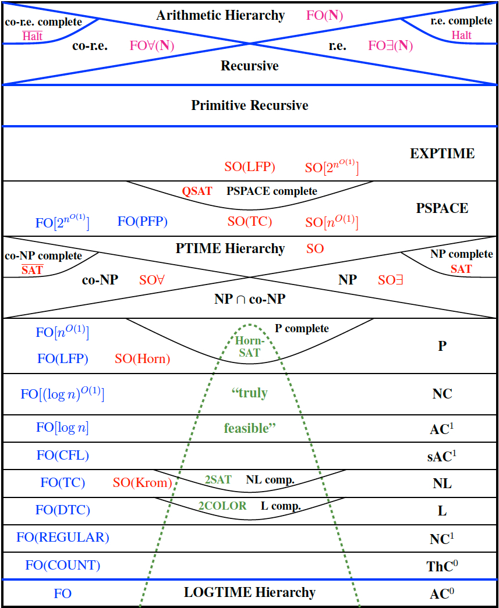

# 可计算性与复杂度 computability and complexity (Neil Immerman)

**首次发表于 2004 年 6 月 24 日；2021 年 10 月 18 日实质修订。**

一个数学问题是 **可计算的**（computable），如果它原则上可由某台计算装置求解。“可计算的”一词的几个常用同义词是“可解的”（solvable）、“可判定的”（decidable）与“递归的”（recursive）。希尔伯特（David Hilbert）相信所有数学问题都是可解的，但 20 世纪 30 年代，哥德尔（Kurt Gödel）、图灵（Alan Turing）与邱奇（Alonzo Church）表明情况并非如此。人们已对哪些数学问题可计算、哪些不可计算作了广泛的研究与分类。此外，人们还把可计算问题按计算复杂性类作了广泛的分类，分类依据是求解某实例需要多少计算量——作为该问题实例规模的函数。令人惊叹的是，这些分类划得如此清晰、优雅而精确。

## 1 原则上能计算什么？导言与历史

20 世纪 30 年代，远在计算机问世之前，世界各地多位数学家发明了“可计算”的精确而彼此独立的定义。阿隆佐·邱奇（Alonzo Church）定义了 λ 演算（lambda calculus），库尔特·哥德尔（Kurt Gödel）定义了递归函数，斯蒂芬·克林（Stephen Kleene）定义了形式系统，马尔可夫（A. A. Markov）定义了后来所称的马尔可夫算法，埃米尔·波斯特（Emil Post）与艾伦·图灵（Alan Turing）定义了如今所称的波斯特机与图灵机的抽象机器。

令人惊讶的是，所有这些模型恰好彼此等价：凡在 λ 演算中可计算者，皆可被图灵机计算，对上述计算系统任意其他一对亦然。这一事实被证明之后，邱奇表达了如下信念：直观的“原则上可计算”概念与上述精确概念是同一的。这一信念现称“邱奇-图灵论题”（Church-Turing Thesis），为数学家们一致接受。

推动“将可计算之物加以法典化”这一工作的部分动力，来自数学家大卫·希尔伯特（David Hilbert）。希尔伯特相信，全部数学都能被精确地公理化。一旦做到这一点，便会有一个“有效程序”，即一个算法，它取任何精确的数学陈述为输入，并在有限步之后判定该陈述为真或为假。希尔伯特所要求的，正是如今所称的全数学的 **判定过程**（decision procedure）。

作为这一判定问题的特例，希尔伯特考虑了一阶逻辑的有效性（判定）问题。一阶逻辑是一种数学语言，大多数数学陈述都可在其中表述。一阶逻辑中的每个陈述在每个适当的逻辑结构中都有精确的意义，即它在每个这样的结构中或真或假。凡在每个适当结构中为真的陈述，称为 **有效的**（valid）；凡在某个结构中为真的陈述，称为 **可满足的**（satisfiable）。注意，一个公式 $\varphi$ 是有效的，当且仅当其否定 $\neg \varphi$ 不可满足。

希尔伯特把一阶逻辑的有效性（判定）问题称为*Entscheidungsproblem*（判定问题）。在希尔伯特与阿克曼合著的教科书《数理逻辑原理》（*Principles of Mathematical Logic*）中，作者写道：“当我们掌握了一种程序，它允许对任何给定的逻辑表达式经有限次运算判定其有效性或可满足性时，Entscheidungsproblem 即告解决。……entscheidungsproblem 必须被视为数理逻辑的主要问题。”（Böerger, Grädel, & Gurevich 1997）。

在其 1930 年的博士论文中，哥德尔给出了一阶逻辑的一个完全公理化，它基于怀特海（Alfred North Whitehead）与罗素（Bertrand Russell）的《数学原理》（*Principia Mathematica*）（Gödel 1930）[^gödel-1930]。哥德尔证明了他的完备性定理，即一个公式可由公理证明，当且仅当它是有效的。哥德尔的完备性定理，是迈向解决希尔伯特*Entscheidungsproblem*（判定问题）的一步。

尤其因为公理易于识别、推理规则又至为简单，故存在一个能列出所有证明的机械程序。注意，证明中的每一行，要么是一条公理，要么由前面的行经某一简单规则推出。对任何给定的字符串，我们都能判断它是否构成一个证明。于是我们可系统地列出长度为 1、2、3……的所有字符串，并逐一检查它们是否为证明。若是，我们便把该证明的最后一行加入定理表。如此，我们便能列出所有定理——即一阶逻辑中所有有效公式——由一简单的机械程序列出。更精确地说，有效公式之集合乃一可计算函数的值域。用现代术语表述：一阶逻辑的有效公式集合是*递归可枚举的（recursively enumerable，r.e.）*。

然而，哥德尔的完备性定理并不足以给*Entscheidungsproblem*（判定问题）以肯定解。给定公式 $\varphi$，若 $\varphi$ 有效，则上述程序终将把它列出，从而能回答“是，$\varphi$ 有效”。但若 $\varphi$ 无效，我们或许永远无从得知这一事实。所缺的，是一个列出所有非有效公式的程序，或等价地，一个列出所有可满足公式的程序。

一年之后，即 1931 年，哥德尔以证明其不完备性定理而震惊数学界：自然数的一阶理论不存在完全而可计算的公理化。也就是说，不存在一份合理的公理表，使我们能从中恰好证明数论的全部真陈述（Gödel 1931）[^gödel-1931]。

几年之后，邱奇与图灵各自独立地证明了*Entscheidungsproblem*（判定问题）不可解。邱奇的做法，是运用哥德尔不完备性定理的方法，表明一阶逻辑的可满足公式集合不是递归可枚举的，即它们无法被一个可由 λ 演算计算的函数系统地列出。图灵引入他的机器，证明了诸多有趣定理，其中一些我们将在下节讨论。尤其是，他证明了 **停机问题**（halting problem）的不可解性，并把*Entscheidungsproblem*的不可解性作为其推论得出。

希尔伯特深感失望，因为他谋求为全部数学建立判定过程的计划被证明不可能。然而，正如我们将在本文其余部分更详细看到的，人们关于计算的根本性质有了大量认识。

## 2 图灵机

在其 1936 年的论文《论可计算数及其在判定问题上的应用》（“On Computable Numbers, with an Application to the Entscheidungsproblem”）中，艾伦·图灵（Alan Turing）引入了他的机器，并确立了它们的基本性质。

他清晰而抽象地思考了机器执行一项计算任务究竟意味着什么。图灵将他的机器规定为由以下部分组成：

- 一个有限集 $Q$，为可能状态之集，因为任何装置都必须处于有限多个可能状态之一；
- 一条潜在地无限的纸带，由相邻单元 $\sigma_{1}, \sigma_{2}, \sigma_{3}$ 组成，取自某个有限字母表 $\Sigma$；（$\Sigma$ 可以是任何至少含两个符号的有限集。取 $\Sigma = \{0, 1, b\}$ 较为方便，它由二进制字母表加上空白单元符号构成。我们通常假定纸带的一个有限初始段含有二进制符号，其余部分为空白。）
- 一个读/写磁头 $h \ge 1$，扫描纸带单元 $\sigma_{h}$；以及最后，
- 一个转移函数 $\delta : Q \times \Sigma \rightarrow Q \times \Sigma \times \{-1,0,1\}$。（转移函数的意义是：自任何给定状态 $q$ 出发，看到任何给定符号 $\sigma_{h}$ 时，$\delta$ 告诉我们机器应进入的新状态、应在当前方格写入的新符号，以及新磁头位置 $h' = h + d$，其中 $d \in \{-1,0,1\}$ 是 $\delta$ 给出的位移。）

- 一个有限集 $Q$，为可能状态之集，因为任何装置都必须处于有限多个可能状态之一；
- 一条潜在地无限的纸带，由相邻单元 $\sigma_{1}, \sigma_{2}, \sigma_{3}$ 组成，取自某个有限字母表 $\Sigma$；（$\Sigma$ 可以是任何至少含两个符号的有限集。取 $\Sigma = \{0, 1, b\}$ 较为方便，它由二进制字母表加上空白单元符号构成。我们通常假定纸带的一个有限初始段含有二进制符号，其余部分为空白。）
- 一个读/写磁头 $h \ge 1$，扫描纸带单元 $\sigma_{h}$；以及最后，
- 一个转移函数 $\delta : Q \times \Sigma \rightarrow Q \times \Sigma \times \{-1,0,1\}$。（转移函数的意义是：自任何给定状态 $q$ 出发，看到任何给定符号 $\sigma_{h}$ 时，$\delta$ 告诉我们机器应进入的新状态、应在当前方格写入的新符号，以及新磁头位置 $h' = h + d$，其中 $d \in \{-1,0,1\}$ 是 $\delta$ 给出的位移。）

- 一个有限集 $Q$，为可能状态之集，因为任何装置都必须处于有限多个可能状态之一；
- 一条潜在地无限的纸带，由相邻单元 $\sigma_{1}, \sigma_{2}, \sigma_{3}$ 组成，取自某个有限字母表 $\Sigma$；（$\Sigma$ 可以是任何至少含两个符号的有限集。取 $\Sigma = \{0, 1, b\}$ 较为方便，它由二进制字母表加上空白单元符号构成。我们通常假定纸带的一个有限初始段含有二进制符号，其余部分为空白。）
- 一个读/写磁头 $h \ge 1$，扫描纸带单元 $\sigma_{h}$；以及最后，
- 一个转移函数 $\delta : Q \times \Sigma \rightarrow Q \times \Sigma \times \{-1,0,1\}$。（转移函数的意义是：自任何给定状态 $q$ 出发，看到任何给定符号 $\sigma_{h}$ 时，$\delta$ 告诉我们机器应进入的新状态、应在当前方格写入的新符号，以及新磁头位置 $h' = h + d$，其中 $d \in \{-1,0,1\}$ 是 $\delta$ 给出的位移。）

- 一个有限集 $Q$，为可能状态之集，因为任何装置都必须处于有限多个可能状态之一；
- 一条潜在地无限的纸带，由相邻单元 $\sigma_{1}, \sigma_{2}, \sigma_{3}$ 组成，取自某个有限字母表 $\Sigma$；（$\Sigma$ 可以是任何至少含两个符号的有限集。取 $\Sigma = \{0, 1, b\}$ 较为方便，它由二进制字母表加上空白单元符号构成。我们通常假定纸带的一个有限初始段含有二进制符号，其余部分为空白。）
- 一个读/写磁头 $h \ge 1$，扫描纸带单元 $\sigma_{h}$；以及最后，
- 一个转移函数 $\delta : Q \times \Sigma \rightarrow Q \times \Sigma \times \{-1,0,1\}$。（转移函数的意义是：自任何给定状态 $q$ 出发，看到任何给定符号 $\sigma_{h}$ 时，$\delta$ 告诉我们机器应进入的新状态、应在当前方格写入的新符号，以及新磁头位置 $h' = h + d$，其中 $d \in \{-1,0,1\}$ 是 $\delta$ 给出的位移。）

其存储纸带的线性性质——与随机存取存储器相对——限制的是计算速度而非能力：图灵机能够找到任何存储位置（即纸带单元），但这可能很耗时，因为它须沿纸带一步步移动磁头。

图灵机之优美，在于该模型极其简单，却极其强大。图灵机拥有潜在地无限的工作空间，故能处理任意大的输入，例如相乘两个巨大的数；但它每一步只能读写有界的信息量，即一个符号。甚至在证明图灵机与所有其他数学计算模型等价之前、在任何邱奇-图灵论题的表述之前，图灵便令人信服地论证：他的机器与任何可能的计算装置一样强大。

### 2.1 通用机

每台图灵机都可由其转移表唯一地描述：对每个状态 $q$ 与每个符号 $\sigma$，$\delta(q,\sigma)$ 给出新状态、新符号与磁头位移。这些转移表可写成一个有限的符号串，给出每台图灵机的完整指令集。此外，这些符号串可按字典序列出如下：$M_{1}, M_{2}, M_{3},\ldots$，其中 $M_{i}$ 是第 $i$ 号图灵机的转移表，即完整指令集。$M_{i}$ 的转移表便是第 $i$ 号图灵机的程序，或更简单地说，第 $i$ᵗʰ 个程序。

图灵表明，他能构造一台图灵机 $U$，它是 **通用的**（universal），即它能运行任何其他图灵机的程序。更明确地说，对任何 $i$ 与任何输入 $w$，$U$ 在输入 $i$ 与 $w$ 上所做的，恰与 $M_{i}$ 在输入 $w$ 上所做的相同。用符号表示，
$$ U(i,w) = M_{i}(w) $$

图灵表明，他能构造一台图灵机 $U$，它是 **通用的**（universal），即它能运行任何其他图灵机的程序。更明确地说，对任何 $i$ 与任何输入 $w$，$U$ 在输入 $i$ 与 $w$ 上所做的，恰与 $M_{i}$ 在输入 $w$ 上所做的相同。用符号表示，
$$ U(i,w) = M_{i}(w) $$

图灵对通用机的构造，给出了关于计算的最根本洞见：一台机器能运行任何程序。无论将来我们可能需要执行何种计算任务，单单一台机器便能完成它们全部。正是这一洞见，使建造与销售计算机成为可行之事。一台计算机能运行任何程序；我们无须在每次面对新问题时另购一台新计算机。当然，在个人计算机时代，这一事实已是一条如此基本的假设，以致人们或许难以退后一步去欣赏它。

### 2.2 停机问题

由于图灵机被设计来体现一切可能的计算，它们便带有一个无法摆脱的缺陷：某些图灵机在某些输入上永不停机。有些不停机出于荒唐的原因——例如，我们可以错误地编程一台图灵机，使它陷入一个紧凑循环：譬如在状态 17 看到 1，它或许转到状态 17、写入 1 并把磁头位移 0。稍不荒唐些，我们可以遇到一个空白符号，而右边尽是空白符号，却仍停留在同一状态，向右移一步，寻找一个“1”。这两种不停机的情形，都能被一个像样的编译器轻易检测并修复。然而试考虑图灵机 $M_{F}$：它在输入“0”上系统性地搜寻费马大定理的第一个反例，一旦找到便输出该反例并停机。在安德鲁·怀尔斯（Andrew Wiles）相对晚近地证明费马大定理之前，全世界所有数学家工作了三个多世纪，都无法判定 $M_{F}$ 在输入“0”上是否最终停机。如今我们知道，它永不。

### 2.3 可计算函数与可枚举性

由于图灵机可能在某些输入上不停机，我们在定义图灵机可计算的函数时须格外小心。设自然数集 $\mathbf{N}$ 为集合 $\{0,1,2,\ldots \}$，并把图灵机看作从 $\mathbf{N}$ 到 $\mathbf{N}$ 的部分函数。

设 $M$ 为一台图灵机，$n$ 为一个自然数。我们说 $M$ 的纸带 **含有** 数 $n$，如果 $M$ 的纸带以 $n$ 的二进制表示开头（无多余的前导 0），其后则仅为空白符号。

若在一张含有 $n$ 的纸带上启动图灵机 $M$，且它最终停机时纸带含有 $m$，则我们说 $M$ 在输入 $n$ 上计算 $m$：$M(n) = m$。若在输入 $n$ 上启动 $M$ 时，它要么永不停机，要么停机时纸带并不含自然数——例如因它有前导 0，或因数字与空白符号相间——则我们说 $M(n)$ 无定义，用符号表示：$M(n) =\nearrow$。于是我们可把每台图灵机 $M$ 与一个 **部分** 函数 $M: \mathbf{N} \rightarrow \mathbf{N} \cup \{\nearrow\}$ 相联系。我们说函数 $M$ 是 **全的**（total），如果对所有 $n\in \mathbf{N}$ 皆有 $M(n) \in \mathbf{N}$，即 $M(n)$ 总有定义。

现在我们可以形式地定义“集合 **递归可枚举**（r.e.）”意味着什么——此前我们只是非形式地描述过它。设 $S \subseteq \mathbf{N}$。则 $S$ 是递归可枚举的，当且仅当存在某台图灵机 $M$，使 $S$ 为 $M$ 所计算函数的值域。用符号表示，
$$ S = \{M(n) \mid n \in \mathbf{N}; M(n) \ne\nearrow\}. $$

现在我们可以形式地定义“集合 **递归可枚举**（r.e.）”意味着什么——此前我们只是非形式地描述过它。设 $S \subseteq \mathbf{N}$。则 $S$ 是递归可枚举的，当且仅当存在某台图灵机 $M$，使 $S$ 为 $M$ 所计算函数的值域。用符号表示，
$$ S = \{M(n) \mid n \in \mathbf{N}; M(n) \ne\nearrow\}. $$

因此，$S$ 是递归可枚举的，当且仅当它能被某台图灵机列出。设 $S$ 是递归可枚举的，其元素如上被图灵机 $M$ 枚举。我们便可描述另一台图灵机 $P$：它在输入 $n$ 上，以轮转方式（round-robin）在 $M$ 的一切可能输入上运行 $M$，直到 $M$ 最终输出 $n$。若此事发生，则 $P$ 停机并输出“1”，即 $P(n)=1$。若 $n \not\in S$，则 $M$ 永不输出 $n$，故 $P(n)$ 永不停机，即 $P(n)=\nearrow$。

令记号 $P(n)\downarrow$ 表示图灵机 $P$ 在输入 $n$ 上最终停机。对图灵机 $P$，定义 $L(P)$——*被 $P$ 接受的集合*——为那些使 $P$ 在输入 $n$ 上最终停机的数 $n$，
$$ L(P) = \{n \mid P(n)\downarrow \}. $$

令记号 $P(n)\downarrow$ 表示图灵机 $P$ 在输入 $n$ 上最终停机。对图灵机 $P$，定义 $L(P)$——*被 $P$ 接受的集合*——为那些使 $P$ 在输入 $n$ 上最终停机的数 $n$，
$$ L(P) = \{n \mid P(n)\downarrow \}. $$

上述论证表明，若集合 $S$ 递归可枚举，则它被某台图灵机 $P$ 接受，即 $S = L(P)$。此陈述之逆亦成立。也就是说，$S$ 是递归可枚举的，当且仅当它被某台图灵机 $P$ 接受。

我们说集合 $S$ 是 **可判定的**（decidable），当且仅当存在一台全图灵机 $M$，它对所有 $n \in \mathbf{N}$ 判定 $n \in S$ 与否。把“1”视为“是”、“0”视为“否”。对所有 $n\in \mathbf{N}$，若 $n \in S$，则 $M(n) = 1$，即 $M$ 在输入 $n$ 上最终停机并输出“是”；若 $n \not\in S$，则 $M(n) = 0$，即 $M$ 在输入 $n$ 上最终停机并输出“否”。“可判定的”的同义词为：**可计算的**、**可解的** 与 **递归的**。

对 $S \subseteq \mathbf{N}$，$S$ 的 **补集** 为 $\mathbf{N} - S$，即所有不在 $S$ 中的自然数之集。我们说集合 $S$ 是 **余递归可枚举的**（co-r.e.），当且仅当其补集递归可枚举。若集合 $S$ 既递归可枚举又余递归可枚举，则我们可在一列中列出它的全部元素，在第二列中列出它的全部非元素。如此便能判定给定元素 $n$ 是否属于 $S$：只消扫描两列，静候 $n$ 出现。若它出现在第一列，则 $n \in S$；否则它会出现在第二列，$n \not\in S$。事实上，一个集合是递归的，当且仅当它既递归可枚举又余递归可枚举。

### 2.4 停机问题的不可解性

图灵问：是否每个自然数集合都是可判定的。经由下列计数论证，容易看出答案是“否”。$\mathbf{N}$ 有不可数多个子集，但既然只有可数多台图灵机，便只可能有可数多个可判定集合。因此几乎所有集合都是不可判定的。

图灵实际上构造了一个不可判定的集合。正如我们将看到的，他是借对角线论证做到这一点的。对角线论证可上溯至格奥尔格·康托尔（Georg Cantor），他借此表明实数集不可数。哥德尔在证明不完备性定理时使用了类似的对角线论证，他构造了数论中的一个句子 $J$，其意义可理解为“$J$ 不是定理”。

图灵如下构造一个对角线停机集 $K$：
$$ K = \{n \mid M_{n}(n)\downarrow \}. $$

图灵如下构造一个对角线停机集 $K$：
$$ K = \{n \mid M_{n}(n)\downarrow \}. $$

也就是说，$K$ 由那些以自身程序为输入时最终停机的图灵机组成。

不难看出 $K$ 是递归可枚举的。为引出矛盾，假设 $K$ 亦余递归可枚举，并设 $d$ 为接受 $K$ 之补集的那台图灵机的编号。也就是说，对任何 $n$，
$$ n \not\in K \Leftrightarrow M_{d}(n)\downarrow $$

不难看出 $K$ 是递归可枚举的。为引出矛盾，假设 $K$ 亦余递归可枚举，并设 $d$ 为接受 $K$ 之补集的那台图灵机的编号。也就是说，对任何 $n$，
$$ n \not\in K \Leftrightarrow M_{d}(n)\downarrow $$

但试考虑把上式中的 $n$ 代换为 $d$ 时会发生什么：
$$ d \not\in K \Leftrightarrow M_{d}(d)\downarrow. $$

但试考虑把上式中的 $n$ 代换为 $d$ 时会发生什么：
$$ d \not\in K \Leftrightarrow M_{d}(d)\downarrow. $$

然而，$K$ 的定义告诉我们：
$$ d \in K \Leftrightarrow M_{d}(d)\downarrow . $$

然而，$K$ 的定义告诉我们：
$$ d \in K \Leftrightarrow M_{d}(d)\downarrow . $$

于是我们得到
$$ d \in K \Leftrightarrow d \not\in K, $$

于是我们得到
$$ d \in K \Leftrightarrow d \not\in K, $$

这是一个矛盾。因此我们关于 $K$ 余递归可枚举的假设为假，从而 $K$ 不是递归的。由此推出：给定一台图灵机及其输入，判定该图灵机是否在该输入上最终停机，并非可计算的问题；也就是说，停机问题不可解。

## 3 原始递归函数

我们接下来定义 **原始递归函数**（primitive recursive functions）类。这是一类非常有趣的函数，由斯科伦（Thoralf Skolem）在一篇 1923 年的论文中描述，并被哥德尔用于其不完备性定理的证明。我们关注从 $\mathbf{N}^{r}$ 到 $\mathbf{N}$ 的函数 $f$，其中 $r = 0, 1, 2,\ldots$。这里 $r$ 称为函数 $f$ 的元数（arity），即它所取参数的个数。哥德尔从三个非常简单的函数（初始函数）和两个自然的闭包运算（复合与原始递归）出发，其中每一个都取若干已定义的函数，并用它们定义一个新函数。我们接下来详细解释他的定义。本节是技术性的，可以放心跳过。重要的观念在于：原始递归函数构成一个非常大而强大的可计算函数类，而且全部以极其简单的方式生成。

我们从三个 **初始** 原始递归函数出发：
- $\zeta$，元数为 0 的零函数，$\zeta$( ) $= 0$；
- $\eta$，元数为 1 的恒等函数，$\eta(n) = n$；以及
- $\sigma$，元数为 1 的后继函数，$\sigma(n) = n +1$。

我们从三个 **初始** 原始递归函数出发：
- $\zeta$，元数为 0 的零函数，$\zeta$( ) $= 0$；
- $\eta$，元数为 1 的恒等函数，$\eta(n) = n$；以及
- $\sigma$，元数为 1 的后继函数，$\sigma(n) = n +1$。

我们从三个 **初始** 原始递归函数出发：
- $\zeta$，元数为 0 的零函数，$\zeta$( ) $= 0$；
- $\eta$，元数为 1 的恒等函数，$\eta(n) = n$；以及
- $\sigma$，元数为 1 的后继函数，$\sigma(n) = n +1$。

我们从三个 **初始** 原始递归函数出发：
- $\zeta$，元数为 0 的零函数，$\zeta$( ) $= 0$；
- $\eta$，元数为 1 的恒等函数，$\eta(n) = n$；以及
- $\sigma$，元数为 1 的后继函数，$\sigma(n) = n +1$。

现在考虑下列两个运算：

**复合**（composition）：若 $f$ 是元数为 $a$ 的原始递归函数，$g_{1}, \ldots ,g_{a}$ 是元数分别为 $r_{1}, \ldots ,r_{a}$ 的原始递归函数，且 $k\in \mathbf{N}$，则下列是元数为 $k$ 的原始递归函数：$$ h(x_{1}, \ldots ,x_{k}) = f(g_{1}(w_{1}), \ldots ,g_{a}(w_{a})), $$ 其中每个 $w_{i}$ 是从 $x_{1}, \ldots ,x_{k}$ 中取出的 $r_{i}$ 个参数之列表，容许重复；以及，

**原始递归**（primitive recursion）：若 $f$ 与 $g$ 分别是元数为 $k$ 与 $k+2$ 的原始递归函数，则存在一个元数为 $k+1$ 的原始递归函数 $h$，满足下列条件：$$\begin{align} h(0,x_{1},\ldots ,x_{k}) &= f(x_{1},\ldots ,x_{k}); \text{ 以及，} \\ h(n+1,x_{1},\ldots ,x_{k}) &= g(h(n,x_{1},\ldots ,x_{k}), n,x_{1},\ldots ,x_{k}). \end{align}$$

这里复合是组合函数的自然方式，而原始递归是一种受限的递归：第一个参数为 $n+1$ 的 $h$，以第一个参数为 $n$ 的 $h$ 来定义，其余参数均保持不变。

把 **原始递归函数** 定义为包含初始函数、并在复合与原始递归下封闭的最小函数类。原始递归函数集等于借助有界迭代（bounded iteration）计算的函数集（Meyer & Ritchie 1967）[^meyer-1967]，亦即可在 Bloop 语言中定义的函数集（Hofstadter 1979）[^hofstadter-1979]。

原始递归函数的定义极为简单，然而它们却异常强大。哥德尔以归纳法证明，每个原始递归函数都能在一阶数论中被简单地表示。随后他用原始递归函数把公式、乃至公式序列编码为数。最后他用原始递归函数来计算所表示公式的各种性质，包括某公式是良构的、以及某公式序列构成一个证明。

要表明原始递归函数何等强大，需要一长串引理。以下是几个例子，说明加法、乘法与幂运算都是原始递归的。

如下定义加法函数 $P(x,y)$：
$$\begin{align} P(0,y) &= \eta(y) \\ P(n+1,y) &= \sigma(P(n,y)) \end{align}$$

如下定义加法函数 $P(x,y)$：
$$\begin{align} P(0,y) &= \eta(y) \\ P(n+1,y) &= \sigma(P(n,y)) \end{align}$$

（注意，这符合原始递归的定义，因为函数 $g(x_{1},x_{2},x_{3}) = \eta(\sigma(x_{1}))$ 可由初始函数 $\eta$ 与 $\sigma$ 经复合定义。）

接下来，如下定义乘法函数 $T(x,y)$：
$$\begin{align} T(0,y) &= \zeta(\ ) \\ T(n+1,y) &= P(T(n,y),y). \end{align}$$

接下来，如下定义乘法函数 $T(x,y)$：
$$\begin{align} T(0,y) &= \zeta(\ ) \\ T(n+1,y) &= P(T(n,y),y). \end{align}$$

接下来，我们定义指数函数 $E(x,y)$。（通常 $0^{0}$ 被视为无定义，但由于原始递归函数必须是全的，我们把 $E$(0,0) 定义为 1。）由于原始递归只允许我们在第一个参数上递归，我们分两步定义指数函数：
$$\begin{align} R(0,y) &= \sigma(\zeta(\ )) \\ R(n+1,y) &= T(R(n,y),y). \end{align}$$

接下来，我们定义指数函数 $E(x,y)$。（通常 $0^{0}$ 被视为无定义，但由于原始递归函数必须是全的，我们把 $E$(0,0) 定义为 1。）由于原始递归只允许我们在第一个参数上递归，我们分两步定义指数函数：
$$\begin{align} R(0,y) &= \sigma(\zeta(\ )) \\ R(n+1,y) &= T(R(n,y),y). \end{align}$$

最后，我们可经复合定义 $E(x,y) = R(\eta(y),\eta(x))$。（回想 $\eta$ 是恒等函数，故这可以更简单地写成 $E(x,y) = R(y,x)$。）

指数函数 $E$ 增长极为迅速：例如 $E$(10,10) 是一百亿，$E$(50,50) 超过 $10^{84}$（因而显著多于对宇宙原子总数的估计）。然而，还有增长快得多的原始递归函数。如我们所见，$E$ 是由缓慢增长的函数 $\sigma$ 经三次原始递归应用定义的：一次用于加法，一次用于乘法，再一次用于幂运算。我们可以继续应用原始递归，构造一列难以想象地快速增长的函数。让我们在这列函数中再进了一步，把超指数函数 $H(n,m)$ 定义为 2 的 2 的 2 的……的 $m$ 次幂，其中是一个由 $n$ 个 2 组成的塔。$H$ 是原始递归的，因为它可由 $E$ 再经一次原始递归应用定义：

$$\begin{align} H(0,y) &= y \\ H(n+1,y) &= E(2,H(n,y)) \end{align}$$

因此 $H(2,2) = 2^{4} = 16$，而 $H(3,3) = 2^{256}$ 超过 $10^{77}$，与宇宙中原子总数相当。如果这对你还不够大，那么试考虑 $H(4,4)$。要用十进制记数法写出这个数，我们需要一个 1，后面跟着的 0 比宇宙中的粒子总数还多。

### 3.1 递归函数

原始递归函数集是庞大的可计算函数类。事实上，它们可刻画为：在某一时间（该时间是输入长度 $n$ 的某个原始递归函数）内可计算的函数之集。例如，由于 $H(n,n)$ 是原始递归函数，原始递归函数便包含全部 TIME[$H(n,n)$]。（关于计算复杂性、包括 TIME 的讨论，见下节。）因此，原始递归函数包含所有在任何可设想的“可行”度量下可行地可计算的函数，并且远超于此。

然而，原始递归函数并不包含所有原则上可计算的函数。要看出这一点，我们可以再次使用对角化。我们可以系统地编码所有元数为 1 的原始递归函数之定义，称之为 $p_{1}, p_{2}, p_{3}$，依此类推。

然后我们可构造一台图灵机，计算下列对角函数的值 $D(n) = p_{n}(n) + 1$。

注意，$D$ 是从 $\mathbf{N}$ 到 $\mathbf{N}$ 的、全的、可计算的函数，但它不是原始递归的。为什么？为引出矛盾，假设 $D$ 是原始递归的。则 $D$ 将等于某个 $d\in \mathbf{N}$ 的 $p_{d}$。但如此便会推出
$$ p_{d}(d) = p_{d}(d) +1, $$

注意，$D$ 是从 $\mathbf{N}$ 到 $\mathbf{N}$ 的、全的、可计算的函数，但它不是原始递归的。为什么？为引出矛盾，假设 $D$ 是原始递归的。则 $D$ 将等于某个 $d\in \mathbf{N}$ 的 $p_{d}$。但如此便会推出
$$ p_{d}(d) = p_{d}(d) +1, $$

这是一个矛盾。因此，$D$ 不是原始递归的。

遗憾的是，上述对角论证适用于任何可被视为“所有可计算函数类”之候选的全函数类。若我们想要所有原则上（而不仅是实践上）可计算的函数，绕开这一点的唯一办法，便是添加某种无界搜索运算。这正是哥德尔为把原始递归函数扩展为递归函数所做的。

如下定义无界极小化算子（unbounded minimization operator）$\mu$。设 $f$ 是一个也许部分的、元数为 $k+1$ 的函数。则 $\mu[f$] 定义为下列元数为 $k$ 的函数。在输入 $x_{1}, \ldots ,x_{k}$ 上执行如下步骤：

对于 $i = 0$ 到 $\infty$ 执行 $\{$

如果 $f(i,x_{1},\ldots ,x_{k}) = 1$，则输出 $i$

$\}$

对于 $i = 0$ 到 $\infty$ 执行 $\{$

如果 $f(i,x_{1},\ldots ,x_{k}) = 1$，则输出 $i$

$\}$

对于 $i = 0$ 到 $\infty$ 执行 $\{$

如果 $f(i,x_{1},\ldots ,x_{k}) = 1$，则输出 $i$

$\}$

因此，若 $f(i,x_{1},\ldots ,x_{k}) = 1$，且对所有 $j \lt i$，$f(j,x_{1},\ldots ,x_{k})$ 均有定义但不等于 1，则 $\mu [f](x_{1}, \ldots ,x_{k}) = i$；否则 $\mu[f](x_{1}, \ldots ,x_{k})$ 无定义。

哥德尔把 **递归函数**（recursive functions）集定义为初始原始递归函数在复合、原始递归与 $\mu$ 之下的闭包。有了这一定义，递归函数便与可由 λ 演算、克林（Stephen Kleene）形式系统、马尔可夫算法、波斯特机与图灵机计算的部分函数集完全相同。

## 4 计算复杂性：实践中可计算的函数

二战期间，图灵在布莱切利园（Bletchley Park）协助设计并建造了一种名为 Bombe 的专用计算装置。他用 Bombe 破解了德国的“恩尼格玛”（Enigma）密码，大大助益了盟军事业 [Hodges, 1992]。到 20 世纪 60 年代，计算机已在工业界与大学中广泛可得。随着算法被开发出来解决无数问题，一些数学家与科学家开始按效率对算法进行分类，并为某些问题寻求最佳算法。这是现代计算理论的开端。

本节讨论的是复杂性而非可计算性，而且我们考虑的所有图灵机都将在其一切输入上停机。我们不采用“停机即接受”的方式，而是假定图灵机以输出“1”表示接受、以输出“0”表示拒绝，于是重新定义一台全机器 $M$ 所接受的集合，
$$ L(M) = \{n \mid M(n) = 1\}. $$

本节讨论的是复杂性而非可计算性，而且我们考虑的所有图灵机都将在其一切输入上停机。我们不采用“停机即接受”的方式，而是假定图灵机以输出“1”表示接受、以输出“0”表示拒绝，于是重新定义一台全机器 $M$ 所接受的集合，
$$ L(M) = \{n \mid M(n) = 1\}. $$

一个算法所耗时间取决于输入以及运行它的机器。复杂性理论的第一个重要洞见在于：算法复杂性的一个良好度量，是其作为输入规模 $n$ 之函数的渐近最坏情况复杂性。

对输入 $w$，设 $n = \lvert w\rvert$ 为 $w$ 的长度。遵循 [Hartmanis, 1989]，我们说图灵机 $M$ **以时间** $T(n)$ **运行**，若对所有长度为 $n$ 的 $w$，$M(w)$ 至多花 $T(n)$ 步便告停机。这称为最坏情况复杂性，因为 $T(n)$ 必须大到不亚于任何长度为 $n$ 的输入所花的时间。

对任何函数 $T : \mathbf{N} \rightarrow \mathbf{N}$，设
$$ \TIME[T(n)] = \{ A \mid A = L(M) \text{ for some } M \text{ that runs in time } T(n)\}. $$

对任何函数 $T : \mathbf{N} \rightarrow \mathbf{N}$，设
$$ \TIME[T(n)] = \{ A \mid A = L(M) \text{ for some } M \text{ that runs in time } T(n)\}. $$

艾伦·科巴姆（Alan Cobham）与杰克·埃德蒙兹（Jack Edmonds）把在某个多项式时间内可识别的复杂性类 $\P$，确认为可行问题类的一个极佳数学包装——所谓可行问题，即那些其全部中等规模实例都能被可行地识别的问题，
$$ \P = \bigcup_{i=1,2,\ldots} \TIME[n^{i}] $$

艾伦·科巴姆（Alan Cobham）与杰克·埃德蒙兹（Jack Edmonds）把在某个多项式时间内可识别的复杂性类 $\P$，确认为可行问题类的一个极佳数学包装——所谓可行问题，即那些其全部中等规模实例都能被可行地识别的问题，
$$ \P = \bigcup_{i=1,2,\ldots} \TIME[n^{i}] $$

任何不在 $\P$ 中的问题，当然不是可行的。另一方面，凡在 $\P$ 中拥有算法的自然问题，通常最终都会为其发现实际可行的算法。

除 P 之外，许多重要的复杂性类已被定义并研究；其中若干是 $\NP$、$\PSPACE$ 与 $\EXPTIME$。$\PSPACE$ 由那些可用某个多项式量内存空间解决的问题组成；$\EXPTIME$ 则是在时间 $2^{p(n)}$（$p$ 为某个多项式）内可解决的问题集。

上述各类中最有趣的，或许是 NP：非确定性多项式时间。其定义并非来自真实机器，而是一种数学抽象。一台非确定性图灵机 $N$，在每一步都要在两种可能的动作中作出一个选择（猜测）。若在输入 $w$ 上，这些选择的某个序列导致接受，则我们说 $\mathbf{N}$ 接受 $w$，并说 $\mathbf{N}$ 在输入 $w$ 上所用的 **非确定性时间**（nondeterministic time），就是导致接受的那个序列所走的步数。非确定性机器并不为它可能作出的所有其他选择计费，只计费那单一的正确选择序列。

NP 有时被描述为拥有成员资格短证明的问题 $S$ 之集。例如，假设给定我们一个由 $m$ 个大的自然数组成的列表 $a_{1}, \ldots ,a_{m}$，以及一个目标数 $t$。这是子集和（Subset Sum）问题的一个实例：是否存在这 $m$ 个数的一个子集，其和恰好等于 $t$？这个问题在非确定性线性时间内容易解决：对每个 $i$，我们猜测是否取 $a_{i}$；接着把决定取的所有数加起来，若和等于 $t$ 则接受。因此非确定性时间是线性的，即某个常数乘以输入长度 $n$。然而，尚无已知的（确定性）方法能在小于 $n$ 的指数时间内解决此问题。

### 4.1 归约与完全性

人们对算法已作了大量研究，许多重要问题的复杂性已广为人知。尤其是，问题之间的归约（reduction）已被定义，并用于比较两个问题的相对难度。直觉上，我们说 $A$ **可归约** 于 $B$（$A \le B$），若存在一个易于计算的变换 $\tau$，它把 $A$ 的实例映射到 $B$ 的实例，并保持成员资格，即 $\tau$(w) $\in B \Leftrightarrow$ w $\in A$。

值得注意的是，自然出现的计算问题中有很高比例对于上述各类之一是 **完全的**（complete）。（问题 $A$ 对于复杂性类 $C$ 是完全的，若 $A$ 是 $C$ 的成员，且 $C$ 中所有其他问题 $B$ 都不比 $A$ 更难，即 $B \le A$。同一类中的两个完全问题具有等价的复杂性。）

这一完全性现象的原因尚未得到充分解释。一个似乎合理的解释是：自然计算问题往往在图灵通用机的意义上是通用的。某一复杂性类中的通用问题，能够模拟该类中的任何其他问题。

1971 年，库克（Cook）证明 SAT 是 NP 完全的 [Cook, 1971]。不久之后，卡普（Karp）表明许多重要的组合问题亦为 NP 完全的，从而确立了 NP 类的重要性 [Karp, 1972]。

我们上面的归约定义缺乏精确性，只说了映射 $\tau$ 必须易于计算。卡普所用的归约是多项式时间归约，即 $\tau$ 在多项式时间内可计算。自那时起，许多研究者观察到：在惊人地弱的归约下，自然问题对于自然复杂性类仍保持完全性——这些弱归约包括对数空间归约 [Jones, 1973]、一阶归约 [Immerman, 1999]、投影 [Valiant, 1982] 与一阶投影 [Immerman, 1999]。

除了极少数例外，当一个自然问题属于 NP 时，它要么是 NP 完全的，要么属于 P。人们不禁想问这是否总是如此。拉德纳（Ladner）证明：若 P $\ne$ NP，则存在一个中间问题 $I$，它在 NP 中、却不在 P 中，也不是 NP 完全的 [Ladner, 1975]。

拉德纳的证明方法称为延迟对角化（delayed diagonalization）。他推广了这一结果，表明：对任何两个性质良好的复杂性类 C、E，若 C 严格包含于 E，则存在一个中间类 D，使 C 严格包含于 D、D 严格包含于 E。因此，复杂性类的序是稠密的。

然而，这些中间问题往往不会出现。这一现象近来经费德（Feder）与瓦尔迪（Vardi）的二分猜想（dichotomy conjecture）而备受关注 [Feder and Vardi, 1999]。谢弗（Schaefer）以一篇富有洞见的论文开创了这一研究，他在其中研究了布尔可满足性问题的所有变体 [Schaefer, 1978]。他证明每个这样的问题要么是 NP 完全的、要么在 P 中，因此拉德纳的中间问题不可能出现在这类可满足性问题之中。既然只有这两种可能，谢弗称之为一种二分法（dichotomy）。

事实上，若细加审视，谢弗的所有可满足性问题，要么是 NP 完全的、P 完全的、$\oplus$L 完全的、NL 完全的、L 完全的，要么是平凡的 [Allender et al., 2009]。也就是说，P 中的非平凡问题可能是 P 完全的，或对 P 内这三个复杂性类之一是完全的。换言之，若细加审视，NP/P 二分现象实际上是一种“多重二分”（multi-chotomy）现象：所有非平凡可满足性问题对五个众所周知的复杂性类之一是完全的。

费德与瓦尔迪研究了谢弗的二分法，并猜想它对所有有限域约束满足问题（Constraint Satisfaction Problems，CSP）都成立 [Feder and Vardi, 1999]。一个有限域 CSP，C，由一个有限域 D 和 D 上的一个有限关系集 $R_1, \ldots , R_k$ 组成。C 的一个实例由一组变量 $v_1, \ldots v_n$ 和一个原子合取式 $\varphi \equiv \bigwedge R_i(v_{j_1}, \ldots)$ 组成。该实例 $\varphi$ 的答案为“是”，即 $\varphi \in C$，当且仅当存在一个把变量指派到域 D 的元素上的指派，使 $\varphi$ 被满足。

当域大小为 2 时，CSP 问题便只是一个可满足性问题，故谢弗定理已为这一情形确立了费德与瓦尔迪猜想。域大小为 3 的 CSP 的一个简单实例，是无向图的 3COLOR（三色）问题。给定这样的图 G，能否把 G 的顶点涂成三种颜色之一，使没有两个相邻顶点同色？为把它写成 CSP，设 $D = \{R,Y,B\}$ 为三种不同颜色的集合，并设关系 $N$ 为 D 上的不相等关系。于是由 $G=(V,E)$，3COLOR 的实例为 $$ \varphi_G \quad = \quad \bigwedge_{(u,v)\in E} N(u,v)\; .$$ 注意，$\varphi_G$ 是说：每当 G 中在顶点 $u$ 与 $v$ 之间有一条边，则 $u$ 与 $v$ 被指派不同颜色。

费德与瓦尔迪的猜想催生了一个成果极为丰硕的研究纲领。尤其是，以 [Jeavons et al. 1997][^jeavons-1997] 为开端的一系列论文，发展出了丰富的 CSP 代数理论；综述见 [Bulatov, 2018]。最终，布拉托夫（Bulatov）与茹克（Zhuk）通过应用并推进这一代数理论，各自独立地证明了费德与瓦尔迪猜想 [Bulatov, 2017; Zhuk, 2017]。

### 4.2 复杂性的意义

NP 类之所以被研究得如此透彻，是因为大量重要的实际问题都是 NP 完全的，包括子集和。这些问题中没有一个已知拥有快于指数时间的算法，尽管某些 NP 完全问题容许对其解作可行的近似。

关于计算复杂性，仍有许多未解之事。我们知道，拥有严格更多的某种特定计算资源，使我们能解决严格更难的问题，例如 $\TIME[n]$ 严格包含于 $\TIME[n^{1.01}]$，对 $\SPACE$ 与其他度量亦然。然而，不同计算资源之间的权衡仍相当不为人所理解。显然 $\P$ 包含于 $\NP$。此外，$\NP$ 包含于 $\PSPACE$，因为在 $\PSPACE$ 中我们可以系统地尝试 $\NP$ 计算的每一个分支，为相继的分支重用空间，并在这些分支中任一者导致接受时予以接受。$\PSPACE$ 包含于 $\EXPTIME$，因为若一台 $\PSPACE$ 机器耗时超过指数时间，则它必已恰好重复了某个构型，故必处于无限循环之中。下列是上述各类之间的已知关系：

$$ \P \subseteq \NP \subseteq \PSPACE \subseteq \EXPTIME $$

然而，尽管 $\P$ 严格包含于 $\NP$、$\NP$ 严格包含于 $\PSPACE$、$\PSPACE$ 严格包含于 $\EXPTIME$ 似乎显而易见，但这些不等式却无一被证明。事实上，人们甚至不知道 $\P$ 是否异于 $\PSPACE$，也不知道 $\NP$ 是否异于 $\EXPTIME$。上述关系中唯一已知的真包含，是 $\P$ 严格包含于 $\EXPTIME$。至于不同计算资源相对力量的其他问题，则是计算理论中一些基本的未解难题。

下图描绘了我们讨论过的所有复杂性类，另加少数几个。该图来自描述复杂性（Descriptive Complexity）方面的工作 [Immerman, 1999]，它表明一切重要的复杂性类都具有描述性刻画。法金（Fagin）开创了这一领域，他证明 NP = SO$\exists$，即一个性质属于 NP，当且仅当它可在一阶存在逻辑中表达 [Fagin, 1974]。

瓦尔迪（Vardi）与本词条作者后来各自独立地证明 P = FO(LFP)：一个性质属于 P，当且仅当它可用一阶逻辑加上一个最小不动点算子（least fixed-point operator，LFP）表达，该算子形式化了通过归纳定义新关系的力量。这一结论的一个引人入胜的推论是：P = NP，当且仅当 SO = FO(LFP)。也就是说，P 等于 NP，当且仅当每个可用二阶逻辑表达的性质，已可用一阶逻辑加上归纳定义表达。（所涉语言定义在有限有序输入结构上；详见 [Immerman, 1999]。）

可计算性与复杂性的世界

<<<MISSING>>>The top right of the diagram shows the recursively enumerable (r.e.) problems; this includes r.e.-complete problems such as the halting problem (Halt). On the left is the set of co-r.e. problems including the co-r.e.-complete problem $\overline{{\rm Halt}}$ -- the set of Turing Machines that never halt on a given input. We mentioned at the end of Section 2.3 that the intersection of the set of r.e problems and the set of co-r.e problems is equal to the set of Recursive problems. The set of Primitive Recursive problems is a strict subset of the Recursive problems.

<<<MISSING>>>Moving toward the bottom of the diagram, there is a region marked with a green dotted line labelled “truly feasible”. Note that this is not a mathematically defined class, but rather an intuitive notion of those problems that can be solved exactly, for all the instances of reasonable size, within a reasonable amount of time, using a computer that we can afford. (Interestingly, as the speed of computers has dramatically increased over the years, our expectation of how large an instance we should be able to handle has increased accordingly. Thus, the boundary of what is “truly feasible” changes more slowly than the increase of computer speed might suggest.)

<<<MISSING>>>As mentioned before, P is a good mathematical wrapper for the set of feasible problems. There are problems in P requiring $n^{1,000}$ time for problems of size $n$ and thus not feasible. Nature appears to be our friend here, which is to say naturally occurring problems in P favor relatively simple algorithms, and “natural” problems tend to be feasible. The number of steps required for problems of size $n$ tends to be less than $c n^k$ with small multiplicative constants $c$, and very small exponents, $k$, i.e., $k\leq 2$.

<<<MISSING>>>In practice the asymptotic complexity of naturally occurring problems tends to be the key issue determining whether or not they are feasible. A problem with complexity $17n$ can be handled in under a minute on modern computers, for *every* instance of size a billion. On the other hand, a problem with worst-case complexity $2^n$ cannot be handled in our lifetimes for *some* instance of size a hundred.

<<<MISSING>>>As discussed, natural problems tend to be complete for important complexity classes, namely the ones in the diagram and only a very few others. This fascinating phenomenon means that algorithms and complexity are more than abstract concepts; they are important at a practical level. We have had remarkable success in proving that our problem of interest is complete for a well-known complexity class. If the class is contained in P, then we can usually just look up a known efficient algorithm. Otherwise, we must look at simplifications or approximations of our problem which may be feasible.

<<<MISSING>>>There is a rich theory of the approximability of NP optimization problems (See [Arora & Barak, 2009]). For example, the Subset Sum problem mentioned above is an NP-complete problem. Most likely it requires exponential time to tell whether a given Subset Sum problem has an exact solution. However, if we only want to see if we can reach the target up to a fixed number of digits of accuracy, then the problem is quite easy, i.e., Subset Sum is hard, but very easy to approximate.

<<<MISSING>>>Even the r.e.-complete Halting problem has many important feasible subproblems. Given a program, it is in general not possible to figure out what it does and whether or not it eventually halts. However, most programs written by programmers or students can be automatically analyzed, optimized and even corrected by modern compilers and model checkers.

<<<MISSING>>>The class NP is very important practically and philosophically. It is the class of problems, $S$, such that any input $w$ is in $S$ iff there is a proof, $p(w)$, that $w\in S$ and $p(w)$ is not much larger than $w$. Thus, very informally, we can think of NP has the set of intellectual endeavors that may be in reach: if we find the answer to whether $w \in S$, we can convince others that we have done so.

<<<MISSING>>>The boolean satisfiability problem, SAT, was the first problem proved NP complete [Cook, 1971], i.e., it is a hardest NP problem. The fact that SAT is NP complete means that all problems in NP are reducible to SAT. Over the years, researchers have built very efficient SAT solvers which can quickly solve many SAT instances – i.e., find a satisfying assignment or prove that there is none -- even for instances with millions of variables. Thus, SAT solvers are being used as general purpose problem solvers. On the other hand, there are known classes of small instances for which current SAT solvers fail. Thus part of the P versus NP question concerns the practical and theoretical complexity of SAT [Nordström, 2015].

<<<MISSING>>>There is an extensive theory of computational complexity. This entry briefly describes the area, putting it into the context of the question of what is computable in principle versus in practice. For readers interested in learning more about complexity, there are excellent books, for example, [Papadimitriou, 1994] and [Arora and Barak, 2009]. There is also the entry on Computational Complexity Theory.

## 参考文献

> 原文参考文献已转为脚注引用：文内“作者-年份”引用组后附 [^key] 标记，完整条目见本文末脚注定义。

## 学术工具

> |   | [How to cite this entry](https://plato.stanford.edu/cgi-bin/encyclopedia/archinfo.cgi?entry=computability). |
> | --- | --- |
> |   | [Preview the PDF version of this entry](https://leibniz.stanford.edu/friends/preview/computability/) at the [Friends of the SEP Society](https://leibniz.stanford.edu/friends/). |
> |   | [Look up topics and thinkers related to this entry](https://www.inphoproject.org/entity?sep=computability&redirect=True) at the Internet Philosophy Ontology Project (InPhO). |
> |   | [Enhanced bibliography for this entry](https://philpapers.org/sep/computability/) at [PhilPapers](https://philpapers.org/), with links to its database. |

## 其他网络资源

- [Descriptive Complexity](http://people.cs.umass.edu/~immerman/descriptive_complexity.html): a webpage describing research in Descriptive Complexity which is Computational Complexity from a Logical Point of View (with a diagram showing the World of Computability and Complexity). Maintained by Neil Immerman, University of Massachusetts, Amherst.
- [Mass, Size, and Density of the Universe](http://www.cs.umass.edu/~immerman/stanford/universe.html), from the National Solar Observatory/Sacramento Peak.

## 相关词条

Church, Alonzo: logic, contributions to | Church-Turing Thesis | computational complexity theory | Gödel, Kurt | quantum theory: quantum computing | recursive functions | set theory | Turing, Alan | Turing machines

[^allender-2009]: Allender, E., M. Bauland, N. Immerman, H. Schnoor and H. Vollmer, 2009, “The Complexity of Satisfiability Problems: Refining Schaefer’s Theorem”, *Journal of Computer and System Science* 75(4): 245–254.

[^arora-2009]: Arora, Sanjeev and Boaz Barak, 2009, *Computational Complexity: A Modern Approach*, New York: Cambridge University Press.

[^böerger-1997]: Böerger, Egon, Erich Grädel, and Yuri Gurevich, 1997, *The Classical Decision Problem*, Heidelberg: Springer.

[^bulatov-2017]: Bulatov, Andrei, 2017, “A Dichotomy Theorem for Nonuniform CSPs”, *IEEE 58th Annual Symposium on Foundations of Computer Science*, 319–330.

[^bulatov-2018]: –––, 2018, “Constraint Satisfaction Problems: Complexity and Algorithms”, *SIGLOG News* 4(5): 3–24.

[^church-1933]: Church, Alonzo, 1933, “A Set of Postulates for the Foundation of Logic (Second Paper)”, *Annals of Mathematics* (Second Series), 33: 839–864.

[^church-1936a]: –––, 1936a, “An Unsolvable Problem of Elementary Number Theory,” *American Journal of Mathematics*, 58: 345–363.

[^church-1936b]: –––, 1936b, “A Note on the Entscheidungsproblem,” *Journal of Symbolic Logic*, 1: 40–41; correction 1, 101–102.

[^cobham-1964]: Cobham, Alan, 1964, “The Intrinsic Computational Difficulty of Functions,” *Proceedings of the 1964 Congress for Logic, Mathematics, and Philosophy of Science*, Amsterdam: North-Holland, pp. 24–30.

[^cook-1971]: Cook, Stephen, 1971, “The Complexity of Theorem Proving Procedures,” *Proceedings of the Third Annual ACM STOC Symposium*, Shaker Heights, Ohio, pp. 151–158.

[^davis-2000]: Davis, Martin, 2000, *The Universal Computer: the Road from Leibniz to Turing*, New York: W. W. Norton & Company.

[^edmonds-1965]: Edmonds, Jack, 1965, “Paths, Trees and Flowers,” *Canadian Journal of Mathematics*, 17: 449–467.

[^enderton-1972]: Enderton, Herbert B., 1972, *A Mathematical Introduction to Logic*, New York: Academic Press.

[^fagin-1974]: Fagin, Ronald, 1974, “Generalized First-Order Spectra and Polynomial-Time Recognizable Sets,” in *Complexity of Computation*, R. Karp (ed.), *SIAM-AMS Proc*, 7: 27–41.

[^feder-1999]: Feder, Tomas and Moshe Vardi, 1999, “The Computational Structure of Monotone Monadic SNP and Constraint Satisfaction: A Study Through Datalog and Group Theory”, *SIAM Journal of Computing* 28: 57–104.

[^garey-1979]: Garey, Michael and David S. Johnson, 1979, *Computers and Intractability*, New York: Freeman.

[^gödel-1930]: Gödel, Kurt, 1930, “The Completeness of the Axioms of the Functional Calculus,” in van Heijenoort 1967: 582–591.

[^gödel-1931]: –––, 1931, “On Formally Undecidable Propositions of Principia Mathematica and Related Systems I,” in van Heijenoort, 1967: 592–617.

[^hartmanis-1989]: Hartmanis, Juris, 1989, “Overview of computational Complexity Theory” in J. Hartmanis (ed.), *Computational Complexity Theory*, Providence: American Mathematical Society, pp. 1–17.

[^hilbert-1928]: Hilbert and Ackermann, 1928/1938, *Grundzüge der theoretischen Logik*, Springer. English translation of the 2nd edition: *Principles of Mathematical Logic*, New York: Chelsea Publishing Company, 1950.

[^hodges-1992]: Hodges, Andrew, 1992, *Alan Turing: the Enigma*, London: Random House.

[^hofstadter-1979]: Hofstadter, Douglas, 1979, *Gödel, Escher, Bach: an Eternal Golden Braid*, New York: Basic Books.

[^hopcroft-1984]: Hopcroft, John E., 1984, “Turing Machines”, *Scientific American*, 250(5): 70–80.

[^immerman-1999]: Immerman, Neil, 1999, *Descriptive Complexity*, New York: Springer.

[^jeavons-1997]: Jeavons, P.G., D.A. Cohen and M. Gyssens, 1997, “Closure Properties of Constraints”, *Journal of the ACM*, 44: 527–548.

[^jones-1973]: Jones, Neil, 1973, “Reducibility Among Combinatorial Problems in Log *n* Space”, *Proc. Seventh Annual Princeton Conf. Info. Sci. and Systems*, 547–551.

[^karp-1972]: Karp, Richard, 1972, “Reducibility Among Combinatorial Problems,”, in *Complexity of Computations*, R.E. Miller and J.W. Thatcher (eds.), New York: Plenum Press, pp. 85–104.

[^kleene-1935]: Kleene, Stephen C., 1935, “A Theory of Positive Integers in Formal Logic,” *American Journal of Mathematics*, 57: 153–173, 219–244.

[^kleene-1950]: –––, 1950, *Introduction to Metamathematics*, Princeton: Van Nostrand.

[^ladner-1975]: Ladner, Richard, 1975, “On the structure of polynomial time reducibility”, *Journal of the ACM*, 155–171.

[^levin-1973]: Levin, Leonid, 1973, “Universal search problems,” *Problemy Peredachi Informatsii*, 9(3): 265–266; partial English translation in B.A.Trakhtenbrot, 1984, “A Survey of Russian Approaches to Perebor (Brute-force Search) Algorithms,” *IEEE Annals of the History of Computing*, 6(4): 384–400.

[^markov-1960]: Markov, A.A., 1960, “The Theory of Algorithms,” *American Mathematical Society Translations* (Series 2), 15: 1–14.

[^meyer-1967]: Meyer, Albert and Dennis Ritchie, 1967, “The Complexity of Loop Programs,” *Proceedings of the 22nd National ACM Conference*, Washington, D.C., 465–470.

[^nordström-2015]: Nordström, Jakob, 2015, “On the Interplay Between Proof Complexity and SAT Solving,” SIGLOG News, 2(3): 18–44.

[^papadimitriou-1994]: Papadimitriou, Christos H., 1994, *Computational Complexity*, Reading, MA: Addison-Wesley.

[^péter-1967]: Péter, Rózsa. 1967, *Recursive Functions*, translated by István Földes, New York: Academic Press.

[^post-1936]: Post, Emil, 1936, “Finite Combinatory Processes – Formulation I,” *Journal of Symbolic Logic*, 1: 103–105.

[^rogers-1967]: Rogers, Hartley Jr., 1967, *Theory of Recursive Functions and Effective Computability*, New York: McGraw-Hill.

[^schaefer-1978]: Schaefer, Thomas, 1978, “The Complexity of Satisfiability Problems”, *Proceedings of the Tenth Annual ACM STOC Symposium*, 216–226.

[^skolem-1923]: Skolem, Thoralf, 1923, “The foundations of elementary arithmetic established by means of the recursive mode of thought,” in van Heijenoort 1967: 302–33.

[^turing-1936]: Turing, A. M., 1936–7, “On Computable Numbers, with an Application to the Entscheidungsproblem”, *Proceedings of the London Mathematical Society*, 2(42): 230–265 [[Preprint available online](http://www.abelard.org/turpap2/tp2-ie.asp)].

[^valiant-1982]: Valiant, Leslie, 1982, “Reducibility By Algebraic Projections”, *L’Enseignement mathematique*, 28(3–4): 253–268.

[^heijenoort-1967]: van Heijenoort, Jean, (ed.), 1967, *From Frege To Gödel: A Source Book in Mathematical Logic, 1879–1931*, Cambridge, Massachusetts: Harvard University Press.

[^whitehead-1910]: Whitehead, Alfred North and Bertrand Russell, 1910–1913, *Principia Mathematica*, first edition, Cambridge: Cambridge University Press.

[^zhuk-2020]: Zhuk, Dmitriy, 2020, “A Proof of CSP Dichotomy Conjecture”,*Journal of the ASM*, 30: 1–78.
