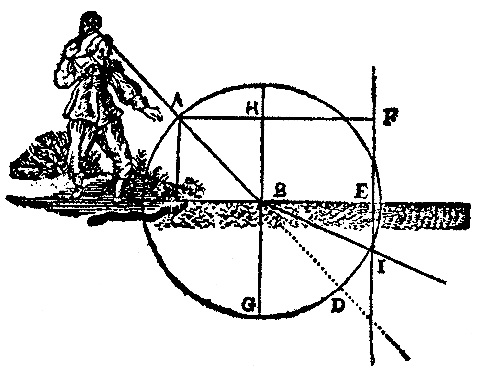
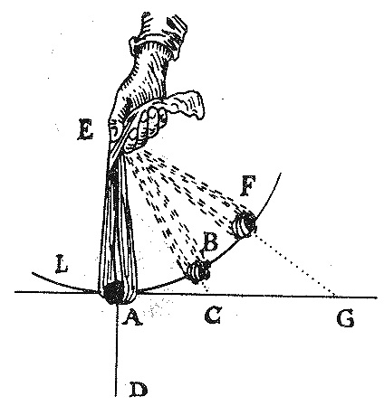
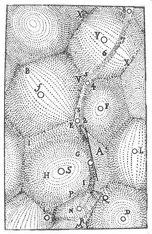

# 笛卡尔的物理学 physics (Edward Slowik)

**首次发表于 2005 年 7 月 29 日；2025 年 10 月 20 日实质修订。**

尽管勒内·笛卡尔（1596–1650）作为现代哲学的奠基人之一而颇为知名，但他在现代物理学发展中的影响性角色，直到二十世纪后半叶，总体上一直都被科学史家和科学哲学家所低估和忽视。笛卡尔不仅提供了自然定律与运动守恒原理的第一个明确现代表述，而且构造出了后来成为十七世纪晚期最流行的行星运动理论。正如著名科学史家克利福德·特鲁斯德尔（Clifford Truesdell）所观察到的，“〔笛卡尔的物理学〕是现代意义上理论的起点”（Truesdell 1984, 6）[^truesdell-1984]。然而，尽管笛卡尔的物理学具有前瞻性、看似现代的诸多方面，他的许多物理学假说却与受亚里士多德影响的晚期中世纪和文艺复兴经院哲学的科学有着密切的亲缘关系。正是这种关于物理世界的旧与新概念的独特混合，可能解释了当前学界对笛卡尔物理学兴趣的复兴。

## 1. 笛卡尔科学工作简史

尽管他以纯粹形而上学问题（如身心关系、上帝存在）的哲学家而闻名，但断言笛卡尔首先是科学家、其次是哲学家，当不为错。笛卡尔在科学上的兴趣与工作不仅贯穿其整个学术生涯，而且他一些最重要的形而上学著作（如《沉思集》）是由一种感知到的需要所促成的，即为他的科学配备一个可为受亚里士多德影响的经院学者所接受的形而上学基础。然而，必须小心不要把现代观念强加于早期几个世纪的“自然哲学”，因为十七世纪的科学在很大程度上与该时代更具思辨性的形而上学难以区分（因此“自然哲学”这一称谓特别适用于描述十七世纪的科学）。事实上，笛卡尔的许多科学只是一个远为庞大的体系的一部分，该体系涵盖哲学探究的所有领域，包括他的物理学和形而上学。

笛卡尔对物理学兴趣的觉醒通常被定于 1618 年末，当时笛卡尔首次遇见艾萨克·贝克曼（Isaac Beeckman），一位业余科学家兼数学家，他倡导新的“机械”哲学。机械哲学对自然现象的解释——笛卡尔很快采纳了它——拒斥经院哲学实体形式的使用（见第 2 节）。相反，机械路径青睐一种接触或碰撞模型，用以说明小的、不可观察的“微粒”（corpuscles）物质的相互作用（这些微粒只拥有有限数量的、主要是几何性的属性，如大小、运动、形状等）。在接下来的十年中，笛卡尔在科学和数学两方面的众多问题上都作了研究，尤其侧重于光的理论、力学（包括流体静力学）以及地面物体的自由下落。笛卡尔这一时期的许多成果既高度数学化，又只涉及特定的物理问题，与其同时代人伽利略的工作不无相似。这些年的成就之一包括他发现折射定律，常被称为斯涅耳定律：当光从一种介质进入另一种介质时，入射角的正弦与折射角的正弦保持恒定的比值。然而，到 1630 年代初，笛卡尔开始着手一个更具雄心的计划，即构建一个系统的知识理论，包括物理学。其成果便是《世界》（1633），这部重要文本实质上包含了机械/几何物理学的蓝图，以及行星运动的旋涡理论，笛卡尔在其整个科学生涯中不断加以精炼和发展。然而，在出版这部论著之前，他得知教会（1633 年）因伽利略宣扬日心说而对其加以谴责，这促使笛卡尔撤回其作品不予出版（因为笛卡尔在《世界》中也主张日心说）。在 1630 年代，《几何学》、《光学》和《气象学》的出版，连同哲学导论《方法谈》（1637），进一步提出了笛卡尔关于折射定律、视觉和彩虹等论题的假说。然而，除了在《方法谈》（第四、五部分）中对他的形而上学和物理学作简要概述外，对他的物理学的全面论述须待 1644 年《哲学原理》的出版。这部著作不仅代表了笛卡尔最充分、最详尽地研究物理学，而且（在第一部分）提供了其物理体系的形而上学基础。作为其成熟观点的体现，《哲学原理》因而将构成我们考察笛卡尔物理学的基础。

### 1.1 关于原始文本的说明

译文（略有出入）取自 Descartes 1979、1983、1984a、1984b、1991，但引文按标准惯例以 Adam 和 Tannery 版《笛卡尔全集》（1976）为准：先写“AT”，后跟卷号和页码。然而，引自《哲学原理》的段落则以“Pr”标识，后跟卷号和条目，并以末尾的“F”表示包含 1647 年法文译本的新材料。

### 1.2 推荐阅读

关于笛卡尔物理学的近期深入研究，见 Garber 1992a 与 Des Chene 1996。Schuster 2014 涵盖笛卡尔早期的物理学，从 1618 年到 1633 年。笛卡尔物理学的一个简明概述可见 Garber 1992b。笛卡尔的科学生涯（特别强调其物理学）见 Shea 1991；另见 Gaukroger, Schuster, Sutton 2000 关于其自然哲学的诸多方面。Gaukroger 2002 考察《哲学原理》，尤其是其中的物理学，而 Slowik 2002 则主要聚焦于笛卡尔的空间与关系运动。笛卡尔物理学中许多内容的历史背景亦见于 Ariew 2011。关于笛卡尔自然哲学的方法论，见 Smith 2009，而 Hattab 2009、Machamer and McGuire 2009 与 Brown and Normore 2019 则涵盖对其物理学重要的各种观念的发展。关于笛卡尔著作的接受与早期笛卡尔主义诸形式（特别关注物理学），见 Schmaltz 2005, 2017 与 Dobre 2017。

## 2. 笛卡尔物理学的策略

与他的许多同时代人一样（如伽利略与伽桑狄），笛卡尔在很大程度上设计其机械理论，是为了反驳广泛持有的、基于亚里士多德的经院哲学对自然现象的解释，这种解释使用了一种“实体形式”与“原初质料”的本体论。简言之，经院自然哲学把一个物质物体视为由一种惰性的、无属性的基底（原初质料）和一种承载性质的本质（实体形式）共同构成，其中后者提供物体的因果能力。例如，一份物质只有与一个确定的形式（台球、椅子等的）相结合，才拥有重量、颜色、质地及所有其他物体属性。笛卡尔承认，他早年曾持有这样一种重力观，把实体形式设想为物体的一种目的导向的（目的论的）心灵属性：“尤其使我清楚地认识到，我的重力观念大体上取自于我关于心灵的那个观念的事实在于：我曾以为，重力把物体引向地心，仿佛它自身对地心有所知。因为这事若无知则决不可能发生，而除了在心灵之中，不可能有任何知识”（AT VII 442）。在《世界》中一段富有启示性的文字里，笛卡尔宣称经院假说既是一种不可理解的、也是不充分的方法论进路，用以解释自然现象：

> 如果你觉得奇怪，我不像〔经院〕哲学家们那样使用人们所谓的冷、热、湿、干等性质，那么我告诉你：这些性质在我看来需要加以解释；而如果我没有弄错的话，不仅这四种性质，而且所有其他的性质，甚至无生命物体的一切形式，都可以得到解释，而无须为此在它们的质料中假定任何别的东西，只须假定运动、大小、形状及其各部分排列即可（AT XI 25–26）。

笛卡尔的计划是：把热、重量、味等一类形而上地可疑的性质，还原为大小、形状和运动等经验上可量化的属性。换言之，笛卡尔打算以只需延展属性即可描述自然界显见秩序的理论，取代经院自然哲学中受“心灵”影响的物理性质描绘。因此，笛卡尔是后来所谓的“第一性/第二性”性质区分的最早倡导者之一，这一概念在经院哲学的批评者当中颇为“流行”。

尽管如此，即使笛卡尔的机械论自然哲学回避了实体形式的形而上学，其潜在的方法论或科学进路仍与经院传统非常接近。到撰写《哲学原理》时，笛卡尔已形成一种方法，该方法像经院学者那样，力求基于据称简单而不可反驳的“事实”和/或观察——这些事实与观察或来自对概念的理性反思，或来自日常经验——来解释关于实在最根本方面的自然现象。这些据称基本的事实由此为其物理学假说提供了所需的形而上学基础：换言之，人们从我们对一般形而上学事项（如物质实体及其样式的本质）的“清晰而分明”的知识出发，推出关于特定物理过程（例如自然定律）的具体结论。这种开展科学的方式与现代进路截然相反，自不待言，因为现代科学家并不首先从事对第一原理的形而上学探求，以之作为其工作的基础。然而，这恰恰是笛卡尔对伽利略物理学提出的批评（在 1638 年致梅森的信中）：“〔伽利略〕没有考虑自然的第一原因，只是寻求对少数特定结果的解释，因而是在没有地基的情况下建造”（AT II 380；另见《哲学原理》法文译本序言，AT IXB 5–11）。《哲学原理》——笛卡尔最全面的科学著作——的结构反映了这些优先考虑：第一部分重述了（《沉思集》中著名的）关于上帝存在、心灵实体及其他形而上学论题的论证；而其余各部分则进而解释物质实体的本质、物理学、宇宙论、地质学及其他科学分支，据称皆基于这些基本的形而上学真理。这种对形而上学基础的执着，以及由之推出的对自然现象的因果说明，或许也能说明《哲学原理》中何以缺少笛卡尔更数学化的物理学工作，例如他对光的折射定律的发现。正如他在《指导心灵的规则》（1628）中所论证的，纯粹数学家只关心求比与比例，而自然哲学家则旨在理解自然（AT X 393–395）。现代物理学的发展——它与现代数学密不可分——因而与笛卡尔形而上学进路中显而易见的潜在经院主义形成鲜明对照。

## 3. 空间、物体与运动

笛卡尔关于空间与物体的许多假说，最好被视为中世纪/文艺复兴哲学中一场长期争论的延续，这场争论围绕亚里士多德的格言展开，即凡具有维度性的东西就是物体（见 Grant 1981）[^grant-1981]。虽然一些哲学家（如 Telesio、Campanella 和布鲁诺）认为空间总是充满物质（即充满体），却不知何故独立于物质，但另一些人（如 Patrizi 和伽桑狄）则赞同一种更绝对论的概念，允许完全没有物质的真空。笛卡尔拒斥这些关于虚空的、反亚里士多德的观念，把物质实体的定义性属性，即“本质”，等同于三维空间延展：“构成一物体所占据空间的、在长、宽、深上的延展，与构成该物体的延展完全相同”（Pr II 10）。因此，不可能存在一个独立于物体的空间（Pr II 16），因为一切空间延展就是物体本身（而且他拒斥一种无延展的真空的可能性）。例如，如果上帝移除了容器内的物质（以致空无一物），那么容器的壁将立即变得彼此相邻（但并非通过运动；Pr II 18）。值得注意的是，笛卡尔关于容器壁必然变得相邻的主张，在经院学者中颇为常见，因为他们也接受空间延展需要一种基底来支撑延展这一观念（见 Grant 1981, 122）[^grant-1981]。笛卡尔论证，就空容器而言，“虚无不可能拥有任何延展”，因为“一切距离都是延展的一种样式，因而若无延展实体则不可能存在”（Pr II 18）。虽然笛卡尔接受实体—属性形而上学，但对空容器情境的拒斥似乎更多地源于其唯名论，即只有个别事物存在，而共相只是名称和对个别事物的抽象。正如他在《哲学原理》前文就数而言所说的，“当数不被视为任何被造物中的，而只是在抽象中或一般地加以考虑时，它只是一种思想样式”（Pr I 58）。

笛卡尔对“空间”的实际概念可被视为从这种物体的空间延展中作出的一种概念性抽象，他也称之为“内在位置”：

> 我们把一种属的统一性归于〔某物体的〕空间的延展，以致当充满该空间的物体被更换时，空间本身的延展不被视为已改变或被移动，而仍被视为同一个；只要它保持同样的大小和形状，并在某些借以规定该空间的外部物体之间保持同样的位置。（Pr II 10F）

相对于任意选定的一组物体，因此可以谈到充满体一部分的、不同延展物体先后“占据”的抽象（属的）空间延展；而且，可以推测，通过这种抽象过程，整个充满体的内在位置也能同样地建构出来。笛卡尔对时间采取类似看法，时间被视为对特定物体的“绵延”的一种概括性抽象（其中绵延是实体的一种属性；Pr I 55–57；关于笛卡尔的时间观另见 Gorham 2007）[^gorham-2007]。同样与经院学者一样，笛卡尔拒斥任何形式的原子论，即存在最小的不可分的物质粒子的观点。相反，他认为，既然任何给定的空间延展长度在思想中都是可分的，那么上帝就有能力实际地分割它（Pr II 20）。在笛卡尔物理学中相互作用的物质实体以不同的单元或微粒（corpuscles）出现（见第 7 节），这解释了他的机械体系常被冠以的“微粒论”（corpuscularian）称号，但这些微粒并非不可分。

笛卡尔的《哲学原理》也呈现了他对运动现象最详尽的讨论，运动被定义为“某一物质或某一物体，从紧邻它的那些被视为静止的物体附近，转移到另一些物体的附近”（Pr II 25）。笛卡尔试图把他的“本真的”运动概念（作为相邻物体“邻域”的变化）与通常或“通俗的”运动概念（作为内在位置的变化）区分开来（Pr II 10–15, 24–28）。这些包容物体（与被包容物体相邻）的表面也被称为被包容物体的“外在位置”。笛卡尔指出，通俗的运动概念允许一个物体同时参与许多（可能相互矛盾的）运动，例如船上一个坐着的乘客，相对于船的各个部分把自己视为静止，但相对于岸则并非静止（Pr II 24）。然而，当运动被视为相邻邻域的平移时，一个物体只能参与一种运动，这消解了表面的矛盾（因为该物体要么静止，要么远离其相邻邻域而平移）。

尽管如此，笛卡尔的运动假说可能认可一种相对运动，因为他的措辞“被视为静止”意味着，哪些物体静止或运动的选择纯粹是任意的。根据“关系”理论（或至少关系主义的更严格版本），空间、时间和运动只是物体之间的关系，而非以任何方式独立于物质物体的、单独存在的实体或属性。运动只作为物体之间的“相对差异”而存在：即物体并不具有个别的、确定的速率、速度、加速度属性（例如，物体 *C* 具有“每小时 5 英里”的速率属性）；相反，真实存在的只是它们的相对速率、速度和加速度上的差异（例如，物体 *C* 与 *B* 之间存在“每小时 5 英里”的速率差异）。笛卡尔对运动的分析中若干段落似乎支持这种强关系主义：“我们不能设想物体 *AB* 从物体 *CD* 的邻近被移走，而不也理解物体 *CD* 从物体 *AB* 的邻近被移走”（Pr II 29）。因此，“运动物体中所有真实的、肯定的属性，以及我们据此说它们运动的属性，也存在于与它们相邻的那些物体之中，即使我们认为后一组是静止的”（Pr II 30）。这种关系运动形式在近来的文献中被称为“转移的相互性”。然而，正如将在后文讨论的，笛卡尔也认为静止与运动是物体不同的状态，这一观点就运动而言与严格关系主义不相容。因此，笛卡尔的转移相互性只在运动物体（即当物体与其相邻邻域之间存在明显的平移时）那里满足关系主义（连同其对个别运动状态之禁止）。笛卡尔物理学所关联的许多困难，都可追溯到笛卡尔赋予其运动假说的巨大本体论负担。在后文我们将考察把他的运动说明与笛卡尔自然定律整合的问题，但此刻需要对笛卡尔关于运动与物体的定义的表观循环性作一简要讨论。在把运动描述为物体从周围物体邻域的转移之后，笛卡尔说，我在这里“把某一体，或某一部分物质，理解为一切同时被转移的东西”（Pr II 25）。问题当然在于，笛卡尔把运动定义为相邻物体的变化，然后又进而把物体定义为运动（平移、转移）的东西。尽管这种循环性威胁着笛卡尔物理学的整个大厦，但笛卡尔可能有意让运动与物体在他的理论中具有同等的本体论重要性，以致两者都不是更根本的概念（后者作为构建或定义另一概念的基础）。然而，它们固有的相互关系意味着，任何对一者的定义尝试都不可避免地要纳入另一者。不过，对笛卡尔推理的这种重构的问题在于，笛卡尔明确地把运动视为延展的一种“样式”；其中样式是一个较低的本体论范畴，大致可理解为延展表现自身的一种方式，或延展的一种“属性”（Pr I 53；形状也被提到作为延展的一种样式）。最后，笛卡尔理论中隐含的另一困难在于：一个静止的物体，按照物体和位置的定义，似乎会“融入”周围充满体：即如果物体是“一切同时被转移的东西”，那么就不可能把一个静止物体与形成该静止物体外在位置的周围充满体物质区分开来。此外，笛卡尔拒斥任何用其粒子之间的联结来解释物体坚固性的说明（因为联结本身要么是实体要么是属性，因而联结的坚固性想必也需解释；Pr II 55）。一个宏观物质物体本质上只靠其组成物质部分的相对静止而聚在一起。这引出明显的困难，即这类物体的碰撞应导致它们的散开或毁灭（因为没有什么把它们聚在一起）。这类复杂情况促使许多后来的自然哲学家——他们通常同情笛卡尔的机械哲学——去寻求物质的一种内在属性，使之能充当物体的一种个体化与构成性原则；例如莱布尼茨对“力”的运用。

与运动与物体定义的表观循环性以及静止物体问题相关的，是调和笛卡尔对“实体”的定义与其关于个别物体是实体的主张的困难。如果像笛卡尔所相信的，实体为了存在而不依赖其他事物（Pr I 51），那么延展的任何部分（如前所述，通过 Pr II 10，它就是一个物体）就不够格成为实体，因为它依赖其相邻邻居来划定并规定其边界。然而，笛卡尔常常宣布个别物体是实体；例如，“一份物质的这两半，无论多么微小，都是两个完整的实体”（AT III 447）。对这一困难最流行的回应之一——从斯宾诺莎（《伦理学》，第一部分，命题 15）到许多当代评论者（如 Keeling 1968、Lennon 1993、Sowaal 2004、Schmaltz 2020 及众多其他人）[^keeling-1968][^lennon-1993][^schmaltz-2020][^sowaal-2004]——是宣布只有整个充满体才是实体，而它的任何组成部分都不是。然而，这种尝试性解决方案的问题在于，它缺乏文本支持，正如上面 Pr I 51 的引文所显明的。同样，这些重构中的一些，例如伦农（Lennon）的，似乎违反笛卡尔物理学和形而上学的核心方面，因为他把运动解释为心灵的现象性贡献，以致充满体及其部分根本不动或不变。沿着同样的思路，一些学者（如 Schaffer 2009）[^schaffer-2009]得出结论：笛卡尔是一位超级实体主义者，即认为空间（在现代语境中为时空）是唯一可述谓的或基本的实体。虽然笛卡尔把物体实体与空间等同起来（见上文，Pr II 10）似乎支持这一解读，但超级实体主义把空间视为第一位的，而把物质视为第二位的或派生于空间的（见 Sklar 1974, 222）[^sklar-1974]。相反，笛卡尔把物质或物体视为第一位的，而把空间视为派生的、抽象的概念：“构成物体本性的同一延展也构成空间的本性，而……这两者只以属或种的本性不同于个体的本性的那种方式相区别”（Pr II 11）。既然空间对笛卡尔而言是一个属或种的概念（这是一个共相；Pr I 59），那么空间对超级实体主义者而言就是个体，因而把超级实体主义归于笛卡尔违反了他的唯名论（Pr II 8）。的确，笛卡尔在《哲学原理》这一部分寻求把物体延展与空间延展等同起来的原因在于，他力求拒斥任何把空间视为独立于物质的、分离的、通常非物体的实体的观点（例如流行的想象空间传统，它是绝对论或实体主义概念的先驱）：“物体实体，当与它的量或延展区分开来时，被混乱地设想为仿佛是非物体的”（Pr II 9）。

## 4. 运动定律与笛卡尔守恒原理

笛卡尔物理学最突出的成就是三大自然定律（它们实质上就是物体运动的定律）。牛顿自己的运动定律将以此为蓝本，这在笛卡尔的前两条自然定律中显而易见：第一条断言“每一事物，尽其所能，总是保持同一状态；因而一旦被移动，它就总是继续运动”（Pr II 37），第二条则认为“一切运动就其本身而言都是沿直线的”（Pr II 39；这两条后来被纳入牛顿第一运动定律）。通过宣布运动与静止是物质物体的原始 **状态**，无须进一步解释，以及物体只在受到外在原因作用时才改变其状态，断言笛卡尔帮助奠定了现代动力学（研究物体在力作用下运动的学科）的基础，并不夸张。对于受亚里士多德影响的经院学者——他们曾努力确定造成地面物体“受迫”运动（与它们趋向充满体特定区域的“自然”运动相对）的因果原理——这些强制性的、非自然的运动的解释，似乎在于某种内在的物体属性，或外在的动因，它们被一物体暂时拥有或施加于其上——这种解释说明了物体运动既发端于、也终结于静止状态这一事实（因为在地球表面，土元素没有任何自然运动）。例如，根据中世纪“冲力”（impetus）理论，当一种性质从运动的或受限的源（比如从拉开的弓到等待的箭）直接传递给一物体时，这些受迫运动就发生了。这种性质造成所观察到的物体运动，直到它完全耗尽为止，从而带来受迫运动的停止（以及箭落回地面）。经院观点隐含的基本信念是：地面物体位于地球上时持续抵抗从静止状态的变化，因为冲力性质的耗尽最终导致物体回到其原初的、静止的、在地的条件。另一方面，笛卡尔以一种全新的视角解释运动现象，因为他承认惯性运动（匀速或非加速运动）作为自然的物体状态，与物体静止的观念并列且地位对等。他论证，“因为经验似乎在许多场合向我们证明了这一点，我们仍然倾向于相信一切运动都因自身本性而停止，或物体有朝向静止的倾向。然而这无疑与自然定律完全矛盾；因为静止是运动的反面，而任何东西都不会因自身本性而趋向其反面或自身的毁灭”（Pr II 37）。虽然可以找到若干自然哲学家，其早期或同时代的工作强烈预示了笛卡尔在前两条定律上的成就——即伽利略和艾萨克·贝克曼（见 Arthur 2007）[^arthur-2007]——但《哲学原理》所提出的精确表述却相当独特（尤其是就第二条定律而言，因为伽利略和贝克曼似乎都认可一种圆形的惯性运动，这可能暴露了经院学者关于天体元素的圆周运动的影响）。在以上引文中也可看到经院主义与新物理学的一种引人入胜的融合，因为笛卡尔在其“任何东西都不会因自身本性而趋向其反面或自身的毁灭”这一陈述中诉诸了相反性质的逻辑。即静止与运动是相反或对立的状态，而既然对立状态（按经院原则）不能相互转化，那么静止的物体将保持静止，运动的物体将保持运动。因此，笛卡尔运用了一个经院/中世纪的论证，来为现代物理学形成中或许最重要的概念即惯性奠基。然而，必须注意，笛卡尔的前两条定律并不对应于现代惯性概念，因为他错误地把（匀速、非加速的）运动与静止视为不同的物体状态，而现代理论则规定它们是同一状态。

虽然笛卡尔的前两条定律处理个别物体的静止与运动，但第三运动定律则明确设计来揭示若干物体在碰撞和相互作用中展现的性质。简言之，第三定律处理在他充满物质的世界中正常条件下物体的行为；当它们碰撞时：“第三定律：一个物体，与较强的物体接触时，不损失任何运动；但与较弱的物体接触时，它损失的多寡恰等于它转移给该较弱物体的运动”（Pr II 40）。在《哲学原理》随后的章节中，笛卡尔明确了这一第三定律所提到的守恒量：

> 然而，我们此刻必须仔细注意，每个物体反抗另一物体或抵抗那另一物体之作用的力在于什么：即在于每一事物尽其所能、按上述第一定律力求保持同一状态这一单一事实……这个力不仅必须由它所处的物体的大小、由分隔此物体与周围物体的〔表〕面积来度量，而且还必须由它的运动的速度和本性，以及物体彼此接触的不同方式来度量。（Pr II 43）

作为其第一运动定律的结果，笛卡尔坚持认为碰撞中守恒的量等于每个撞击物体的大小与速度之积的总和。尽管这是一个难解的概念，但物体的“大小”大致对应于它的体积，表面积也起着间接的作用。这个守恒量——笛卡尔不加区分地称之为“运动”或“运动量”——在历史上意义重大，因为它标志着最早尝试找到物体相互作用的不变或不变特征之一。举例来说，如果一个大小为 3、速度为 5 的物体 *B* 与一个大小为 2、速度为 4 的物体 *C* 碰撞，那么该系统的运动量总和为 23，这个量在碰撞后仍保持，即使两物体可能具有不同的速度。

此外，笛卡尔把运动量的守恒设想为整个宇宙的基本支配原则之一。他推理，当上帝创造宇宙时，一个有限的运动量（运动量）被传递给其物质居住者；而且，上帝在每个接续时刻都持续保存这个量。（关于上帝对物质世界的持续再创造或保存这一困难问题的更多讨论，见，例如 Gorham 2004、Hattab 2007 与 Schmaltz 2008）[^gorham-2004][^hattab-2007][^schmaltz-2008]。

> 显而易见，当上帝最初创造世界时，他不仅以各种方式移动其各部分，而且同时使其中一些部分推动另一些部分，并把它们的运动转移给这些另一些部分。因此，在以他创造世界时的同一行动和同一律令来维持世界时，他保存运动；运动并非总是包含在物质的同一部分之中，而是根据各部分接触的方式从一些部分转移给另一些部分。（Pr II 62）

在《哲学原理》中，笛卡尔的守恒定律只承认物体的运动程度，它与标量“速率”（speed）相关联，而非矢量的“速度”（velocity）概念（后者是给定方向上的速率）。速率与速度之间的这种区分，在笛卡尔的七条碰撞规则中显现出来，这些规则精确详尽地说明了物体碰撞的结果（尽管这些规则只描述沿同一直线行进的两物体之间的碰撞）。笛卡尔对速率概念的使用贯穿这些规则。例如：

> 第四，如果物体 *C* 完全静止，……而且如果 *C* 略大于 *B*，那么后者就绝不可能有推动 *C* 的力，无论 *B* 以多大的速率接近 *C*。相反，*B* 将被 *C* 向相反方向弹回：因为……一个静止的物体对高速率的抵抗大于对低速率的抵抗；而且这随速率之差的增大而成比例地增加。因此，*C* 中抵抗的力总是大于 *B* 中推动的力，……（Pr II 49F）

令人惊讶的是，笛卡尔声称，一个较小的物体，无论其速率如何，都永远无法推动一个较大的静止物体。尽管这显然与常识相悖，但第四条碰撞规则确实很好地展示了笛卡尔动力学中速率的标量性质，以及运动量的首要重要性。在这一规则中，笛卡尔面临在较大物体完全静止、因而运动量为零的情况下保存总运动量的问题。笛卡尔通过给静止物体 *C* 配备一个足以偏转运动物体 *B* 的抵抗力来保存联合运动量，这一解决方案确实在 *C* 静止的情形下维持了运动量。即，既然 *B* 只是改变其惯性运动的方向，而非其大小或速率程度（而且 *C* 在整个相互作用中为零），系统的总运动量得以保存。对笛卡尔而言，反转 *B* 的运动方向并不改变总运动量，这一结论与后来的假说（通常关联于牛顿和莱布尼茨）形成鲜明对照，后者把方向的变化视为对初始速率（即速度）的否定。因此，由于未能预见把方向与速率结合的重要性，笛卡尔的定律与动量守恒的现代定律失之交臂。

在此语境中，应讨论“决定”（determination）这一复杂概念，因为它大致对应于物体运动量的合成方向。在一些段落中，笛卡尔显然把物体运动的方向称为其决定：“运动本身与它在某一方向上的决定之间有所区别；这一区别使得在运动量保持不变的同时改变决定成为可能”（Pr II 41）。然而，一个单一的运动并不只有一个决定，这在他对霍布斯关于决定解释的批评中显而易见：“他〔霍布斯〕接着说的，即‘一个运动只有一个决定’，正如我说一个延展的东西只有一个形状一样。然而这并不妨碍形状被分成若干组成部分，正如对运动的决定也可以如此处理一样”（1641 年 4 月 21 日；AT III 356）。正如一个特定的形状可以分割成各种组成图形一样，一个特定的决定也可以分解为各种组成方向。在他 1637 年出版的《光学》中，笛卡尔对折射定律的推导似乎赞同这种对决定的解释。如果一个球以 45 度角从左向右向下射出，然后穿透一层薄麻布，那么它在穿透麻布后将继续向右运动，但此刻与地平线几乎平行的角度。笛卡尔推理，方向的这种改变（从 45 度角到更小的角）是球的向下决定因与麻布碰撞而减小这一净结果，“而〔决定中〕使球趋向右边的那一个必须始终保持不变，因为麻布对这一方向的决定毫无阻碍”（见图 1）。

图 1.

图 1.《光学》中的图示。

笛卡尔的决定假说也包含某种定量要素，这在一个进一步的、常有争议的假说中显现出来，它常被称为“最小样式作用原理”。在 1645 年 2 月 17 日致克莱尔塞利耶（Clerselier）的信中，笛卡尔解释说：

> **当两个物体碰撞，且它们包含不相容的样式时**，〔即速率的不同状态，或运动的不同决定〕 **那么就必然在这些样式中发生某种变化以使它们相容；但这种变化总是所能发生的最小变化。** **换言之，如果这些样式在改变其中一定量时能够变得相容，那么就不会有更大的量改变**，（AT IV 185）。

这一原理可以用我们先前涉及第四条碰撞规则的例子来说明。如果 *B* 和 *C* 在碰撞后以相同速率和相同方向离开，那么较小的物体 *B* 就必须把它至少一半的运动量转移给较大的静止物体 *C*。然而，笛卡尔推理，在这种情境下 *B* 只是反转其方向比转移其运动更容易：

> 当 *C* 是较大的〔物体〕时，*B* 不能把它推到 *C* 前面，除非它把超过其一半的速率，连同超过其一半的、从左向右运动的决定（就这一决定与其速率相联而言），转移给 *C*。相反，它弹回而不移动物体 *C*，只改变它的整个决定，这是一个比从超过一半的决定连同超过一半的速率所产生的那种变化更小的变化（AT IV 186）。

因此，反转 *B* 的运动方向（一种样式，即决定的变化）构成一种比两物体之间转移运动更小的样式变化，后者改变两种样式（速率和决定）。在这一段落中，必须注意，如果 *B* 把运动转移给 *C*，那么它将既改变 *B* 一半的速率，也改变其一半的决定，即使 *B* 的运动量方向得以保存。结果，物体的决定显然与其速率的大小相关联。

## 5. 关系运动的问题

如前几节所讨论的，笛卡尔的运动定律有多种方式违反严格关系主义。最成问题的情况之一涉及第四条和第五条碰撞规则的关系相容性。第四条规则得出结论：一个较大的物体在与较小的运动物体碰撞时保持静止，以致较小的物体沿其初始路径被弹回；而第五条规则得出结论：一个较大的物体将推动一个较小的静止物体，“把其运动转移给〔较小物体〕，其多寡足以使两者随后以相同速率行进”（Pr II 50）。然而，从关系立场看，规则四和规则五构成同一种碰撞，因为它们都涉及一个小物体和一大物体之间相同的相对运动（或速率差）的相互作用。人们或可诉诸笛卡尔的基本信条——运动与静止是物体不同的内在状态，或转移相互性论题——来规避这一困难（见第 3 节）：即，一个物体相对于其相邻邻域是否正在平移，存在本体论差异，而这足以把规则四的情形与规则五区分开来（因为大物体在规则四中真正静止，在规则五中真正运动）。

然而，这一推理路线的问题在于：只有当预先假定两物体正在相互接近时它才有效，而这并非仅参照每个物体自身的相邻邻域就能捕捉到的系统特征。即使物体与其邻域之间存在转移相互性，除非参照某个能计算两物体彼此相对运动的参考系，否则仍不可能确定碰撞将落入哪条碰撞规则，甚至不可能确定两物体是否会碰撞。假设，例如，某一空间距离分隔开两物体，其中一物体正相对于其邻近物体平移，另一物体则没有。在这种情境下，不可能确定：（i）平移物体是否正接近非平移物体，还是（ii）它们之间的空间间隔保持不变，而平移物体只是经历邻域的变化（即邻域相对于一个静止物体移动）。简言之，笛卡尔的转移相互性论题使他的物体碰撞的结果成为欠定，也使应用笛卡尔碰撞规则并据之作预测的能力成为欠定。碰撞规则的语境也支持这一观点：撞击物体的运动是从一个外在参考系确定的，而非从它们相邻邻域的局部平移确定的。例如，在阐明第四条规则时，笛卡尔说 *B* 永远无法推动 *C*，“无论 *B* 以多大的速率接近 *C*”（Pr II 49）——而只有一种外在视角，与物体的转移相互性无关，才能确定 *B* “接近” *C*。这样的承认使调和笛卡尔的物理学与空间和运动的严格关系理论变得非常困难，尽管它可能与较弱的关系主义形式相容，后者能够容纳各种外在参考系、结构或其他确定物体运动个别状态的方法。然而，这些较弱的关系主义策略（甚至非关系的、绝对论的解释）对笛卡尔物理学而言代价高昂，因为转移相互性论题必须被放弃。基于这些原因，笛卡尔的转移相互性论题更可能意在反驳任何把运动视为由物体属性引起的解释，正如一些经院学者（如布里丹）所主张的，而非为关系运动辩护（关于这些早期运动观，见 Maier 1982）。即，如果运动物体中没有任何东西与其相邻邻域的物体不同（见 Pr II 30），那么物体的运动就不是因为它拥有邻域所缺乏的某种特殊属性。

支持“笛卡尔的转移相互性假说意在否认运动是一种属性或实体”这一推测的额外证据，可在笛卡尔 1649 年与亨利·摩尔（Henry More）的通信中窥见。摩尔询问，吹过塔窗的风是否也属于一种相互转移，以致风可被视为静止而塔在运动（AT V 312）。虽然没有直接回答摩尔的问题，笛卡尔反而给出一个涉及两人试图解放搁浅船只的例子，其中一人在船上推岸，另一人在岸上推船：

> 除了把一种情境摆在你们眼前，我无法更好地说明两物体彼此分离时一物体相对于另一物体的相互力〔vires〕：一艘船搁浅在河岸，有两个人，其中一人在岸上用手把船推离岸，另一人在船上同样用手推岸，从而也把船拉离岸。如果两人的力相同，那么岸上那人（他由此与陆地相连）的努力，对船的运动所作的贡献，并不小于船上那人（他随船一起被搬运）的努力。因此显而易见，使船离开岸的那个作用，同样在岸上，也在船上（AT V 346）。

简言之，笛卡尔已把船与岸之间的转移相互性——一种不涉及力的纯粹运动学事件——替换为一种涉及两个可能的运动来源（即每个人之推）之间力（或作用）相互性的情境。虽然对摩尔原初问题缺乏直接回应，强烈表明笛卡尔拒绝了运动塔的选项，从而削弱了支持关系运动的转移相互性解释，但可以论证，笛卡尔提供的替代性的力的相互性叙事，才构成对关系运动解释更大的威胁。即，笛卡尔可能正在援引后来成为牛顿第三运动定律的一个早期版本，即每个作用都有一个大小相等、方向相反的反作用，以作为“运动是物体之间实体的力之转移的结果”这一观点的替代。换言之，如果推动船的力“同样在岸上，也在船上”，那么“船因从岸上那人转移来的力而运动”这一主张就被驳斥了。这一解释在他“运动是一种转移，而非进行转移的力或作用”（Pr II 25）的主张中获得进一步支持。

## 6. 笛卡尔物理学中的“力”

尽管笛卡尔对运动和物体相互作用的分析具有机械的、非目的论的特征，但笛卡尔物理学中仍有许多看似形而上学和定性的特性，与他那种还原论（即物质物体只是延展及其样式）并不相宜。事实上，回到笛卡尔自然定律（第 4 节），显然笛卡尔已把一种基本角色分配给物体“力”或“倾向”的作用：例如，物体遵循直线的倾向、一个大的静止物体（对较小的运动物体）的运动抵抗等。在《世界》中，他说：“物体中推动自身的力量或能力，完全可以全部或部分地传给另一物体，从而不再存在于第一个物体之中；但它不可能不再存在于世界之中”（AT XI 15）。作为关于其守恒原理的早期评论，这一解释似乎把力设想得颇像个别物质对象所拥有的一种属性或“能力”，类似于经院学者的定性、形而上学的属性（如在“冲力”理论中那样）。基于这些原因，物体力或倾向的本性，是研究笛卡尔物理学中一个颇受关注的哲学问题。

为了更好地把握笛卡尔力的具体角色，仔细考察他的离心效应理论将是有益的，它与第二自然定律密切相关。除了直线运动，笛卡尔的第二条定律还提到圆周运动的物质物体的“离心的”（离心）倾向：“一切运动就其本身而言都是沿直线的；因此，作圆周运动的物体总是倾向于离开它们所描述的圆的中心”（Pr II 39）。乍看之下，第二条定律似乎对应于现代科学对离心力的剖析：具体而言，作圆周运动的物体（如投石索中的石头）所经历的离心效应，是物体沿直线切向路径离开该圆之倾向的正常结果。然而，正如其第二条定律所述，笛卡尔（错误地）主张物体倾向于沿直线离开其圆周轨迹的中心。即，旋转的石头所施加的力——表现为对阻碍的投石索向外的“拉”——是一种朝向直线惯性运动的努力的结果，这种努力从圆心径向向外，而非旨在沿圆的切线的直线运动的努力。然而，笛卡尔确实承认切向运动在说明这种“离心”倾向中的重要性，但他把这一现象降格为一种复合效应的从属地位。按他的估算，作圆周运动的物体所展现的遵循切向路径的倾向（如石头脱离投石索时的飞行），可由两种更基本或更原初的倾向构建：其一，物体继续沿其圆周路径的倾向；其二，物体沿径向线远离中心的倾向。因此，笛卡尔愿意承认“同一物体在同一时间可以有朝向不同运动的努力”（Pr III 57），这一判断似乎预设了接受某种类似于他对决定之剖析的“组合”倾向理论。然而，既然他相信“投石索……并不阻碍〔物体沿圆周路径的〕努力”（Pr III 57），他最终把产生离心力效应的全部责任归于“努力”的径向分量。他说，“如果不是考虑〔物体〕运动的全部力，而只注意其中一部分，其效果被投石索所阻碍；……我们就会说，当石头位于点 *A* 时，它只努力〔运动〕朝向 *D*，或者说它只是试图沿直线 *EAD* 离开中心 *E*”（Pr III 57；见图 2）。

图 2.

图 2. 伴随 Pr III 57 的图示。

笛卡尔在其旋转投石索例子中对“倾向”和“努力”两词的使用，不应与先前关于运动决定的概念等同。一个决定限于物体的实际运动，而物体朝向运动的倾向只发生在单一瞬间。他说：“当然，没有任何运动是在一个瞬间完成的；然而显而易见，每个运动物体在其运动的任何给定时刻，都倾向于沿直线朝某一方向继续该运动，……”（Pr II 39）。在《哲学原理》另一段落中，笛卡尔把这些努力称为运动的“第一次准备”（Pr III 63）。因此，虽然决定需要跨越若干瞬间，但朝向运动的倾向只在单一瞬间显现。这是一个关键区分，因为它把笛卡尔动力学分为两个本体论阵营：存在于时间瞬间的力，与只能在若干时间瞬间过程中存续的运动。此外，在《哲学原理》的许多地方，笛卡尔提示运动量是这些物体倾向的度量，因而运动量具有双重角色，既作为非瞬间物体运动的度量，也作为瞬间物体倾向的度量（见 Pr III 121）。

鉴于他拒斥物理学中的经院定性传统，笛卡尔把离心效应描绘为运动物体的“倾向”或“努力”的结果，由此引出一系列引人入胜的本体论问题（甚至可能暴露他早期经院训练的残留影响）。即，即使他偏爱几何世界观——体现在把延展视为物质的首要性质——笛卡尔仍继续把惯性运动及其伴随的力效应当作物体的本质特征来处理。此外，笛卡尔本人关于惯性力本体论地位的评论，暴露出某种程度的模棱两可与犹豫不决。在 1638 年的一封信中（《哲学原理》前六年），他总结道：我不承认物体中有任何惯性或天然的迟钝……；而且我认为，一个人仅仅行走，就使地球的整个质量微微移动，因为他现在把重量放在一处，现在又放在另一处。尽管如此，我同意……当最大的物体（如最大的船只）被某个给定的力（如风）推动时，它们总是比别的物体运动得慢。（AT II 467）

在这一段落中，笛卡尔似乎否认惯性力的存在——如果把它构想为物质物体能够拥有的一种经院性质的话；相反，物体“对运动无差别”，因此甚至最轻微的重量也应使整个地球运动。另一方面，他愿意承认这一常见观察到的事实：较大的物体比较小的物体更难被启动运动。因此，尽管笛卡尔认为“抵抗的力”（或“天然的迟钝”）的存在成问题——正如重量这类类似属性那样——他并没有完全把惯性贬为所谓的物质第二性属性（如颜色、味等只存在于心灵中的东西）的现象学地位。把惯性力效应纳入科学话语的主要理由，或许可追溯到笛卡尔把运动归类为延展的内在特征或“样式”（见第 3 节）。正如《哲学原理》结尾部分所说：“我现在已经证明，〔物质〕对象中除了……大小、形状和运动的某些安排之外，别无其他……”（Pr IV 200）。既然惯性力是运动的后果或副产品，是物体大小乘速率的积，笛卡尔显然不反对把这些现象纳入对物质实体样式的讨论。

然而，即使笛卡尔把力描述为物质相互作用的一种内在事实，力与物质之间关系的确切本性仍相当不清楚。特别地，力是一种实际上包含或存在于物体之中的属性吗？还是某种由速率和大小之作用而来的派生的现象效应，因而不存在于延展之中？在前一种解释下（如 Gabbey 1980、Gueroult 1980 与 Schmaltz 2008 所赞同的）[^gabbey-1980][^gueroult-1980][^schmaltz-2008]，力在至少一种重要意义上作为“真实的”属性或样式存在于物体之中，其在场促成了笛卡尔自然定律。虽然笛卡尔的许多解释似乎都支持这一解释（例如，“〔一个〕静止的物体有力保持静止”，Pr II 43），但丹尼尔·加伯（Daniel Garber）指责这类观点有悖于笛卡尔的要求，即延展单独构成物质的本质。加伯建议，我们应把笛卡尔的力视为对上帝在世界中维持的动力规律性的一种简写描述，而非物体内部某种形式的性质：“〔笛卡尔碰撞定律讨论〕中进入讨论的力，可以简单地被视为谈论上帝如何行动、从而产生物体规律性行为的种种方式；前进的力与抵抗的力，是谈论上帝如何……以一种物体的状态之持存与另一种物体的相平衡的方式”（Garber 1992a, 298；另见 Hatfield 1979、Des Chene 1996 与 Manchak 2009，以了解更多的进路）[^des-1996][^garber-1992a][^hatfield-1979][^manchak-2009]。在与守恒原理相关的若干段落中，加伯的解释显然获得可信度。例如：“因此，在以他〔上帝〕创造世界时的同一行动和同一律令来维持世界时，他保存运动；运动并非总是包含在物质的同一部分之中，而是根据各部分接触的方式从一些部分转移给另一些部分”（Pr II 42）。

一切物体属性完全依赖于延展这一点，在笛卡尔对不可入性的分析中得到很好的展示；不可入性是物质现象的一个特征，他的许多同时代人（如摩尔和伊丽莎白公主）以及后来的评论者（最著名的是莱布尼茨）都会在他们对笛卡尔物质的批评中援引它。例如，在与摩尔的通信中，笛卡尔声称“物体中的不可入性有点像人身上的笑的能力；……它是一种‘第四种性质’，而非如我所主张的延展那样的真实而本质的区别特征”（AT V 269）。他后来提供了关于不可入性如何源自延展的更详细解释：

> 此外，不可能设想一个延展东西的一部分穿透另一个相等的部分，而不由此理解总延展的一半被取走或消灭；但被消灭的东西并不穿透任何别的东西；所以，依我之见，不可入性属于延展的本质而非任何别的东西的本质，这一点已经确立。（AT V 342）

虽然确切的过程未被揭示，但可能的或许是：笛卡尔关于一切物体的运动量（大小乘速率）的守恒定律，在这一假说中是相关因素（AT VIIIA 61–62）：如果碰撞物体相互穿透，而这等同于其中一个物体的延展被消灭，那么世界的总运动量就减少，从而违反守恒定律。总体而言，笛卡尔把一切物体属性还原为纯粹延展的尝试，仍是其物理学中较为激进的方面之一，它给任何试图把力（作为延展之外的独立属性）归于笛卡尔物体的尝试都带来严重障碍。然而，必须承认，笛卡尔把延展单独挑选为物质实体唯一本质的决定——体现在他要求物体中除“大小、形状和运动的某些安排”之外别无其他——如此不清楚和模棱两可，以致能够容纳上述两种解释。所能稳妥得出的结论只是：笛卡尔把与物体状态相联的力视为物质物体存在的基本、或许是原初的事实——这是一个宽泛的判断，通过拒绝站队，它回避了这一困难的本体论争论。

## 7. 笛卡尔宇宙论与天体物理学

笛卡尔的行星运动旋涡理论，最初被证明是笛卡尔物理学最有影响的方面之一，至少直到大约十八世纪中叶。对笛卡尔而言，旋涡是一个大的、作圆周运动的物质粒子带。本质上，笛卡尔的旋涡理论试图解释天体现象，尤其是行星的轨道或彗星的运动，其方法是将它们（通常处于静止）置于这些大的圆周运动带中。因此，整个笛卡尔充满体由一系列分离的、相互咬合的旋涡网络或系列构成。例如，在我们的太阳系中，旋涡内的物质已形成一组分层带，每带安放一颗行星，它们以不同的速率绕太阳运行。构成旋涡带的微小物质粒子，要么是原子大小的球粒（第二物质），要么是大元素碰撞与断裂后遗留的“无限地”小的碎屑（第一物质）；相比之下，第三物质则构成大的、宏观的物质元素（Pr III 48–54）。物质的三重划分，连同三大自然定律，在笛卡尔体系中负责一切宇宙论现象，包括重力。如 Pr III 140 所描述的，当一颗行星或彗星逃离旋转中心的、径向向外的倾向（即离心力；见第 6 节），被构成旋涡环的微小元素中相等的倾向所平衡时，它就静止在一个旋涡带中。如果行星比某一特定旋涡中的小元素具有更大或更小的离心倾向，那么它将分别升到下一最高的旋涡（并可能与该带中的粒子达到平衡），或被推到下一最低的旋涡——而这后一情境最终提供了笛卡尔对重力或“沉重”现象的解释。更具体地说，笛卡尔认为，环绕地球的微小粒子以同样方式说明地面重力（Pr IV 21–27）。至于旋涡体系的形成，笛卡尔推理，赋予充满体的守恒运动量最终导致了当前的旋涡构型（Pr III 46）。上帝首先把充满体分成大小相等的部分，然后把这些物体置于各种圆周运动中，这些运动最终形成了物质的三大元素和旋涡体系（见图 3）。

图 3.

图 3.《哲学原理》中的充满体旋涡，Pr III 53。

除了只要求惯性运动及其伴随的力效应的本体论节俭之外，笛卡尔选择作圆周运动的粒子带，可能也出于对——用更好的措辞说——充满体“拥挤”的担忧。在《哲学原理》中，他论证：“已经表明……所有场所都充满物体……。由此推出，没有物体能够运动，除非在一个完整的物质圆或物体环中，它们同时都在运动”（Pr II 33）。因此圆周运动对笛卡尔是必要的，因为没有空洞的空间供运动物体占据。虽然世界被描述为“无限地”大（Pr I 26–27，只有上帝获得更肯定的描述，即无限），但单个物体的非圆周运动可能违反笛卡尔守恒原理，因为它导致一种不确定的物质位移。附带一提，调和笛卡尔的碰撞规则与他关于一切物体运动都沿圆周路径发生的主张极为困难；此外，既然构成圆周路径的物体同时运动，那么从“物体”的定义（见第 3 节）似乎推出只有一个运动物体（而非许多）。

回到旋涡理论，笛卡尔把《哲学原理》的相当一部分用于阐明各种天体现象，同时采纳并调整大量次级假说，把他的整体机械体系应用于特定的天体事件。这些解释中较著名的一个是笛卡尔的旋涡坍缩理论，它也提供了关于彗星起源的假说（Pr III 115–120）。简言之，笛卡尔认为，相当数量的第一元素物质持续在相邻旋涡之间流动：当物质从一个旋涡的赤道流出时，它进入其邻居的两极。在正常情况下，第一物质从一个旋涡的两极流入其中心，即太阳，太阳本身由第一物质构成。由于离心力，这些粒子在开始向赤道推进时向外压向周围的第二球粒（Pr III 120–121）；第一与第二元素所施加的（对一个人视神经的）压力也作为光的原因（Pr III 55–64, IV 195）。既然相邻旋涡也拥有同样的膨胀倾向，一种膨胀力的平衡就阻止了邻近旋涡的侵占。然而，偶尔地，太阳表面上较大元素的积聚——即太阳黑子——可能合谋阻止来自两极的第一元素物质的流入。如果太阳黑子最终覆盖太阳的整个表面，那么旋涡剩余的第一物质将在赤道处被排出，因而它不再有向外压力的来源来阻止邻近旋涡的侵占。一旦旋涡被其膨胀的邻居吞没，结壳的太阳可能成为新旋涡中的一颗行星，或最终成为穿过许多旋涡的一颗彗星。

总体而言，旋涡理论为自然哲学家提供了一种高度直观的天体现象模型，与机械哲学相容。该理论被认为优于牛顿的万有引力理论，因为它没有设定一种神秘的、隐秘的性质（重力）作为行星轨道或地面物体自由下落的原因。旋涡理论同样为所有行星轨道的共同方向提供了一种内置的解释。此外，旋涡理论使笛卡尔能够赞同一种日心说（即太阳中心的世界）而不触犯教会的审查。由于地球据称的运动是教会反对伽利略科学的主要理由之一，笛卡尔希望通过把地球置于一个绕太阳旋转的旋涡带中的静止位置来避免这一反对，以致地球相对于其旋涡带中邻近物质粒子的包容表面不发生位置变化（Pr III 24–31；及第 3 节）。通过这一巧妙的手法，笛卡尔随后能够主张地球不动——凭借他的位置和运动定义——同时仍维持地球绕太阳运行的日心说假说。“严格地说，地球并不运动，任何行星也不运动；尽管它们被天空携带着”（Pr III 28）。然而，从长远看，笛卡尔的旋涡理论因两个根本原因而失败：其一，笛卡尔及其追随者从未发展出一种系统的数学处理，能够匹敌（不断改进的）牛顿理论的准确性和预测范围；其二，笛卡尔自然哲学家对圆形运动粒子动力学各种观念（例如使用装满小粒子的大型旋转桶）的许多检验，并不符合《哲学原理》所提出的预测（见 Aiton 1972）[^aiton-1972]。

## 参考文献

**以下文献从原文照录，不作翻译；中国文献条目（古今）一律译为中文。**

[^aiton-1972]: Aiton, E. J., 1972, *The Vortex Theory of Planetary Motions*, London: MacDonald.

[^ariew-2011]: Ariew, R., 2011, *Descartes among the Scholastics*, Leiden: Brill.

[^arthur-2007]: Arthur, R., 2007, “Beeckman, Descartes and the Force of Motion”, *Journal of the History of Philosophy*, 45: 1–28.

[^brown-2019]: Brown, D., and Normore, C., 2019, *Descartes and the Ontology of Everyday Life*, Oxford: Oxford University Press.

[^descartes-1976]: Descartes, R., 1976, *Oeuvres de Descartes*, C. Adams and P. Tannery (eds.), Paris: J. Vrin.

[^descartes-1979]: –––, 1979, *The World*, M. S. Mahoney (trans.), New York: Abaris Books.

[^descartes-1983]: –––, 1983, *Principles of Philosophy*, V. R. Miller and R. P. Miller (trans.), Dordrecht: Kluwer Academic Publishers.

[^descartes-1984a]: –––, 1984a, *The Philosophical Writings of Descartes, Vol. 1*, J. Cottingham, R. Stoothoff, and D. Murdoch (eds.) (trans.), Cambridge: Cambridge University Press.

[^descartes-1984b]: –––, 1984b, *The Philosophical Writings of Descartes, Vol. 2*, J. Cottingham, R. Stoothoff, and D. Murdoch (eds.) (trans.), Cambridge: Cambridge University Press.

[^descartes-1991]: –––, 1991, *The Philosophical Writings of Descartes, Vol. 3: The Correspondence*, J. Cottingham, R. Stoothoff, and D. Murdoch (eds.) (trans.), Cambridge: Cambridge University Press.

[^des-1996]: Des Chene, D., 1996, *Physiologia: Natural Philosophy in Late Aristotelian and Cartesian Thought*, Ithaca: Cornell University Press.

[^dobre-2017]: Dobre, M., 2017, *Descartes and Early French Cartesianism: Between Metaphysics and Physics*, Bucharest, Zeta.

[^gabbey-1980]: Gabbey, A., 1980, “Force and Inertia in the Seventeenth Century: Descartes and Newton”, in *Descartes: Philosophy, Mathematics and Physics*, S. Gaukroger (ed.), Sussex: Harvester Press.

[^garber-1992a]: Garber, D., 1992a, *Descartes’ Metaphysical Physics*, Chicago: University of Chicago Press.

[^garber-1992b]: –––, 1992b, “Descartes’ physics”, in *The Cambridge Companion to Descartes*, J. Cottingham (ed.), Cambridge: Cambridge University Press.

[^gaukroger-2000]: Gaukroger, S., Schuster, J., Sutton, J. (eds.), 2000, *Descartes’ Natural Philosophy*, London: Routledge.

[^gaukroger-2002]: Gaukroger, S., 2002, *Descartes’ System of Natural Philosophy*, Cambridge: Cambridge University Press.

[^gorham-2004]: Gorham, G., 2004, “Cartesian Causation: Continuous, Instantaneous, Overdetermined”, *Journal of the History of Philosophy*, 42: 389–423.

[^gorham-2007]: –––, 2007, “Descartes on Time and Duration”, *Early Science and Medicine*, 12: 28–54.

[^grant-1981]: Grant, E., 1981, *Much Ado About Nothing: Theories of Space and Vacuum from the Middle Ages to the Scientific Revolution*, Cambridge: Cambridge University Press.

[^gueroult-1980]: Gueroult, M., 1980, “The Metaphysics and Physics of Force in Descartes”, in *Descartes: Philosophy, Mathematics and Physics*, S. Gaukroger (ed.), Sussex: Harvester Press.

[^hatfield-1979]: Hatfield, G., 1979, “Force (God) in Descartes’ Physics”, *Studies in History and Philosophy of Science*, 10: 113–140.

[^hattab-2007]: Hattab, H., 2007, “Concurrence or Divergence? Reconciling Descartes’s Metaphysics with His Physics”, *Journal of the History of Philosophy*, 45: 49–78.

[^hattab-2009]: –––, 2009, *Descartes on Forms and Mechanism*, Cambridge: Cambridge University Press.

[^keeling-1968]: Keeling, S. V., 1968, *Descartes*, 2nd edition, Oxford: Oxford University Press.

[^lennon-1993]: Lennon, T., 1993, *The Battle of the Gods and Giants: The Legacies of Descartes and Gassendi, 1655–1671*, Princeton: University of Princeton Press.

[^machamer-2009]: Machamer, P., and McGuire, J. E., 2009, *Descartes’ Changing Mind*, Princeton: Princeton University Press.

[^manchak-2009]: Manchak, J., 2009, “On Force in Cartesian Physics”, *Philosophy of Science*, 76: 295–306.

[^schaffer-2009]: Schaffer, J., 2009, “Spacetime the one Substance”, *Philosophical Studies*, 145: 131–148.

[^schmaltz-2005]: Schmaltz, T. (ed.), 2005, *Receptions of Descartes: Cartesianism and anti-Cartesianism in Early Modern Europe*, London: Routledge.

[^schmaltz-2008]: –––, 2008, *Descartes on Causation*, Oxford: Oxford University Press.

[^schmaltz-2017]: –––, 2017, *Early Modern Cartesianisms: Dutch and French Constructions*, Oxford: Oxford University Press.

[^schmaltz-2020]: –––, 2020, *The Metaphysics of the Material World: Suarez, Descartes, Spinoza*, Oxford: Oxford University Press.

[^schuster-2014]: Schuster, J., 2014, *Descartes–Agonistes: Physico–mathematics, Method and Corpuscular–Mechanism 1618–1633*, Dordrecht: Springer.

[^shea-1991]: Shea, W. R., 1991, *The Magic of Numbers and Motion: The Scientific Career of René Descartes*, Canton, Mass.: Science History Publications.

[^sklar-1974]: Sklar, L., 1974, *Space, Time, and Spacetime*, Berkeley: University of California Press.

[^slowik-2002]: Slowik, E., 2002, *Cartesian Spacetime*, Dordrecht: Kluwer.

[^smith-2009]: Smith, K., 2009, *Matter Matters: Metaphysics and Methodology in the Early Modern Period*, Oxford: Oxford University Press.

[^sowaal-2004]: Sowaal, A., 2004, “Cartesian Bodies”, *Canadian Journal of Philosophy*, 34: 217–240.

[^truesdell-1984]: Truesdell, C., 1984, *An Idiot’s Fugitive Essays on Science*, New York: Springer Verlag.

[^wilson-2019]: Wilson, M., 2019, “What I’ve Learned from the Early Moderns”, *Synthese*, 196: 3465–3481.

[^wilson-2021]: –––, 2021, “The Evil Deceiver Strikes Again”, *Australasian Journal of Philosophy*, doi:10.1080/00048402.2021.1943471

## 学术工具

* [如何引用本词条](https://plato.stanford.edu/cgi-bin/encyclopedia/archinfo.cgi?entry=descartes-physics)。
* [预览本词条的 PDF 版本](https://leibniz.stanford.edu/friends/preview/descartes-physics/)，见 [SEP 学会之友](https://leibniz.stanford.edu/friends/)。
* 在 [InPhO](https://www.inphoproject.org/entity?sep=descartes-physics&redirect=True) 查找与本词条相关的话题与思想家。
* 在 [PhilPapers](https://philpapers.org/sep/descartes-physics/) 查看本词条的增强文献目录及其数据库链接。

## 其他网络资源

[欢迎向作者提出建议。]

## 相关词条

笛卡尔，勒内：认识论 | 笛卡尔，勒内：生平与著作 | 伽利略·伽利莱 | 皮埃尔·伽桑狄 | 艾萨克·牛顿：论空间、时间与运动 | 空间与时间：绝对空间与关系空间及运动，牛顿之后的理论

**（译注：相关词条的中文站内链接将由管线在对应词条重译完成后统一挂接。）**
