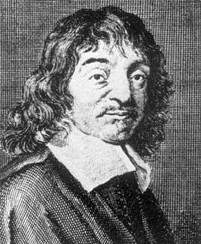

# 笛卡尔的生平与著作 Descartes's Life and Works (Kurt Smith)

*首次发表于 2001 年 4 月 9 日；2023 年 3 月 1 日实质修订。*

笛卡尔被誉为第一位现代哲学家。他以在几何与代数之间作出重要联系而闻名，这使得几何问题能经由代数方程求解。他也以提出一种新的物质观而闻名，这使得物理现象能经由力学解释来说明。然而他最著名的是撰写了一部相对简短的作品《第一哲学沉思集》（*Meditationes de Prima Philosophia*），出版于 1641 年，在其中他为科学的可能性提供了哲学基础。

## 1 早年

笛卡尔于 1596 年 3 月 31 日生于拉艾，为若阿基姆·笛卡尔与让娜·布罗夏尔之子。他是若干幸存子女之一（两个兄弟姐妹和两个同父异母兄弟姐妹）。他父亲是律师兼治安法官，这显然很少留下家庭时间。笛卡尔的母亲在他出生后次年五月去世，他、他的同胞兄弟和姐妹皮埃尔与让娜交由拉艾的祖母抚养。约十岁时，1606 年，他被送入拉弗莱什的耶稣会学院。他在那里学习到 1614 年，1615 年进入普瓦捷大学，一年后获得教会法与民法学士和执业资格。关于其论文的历史和文本，参见以下补充文件：

[笛卡尔的法学论文](descartes-works.history.md)

1618 年，二十二岁时，他加入拿骚的莫里斯亲王的军队。他的具体职责不详，尽管巴耶提出他很可能被吸引到如今所谓工兵部队（Baillet, Livre 1, Chapitre 9, p. 41）。该部队会从事应用数学，设计各种旨在保护和协助战斗士兵的结构与机器。另一方面，索雷尔指出，在笛卡尔驻扎的布雷达，军队“兼作欧洲大陆年轻贵族子弟的军事学院”（Sorell, p. 6）。而高克罗格指出，年轻贵族的教育围绕利普修斯（1547–1606）的教育模式构建，他是一位在科隆接受耶稣会教育的备受尊敬的荷兰政治理论家（Gaukroger, pp. 65–6）。尽管历史记录表明布雷达有军事存在，但没有确凿证据支持存在一个完全的“学院”。有理由认为笛卡尔可能是士兵，但大多数传记作者提出，更可能他的职责更偏向工程或教育。

驻扎布雷达期间，笛卡尔遇见伊萨克·贝克曼（1588–1637）。笛卡尔保存的与其通信相关的笔记表明，他和贝克曼已超越单纯的相识——他们的关系更似师生（笛卡尔为后者）。这一关系在笛卡尔心中重新燃起对科学的浓厚兴趣。除关于自然科学广泛主题的讨论外，贝克曼提出的某些问题的直接结果迫使笛卡尔撰写《音乐提要》（*Compendium Musicae*）。《提要》除其他内容外，试图建立在比例或比率概念之上的和声理论，这些概念（沿古人思路）试图以数学术语表达和声概念。它在笛卡尔生前不会出版。至于贝克曼，笛卡尔后来会淡化其影响。

## 2 《世界》与《方法谈》

1619 年笛卡尔离开军队后，他此后几年的行踪不明。基于他在 1637 年出版的《方法谈》（*Discours de la Methode*）中所说，有人推测他在乌尔姆附近度过一段时间（笛卡尔显然 1619 年出席了法兰克福斐迪南二世的加冕礼）。有证据表明 1622 年他在法国，因为正是此时他继承的财产被出售——其收益将为他提供多年简单收入。有人推测 1623 至 1625 年间他访问了意大利。笛卡尔于 1625 年在巴黎出现，他的笔记表明他与最小的修会成员马兰·梅森神父（1588–1648）有联系。这一关系会促使笛卡尔公开其自然哲学（科学）思想。正是经由梅森，笛卡尔的著作才落入巴黎一些最优秀头脑之手——例如安托万·阿尔诺（1612–1694）、皮埃尔·伽桑狄（1592–1655）和托马斯·霍布斯（1588–1679）。

1628 年笛卡尔离开巴黎。此时他似乎正在撰写《指导心灵的规则》（*Regulae ad Directionem Ingenii*），一部他后来放弃的著作，有人推测约在离开巴黎时。值得注意的是，相对最近在剑桥大学一座图书馆发现了一份《规则》抄本。学者们不确定它如何到那里。目前，基于其内容，据信这份手稿代表笛卡尔 1628 年放弃该著作时的状态。后来的阿姆斯特丹印本（1701）和莱布尼茨从克莱尔塞利耶处获得的抄本（约 1670）在剑桥手稿所见基础上有所进展。因此，似乎笛卡尔重新拾起了这部著作。有人推测这可能发生在 1635 年约翰·杜里（1596–1680）和塞缪尔·哈特利布（1600–1662）来访之后，哈特利布报告杜里带着笛卡尔某些著作的抄本返回英国（Fallon, pp. 9f）；推测认为最近发现的手稿与杜里带回之物有关。会面发生在海牙。杜里和哈特利布是剑桥哲学家亨利·莫尔（1614–1687）的朋友，笛卡尔曾与他通信，也是莫尔圈子中其他人（包括约翰·弥尔顿，1608–1674）的朋友。也许抄本作于访问期间并被带回剑桥。（无论如何，这是笛卡尔研究中的一个新而有趣的进展。）1630 年笛卡尔移居阿姆斯特丹。在那里他撰写《屈光学》（*Dioptrique*）和《气象学》（*Meteors*）的初稿，它们很可能旨在成为一部更大著作《世界》（*Le Monde*）的一部分。1632 年他再次迁居，这次到代芬特尔，显然为了教亨利·雷内里（1593–1639）他的物理学。也是在代芬特尔逗留期间，笛卡尔大概完成了《论人》（*Traite de l'homme*）的定稿，它与《屈光学》和《气象学》相联系，大概原本旨在成为《世界》的一部分。

当《世界》于 1633 年准备出版时，笛卡尔听到同年教会对伽利略（1564–1642）的谴责，决定不出版它。因为他在书中所采纳的世界体系，如伽利略的体系一样，假设了日心说的哥白尼模型。在 1633 年 11 月致梅森的信中，笛卡尔表达了他的恐惧：如果他出版《世界》，降临伽利略的同样命运也会降临他。尽管这是他可以理解地想要避免的，一些学者质疑笛卡尔所表达的担忧，因为他生活在荷兰会使其脱离天主教当局的掌控。《世界》似乎由若干较小但相关的著作构成：一部论物理学的著作、一部论力学（机器）的著作、一部论动物的著作和一部论人的著作。尽管《世界》的大部分已失传，其中一些似乎以附于《方法谈》的论文形式幸存，如前所述，《方法谈》将在四年后的 1637 年出版。其中一些是身后出版的。可以论证，康斯坦丁·惠更斯（1596–1687）收到了笛卡尔所谓《世界》的“三页纸”，连同 1637 年 10 月 5 日的信。这些“纸页”主要涉及力学。

约 1635 年，在乌得勒支大学，雷内里开始教授“笛卡尔式”物理学。也是在这一年，一位名叫海伦的仆人产下一个女婴，弗朗辛。热纳维耶芙·罗迪斯-刘易斯声称弗朗辛生于 1635 年 6 月 19 日（Rodis-Lewis, p. 40）。据 1635 年 7 月 28 日的洗礼记录，笛卡尔被命名为父亲（AT I 395n）。然而高克罗格声称洗礼日期是 1635 年 8 月 7 日（Gaukroger, p. 294）。1636 年雷内里在乌得勒支大学获得哲学正式教席，并继续建立对笛卡尔科学感兴趣的学生追随者。约 1636 年 3 月，四十岁时，笛卡尔移居莱顿以筹备《方法谈》的出版。1637 年它出版了。随着《方法谈》问世和在乌得勒支学生追随者的建立，笛卡尔似乎把注意力从事业转向家庭。在 1637 年 8 月 30 日的信中，我们发现他显然在为弗朗辛作安排，但奇怪地称她为他的“侄女”——这表明他不想让某些人知道他是父亲（或弗朗辛是非婚生）。高克罗格提出，尽管这一明显的否认父权，笛卡尔不仅与弗朗辛通信，而且 1637 年把她和海伦带到他在桑特普尔特或埃赫蒙德-比嫩的新居（Gaukroger, pp. 294, 332）。

《方法谈》是笛卡尔第一部出版的作品，在他放弃《世界》约四年后问世。《方法谈》因许多原因重要。例如，它告诉我们笛卡尔自己似乎如何看待他早年教育，尤其是他早年接触数学。罗杰·阿里乌提出，这些反思与其说是历史笛卡尔的，不如说是笛卡尔在讲述《方法谈》故事时采用的一个面具人格的（Ariew, pp. 58–63）。然而无可争辩的是，《方法谈》勾勒出笛卡尔体系的形而上学基础。此外，作为额外内容，它附有三部作品，显然是为了例证它所发展的探究方法而加入（尽管诚然不清楚该方法如何应用于这些论文）。所附论文是《屈光学》、《气象学》和《几何学》（*Le Geometrie*）。如前所述，《屈光学》和《气象学》很可能是原本为《世界》而作的著作的版本。

应当强调，三部所附论文独立于《方法谈》而重要，因为它们包含许多值得研究的内容。例如在《屈光学》中，笛卡尔推演了他的折射定律，并在此语境中推出后来所谓斯涅耳定律（笛卡尔似乎在 1632 年就推出了它）。此外，尽管《几何学》似乎凭空出现，但笛卡尔给自己笔记中有证据（克莱尔塞利耶据此重构了笛卡尔的部分书信），他早在 1619 年就在撰写其某个版本。例如，在 1619 年 3 月 26 日致贝克曼的信中，笛卡尔讨论了《几何学》中的主题，而在 1619 年 4 月 23 日的信中，他明确提到书名。正是在这部著作中，笛卡尔展示了某些几何问题如何能经由代数方程求解。

笛卡尔在几何与代数之间所作联系的重大意义确实巨大，因为没有它，物理学的数学化和微积分的发展可能不会在他们那时发生——一代人之后经艾萨克·牛顿爵士（1642–1727）和戈特弗里德·莱布尼茨（1646–1716）。然而应注意，尽管这部著作可能具有开创性，与许多人的主张相反，《几何学》中从未发展出“笛卡尔坐标系”（即今天教给代数学生的 *x*-*y* 坐标系），他也不是其他冠以其名的数学概念的创始者，例如“笛卡尔积”。卡尔·博耶指出，导致解析几何的各种概念首次见于《几何学》，而且《几何学》的数学记法至今仍在使用。但他论证，尽管笛卡尔几何被许多人视为与解析几何同义，事实是笛卡尔体系的基本目标与当代解析几何颇为不同（Boyer, pp. 370–1）。因此，宣称笛卡尔是解析几何的创始者，至少就我们今天所理解而言，是夸大其词。然而正如博耶正确指出的，这并不减损该著作在数学史上的重要性。

## 3 《沉思集》

1639 年笛卡尔开始撰写《沉思集》。1640 年他返回莱顿协助筹备出版。在这一年期间，笛卡尔的女儿弗朗辛去世。有证据表明他在她去世前后被叫离莱顿，不久即返回。有人推测他离开莱顿是为了在她身边。也是在这一年，笛卡尔的父亲和姐妹去世。笛卡尔与父亲（和兄弟）的关系是那种他的兄弟皮埃尔甚至懒得把他父亲去世的消息告诉他的。毋宁说，似乎是在梅森的一封信中笛卡尔才第一次得知此事。在 1640 年 12 月 3 日致梅森的后续信中，笛卡尔表达了对未能在他父亲去世前见到他的遗憾。但他拒绝离开莱顿参加父亲的葬礼，而是留下完成《沉思集》的出版。

今天，《沉思集》无疑是笛卡尔最受欢迎的作品——尽管在笛卡尔时代并非如此。这部作品对今天的学者因许多原因重要，其中不乏它作为附加文本收入了巴黎一些最优秀头脑所写的诘难。梅森把《沉思集》寄给哲学家和神学家批评。批评者名单包括：卡特鲁斯、霍布斯、阿尔诺、伽桑狄和梅森本人，还有几位通过梅森提出诘难的未具名读者。一个较晚版本会收入博尔丹的一个诘难。笛卡尔逐一回应每位批评者，结果是一个被称为“诘难与答辩”的附加文本。第二版共含七组。

《沉思集》开篇发展关于知识可能性的怀疑论问题。经由一系列经过仔细思考的沉思，读者（与作者一起）确立知识（scientia）可能性的基础。笛卡尔不是怀疑论者，正如一些人所坚持的，而是把怀疑论用作促使读者经由哲学考察“发现”什么构成这一基础的工具。在第二组答辩中，笛卡尔把这一呈现方式称为“分析的”方式。有两种呈现方式：分析的和综合的。重要的是不要把这些术语与例如康德所用的混淆。对笛卡尔而言，分析的呈现（和探究）方式通过从通常被视为已知者出发并发现这种知识所必需者来推进。因此，探究从通常所知者推进到第一原理。“发现”以每种发现都基于先前发现的方式推进。相反，综合的呈现方式通过断言第一原理然后确定由之推出者开始。应梅森之请，笛卡尔在第二组答辩中勾勒出《沉思集》的一个综合性呈现。

在确立科学基础的同时，笛卡尔同时推翻了一个已确立数世纪的自然哲学体系——一种定性的亚里士多德物理学。在 1641 年 1 月 28 日致梅森的信中，笛卡尔说“这六个沉思包含我的物理学的全部基础。但请不要告诉人们，因为那可能使亚里士多德的支持者更难赞同它们。我希望读者会逐渐习惯我的原理，并在他们注意到它们摧毁亚里士多德的原理之前认识到它们的真理性。”与其早期著作《世界》不同，《沉思集》与“旧”科学分道扬镳，而没有明确提出有争议的观点，如太阳系的哥白尼日心说模型。具体说，笛卡尔式观点否认物理学建立于热、冷、湿、干之上。它论证，与亚里士多德的观点相反，这类“性质”根本不是物体的属性。毋宁说，物理学家所能关注的物体的唯一属性是大小、形状、运动、位置等等——那些在概念上（或逻辑上）蕴含长宽深延展的样态。与亚里士多德的“性质”相对照，笛卡尔物理学所处理的物体属性（或样态）具体在比率尺度（而非强度尺度）上可测量，因而在一切正确方面服从数学（Buroker, pp. 596–7）。这一物质观，与《几何学》中所见那类数学相结合，与塔尔塔利亚、乌巴尔多和伽利略等意大利自然哲学家的工作结盟，并帮助推进早期思想家建立数学物理学的尝试。

笛卡尔致索邦“博学而杰出人士”的信（附于《沉思集》）表明，他试图把《沉思集》推销为大学的教科书。尽管博学人士的认可不能保证《沉思集》会被接受或用作教科书，它当然可被视为迈向被接受的重要一步。与今天的教科书概念不同，在笛卡尔时代，“教科书”主要供教师而非学生使用。通常，在教师职业生涯结束时，他的笔记会为那些将去教授此类课程材料的人之利益而出版。笛卡尔寻求教师接受和使用他的《沉思集》的笨拙，因他自己不是教师这一事实而被放大。因此，他寻求“教科书”地位很可能会被那些博学人士视为有点自负。可以说，他是与大学无学术或政治联系（除与梅森的联系外）的自由职业者。而且他当然缺乏像欧斯塔基乌斯这样的人的资历和声誉，后者的广泛使用的时代教科书正是《沉思集》大概旨在取代的那一类。尽管《沉思集》似乎得到索邦的认可，但它从未被采纳为大学文本。

## 4 《原理》

在与索邦相遇后不久，笛卡尔的公共生活进一步被荷兰神学家吉斯伯特·富提乌斯（1588–1676）复杂化。富提乌斯攻击雷吉乌斯，一位在乌得勒支大学教授医学的荷兰医生，因为他教授某些与传统神学教义冲突的“笛卡尔式”观念。雷吉乌斯是雷内里和笛卡尔的朋友，是笛卡尔哲学观点的坚定追随者。富提乌斯试图让雷吉乌斯被免去教授职位，不仅攻击笛卡尔的著作，还攻击他的品格。笛卡尔为辩护进入论争。争论会让雷吉乌斯被限制教授医学，而他发表的（他关于笛卡尔思想的）辩护会被富提乌斯正式谴责，后者将在五年内升任大学校长。在断断续续持续约五年的论争结束时，形势最终对笛卡尔变得绝望。他害怕被驱逐出境，也害怕看到自己的书被焚毁。他甚至会寻求保护，请求奥兰治亲王干预并平息富提乌斯的攻击。

1643 年，四十七岁时，笛卡尔移居埃赫蒙德-杜霍夫。随着富提乌斯论争似乎已成过去（尽管如上所述，它会在五年后再次抬头并达到顶点），笛卡尔和波希米亚的伊丽莎白公主开始通信。在这一通信中，伊丽莎白公主就他对心物二元论的承诺的含义探究笛卡尔。在此期间，他完成了一部新教科书的定稿，他三年前已开始撰写，即《哲学原理》（*Principia Philosophiae*），1644 年它出版了。他把它题献给伊丽莎白公主。

《原理》是一部重要文本。作品分为四部分，共五百零四条。第一部分发展笛卡尔的形而上学。尽管它似乎是《沉思集》的快速过一遍，但有许多不同。例如，上帝存在证明的呈现顺序，一些人论证这是重要的，见于第三和第五沉思，在《原理》中被颠倒。第二部分引入的原理基于第一部分的形而上学。而第三和第四部分发展的后续物理学基于第二部分的原理。尽管物理学结果证明是不健全的，《原理》仍然启发了诸如罗伯特·玻意耳（1627–1691）、埃德蒙·哈雷（1656–1742）和艾萨克·牛顿这样的伟大思想家。作为重要旁注，必须强调，尽管笛卡尔在其整个职业生涯中对数学极为强调，《原理》中发展的物理学似乎不是数学物理学。毋宁说，它传统上被视为一个只有一丝经验色彩的概念性工程——一个完全植根于形而上学的物理学。然而可以论证，笛卡尔在《规则》中关于枚举、秩序和度量的工作提供了建立“数学”物理学所需的概念机器——这一概念机器被带入《原理》（Smith 2003, 2010）[^smith-2003]。两部分，从未完成，原本旨在处理植物、动物和人。鉴于这一点以及笛卡尔在 1642 年 1 月 31 日致数学家康斯坦丁·惠更斯的信中所说，可以合理认为《原理》如果按计划完成，会看起来像《世界》。

《原理》提出的更有争议的立场之一，至少按牛顿的说法，是真空不可能。笛卡尔拒斥真空的可能性源于他承诺于物体本质是延展的观点。鉴于延展是属性，而无不能具有任何属性（AT VIIIA 25; CSM I 210），由此推出“无不能具有任何延展”（AT VIIIA 50; CSM I 231）。因此，任何延展实例都会蕴含某种实体的在场（AT VIIIA 25; CSM I 210）。换言之，真空，作为延展的 **无**，是十足的矛盾。物质宇宙因此是充实（plenum），个别物体仅由其表面分离。牛顿在他的《论重力》和《原理》中论证，如果宇宙被视为充实，运动概念就变得成问题。另一个有争议的立场是笛卡尔坚持物质无限可分。伽桑狄，后来还有科尔德穆瓦，论证物理宇宙必须有一个底，一个“实体”，一切有形之物的存在都依赖它。与古代原子论者伊壁鸠鲁一致，他们论证如果物质无限可分，那么如此分割它会显示没有底——因而有形性不会是实体性的。所以，如果有形性是实体性的，如笛卡尔自己所称，那必然存在一个（至少凭自然手段）不可分的延展最小量度。因此存在原子。但这一结论是笛卡尔在《原理》中明确拒斥的。

## 5 《论灵魂的激情》

1646 年，作为伊丽莎白公主探究的结果，笛卡尔完成了《论灵魂的激情》（*Passions de l'ame*）的工作初稿。也是在这一年，另一位显赫政治人物开始与笛卡尔通信，瑞典的克里斯蒂娜女王。雷吉乌斯出版了他视为笛卡尔科学的新改进版本，如我们现在所知，这会引起富提乌斯的愤怒。但雷吉乌斯并未止步于此，因为他似乎发现了他的“笛卡尔式”观点与笛卡尔观点的重大差异，并试图把两者分开，出版了一张列出二十一条反笛卡尔论题（他的“笛卡尔式”科学版本所拒斥的）的传单。作为回应，笛卡尔写了一份单页印刷辩护，张贴在公共报亭供所有人阅读。1648 年出版的《对某个纲领的注释》（*Notae in Programma Quoddam*，亦名《对某张传单的评论》）是笛卡尔的公开辩护。然而，如前所述，紧张情绪因公开交锋而加剧，笛卡尔感到他在荷兰的生活方式受到威胁。碰巧的是，笛卡尔的一位仰慕者和朋友——沙努，供职于克里斯蒂娜女王宫廷——和克里斯蒂娜女王本人开始探究笛卡尔来瑞典的可能性。而在一段不太长的通信之后，克里斯蒂娜女王向笛卡尔提供宫廷职位。因许多原因，其中肯定包括与他担忧富提乌斯相关者，笛卡尔接受了邀请。1649 年他动身前往瑞典。

克里斯蒂娜女王起初对笛卡尔要求甚少。然而据高克罗格所述，这会改变。因为，在他安顿一段时间后，她命令他做两件事：第一，把他所有论文整理有序；第二，为一座学院设计图纸（Gaukroger, p. 415）。可以论证，笛卡尔借其布雷达经验对后者如何做有一些想法。1650 年 1 月克里斯蒂娜女王开始要求笛卡尔给她上哲学课。这些显然从清晨五点开始，持续约五个小时。每周三次（Gaukroger, p. 415）。在此期间笛卡尔出版了《论灵魂的激情》，该著作主要产生于他与伊丽莎白公主（他把《原理》题献给她）的通信。《论灵魂的激情》的一个目标是解释人的情感（从而道德）生活如何与灵魂本质上与身体结合相联系。简言之，“灵魂的激情”是作为大脑活动直接结果而产生的一种心灵状态（或思想）。这类激情可以推动我们行动。既然如此，笛卡尔提出，人们需要学会控制自己的激情，因为它们可以推动人们做出恶行。包括伊丽莎白在内的笛卡尔批评者论证，笛卡尔的形而上学承诺对《论灵魂的激情》所阐明的观点施加了真正压力。因为，据笛卡尔的形而上学，心灵的本性是思想，身体的本性是在长宽深上延展。一种关于因果性的观点，笛卡尔的批评者似乎归于他的观点是：一物引起另一物运动，例如经由接触。在此语境中，接触似乎只能经由表面实现。现在，物体，由于是延展的从而有表面，能相互接触从而能相互引起运动。然而，如果心灵不延展，它们缺乏表面。而如果它们缺乏表面，原则上没有物体能与之接触的方式。因此，原则上没有物体推动心灵、反之亦然的方式。也就是说，心灵和物体原则上不能因果相互作用。所以，如果《论灵魂的激情》所阐明的观点要求物体和心灵能因果相互作用，而笛卡尔的形而上学承诺使这种相互作用不可能，那么笛卡尔的形而上学就对《论灵魂的激情》所阐明的观点施加了巨大压力。

尽管事情似乎在推进，但它们并不如人们所希望的那样顺利。例如，在 1650 年 1 月 15 日致布雷吉的信中，笛卡尔表达了对来瑞典决定的保留意见。他视自己“不在其所”，冬天如此严酷以致“人们的思想在这里冻结，像水一样”（AT V 467; CSMK III 383）。鉴于信中所表达的情绪，这一评论大概既想是笛卡尔对智识气候的看法，也是关于天气。二月初，在写给布雷吉不到一个月后，笛卡尔病倒了。他的病很快转为严重的呼吸道感染。尽管一周结束时他似乎朝康复有所进展，情况恶化，他于 1650 年 2 月 11 日清晨去世。他五十三岁。

## 参考文献

> 原文参考文献已转为脚注引用：文内“作者-年份”引用组后附 [^key] 标记，完整条目见本文末脚注定义。

### 原始文献（Primary Sources）

### 其他英译本（Other English Translations）

### 二手文献（Secondary Sources）

### 其他有用文献（Other Helpful Sources）

[^adam-nd]: In the above, the Adam and Tannery volumes, *Oeuvres De Descartes*, (11 volumes) are cited. Such citations are abbreviated as AT, followed by the appropriate volume and page numbers. I have whenever possible used the Cottingham, Stoothoff, and Murdoch translation, *The Philosophical Writings Of Descartes* (3 volumes). Volume 3 includes Anthony Kenny as a translator. This has been abbreviated as CSMK, followed by the appropriate volume and page numbers. The AT and CSMK numbers are cited, side by side, separated by a semicolon.

[^oeuvres-1983]: *Oeuvres De Descartes*, 11 vols., edited by Charles Adam and Paul Tannery, Paris: Librairie Philosophique J. Vrin, 1983.

[^philosophical-1988]: *The Philosophical Writings Of Descartes*, 3 vols., translated by John Cottingham, Robert Stoothoff, and Dugald Murdoch (Volume 3 including Anthony Kenny), Cambridge: Cambridge University Press, 1988.

[^meditations-1996]: *Meditations on First Philosophy*, translated by John Cottingham, Cambridge: Cambridge University Press, 1996.

[^principles-1983]: *Principles of Philosophy*, translated by V.R. Miller and R.P. Miller (Dordrecht: D. Reidel, 1983).

[^geometry-1954]: *The Geometry of René Descartes*, translated by David Eugene Smith and Marcia L. Lantham (New York: Dover Publications, 1954).

[^passions-1989]: *The Passions of the Soul*, translated by Stephen H. Voss (Indianapolis: Hackett Publishing Company, 1989).

[^ariew-1992]: Ariew, Roger, 1992, “Descartes and Scholasticism: the intellectual background to Descartes’ thought,” in *The Cambridge Companion to Descartes*, edited by John Cottingham, Cambridge: Cambridge University Press, pp. 58–90.

[^baillet-1691]: Baillet, Adrien, 1691, *La Vie de M. Descartes* (2 vols.), Paris.

[^boyer-1985]: Boyer, Carl B., 1985, *A History of Mathematics*, Princeton: Princeton University Press.

[^buroker-1991]: Buroker, Jill, 1991, “Descartes On Sensible Qualities,” *Journal Of The History Of Philosophy*, XXIX (4): 585–611.

[^gaukroger-1995]: Gaukroger, Stephen, 1995, *Descartes: An Intellectual Biography*, Oxford: Clarendon Press.

[^rodis-lewis-1992]: Rodis-Lewis, Genevieve, 1992, “Descartes’ life and the development of his philosophy,” in *The Cambridge Companion to Descartes*, edited by John Cottingham, Cambridge: Cambridge University Press, pp. 21–57.

[^smith-2003]: Smith, Kurt, 2003, “Was Descartes’s Physics Mathematical?” *History of Philosophy Quarterly*, 20 (3): 245–256.

[^sorell-1987]: Sorell, Tom, 1987, *Descartes*, Oxford: Oxford University Press.

[^alanen-2003]: Alanen, Lilli, 2003, *Descartes’s Concept of Mind*, Cambridge: Harvard University Press.

[^ariew-1998]: Ariew, R., and John Cottingham and Tom Sorell (eds.), 1998, *Descartes’* Meditations: *Background Source Materials*, Cambridge: Cambridge University Press.

[^bonnen-2002]: Bonnen, Clarence A., and Flage, Daniel E., 2002, *Descartes and Method: A Search for Method in Meditations*, London: Routledge.

[^broughton-2007]: Broughton Janet, and John Carriero (eds.), 2007, *A Companion to Descartes*, Oxford: Blackwell.

[^brown-2006]: Brown, Deborah, 2006, *Descartes and the Passionate Mind*, Cambridge: Cambridge University Press.

[^carriero-2009]: Carriero, John, 2009, *Between Two Worlds: A Reading of Descartes’* Meditations, Princeton: Princeton University Press.

[^carriero-2018]: –––, 2018, *Descartes and the Autonomy of the Human Understanding*, London: Routledge.

[^chappell-1997]: Chappell, Vere (ed.), 1997, *Descartes’s* Meditations: *Critical Essays*, Lanhan: Rowan & Littlefield Publishers, Inc.

[^clarke-2003]: Clarke, Desmond, 2003, *Descartes’s Theory of Mind*, Oxford: Oxford University Press.

[^cottingham-1998]: Cottingham, John (ed.), 1998, *Descartes*, Oxford: Oxford University Press.

[^cottingham-1994]: ––– (ed.), 1994, *Reason, Will and Sensation: Studies in Descartes’ Metaphysics*, Oxford: Clarendon Press.

[^cunning-2010]: Cunning, David, 2010, *Argument and Persuasion in Descartes’* Meditations, Oxford: Oxford University Press.

[^curley-1978]: Curley, E. M., 1978, *Descartes Against the Skeptics*, Oxford: Basil Blackwell.

[^de-2010]: De Rosa, Raffaella, 2010, *Descartes and the Puzzle of Sensory Representation*, New York: Oxford University Press.

[^des-2001]: Des Chene, Dennis, 2001, *Spirits and Clocks: Machine and Organism in Descartes*, Ithaca: Cornell University Press.

[^garber-1992]: Garber, Daniel, 1992, *Descartes’ Metaphysical Physics*, Chicago: University of Chicago Press.

[^garber-2001]: –––, 2001, *Descartes Embodied*, Cambridge: Cambridge University Press.

[^garber-1998]: Garber, Daniel and Michael Ayers (eds.), 1998, *The Cambridge History of Seventeenth-Century Philosophy*, 2 volumes, Cambridge: Cambridge University Press.

[^gaukroger-1995-2]: Gaukroger, Stephen, 1995, *Descartes: An Intellectual Biography*, Oxford: Clarendon Press.

[^gaukroger-2006]: ––– (ed.), 2006, *The Blackwell Guide to Descartes’ Meditations*, Oxford: Blackwell.

[^gueroult-1984]: Gueroult, Martial, 1984, *Descartes’ Philosophy Interpreted According to the Order of Reasons*, 2 vols., translated by Roger Ariew, Minneapolis: University of Minnesota Press.

[^fallon-1991]: Fallon, Stephen M, 1991, *Milton Among the Philosophers*, Ithaca: Cornell University Press.

[^hatfield-2002]: Hatfield, Gary, 2002, *Routledge Philosophy Guidebook to Descartes and the* Meditations, London: Routledge.

[^hausman-1997]: Hausman, David, and Hausman, Alan, 1997, *Descartes’s Legacy: Mind and Meaning in Early Modern Philosophy*, Toronto: University of Toronto Press.

[^kenny-1968]: Kenny, Anthony, 1968, *Descartes: A Study of His Philosophy*, Bristol: Thoemmes Press.

[^lennon-2008]: Lennon, Thomas M., 2008, *The Plain Truth: Descartes, Huet, and Skepticism*, Leiden: Brill.

[^machamer-2009]: Machamer, Peter and McGuire, J.E., 2009, *Descartes’s Changing Mind*, Princeton: Princeton University Press.

[^nelson-2006]: Nelson, Alan (ed.), 2006, *A Companion to Rationalism*, Oxford: Blackwell.

[^nolan-2016]: Nolan, Lawrence (ed.), 2016, *The Cambridge Descartes Lexicon*, Cambridge: Cambridge University Press.

[^rodis-lewis-1999]: Rodis-Lewis, Genevieve, 1999, *Descartes: His Life and Thought*, translated by Jane Marie Todd, Ithaca: Cornell University Press.

[^rorty-1986]: Rorty, Emelie Oksenberg (ed.), 1986, *Essays on Descartes’* Meditations, Berkeley: University of California Press.

[^rozemond-1998]: Rozemond, Marleen, 1998, *Descartes’s Dualism*, Cambridge: Harvard University Press.

[^smith-2010]: Smith, Kurt, 2010, *Matter Matters: Metaphysics and Methodology in the Early Modern Period*, Oxford: Oxford University Press.

[^smith-2015]: –––, 2015, *The Descartes Dictionary*, London: Bloomsbury.

[^smith-2018]: –––, 2018, *Simply Descartes*, New York: Simply Charly Press.

[^smith-2022]: –––, 2022, *This is Modern Philosophy: An Introduction*, Oxford: Wiley-Blackwell.

[^smith-2010-2]: Smith, Kurt and Nelson, Alan, 2010, “Divisibility and Cartesian Extension”, in *Oxford Studies in Early Modern Philosophy* (Volume V), Daniel Garber and Stephen Nadler (eds.), Oxford: Clarendon Press, pp. 1–24.

[^sorell-1987-2]: Sorell, Tom, 1987, *Descartes*, Oxford: Oxford University Press.

[^stewart-1997]: Stewart, M.A. (ed.), 1997, *Studies in Seventeenth-Century European Philosophy* (Oxford Studies in the History of Philosophy: Volume 2), Oxford: Clarendon Press.

[^versfeld-2018]: Versfeld, Marthinus, 2018, *An Essay on the Metaphysics of Descartes*, London: Routledge.

[^watson-1966]: Watson, Richard A., 1966, *The Downfall of Cartesianism, 1673–1712*, The Hague: Martinus Nijhoft.

[^watson-2007]: –––, 2007, *Cogito Ergo Sum: The Life of René Descartes*, Boston: David R. Godine.

[^williams-1978]: Williams, Bernard, 1978, *Descartes: The Project of Pure Enquiry*, London: Penguin Books.

[^wilson-2003]: Wilson, Catherine, 2003, *Descartes’s* Meditations, Cambridge: Cambridge University Press.

[^wilson-1978]: Wilson, Margaret, 1978, *Descartes*, London: Routledge & Kegan Paul.

## 学术工具

* [如何引用本词条](https://plato.stanford.edu/cgi-bin/encyclopedia/archinfo.cgi?entry=descartes-works)。
* [预览本词条的 PDF 版本](https://leibniz.stanford.edu/friends/preview/descartes-works/)（斯坦福哲学百科全书之友）。
* 在 [InPhO](https://www.inphoproject.org/entity?sep=descartes-works&redirect=True) 中查找与本词条相关的话题与思想家。
* 在 [PhilPapers](https://philpapers.org/sep/descartes-works/) 查看本词条的增强文献目录及其数据库链接。

## 其他网络资源

* [Descartes E Il Seicento](http://www.cartesius.net/)，由朱莉娅·贝尔焦约索（笛卡尔与十七世纪研究中心主任）、让-罗贝尔·阿尔莫加特（笛卡尔研究中心）及其同事维护。一个极佳的笛卡尔网站。

## 相关词条

阿尔诺，安托万 | 笛卡尔，勒内：认识论 | 笛卡尔，勒内：模态形而上学 | 笛卡尔，勒内：本体论论证 | 笛卡尔，勒内：观念论 | 德加贝，罗贝尔 | 梅森，马兰

### 致谢

我感谢国家人文基金会（NEH）给予我参加 2000 年 NEH 暑期研讨班“笛卡尔及其同时代人”（在弗吉尼亚理工举办）的机会。除从研讨班负责人罗杰·阿里乌和丹尼尔·加伯那里学到大量知识外，我也从同届学员那里学到大量知识。我也感谢宾夕法尼亚布卢姆斯堡大学为我提供 2001 年暑期教师发展资助。最后，我感谢艾伦·纳尔逊和罗杰·阿里乌对本文早期版本的意见。

（译注：相关词条的中文站内链接将由管线在对应词条重译完成后统一挂接。）
