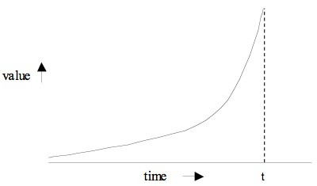
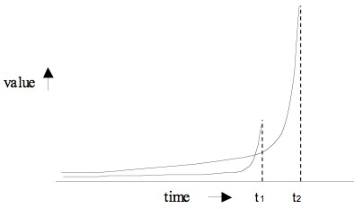

# 动态选择 choice, dynamic (Chrisoula Andreou)

*首次发表于 2007 年 10 月 15 日；2025 年 5 月 12 日实质修订。*

有时候，一系列的选择并不能很好地服务于一个人的关切，即使这一系列中的每一个选择看起来都完全适合服务于他的关切。在这样的情形中，这个人就有一个动态选择（dynamic choice）问题。换言之，他面临的问题与这样一个事实有关：他的选择在时间上分布开。关于有效动态选择的障碍，存在一门不断增长的哲学文献，它跨越到心理学与经济学。这门文献考察那些会引发动态选择问题的具有挑战性的选择情境和有问题的偏好结构。它也提出解决这类问题的方案。越来越多的熟悉但可能令人困惑的现象——包括例如自我毁灭性的成瘾行为和危险的环境破坏——已为动态选择理论所阐明。这表明动态选择理论的哲学意义与实践意义都相当广泛。

## 1 具有挑战性的选择情境、有问题的偏好结构与动态选择问题

行动者往往缺乏关于他们在某个选择情境中所面对的每一个可行选项之后果的某些信息（此时选择是在该选择结果存在某种风险或不确定性的情况下作出的）。但是，即使不存在这种信息缺乏，只要给定的选择情境具有挑战性，或偏好结构有问题（如下文所述的那些），跨时间的有效选择也可能极其困难。正如将要变得明显的那样，这些选择情境或偏好结构会引发一系列决策，而这些决策非常糟糕地服务于一个人大规模的、持续性的关切。（当然，如果由于某些重大转变，一个人在时间上如此分裂，以至于他没有任何可以持续为之负责的大规模的、持续性的关切，那么他在时间上选择的不一致也许就是不可避免的；但我在这里的主要兴趣在于动态选择中那些哲学上令人困惑的情形：在这些情形中，行动者仍然对某些大规模的、持续性的关切负责，而这些关切却被他跨时间的选择糟糕地服务。）

### 1.1 不可通约的备选项

让我们首先考虑涉及在不可通约的备选项之间作选择的情境。根据如今已为人熟悉的“不可通约的”一词的用法（这一用法由约瑟夫·拉兹（Joseph Raz）和约翰·布鲁姆（John Broome）等哲学家推广，参见例如 Raz 1986 和 Broome 2000）[^broome-2000][^raz-1986]，两个备选项是不可通约的，如果两者都不比另一个好，两者也不是同样好。（虽然本词条坚持这一标准用法，但值得注意的是，一些哲学家——例如 Ruth Chang（2017）——以不同的方式使用“不可通约的”一词，从而对这里被描述为不可通约的那些选项偏好另一个标签，如“同档的”（in equipoise），参见 Chang 2013。）

不可通约的备选项这一观念似乎并不真正说得通。因为如果一个备选项（对某个特定的行动者而言）的价值既不高于也不低于另一个备选项的价值，那么这两个备选项的价值，看起来，必定相等。但这假设存在一个共同的尺度，人们可以用它来表达和排列每个备选项的价值；而如果存在不可通约的备选项，那么这一假设就是错误的。

现在考虑以下情况：如果所有备选项都是可通约的，那么每当一个人面对两个备选项而两者都不比另一个好时，稍微改进其中一个备选项，看起来，就会‘打破平局’并使得一个备选项——即被改进的那个——变得优越。但似乎存在这样的情形：有两个备选项，使得（i）两者都不比另一个好，而且（ii）这一特征并不会因稍微改进其中一个备选项而改变。考虑例如以下情形：对 Kay 来说，以下两个备选项都不比另一个好：

**(A1)**

与她的孩子们一起度六天海滨假期

**(A2)**

上一个两个月的油画课程。

此外，尽管备选项

**(A1⁺)**

与她的孩子们一起度七天海滨假期

是对 A1 的轻微改进，A1⁺ 却并不比 A2 好。这一情形似乎可能成立，而如果它成立，那么我们就有一个不可通约的备选项的案例。因为，在这个案例中，A1 不比 A2 好，A2 不比 A1 好，而 A1 与 A2 却又不是同样好。如果 A1 与 A2 是同样好，那么对 A1 的一个改进（如 A1⁺）就会比 A2 好。但对 Kay 来说，A1⁺ 并不比 A2 好。

人们通常假定不可通约的备选项必定是不可比较的。但一旦认识到，存在概念上的空间让两个备选项不是作为“一个比另一个好”或“同样好”而可比较（因而按照上面所确认的不可通约性概念是不可通约的），而是作为‘在同一档次上’或‘同档’（on a par）而可比较，从而并非完全不可比较——如果不存在任何把每个选项的整体价值联系起来的肯定性关系，情形就会如此——事情就复杂了（参见 Chang 2002）。就本讨论的目的而言，不可通约的备选项是否必定不可比较这一问题可以搁置一边，因为将要讨论的与不可通约性相关的动态选择问题，无论所涉的不可通约选项是不可比较的，还是作为同档而可比较的，都同样适用。

尽管关于不可通约的备选项的可能性仍有一些争议（参见 Raz 1997 和 Regan 1997，以了解问题的来龙去脉）[^raz-1997][^regan-1997]，人们却普遍同意：我们经常把备选项 **当作** 不可通约的。就实践而言，用共同的尺度去确定两个非常不同的备选项的价值，即使可能，也往往过于费力。因此，把两个备选项当作既非相等也不比另一个好，往往是很自然的。

不可通约的备选项的存在或表象可以引发动态选择问题。考虑亚伯拉罕的情形，正如约翰·布鲁姆（John Broome）在其关于不可通约性的著作中所描述的：

> 上帝告诉亚伯拉罕，带他的儿子以撒到山上去，并在那里把他献祭。亚伯拉罕必须决定是否服从。让我们假设这是那种备选项不可通约[的]选择。服从这一选项将显示对上帝的顺从，但不服从这一选项将拯救以撒的生命。顺从上帝与拯救自己儿子的生命是如此不同的价值，以至于它们无法被确定地彼此衡量；这就是那个假设。两个选项都不比另一个好，然而我们也不能说它们是同样好。（Broome 2001, 114）[^broome-2001]

鉴于顺从上帝与拯救以撒这两个选项是不可通约的（即使它们仅仅在通情达理的人所能判断的范围内不可通约），亚伯拉罕决定顺从上帝似乎在理性上是被允许的。所以很容易看出，亚伯拉罕的情形如何可能促使他动身前往山上，以便献祭以撒。但也很容易看出，一旦到了山脚下，亚伯拉罕如何可能决定掉头返回。因为，尽管正如布鲁姆所说，“在山脚下掉头返回绝对比根本不出发更糟”，因为“父亲与儿子之间的信任[已经]被严重损害”（2001, 115），但通过掉头返回来拯救以撒这一选项与顺从上帝并献祭以撒这一选项，可能是不可通约的。如果回想 Kay 的情形并把亚伯拉罕上述选项标注如下，这一点就变得明显：

**(B1)**

在山脚下掉头返回来拯救以撒

**(B1⁺)**

拒绝动身前往山上来拯救以撒

**(B2)**

顺从上帝并献祭以撒。

即使 B1⁺ 比 B1 好，B1⁺ 和 B1 也都可能与 B2 不可通约。但如果 B1 与 B2 不可通约，那么亚伯拉罕一旦到了山脚下，就可能轻易决定选择 B1 而非 B2。鉴于 B1 比 B1⁺ 差，亚伯拉罕就可能轻易最终得到一个比他本可获得的另一个结果更糟的结果，即使他的每一个选择，就他所面对的备选项的价值而言，都是说得通的。

一般说来，寓意是：在不可通约性的情形中（或人们易于把两个备选项当作不可通约的情形中），那些似乎各自都可辩护的决策，合在一起时，可能导致一系列与行动者大规模的、持续性的关切极不吻合的决策。关于不可通约性的可能性、意义与意涵——无论对个体还是对公共政策——的贡献继续快速增长并引起关注，近期争论出现在多个关于该主题的新文集之中。（参见例如 Andersson & Herlitz 2021 和 Eyal & Herlitz 2024。）[^andersson-2021][^eyal-2024]

### 1.2 时间偏向的偏好

动态选择问题的另一个来源是现在偏向的偏好。像其他动物一样，人类给予现在满足的权重大于未来满足。换言之，我们对未来效用打折扣。只要一个人对未来效用打折扣，在其他条件相同的情况下，他就更愿意早得到奖励而非晚得到；相关地，一个人越接近一项未来奖励，该奖励就越被重视。如果我们把（对某个特定行动者的）一项给定未来奖励的价值绘制为时间的函数，我们就得到一条折现曲线，如图 1：

*图 1.*

图 1. 一项奖励的折现价值随着 *t*（该奖励可供领取的时间）的临近而逐渐增加。

实验心理学的研究（参见例如 Kirby & Herrnstein 1995、Millar & Navarick 1984、Solnick et al. 1980 和 Ainslie 2001）[^ainslie-2001][^kirby-1995][^millar-1984]表明，鉴于动物（包括人类）如何对未来效用打折扣，存在大量情形，其中来自两项奖励——一项是较早的小额奖励，另一项是较晚的大额奖励——的折现曲线相交，如图 2：

*图 2.*

图 2. 两条相交的折现曲线，一条追踪将在 *t*₁ 可供领取的一笔小额奖励的折现价值，另一条追踪将在 *t*₂ 可供领取的一笔大额奖励的折现价值。

在这样的情形中，行动者对将来效用的折现就两个可能的奖励诱发了偏好反转。当两项奖励都不迫近、折现曲线尚未相交时，行动者始终偏好较晚的大额奖励而非较早的小额奖励。但当接受小额奖励的机会足够临近时，小额奖励的折现价值追上并随后超过较晚的大额奖励的折现价值。当折现曲线相交时，行动者的偏好反转，她偏好小额奖励而非较晚的大额奖励。

由折现引起的偏好反转使得跨时间的、一致而有效率的选择成为一个挑战。一个受折现引起的偏好反转影响的行动者，很容易发现自己执行一系列她曾计划反对、且很快会后悔的行动。考虑那位想要为体面的退休储蓄、但随着每次储蓄机会的临近却宁愿把潜在的退休缴款花在再多一次琐碎的纵情上、然后才为了她感到对其福祉至关重要的未来满足而勒紧腰带的行动者。虽然这位行动者始终计划为退休储蓄（这样的储蓄位列她大规模的、持续性的关切之中），她的计划却可能始终被她的折现引起的偏好反转所阻挠。她的生活可能最终看起来与她想要的那种生活大不相同。

有趣的是，除了给予现在满足的权重大于未来满足之外，人类似乎也给予未来满足的权重大于过去满足（Greene et al. 2022）[^greene-2022]。相关地，人类似乎对过去的痛苦打折扣比对未来的痛苦打折扣更多。假设，诉诸德里克·帕菲特（Derek Parfit）著名思想实验的一个变体（1984, 165–6），你的处境是：或者你昨天已经经历了一个完全安全但极其痛苦的十小时医疗程序，或者你明天将经历一个完全安全但极其痛苦的九小时医疗程序。（你不知道自己处于哪种处境，因为该程序刚结束时你就被施以麻醉，而你刚在医院醒来，搞不清自己是在程序后恢复还是在为程序作准备。）你难道不更愿意处于前一种处境吗？直觉上，似乎通情达理而理性的反应会是“当然愿意！”。但也存在一些担忧：这种形式的未来偏向——过去奖励或代价被打了比未来奖励或代价更多的折扣——可能带来麻烦（Dougherty 2011；Greene and Sullivan 2015）[^dougherty-2011][^greene-2015]。例如，Preston Greene 和 Meghan Sullivan（2015）论证，它可能成为“微薄回报”和/或遗憾的生活的配方。他们的推理相当繁复，但以下简单说明和一些即席分析，有望让人一窥其中一些有趣的哲学问题。考虑 Massimo，他非常享受按摩，并且可以在较早的较长时间按摩和较晚的较短时间按摩之间选择。如果 Massimo 是未来偏向的，那么，在按摩的长度与时间安排上作一些变化，他就很容易发现自己面临以下两难：如果他选择较早的较长时间按摩，他将在得到那次较长时间按摩之后的某个时候、在较短的按摩本可提供之前，后悔接受了某个现在已成为过去的愉悦——而这一愉悦本可以仍在未来（即使已减少）；反之，如果他选择较晚的较短时间按摩（从而避免上述那类后悔），他将面对一个“微薄回报”的生活，其中较少的愉悦晚些时候被选择、而且可能经常被选择，而非较多的愉悦早些时候被选择（这一情境本身可以产生后悔和/或担忧，尤其是一旦两个按摩时间都已过去，或者如果一个人认识到——即使他正高兴地等待一份较少的愉悦，而这份愉悦是在放弃了一份现在本会成为过去、原本更大的愉悦之后得到的——只要同一种选择已经反复出现并将继续反复出现，那么反复选择较少的愉悦晚些时候，就造成了一个从回顾和前瞻两方面都远不如反复选择较多的愉悦早些时候的生活）。

### 1.3 非传递偏好

一个行动者的偏好结构不必随时间变化，也能引发动态选择问题。这类问题也可以由稳定但非传递的偏好引发。一个人的偏好算作传递的，如果它们满足以下条件：对所有 *x*、*y* 和 *z*，如果一个人偏好 *x* 胜过 *y*，且偏好 *y* 胜过 *z*，那么他也偏好 *x* 胜过 *z*。如果一个人对一组选项的偏好不满足这一条件，那么这些偏好就算作非传递的。当一个人对一组选项的偏好是非传递的，他就无法把这组选项从最偏好排到最不偏好。即使一个人对这组选项的偏好是完备的（在全部选项都彼此排列这一意义上），情况也是如此。假设，例如，一个人偏好工作 *A* 胜过工作 *B*，偏好工作 *B* 胜过工作 *C*，但偏好工作 *C* 胜过工作 *A*。在这种情况下，他对集合 {工作 *A*、工作 *B*、工作 *C*} 的完备偏好形成一个偏好循环，它可以表示如下：

*图 3.*

图 3.

其中 *x* > *y* 读作 *x* 被偏好于 *y*。

一个行动者真的能拥有非传递的偏好吗？实验经济学和理论经济学的工作（参见例如 Tversky 1969）[^tversky-1969]表明，非传递的偏好存在，而且可能相当常见。（关于非传递偏好例子的近期分类，参见 Bovens 2022。）[^bovens-2022]考虑以下情境可能有助于弄清非传递的偏好如何产生（无论它们是否理性）。假设 Jay 可以接受三份工作中的一份：工作 *A* 非常刺激但报酬低；工作 *B* 有些刺激且报酬不错；工作 *C* 不刺激但报酬很高。鉴于这一情境，人们可以想象 Jay 有以下偏好：他偏好工作 *A* 胜过工作 *B*，因为拥有一份报酬低的工作与拥有一份报酬不错的工作之间的差别，还不足以让 Jay 想放弃一份非常刺激的工作。同样，他偏好工作 *B* 胜过工作 *C*，因为拥有一份报酬不错的工作与拥有一份报酬很高的工作之间的差别，还不足以让 Jay 想放弃一份刺激的工作。但他偏好工作 *C* 胜过工作 *A*，因为拥有一份报酬很高的工作与拥有一份报酬低的工作之间的差别，足以让 Jay 想放弃即使是非常刺激的工作。

鉴于著名的“金钱泵论证”（由 Donald Davidson、J. McKinsey 和 Patrick Suppes 于 1955 年提出），非传递的偏好显然可能成为问题。就像关于下注的荷兰赌论证——其中行动者的理性受到质疑，因为该行动者易受被人做局（即接受一系列注定使他损失多于所得的下注）的影响——金钱泵论证关注的是那些易受一系列导致必然损失的组合选择影响的行动者。根据金钱泵论证，非传递的偏好是非理性的，因为它们可以促使一个行动者接受一系列交易报价，这些报价使该行动者回到他起初拥有的同一选项，但钱更少。以下是相关类型的一个案例。假设 Alex 有以下非传递的偏好：他偏好拥有一台 *A* 型电脑胜过拥有一台 *B* 型电脑，偏好拥有一台 *B* 型电脑胜过拥有一台 *C* 型电脑，偏好拥有一台 *C* 型电脑胜过拥有一台 *A* 型电脑。还假设 Alex 拥有一台 *C* 型电脑和一百美元零花钱。最后假设，鉴于他在不同电脑类型之间的偏好，Alex 偏好（i）拥有一台 *B* 型电脑且少一元零花钱胜过拥有一台 *C* 型电脑，（ii）拥有一台 *A* 型电脑且少一元零花钱胜过拥有一台 *B* 型电脑，（iii）拥有一台 *C* 型电脑且少一元零花钱胜过拥有一台 *A* 型电脑。于是一系列未预料的交易机会就能给 Alex 带来麻烦。具体而言，鉴于用他当前（*C* 型）电脑加一美元换一台 *B* 型电脑的机会，Alex 的偏好会促使他做这笔交易。鉴于用他当前（*B* 型）电脑加一美元换一台 *A* 型电脑的进一步机会，Alex 的偏好会促使他再次交易。而鉴于用他当前（*A* 型）电脑加一美元换一台 *C* 型电脑的机会，Alex 的偏好会促使他做第三笔交易。但这系列交易使 Alex 以他起初拥有的那种电脑和仅 97 美元告终。而且，鉴于未预料的交易机会可能不断冒出来，Alex 的处境可能持续恶化。即使他看重自己的零花钱，他的偏好也使他易被用作一个‘金钱泵’。此外，基本金钱泵论证的有趣变体表明，一个具有上述这类非传递偏好的行动者，即使表现出远见、正确预料到他即将到来的交易机会，也易被金钱泵抽干。参见例如 Rabinowicz 2000 和 Dougherty 2014。关于金钱泵论证重要性的近期深入辩护，参见 Gustafsson 2022。

即使他不充当金钱泵，一个具有非传递偏好的行动者也可能陷入大麻烦。要看到这一点，考虑 Warren Quinn 的“自我折磨者难题”（1993）：假设某个人——出于一些将要变得明显的原因，Quinn 称其为自我折磨者——身上连接着一台特殊的电装置。该装置有 1001 个档位：0、1、2、3、……、1000，其工作方式如下：上升一个档位，会以微小的增量提高施加到自我折磨者身上的电流量。电流增量如此之小，以至于自我折磨者无法分辨相邻档位之间的差别。然而，他能分辨相隔很远的档位之间的差别。而且，事实上，存在一些档位，自我折磨者会在这些档位上经历剧痛。每周一次，自我折磨者可以比较所有不同档位。然后他必须回到他当时所在的档位，并决定是否要上升一个档位。如果他这样做，他就得到 10,000 美元，但他永远不能永久回到较低的档位。像我们大多数人一样，自我折磨者希望增加自己的财富，但也在意感觉良好。由于自我折磨者在相邻档位之间感觉不到任何舒适度差别，却每次上升都得到 10,000 美元，所以对任意两个连续档位 *s* 和 *s*+1，他都偏好停在 *s*+1 胜过停在 *s*。但是，由于他不想生活在剧痛之中，即使为了大笔财富，他也偏好停在低档位（如 0）胜过停在高档位（如 1000）。

鉴于他的偏好，自我折磨者无法把他所面对的档位选项从最偏好排到最不偏好。更具体地说，他的偏好包含以下偏好循环：

*图 4.*

图 4.

相关地，自我折磨者对可用档位选项的偏好是非传递的。如果他的偏好是传递的，那么，鉴于他偏好档位 2 胜过档位 1、偏好档位 1 胜过档位 0，他就会偏好档位 2 胜过档位 0。鉴于他也偏好档位 3 胜过档位 2，他（假定传递性）就会偏好档位 3 胜过档位 0。鉴于他也偏好档位 4 胜过档位 3，他（假定传递性）就会偏好档位 4 胜过档位 0。继续这一推理线索会导致结论：如果他的偏好是传递的，他就会偏好档位 1000 胜过档位 0。由于他不偏好档位 1000 胜过档位 0，他的偏好就是非传递的。而这种非传递性可以把自我折磨者引向一条可怕的路径。具体而言，如果每周自我折磨者都遵循他必须在其间选择的档位对的偏好，他最终会处于一个他认为完全不可接受的处境。这相当令人不安，尤其是一旦人们意识到，虽然自我折磨者的处境纯属科幻，自我折磨者却并非真的孤身一人处于其困境。正如 Quinn 所强调，“我们大多数人在这样或那样的方面都像他一样。[例如，我们大多数人]喜欢吃东西，但也在意自己的外表。再多一口会给我们带来愉悦，而且不会让我们看起来更胖；但非常多的口就会”（Quinn 1993, 199）[^quinn-1993]。

鉴于金钱泵论证和自我折磨者难题，我们似乎可以得出结论：尽管非传递的偏好有时可以理解，依它们行事却可能远非明智。（然而请注意，正如 Duncan MacIntosh（2010）所提示的，“不可接受的处境”这一概念在这里扮演重要角色，而如何实现这一概念的问题尚需更多关注。关于解决这一问题的近期尝试，参见（Andreou 2023, chapter 3）[^andreou-2023]，其中工具理性被描绘为对超越行动者偏好、有时允许“偏好循环”中的某些结果作为（理性上）可接受的、而另一些结果作为（理性上）不可接受的结果的“主观评价回应”负责。）

### 1.4 模糊目标与其他具有挑战性的整体

像非传递偏好一样，模糊的目标或计划可以引发动态选择问题，即使行动者的偏好结构不随时间变化。事实上，有些人曾提出，自我折磨者问题的深层根源、以及促使他产生非传递偏好的东西，在于他避免极端痛苦的目标是模糊的：在所述情境中，避免极端痛苦需要从事大量目标导向的行动，而这些行动个别地看既非达成目标所必需、也非达成目标所充分，因而若个别地考虑是可舍弃的，甚至可能是被支配的（Tenenbaum and Raffman, 2012）。考虑一个更熟悉的模糊目标或计划的例子，如写一本好书，可能有所助益。正如 Sergio Tenenbaum 和 Diana Raffman 所解释的，这一计划可以刻画如下（2012, 99–100）：

1. 它的完成需要成功执行许多瞬间行动。
2. 对于你执行该计划的每一个瞬间行动，未能执行该行动本不会阻止你写成那本书。
3. 在许多你执行该计划的场合，有你更愿意做的别的事情，因为此时执行该计划不太可能对你写成那本书的成功产生影响。
4. 如果你每次都未能执行该计划（在你更愿意做别的事情的时候），你就不会写成那本书。
5. 你偏好在你本可以执行该计划的每一个瞬间选择情境中执行该计划，胜过完全不写那本书。

不难看出，在这样的情形中，看似理性的“局部”决策如何可能使人偏离正道。

Tenenbaum 和 Raffman 对追求模糊目标的讨论，与 Luca Ferrero 的建议有趣地相关：许多活动“由以非局部的方式相关联、横跨整个活动长度的瞬间行动构成”，并“要求行动者持续领会作为整体来看待的延展活动的结构与结果”（2009, 406）。Ferrero 关注的是具有叙事维度的活动，因为“……[这些]活动的特征性时间结构的展开，可以完全且清晰地单凭叙事来描述”（412–3），但追求模糊目标似乎也符合 Ferrero 的初始描述，以及他的这一想法：相关类型的活动涉及“历时意志”的“范式性运作”（406）。在所有这类活动中，受“局部关切”的无情引导，会干扰“活动的整体结构”所要求的东西（406）。

### 1.5 自主利益情形

前三节的讨论表明，就很好地服务于一个人的关切而言，反偏好选择的能力可能相当有帮助。这一观点得到自主利益情形可能性的加强。

在自主利益情形中，一个人从形成一个特定意向中受益，却不会从执行相关行动中受益。在动态选择文献中最为突出的自主利益情形，是那些执行与有益意向相关的行动不仅无回报、而且有害的情形。最著名的自主利益情形之一是 Gregory Kavka 的“毒素难题”（1983）。在 Kavka 虚构的情形中，

> 一个古怪的亿万富翁……把一小瓶毒素放在你面前……[并向你提供以下信息：]如果你喝下[这毒素]，[它]会使你痛苦地病一天，但不会威胁你的生命，也不会有任何持久影响……。如果今晚午夜你打算明天下午喝下这毒素，这位亿万富翁明早将付给你一百万美元……。你不必喝下毒素也能拿到钱；事实上，如果你成功的话，钱会在喝下它的时间到来前数小时就已在你银行账户里……。[这]……外部激励的安排被排除了，诸如雇佣催眠师植入意向之类的替代花招也被排除了……（Kavka 1983, 33–4）[^kavka-1983]

这个案例之所以有趣，部分原因在于：即使大多数人会为一百万美元而乐意喝下毒素，得到这一百万美元却并不那么容易。这是因为一个人并不是因为喝下毒素而得到那一百万美元。事实上，他喝下毒素什么也得不到，只有一天的病。正如 Kavka 所解释的，到毒素该被饮下之时，一个人要么账户里已经有一百万美元，要么没有；而喝下毒素不会给他带来任何（额外的）资金。假设他无意白白生病，那么喝下毒素似乎涉及反偏好行事——而这即使不是不可能，也绝非易事。所以，在清楚理解这一情境的情况下，一个人很可能发现，要形成喝下毒素的意向即使不是不可能，也是困难的。可以推定，如果一个人确信自己不会喝下它，他就无法形成喝下毒素的意向。只要他能以某种方式依靠未来自我的合作，他就能真正形成喝下毒素的意向，从而得到那一百万美元——从当下自我和未来自我双方的角度看，这都是一个极好的结果。但是，唉，当喝下毒素的时间到来时，未来自我似乎没有理由喝下它。

这里我们又有一个善待自己并不容易的情境。

## 2 解决动态选择问题

鉴于动态选择问题可能造成多大的麻烦，人们自然要问：它们能否被解决、如何被解决。动态选择文献中提出了各种范围不同的解决方案。以下前三小节聚焦于处理动态选择问题这一实践问题的观念。第四小节聚焦于解决各种动态选择问题所提出的、关于理性选择的种种理论难题的尝试。

### 2.1 理性非理性

在 Kavka 对毒素难题的描述中，暗示了两种我们有时可以用来解决（在处理这一实践问题的意义上）动态选择问题的策略。一种策略是使用花招，使一个人以不符合自己偏好的方式推理或选择。另一种策略涉及外部激励的安排。尽管这类手法在 Kavka 的案例中被排除，它们在限制较少的案例中却可能证明有用。本小节考虑前一种策略，下一小节考虑后一种策略。

如果一个人接受这一常见假设：使自己以不符合自己偏好的方式推理或选择涉及使自己变得非理性，那么前一种策略可以被视为旨在引起理性诱致的非理性。这一策略的一个异想天开但清晰的例示见于德里克·帕菲特（Derek Parfit）的著作（1984）。在帕菲特的例子中（该例子被标注为 **谢林对武装抢劫的回答**，因为它利用了托马斯·谢林（Thomas Schelling）的观点：“在冲突情境中，在决策和动机上不可剥夺地、明显地保持理性，并不是一种普遍优势”（Schelling 1960, 18）[^schelling-1960]），一个强盗闯入某人的家，命令房主——我们称他为 Moe——打开他囤积金子的保险箱。强盗威胁说，除非 Moe 服从，否则就开枪打死 Moe 的孩子。但 Moe 意识到，即使他服从，他和他的孩子也多半会被打死，因为强盗会想除掉他们，以免他们记下他的逃跑汽车信息并交给警察（警察将在约 15 分钟内从最近的镇子赶来，回应 Moe 的报警电话，该电话是由入室盗窃的最初迹象促发的）。幸运的是，Moe 手头有一种特殊药物，如果服下，会使人在短时间内变得非理性。Moe 意识到这种药物是他唯一真正的希望，于是服下药物并立刻失去理智。他开始“在房间里东倒西歪地打转”，说着诸如此类的话：“来吧。我爱我的孩子。所以请杀了他们”（Parfit 1984, 13）[^parfit-1984]。鉴于 Moe 当前的状态，强盗无法做任何会诱使 Moe 打开保险箱的事。打死 Moe 或他的孩子毫无意义。现在唯一明智的事，是在警察到来之前赶快离开。

鉴于服用非理性药物甚至雇佣催眠师通常不是我们动态选择问题的可行解决方案，理性地诱发非理性的可能性也许显得在实践上无关紧要。但也许我们经常从或多或少地非自觉地使用这一策略的一个版本中受益。例如，我们有时在方便时从事自欺，或纵容非理性的恐惧或迷信。我们中的许多人在毒素型情形中，可能天生倾向于沉湎于并纵容迷信的恐惧，比如担心如果自己设法得到那一百万美元却没有喝下毒素，就会莫名其妙地遭厄运。鉴于这一恐惧，一个人可能相当确信：如果他得到那一百万美元，他会喝下毒素；因此，他可能很容易形成喝下毒素的意向。虽然这不是一个可以有意识地计划使用的毒素难题解决方案（也不是一个解决该案例所提出的理论问题的方案），它却可能经常帮助我们有效应对毒素型情形。（关于自欺、“动机性偏颇信念”和更一般的“动机性非理性”的清晰而紧凑的讨论，参见例如 Mele 2004。）[^mele-2004]

### 2.2 外部激励的安排

上文提到的另一种常有助于处理某些动态选择问题的策略，是安排外部激励，使未来自我值得配合当下计划。这一策略在应对折现引起的偏好反转时可能特别有用。再次考虑那位想要为体面的退休储蓄、但随着每次储蓄机会的临近却宁愿把潜在的退休缴款花在再多一次琐碎的纵情上、然后才为了她感到对其福祉至关重要的未来满足而勒紧腰带的行动者。如果这位行动者的计划始终被她的折现引起的偏好反转所阻挠，她可能得出结论：如果她不用激励来补充她的计划，以防止给她带来这么多麻烦的偏好反转，她就永远无法为体面的退休储蓄。如果她走运，她可能找到一个她可以利用的现成预先承诺装置。假设，例如，她可以参加工作中的一项计划，该计划从一个月后开始，自动把她的部分工资存入退休基金。如果她不能在不受重大处罚的情况下取出已存入的资金，而且如果她必须提前一个月通知才能停止参与该计划，那么参加该计划可能足以改变把潜在退休缴款花在琐碎纵情上的成本-奖励结构，使这一选项始终被不偏好。如果没有现成的预先承诺装置，她也许能自己创造一个合适的。例如，如果她非常厌恶违背承诺，她也许能通过简单地向一位关心的朋友承诺今后把一定比例的工资存入退休基金来解决她的问题。

在某些情况下，一个人可能不确信自己能够安排外部激励，使未来自我自愿配合当下计划。因此，一个人可能更倾向于相关但更极端的策略：确保未来自我没有能力阻挠当下计划。这一策略不只是让配合更值得（从而在某种意义上更令人信服），还涉及安排使用强制力（它以更强的意义 **强制**）。该策略一个虚构但特别著名的运用（例如在 Elster 1984 中讨论）[^elster-1984]，是奥德修斯在荷马的《奥德赛》中的运用。因为他渴望听塞壬那迷人的歌声，却又害怕自己会因此被诱入危险，奥德修斯吩咐同伴们把他绑在船的桅杆上，并抵抗他（预期的）挣脱所请求束缚的企图。

### 2.3 符号效用

应对某些动态选择问题的另一种策略——这一策略由罗伯特·诺齐克（Robert Nozick）提出（1993）——是赋予行动符号效用（或价值），然后让自己不仅受行动因果意义的引导，也受其符号意义的引导。根据诺齐克，“行动和结果可以象征更进一步的事件……[并]把这些其他事件的情感意义（以及效用……）引到自己身上”（26）。如果“我们赋予行动……与其所象征之物相协调的效用，并且我们努力实现（或避免）它们，正如我们努力追求其所代表之物”（32），我们的选择就会不同于我们只考虑行动的因果意义时的选择。考虑例如自我折磨者的情形。假设自我折磨者十周内上升了十个档位。他仍处于一个非常舒适的范围内，但他开始担心最终停在一个会让他处于剧痛的高档位上。他想到自己应该在还占上风时退出，于是开始象征性地把下次机会上升一个档位与每一次即将到来的机会上升一个档位联系起来。到下次上升一个档位的机会到来时，这一潜在行动极其负面的符号意义使他不去执行该行动。考虑一个结构相似但更接地气的例子：一个人真的很享受吃东西，却因与关节疼痛相关的问题而不愿增加相当多的体重。如果这个人开始象征性地把多吃一份与总体上暴饮暴食、从而与增加相当多体重联系起来，他可能不愿多吃一份，即使就因果而言，他在这一特定案例中所做的微不足道。

### 2.4 计划与坚定

迄今讨论的三种策略表明，要应对动态选择问题，一个人必须要么搞乱自己的理性，要么以某种方式改变他将面对的选项所关联的收益。然而，一些哲学家——包括例如 Michael Bratman（1999；2006）、David Gauthier（1986；1994）和 Edward McClennen（1990；1997）——却提出，理性行动者不必像人们可能以为的那样频繁诉诸这类花招——这是件好事，因为作出必要安排可能需要投入大量时间、精力和/或金钱。他们论证的关键在于这一观念：采纳计划可以影响一个人做什么是理性的，即使这些计划不影响他将面对的选项所关联的收益；相关地，他们的论证融入了这一观念：理性至少有时要求坚定地坚持一个计划，即使该计划不允许某个与计划所要求的行动一样好甚至更好地符合一个人偏好的行动。（关于坚定、一个人当前的选项以及他将面对的选项之间关系的一些有趣讨论，参见 Portmore 2019。）[^portmore-2019]对 Bratman、Gauthier 和 McClennen 而言，坚定不只是应对动态选择问题时有用。毋宁说，它作为理性概念的一部分出现，这一概念解决了各种动态选择问题所提出的、关于跨时间理性与选择的种种理论难题。特别地，它作为理性概念的一部分出现，其命令不仅在简单情境中，也在具有挑战性的动态选择情境中，提供直觉上合理的指导。（值得注意的是，在 Bratman 一些较近期的著作中（2014；2018），他远离了“理性坚定涉及违背当下偏好行事”这一观念，他提出：当理性要求坚持一个计划、即使这并非当下偏好所要求时，可能存在“理性压力”去改变当下偏好。）

正如 Michael Bratman（1983；1987）所强调的，我们是会规划的生物。我们的推理由我们的计划所结构化，这些计划使我们能够实现复杂的个人与社会目标。要从规划中受益，一个人必须认真对待计划。对 Bratman 而言，这涉及（在其他事物中）（i）承认一种支持坚持自己计划的一般理性压力，只要该计划没有问题（Bratman 2006, section 8）[^bratman-2006]，以及（ii）“认真对待一个人在计划的结论处、或在此过程中适当阶段，将如何看待事情——对于正在进行中的计划或政策而言”（1999, 86）。按照这些提议的要求，Bratman（1999）得出结论：理性至少有时要求坚持一个计划，即使这不是当下偏好所要求的。此外，尽管这一理性概念要求一个人有时抵制当下偏好，它被认为在具有挑战性的动态选择情境中，比那些不认真对待计划的理性概念，促成更明智的选择。

第一个要求的意义容易看出。如果存在一种支持坚持自己计划（只要它没有问题）的一般理性压力，那么一个认真对待计划的理性行动者，就不会陷入布鲁姆想象亚伯拉罕可能陷入的那类麻烦。当面对不可通约的备选项时，认真对待计划的理性行动者会采纳一个计划并坚持它，即使他的偏好与追求另一行动路线相一致。

第二个要求的意义又如何？对 Bratman 而言，如果一个人关心自己在计划的结论处或在此过程中适当阶段将如何看待事情，那么在其他条件相同的情况下，他会避免以自己在未来将后悔的方式调整自己的计划。所以 Bratman 的规划性理性概念包含一个“无悔条件”。而且，根据 Bratman，鉴于这一条件，他的理性概念在类似自我折磨者或退休缴款案例的诱惑情形中，提供直觉上合理的指导。特别地，它意味着：在这类情形中，理性的规划者会采纳一个计划并避免调整它。因为在这两类情形中，如果“一个人的偏好支持调整自己计划”这一简单事实导致他调整它，那么，通过反复调整自己的计划，他必定最终处于他认为不可接受的处境。他必定会经历未来的后悔。而且，尽管 Bratman 允许后悔有时可能走错方向——这就是他为什么不把避免后悔呈现为无例外的命令——但对 Bratman 而言，在类似自我折磨者或退休缴款案例的情形中，如果一个人向诱惑屈服，并不存在任何会使后悔走错方向的特殊考虑。

基于他们自己关于理性坚定的推理，Gauthier（1994）和 McClennen（1990；1997）论证，理性坚定可以帮助一个行动者在类似毒素案例的自主利益情形中做得好。他们主张，成为理性的不在于总是选择最能服务于自己关切的行动。毋宁说，它在于按照最能服务于自己关切的审议程序行事。现在，看起来似乎最能服务于自己关切的审议程序，必定是要求总是选择最能服务于自己关切的行动的审议程序。但类似毒素案例的自主利益情形表明，这并不完全正确。因为，要求总是选择最能服务于自己关切的行动的审议程序，在自主利益情形中并不能很好地服务于自己的关切。更具体地说，按照这一审议程序推理的人，在自主利益情形中，比愿意坚定坚持一个他当初采纳得好的先前计划的人，做得更差。因此，Gauthier 和 McClennen 否认最好的审议程序要求一个人总是选择最能服务于自己关切的行动；在他们看来，最好的审议程序要求某种坚定。相关地，他们认为，按照先前喝下毒素的计划喝下毒素是理性的，实际上是理性上所要求的，因为一个人当初采纳该计划是好的；所以理性帮助一个人受益，而非阻碍一个人受益，在类似毒素案例的自主利益情形中。

注意，尽管人们普遍同意，一个合理的理性概念将意味着自我折磨者应抵制继续上升一个档位的诱惑，却没有人普遍同意，一个合理的理性概念将意味着喝下毒素是理性的。对于那些觉得喝下毒素是理性的这一观念完全反直觉的人而言，它的出现，作为 Gauthier 与 McClennen 关于理性坚定观点的有问题而非受欢迎的含义。

如果 Bratman 和/或 Gauthier 与 McClennen 走在正确的轨道上——当然，这是一个很大的“如果”——那么（某种形式的）坚定可能常常是把一个人自己挡在潜在动态选择陷阱之外的关键。它也可能是解决关于理性与动态选择的各种难题的关键。（关于理性选择中承诺与坚定的近期深入讨论，参见 Andreou 2022。）[^andreou-2022]

在对诱惑情形之规划解决方案的一个有趣批评中，Tenenbaum 和 Raffman（2012）挑战了坚定据称的核心地位。他们提出，在诱惑情形中，工具理性可能不要求规划和坚定，而只要求行使“足够多”的“许可”，在某个“理性上无辜的”目标或计划需要时，去做“在给定时刻本会最好”之外的事情。例如，“假设你从写一份重要备忘录中休息一下，开始上网。当然，再多上网一秒钟不会阻止你完成备忘录，但如果你上网上得足够久，你就没时间完成了”（110）。工具理性要求你在一个可接受的点停止上网。但这不必涉及在一个由先前计划确定的点停止。无论你是否有一个在时间 *t* 停止的计划，也无论你是否坚定地遵守这样的计划，都未必至关重要。重要的是，你最终及时停下来，通过在一个或多个点上行使理性的许可，去做那一刻本会最好之外的事情，着眼于实现完成那份重要备忘录这一理性上无辜的目标。Tenenbaum（2020）发展了一种工具理性理论，阐明并容纳了行使上述那类理性许可的需要。

## 3 为动态选择理论所阐明的一些熟悉现象

尽管动态选择问题常常借助异想天开的思想实验来呈现，它们的旨趣却并非纯粹理论性的。正如本节所强调的，它们可以在我们的真实生活中造成严重破坏，支持诸如自我毁灭性的成瘾行为和危险的环境破坏等现象。在某些情形中，这些现象可以从拖延的角度来理解（Andreou 2007）[^andreou-2007][^andreou-2007-2]，而拖延就其本性而言似乎正是一个动态选择问题（Stroud 2010）[^stroud-2010]。

根据自我毁灭性成瘾行为最熟悉的模型，这类行为源于限制“行为之意志控制范围”的渴求，并且在某些情形中可能是不可抗拒的，“[把]决策[完]全压倒”（Loewenstein 1999, 235–6）。但是，正如我们从动态选择理论所知，自我毁灭性行为不必是被强迫的。它也可以由引发动态选择问题的具有挑战性的选择情境和有问题的偏好结构所支持。对这一点的反思，已引出关于自我毁灭性成瘾行为可能来源的新观念。例如，George Ainslie（2001）发展了这一观点：诸如吸烟之类的成瘾习惯——即使在没有不可抗拒渴求的情况下，它似乎也能兴旺——常常由折现引起的偏好反转所支持。鉴于折现引起的偏好反转的可能性，即使是一个深深关心拥有健康未来、因此不想成为重度吸烟者的人，也很容易发现自己一根接一根地抽烟，而这就是一系列她计划反对、然后后悔的纵情。

对动态选择理论的反思也引出了环境哲学中的新观念。例如，Chrisoula Andreou（2006）论证，尽管危险的环境破坏通常被分析为源于人际利益冲突，这类破坏即使在没有这类冲突的情况下也能兴旺。特别地，当涉及个别可忽略的效应时，正如在“蔓延性环境问题”（如污染）中的情形那样，“一个行动者，无论是一个个体还是一个 **统一的** 集体，都可以仅仅因为遵循其有信息的、完全可以理解的但 **非传递的** 偏好，而被引向毁灭之路”（Andreou 2006, 96）[^andreou-2006]。注意，例如，如果一个统一的集体看重一个健康的社区，但也看重其生产或使用会促成致癌环境的奢侈品，它可能发现自己处于一个与自我折磨者处境结构相似的情境。像自我折磨者一样，这样一个集体必须应对这一事实：再多一天、甚至再多一个月的纵情，可以带来巨大回报而不引起（身体或心理）健康的任何显著变化，但“持续的纵情远非无害”（Andreou 2006, 101）[^andreou-2006]。

显然，成功实现一个长期目标可能需要在此过程中表现出某种克制；但人们却容易推迟表现克制，而偏爱多一点纵情，胜过着手那些将服务于所看重的长期目标的具有挑战性的行为或放弃。这里，正如在许多其他情境中一样，拖延成为一个严重威胁。

尽管既在哲学上引人入胜又在实践上意义重大，拖延却只是最近才作为哲学争论的一个重要主题受到大量关注。（许多争论见于 2010 年由 Chrisoula Andreou 和 Mark D. White 编辑的关于该主题的论文集。）也许人们一直假定，拖延只是意志薄弱的一种形式，所以尽管对拖延几乎没有明确讨论，理解拖延所需的大部分哲学工作却已经完成。但是，正如 Sarah Stroud（2010）所论证的，这一假设是有问题的，因为存在一些拖延情形，不符合传统的意志薄弱概念（它把行动者描绘为违背自己更好的判断行事），也不符合 Richard Holton（1999）提出的有影响力的修正性意志薄弱概念（它把行动者描绘为不坚定地行事）。尽管关于意志薄弱的成熟文献是研究拖延的重要资源，却还有更多哲学工作需要完成，而看起来最有前途的建模工作，聚焦于拖延是选择在时间上分布开的行动者所面对的问题这一事实。

## 4 结束语

当一个人执行一系列不能很好地服务于自己关切的行动时，他自然会感到后悔和沮丧。人们可能会纳闷，为什么他这样亏待自己？自我憎恨、强迫或简单的无知在某些情形中可以解释这一情况；但往往，这些东西似乎都不是问题的根源。因为，在许多情形中，一个人沿着不利路线的每一步似乎都是自愿的，由某种利益的远景所激发，并且是在正确理解每一步之后果的情况下执行的。正如我们已经看到的，动态选择理论使这类情形如何可能变得清楚。

尽管一个具有动态选择问题的行动者常常可以被描述为不够坚定，她通常却由自己的偏好或对自己所面对选项的评价所引导。就此而言，她一般不能恰当地被描述为完全失控。尽管如此，她所表现的控制，就有效治理自己（在时间上延展的）自我这一任务而言，是不充分的。所以她的问题至少部分是跨时间有效自我治理的问题。因此，一些关于跨时间选择的工作（例如 Velleman 2000；Bratman, 2012）[^velleman-2000]包含对跨时间有效自我治理的讨论，并探索跨时间有效自我治理的要求与跨时间理性选择的要求（有时被称为历时理性的要求）之间的联系。这一领域的一些重大问题包括：跨时间自我治理（或至少跨时间有效自我治理）在多大程度上要求以支持先前意向的推定这一形式实现跨时间连贯？历时理性在多大程度上要求跨时间自我治理？历时理性在多大程度上要求以支持先前意向的推定这一形式实现跨时间连贯？我自己的观点是，理性所要求的是确保避免自我挫败的行为，而非确保跨时间自我治理，所以历时理性只在避免自我挫败行为所必需时，才要求支持先前意向的推定（Andreou, 2023, chapter 2）。但关于这一主题的争论还不很广泛，对这一主题的进一步探索无疑是有必要的。

## 参考文献

**以下文献从原文照录，不作翻译；中国文献条目（古今）一律译为中文。**

[^ainslie-1999]: Ainslie, George, 1999. “The Dangers of Willpower,” in *Getting Hooked*, Jon Elster and Ole-Jørgen Skog (eds.), Cambridge: Cambridge University Press, pp. 65–92.

[^ainslie-2001]: –––, 2001. *Breakdown of Will*, Cambridge: Cambridge University Press.

[^andersson-2021]: Andersson, Henrik and Anders Herlitz, 2021. *Value Incommensurability: Ethics, Risk, and Decision-Making*, New York: Routledge.

[^andreou-2005]: Andreou, Chrisoula, 2005. “Incommensurable Alternatives and Rational Choice,” *Ratio*, 18(3): 249–61.

[^andreou-2005-2]: –––, 2005. “Going from Bad (or Not So Bad) to Worse: On Harmful Addictions and Habits,” *American Philosophical Quarterly*, 42(4): 323–31.

[^andreou-2006]: –––, 2006. “Environmental Damage and the Puzzle of the Self-Torturer,” *Philosophy & Public Affairs*, 34(1): 95–108.

[^andreou-2007]: –––, 2007. “There Are Preferences and Then There Are Preferences” in *Economics and the Mind*, Barbara Montero and Mark D. White (eds.), New York: Routledge, pp. 115–126.

[^andreou-2007-2]: –––, 2007. “Understanding Procrastination,” *Journal for the Theory of Social Behaviour*, 37(2): 183–93.

[^andreou-2022]: –––, 2022. “Commitment and Resoluteness in Rational Choice,” in *Elements in Decision Theory and Philosophy*, Martin Peterson (ed.), Cambridge: Cambridge University Press.

[^andreou-2023]: –––, 2023. *Choosing Well: The Good, the Bad, and the Trivial*, New York: Oxford University Press.

[^andreou-2010]: Andreou, Chrisoula and Mark D. White (eds.), 2010. *The Thief of Time: Philosophical Essays on Procrastination*, Oxford: Oxford University Press.

[^bratman-1983]: Bratman, Michael, 1983. “Taking Plans Seriously,” *Social Theory and Practice*, 9: 271–87.

[^bratman-1987]: –––, 1987. *Intentions, Plans, and Practical Reason*, Cambridge, MA: Harvard University Press.

[^bratman-1999]: –––, 1999. “Toxin, Temptation, and the Stability of Intention,” in *Faces of Intention*, Cambridge: Cambridge University Press, pp. 58–90.

[^bratman-2006]: –––, 2006. “Temptation Revisited,” in *Structures of Agency*, Oxford: Oxford University Press, pp. 257–282.

[^bratman-2012]: –––, 2012. “Time, Rationality, and Self-Governance,” *Philosophical Issues*, 22: 73–88.

[^bratman-2014]: –––, 2014. “Temptation and the Agent’s Standpoint,” *Inquiry*, 57: 293–310.

[^bratman-2018]: –––, 2018. *Planning, Time, and Self-Governance*, New York: Oxford University Press.

[^broome-2000]: Broome, John, 2000. “Incommensurable Values,” in *Well-Being and Morality: Essays in Honour of James Griffin*, Roger Crisp and Brad Hooker (eds.), Oxford: Oxford University Press, pp. 21–38.

[^broome-2001]: –––, 2001. “Are Intentions Reasons? And How Should We Cope with Incommensurable Values?” in *Practical Rationality and Preference*, Christopher W. Morris and Arthur Ripstein (eds.), Cambridge: Cambridge University Press, pp. 98–120.

[^bovens-2022]: Bovens, Luc, 2022. “Four Structures of Intransitive Preferences,” *Routledge Handbook of Philosophy, Politics, and Economics*, C. M. Melenovsky (ed.), New York: Routledge, pp. 81–93.

[^chang-1997]: Chang, Ruth (ed.), 1997. *Incommensurability, Incomparability, and Practical Reason*, Cambridge, MA: Harvard University Press.

[^chang-2002]: –––, 2002. “The Possibility of Parity,” *Ethics*, 112: 659–88

[^chang-2013]: –––, 2013. “Grounding Practical Normativity: Going Hybrid,” *Philosophical Studies*, 164: 163–187.

[^chang-2017]: –––, 2017. “Hard Choices,” *Journal of the American Philosophical Association*, 3(1): 1–21.

[^davidson-1955]: Davidson, Donald, McKinsey, J. and Suppes, Patrick, 1955. “Outlines of a Formal Theory of Value,” *Philosophy of Science*, 22: 140–60.

[^dougherty-2011]: Dougherty, Tom, 2011, “On Whether to Prefer Pain to Pass,” *Ethics*, 121: 521–37.

[^dougherty-2014]: –––, 2014, “A Deluxe Money Pump,” *Thought*, 3: 21–29.

[^elster-1984]: Elster, Jon, 1984. *Ulysses and the Sirens*, Cambridge: Cambridge University Press.

[^elster-2000]: –––, 2000. *Ulysses Unbound*, Cambridge: Cambridge University Press.

[^elster-1999]: Elster, Jon and Ole-Jørgen Skog (eds.), 1999. *Getting Hooked*, Cambridge: Cambridge University Press.

[^eyal-2024]: Eyal, Nir and Anders Herlitz (eds.), 2024. *Philosophical Studies* Special issue: *Incommensurability and Population-Level Bioethics*, 181(12): 3219–3519.

[^ferrero-2009]: Ferrero, Luca, 2009. “What Good is a Diachronic Will?,” *Philosophical Studies*, 144: 403–30.

[^gauthier-1986]: Gauthier, David, 1986. *Morals by Agreement*, Oxford: Clarendon Press.

[^gauthier-1994]: –––, 1994. “Assure and Threaten,” *Ethics*, 104(4): 690–716.

[^greene-2015]: Greene, Preston and Meghan Sullivan, 2015. “Against Time Bias,” *Ethics*, 125: 947–70.

[^greene-2022]: Greene, Preston, Andrew J. Latham, Kristie Miller, and James Norton, 2022. “How much do we discount past pleasures?” *American Philosophical Quarterly*, 59: 367–376.

[^gustafsson-nd]: Gustafsson, Johan E., *Money-Pump Arguments*, in *Elements in Decision Theory and Philosophy*, Martin Peterson (ed.), Cambridge: Cambridge University Press.

[^holton-1999]: Holton, Richard, 1999. “Intention and Weakness of Will,” *Journal of Philosophy*, 96: 241–62.

[^kavka-1983]: Kavka, Gregory S., 1983. “The Toxin Puzzle,” *Analysis*, 43: 33–6.

[^kirby-1995]: Kirby, Kris N. and R. J. Herrnstein, 1995. “Preference Reversals Due to Myopic Discounting of Delayed Reward,” *Psychological Science*, 6: 83–89.

[^loewenstein-1992]: Loewenstein, George and Jon Elster (eds.), 1992. *Choice Over Time*, New York: Russell Sage Foundation.

[^loewenstein-2003]: Loewenstein, George, Daniel Read, and Roy Baumeister (eds.), 2003. *Time and Decision*, New York: Russell Sage Foundation.

[^macintosh-2010]: MacIntosh, Duncan, 2010. “Intransitive Preferences, Vagueness, and the Structure of Procrastination” in *The Thief of Time: Philosophical Essays on Procrastination*, Chrisoula Andreou and Mark D. White (eds.), Oxford: Oxford University Press, pp. 68–86.

[^mele-2004]: Mele, Alfred, 2004. “Motivated Irrationality,” in *The Oxford Handbook of Rationality*, Oxford: Oxford University Press, pp. 240–256.

[^mcclennen-1990]: McClennen, Edward, 1990. *Rationality and Dynamic Choice*, Cambridge: Cambridge University Press.

[^mcclennen-1997]: –––, 1997. “Pragmatic Rationality and Rules,” *Philosophy and Public Affairs*, 26(3): 210–58.

[^millar-1984]: Millar, Andrew and Douglas J. Navarick, 1984. “Self-Control and Choice in Humans: Effects of Video Game Playing as a Positive Reinforcer,” *Learning and Motivation*, *15*: 203–218.

[^nozick-1993]: Nozick, Robert, 1993. *The Nature of Rationality*, Princeton: Princeton University Press.

[^parfit-1984]: Parfit, Derek, 1984. *Reasons and Persons*, Oxford: Clarendon Press.

[^portmore-2019]: Portmore, Douglas W., 2019. *Opting for the Best: Oughts and Options*, New York: Oxford University Press.

[^quinn-1993]: Quinn, Warren, 1993. “The Puzzle of the Self-Torturer,” in *Morality and Action*, Cambridge: Cambridge University Press, pp. 198–209.

[^rabinowicz-2000]: Rabinowicz, Wlodek, 2000. “Money Pump with Foresight,” in M. J. Almeida (ed.), *Imperceptible Harms and Benefits* (Library of Ethics and Applied Philosophy: 8), Dordrecht, London: Kluwer Academic, pp. 123–154.

[^ramsey-1926]: Ramsey, Frank P., 1926. “Truth and Probability,” in *The Foundations of Mathematics and other Logical Essays*, R. B. Braithwaite (ed.), London: Routledge & Kegan Paul, 1931, pp. 156–198.

[^raz-1997]: Raz, Joseph, 1997. “Incommensurability and Agency,” in *Incommensurability, Incomparability, and Practical Reason*, Ruth Chang (ed.), Cambridge, MA: Harvard University Press, pp. 110–128.

[^raz-1986]: –––, 1986. *The Morality of Freedom*, Oxford: Clarendon Press.

[^regan-1997]: Regan, Donald, 1997. “Value, Comparability, and Choice,” in *Incommensurability, Incomparability, and Practical Reason*, Ruth Chang (ed.), Cambridge, MA: Harvard University Press, pp. 129–150.

[^schelling-1960]: Schelling, Thomas C., 1960. *The Strategy of Conflict*, Cambridge, MA: Harvard University Press.

[^solnick-nd]: Solnick, Jay V., Catherine H. Kannenberg, David A. Eckerman, and Marcus B. Waller. “An Experimental Analysis of Impulsivity and Impulse Control in Humans,” *Learning and Motivation*, 11: 61–77.

[^stroud-2010]: Stroud, Sarah, 2010. “Is Procrastination Weakness of Will?” in *The Thief of Time: Philosophical Essays on Procrastination*, Chrisoula Andreou and Mark D. White (eds.), Oxford: Oxford University Press, pp. 51–67.

[^tenenbaum-2020]: Tenenbaum, Sergio, 2020. *Rational Powers in Action*, New York: Oxford University Press.

[^tenenbaum-2012]: Tenenbaum, Sergio and Diana Raffman, 2012. “Vague Projects and the Puzzle of the Self-Torturer,” *Ethics*, 123: 86–112.

[^tversky-1969]: Tversky, Amos, 1969. “Intransitivity of Preferences,” *Psychological Review*, 76: 31–48.

[^velleman-2000]: Velleman, David, 2000. “Deciding How to Decide,” in *The Possibility of Practical Reason*, Oxford: Clarendon Press, pp. 221–243.

## 学术工具

* [如何引用本词条](https://plato.stanford.edu/cgi-bin/encyclopedia/archinfo.cgi?entry=dynamic-choice)。
* [预览本词条的 PDF 版本](https://leibniz.stanford.edu/friends/preview/dynamic-choice/)，见 [SEP 学会之友](https://leibniz.stanford.edu/friends/)。
* 在 [InPhO](https://www.inphoproject.org/entity?sep=dynamic-choice&redirect=True) 查找与本词条相关的话题与思想家。
* 在 [PhilPapers](https://philpapers.org/sep/dynamic-choice/) 查看本词条的增强文献目录及其数据库链接。

## 其他网络资源

- [PEA Soup](https://peasoupblog.com/)
- [PEA Soup: Practical Rationality](https://peasoupblog.com/category/discussions/metaethics/practical-rationality/)

## 相关词条

决策论 | 大弃赌论证 | 经济哲学 | 搭便车问题 | 实践理性 | 偏好 | 囚徒困境 | 规范性的理性选择：期望效用 | 价值：不可通约性 | 价值：多元主义 | 投票：方法 | 意志薄弱

### 致谢

我感谢犹他大学坦纳人文中心（University of Utah Tanner Humanities Center）提供的一笔小额资助，它支持了我为本词条所作的研究。
