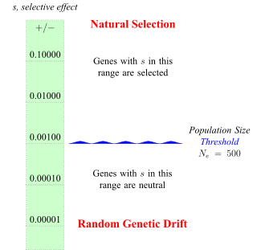
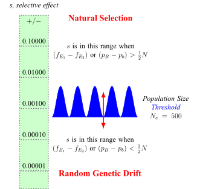

# 生态遗传学 ecological (Michael Wade)

*首次发表于 2021 年 11 月 19 日；2026 年 1 月 12 日实质修订。*

“生态遗传学”是一个宽泛的研究领域，考察遗传变化与生物及非生物环境特征之间的关系。在群体遗传学理论中，环境在适应性进化中的作用往往隐藏在基因频率动态的递归方程里。方程通常假定选择系数恒定，等于假定基因型、表现型与适合度三者的关系不随环境改变。与之相对，“生态遗传学”的核心焦点是遗传变异与环境变异之间的因果关系，并假定醒目的（尤其是离散的）表现型变异背后有遗传成分支撑。近十五年来，分子工具的出现与分子生态学在生态遗传学内部的发展，大大拓宽了这个领域的概念范围。

“生态遗传学”的起源可以追溯到“现代综合”（Huxley 1942）[^huxley-1942]。这场综合完成了遗传学与达尔文式进化的整合，靠的是 R. A. 费希尔、S. 赖特与 J. B. S. 霍尔丹的理论工作，也靠 J. 赫胥黎、T. 杜布赞斯基与 H. J. 穆勒的概念工作及其影响深远的著述。有了这样的遗传学起点，大量进化研究把注意力集中到种群之内改变基因与基因型频率的力量上，也就顺理成章。在这种以遗传学为中心的视角下，四种进化力量（突变、随机遗传漂变、自然选择、基因流）在种群内外发挥作用，造成微观进化层面的变化；也正是这几种力量协同运作，把种群内部的遗传变异转化为物种之间多少算得上持久的遗传变异。只要时间足够，这些微观进化的力量被认为足以解释高等分类群所特有的宏观进化格局。简言之，“进化遗传学”这一领域的核心挑战，始终是刻画四种进化力量如何塑造基因、基因组与物种多样性格局，其中又特别强调自然选择在诸力量之中的主导地位。

不过，对一大批田野研究者——博物学家、动物学家和生态学家——来说，以基因为中心的视角从来不是首要的研究焦点，也算不上他们面对的挑战。他们同样认定，唯一能产生适应的力量是自然选择——适应即生物与其环境之间的契合；但重点落在环境在适应中的角色上。“生态遗传学”研究生态背景下的进化过程，尤其是自然选择带来的适应，以此解释在自然界观察到的表现型格局。如果说“进化遗传学”趋近于一门以孟德尔公理为基础的应用数学，那么“生态遗传学”的根基则是理论与田野、实验室经验观察之间的往复互动。

## 1. 导言

本词条简要回顾生态遗传学研究的历史，以及它近来在分子生态学这一子领域内与分子遗传方法的整合。生态遗传学的研究大多从自然界最突出的两类模式之一入手：

1. 适应，也就是生物与其环境之间的“契合”（参见“适合度”词条）；或者，
2. 多态性，也就是自然选择使两种或更多表现型形式或遗传形式在同一个种群内得到维持。

随着分子生态学的发展，后一类研究得以在系统发生的框架中大幅扩展，转而考察物种之间的表现型差异。这让我们能够更锐利地追问：哪些环境有利于物种之间表现型的适应性分化。不仅如此，系统发生学里那些好用的分子方法，稍加改造往往就能用来鉴定造成种间表现型差异的基因或染色体区域（Gibson et al. 2021）[^gibson-2021]。

最早的一批研究试图记录自然选择在野生种群中的运作，以此为达尔文的理论提供支持。它们力图证明：由自然选择驱动的进化不只是历史上的一份因果力量，它至今仍在塑造野生种群的性状。可是在渐变论的假设下，作用于野生种群表现型的自然选择究竟能否被检测到，本身就很成问题，更遑论用它去解释物种之间的表现型差异。许多最早的生态遗传学考察，都从醒目的表现型多态起步：蝴蝶翅面斑点、蜗牛壳面条带，或染色体重排的多态。这些也正是研究者最关心的性状。这些性状要么已知有遗传基础，要么可以被稳妥地假定为有。

自然选择固然是唯一能解释适应的进化力量，但若干种进化力量，无论单独还是联合作用，都能让一个遗传多态性维持下去——至少能维持一时。所以与解释适应相比，解释种内多态现象时，把因果作用归给某一种特定的进化力量往往更加困难。在关于醒目多态现象的研究中，四种进化力量里被“优先”用作维持机制解释的是自然选择，部分缘由在于生态遗传学的奠基人之一 E. B. 福特曾与 R. A. 费希尔密切合作（见 Ford 1975）[^ford-1975]。在早期阶段（1928–1950），维持遗传多态性的因果归属问题在很大程度上是靠定义、而非靠经验观察解决的（见下文第 2 节“经典生态遗传学与多态性”）。换句话说，只有那些最稀有形式也“常见”到无法用反复突变交代的多态现象，才被认定值得研究。再者，倘若物种数量丰富，随机遗传漂变也照样可以被排除出相关过程之列。事实上，生态遗传学中最旷日持久的争论恰恰是：观察到的多态频率，究竟能否由自然选择解释。抑或，这些频率的波动意味着随机遗传漂变扮演着重要角色（例如，关于沙漠一年生植物 *Linanthus parryae* 花色多态的解释之争，见 Schemske and Bierzychudek [2001]）。

在较晚的阶段（1966 年至今），等位酶（allozyme）与分子遗传学的到来让研究者得以考察一份偏向小得多的遗传多态性样本。等位酶与单核苷酸多态性的现代刻画及分析依旧承袭了早年的侧重：把自然选择当作塑造遗传材料的首要进化力量。换个说法，面对物种分化的格局，适应性解释总是比非适应性解释更受偏爱（关于生殖基因在物种间快速多样化的原因，近期综述见 Dapper and Wade [2020]）。

生态遗传学诞生之际，现代综合的主要理论构件均已就位，适应之精妙有目共睹，可自然选择实际运作的经验实例却屈指可数。渐变论要达成适应的完善，必须有漫长的时间，其间——

> ……一个极其微弱的选择效应，只要作用相应长的时间，其效果便等同于一个强大得多、但作用时间成比例缩短的效应。（R. A. Fisher 1921，与 S. Wright 通信，转引自 Provine [1986: 247]）

可是，要达成生态遗传学的目标——阐明自然选择在野外的实际运作——极其微弱的自然选择恰恰是一块绊脚石。由此便不难理解，研究焦点为何转向强自然选择在维持可见遗传多态性中的角色。用其奠基人 E. B. 福特的话说：

> 它［生态遗传学］提供了手段，而且是唯一直接的手段，用以研究当下正在进行的进化的实际过程。（1975: 3）

传统生态遗传研究聚焦自然选择的当下作用；在最近二十年里，这一焦点从多个方向得到拓宽。其一，早期研究大多着眼于单一种群内的进化，如今生态遗传学则相当重视集合种群的种群遗传结构，重视迁移、灭绝与拓殖在进化及适应过程中的作用（如 Goodacre 2002）[^goodacre-2002]。其二，最早的研究强调醒目的多态现象或染色体重排，及其对适合度的影响；而二十世纪六十年代末，生化遗传学的兴起大大拓宽了表现型的范围，起点是电泳方法在种群研究中的应用。这类研究在酶迁移率这一新型生化表现型中揭示出大量“隐蔽多态性”。生态遗传学的疆域由此从颜色、形状、行为层面的经典“醒目表现型多态性”，延伸到酶功能的生理领域。不过，侧重功能性生化表现型这一转变，并未触动该领域的解释框架与因果框架。研究的首要焦点，是查明自然选择如何维持酶多态性。例子有：乙醇脱氢酶（参与环境酒精解毒）的快/慢多态、超氧化物歧化酶（催化清除自由氧自由基）、酯酶（在许多昆虫体内解除杀虫剂毒性）。目标则是着眼于酶变体在物理与动力学性质上的差异，为其找到一个“选择”基础。事实上，选择论学派与中性论学派围绕“平衡”多态性维持问题的争端（见 Lewontin 1974）[^lewontin-1974]，正发端于早期生态遗传研究中随机遗传漂变与自然选择的旧有对峙（见下文）。

更晚些时候，DNA 测序技术问世，带动了分子系统发生学与分子生态学的成长。新技术不只添了一种新的表现型，还为生态遗传研究补上了更浓重的历史（系统发生）维度。如今，刻画 DNA 序列进化格局与过程，主要靠分子系统发生学与比较序列分析。这些方法加固了生物地理、物种形成与适应方面的推断，在分类谱系伴随生态释放与适应辐射而多样化的问题上尤其如此。它们把注意力从种内多态性移向支系之间的多样化（如 Kostyun et al. 2019）[^kostyun-2019]，还让追踪单个基因的历史成为可能（Gibson et al. 2021）[^gibson-2021]。举个例子，凭借生态基因组数据，我们可以重构野生番茄 *Solanum pimpinellifolium* 入侵加拉帕戈斯群岛的过程：它与近缘特有种 *Solanum cheesmaniae* 杂交并发生基因渗入。而且，那里有一种适应性表现型——与特有种相仿的橙色果色——正好落在 *Solanum* 基因组两个渗入区域上，区域内含已知的果色位点；这支持如下推断：适应性趋同之所以实现，遗传上得益于基因渗入（Gibson et al. 2021）[^gibson-2021]。

这类基于 DNA 的方法尤其辨认出两种新模式。其一是“净化选择”的盛行：自然选择的保守力量在这里被当作多样性的屏障。自然选择在分子层面施展的这种保守面向，正是比较模式生物与人类遗传结构的研究得以立足的力量来源。其二是“古老多态性”的发现——某些分子遗传变异的年龄，可能超过它们所栖身的物种或分类单元本身。在现代序列研究中，自然选择依旧稳居首选解释的地位。毋宁说，围绕密码子偏倚（Behura & Severson 2013）[^behura-2013]、选择性清扫这类独有分子模式所做的搜寻、刻画与解释，非但没有削弱自然选择的地位，反而抬高了它在进化研究中的核心解释力。所谓密码子偏倚，是指 DNA 序列对冗余密码子的使用并非随机、而是有偏向的；这被当作一条证据，说明冗余密码子虽然不改变氨基酸序列，功能上却未必等价——其中一些能支持更高效的基因表达。人们由此认定，自然选择威力无边，一直深入到基因组内部，连遗传材料里最细小、最不显眼的组件也不放过。

本词条先回顾经典生态遗传学，继而讨论该领域扩张时伴随出现的新型过程与解释——从单一种群到有遗传结构的集合种群，从表现型多态性到生化与 DNA 序列多态性。我要说明的是：围绕随机遗传漂变与自然选择在进化中的角色，这场早期的核心争论延续至今，尽管生化与 DNA 序列数据带来了看似精良的技术改进。换言之，尺度更细、更加还原论的遗传数据，至今未能化解生态遗传学奠基之处的那些概念问题。

## 2. 经典生态遗传学与多态性

历史地看，生态遗传研究的起点，是在某个自然种群内发现变异，也就是表现型多态现象。接下来的目标有三：

1. 判定该多态现象有没有遗传成分；
2. 判定各多态类型的频率，及其在空间与时间上的变动幅度；以及，
3. 判定自然选择如何维持这一多态现象——靠它单独起作用，还是与其他进化力量联手。

福特对“遗传多态性”的定义如下：

> ……同一物种的两种或更多不连续类型在同一地点同时出现，出现比例使其中最稀有的类型无法仅凭反复突变维持下去。（1975: 109；另见 Ford 1940）[^ford-1940]

反复突变固然能在突变-选择平衡点上把一个多态现象无限期维持下去，但福特在此明显更关心自然选择在多态性维持中扮演更主动的角色。第一项任务得益于群体遗传理论的早期进展，尤其是费希尔（1930）的研究发现。福特的解读是：自然界出现的不连续表现型变异“几乎总是遗传的”。这条推理出自一个理论结论：在大种群中，一个等位基因（或染色体倒位）的正、负两种适合度效应恰好相抵，这种情况极不可能出现。于是，带有某个稀有中性突变的个体数量，就与该突变起源以来所历经的世代数成正比。再者，这样的等位基因即便真正中性，靠随机遗传漂变扩散于大种群的速度也极其缓慢，以至于

> 维持其中性地位所需的精微平衡，早就会因环境变化与生物遗传装备的更动而遭到破坏（Ford 1975: 110）[^ford-1975]

在中性等位基因达到可觉察的频率之前，这种平衡便已失守。再者，用反复突变解释持久多态性，被普遍认为最不足信；事实上，福特对遗传多态性的定义（见上文）明确排除了这条进化成因。于是，在生态遗传学的奠基者眼中，中性遗传多态性是极其罕见的事件；相应地，这类多态现象一旦出现，便标志着强而活跃的自然选择。

福特（1940）又把选择性多态现象分作两类：过渡性多态性与平衡多态性。过渡性多态性起于一个新有利突变，它正在自然选择的推动下取代祖先等位基因——这类多态性按理说不大可能出现，因为“有利的基因通常早已被纳入物种的遗传构成”（Ford 1975: 110）[^ford-1975]。这句话以及同类论断背后，是这样一种观点：费希尔式渐变论的自然选择长期作用下来，自然界中的生物已与其环境达成精微的适应（参见“自然选择”词条）。它还为当下行为学文献里更露骨的适应主义观点做了铺垫（综述见 Shuster & Wade 2003）[^shuster-2003]。把进化过程主要理解为对生物既有适应的打磨与完善，正是费希尔进化遗传学理论不可或缺的组成部分（Wade & Goodnight 1998）[^wade-1998]。

不连续的表现型多态性以遗传为基础、由自然选择维持——这两个假定，从上引福特的话里已经看得很清楚；而它们同样可以合并成一句话：

> 有鉴于此，显而易见：任何单因子性状，只要分布得足够广泛，就必有一定的［适应］价值。甚至可以断言，哪怕它出现频率低至百分之一，也必定得到过选择的青睐。（Ford 1975: 110）[^ford-1975]

于是，生态遗传学家的首要目标，便是精确弄清自然选择如何把一个“平衡多态性”维持下去。维持靠的是相反适合度效应之间的相对强弱；这些相反的效应分别作用于不同性别、不同生活史阶段、不同地点，以及生物一生中的不同时段。

关于雌雄两性的存在，福特曾把它当作平衡多态性的头号例证来讨论，理由是：

> 显而易见，雄性若以牺牲雌性为代价而增多，或雌性以牺牲雄性为代价而增多，这种趋势都会被选择所抵制。（Ford 1975: 111）[^ford-1975]

费希尔（1930）率先论证：每个个体都有一位母亲、一位父亲，因此雄性的平均适合度必然等于雌性平均适合度乘以性比——性比以雌比雄计，即每头雄性的平均配偶数（另见 Shuster and Wade 2003，第一章）[^shuster-2003]。由此可知，适合度随稀有而升高；于是，只要种群性比偏离 1:1，任何在出生时增加少数性别数量的基因都会获得选择优势。如此一来，1:1 的性比就是一个稳定的平衡多态性，在许多物种里靠染色体性别决定机制来实现；福特称之为“‘内置的’遗传开关机制”，并认为贝氏拟态等其他遗传多态性同样具有这种特征。一般而言，构成一个表现型多态性的两种类型，只有适合度相等，才能靠自然选择在某个中间平衡频率上维持于种群之内（这一点在 Darwin 1871 的第二卷第十四章已得到确认）[^darwin-1871]。可是，非性别相关的（乃至伴性的）多态现象，其选择力量如何制衡，与维持均等性比所需的制衡截然不同。以两性的存在为例来说明平衡多态性，会误导人，至少不能代表维持一般平衡多态性所需的选择力量。

## 3. 经典生态遗传学、种群规模与自然选择

生态遗传学的奠基者否认随机遗传漂变在进化中扮演任何重要角色（参见“遗传漂变”词条）。就效应恒定的单个基因而言，随机遗传漂变与自然选择之间的理论互动见图 1。费希尔的进化理论假定，自然种群规模极大、且长期维持着极大水平；这见于他写给 S. Wright 的一封信（1929 年 8 月 13 日，转引自 Provine 1986: 255）[^provine-1986]：“我相信 *N* 通常必须是性成熟时清点的全球种群总数。”同样的话也出自其思想传记作者 W. 尤文斯（W. Ewens）：

> 费希尔从来没有像他本应做的那样关注［有效种群大小］这个概念……他在分析中使用的种群数量极高（最高到 $10^{12})$，就一般情形而言这肯定大得离谱。（2000: 33）

面对如此庞大的种群数量，选择与漂变之间的那条阈值线（见图 1）——它由有效种群大小 $N_e$ 决定——低到在进化上无关宏旨。换言之，随机遗传漂变的强度与 (1/$2N_e)$ 成正比，微弱得近乎为零；哪怕 $s$ 值极小的基因，其进化命运也完全听凭选择裁决。这正是“费希尔式渐变论”的要义：只要时间够长，极微小的选择力量对适应所起的作用，可以等同于效应大得多的基因在短期内所起的作用。$N_e$ 一旦非常大，随机遗传漂变的作用域便大为收缩，自然选择的作用域则随之扩张（见图 1）。

图 1。

图 1：随机遗传漂变与自然选择的互动。选择强度以单个基因的选择效应 $s$ 来度量；随机遗传漂变的强度则以 $(1/2N_e)$ 标示，$N_e$ 为种群的有效大小。当 $s$ 大于 $(1/2N_e)$，基因的进化命运主要归自然选择掌管；当 $s$ 小于 $(1/2N_e)$，命运则主要交由随机遗传漂变裁断。于是，自然选择的领域（上部）与随机遗传漂变的领域（下部），由一条随有效种群大小起伏的波浪形边界隔开。［图 1 的扩展描述见补充材料。］

不过，生态遗传学家并没有以费希尔的那些理由完全否认随机遗传漂变是重要的进化力量。借助他们自己发展的标记-重捕法所做的野外观察记录显示：在得到长期研究的大多数自然种群中，种群大小逐代波动的幅度可达乃至超过一个数量级。所以，局部种群规模偏小，在生态遗传学家看来并非异常。事实上，福特相信：

> ……生物会自动生成自身丰饶与稀少的周期节律，而与这些节律相伴的选择压力变化，可能大大加快进化的速度；（Ford 1975: 36）[^ford-1975]

虽然种群规模不时会小到漂变本该大显身手的地步，随机遗传漂变在生态遗传学中却仍旧无关紧要——理由是：自然选择在种群衰退期被认为格外强劲。换言之，自然选择的强度与种群密度呈负相关。于是，当环境胁迫令种群大小与 $N_e$ 下降时，自然选择反而增强，两域之间的边界（图 1）便始终偏向选择一边。规模最小的种群几乎没有表现型变异，这反倒成了其最适合、适应最精细的证据。小种群之所以缺乏表现型变异，是因为变异在紧随其前的衰退期里遭自然选择清除殆尽。反过来，在种群增长期，环境胁迫最小，自然选择乏力，对变异也就宽容。靠着这种“宽松选择”概念，福特解释了为什么在庞大且增长中的自然种群中，稀有表现型变异体的记录反而增多。既然选择压力与种群大小此消彼长，随机遗传漂变在进化中的作用就必然受到极大压缩。

另外，福特（1975: 38）相信，生态遗传研究已经清楚证明：基因在自然界中的选择优势“……相当普遍地超过 25%，而且常常远不止于此……”。对照图 1，这意味着自然种群中 $s$ 值的分布范围显著高于 0.01；如此一来，哪怕身处很小的种群，基因也稳稳落在自然选择统辖的领域之内。

不止于此，福特还认为，选择压力不只强度会随密度变化，其性质也必定常常随之改变，理由是：

> ……一种生物在数量众多时与数量稀少时的适应需求并不相同；当与之相接触的动植物类群或众或寡时，情形也是一样。（Ford 1975: 39）[^ford-1975]

他甚至认为，丰度波动带来的选择压力起伏“推翻”了赖特的进化动态平衡说，还称之为“牵强附会”。耐人寻味的是，福特及其同事同样相信：赖特设想的那种遗传分划会加速进化。但所持理由与赖特大异，机制也不同——促其实现的不是随机遗传漂变、局部选择或群间选择，而是自然选择本身。福特（1975: 40–44）论证道，把一个地理上广布的大种群分划成若干相对较小的组群之所以加速进化，是因为：

> ……当种群占据一连串受限生境时，它们能分别独立地适应每个生境的局部环境；而当它们散布于更大的区域时，就只能［由自然选择］去迁就那里多种多样条件的平均水平。不过这有一个前提：从一个小的群落迁往另一个小群落的移民细流，不能持续不断地瓦解这些适应。

福特在此实际上提出了一个权衡问题：没有迁移时对局部条件的特化适应，与有迁移时对全局条件的泛化适应，二者难以兼得。用现代术语说，这就是基因型×环境互作：基因的选择效应 $s$ 会随环境改变而变动。同一个基因，在这种环境里可能有利（即 $s \gt 0)$，换个环境却可能有害（即 $s \lt 0)$。局部环境之间的迁移会把对选择的适应性与非适应性反应搅在一起，拉低基因频率变化的平均幅度。就此而言，适合度上的基因型×环境互作被看成一种进化约束——它限制了基因频率变化的速率。而要解除这条约束，办法简单：切断基因流，不再让基因在不同局部环境之间混流。于是，图 1 所画的那条固定选择效应，必须当作跨环境变动着的选择效应的一种平均来理解。显然，只要生境之间存在基因流，符号相反的大局部效应就得被拉平平均，而平均化往往缩小基因选择效应的量值。福特还提示，其遗传机制牵涉“平衡以契合自身局部环境的基因复合体”：他主张，基因之间的互作——即上位性——助成了局部适应。这样，福特在快进化的案例里同时求助于两种互作：适合度上的基因型×环境互作与基因-基因互作；尽管这两种互作都会压低基因的平均选择效应。这一论证还与他那个断言——基因的适应优势在自然种群中通常达 25%——相抵牾。两类互作都改写了图 1 中分隔自然选择与随机遗传漂变的那条阈值的画法；实际上它们倾向于抬高阈值，从而扩大随机遗传漂变的领地。在转入互作效应之前，我先借助一个自然种群的数据，考察一场关于随机遗传漂变的生态遗传学代表性讨论。

## 4. 塞瓦尔·赖特效应

一项针对 *Panaxia dominula* 蛾类小型自然种群的研究，追踪了几种翅色变异的分离情况（Fisher & Ford 1947）[^fisher-1947]；用的是标记-重捕法，也是整个进化研究领域对一个单一种群历时最长的连续研究之一。费希尔与福特想判定：这些变异体（*medionigra*，杂合体；*bimaculata*，纯合体）频率的逐年波动，究竟用自然选择还是用随机遗传漂变来解释更合适。（蜗牛 *Cepea nermoralis* 的条带图案，也曾是关于自然选择与遗传漂变相对角色的类似讨论的对象，见 [Cain & Shephard 1954; Cain & Provine 1992; Millstein 2008, 2009]。）[^cain-1992][^cain-1954][^millstein-2008] 他们从自己的分析中推得：

> 自然种群一般都受选择作用的支配——其方向与强度随时变动，且量值足以使一切基因频率发生波动式变化——这一结论与关于野生种群可观察频率的其他研究相当一致，本研究专事考察的那个种群也不例外。……但我们认为有一点尚未得到足够强调：这个事实对某类理论是致命的，那些理论把极小的隔离种群中偶然出现的基因比率波动看成了具有特殊进化意义的东西。……
>
> 由此，我们的分析——首次得以在野生种群中检验随机存活与选择各自扮演的相对角色——并不支持如下观点：偶然波动对进化能够有任何意义。（Fisher & Ford 1947: 171, 172；转引自 Provine 1986: 423）[^fisher-1947][^provine-1986]

凭着这篇论文，费希尔与福特把那场围绕自然选择与随机遗传漂变相对角色的老争论——赖特对阵费希尔——从书斋搬进了自然界。令人吃惊的是，在这第一项此类研究中，他们手头只有一个座位上交替等位基因的八年观察，却已信心十足地把赖特理论与随机遗传漂变整个儿拒之门外。

赖特（1948）在回应中首先指出：他的进化理论本就明确涉及几种力量的同时作用，即选择、漂变、突变、迁移并动。他断然拒绝费希尔与福特那套二元框架——仿佛“要么”选择、“要么”漂变，就得独自扛起全部基因频率波动（参见“群体遗传学”词条）。赖特还点破：要得出那个统计结论，福特和费希尔必须把比精细研究早十年的基因频率数据也塞进分析，而那段时期恰恰没有任何种群大小估计。若抽掉这个较早的数据点，平均波动便小得多，也不再显著。他又指出，基因频率同标记-重捕估计的种群数量一样，本身就是估计值；按其报告的样本量核算，估计误差引起的方差已占去费希尔和福特想解释的观察方差的一大半（55.2%）。他接着演示：若只认自然选择这一元解释，那么观察到的基因频率波动就大到惊人，即便不计抽样方差。等位基因选择系数的时间变动，必须在近乎致死（或不育）与巨大优势之间来回摆荡（即从 −0.50 摆到 +0.50）。可是，对于任何充当选择动因的环境因素，费希尔和福特（1947）都没有出示过拥有可堪比较的时间变异水平的迹象。赖特进而论证：分析所用的有效种群大小几乎肯定定得过大，可能大出一个数量级；而且，费希尔和福特压根没有尝试估计那些预期会拉低有效大小的因素。这类因素包括：繁殖数量的时间波动；幼虫期非随机的死亡——同一家族内聚集发生，正如一个因病毒感染而蛹期死亡率超过 85% 的物种可能遭遇的那样。此外，后代数量方差还有别的来源，比如雌体之间产卵数或雄体之间配偶数的差异。费希尔和福特（1950）寸步不让，在回复中给基因频率的偶然波动或随机波动贴上“塞瓦尔·赖特效应”的标签；这个术语作为随机遗传漂变的同义词，一直沿用至今。

手握覆盖更多年份的更大数据集，福特（1975: 146）旧事重提，并论证赖特在每一点上依旧错了。福特还展示：较稀有那个基因的选择优势波动剧烈，介于 −0.10 到 +0.20 之间，且找不到杂合子优势的证据。不过，他在这些数据里并没有看到预期中的那种负相关——选择强度随种群增大而减弱。此后几十年，来自其他多种生物与自然种群的数据渐次积累；盘点这些数据之后，福特得出结论：

> 因此，无论如何也不能再把进化调控中的任何重要部分归到随机遗传漂变或突变名下了。（1975: 389）

于是，在整个奠基时期，生态遗传学始终不遗余力地把自然选择奉为解释进化变化的单一法宝。（后来的实验室研究显示：翅色图案的表达对发育期热环境敏感而可塑，故而基因频率的估计可能因基因型误判而掺入显著的测量误差。这是福特分析未曾计入的又一方差来源，它倾向于松弛基因型与表现型之间的纽带，从而松动作用于表现型的选择同底层基因型之间的关系。此外，经验证据证实了赖特的预料：种群大小随时间波动、雌体繁殖力方差巨大，加上性选择，把有效数量压到费希尔-福特估计值的一半以下。再者，更精细的研究已把福特对平均单基因选择系数量值的估计砍掉约三分之二［见 Cook & Jones 1996］[^cook-1996]。）

## 5. 互作对自然选择与随机漂变之分界阈值的影响

基因型×环境互作 $(\rG \times \rE)$ 与基因-基因互作（上位性，$\rG \times \rG$）一经登场，选择系数的估计就大大复杂化了。以福特为代表的生态遗传学家所设想的互作，能够随环境（包括密度）或遗传背景的变动，令单基因选择系数改变符号。选择效应的这种反转，需要所谓“交叉型”反应规范（对 $\rG \times \rE$ 而言），或加性-加性上位性（对 $\rG \times \rG$ 而言）（Wade 2002）[^wade-2002]。交叉型 $\rG \times \rE$ 最简单的模型是这样的：设有两个备选环境 $E_1$ 与 $E_2$，频率分别为 $f_{E_1}$ 与 $f_{E_2}$；在每个环境中选择都是加性的，即基因型 AA、Aa 与 aa 的适合度依次为 $1 + 2s, 1 + s$ 和 1，而在第二种环境中次序正好颠倒。随着两种环境的频率在空间或时间上此消彼长，A 等位基因的选择效应在量值与符号两个方向上都跟着变（见图 2）。A 等位基因平均而言是好是坏，要看两种备选环境的相对频率，以及二者之间基因流或迁移的多寡。它可以是适合度意义上的“好”基因或“坏”基因，也可以是对适合度影响或大或小的基因；两种环境若恰好一样多，它甚至可以是中性基因。环境之间的迁移越少，各环境内的局部适应就越彻底——理论与福特的判断一致（见上文）。然而，费希尔理论所谈论的基因平均选择效应，必须小于特定时间、特定地点观察到的平均值，因为长期平均把 $s$ 的正值与负值一并计入。此外，局部 $s$ 值只要随环境条件持续波动而变号，A 等位基因对适合度的平均效应就会像赖特提示的那样下行——从选择领域滑入漂变领域。所以说，福特设想的那种种群分划——选择在每个局部都在运转，只是方向彼此不同——非但没有消除随机遗传漂变的机会，反而为其敞开了更大的空间。

图 2。

图 2：当存在基因型×环境互作或加性-加性上位性时，随机遗传漂变与自然选择的互动（见正文）。单个基因的选择效应 $s$，或者随基因流相连的备选环境频率 $f_{E_1}$、$f_{E_2}$ 的变动而改变量值，或者随互作座位上备选等位基因频率 $p_B$、$p_b$ 的变动而改变量值。于是，基因的选择效应与有效种群大小二者皆不再恒定。结果，相对于图 1，自然选择领域与随机遗传漂变领域之间的阈值边界大大加宽：在相当宽的 $s$ 与 $N_e$ 取值范围内，两种力量扮演的进化角色相差无几。这类互作还打开了一种可能。备选环境之间、或其他座位上备选等位基因之间，相对频率一旦变动，就能在基因进化进程中，把选择效应从选择领域搬到漂变领域，或者反向搬回。［图 2 的扩展描述见补充材料。］

对选择的“基因之眼”视角，加性-加性上位性造成的效果几乎如出一辙（Goodnight & Wade 2000; Wade 2001, 2002）[^goodnight-2000][^wade-2001]。设想座位 A 与 B 互作，各自带有备选等位基因。这类 $\rG \times \rG$ 的最简模型给出：作用于 A 等位基因的平均单基因选择系数为 $s(p_B - p_b)$；其中 $p_B$ 与 $p_b$ 是 B 座位上备选等位基因的频率，它们按加性-加性模型与 A 座位上的等位基因互作。B 座位上两种备选等位基因的相对频率，决定着 A 等位基因在适合度意义上是“好”基因还是“坏”基因，是对适合度影响居大还是居小的基因；背景等位基因若恰好一样多（即 $p_B = p_b)$），它甚至可以是中性基因。它的上位性伙伴的等位基因频率一旦变动——不管这种变动出于漂变还是选择——A 等位基因的选择效应就跟着变；与 $\rG \times \rE$ 的情形相同，这会挪动自然选择领域与随机漂变领域之间的那条边界（图 2）：扩大随机漂变的领域，压缩自然选择的领域。

## 6. 等位酶变异以及漂变与选择之争

拿醒目多态现象去考察各种进化力量的相对作用，核心症结在于：无论按适应功能衡量，还是按遗传变异量衡量，它们都不是遗传多样性的无偏样本。事实上，福特采纳的那个遗传多态性定义（见上文），恰恰把这两种偏倚的实质一并收进了定义本身。曾有一段时间，人们寄望于“我们这个两难困境的出路在于分子遗传学的发展”（Lewontin 1974: 99）[^lewontin-1974]。电泳一经问世，几乎任何生物的蛋白质随机样本，其氨基酸序列都可以拿来研究；以氨基酸替换形式呈现的基因组整体遗传多样性水平，也第一次得到了量化。

借助电泳，可以测得遗传多样性的两项指标：

1. 呈多态性的座位数；以及，
2. 每个个体在每座位上的平均杂合度。

跨物种的研究给出的估计是：全部座位中有 15–40% 呈多态性；平均每个个体的基因组有 5–15% 处于杂合状态。这门技术测得的主要是引起电荷改变的氨基酸替换，只占全部可能氨基酸替换的三分之一；由此可以推断，上述数字只是遗传多样性的下限，远低于实际水平。遗传变异无处不在、多数基因都是多态的——这个结论已无从回避。于是，正如生态遗传学最早的那些研究一样，一场在生理层面寻找等位酶变体适应功能与平衡选择的搜索随即展开。

可是，观测到的遗传多态性水平，给进化遗传学的数学理论出了一道无法逾越的难题。遗传变异的量实在太大，福特及其同事在自然种群醒目表现型多态现象中观察到的那类平衡选择，无论如何解释不了。根本困难在于：要撑起观测到的等位酶多态水平，所需的选择性死亡数目会超过几乎所有物种的繁殖盈余。正是在这里，对遗传学的关注必须同繁殖与存活的生态学接驳起来。霍尔丹（1957）把这称作“自然选择的代价”，它另有名字叫置换负荷。换个说法：纯合基因型的死亡（若被独立选择，又称“分离负荷”）所造成的损耗，将超过一个种群所能产生的后代总数。正因如此，木村资生（1983）提出了分子进化中性理论；其理论支点是：选择系数 $s \gt 0$ 的新突变等位基因，其固定概率约为 $2s$（Wright 1931: 133）[^wright-1931]。既然 $s$ 通常被认为介于 0.001 与 0.0001 之间，一个有利的新突变因偶然而丢失的概率就相当可观，只比真正中性等位基因偶失的概率略低一点。

对蛋白质结构的研究揭示：蛋白质的功能性非同义位点——在其氨基酸中只占少数——进化速率比非功能的同义位点或结构位点慢了好几倍。木村资生认为，分子水平上的进化变化纵然不是绝大部分、至少也是很大一部分由随机遗传漂变而非自然选择所决定；这个观点在当时极具争议。用木村资生自己的话说：

> ……倘若一种学说总是为多数人所乐道、为顶尖权威在著作里所背书、在课堂上所讲授，一种信念就会在人的头脑中渐渐立稳，最终变成指导原则与价值判断的根基。不管怎样，那正是泛选择论或“新达尔文主义”立场在生物学史上最有保障的时期：传统进化“综合理论”的黄金时代。（1983: 22）

很快人们意识到，一条更还原论的路径（DNA 序列研究）或许能帮助裁断一个问题：每个氨基酸是否都有一点功能价值。生命密码中冗余的位置，假定提供了真实“中性”进化速率的估计值——那正是随机遗传漂变在无选择状态下施展作用的速率。

## 7. 序列变异以及漂变与选择之争

中性进化理论恰是生态遗传学的反面。它主张：在 DNA 与蛋白质的层面上，左右大部分进化变化的不是自然选择，而是独立于环境的随机遗传漂变；同时它又承认，在塑造那些与环境形成适应性契合的形态与生理性状方面，自然选择占据主导。这就成了一个悖论：大多数 DNA 看上去没有功能，大多数外部可观察的表现型却似乎带有适应功能。

用 DNA 序列数据检验中性理论，办法是比较密码子内部不同类型位点（碱基对）的相对进化速率，并借力遗传密码的冗余性。中性进化的速率这样估得：或取种内多态性水平、分离位点的数目，或取物种之间在沉默位点与冗余位点替换上的分歧（如 Dapper & Wade 2020）[^dapper-2020]。所谓沉默位点，即不引起蛋白质氨基酸改变的位点；按通常的意义，它们也就是非功能的。与之相对，选择性变化或选择约束的速率，则借替换位点（引起氨基酸改变的碱基对变化）对照中性速率来评估。替换或多态速率若低于中性速率，即证明存在选择约束或净化选择——它遏制变化，在突变的破坏面前保全功能。替换速率若高于中性速率，则为适应性替换之明证。

分子进化研究还揭示了假基因的存在——由单拷贝基因串联重复、再经突变失活而来的非编码 DNA 片段。假基因没有功能，其全部密码子于是实际上都是中性的，这就提供了估计中性进化速率的另一条途径。尤其值得注意的是：“替换”位点在功能基因里进化缓慢，到了串联重复的假基因里，进化反而加快。

受选位点附近中性变异格局的变动同样富含信息：适应性替换发生时，连在受选 DNA 片段上的中性变异体会被一道携带、一道“清扫”到固定。这场“选择性清扫”会暂时压低受选位点附近的中性变异水平，直到突变把亏损补回来为止。中性变异缩减的幅度，即所谓“选择足迹”，大小取决于三件事：选择有多强、选择期间重组有多频繁，以及选择启动至今过了多久。选择性清扫若由单个新有利突变的出现所引发，足迹最为醒目；新选择若是出于环境改变、一开始就作用于种群中既有的存量变异，那么它给中性多态性留下的冲击就可能相当轻微。

福特观察到的那类平衡选择，会在中性多样性上留下自己特有的“反向”足迹（Kreitman & Di Rienzo 2004）[^kreitman-2004]。构成平衡多态性的那些 DNA 片段，被选择拘留在种群中的时间远超随机漂变所预期的长度；由于后代数量变异低于随机情形，这些片段的有效种群大小较高，也就有更长的时间在邻近的中性位点积累突变变异。有些时候，这段时间甚至超过诞生一个新物种所需的时间，于是形成跨种多态性（Cho et al. 2006）[^cho-2006]。因此可以预期：分子平衡多态性附近的中性多样性水平会有所抬升。当交配系统限制重组时（比如自交或近交的物种），平衡多态性附近那片中性多样性升高的区域可以延展得很广（如拟南芥 *Arabiodopsis thaliana* [Tian et al. 2002]）[^tian-2002]。

早在有序列数据可以检验其中性理论之前，木村资生就预言：沉默替换的进化速度会超过氨基酸替换。分子遗传学研究证实了这一预言——沉默位点的进化比替换位点快上好几倍。这些研究清楚表明：自然选择在 DNA 序列层面的主要作用方式是净化选择。正因为自然选择有这个高度保守的面向，比较分子进化研究才能横跨人类与果蝇这般悬殊的物种去考察发育过程。在分子层面，大多数基因虽然在序列上多态，却拿不出平衡选择的证据；其变异格局反而与中性理论相当吻合。

在 DNA 序列的连锁区域上，选择与随机漂变如何互动，这是当前分子进化理论与经验研究最热闹的战场之一。理论告诉我们：除了参数空间的某些区域之外，想把选择与漂变这两种进化力量的作用干净利落地拆开是件难事，而这些例外的普遍性如何，至今未有定论，争论也不少。与费希尔和福特（1947）的研究一样，多数经验研究把对严格中性预期的一切偏离都读作自然选择的证据，却不追问动因是谁。例如，密码子偏倚即被当作自然选择连基因中那些看似无功能的组件也不放过的证据。于是，尽管理论有所推进、更加还原论的遗传方法也已上手，“自然选择是唯一重要的进化力量”这条生态遗传学的原始信条，依旧统治着现代分子进化研究的一大片地盘。福特（1975: 389；见上文）的总结陈述，与二十五年后分子进化遗传学家 E. 内沃（E. Nevo）的总结陈述遥相呼应，令人瞩目：

> 生物多样性的进化，哪怕发生在很小的隔离种群中，也主要受自然选择驱动：多样化、平衡、周期与净化诸般选择体制同突变、迁移与随机性［随机遗传漂变］的效应交互作用，但最终把后者压倒。（Nevo 2001: 6223）[^nevo-2001]

## References（引用注释）

**以下文献从原文照录，不作翻译；中国文献译为中文。**

> 原文参考文献已转为脚注引用：文内“作者-年份”引用组后附 [^key] 标记，完整条目见本文末脚注定义。

[^behura-2013]: Behura, Susanta K. and David W. Severson, 2013, “Codon Usage Bias: Causative Factors, Quantification Methods and Genome-Wide Patterns: With Emphasis on Insect Genomes”, *Biological Reviews*, 88(1): 49–61. doi:10.1111/j.1469-185X.2012.00242.x
[^cain-1992]: Cain, A. J. and William Provine, 1992, “Genes and Ecology in History”, in *Genes in Ecology*, R.J. Berry, T.J. Crawford, and G.M. Hewitt (eds), Oxford: Blackwell Scientific, 3–28.
[^cain-1954]: Cain, A. J. and P. M. Sheppard, 1954, “Natural Selection in Cepaea”, *Genetics*, 39(1): 89–116. doi:10.1093/genetics/39.1.89
[^cho-2006]: Cho, Soochin, Zachary Y. Huang, Daniel R. Green, Deborah R. Smith, and Jianzhi Zhang, 2006, “Evolution of the Complementary Sex-Determination Gene of Honey Bees: Balancing Selection and Trans-Species Polymorphisms”, *Genome Research*, 16(11): 1366–1375. doi:10.1101/gr.4695306
[^cook-1996]: Cook, L. M. and D. A. Jones, 1996, “The *Medionigra* Gene in the Moth *Panaxia dominulcr*: The Case for Selection”, *Philosophical Transactions of the Royal Society of London. Series B: Biological Sciences*, 351(1347): 1623–1634. doi:10.1098/rstb.1996.0146
[^dapper-2020]: Dapper, Amy L. and Michael J. Wade, 2020, “Relaxed Selection and the Rapid Evolution of Reproductive Genes”, *Trends in Genetics*, 36(9): 640–649. doi:10.1016/j.tig.2020.06.014
[^darwin-1871]: Darwin, Charles, 1871, *The Descent of Man and Selection in Relation to Sex*, Volume II, London: John Murray.
[^ewens-2000]: Ewens, Warren C., 2000, “The Mathematical Foundations of Population Genetics”, in *Evolutionary Genetics: From Molecules to Morphology*, Rama S. Singh and Costas B. Krimbas (eds), New York: Cambridge University Press, 24–40.
[^fisher-1930]: Fisher, R. A., 1930, *The Genetical Theory of Natural Selection*, Oxford: Clarendon Press.
[^fisher-1947]: Fisher, R. A. and E. B. Ford, 1947, “The Spread of a Gene in Natural Conditions in a Colony of the Moth *Panaxia dominula L.*”, *Heredity*, 1(2): 143–174. doi:10.1038/hdy.1947.11
[^fisher-1950]: –––, 1950, “The ‘Sewall Wright Effect’”, *Heredity*, 4(1): 117–119. doi:10.1038/hdy.1950.8
[^ford-1940]: Ford, E. B., 1940, “Genetic Research in the Lepidoptera: Being the Galton Lecture of London University, Delivered August 1939, to the Seventh International Congress of Genetics”, *Annals of Eugenics*, 10: 227–252. doi:10.1111/j.1469-1809.1940.tb02249.x
[^ford-1975]: –––, 1975, “Balanced Polymorphism in *Panaxia Dominula*”, in his *Ecological Genetics*, fourth edition, London: Chapman and Hall, 137–156 (ch. 7).
[^gibson-2021]: Gibson, Matthew J.S., María de Lourdes Torres, Yaniv Brandvain, and Leonie C. Moyle, 2021, “Introgression Shapes Fruit Color Convergence in Invasive Galapagos Tomato”, *Elife*, 10: p.e64165.
[^goodacre-2002]: Goodacre, Sara L., 2002, “Population Structure, History and Gene Flow in a Group of Closely Related Land Snails: Genetic Variation in Partula from the Society Islands of the Pacific”, *Molecular Ecology*, 11(1): 55–68. doi:10.1046/j.0962-1083.2001.01422.x
[^goodnight-2000]: Goodnight, Charles J. and Michael J. Wade, 2000, “The Ongoing Synthesis: A Reply to Coyne, Barton, and Turelli (2000)”, *Evolution*, 54(1): 317–324. doi:10.1111/j.0014-3820.2000.tb00034.x
[^haldane-1957]: Haldane, J. B. S., 1957, “The Cost of Natural Selection”, *Journal of Genetics*, 55(3): 511–524. doi:10.1007/BF02984069
[^huxley-1942]: Huxley, Julian, 1942, *Evolution, the Modern Synthesis*, New York: Harper & Brothers.
[^kimura-1983]: Kimura, Motoo, 1983, *The Neutral Theory of Molecular Evolution*, Cambridge: Cambridge University Press. doi:10.1017/CBO9780511623486
[^kostyun-2019]: Kostyun, Jamie L., Matthew J. S. Gibson, Christian M. King, and Leonie C. Moyle, 2019, “A Simple Genetic Architecture and Low Constraint Allow Rapid Floral Evolution in a Diverse and Recently Radiating Plant Genus”, *New Phytologist*, 223(2): 1009–1022. doi:10.1111/nph.15844
[^kreitman-2004]: Kreitman, Martin and Anna Di Rienzo, 2004, “Balancing Claims for Balancing Selection”, *Trends in Genetics*, 20(7): 300–304. doi:10.1016/j.tig.2004.05.002
[^lewontin-1974]: Lewontin, Richard C., 1974, *The Genetic Basis of Evolutionary Change*, New York: Columbia University Press.
[^millstein-2008]: Millstein, Roberta L., 2008, “Distinguishing Drift and Selection Empirically: ‘The Great Snail Debate’ of the 1950s”, *Journal of the History of Biology*, 41(2): 339–367. doi:10.1007/s10739-007-9145-5
[^millstein-2009]: –––, 2009, “Concepts of Drift and Selection in ‘The Great Snail Debate’ of the 1950s and Early 1960s”, in *Descended from Darwin: Insights into the History of Evolutionary Studies, 1900–1970*, Joe Cain and Michael Ruse (eds.), (Transactions of the American Philosophical Society 99), Philadelphia, PA: American Philosophical Association, 271–298. [[Millstein 2009 available online](https://profjoecain.net/descended-darwin-book-evolutionary-synthesis/)]
[^nevo-2001]: Nevo, Eviatar, 2001, “Evolution of Genome-Phenome Diversity under Environmental Stress”, *Proceedings of the National Academy of Sciences*, 98(11): 6233–6240. doi:10.1073/pnas.101109298
[^provine-1971]: Provine, William B., 1971, *The Origins of Theoretical Population Genetics*, Chicago: University of Chicago Press.
[^provine-1986]: –––, 1986, *Sewall Wright and Evolutionary Biology*, Chicago: University of Chicago Press.
[^schemske-2001]: Schemske, Douglas W. and Paulette Bierzychudek, 2001, “Perspective: Evolution of Flower Color in the Desert Annual *Linanthus parryae*: Wright Revisited”, *Evolution*, 55(7): 1269–1282. doi:10.1111/j.0014-3820.2001.tb00650.x
[^shuster-2003]: Shuster, Stephen M. and Michael J. Wade, 2003, *Mating Systems and Strategies*, Princeton, NJ: Princeton University Press.
[^tian-2002]: Tian, Dacheng, Hitoshi Araki, Eli Stahl, Joy Bergelson, and Martin Kreitman, 2002, “Signature of Balancing Selection in Arabidopsis”, *Proceedings of the National Academy of Sciences*, 99(17): 11525–11530. doi:10.1073/pnas.172203599
[^wade-2001]: Wade, Michael J., 2001, “Epistasis, Complex Traits, and Mapping Genes”, *Genetica*, 112: 59–69. doi:10.1023/A:1013316611768
[^wade-2002]: –––, 2002, “A Gene’s Eye View of Epistasis, Selection and Speciation: A Gene’s Eye View of Epistasis”, *Journal of Evolutionary Biology*, 15(3): 337–346. doi:10.1046/j.1420-9101.2002.00413.x
[^wade-1998]: Wade, Michael J. and Charles J. Goodnight, 1998, “Perspective: The Theories of Fisher and Wright in the Context of Metapopulations: When Nature Does Many Small Experiments”, *Evolution*, 52(6): 1537–1553. doi:10.1111/j.1558-5646.1998.tb02235.x
[^wright-1931]: Wright, Sewall, 1931, “Evolution in Mendelian Populations”, *Genetics*, 16: 97–159.
[^wright-1948]: –––, 1948, “On the Roles of Directed and Random Changes in Gene Frequency in the Genetics of Populations”, *Evolution*, 2(4): 279–294. doi:10.1111/j.1558-5646.1948.tb02746.x

## 学术工具

* [如何引用本词条](https://plato.stanford.edu/cgi-bin/encyclopedia/archinfo.cgi?entry=ecological-genetics)。
* [预览本词条的 PDF 版本](https://leibniz.stanford.edu/friends/preview/ecological-genetics/)，见 [SEP 学会之友](https://leibniz.stanford.edu/friends/)。
* 在 [InPhO](https://www.inphoproject.org/entity?sep=ecological-genetics&redirect=True) 查找与本词条相关的话题与思想家。
* 在 [PhilPapers](https://philpapers.org/sep/ecological-genetics/) 查看本词条的增强文献目录及其数据库链接。

## 其他网络资源

[欢迎读者向作者提出建议。]

## 相关词条

适合度 | 遗传漂变 | 分子遗传学 | 群体遗传学 | 自然选择

**（译注：相关词条的中文站内链接将由管线在对应词条重译完成后统一挂接。）**

## 致谢

本词条取代同作者早先的词条《进化遗传学》（[Evolutionary Genetics](https://plato.stanford.edu/archives/fall2021/entries/evolutionary-genetics/)），并在其基础上写成。
