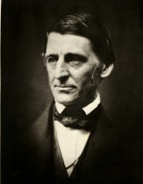

# 拉尔夫·沃尔多·爱默生 Emerson, Ralph Waldo (Russell Goodman)

*照片出自 Amos Bronson Alcott 1882 年所编的一本书。*
# 拉尔夫·沃尔多·爱默生
**首次发表于 2002 年 1 月 3 日；2022 年 10 月 21 日实质修订**

拉尔夫·沃尔多·爱默生（Ralph Waldo Emerson，1803–82）是美国随笔作家、诗人，也是一位面向大众的哲学家。他的生涯始于波士顿的一位论派牧师，后来却以演讲家和随笔作者的身份享誉世界，《自立》《历史》《超灵》《命运》诸篇即出自其手。爱默生的思想资源包括英国与德国的浪漫主义、新柏拉图主义、康德主义和印度教；由此出发，他提出了过程形而上学、心境的认识论，以及一种“存在主义式”的自我完善伦理学。他影响了几代美国人——从挚友亨利·戴维·梭罗到约翰·杜威；在欧洲，则有弗里德里希·尼采承接他的主题：权力、命运、诗歌与历史的用途，以及对基督教的批判。

## 1. 爱默生生平年表

**1803 年**

出生于波士顿，父亲是威廉·爱默生，母亲是露丝·哈斯金斯·爱默生。

**1811 年**

父亲去世，死因大概是肺结核。

**1812 年**

入读波士顿公立拉丁学校。

**1817 年**

进入哈佛学院，修习希腊文、拉丁文、历史与修辞学。

**1820 年**

写下最早的一部日记，题为《广阔世界》（“The Wide World”）。

**1821 年**

哈佛毕业后，他到兄长威廉在波士顿办的女子学校教书。

**1825 年**

入读哈佛神学院。

**1829 年**

迎娶埃伦·塔克（Ellen Tucker），并在波士顿第二教堂接受按立，成为牧师。

**1831 年**

妻子埃伦·塔克·爱默生去世，年仅 19 岁。

**1832 年**

辞去牧师一职，渡海前往欧洲。

**1833 年**

与华兹华斯、柯勒律治、J. S. 穆勒和托马斯·卡莱尔相识。同年 11 月回到波士顿，从此走上演讲之路。

**1834 年**

从埃伦的遗产中得到一笔可观遗产的一半，另一半 1837 年才到手。

**1835 年**

续娶莉迪安·杰克逊（Lidian Jackson）。

**1836 年**

第一部书《自然》（*Nature*）问世。

**1838 年**

发表《神学院致辞》（“Divinity School Address”）。又致信范布伦总统，抗议切罗基人被迫迁离故土。

**1841 年**

《随笔集》（*Essays*）出版，其中收有《自立》《超灵》《圆圈》《历史》四篇。

**1842 年**

幼子沃尔多因猩红热夭折，年仅 5 岁。

**1844 年**

《随笔二集》（*Essays, Second Series*）出版，收《诗人》《经验》《唯名论者与实在论者》。

**1847–8 年**

赴英格兰巡回演讲。

**1850 年**

出版《代表人物》（*Representative Men*），论柏拉图、斯威登堡、蒙田、歌德与拿破仑。

**1851–60 年**

在康科德、波士顿、纽约和费城发表演说，抨击《逃奴法》，为反奴隶制派候选人助选。

**1856 年**

《英国人的性格》（*English Traits*）出版。

**1860 年**

出版《生活的准则》（*The Conduct of Life*），内有《文化》《命运》两篇。

**1867 年**

远赴西部九州讲学。

**1870 年**

《社会与孤独》（*Society and Solitude*）出版；同年他在哈佛哲学系作了十六场演讲。

**1872–3 年**

身体抱恙多时之后，他前往欧洲与埃及游历。

**1875 年**

日记从此不再有新条目。

**1882 年**

逝于康科德。

## 2. 爱默生哲学的几个主题

### 2.1 教育

1837 年，爱默生以 Phi Beta Kappa 学会致辞的形式发表《美国学者》。文中他主张，学者的教育来自三样东西：自然、书籍与行动。自然在时间上最先（因为它永远在场），重要性也居首。自然的纷繁多样之下藏着一些法则，而这些法则同时也是人类心灵的法则：“古代的箴言‘认识你自己’与现代的箴言‘研究自然’，最终合成了一句格言”（CW1: 55）。学者的教育还有第二个组成部分——书籍，它带给我们过去的影响。可许多号称教育的东西，不过是对书籍的偶像崇拜：把“本属于创造行为的庄严……挪到了记录上”。对待书籍的正确方式，不是做“书蠹”或“藏书狂”，而是做“有创造力”的读者（CW1: 58）——把书当作刺激，借以形成“自己对原理的洞见”。书若用得其所，就会“激发……能动的灵魂”（CW1: 56）。在爱默生看来，伟大的书无非是这类激发的记录；它们的价值，也仅在于激发或记录了这样的灵魂状态。爱默生在自然中看到的“目的”并非汗牛充栋的藏书，而是——如他在《诗人》中所言——“新个体的产生……或灵魂向更高形式的过渡”（CW3:14）。

学者教育的第三个组成部分是行动。没有行动，思想“永远无法成熟为真理”（CW1: 59）。所谓行动，就是让尚未成形的东西进入有表现力的意识这样一个过程。生活是学者的“词典”（CW1: 60），是她一切言说的来源：“我活过多少，就知道多少”（CW1:59）。真正的学者凭经验说话，不模仿旁人；用爱默生的话说，她的言辞“满载着生活……”（CW1: 59）。在爱默生看来，学者在原创经验与自我表达上的这种修养，并非少数人的专利，而属于每一个人。它的目标是缔造一个民主的国家。他断言，只有当我们学会“用自己的双脚走路”、学会“说出自己的心思”，一个国家才会“第一次存在”（CW1: 70）。

晚年，爱默生在《教育》中重新回到这一主题。那是他在 1860 年代多次以不同版本在毕业典礼上所作的演说。文中谈尊重时，“自立”再度登场。他说，“教育的秘密”“就在于尊重学生”。学生该知道什么、该做什么，不该由教师替他选定，而要由学生自己去发现“他自己的秘密”。所以教师必须“等着看自然的新产物”（E: 143），该引导时就引导，该管束时就管束——目标不是让孩子重复、模仿，而是找出每个孩子奉献给世界的那份新力量。教育的目的在于“守住”孩子的“天性，顺着它指的方向用知识把它武装起来”（E: 144）。爱默生提醒，大众教育恰恰牺牲了这个目的。我们不该去教育“大众”，而应“一个一个、心怀敬意地”教育，并且相信：“教好每一个学生，都需要整个世界”（E: 154）。

### 2.2 过程

从许多方面说，爱默生都是过程哲学家：在他眼中，宇宙根本上处于流动之中，“永恒云云，不过是个程度问题”（CW 2: 179）。他即便论及“存在”，也不把它说成一堵稳固的“墙”，而说成一片接一片的“无边海洋”（CW3: 42）。这套形而上学在认识论上有其对应物：任何事实都没有最终的解释，每条法则终将被纳入“某条更普遍的、即将自行显露的法则”（CW2: 181）。正是过程，构成了爱默生在《经验》里描写的心境更替的底子（CW3: 30），也构成了他全部哲学对当下的看重。

爱默生在道德与真理上有若干最惊人的想法，均由其过程形而上学推出：没有哪一种德性具最终性或永恒性，全部都是“初始的”（CW2: 187）；真理是一瞥一瞥得来的，而不是可以稳稳端详的。他在《智性》（“Intellect”）里写道，我们只能“在真理与安息之间”二选一，不能兼得（CW2: 202）。新的真理像天才的念头，总是猝然降临，即爱默生所谓的“新”（CW3: 40）。所以他寻找的是“某种短短的体验，它在大路上、在市场里，在某个地方、某个时刻，让我吃了一惊……”（CW1: 213）。这样的体验，无法靠重返原地或重看某件东西（比如一幅画）而复得。爱默生觉得，人生的一大遗憾正在这里：有些画只能“看”一次；那些用欢乐和洞见充实过我们一天或一个钟头的故事与人，也没法把那场面再演一遍。

爱默生对宗教的基本看法，同样呼应他对过程的强调：他认定，人只能在当下遇见上帝——“上帝在，不是曾在”（CW1:89）。与此相反，他称为“历史中的基督教”的那种东西（CW1: 82），行事“仿佛上帝已经死了”（CW1: 84）。就连明显属于过去的历史，爱默生也认为其真正用处是为当下服务：“学生读历史要主动，不要被动；要把自己的生活当作正文，把书当作注脚”（CW2: 5）。

### 2.3 道德

爱默生的道德观，与他的过程形而上学交织在一起，也与他的至善论交织在一起——所谓至善论，是说人生有一个目标：过渡到“更高的形式”（CW3:14）。目标固然还在，人类生活的种种形式（包括诸德性）却全是“初始的”（CW2: 187）。“初始的”这个词让人想到动词“开创”；对爱默生“一切德性都是初始的”一语，有一种读法是：德性开创出历史地生长着的生活形式，比如罗马贵族的生活方式，或儒家 *junxi*（君子）的生活方式。爱默生确实有道德随历史发展的意识；但在《圆圈》一文的具体语境里，他推向的是一个更激进、更怀疑的立场：我们的德性往往必须被舍弃，而不是被培育。他写道：“改革的恐怖，就在于发现我们必须把自己的德性——或者我们一直当作德性的东西——丢进那个早已吞掉我们更粗野恶习的深坑”（CW2: 187）。限定语“或者我们一直当作德性的东西”表明，爱默生不赞同一种省事的相对主义——它认定：任何时代被当成德性的，就必定真是德性。但他确实给一切既成的思考方式与行为方式蒙上了一层疑云。审视德性的恰当立足点是“新的时刻”——他在别处把这叫作真理而非安息（CW2:202）——在这一刻，过去显得重要的东西，也许会显得“琐屑”或“虚妄”（CW2:189）。从这个视角看（更确切地说，从这样一组不断生成的视角看），德性并没有消失，只是可能被根本改变、重新排布。

爱默生既然提不出一套道德体系，就在全部作品里勾画了一组德性与英雄，以及与之相对的一组恶习与反派。《圆圈》里，恶习是“老年的种种形态”，英雄是“敏于接受、志存高远”的青年（CW2:189）。《神学院致辞》里的反派，是那位“幽灵般”的牧师——听他的讲道，你丝毫看不出他曾经活过。《自立》痛斥那些其实是“苦修”的所谓德性（CW2: 31），也痛斥废奴主义者的那种慈善：对远方之人摆出理想化的“爱”，对身边之人却满怀憎恶（CW2: 30）。

爱默生眼中的头号恶习是从众，它与“自立”这一德性正相对，是后者的“反面”。我们给衣着和其他身份符号奉上本不该给的敬意，我们露出“赞美时的蠢相”，或者在并不自在的场合、为应付并不感兴趣的谈话而“堆起勉强的笑”——这就是从众（CW2: 32）。爱默生批评的甚至包括我们对自己过往行为的从众：当那些行为已经不合当下的需要与抱负时，仍不肯改。他那句名言就出自这一语境：“愚蠢的一贯，是小智者的妖怪，小政客、哲学家和神学家都奉它为神明”（CW2: 33）。一贯有明智的，也有愚蠢的；倘若一贯妨碍了“世上为壮丽、为广远而进行的主要事业……也就是人的造就”，那这种一贯就是愚蠢的（CW1: 65）。

爱默生对人类生活多有批评，但他的注意力大半还是放在德性上。德性之中居首的，就是他所说的“自立”。这个词带有原创与自发的意味，而最令人难忘的写照是一群满不在乎的少年：他们“确信自己有饭吃……若要他们为讨好谁而做点什么、说点什么，他们会像老爷一样不屑一顾……”这群少年对世界和世上的人下判断：对自己觉得“愚蠢”或“讨嫌”的人，他们毫不客气地、“不负责任地”加以贬斥；对自己觉得“有意思”或“口才好”的人，则加以称许（CW2: 29）。少年这一形象，恰好显出爱默生的典型手法：把浪漫的一面（对孩子的推崇）与古典的一面（一种等级秩序，少年在其中坐的是老爷或贵族的位子）合在一起。

爱默生为“自立”提供了一连串分析与意象，却又亲手拆解了自己对这个词的用法。他写道：“空谈‘依靠’，是一种贫弱的外在说法。不如去说那个有所依靠者，因为它起作用，而且存在”（CW 2:40）。“自立”可以被读成：已经有一个现成的自我摆在那里，供我们依靠。可我们要“依靠”的那个“自我”，恰恰是我们正在创造之中的原初自我。这样的自我，借用尼采《瞧，这个人》（Ecce Homo）的说法，是“生成其自身之所是”的。

在爱默生看来，最好的人际关系，要靠自立者那种自信而独立的禀性。他心目中的理想社会，是一群强大而独立的“神”彼此相对，“在奥林匹斯山四围，从一个峰顶向另一个峰顶交谈”。这些神之间要保持恰当的距离：爱默生的忠告是，他们“每天早晨相会，如同来自异国；同处一日，分手时又如同各赴异国”（CW 3:81）。他甚至劝“恋人”也“要守住彼此的陌生”（CW3: 82）。《随笔二集》的末篇《唯名论者与实在论者》结尾有一段冷静的自白，爱默生借它以自况，说自己正是这样保持距离的人：

> 昨天我和两位哲学家聊了一阵。我竭力让这两位好人明白：我喜欢什么东西都是轮流喜欢，没有哪一样能长久……只要他们能懂得这一点就好了：我愿意知道他们活着，也真心祝他们顺遂；可我生活和思想都很贫乏，他们来看我时，我既没有话说，也拿不出什么招待；至于我对他们有什么要求，那更是没有——他们尽可住到俄勒冈去，我会十分满意（CW 3:145）。

自立者会把自己的所得“发表”出去，但她得先学会辨认自己那一点原创性或天才的火花——那是她献给世界的独特礼物。这礼物却不是随要随有的；人生的一大功课，就是让天才与它的表达熔为一体。爱默生说：“人只是自己的一半，另一半是他的表达”（CW 3:4）。他在《经验》中感叹，有些天资卓异的年轻人许下“一个新世界”，却始终兑现不了：他们没能在“人类生活的实际地平线之内”为自己的天才找到聚焦之处（CW 3:31）。可见，爱默生虽然强调人的独立、甚至强调彼此间的距离，自立的报偿却是公开的、社会性的。学者会发现，自己最私密、最不示人的想法，恰恰“最被接受、最公开，也最具普遍的真理性”（CW1: 63）。而他辨认出的那些伟大“代表人物”，其标志正是对世界的影响。他们的名字——柏拉图、摩西、耶稣、路德、哥白尼，乃至拿破仑——“已经犁进了这个世界的历史”（CW1: 80）。

自立虽居中位，却不是爱默生唯一的德性。他还推崇一种信赖，以及“明智的怀疑论”的实行。他认为，有些时候我们必须松手，信赖宇宙的本性：“迷路的旅人会把缰绳丢到马颈上，信这畜生的本能替他找路；对待那驮着我们穿过此世的属神畜生，我们也该如此”（CW3:16）。但流变的世界、相互冲突的证据，还要求一种认识上和实践上的灵活，爱默生称之为“明智的怀疑论”（CW4: 89）。这方面的代表人物是米歇尔·德·蒙田（Michel de Montaigne）。《代表人物》笔下的蒙田绝不是不信神的人，而是一个自我感极强、扎根于大地与日常生计、一心求知识的人。他要的是“就近看看最好的猎物和主要的猎手；看看这星球上最好的东西；艺术与自然，地方与事件；但主要是人”（CW4: 91）。他也知道生活凶险莫测，是“多种元素搅成的风暴”，要在其中行船，得有一条灵活的船，“合于人的形体”（CW4: 91）。

### 2.4 基督教

爱默生是一位论派牧师的儿子，念过哈佛神学院，做牧师将近三年。可他在《神学院致辞》里对基督教作了痛切而深入的批判，其思路来自他在《美国学者》中已经铺好的论证：既然世上唯一有价值的东西是能动的灵魂，那么宗教机构与教育机构一样，都得拿这把尺子来量。爱默生发现，当时的基督教不但不激活精神，反而使精神麻木。那是一种“基督教的东方专制”：耶稣本来是“人类之友”，如今却成了人类的敌人和压迫者。真正忠实于耶稣生平与教诲的基督教，应当激发“宗教情感”——一种欢欣的看见，而这种看见与其说在教堂里遇见，不如说在“牧场”上、在“池中的小船”上更容易遇见。爱默生认为，一个国家丧失“崇拜”（CW1: 89）是场灾祸；可他又觉得奇怪：既然“我们的教堂正在闹饥荒”（CW1: 85），怎么还有人去呢？于是他呼吁神学院的毕业生为自己宗教的旧形式注入新生命，做教区信众的朋友与榜样，并且记住：“人人都有崇高的思想；人人都珍惜生活中那少数几个真正的时辰；人们爱被听见；人们爱被带进原理的视界”（CW1: 90）。

### 2.5 力量

力量是爱默生早期写作就有的主题，但在他中晚期的随笔里格外显眼，如《经验》《蒙田，或怀疑论者》《拿破仑》和《力量》。在《美国学者》中，力量与行动相连：爱默生说，“真正的学者为每一次错过的行动机会惋惜，把它看作力量的损失”（CW1: 59）。《自立》也讨论力量，爱默生在那里说，每个人身上“蕴藏的力量，在自然中是新的”（CW2: 28）。《经验》里，他讲到一种生活“不属于智性的或批判的，而是结实有力的”（CW3: 294）；《力量》里，他赞美世上那些“蛮干家”（CW6: 34）——他们粗声粗气地表达自己，还能如愿以偿。不过，爱默生感兴趣的力量，偏于艺术与智性，而非政治或军事。他下面这段话很能代表他的想法：

> 历史上最伟大的时刻，是野蛮人刚刚不再是野蛮人的那一刻：他那一身毛茸茸的佩拉斯吉式的力气，全部倾注到刚刚睁开的审美感上——于是有了伯里克利和菲狄亚斯——他们还没有迈进科林斯式的文雅。自然和世间的一切美好，都在这过渡的一瞬：黝黑的汁液仍从自然里丰沛地涌出，而其中的涩味、辛辣味，已经由伦理与人性除去了。（CW6: 37–8）

力量环绕着我们，却并不总能驾驭。它像“一只从不落地的鸟”，“永远在枝头之间跳来跳去”（CW3: 34）。而且，我们运用力量的时候，常常当时并不知道自己正在运用：好在事后有时会发现，许多事情恰恰完成于“我们自以为懒散的时候”（CW3: 28）。

### 2.6 统一与诸心境

爱默生的许多随笔与演说，往往在某处宣示、或至少提到一幅宏大的统一图景。《美国学者》里，他说有一个“原初的单元”或“力量的泉源”（CW1: 53），我们每个人都分有它的一部分。《神学院致辞》里，他写我们每个人都是“通向理性深渊的一个入口”。而在最推崇个体性的那篇《自立》里，他写“万物归于那永远蒙福的太一”（CW2: 40）。《超灵》是爱默生对“太一”论述得最充分的一篇；但即便在那里，他也不回避过程之实在与终极形而上学统一之实在之间那看似难以调和的冲突。接续的图景与统一的图景，究竟怎样调和？

爱默生始终没有给出一个清楚、最终的答案。有这样一种解决办法，他既提出又放弃：毫不含糊的唯心论——按这种说法，非时间性的“太一”或“超灵”是唯一的实在，其余全是幻象。他在不少地方谈到从梦中、从噩梦中醒来，就是在提这种办法。但他随即又说，我们醒来面对的不只是一个不变的“太一”，而是一个过程、一串接续：一种“生长”或“灵魂的运动”（CW2: 189），或者一个“新的、却仍无法接近的美洲”（CW3: 259）。

爱默生用以拆解自己统一图景（也拆解其他一切）的手段，正是 Stanley Cavell 所说的“心境的认识论”。这种认识论在《经验》里发展得最充分，却贯穿爱默生的全部写作：我们从不“正面地”、如其所是地把握任何东西，而总是在某个侧面、某种心境之下把握它。爱默生说，生活是“一串心境，如同一串珠子”，透过每颗珠子的焦点，我们只看得见落在其中的那一点（CW3: 30）。珠子之中，有我们的性情，有不断变换的心境，也有支配一切人类经验的“生命诸主”。这些“主”包括“接续”“表面”“梦”“实在”和“惊奇”。那么，那些宏大的统一图景，莫非只是我们观看世界时所取的侧面？

爱默生调和接续与统一、一与多，最直接的尝试在《随笔二集》末篇《唯名论者与实在论者》里。他把宇宙说成“一张古老的双面脸……对它的任何命题，都可以肯定，也都可以否定”（CW3: 144）。和《经验》一样，爱默生最后留给我们的，是心境旋转不息的更替。“我从来都是不真诚的，”他带着怀疑下结论，“因为我总知道还有别的心境”（CW3: 145）。不过，爱默生不只描述心境的更替，他还在文中把它演出来；《唯名论者与实在论者》以“一切都还没有说”的“感觉”作结，并且至少留下了某种普遍真理的念头（CW3: 363）。

## 3. 爱默生论奴隶制与种族问题

1783 年，马萨诸塞州废除了奴隶制。当时首席大法官威廉·库欣（William Cushing）在审理前奴隶 Quock Walker 一案时指示陪审团：“奴隶制这一观念”与马萨诸塞州宪法“人人生而自由平等”的保证“不相容”（Gougeon, 71）。爱默生初次直面奴隶制，是在 1827 年冬天——他 23 岁，为调养身体南下。在佛罗里达的塔拉哈西，他把下面这一幕写进了日记：

> 两周前，我去参加了一次圣经公会的集会。该会的司库是本地区的执法官，由于一个颇不幸的安排，他把公会的特别集会与一场奴隶拍卖排在了同一时间、同一地点：一个在政府大楼里，一个就在旁边的院子里。于是一只耳朵听见“大喜的福音”，另一只耳朵听着“走啦，先生们，走啦！”的叫卖。几乎不必挪动身子，我们既能帮着把圣经送进非洲，也能为“四个被人从非洲拐来、没了母亲的孩子”出价（JMN3: 117）。

爱默生从不怀疑奴隶制的不义，只是它直到 1840 年代才成为他思想议程上的大事。在《自然》的“前景”一章里，他谈到历史黑暗中的“更美好的光线之微光”，并以“废除奴隶贸易”“耶稣基督的历史”“儿童的智慧”为例，这就提到了废奴（CW1:43）。他还在自己最出色的几篇随笔里谴责奴隶制，如《自立》（1841）。所以，即便没有 1840、1850 年代那些反奴隶制演说，我们仍有证据：既证明奴隶制的存在，也证明爱默生反对它。他称赞“废奴这一丰饶的志业”，但又感叹这志业让“愤怒的偏狭之徒”把持了去。文章后文，他把废奴与基督教、宗教改革、卫理公会并列，视为世界历史上的伟大志业与运动。有一段名言说“制度是一个人的影子”，他举的例子是“路德的宗教改革、福克斯的贵格会、卫斯理的卫理公会、克拉克森的废奴”（CW2: 35）。这份名单里那个陌生的名字是托马斯·克拉克森（Thomas Clarkson，1760–1846）：他受教于剑桥，身为教士，参与创建了英国废除奴隶贸易委员会。克拉克森骑马走遍不列颠，访问在贩奴船上干活的船员，还展示手铐、拇指夹、烙铁之类的家什。他 1808 年的《英国议会废除非洲奴隶贸易之兴起、进展与完成史》，后来成了爱默生反奴隶制演说的重要材料来源。

奴隶制也出现在 1844 年《随笔二集》的《政治》篇里。爱默生在那里检视美国的两大政党：一个主张自由贸易、普选权，主张让年轻人和穷人也有机会获得财富与权力，它占着“最好的志业”，领袖却最不吸引人；另一个的领袖最有教养、最能干，立场却“只是为财产辩护”。这个保守党“不维护任何权利，不追求任何真正的善，不指认任何罪行，不提出任何宽厚的政策；它不修建、不著述，不爱护艺术，不扶持宗教，不办学校，不鼓励科学，不解放奴隶，也不做穷人、印第安人和移民的朋友”（CW3: 124）。爱默生在这里要的是解放，而不只是终止奴隶贸易。

1844 年也是爱默生反奴隶制演说取得突破的一年：他在英属西印度群岛废除奴隶制的周年庆典上发表了这篇演说。此时正值美国对墨西哥开战、兼并得克萨斯，而后者很可能作为一个蓄奴州加入联邦。康科德与波士顿相比算是废奴主义的温床，可镇上仍有不少保守派。没有一间教堂肯让爱默生讲这个题目；好不容易借到法院的场地，教堂司事又拒绝敲钟通报，这差事最后是年轻的亨利·戴维·梭罗自己揽下来做的（Gougeon, 75）。在这篇演说里，爱默生对一种语言展开了批判——那是我们谈论黑人奴隶制时所用的语言，也是我们回避谈论它时所用的语言：

> 语言得翻掘一遍，屠宰场的秘密、见不得天日的不光彩角落，都得搜个底朝天，才说得清黑奴制的真相。这些人，是我们的恩人：他们生产玉米和葡萄酒，生产咖啡、烟草、棉花、糖、朗姆酒和白兰地；他们自己温和而快活，又替文明世界造出舒适与奢华……读到他们是怎么到的那里、又是怎么被留在那里，我心里发痛。他们的处境，被兄弟们的头脑和心肠漏掉了（*Emerson’s Antislavery Writings*, 9）。

这篇长演说，一面把奴隶制的恶看得清清楚楚，一面对非洲人的可能性怀着希望。演说时，黑人废奴主义者弗雷德里克·道格拉斯（Frederick Douglass）就坐在他旁边的台上，爱默生说：“黑人胸中怀着一样东西，是那正在到来的新文明不可或缺的要素。”他称赞“这样的人”——海地奴隶起义的领袖杜桑·卢维杜尔（Toussaint [L]Ouverture），并宣告：“反奴隶制者在此：人就在此；只要有人，是黑是白都无关紧要。”（Wirzrbicki, 95; *Emerson’s Antislavery Writings,*31）。

1850 年的《逃奴法》等于把奴隶制推广到了全国：自由州的官员和公民都有义务协助把逃亡奴隶送还主人。爱默生 1851 年的《致康科德市民》一面呼吁废止该法，一面主张在该法仍然有效时就拒不服从。1854 年，逃亡奴隶 Anthony Burns 依马萨诸塞州最高法院首席大法官的命令被押回弗吉尼亚，命令由美国海军陆战队执行，依据的正是这部新法。这个“马萨诸塞州的奴隶制”的例子（亨利·梭罗在一篇著名演说里这样称呼它），正是爱默生 1855 年《论奴隶制》演说的背景；他在演说中把 1787 年宪法原文承认奴隶制一事称为“罪行”。从 1840 年代末到内战爆发，爱默生屡次在不同地方重讲这些反奴隶制演说。内战前夕，他支持约翰·布朗——这位激进的废奴主义者 1859 年袭击了西弗吉尼亚哈珀斯费里的联邦军械库，随后被联邦政府处死。战争进行到中途，爱默生为联邦军的黑人团队募款（Wirzbicki, 251–2），并在庆祝林肯总统 1863 年《解放宣言》的集会上，向三千名听众朗诵他的《波士顿颂》。“向主人付赎金吧，”爱默生写道，“把口袋装得满满的。主人是谁？主人就是奴隶。一向如此。付钱给他”（CW9: 383）。

爱默生的《命运》气魄宏大，收在《生活的准则》（1860）中。它既以调和自由与必然的尝试著称，也因一些论命运、论种族的令人不安的说法而引人注目，例如：

> 世界的人口是有条件的人口：不是最好的人口，而是眼下能活下来的最好人口。各部族的档次，胜利如何稳稳附着于这一族、失败如何稳稳附着于那一族，其整齐一如图层相叠。历史上种族占多大分量，我们是知道的。我们看见英国人、法国人、德国人在美洲和澳洲的每一处海岸与市场落脚，把这些国家的商业垄断在手。我们喜欢自家这一支那股神经质而又常胜的作风。我们跟着犹太人、印第安人、黑人走。为了灭绝犹太人，多少意志都耗尽了，却是白费……德意志人和爱尔兰人有好几百万，和黑人一样，命里带着大堆鸟粪。他们被渡过大西洋，被装车拉过美洲，去挖沟、去做苦工，只为把玉米弄得便宜；然后过早躺下，在草原上留下一小片青草（CW6: 8–9）。

文中对种族的种种指涉，反映出英美两地兴起的一种“科学”兴趣：研究种族在人类演化中扮演什么角色——而这个“种族”，常与文化或民族混作一谈。在美国，这种兴趣与奴隶制度、与和印第安部族的接触纠缠在一起，也与“盎格鲁-撒克逊人的自由”这一观念纠缠在一起；该观念在美国革命期间声名鹊起，后来演变成“存在着一个盎格鲁-撒克逊种族”的想法（见 Horsman）。

不过，爱默生之所以是爱默生，就在于他要对自己的用词一并加以批判；“种族”正是一例。只是他把它放在一个非美国的语境里处理：《英国人的性格》（1856）中的《种族》一篇。这篇的批判从第一段就开始了：“每一个变种都悄然过渡到下一个变种，种族从哪里开始、到哪里结束，你根本画不出一条线。”他接着说，文明会“啃掉旧的特征”，宗教则造出新的性格形式，与旧的种族界线相抗。更进一层，他还举出一些“足以动摇”种族概念的考虑。“我们所看到的种族的……固定不变”，他写道，“并不能有力证明这些脆弱界限是永恒的，因为我们整个历史时期，在自然的漫长绵延里只是一个点”（CW 5:24）。何况我们今天看到的那些模式本就不纯：

> 我们用纯种民族的传说去迎合个人与民族的自爱，可我们的一切经验都是种族的渐变与消融，奇异的相似到处遇上我们。我们的形体里还留着虎与狒狒的雏形，也知道种族的壁垒并不牢靠，前大洪水时代的海洋还有些水沫溅到我们身上——那么，马来人与巴布亚人相混，凯尔特人与罗马人相混，撒克逊人与鞑靼人相混，又有什么好奇怪的。

和《自然》以及他早期那些伟大作品一样，爱默生在这里强调我们与自然界的亲密关系——从海洋直到动物。人们不禁要问：既然如此，为什么偏要把较高、却仍属初始形态的某一种拿出来，加以隔离、贬抑和奴役？不过，爱默生在《种族》里展开这些看法时，并没有提到美国奴隶制；那是一本谈英国的书，而他在英国看到的是健康的混合，不是纯种。他写道，英国的历史与其说是“某些撒克逊人、朱特人、弗里斯兰人的部族从一处迁来、血缘同一的历史，不如说是一部从所有这些部族中取材的气质选集……英国人的血统出自如此宽广的一串民族……她种族里的斯堪的纳维亚人，每个时代都还听见母亲海洋的低语；血液里的不列颠人，至今仍眷恋着故园”（CW5: 28）。尽管如此，仍有一点引人注目：爱默生在《命运》和《种族》里都没有提到奴隶制，而这两篇都写于他公开反对美国奴隶制最激烈的时期。

## 4. 关于爱默生的几个问题

### 4.1 一致性

爱默生常常招来“自相矛盾”的指责。他说世界根本上是过程，又说它根本上是统一；说世界抗拒我们强加意志，又说它随我们想象的力量流动；说旅行有益，因为它增长见闻，又说旅行全然无益，因为我们在一处新的地方醒来，发现的仍是那个自以为已经甩掉的“悲伤的自我”（CW2: 46）。

爱默生的“心境的认识论”，是想搭起一个框架，好把那些看似互相矛盾的观点、视角或学说都容纳进来。用他的话说，他是真心要“接受”“相反倾向的叮当与吵闹”（CW3: 36）。他打算对一切拖住他自我发展的东西都不负责任。所以在《圆圈》末尾他写道，自己“只是个实验者……背后没有‘过去’”（CW2: 188）。在那篇文章描绘的流变世界里，没有任何稳固的东西值得他负责：“每一刻都是新的；过去总被吞掉、被忘记，只有将要来临的才是神圣的”（CW2: 189）。

话虽如此，爱默生的各篇随笔之间、各个观念之间，仍有一以贯之之处。只举一例：“能动的灵魂”这一观念——在《美国学者》里被称作“世上唯一有价值的东西”——就是他抨击“教堂的饥荒”时的一个预设（教堂不喂养、也不激活信众的灵魂）；也是他理解诗的一个要素：诗是“一种如此热烈而鲜活的思想，以致像植物或动物的精气一样，自有其建筑……”（CW3: 6）；当然，它更是爱默生“自立”观念的核心。事实上，爱默生的哲学里有多条贯通的线索，由前文讨论过的几个观念牵引：过程、教育、自立，以及当下。

### 4.2 前期与后期的爱默生

用心的读者很难感觉不到：早期爱默生与晚期爱默生之间有着重要差别。比如昂扬的《自然》（1836）与《经验》（1844）那个疲惫的结尾；又如《自立》（1841）里那位气象开阔的作者，与《命运》（1860）里那位负重的作者。爱默生自己在《命运》里似乎也提到这类差别：“从前我们以为，正面的力量就是全部。如今我们知道，负面的力量，也就是境遇，占了一半”（CW6: 8）。《命运》是不是在记录一课——一课他早期写作还没有消化：那些我们无法掌控的境遇（瘟疫、飓风、性情、性、年老）会以种种方式限制自立、限制自我发展？

《经验》是一篇关键的过渡之作。开篇就问：“我们把自己安放在何处？”答案并不让人快慰：爱默生发现，我们处在一个错位而幽暗的地方——“睡意在我们一生的眼际徘徊，如同夜色整日在冷杉枝头盘桓”（CW3: 27）。有一件事始终悬在这篇文章之上，直到第三段才说出来：他五岁的儿子沃尔多死了。爱默生从这个事件以及自己对它的反应里，看到了存在的一种“不体面”的普遍性格——它总是在离我们滑走，就像他那个小男孩一样。

《经验》呈现出许多种心境。它有豁然开朗的时刻，也有深思熟虑的判断：“理想总与我们同行，那是无裂无缝的天”（CW3: 41）。它还给出明智的劝告：要“滑过生活的表面”，要把存在限制在“中段世界”里。可就连它那个乐观的结尾，也摆在“挫败”的大背景上。“再起来吧，老心！”文章最后一句里，那个有些疲惫的声音这样说。不过，全文结尾的断言，以其巨大的希望和底层的信心，与爱默生笔下一些更开阔的段落彼此呼应。他说，“世界存在所要实现的那段真正的传奇”，“将是把天才转化为实践的力量”（CW3: 49）。

尽管语调与侧重有重要差别，爱默生对我们处境的评估，在全部写作中大体未变。对普通人生活最严厉的指斥，就出现在早期作品《美国学者》里：“历史上的人，今天这个世界上的人，是虫子，是鱼卵，被叫作‘群众’和‘群氓’。一个世纪、一千年，才有一两个人；也就是说，才有一两个接近人之应然状态的人”（CW1: 65）。反过来，他早期作品中也没有哪句话比《命运》里这句更唯心：“[思]想把心灵带上一个一切皆可塑的层面，从而化解了物质宇宙”（CW6: 15）。总的看来，早期作品对人类的可能性抱有更明朗的希望，觉得爱默生和他的同代人正待向上、向前迈出一大步；晚期作品依旧怀着希望、依旧自信，却是在重压之下运作的，对世界那种沉默的抵抗感受更深。

### 4.3 来源与影响

爱默生读书极广，也在随笔里一一感念那些教过他的作家，前后数十人。他在日记中列有文学、哲学、宗教思想家的名单，还动手给他们归类。

塑造爱默生哲学形态的作家中，最重要的是柏拉图，以及由普罗提诺、普罗克洛斯、Iamblichus 一路下延到剑桥柏拉图主义者的新柏拉图主义谱系。康德与浪漫主义传统中的作家同样重要（爱默生对这些的了解，多半来自柯勒律治的《文学传记》（*Biographia Literaria*））。他还如饥似渴地读印度哲学——尤其是印度教——以及儒家的书。此外，还有多种经验主义或基于经验的影响：贝克莱、华兹华斯与其他英国浪漫派、牛顿的物理学，以及地质学和比较解剖学这些新兴科学。爱默生时常提到的其他作家包括阿那克萨戈拉、圣奥古斯丁、弗朗西斯·培根、雅各布·伯麦、西塞罗、歌德、赫拉克利特、卢克莱修、孟子、毕达哥拉斯、席勒、梭罗、奥古斯特和弗里德里希·施莱格尔、莎士比亚、苏格拉底、斯塔尔夫人和伊曼纽尔·斯威登堡。

在爱默生生活的年代，他的著作已经在美国和欧洲广为人知。尼采读过爱默生随笔的德译本，把《历史》《自立》里的段落抄进自己的笔记，还这样评《随笔集》：他从未“在一本书里感到如此自在”。爱默生那些观念——关于“强大而满溢”的英雄、把友谊看作战斗、教育，以及为取得控制而先放弃控制——在尼采的著作里都能找到痕迹。另一些爱默生式的观念——关于过渡，关于寻常事物中的理想，关于人类意志的力量——则弥漫在威廉·詹姆斯、约翰·杜威这些古典美国实用主义者的文字里。

Stanley Cavell 对爱默生的投入，在哲学家当中最为独到，也最为持久；爱默生是他写作“道德至善论”的一个主要源头。在最早那几篇论爱默生的文章里——如《思考爱默生》《爱默生、柯勒律治、康德》——Cavell 考察了爱默生在康德传统中的位置，并探究了《美国学者》中“回到平常与低微”的呼声与维特根斯坦寻求回归日常语言之间的相通之处。在《举止古怪，取得报复》和《厌恶的思想》两文中，Cavell 讨论爱默生对存在主义的预示；在这些以及别的著作里，他考察了爱默生与尼采、海德格尔的相近之处。

在 *Conditions Handsome and Unhandsome* 和 *Cities of Words* 两部书里，Cavell 阐发了他所谓的“爱默生式道德至善论”，并认为爱默生的《历史》给了它一个范例式的表达：“所以，斯多葛派也罢，东方或现代的随笔作家也罢，他们关于智者所说的一切，都是向每一位读者描述他自己的观念，描述他那尚未达到、却可以企及的自我。”爱默生式的至善论，指向一个更明智、更好的自我：这个自我没有终点，永远处于初始，永远在路上。

Cavell 对至善论没有一个干净利落的定义，他列举的至善论著作从柏拉图的《理想国》一直到维特根斯坦的《哲学研究》；不过他在爱默生的写作中辨认出“至善论的两个主导主题”：（1）“人类自我……总在生成之中，像在旅途中，总有一部分已进入更远的状态。这段旅程被称作教育或陶冶”；（2）“那个他者——我能用自己寻得的词语向其表达自我的他者——就是朋友：这个形象可以出现在旅途的终点，也可以出现在旅途的起点并一路相伴”（*Cities of Words*, 26–7）。这朋友可以是人，也可以是一段文本。上文所引《历史》的那句话里，“斯多葛派、或东方或现代随笔作家”关于“智者”的文字，正是以朋友和向导的身份起作用：它向每位读者描述的，不是随便什么观念，而是“他自己的观念”。这就是作为发动者与同行者的文本。

Cavell 之所以投入至善论，缘于他对同事约翰·罗尔斯的回应。罗尔斯在《正义论》里谴责尼采（也隐含地谴责爱默生）的这句话：“人类必须不断工作，以产生出一个个伟大的个人。”罗尔斯说：“至善论作为一种政治原则遭到了否弃。”Cavell 回答说，爱默生（以及尼采）对伟人的关注，跟经济资源或政治权力的转移毫无关系，也跟这样一种想法无关：“存在着一个单独的伟人阶层……社会其余成员要为其好处、为其关于好处的构想而活”（CHU, 49）。Cavell 认为，伟人（无论男女）是民主所必需的，而不是与民主相敌对的：“对于从内部批评民主而言，它是不可或缺的”（CHU, 3）。

## References（引用注释）

**以下文献从原文照录，不作翻译；中国文献译为中文。**

> 原文参考文献已转为脚注引用：文内“作者-年份”引用组后附 [^key] 标记，完整条目见本文末脚注定义。

### Works by Emerson

### Selected Writings on Emerson

[^cw-1971]: [**CW**] *The Collected Works of Ralph Waldo Emerson*, ed. Robert Spiller et al, Cambridge, MA: Harvard University Press, 1971–
[^education-1883]: [**E**] “Education,” in *Lectures and Biographical Sketches*, in *The Complete Works of Ralph Waldo Emerson*, ed. Edward Waldo Emerson, Boston: Houghton Mifflin, 1883, pp. 125–59
[^complete-1903]: *The Complete Works of Ralph Waldo Emerson*, ed. Edward Waldo Emerson, Boston: Houghton Mifflin, 12 volumes, 1903–4
[^annotated-2012]: *The Annotated Emerson*, ed. David Mikics, Cambridge, MA: Harvard University Press, 2012.
[^journals-1910]: *The Journals of Ralph Waldo Emerson*, ed. Edward Waldo Emerson and Waldo Emerson Forbes. 10 vols., Boston and New York: Houghton Mifflin, 1910–14.
[^journals-1960]: *The Journals and Miscellaneous Notebooks of Ralph Waldo Emerson*, ed. William Gillman, et al., Cambridge: Belknap Press, Harvard University Press, 1960–
[^early-1961]: *The Early Lectures of Ralph Waldo Emerson*, 3 vols, Stephen E. Whicher, Robert E. Spiller, and Wallace E. Williams, eds., Cambridge, MA: Harvard University Press, 1961–72.
[^letters-1964]: *The Letters of Ralph Waldo Emerson*, ed. Ralph L. Rusk and Eleanor M. Tilton. 10 vols. New York: Columbia University Press, 1964–95.
[^thomas-1964]: (with Thomas Carlyle), *The Correspondence of Emerson and Carlyle*, ed. Joseph Slater, New York: Columbia University Press, 1964.
[^emerson’s-1995]: *Emerson’s Antislavery Writings*, eds. Len Gougeon and Joel Myerson, New Haven and London: Yale University Press, 1995.
[^later-2003]: *The Later Lectures of Ralph Waldo Emerson*, eds. Ronald Bosco and Joel Myerson, Athens, GA: University of Georgia Press, 2003.
[^emerson-2008]: *Emerson: Political Writings (Cambridge Texts in the History of Political Thought)*, ed. Kenneth Sacks, Cambridge: Cambridge University Press, 2008.
[^see-nd]: (See Chronology for original dates of publication.)
[^alcott-1882]: Alcott, Amos Bronson, 1882, *Ralph Waldo Emerson: An Estimate of His Character and Genius: In Prose and in Verse*, Boston: A. Williams and Co., 1882)
[^allen-1981]: Allen, Gay Wilson, 1981, *Waldo Emerson*, New York: Viking Press.
[^arsić-2010]: Arsić, Branka, 2010. *On Leaving: A Reading in Emerson*, Cambridge, MA: Harvard University Press.
[^arsić-2010-2]: Arsić, Branka, and Carey Wolfe (eds.), 2010. *The Other Emerson*, Minneapolis, MN: University of Minnesota Press.
[^bishop-1964]: Bishop, Jonathan, 1964, *Emerson on the Soul*, Cambridge, MA: Harvard University Press.
[^buell-2003]: Buell, Lawrence, 2003, *Emerson*, Cambridge, MA: Harvard University Press.
[^cameron-2007]: Cameron, Sharon, 2007, *Impersonality*, Chicago: University of Chicago Press.
[^carpenter-1930]: Carpenter, Frederick Ives, 1930, *Emerson and Asia*, Cambridge, MA: Harvard University Press.
[^cavell-1981]: Cavell, Stanley, 1981, “Thinking of Emerson” and “An Emerson Mood,” in *The Senses of Walden, An Expanded Edition*, San Francisco: North Point Press.
[^cavell-1988]: –––, 1988, *In Quest of the Ordinary: Lines of Skepticism and Romanticism*, Chicago: University of Chicago Press.
[^cavell-1990]: –––, 1990, *Conditions Handsome and Unhandsome: The Constitution of Emersonian Perfectionism*, Chicago: University of Chicago Press. (Abbreviated **CHU** in the text.).
[^cavell-2004]: –––, 2004, *Emerson’s Transcendental Etudes*, Stanford: Stanford University Press.
[^cavell-2004-2]: –––, 2004, *Cities of Words: Pedagogical Letters on a Register of the Moral Life*, Cambridge, MA and London: The Belknap Press of Harvard University Press.
[^conant-1997]: Conant, James, 1997, “Emerson as Educator,” *ESQ: A Journal of the American Renaissance*, 43: 181–206.
[^conant-2001]: –––, 2001, “Nietzsche as Educator,” *Nietzsche’s Post-Moralism: Essays on Nietzsche’s Prelude to Philosophy’s Future*, Richard Schacht (ed.), Cambridge: Cambridge University Press, 181–257.
[^constantinesco-2012]: Constantinesco, Thomas, 2012, *Ralph Waldo Emerson: L’Amérique à l’essai*, Paris: Editions Rue d’Ulm.
[^ellison-1984]: Ellison, Julie, 1984, *Emerson’s Romantic Style*, Princeton: Princeton University Press.
[^firkins-1915]: Firkins, Oscar W., 1915, *Ralph Waldo Emerson*, Boston: Houghton Mifflin.
[^follett-2015]: Follett, Danielle, 2015, “The Tension Between Immanence and Dualism in Coleridge and Emerson,” in *Romanticism and Philosophy: Thinking with Literature*, Sophie Laniel-Musitelli and Thomas Constantinesco (eds.), London: Routledge, 209–221.
[^friedl-2018]: Friedl, Herwig, 2018, *Thinking in Search of a Language: Essays on American Intellect and Intuition*, New York and London: Bloomsbury Academic.
[^goodman-1990a]: Goodman, Russell B., 1990a, *American Philosophy and the Romantic Tradition*, Cambridge: Cambridge University Press, Chapter 2.
[^goodman-1990b]: –––, 1990b, “East-West Philosophy in Nineteenth Century America: Emerson and Hinduism,” *Journal of the History of Ideas*, 51(4): 625–45.
[^goodman-1997]: –––, 1997, “Moral Perfectionism and Democracy in Emerson and Nietzsche,” *ESQ: A Journal of the American Renaissance*, 43: 159–80.
[^goodman-2004]: –––, 2004, “The Colors of the Spirit: Emerson and Thoreau on Nature and the Self,” *Nature in American Philosophy*, Jean De Groot (ed.), Washington, DC: Catholic University of America Press, 1–18.
[^goodman-2008]: –––, 2008, “Emerson, Romanticism, and Classical American Pragmatism,” *The Oxford Handbook of American Philosophy*, Cheryl Misak (ed.), Oxford: Oxford University Press, 19–37.
[^goodman-2015]: –––, 2015, *American Philosophy Before Pragmatism*, Oxford: Oxford University Press, 147–99, 234–54.
[^goodman-2021]: –––, 2021, “Transcendentalist Legacies in American Philosophy,” *Handbook of American Romanticism,* Philipp Löffler, Clemens Spahr, Jan Stievermann (ed.), Berlin and Boston: Walter de Gruyter, 517–536.
[^holmes-1885]: Holmes, Oliver Wendell, 1885, *Ralph Waldo Emerson*, Boston: Houghton Mifflin.
[^horsman-1981]: Horsman, Reginald, 1981, *Race and Manifest Destiny: The Origins of American Racial Anglo-Saxonism,*Cambridge, and London: Harvard University Press.
[^lysaker-2008]: Lysaker, John, 2008, *Emerson and Self-Culture*, Indianapolis: Indiana University Press.
[^matthiessen-1941]: Matthiessen, F. O., 1941, *American Renaissance: Art and Expression in the Age of Emerson and Whitman*, New York: Oxford University Press.
[^packer-1982]: Packer, B. L., 1982, *Emerson’s Fall*, New York: Continuum.
[^packer-2007]: –––, 2007, *The Transcendentalists*, Athens: University of Georgia Press.
[^poirier-1987]: Poirier, Richard, 1987, *The Renewal of Literature: Emersonian Reflections*, New York: Random House.
[^poirier-1992]: –––, 1992, *Poetry and Pragmatism*, Cambridge, MA.: Harvard University Press.
[^porte-1999]: Porte, Joel, and Morris, Saundra (eds.), 1999, *The Cambridge Companion to Ralph Waldo Emerson*, Cambridge: Cambridge University Press.
[^richardson-1995]: Richardson, Robert D. Jr., 1995, *Emerson: The Mind on Fire*, Berkeley and Los Angeles: University of California Press.
[^sacks-2003]: Sacks, Kenneth, 2003, *Understanding Emerson: “The American Scholar” and His Struggle for Self-Reliance*, Princeton: Princeton University Press.
[^urbas-2016]: Urbas, Joseph, 2016, *Emerson’s Metaphysics: A Song of Laws and Causes*, Lanham, MD and London: Lexington Books.
[^urbas-2021]: –––, 2021, *The Philosophy of Ralph Waldo Emerson*, New York and London: Routledge.
[^versluis-1993]: Versluis, Arthur, 1993, *American Transcendentalism and Asian Religions*, New York: Oxford University Press.
[^whicher-1953]: Whicher, Stephen, 1953, *Freedom and Fate: An Inner Life of Ralph Waldo Emerson*, Philadelphia: University of Pennsylvania Press.
[^wirzbicki-2021]: Wirzbicki, Peter, 2021, *Fighting for the Higher Law: Black and White Transcendentalists Against Slavery*, Philadelphia: University of Pennsylvania Press.
[^zavatta-2019]: Zavatta, Benedetta, 2019, *Individuality and Beyond: Nietzsche Reads Emerson, trans. Alexander Reynolds*, New York: Oxford University Press.

## 学术工具

* [如何引用本词条](https://plato.stanford.edu/cgi-bin/encyclopedia/archinfo.cgi?entry=emerson)。
* [预览本词条的 PDF 版本](https://leibniz.stanford.edu/friends/preview/emerson/)，见 [SEP 学会之友](https://leibniz.stanford.edu/friends/)。
* 在 [InPhO](https://www.inphoproject.org/entity?sep=emerson&redirect=True) 查找与本词条相关的话题与思想家。
* 在 [PhilPapers](https://philpapers.org/sep/emerson/) 查看本词条的增强文献目录及其数据库链接。

## 其他网络资源

- [Emerson Texts](http://www.emersoncentral.com/)，爱默生文本的网上资料库。

## 相关词条

阿那克萨哥拉 | 希波的奥古斯丁 | 弗朗西斯·培根 | 剑桥柏拉图学派 | 西塞罗 | 约翰·杜威 | 赫拉克利特 | 杨布里科斯 | 威廉·詹姆斯 | 卢克莱修 | 孟子 | 弗里德里希·尼采 | 普罗提诺 | 毕达哥拉斯 | 约翰·克里斯托弗·弗里德里希·冯·席勒 | 弗里德里希·施莱格尔 | 苏格拉底 | 超验主义

**（译注：相关词条的中文站内链接将由管线在对应词条重译完成后统一挂接。）**
