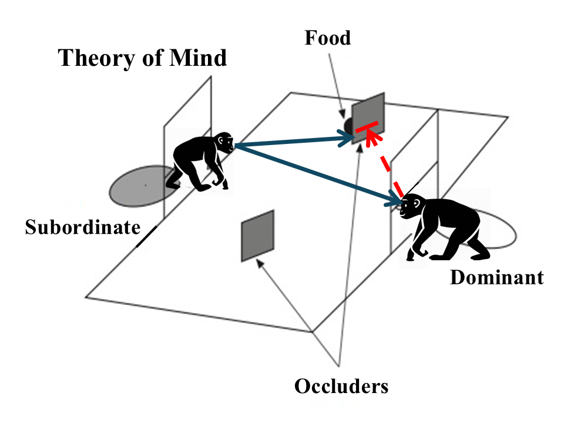

# Animal Social Cognition
**First published Thu Dec 5, 2024**

*Buckner, Cameron*

Nonhuman animals have long been seen as a crucial source of evidence regarding the nature and origins of human social capacities, such as communication, deception, culture, technology, politics, and morality. Humans distinctively excel at these forms of sociality, which led theorists in many disciplines to hypothesize that humans possess unique adaptations facilitating advanced social cognition. Many of these social activities presume an ability to attribute mental states such as perceptions, beliefs, and desires to other social agents, which might suggest that humans uniquely evolved a “theory of mind” that enables these attributions. At the same time, theorists have long appreciated that many animals also have complex social lives and social abilities, and that humans and some current animals evolved from a common ancestor which likely possessed precursors to our cognitive abilities. This appreciation led to decades of intense research into whether any animals also have a theory of mind—a question which quickly proved difficult to answer, for a variety of scientific and philosophical reasons reviewed below. Many important philosophical positions also have a stake in the outcome of this research, such as the Gricean theory of meaning and communication, theories of intentional action, the nature of thought and rationality, and—because these issues have implications for things like rational agency and moral worth—views on the moral and political status of animals.

The scientific study of social cognition in animals has thus long been of interest to philosophers—who have in turn contributed to scientific debates, especially by proposing new experimental designs to address evidential, conceptual, and methodological challenges arising from within the empirical research. Two basic facts complicate the study of animal social cognition:

1. animal social cognition involves one cognitive agent interacting with and perhaps representing the mental states of another cognitive agent, increasing the complexity of any experimental design, and
2. any empirical study of such nonlinguistic social interactions and mental representations must eschew reliance on language-based instructions and subject reports used to interpret data in studies of human social cognition.

As a result, complex debates over scientific method, epistemology of science, philosophy of mind, and semantics collide in the interpretation of key experiments, leading some philosophers and scientists to despair over the possibility of any clear empirical progress on core questions, especially regarding animal theory of mind.

This article will focus primarily on debates over theory of mind (Premack & Woodruff 1978)[^premack-1978] or “mindreading” (Krebs & Dawkins 1984; Whiten & Byrne 1991)[^krebs-1984][^whiten-1991] in animals, as this topic—especially attributions of perceptual and epistemic states such as *seeing* and *believing* in primates—has captured the most attention in the philosophical literature on animal social cognition. However, more recently the research agenda here has broadened, following similar shifts in human developmental psychology, to encompass a wider range of state attributions (such as desires or intentions), a wider range of social interactions (such as play, culture, shared intentionality, and norm-following), and a wider range of animal taxa (such as insects, corvids, and dolphins). This entry will review the basic history of scientific debates over animal theory of mind (highlighting key contributions from philosophers), major distinctions between types of views on animal theory of mind, core philosophical questions and methodological problems that challenge the interpretation of existing theory of mind experiments, and conclude by exploring the broader spread of states and types of social interactions in which philosophers are beginning to take greater interest.

## 1. History: Theory of mind in non-human animals

From ancient debates to the twentieth century, philosophers and scientists speculated and theorized about the social cognition of animals, often in the context of evaluating animals’ moral status. Porphyry (see *Four Books on Abstinence from Animal Food*), for example, reviewed centuries of arguments appealing to the social abilities of various animals in ancient debates over the moral status of animals, and empiricists like Hume (1739)[^hume-1739] and Darwin (1871)[^darwin-1871] described animals’ social instincts as simpler versions of the social passions and moral emotions in humans. Other theorists such as Chance & Mead (1953), Jolly (1966)[^jolly-1966], and Humphrey (1976)[^humphrey-1976] had proposed that the cognitive demands of social competition (such as deception and maintaining alliances) would be a primary driver of the evolution of intelligence in primates, which led to special focus on the social organization of humans’ closest ancestors like chimpanzees and bonobos.

By the standard’s of today’s comparative psychology, much of this theorizing looks informal and anecdotal (though observational methods remain standard in primatology and anthropology); for present purposes, the systematic experimental study of social cognition in animals can be traced to an influential article published in *Behavioral and Brain Sciences* in 1978 by the primatologists David Premack and Guy Woodruff, entitled “Does the chimpanzee have a theory of mind?”. This article opened with the idea that “theory of mind” would be the primary target of its experimental investigations, and that theory of mind involves the ability of agents to “impute mental states” to themselves and others. It also introduced other key assumptions of later work, such as that the faculty would be theory-like because imputed mental states were not directly observable in behavior, and that the primary function of theory of mind was to predict the behavior of others. The original list of mental states to be attributed included “intention, as well as knowledge, belief, thinking, doubt, guessing, pretending, liking, and so on”, but a trio of philosophical commentators all independently recommended special emphasis on epistemic states like belief—in particular, false beliefs.

Specifically, Dennett (1978)[^dennett-1978], Bennett (1978)[^bennett-1978], and Harman (1978)[^harman-1978] each expressed concern that any behavioral evidence researchers might collect which suggested that animals could attribute states like perceptions, intentions, or knowledge would be conflated with evidence that the attributing animal itself had those same perceptions, intentions, or knowledge. Whenever two animals share the same mental states, then the attributor could simply reason over its own mental states, which would lead to the same predictions without any need to attribute those mental states to another. Worse from the perspective of a fledgling comparative psychology eager to legitimize its approach to skeptical behaviorists, true mental states would often be based on observed evidence for those states (e.g., observing a food item being placed in a certain container), which could serve as associative cues that lead animals to the “correct” solution in an experiment through classical or instrumental conditioning. As is common in comparative cognition research, an explanation of observed behavior in terms of associative cues would be seen to undermine a cognitive, representational interpretation of the data (an approach described and critiqued at more length in Andrews & Monsó 2021)[^andrews-2021][^andrews-2021-2][^monsó-2021]. Premack and Woodruff (1978) had tried to develop analogues of linguistic cues in chimpanzees that could play the role of verbal reports in children, but any signals produced by chimpanzees remained confounded by associative explanations, as the animals had to be trained to use such signals before they could be assessed in experiments. Indeed, the history of this area reflects the hunt for cues that could be assessed in experiments to reveal an animal’s understanding of another agent’s mental state, but without being subject to deflationary explanation in terms of associative confounds.

For example, if a chimpanzee wants to know whether some visually obscured food is safe to grab when competing with a hostile conspecific (i.e., member of the same species), when both animals know the food’s true location, then the attributor can simply predict its competitor’s behavior by generalizing from its own knowledge states or past associations. To provide strong evidence that animals actually attributed mental states to others, Bennett, Dennett, and Harman argued, there must be a divergence between the mental states of the attributing animal and the animal to which the mental state was imputed. If perceptions and knowledge are both factive, then it would be very difficult to find the needed distance; and non-factive motivational states like intentions would often be shared by competitors (e.g., to grab the same food item or to mate with the same conspecific). Beliefs, however, can be false, and thus allow agents represent others as taking the world to be in a different state of affairs than they do. This led to the development of the “false belief” test, which has come to serve a crucial role in human developmental psychology (now being seen as a milestone that human children clear around the ages of 4–6 years old—[Wellman, Cross, & Watson 2001])[^wellman-2001] and for decades served as the primary target of research in animal social cognition research. Dennett’s recommended version of the task, for example, had chimpanzees observing an Experimenter (*E*) using a key to access a “banana locker” which holds desired food items. The chimpanzees observe *E* leaving the key in Box *A*, but the chimpanzees are allowed to observe another agent, “Sneaky Pete”, moving the key to another Box *B*. *E* then returns, and if the chimpanzees can attribute mental states, they should expect *E* to look for the key in Box *A*, even though they now know it to be in Box *B*. The initial difficulty was to find a way for the chimpanzees to signal that they had such an expectation that diverged from their own knowledge. This kind of task eventually evolved into the famous “Sally-Anne test” of false belief that is so frequently deployed on human children, who can simply express this expectation in words when asked (Wimmer & Perner 1983)[^wimmer-1983].

A variety of experimenters continued to explore the edges of this initial conceptual difficulty, with mixed results. Premack (1988)[^premack-1988] later divided Theory of Mind up into three classes, perceptual ToM (seeing, hearing, and attention), motivational ToM (intending, wanting, liking), and epistemic ToM (knowledge and beliefs). In particular, Daniel Povinelli began his career as an enthusiast of chimpanzee theory of mind (Povinelli, Nelson, & Boysen 1990)[^povinelli-1990], but, after thoroughly investigating forms of instability in the experimental evidence for perceptual theory of mind in chimpanzees, became one of its most ardent skeptics. Povinelli and Eddy (1996) tried to overcome the initial difficulty of an unambiguous nonlinguistic signal for what the chimpanzees understood about other minds by using a series of experimental designs which gave chimpanzees a choice between two different experimenters from which to beg for food items. In these “knower-guesser” designs, the two experimenters would have different mental states (e.g., one can see the food and another not, one knows where the food is and the other does not), and the chimpanzee was given a choice to beg from one experimenter or the other. The chimpanzee’s choice of the experimenter from which to beg, they reasoned, should demonstrate whether it can impute those states to the experimenters reliably. The difference between the knower and the guesser, from the chimpanzees’ perspective, was evidenced by differences in gaze cues, such as experimenters with their backs turned, blindfolds, buckets, and tinted goggles.

While chimpanzees in Povinelli and Eddy’s experiments demonstrated some sensitivity to gaze cues, such as not begging from experimenters with their backs turned, they failed to demonstrate robust understanding of the perceptual significance of gaze in other cases, such as by begging from experimenters with opaque buckets over their heads whose visual access to food items was equally occluded. Age matched children (2–5 year old) passed the same tasks, leading Povinelli and Eddy to conclude that chimpanzees’ understanding of gaze cues was shallow and that even perceptual theory of mind is likely uniquely human. Proponents of animal theory of mind rebutted these findings on a wide variety of grounds, by arguing that the experiments were ecologically invalid because chimpanzees more commonly compete rather than cooperate for food, had to be trained to use the begging cues, might not have understood that humans cannot see through buckets and blindfolds, and/or might perform better in more ecologically-enriched environments (Bard et al. 2021; Bulloch, Boysen, & Furlong 2008; Emery & Clayton 2009; Krupenye 2021)[^bard-2021][^bulloch-2008][^emery-2009][^krupenye-2021].

The next major breakthrough in this area arrived via a series of experiments conducted by Brian Hare, Josep Call, Bryan Agnetta, and Michael Tomasello (2000). They devised an experimental paradigm involving two chimpanzees, a subordinate and a dominant, being placed across from one another in a shared enclosure which contained opaque occluders that blocked gaze. The chimpanzees were held behind guillotine doors that could be raised or lowered by experimenters, and food items could be placed either out in the open or behind an opaque occluder from the perspective of the dominant. The guillotine doors were then raised, with the subordinate given a small head start, and the experimenters assessed whether the subordinates were more likely to take food items that were behind occluders from the perspective of the dominant than those that were out in the open, which is just what the subordinates reliably did across a range of experimental conditions. As a result, these authors strongly endorsed the claim that chimpanzees have at least a perceptual theory of mind that allows them to know what others do and do not see. This result led to a resurgence of interest in animal theory of mind after a wave of pessimism in the late 1990s—though this interest quickly led to an interpretive impasse.

*Figure 1*: The Hare et al. (2000) design. Two chimpanzees are allowed to pursue food items in a shared enclosure. Food items are either out in the open from the perspective of the dominant, or behind an opaque occluder from the perspective of the dominant. If the subordinate attempts to take food items that are behind opaque occluders more often than those that are out in the open, the experimenters argue this would provide evidence that they understand what the dominant can and cannot see.

## 2. The “logical problem” with research on animal theory of mind

Hare et al.’s experiments—as well as many others like it conducted in other species like monkeys, ravens, corvids, and dogs (for a systematic review, see Lurz 2011)[^lurz-2011]—were soon subjected to a conceptual critique that has come to be called the “logical problem”. The logical problem highlights a concern that previous experiments for animal perceptual theory of mind necessarily conflate behavioral evidence that an animal represents a conspecific’s perceptual states (such as seeing) with behavioral evidence that they represent the observable cues indicating that mental state, such as line-of-gaze. Povinelli and other skeptics argued that in these experiments, the chimpanzees could only infer the contents of a competitor’s visual perceptual states if they had observable behavioral cues as to where they were looking. The most common confounds were so-called “line-of-gaze cues”, such as the direction of the other agent’s head or eyes. The computation of line-of-gaze is thought to be more complex than merely observing the animal’s eyes or face, as line-of-gaze includes a spatial line originating at the surface of the other agent’s eyes or head and terminating in a target object or an opaque occluder. Heyes similarly concedes that chimpanzees can “accurately anticipate the goal-directed behavior of an agent who held a false belief”, but she insists that existing experiments merely show evidence for “submentalizing”, which involves “prediction of behavior by low-level, domain-general psychological processes” (Heyes 2017: 1)[^heyes-2017]. While Penn and Povinelli (2007) admit that tracking line-of-gaze across all control conditions is cognitively sophisticated, they insist that it is merely “behavior-reading”—which is to be contrasted with human-like theory of mind or mindreading because the chimpanzees’ ability relies only on tracking “behavioral, rather than mental, intervening variables” (2007: 737). Some skeptical philosophers, most especially Robert Lurz (2011)[^lurz-2011], have argued that both the psychology and philosophy of perception suggest that animals track such complex cue combinations as part of their routine comprehension of their environment; but others have argued that such computations would be as cognitively demanding as theory of mind itself (Buckner 2014)[^buckner-2014].

Typically, skeptics who defend the logical problem such as Heyes (1998)[^heyes-1998], Penn and Povinelli (2007), and Lurz (2009)[^lurz-2009] offer their own version of an experiment that they believe can in principle overcome their skeptical challenges, in order to obviate the charge that their evidential standard is so stringent as to be empirically unsatisfiable. However, other skeptics have often argued that these increasingly complex designs are also undermined by the logical problem, sometimes before the experiments had even been performed. This led research in this area to reach a kind of conceptual and methodological impasse (Call & Tomasello 2008; Penn, Holyoak, & Povinelli 2008)[^call-2008][^penn-2008]. This impasse encouraged a variety of psychologists and philosophers to suggest that some of the basic assumptions of the research tradition needed to be revised in order to achieve empirical progress—such as ideas about theoretical parsimony (Clatterbuck 2015; Dacey 2016; Halina 2015; Heyes 1998; Sober 2015)[^clatterbuck-2015][^dacey-2016][^halina-2015][^heyes-1998][^sober-2015], null hypothesis testing (Andrews & Huss 2014; Meketa 2014; Mikhalevich 2015; Mikhalevich, Powell, & Logan 2017)[^andrews-2014][^meketa-2014][^mikhalevich-2015][^mikhalevich-2017], implicit theory of representation (Buckner 2014; Phillips 2019)[^buckner-2014][^phillips-2019], and more general epistemology of science (Fagan 2016; Fitzpatrick 2009)[^fagan-2016][^fitzpatrick-2009]. Others have offered alternative interpretations of the cognitive abilities that these designs could or should assess in animals (Andrews 2012; Burge 2018; Nanay 2020)[^andrews-2012][^burge-2018][^nanay-2020]. Recent successes by simple artificial neural networks on nonlinguistic false-belief-attribution designs might further call into question the idea that such tests could only be passed with a concept of belief, as these systems lack much of the cognitive architecture presumed to be shared between humans and animals, yet they can pass some of the more demanding theory of mind tasks (Rabinowitz et al. 2018—Other Internet Resources).

One of the first experimental designs proposed by the skeptics to overcome the logical problem was the “goggles” design sketched by Heyes (1998)[^heyes-1998]. The innovation of the goggles design was to provide animals with a learned, observable cue that could track the internal experience of a conspecific. Chimpanzees were to learn from their own experience that one kind of goggles with translucent lenses afforded sight, whereas another kind had opaque lenses that did not afford sight; from a distance, however, the goggles could be distinguished only by the color of their frames. As a result, subjects must learn from their own experience which color afforded sight, and then they would need to “project” this perceptual access onto a conspecific after observing the color of the goggles they are wearing. While there have not been exact implementations of the goggles design reported, eventually some experimenters published studies operating on similar logic. Karg et al. (2015) implemented a version on chimpanzees using colored boxes instead of goggles, and Bugnyar, Reber, and Buckner (2016) implemented a design on ravens using peepholes between enclosures. Both of these experiments reported positive results. While admitting that these experiments demonstrated a new degree of flexibility in responding to the mental states of others, some skeptics still did not concede that these designs had fully overcome the logical problem (Kuznar et al. 2020; Lurz 2018)[^kuznar-2020][^lurz-2018]. Lurz has recommended the use of mirrors to overcome the logical problem, and has collaborated on other experiments reporting positive results (Lurz & Krachun 2019)[^lurz-2019]. Some of the most devout skeptics however, remain unconvinced, finding residual logical problems with even these most elaborate designs (Burge 2018; Heyes 2017; Lurz & Krachun 2019; Povinelli 2020)[^burge-2018][^heyes-2017][^lurz-2019][^povinelli-2020], and Andrews (2005)[^andrews-2005] argued early on that the goggles design was vulnerable to alternative interpretation in terms of “ability to do things” when certain goggles or buckets are present, rather than the standard line-of-gaze interpretation.

Despite this impasse, new research continues to be conducted on false belief attribution in animals. In particular, Krupenye, Kano, et al. (2016) adapted eye-tracking methods from infant cognition to provide evidence that chimpanzees, bonobos, and orangutans can anticipate that others will act according to false beliefs. While many experimenters had considered applying a version of the canonical Sally-Anne test to animals, it had been difficult to find a non-linguistic analogue that could be applied to apes. Onishi and Baillargeon (2005) developed variant of the Sally-Anne task for nonverbal human infants which used eye-tracking rather than verbal reports to study false belief attributions, but it was also difficult for practical reasons and conceptual reasons to apply eye-tracking methods to apes. Krupenye, Kano, et al. (2016) confronted both challenges by developing a more competitive eye-tracking design in which a human actor wears a gorilla costume (“King Kong”). Apes watched videos in which a plainclothes human would enter a scene with two haystacks in which King Kong could hide; when the human turned his back, King Kong would hit him on the back and hide in a haystack. The human would then leave the scene via a door to go retrieve a long pole that could be used to beat the haystacks. In various conditions, King Kong would move around in the haystacks, either in or outside of the view of the human he had attacked, and then exit the scene entirely. The experimenters would then monitor the observing apes’ gaze locations to see whether they anticipated the human first whacking the haystack where King Kong was last located (and seen by the observing ape), or where the human last observed him to be located. A second version of the experiment was also conducted with a stone and two box location in which it could be hidden. When data across the two experiments was pooled, a significant trend of looking towards the target location predicted by the observing human’s false belief was reported across two types of false belief conditions which was taken as evidence that the apes possess some ability to attribute a false belief.

Krupenye et al.’s experiments were explicitly designed to replicate the logic of looking-times studies for false belief attribution in 2-year-old infants, especially Southgate, Senju, and Csibra (2007); it is thus difficult to attribute theory of mind to human infants on the basis of such anticipatory looking, while denying it to apes. Nevertheless, several looking-times studies on infant theory of mind have recently come under criticism in developmental psychology on the basis of replication failures (Kampis et al. 2021; Kulke et al. 2018; L. Powell et al. 2018; ManyBabies Consortium 2020)[^kampis-2021][^kulke-2018][^manybabies-2020][^powell-2018]. Those unconvinced by the early infant looking-times experiments will likely also look with skepticism upon similar experimental results collected with apes. Indeed, several prominent theorists have suggested that while these studies demonstrate significant flexibility in tracking belief-like states, they can be explained in terms of abilities which show less than a full understanding of propositional theory of mind (Andrews 2018; Heyes 2017; Tomasello 2018)[^andrews-2018][^andrews-2018-2][^heyes-2017][^tomasello-2018].

## 3. Understanding the disagreement over animal ToM: Basic distinctions

As noted above, philosophers have been intensely interested in these disagreements, as they reflect cases where scientists seem to agree on all of the data but disagree on their interpretation. We may begin with a series of distinctions that could be used to organize theoretical positions on these data, as much of the philosophical work on these debates has called into questioned the basic distinctions or assumptions of the empirical research. These include the structure of animal social cognition (is it theory-like or not?), the unity of the purported capacity (is it a single system, a hybrid system, or multiple special-purpose systems?), and the evolutionary origins of the system (did it emerge once in human ancestors, or has it emerged multiple times in different socially complex phylogenetic groups?).

### 3.1 Structure of the theory: theory, simulation, or both

One fundamental issue in the empirical study of animal social cognition concerns the organizing structure of the capacity. In the philosophy and science of human social cognition, there has been a longstanding debate about the structure of “folk psychology” and our own social cognitive capacities. So-called “theory theorists” (cf. Hutto & Ravenscroft 2021, entry on folk psychology as a theory)[^hutto-2021] hold that human social cognitive capacities are theory-like—that is, they operate like a simple scientific theory, positing unobservable, causally-efficacious states that stand in law-like relationships to one another. On this framework, the difference between empirical psychology and folk psychology is one of degree or sophistication rather than of kind. Another camp, the so-called “simulation theorists” (cf. Barlassina & Gordon 2017, entry on folk psychology as mental simulation)[^barlassina-2017], hold that the structure of social cognition in humans is not theory-like, but rather based on our own capacities for mental imagery, imaginative projection, and simulation. We simply plug in different inputs to systems in us which allow us to simulate our own perceptions or form plans on the basis of beliefs and desires, and attribute the result of this simulation to other agents. Since both of these approaches already have entries dedicated to them, this entry need not go into them in more detail here; suffice it to say that such debates can be reprised in the context of animal social cognition. Other relevant positions have been defended as well, such as the idea that animal social cognition is theory-like but implicit, akin to tacit or naïve physics (Kaiser, Jonides, & Alexander 1986)[^kaiser-1986], that humans and animals can directly perceive the mental states of others (Gallagher 2001)[^gallagher-2001], or that social cognition is less about predicting behavior and more about influencing one another’s psychology (Zawidzki 2013)[^zawidzki-2013] or explaining one another’s behavior (Andrews 2005, 2012)[^andrews-2005][^andrews-2012]. Others have also offered hybrid positions, with both theory-like and simulation-like elements (Spaulding 2018)[^spaulding-2018]. Today, hybrid or pluralistic theories tend to be the most empirically-successful in human psychology, as no monolithic form of theory has been able to explain the full range of experimental data in human social psychology.

One’s position on the structure of human social cognition will obviously carry implications for one’s views on whether animals have specific forms of social cognition, such as theory of mind. Notably, the more explicit and theory-like aspects of social cognition are perhaps much less plausibly possessed in non-linguistic animals, who lack the words to learn, describe, and manipulate the components of an explicit theory of mental states. Researchers who think theory-like components form the core or essential aspects of human social cognition will doubt that nonhuman animals possess anything relevant, even when they are capable of flexibly responding in an adaptive matter to a variety of social cues and situations. Conversely, researchers who hold deflationary views about the structure of human social cognition will be more likely to see relevant analogues and precursors in animals. In comparative social cognition research, therefore, explicitly describing assumptions about the nature of human social cognition may lead to more productive debates.

### 3.2 Structure of the view: One level or multiple systems

Relatedly, theorists have speculated that there might be at least two different mindreading systems in humans which can operate independently or in concert, and perhaps only the first system is shared with animals. Apperly and Butterfill (2009) in particular suggest that there might be a “minimal theory of mind” system which is shared at least amongst humans, primates, and corvids, and then a second more theory-like system which is uniquely human. The minimal theory of mind system is based upon the idea of “registrations”, which are combinations of gaze cues, objects, and locations that are recorded by an observing animals (Butterfill & Apperly 2013)[^butterfill-2013]. Registrations are belief-like in that they allow animals to monitor relations between particular agents and the status of particular objects in particular locations. For example, if one animal observes another to have a line-of-gaze to a food item in some location at some time, it records that animal to have registered that object in that location. If the object is later moved outside of that registering animals’ gaze, the representation of registration may allow the observing animal to demonstrate surprise should the observed animal look for the object in its new location as opposed to where it was previously registered—thus passing some versions of the nonverbal false belief task. They argue nevertheless that minimal theory of mind lacks certain capabilities of full propositional theory of mind as possessed by humans, such as the ability to represent different appearances or aspects of registered objects, or to iterate propositional attitude ascriptions to higher orders (e.g., “I believe that you know that the object appears red”). As with “dual system” theories in other areas, the minimal theory of mind system is more implicit and perceptual, perhaps being more automatic and less effortful in its operations, and full theory-of-mind may be more explicit in its operations and require more cognitive effort and attention.

Another kind of hybrid view is based upon the idea that there are forms of theory of mind which depend upon online interaction with other agents. On this view, in addition to theoretical or simulative forms of “off-line” mindreading, there are forms of mindreading which are essentially embodied and based in interpersonal pragmatics and online second-person interactions (Gallagher 2001)[^gallagher-2001]. These views often emphasize imitation and enactive perception as basic precursors of second-person mindreading. In the case of imitation, for example, it may be that online observation, comparison, and effortless proprioceptive understanding of another’s actions allows us to imitate one another without any deeper theoretical or simulative understanding of the others’ actions. Enactive perception of bodily movements and facial expressions may allow us to track another’s goals and intentions in a particular situation in an egocentric and context-bound manner without require any heavy-duty representation of the others’ mental states. Using such mechanisms, animals might be “tuned” to one another in an embodied interaction in a way that produces behavior which is adaptive in light of one another’s mental states, but that does not reflect any deeper theoretical understanding of those mental states in a context-independent way (Gallagher & Povinelli 2012)[^gallagher-2012].

### 3.3 Shared descent or convergent evolution?

Another major issue in the study of animal social cognition concerns the question of whether social cognitive capacities should be expected to have emerged only once in the hominid lineage, or whether capacities might have independently evolved several times in different socially-complex animal species (Sober 2005)[^sober-2005]. One’s views on these issues are often interrelated with those others just discussed. For example, researchers who have a restrictive view of theory of mind as a single, theory-like capacity may hold that theory of mind evolved only once in a hominid ancestor once they diverged from a common line with chimpanzees and bonobos. Theorists who adopt a hybrid view like Apperly and Butterfill may suppose that this view is correct for the theory-like form of theory of mind, but that minimal theory of mind might have evolved multiple times in different taxa. Those with more multifarious or pluralistic views can investigate the spread of many different components and capacities throughout the animal kingdom. Social cognition experiments have been conducted on chimpanzees, bonobos, gorillas, orangutans, capuchins, macaques, rhesus monkeys, tamarins, marmosets, rats, horses, sheep, pigs, dogs, foxes, wolves, scrub jays, ravens, parrots, dolphins, seals, cichlids, wrasses, sticklebacks, bees, ants, and many more. With all this data across the animal kingdom, we can begin to develop a broader picture of the pressures favoring the evolution and development of many different components of social cognition, which may in turn inform a deeper understanding of the practical implications of social cognitive capacities across many different animal groups, for example for welfare decisions (Nawroth et al. 2019)[^nawroth-2019].

## 4. Causes of the ToM impasse: Philosophical diagnoses

Despite the wealth of experimental data now available on the social cognitive abilities of animals, there remains a large degree of disagreement on the best way to interpret these data. Moreover, it has not always been clear how further experimental work could resolve these disagreements; proponents and skeptics of animal social cognition would likely disagree about the correct interpretation of future, more powerful experiments as well. This has led many philosophers and psychologists to conclude that deeper philosophical or methodological disagreements must be resolved before empirical progress can be made on animal social cognition. This section considers some of the suggestions that have been raised in this vein.

### 4.1 Comparative bias

One of the most common concerns expressed in the reflections on the methodology of comparative psychology concerns the charge of anthropomorphic bias. Skeptics who argue that animals are merely capable of associative learning, behavior-reading, or sub-mentalizing argue that proponents of animal theory of mind or mindreading are overinterpreting their data because they are anthropomorphizing their research subjects. Povinelli and Vonk (2003) even argue that anthropomorphism and theory of mind are closely linked: because humans have a unique ability to reinterpret behavioral abstractions in terms of mental states, we cannot help but interpret animal social behavior except by imputing those same mental states to them. Proponents have responded that refusing to interpret similar behavior in terms of similar causes risks a bias in the other direction, dubbed anthropodenial or anthropectomy (Andrews & Huss 2014; De Waal 1999; Sober 2005)[^andrews-2014][^waal-1999][^sober-2005]. Buckner (2013)[^buckner-2013] has further countered that skeptics may be committing a bias dubbed “anthropofabulation”, which combines anthropocentrism with confabulation about human prowess. Specifically, anthropofabulation occurs when researchers set the criteria for the possession of some capacity to an overly idealized view of human capacity, a bar so high that not even humans would clear them if fairly assessed. For example, some presentations of the logical problem require that “genuine” theory of mind or mindreading be independent of any particular capacities for tracking proximal cues or behavior-reading, when humans—assumed to lack psychic powers allowing direct perceptual access to the mental states of others—could also only infer mental states indirectly, on the basis of behavioral evidence.

Concerns about anthropomorphism are also often tied up with other background issues in methodology, especially regarding the choice of null hypothesis and whether it is more parsimonious to assume that our nearest primate relatives would or would not share similar social cognitive capacities. In many experiments in animal cognition, the test conditions of an experiment are designed to rule out a null hypothesis, which in many cases discussed above is that animals do not have the same social cognitive capacities as humans (Andrews & Huss 2014)[^andrews-2014]. This has led some philosophers to recommend choosing more empirically-informed null hypotheses in our experiments, whereas others have pushed back by arguing that existing scientific practices are sufficient to mitigate these concerns (Bausman & Halina 2018; Dacey 2023; Halina 2022; Mikhalevich 2015; Mikhalevich, Powell, & Logan 2017)[^bausman-2018][^dacey-2023][^halina-2022][^mikhalevich-2015][^mikhalevich-2017].

### 4.2. Parsimony Metrics

Relatedly, there has been intense debate regarding measures of parsimony in interpreting data in experiments on animal social cognition. It has long been a popular proposal in comparative psychology that hypotheses which explain behavior in terms of associative learning are more parsimonious than those that appeal to cognitive processes. Penn & Povinelli further suggest that while behavior-reading may not be purely associative in nature, behavior-reading hypotheses are still more parsimonious than mind-reading hypotheses (Penn & Povinelli 2007)[^penn-2007]. The idea that non-cognitive or behavior-reading explanations are more parsimonious is often tied to Morgan’s Canon and likened to a form of Ockham’s Razor for psychology, with the idea that “lower” processes on the scale of psychological evolution and development are more parsimonious explanations by default (Heyes 1998; Karin-D’Arcy 2005; Sober 2005)[^heyes-1998][^karin-d’arcy-2005][^sober-2005]. However, it has often proven difficult to justify the claim that associative or behavior-reading hypotheses are always more parsimonious, especially when many different rules or links must be posited without additional empirical justification (Fitzpatrick 2008; Hanus 2016)[^fitzpatrick-2008][^hanus-2016]. For example, Fletcher and Carruthers (2013) note that Penn and Povinelli (2007) require at least nine different behavior-reading rules to explain the full range of relevant behaviors observed in different social cognition experiments on chimpanzees at the time, and more would need to be added for experiments conducted since. Proponents of theory of mind in animals counter that it is more parsimonious to explain many different experiments by appeal to the same underlying mindreading mechanism, especially when dealing with cognitively flexible animals that share evolutionary lineages and evolutionary pressures with humans (Call & Tomasello 2008; Tomasello, Call, & Hare 2003)[^call-2008][^tomasello-2003]. There are thus a wide range of proposed metrics of parsimony that have been deployed by different authors in the literature, leading to a great deal of talking past when arguing about theory of mind in animals (Clatterbuck 2015, 2016; Dacey 2016; Fagan 2016; Sober 2015)[^clatterbuck-2015][^clatterbuck-2016][^dacey-2016][^fagan-2016][^sober-2015].

### 4.3 Laboratory control vs. ecological validity

Another source of contention in studies of social cognition in animals concerns a tension between laboratory control required for experimental designs, and giving animals ecologically valid situations and cues where they are most likely to be able to manifest social competences. Skeptics argue that giving animals ecologically valid cues or testing them in natural environments makes it difficult or impossible to rule out confounding hypotheses that subjects have enjoyed some associative or statistical learning experience with the relevant cues, and so it is impossible to rule out that the behavior can be explained in terms of behavior-reading or submentalizing. Proponents argue that there is little reason to believe that animals could or should manifest social competences in artificial laboratory settings which lack motivational significance to the animals. The most prominent place where this concern has emerged in studies of animal social cognition concerns the discrepancy between reliable failures on Povinelli and Eddy’s (1996) studies to assess whether chimpanzees understand seeing, compared to Hare et al. (2000)’s later positive findings. As noted in the introduction, one of the most popular explanations for these discrepancies is that Povinelli and Eddy’s tasks were mostly cooperative, whereas Hare et al.’s designs were competitive. Tomasello, Call, and Hare (2003) argued that chimpanzees are naturally more competitive than cooperative, and so they might have failed on Povinelli & Eddy’s designs because they were ecologically invalid. Penn and Povinelli rebut that focusing on ecologically-valid tasks risks introducing confounds, as ecologically-valid cues are more likely to have rigid innate mechanisms or be present in the animals’ learning history prior to the experiment. These concerns have since been discussed in a number of other social cognitive capacities and species; for a recent review, see Krupenye and Call (2019).

More thoroughly ecological approaches—conducting experiments in the wild, on wild animals—have produced even more positive results. While disappointing results were accumulating in lab-based experiments on animal social cognition, cognitive ethologists such as Carolyn Ristau were producing interesting results using entirely different methods in the field. Ristau (1990)[^ristau-1990], for example, systematically explored the broken-wing display of piping plovers as possible example of deception. Inspired in part by Dennett’s (1983)[^dennett-1983] “intentional systems theory”, she argued that the broken-wing display in plovers exhibited a degree of flexibility which merited its description as at least first-order intentional creatures in Dennett’s framework, capable of representations of the form “*X* wants to lead *Y* away from the nest”. This second-order state, Ristau argued, was legitimated by the flexibility demonstrated by the broken wing dance when tested. Rather than being a rigidly defined reflex, the piping plover would make many flexible adjustments to the location of its display. The plovers are a ground-nesting bird, and as a predator approached the nest, the plover would land in a direction that would draw the predator away from the nest, generally in the visual field of the predator, and appeared to make rapid adjustments to its location in response to changes of location and direction by the predator. It would also adjust the urgency and frequency of its display as the predator got closer to the nest, and would cease the display and fly away once the predator was a safe distance away from the nest. Ristau left open, however, whether they merited description as a form of deception, which would construe plovers as second-order intentional systems capable of states involving theory-of-mind-like attributions such as “*X* wants *Y* to believe that it is injured” (Bugnyar & Kotrschal 2004)[^bugnyar-2004]. The pattern of negative results in artificial lab-based tasks and positive results in ecologically valid field-based settings reflects a long-standing tension in animal cognition research generally that is unlikely to resolve itself anytime soon.

### 4.4 The biological function of social cognition

Another set of explanations for discrepancies in findings and interpretations of data on animal social cognition concerns the purported function of theory of mind or mindreading capacities. As noted in the introduction, many experiments are designed around the assumption, common in primatology, that the primary function of social cognitive capacities, especially in primates, is behavioral prediction for the purposes of social competition. This general theory of primate cognition has been dubbed the “Machiavellian intelligence” hypothesis by defenders (Whiten and Byrne 1997)[^whiten-1997], the idea being that a general boom in the intelligence and theoretical reasoning abilities of primates can be explained by a sudden increase in social complexity and competition in our primate ancestors. Other theorists have argued instead that for the purposes of behavioral prediction, behavior-reading or submentalizing would suffice, and so mental state attributions or other sophisticated social cognitive capacities must serve other purposes. Andrews (2005)[^andrews-2005] has argued that theory of mind evolved primarily to serve purposes of explanation rather than prediction, and so experiments should not focus exclusively on behavioral prediction if seeking to find evidence for animal theory of mind. Zawidzki (2013)[^zawidzki-2013] has argued that advanced social cognitive capacities play more of a role in social regulation than in prediction or explanation, and so serve the function of “mindshaping”, helping social agents regulate one another’s behaviors and hold each other to shared social norms. This has in turn been applied to suggest further new directions in experiments on the social cognitive abilities of primates (Papadopoulos & Andrews 2022)[^andrews-2022][^papadopoulos-2022] and further tied to theories about the development of shared intentions and proto-normative behavior in animals. Another interesting suggestion has been that processes of domestication select for social cognitive capacities like perspective-taking, based on comparisons between closely-related domesticated and undomesticated species, such as dogs and wolves (Miklósi & Topál 2011)[^miklósi-2011]. Given the diversity of opinions regarding the purpose of social cognition in animals, theorists should explicitly consider these issues before wading into interpretive disagreements and proposing new experimental paradigms.

### 4.5 Signature limits

Another recent proposal for arbitrating disagreements is that instead of focusing on behavioral manifestations of success on social tasks as evidence for theory of mind, we should look for “signature limits” revealed by differing patterns of failures or rates of acquisition in various situations. Butterfill and Apperly (2013) emphasize that their hypothesized minimal theory of mind and full-blown explicit theory of mind systems would predict similar solutions to social problems in many experimental designs. However, they argued that the two systems could be empirically distinguished by their subtly different patterns of acquisition and failure across tasks. Minimal theory of mind, they hypothesized, would rely on representations of particular objects and relations to agents to make predictions, and so would struggle with more abstract predictions involving quantification and identity; for application of this idea to the interpretation of a recent design, see (Kano et al. 2019; Taylor et al. 2022)[^kano-2019][^taylor-2022]. They thus recommend experimental designs that rely on these more abstract forms of inference to distinguish the two systems.

### 4.6 Theory of representation

Finally, Buckner (2014)[^buckner-2014] has argued that that many of these other dimensions of disagreement can be understood as disagreements over the implicit theories of representation adopted by researchers interpreting the data, and thus the impasse is most fundamentally a “semantic problem”, rather than a logical one. It is difficult to express the distinction between behavior-reading and mind-reading, or between mentalizing and submentalizing, except in representational terms: full theory of mind, mind-reading, or mentalizing involves representing the mental states of others, whereas behavior-reading or submentalizing involves representing only contingencies or configurations of behavioral cues. These behavioral cues are often good evidence for underlying mental states and are statistically correlated with them to varying degrees (Heyes 2015)[^heyes-2015]. Thus, the debate over animal social cognitive capacities turns on the criteria for representing a distal mental state rather than merely its proximal behavioral evidence. This kind of tension between a representation of a distal state and of its proximal cues is common from debates on the theory of representation in philosophy of mind (Dretske 1986; Prinz 2000)[^dretske-1986][^prinz-2000].

Skeptics like Povinelli seem to require unsatisfiably restrictive criteria for representation, such as that the representation of a distal mental state depend upon no particular proximal behavioral cues. Since neither humans nor animals are psychic, neither can represent mental states except by tracking perceivable behavioral evidence of those states. Yet it must also be admitted that there is a real distinction between merely tracking behavioral evidence and tracking the distal mental state. Some proponents of theory of mind in animals seem to implicitly prefer teleosemantic theories of representation, by emphasizing the evolutionary function of tracking behavioral cues must appeal to the functional role that the corresponding mental state (e.g., seeing) plays in the observed agent’s psychology. There are well-known concerns expressed about such teleosemantic proposals in comparative psychology, however, in that it can be difficult to empirically confirm or disconfirm such attributions of function (Chater & Heyes 1994)[^chater-1994]. Buckner (2022)[^buckner-2022] has suggested that the issue can be rendered empirically tractable by emphasizing an open-ended ability to flexibly recruit new proximal cues as evidence for a distal mental state—a “forward-looking” approach to mental representation that correspondingly suggests new behavioral experiments. Phillips (2019)[^phillips-2019] tackles this challenge in a different way by proposing three different accounts of representing “seeing” (the “headlamp conception”, the “stage lights” conception, and “seeing-as”) that can be used to interpret prior experiments on perspective-taking and inspire new ones, and Clatterbuck (2018)[^clatterbuck-2018] suggests that experimenters should develop explicit causal models of various representational hypotheses before trying to tease them apart with behavioral experiments.

## 5. The broadening of research on social cognition

As the flashpoint debate over the logical problem failed to settle into a consensus resolution, general trends—simultaneously developing independently in human developmental social cognition research—recommended a more expansive and pluralistic attitude towards social cognition. Many researchers have suggested that the logical problem caused “tunnel vision” that, while facilitating fruitful interdisciplinary discussion between psychologists and philosophers, led to neglect of other issues that might be just as much or more important, both scientifically and philosophically. In humans, this broadening has been recommended to make sense of the complex pattern of behavior exhibited over developmental timescales, where infants gradually develop nonlinguistic forms of social cognition up to age 2, then tend to fail more advanced verbal versions of social cognition tasks purportedly involving the same attributions (e.g., of false beliefs), then start reliably succeeding on both verbal and nonverbal versions around age 5 (Andrews, Spaulding, & Westra 2021; Fiebich, Gallagher, & Hutto 2017; Westra 2017; Westra & Carruthers 2017)[^andrews-2021][^andrews-2021-2][^fiebich-2017][^westra-2017][^westra-2017-2].

The wider range of states explored in animal social cognition today includes (at least) emotions, desires, social relationships, play, culture, and other precursors of morality.

### 5.1 Emotional states

Another important dimension of social cognition for animals would be the tracking of one another’s emotional states and moods, on the assumption that many animals can possess at least primitive versions of emotion-like states that are significant to navigating their social world (De Waal 2011; Panksepp 2011)[^waal-2011][^panksepp-2011]. The ability to track and appropriately respond to emotional states in conspecifics and heterospecifics may be an important precursor of empathy, such as might be exhibited in “consolation” behavior (Monsó & Wrage 2021; Romero, Castellanos, & de Waal 2010)[^monsó-2021][^romero-2010]. For example, Fraser and Bugnyar (2010) studied “consolation” behavior in ravens after conflicts. Upon observing consolation behavior (such as contact sitting, preening, and beak-to-beak or beak-to-body touching) by partners after conflicts, they explored the question as to whether the consoling bystanders were motivated to alleviate the victim’s apparent distress, or rather according to more deflationary interpretations, such as an attempt to avoid becoming the victim of redirected aggression by the distressed partner (Koski & Sterck 2009)[^koski-2009]. They found that consolation behavior was more likely after intense conflicts, which would be more likely to leave the victims distressed, and from bystanders with more valuable relationships than by unaffiliated bystanders. These suggest both that the function of the behavior is to alleviate distress rather than just to avoid becoming the victim of redirected aggression, and stress the importance of long-term relationships in cognitively sophisticated animals such as ravens. Mimicry and emotional contagion of emotional responses may also support the evolution and development of human empathy, as long suggested by theorists like Hume and Darwin (Palagi et al. 2020)[^palagi-2020]. There has even been research as to whether animals can represent the emotions of heterospecifics, especially in domesticated species like dogs (Albuquerque et al. 2016)[^albuquerque-2016]. Monsó in particular has argued that emotional attributions might be made in the absence of theory of mind, and might give behavior-reading animals an alternative route to moral cognition (2015, 2017). Philosophers—especially those interested in moral psychology and the evolution of empathy—would likely benefit from familiarity with this research.

### 5.2 Relationship maintenance and representation of desires

Another recent trend in empirical research on social cognition in animals has been growing interest in the ability to form and maintain complex, long-term relationships. This interest applies not only to competitive, hierarchical species like chimpanzees where alliances may be important to maintaining and understanding social position, but also in species that form long-term young-caregiver relationships in extended neotony, and/or monogamous pair-bonding relationships, such as corvids and parrots. Maintaining relationships over the long term requires a kind of motivational decoupling—the ability to represent desires or goals that differ from one’s own—and cooperative rearing involves the ability to balance needs and divide the labor of caring for young or the maintenance of a nest or niche in which to raise them (Keefner 2016; Ostojić, Legg, Dits, et al. 2016; Ostojić, Legg, Shaw, et al. 2014)[^keefner-2016][^ostojić-2016][^ostojić-2014]. Ostojic and colleagues in particular developed a new paradigm to test for desire attributions based on such motivational decoupling in scrub jays, a so-called “specific satiety” design. In mated scrub jay pairs, as in many other bird species, males will often bring nesting females food while they tend eggs or young. Jays’ desires for specific types of food could be manipulated by pre-feeding until they no longer consumed more of that food type. This would cause them to prefer the other kind of food. Males could then be allowed to observe the female being pre-fed with a one food type, and then given a choice between the pre-fed food and another type of food. The males, by contrast, were kept on a maintenance diet that gave them no preference for one food type over the other. The males preferentially delivered the type of food that the females had not been pre-fed, demonstrating a sensitivity to their preferences that differed from their own preferences. A follow-up experiment even demonstrated that male jays could show some sensitivity to preferences that were opposed to their own (e.g., when the male and female were pre-fed to satiety on different foods). This research demonstrates the potential for studying other types of mental state attributions in other animals that can be obtained by broadening our focus to a wider range of functions and contexts beyond the competitive contexts in hierarchical animals like chimpanzees that have benefited from so much prior research.

### 5.3 Play

Another interesting kind of social cognition in animals concerns play behavior (Burghardt 2005, 2010)[^burghardt-2005][^burghardt-2010]. Play is an interesting way-station to other more sophisticated forms of social coordination and relationship maintenance found in many different animal species, especially amongst their young. Play allows animals to practice and develop hunting and fighting strategies, develop and maintain social relationships, learn to regulate impulses, and coordinate with others (Bekoff 2004; Bekoff & Allen 1998; Bekoff & Byers [eds] 1998)[^bekoff-2004][^bekoff-1998][^bekoff-1998-2]. Play requires a delicate balancing act, because play that is too rough can easily degenerate into real fighting or conflict. It thus requires signaling and constant monitoring by both animals’ of the others’ state and willingness to continue the bout of play. Bekoff in particular has argued that it is a waystation to moral development, as it involves the early forms of cooperation, fairness, forgiveness, and trust (C. Allen & Bekoff 2005; Bekoff 2001)[^allen-2005][^bekoff-2001]. Animal play thus can serve as a case study for the evolution of shared intentionality and joint action, allowing us to draw comparative inferences about the evolution of shared intentionality in humans and other animals (Heesen et al. 2017)[^heesen-2017]. Critics have argued that the intentional characterization of play involves implausibly intellectualized representational states, such as the intention that the other agent recognize that it is only mimicking real behaviors (such as attacks). Rosenberg (1990)[^rosenberg-1990], for example, worries that such construals involve at least a third-order intentions, that “[agent] *a* wants [agent] *b* to believe that *a* wants to do [behavior] *d* not seriously but with other goals or aims” (1990: 184). Colin Allen and Bekoff (1994) respond that this kind of Gricean analysis of play-intentions would be over-intellectualized even for human children, and so cannot be the right analysis of pretense in animal play. Other researchers have also more recently noted that many components of play behavior—especially expressions and gestures used primarily for signaling—are common between humans and many animals, suggesting alternative, less cognitively-demanding ways to navigate shared episodes of play (Davila-Ross & Palagi 2022)[^davila-ross-2022].

### 5.4 Imitation

Imitation is another intensely studied social behavior in animal, because it is thought to be a prerequisite for human-like cultural learning and tool use. Imitation is often defined as the copying of behavior or learning to move the body in a particular way by observing others (Heyes & Ray 2000; Zentall 2006)[^heyes-2000][^zentall-2006]. It is often distinguished from other forms of social learning to perform tasks, such as stimulus enhancement and intention understanding (Call, Carpenter, & Tomasello 2005; Moore 2013; Spence 1937)[^call-2005][^moore-2013][^spence-1937][^tomasello-2005]. True imitation, many theorists argue, requires repeating the specific motions that another agent is observed to perform, which might be thought to require a representation of the other agent’s movements themselves. Stimulus enhancement might involve repeating the same movements, but only because the other agent’s movements raised the salience of some important cues to draw additional attention or associative value. For example, if I am trying to open a locked door, observing another reaching into their pocket and jingling their keys may remind me of the keys in my own pocket as a means to open the door, but without any actual representation of the other agent’s door-opening movements.

To consider another alternative mechanism, intention understanding might also allow an animals to achieve the same goal but without repeating or representing the same actions; a common experimental design to distinguish the two is to perform an action in an inefficient or needlessly complicated way (such as turning a nonfunctional bolt on a box before opening it), and see whether the observing animal repeats all of the movements exactly or achieves the same result in a different or more efficient manner (Call, Carpenter, & Tomasello 2005; Whiten, Custance, et al. 1996)[^call-2005][^tomasello-2005][^whiten-1996]. Tomasello, Kruger, and Ratner (1993) further distinguished imitation from “emulation”, which pertains less to specific movements and more to learning affordances of objects (such as that a particular stick bends or a box lid affords opening). As with many of the other forms of social cognition already reviewed, imitation has been proposed by some theorists as the uniquely human trait that explains much of our ability to engage in cultural learning and create complex tools and technologies. Heyes (1993, 2021)[^heyes-1993][^heyes-2021] has suggested that what matters for “true imitation” is copying something of specific body movement topography, such as which part of the body to move, or how to move body parts relative to one another or to external objects. This might include so-called “over-imitation”, which involves repeating exact movements even when they lack a clear external goal (Whiten 2019)[^whiten-2019]. Animals often fail to display over-imitation while human children readily exhibit it in many contexts, though some studies have found evidence of over-imitation in highly social species, such as dogs (Huber et al. 2020)[^huber-2020], and Jedediah Allen and Andrews (2024)[^andrews-2024] argued on methodological grounds that many studies on over-imitation in animals were biased towards finding negative results, and different studies are needed. Others have argued that the deviations from exact movement copying exhibited by many animals are often adaptive, and might be explained by their learning that certain movements are non-functional or irrelevant to achieving the goal. As a result, Fridland and Moore (2015) propose amending the definition to include an understanding that the copied behavior is goal-directed and that the imitator has some motivation to replicate the precise technique observed. While more recent studies have found limited abilities to copy actions and not just goals in chimpanzees and other non-human animals, most influential authors still hold that humans are distinctively unparalleled in their ability to copy exact motions when compared to other animals (Heyes 2016; Tomasello & Herrmann 2010; Whiten 2019)[^heyes-2016][^tomasello-2010][^whiten-2019].

One important issue raised in studies of animal imitation that has been of particular interest to philosophers concerns the role that might be played by so-called “mirror neurons”. Mirror neurons were originally discovered by accident in a neuroscientific study on macaques, when it was found that certain neurons in premotor areas fired both when the monkeys made a particular grasping motion and when they observed others making the same grasping motion (di Pellegrino et al. 1992)[^pellegrino-1992]. There was initially great hope that these neurons might form the basis—perhaps even an innate basis—of the topographic representation of the behavioral movements of others that was thought to be required for true imitation. Gallese and Goldman (1998) further argued that such neurons could provide the basis for a simulationist approach to mindreading by enabling organisms to automatically detect the presence of certain distal mental states (such as motor intentions) in other agents—as well as perhaps a wide variety of many other mental state types like emotions (Wicker et al. 2003)[^wicker-2003] or sensations such as pain (Singer et al. 2004)[^singer-2004]. Though capturing a great deal of initial attention and promise, this story has more recently been called into question, especially by philosophers (C. Allen 2010; Jacob 2009; Saxe 2009; Spaulding 2012, 2013)[^allen-2010][^jacob-2009][^saxe-2009][^spaulding-2012]. Spaulding in particular reviews empirical and conceptual evidence to argue that while mirror neuron activity might be a contributing cause of social understanding, it is neither necessary nor sufficient for significant forms of mindreading on its own (2012, 2013). Mirror neurons today remain the subject of controversy in philosophy of psychology, with many different possible interpretations of their representational status and corresponding role in social cognition as theoretical options (Tramacere & Moore 2020)[^tramacere-2020].

### 5.5 Culture

A closely-related topic concerns the possibility of animal culture, which may draw upon imitation and other forms of social learning. Distinctively cultural learning is thought by many theorists to be the primary explanation for humanity’s dominance of the natural world and for most if not all uniquely human cognitive achievements. Though influential primatologists cited chimpanzees as a promising target for the study of cultural innovation (Whiten, Goodall, et al. 1999)[^whiten-1999], Tomasello and his co-authors in particular have emphasized culture as the primary cognitive difference between humans and other animals (Tomasello 1998, 1999a, 1999b; Tomasello, Carpenter, et al. 2005)[^tomasello-1998][^tomasello-1999a][^tomasello-1999b][^tomasello-2005]. Other theorists have pushed back against this view by emphasizing the possibility of cultural traditions and cultural learning in other animals, such as regional differences in tool-using strategies in different populations of chimpanzees (Boesch 1996, 2003; Boesch & Tomasello 1998; Whiten 2021)[^boesch-1996][^boesch-2003][^boesch-1998][^tomasello-1998][^whiten-2021]. Empirical evidence for chimpanzee culture has in turn been systematically critiqued by skeptics, who have emphasized how some of the deflationary mechanisms already reviewed in studies of imitation, such as stimulus enhancement, may explain the results without appealing to cultural learning (Laland & Janik 2006)[^laland-2006]. More recently, Tomasello and co-authors have conceded the existence of some cultural phenomena in animals, but argued that other aspects remain unique to humans, especially an iterative ability to improve with each generation; a so-called “ratchet effect” that allows human culture to improve indefinitely (Dean et al. 2014; Tennie, Call, & Tomasello 2009)[^dean-2014][^tennie-2009]. According to this view, animals without sufficiently flexible forms of imitative copying are limited to a “Zone of Latent Solutions” that are reachable through individualized learning strategies, but humans can acquire traits beyond their own ZLS (Tennie, Bandini, et al. 2020; Tennie, Call, & Tomasello 2009; though cf. Whiten 2022 for criticism)[^tennie-2020][^tennie-2009][^whiten-2022]. Rather than emphasizing a single unique component, however, the more popular viewpoint is now a multi-component account of the differences between human’s capacity for cultural learning and those of some of our nearest relatives like chimpanzees—emphasizing instead tendencies towards cooperative learning involving motivation, attention, and attention-soliciting behavior that may be more difficult for more competitive species like chimpanzees (Moore 2013; Tomasello 2014)[^moore-2013][^tomasello-2014]. Tomasello’s most recent view focuses on a variety of adaptations to facilitate unique excellence in cooperation and shared intentionality—especially enabling shared attention and action—which he thinks enables distinctive forms of agency (Tomasello 2022a, 2022b)[^tomasello-2022a][^tomasello-2022b]. Some more recent work by philosophers returns perhaps to the first and most basic difference between humans and non-human animals to explain the difference between human and nonhuman cultural learning, emphasizing particular ways that linguistic tools are required to bootstrap cultural learning and evolution to the human-like levels (for an overview of some recent work by philosophers, see Moore & Brown 2022)[^moore-2022]. These debates often implicate distinctively human forms of other social cognitive capacities already discussed, especially theory of mind. Philosophers have begun questioning other components of Tomasello’s model for shared intentionality, such as the need for distinctively human abstraction abilities (Papadopoulos 2023)[^papadopoulos-2023], or the development of a notion of “we” and shared obligation (Bratman 2020; Gilbert 2020)[^bratman-2020][^gilbert-2020]. Other theorists have also studied culture and cultural variation in non-primates, such as cetaceans and birds (Aplin 2019; Whitehead & Rendell 2015)[^aplin-2019][^whitehead-2015]. More recently, many participants in the chimpanzee “culture wars” have made peace with minimalist definitions of culture as socially learned behavior that persists over time or informational strategies that vary between communities, which has invited study of cultural variation in a much wider range of species, such as fruit flies and bumblebees (Bridges et al. 2024; Danchin et al. 2018)[^bridges-2024][^danchin-2018].

### 5.6 Moral Emotions and Normative Behavior

Most recently, there has been a surge of interest into whether some forms of social cognition in animals might enable them to engage in behaviors that can be recognized as proto-moral, especially normative behavior and precursors of empathy. Whereas animals have for hundreds of years been thought by philosophers and scientists to exhibit certain precursors of morality like moral emotions (such as kindness, patience, anger, shame, or disgust, but perhaps also more advanced and proto-moral emotions like empathetic concern), it was almost universally denied that they possessed anything like moral or normative cognition. Full normative cognition, it was thought, would require something like an ability to explicitly formulate abstract normative rules, evaluate those rules, and determine whether behavior accorded with them. Rowlands (2012)[^rowlands-2012] softened this strict denial of moral status for animals by suggesting a distinction between moral agents and moral patients; perhaps full-blooded moral agency required some more substantial rational capacity to understand rules and monitor rule-following, but animals’ ability to act (unreflectively) for moral reasons afforded them the status of moral patients, beings which should be afforded moral respect and allowed to live in conditions in which they can flourish. Some theorists have sought moral subjecthood in forms of moral emotions and empathy that could be available in the absence of sophisticated mindreading or theorizing capacities; Monsó (2015)[^monsó-2015], for example, argues that animals might develop forms of empathy that do not require the ability to conceptualize the mental or emotional states of other agents.

While empathy-based views often focus on moral emotions, other theorists approach the question of normative cognition as a separate and independent issue. Vincent, Ring, and Andrews (2018)[^andrews-2018][^andrews-2018-2], for example, argue that animals can behave in accordance with normative practices even if they lack the ability to consider and evaluate fully abstract, propositionally-formulated principles. Furthermore, such normative practices might even be independent of the cluster of behaviors considered indicative of empathetic concern (e.g., consolation, cooperation, and reciprocity). Andrews (2020)[^andrews-2020] develops a notion of a simpler kind of “ought-thought” that she calls “naïve normativity”. Naïve normativity, in analogy to naïve physics or logic, is based in an implicit ability to determine whether one’s behavior is in accordance with observed group practice. Andrews, Fitzpatrick, and Westra (2022) argue that sophisticated animals like chimpanzees have many of the cognitive and social abilities to maintain distinctive, complex normative practices in specific communities, especially to detect whether one’s behavior is in line with one’s community’s practices and to enforce conformity with a norm in others. Many forms of normative behavior that are not distinctively moral, emotional, or empathetic can be studied here, such as “etiquette” norms governing reproduction, cuisine, dress, social ritual, and communication (Andrews, Fitzpatrick, & Westra 2024)[^andrews-2024]. This broader focus on animal “norm psychology” (Sripada & Stich 2006)[^sripada-2006] rather than more restrictive moral psychology has begun to enjoy more uptake both amongst philosophers and psychologists (Heyes 2024; Rohr, Burkart, & Schaik 2011)[^heyes-2024][^rohr-2011] and has led to a burst of philosophical work scrutinizing the norm-tracking behavior in cognitively sophisticated animals like chimpanzees (Monsó & Andrews 2022; Fitzpatrick 2020; Monsó & Moore 2024; Papadopoulos & Andrews 2022; R. Powell 2023; Schlingloff & Moore 2018)[^andrews-2022][^fitzpatrick-2020][^monsó-2022][^monsó-2024][^papadopoulos-2022][^powell-2023][^schlingloff-2018], suggesting the emergence of another burgeoning flashpoint of interdisciplinary collaboration between philosophy and psychology.

## 6. Summary

As the above discussions suggest, the study of animal social cognition is rife with philosophical interest, and the walls between science and philosophy have here been extremely permeable for some time. Many scientists studying these capacities are open to working with philosophers, and many philosophers in this area have worked in the labs of key scientists. The complexity of the subject matter and its connection to key questions about human uniqueness allows it to serve as an interesting case study for many important issues in philosophy of mind, philosophy of science, epistemology, and ethics—likely with many new and fruitful interdisciplinary collaborations to come.

## References（引用注释）

> 原文参考文献已转为脚注引用：文内“作者-年份”引用组后附 [^key] 标记，完整条目见本文末脚注定义。

## Academic Tools

> |   | [How to cite this entry](https://plato.stanford.edu/cgi-bin/encyclopedia/archinfo.cgi?entry=animal-social-cognition). |
> | --- | --- |
> |   | [Preview the PDF version of this entry](https://leibniz.stanford.edu/friends/preview/animal-social-cognition/) at the [Friends of the SEP Society](https://leibniz.stanford.edu/friends/). |
> |   | [Look up topics and thinkers related to this entry](https://www.inphoproject.org/entity?sep=animal-social-cognition&redirect=True) at the Internet Philosophy Ontology Project (InPhO). |
> |   | [Enhanced bibliography for this entry](https://philpapers.org/sep/animal-social-cognition/) at [PhilPapers](https://philpapers.org/), with links to its database. |

## Other Internet Resources

- Rabinowitz, Neil C., Frank Perbet, H. Francis Song, Chiyuan Zhang, S. M. Ali Eslami, and Matthew Botvinick, 2018, “[Machine Theory of Mind](https://arxiv.org/abs/1802.07740)”, unpublished manuscript, arXiv:1802.07740. doi:10.48550/arXiv.1802.07740

## Related Entries

animal: cognition | animal: communication | animal: consciousness | animals: moral status of | comparative cognition, methods in | folk psychology: as a theory | folk psychology: as mental simulation | Porphyry

[^albuquerque-2016]: Albuquerque, Natalia, Kun Guo, Anna Wilkinson, Carine Savalli, Emma Otta, and Daniel Mills, 2016, “Dogs Recognize Dog and Human Emotions”, *Biology Letters*, 12(1): 20150883. doi:10.1098/rsbl.2015.0883

[^allen-2010]: Allen, Colin, 2010, “Mirror, Mirror in the Brain, What’s the Monkey Stand to Gain?”, *Noûs*, 44(2): 372–391. doi:10.1111/j.1468-0068.2010.00744.x

[^allen-1994]: Allen, Colin and Marc Bekoff, 1994, “Intentionality, Social Play, and Definition”, *Biology & Philosophy*, 9(1): 63–74. doi:10.1007/BF00849914

[^allen-2005]: –––, 2005, “Animal Play and the Evolution of Morality: An Ethological Approach”, *Topoi*, 24(2): 125–135. doi:10.1007/s11245-005-5050-8

[^allen-2024]: Allen, Jedediah W.P. and Kristin Andrews, 2024, “How Not to Find Over-Imitation in Animals”, *Human Development*, 68(2): 77–89. doi:10.1159/000537938

[^andrews-2005]: Andrews, Kristin, 2005, “Chimpanzee Theory of Mind: Looking in All the Wrong Places?”, *Mind and Language*, 20(5): 521–536. doi:10.1111/j.0268-1064.2005.00298.x

[^andrews-2012]: –––, 2012, *Do Apes Read Minds? Toward a New Folk Psychology*, Cambridge, MA: MIT Press. doi:10.7551/mitpress/9283.001.0001

[^andrews-2018]: –––, 2018, “Apes Track False Beliefs but Might Not Understand Them”, *Learning & Behavior*, 46(1): 3–4. doi:10.3758/s13420-017-0288-8

[^andrews-2020]: –––, 2020, “Naïve Normativity: The Social Foundation of Moral Cognition”, *Journal of the American Philosophical Association*, 6(1): 36–56. doi:10.1017/apa.2019.30

[^andrews-2018-2]: Andrews, Kristin and Jacob Beck (eds), 2018, *The Routledge Handbook of Philosophy of Animal Minds* (Routledge Handbooks in Philosophy), Abingdon/New York: Routledge. doi:10.4324/9781315742250

[^andrews-2022]: Andrews, Kristin, Simon Fitzpatrick, and Evan Westra, 2022, “Investigating Social Norms in Nonhuman Animals”, *Proceedings of the Annual Meeting of the Cognitive Science Society*, 44.

[^andrews-2024]: –––, 2024, “Human and Nonhuman Norms: A Dimensional Framework”, *Philosophical Transactions of the Royal Society B: Biological Sciences*, 379(1897): 20230026. doi:10.1098/rstb.2023.0026

[^andrews-2014]: Andrews, Kristin and Brian Huss, 2014, “Anthropomorphism, Anthropectomy, and the Null Hypothesis”, *Biology & Philosophy*, 29(5): 711–729. doi:10.1007/s10539-014-9442-2

[^andrews-2021]: Andrews, Kristin and Susana Monsó, 2021, “Animal Cognition”, in *The Stanford Encyclopedia of Philosophy* (Spring 2021 edition), Edward N. Zalta (ed.), URL = <[https://plato.stanford.edu/archives/spr2021/entries/cognition-animal/](https://plato.stanford.edu/archives/spr2021/entries/cognition-animal/)>.

[^andrews-2021-2]: Andrews, Kristin, Shannon Spaulding, and Evan Westra, 2021, “Introduction to Folk Psychology: Pluralistic Approaches”, *Synthese*, 199(1–2): 1685–1700. doi:10.1007/s11229-020-02837-3

[^aplin-2019]: Aplin, Lucy M., 2019, “Culture and Cultural Evolution in Birds: A Review of the Evidence”, *Animal Behaviour*, 147: 179–187. doi:10.1016/j.anbehav.2018.05.001

[^apperly-2009]: Apperly, Ian A. and Stephen A. Butterfill, 2009, “Do Humans Have Two Systems to Track Beliefs and Belief-like States?”, *Psychological Review*, 116(4): 953–970. doi:10.1037/a0016923

[^bard-2021]: Bard, Kim A., Heidi Keller, Kirsty M. Ross, Barry Hewlett, Lauren Butler, Sarah T. Boysen, and Tetsuro Matsuzawa, 2021, “Joint Attention in Human and Chimpanzee Infants in Varied Socio‐Ecological Contexts”, *Monographs of the Society for Research in Child Development*, 86(4): 7–217. doi:10.1111/mono.12435

[^barlassina-2017]: Barlassina, Luca and Robert M. Gordon, 2017, “Folk Psychology as Mental Simulation”, in *The Stanford Encyclopedia of Philosophy* (Summer 2017 edition), Edward N. Zalta (ed.), URL = <[https://plato.stanford.edu/archives/sum2017/entries/folkpsych-simulation/](https://plato.stanford.edu/archives/sum2017/entries/folkpsych-simulation/)>.

[^bausman-2018]: Bausman, William and Marta Halina, 2018, “Not Null Enough: Pseudo-Null Hypotheses in Community Ecology and Comparative Psychology”, *Biology & Philosophy*, 33(3–4): 30. doi:10.1007/s10539-018-9640-4

[^bekoff-2001]: Bekoff, Marc, 2001, “Social Play Behaviour. Cooperation, Fairness, Trust, and the Evolution of Morality”, *Journal of Consciousness Studies*, 8(2): 81–90.

[^bekoff-2004]: –––, 2004, “Wild Justice and Fair Play: Cooperation, Forgiveness, and Morality in Animals”, *Biology & Philosophy*, 19(4): 489–520. doi:10.1007/sBIPH-004-0539-x

[^bekoff-1998]: Bekoff, Marc and Colin Allen, 1998, “Intentional Communication and Social Play: How and Why Animals Negotiate and Agree to Play”, in Bekoff and Byers 1998: 97–114 (ch. 5). doi:10.1017/CBO9780511608575.006

[^bekoff-1998-2]: Bekoff, Marc and John A. Byers (eds), 1998, *Animal Play: Evolutionary, Comparative, and Ecological Perspectives*, Cambridge/New York: Cambridge University Press. doi:10.1017/CBO9780511608575

[^bennett-1978]: Bennett, Jonathan, 1978, “Some Remarks about Concepts”, *Behavioral and Brain Sciences*, 1(4): 557–560. doi:10.1017/S0140525X00076573

[^boesch-1996]: Boesch, Christophe, 1996, “Three Approaches for Assessing Chimpanzee Culture”, in *Reaching into Thought: The Minds of the Great Apes*, Anne E. Russon, Kim A. Bard, and Sue Taylor Parker (eds.), New York: Cambridge University Press, 404–429 (ch. 18).

[^boesch-2003]: –––, 2003, “Is Culture a Golden Barrier between Human and Chimpanzee?”, *Evolutionary Anthropology: Issues, News, and Reviews*, 12(2): 82–91. doi:10.1002/evan.10106

[^boesch-1998]: Boesch, Christophe and Michael Tomasello, 1998, “Chimpanzee and Human Cultures”, *Current Anthropology*, 39(5): 591–614. doi:10.1086/204785

[^bratman-2020]: Bratman, Michael E., 2020, “Tomasello on ‘We’ and the Sense of Obligation”, *Behavioral and Brain Sciences*, 43: e62. doi:10.1017/S0140525X19002383

[^bridges-2024]: Bridges, Alice D., Amanda Royka, Tara Wilson, Charlotte Lockwood, Jasmin Richter, Mikko Juusola, and Lars Chittka, 2024, “Bumblebees Socially Learn Behaviour Too Complex to Innovate Alone”, *Nature*, 627(8004): 572–578. doi:10.1038/s41586-024-07126-4

[^buckner-2013]: Buckner, Cameron, 2013, “Morgan’s Canon, Meet Hume’s Dictum: Avoiding Anthropofabulation in Cross-Species Comparisons”, *Biology & Philosophy*, 28(5): 853–871. doi:10.1007/s10539-013-9376-0

[^buckner-2014]: –––, 2014, “The Semantic Problem(s) with Research on Animal Mind‐Reading”, *Mind & Language*, 29(5): 566–589. doi:10.1111/mila.12066

[^buckner-2022]: –––, 2022, “A Forward-Looking Theory of Content”, *Ergo an Open Access Journal of Philosophy*, 8: article 37. doi:10.3998/ergo.2238

[^bugnyar-2004]: Bugnyar, Thomas and Kurt Kotrschal, 2004, “Leading a Conspecific Away from Food in Ravens (Corvus corax)?”, *Animal Cognition*, 7(2): 69–76. doi:10.1007/s10071-003-0189-4

[^bugnyar-2016]: Bugnyar, Thomas, Stephan A. Reber, and Cameron Buckner, 2016, “Ravens Attribute Visual Access to Unseen Competitors”, *Nature Communications*, 7: article 10506. doi:10.1038/ncomms10506

[^bulloch-2008]: Bulloch, Megan J., Sarah T. Boysen, and Ellen E. Furlong, 2008, “Visual Attention and Its Relation to Knowledge States in Chimpanzees, *Pan troglodytes*”, *Animal Behaviour*, 76(4): 1147–1155. doi:10.1016/j.anbehav.2008.01.033

[^burge-2018]: Burge, Tyler, 2018, “Do Infants and Nonhuman Animals Attribute Mental States?”, *Psychological Review*, 125(3): 409–434. doi:10.1037/rev0000091

[^burghardt-2005]: Burghardt, Gordon M., 2005, *The Genesis of Animal Play: Testing the Limits*, Cambridge, MA: MIT Press. doi:10.7551/mitpress/3229.001.0001

[^burghardt-2010]: –––, 2010, “The Comparative Reach of Play and Brain: Perspective, Evidence, and Implications”, *American Journal of Play*, 2(3): 338–356. [[Burghardt 2010 available online](https://www.museumofplay.org/app/uploads/2022/01/2-3-article-comparative-reach-play-and-brain.pdf)]

[^butterfill-2013]: Butterfill, Stephen A. and Ian A. Apperly, 2013, “How to Construct a Minimal Theory of Mind”, *Mind & Language*, 28(5): 606–637. doi:10.1111/mila.12036

[^call-2005]: Call, Josep, Malinda Carpenter, and Michael Tomasello, 2005, “Copying Results and Copying Actions in the Process of Social Learning: Chimpanzees (*Pan troglodytes*) and Human Children (*Homo sapiens*)”, *Animal Cognition*, 8(3): 151–163. doi:10.1007/s10071-004-0237-8

[^call-2008]: Call, Josep and Michael Tomasello, 2008, “Does the Chimpanzee Have a Theory of Mind? 30 Years Later”, *Trends in Cognitive Sciences*, 12(5): 187–192. doi:10.1016/j.tics.2008.02.010

[^chance-1953]: Chance, M. R. A. and A. P. Mead, 1953, “Social Behavior and Primate Evolution”, in *Evolution* (Symposia of the Society for Experimental Biology 7), Cambridge: Cambridge University Press, 395–439.

[^chater-1994]: Chater, Nick and Cecilia Heyes, 1994, “Animal Concepts: Content and Discontent”, *Mind & Language*, 9(3): 209–246. doi:10.1111/j.1468-0017.1994.tb00224.x

[^clatterbuck-2015]: Clatterbuck, Hayley, 2015, “Chimpanzee Mindreading and the Value of Parsimonious Mental Models”, *Mind & Language*, 30(4): 414–436. doi:10.1111/mila.12085

[^clatterbuck-2016]: –––, 2016, “Darwin, Hume, Morgan, and the Verae Causae of Psychology”, *Studies in History and Philosophy of Science Part C: Studies in History and Philosophy of Biological and Biomedical Sciences*, 60: 1–14. doi:10.1016/j.shpsc.2016.09.002

[^clatterbuck-2018]: –––, 2018, “Using Causal Models to Think about Mindreading”, in Andrews and Beck 2018: 247–257 (ch. 23).

[^dacey-2016]: Dacey, Mike, 2016, “The Varieties of Parsimony in Psychology”, *Mind & Language*, 31(4): 414–437. doi:10.1111/mila.12113

[^dacey-2023]: –––, 2023, “Evidence in Default: Rejecting Default Models of Animal Minds”, *The British Journal for the Philosophy of Science*, 74(2): 291–312. doi:10.1086/714799

[^danchin-2018]: Danchin, Etienne, Sabine Nöbel, Arnaud Pocheville, Anne-Cecile Dagaeff, Léa Demay, Mathilde Alphand, Sarah Ranty-Roby, Lara Van Renssen, Magdalena Monier, Eva Gazagne, Mélanie Allain, and Guillaume Isabel, 2018, “Cultural Flies: Conformist Social Learning in Fruitflies Predicts Long-Lasting Mate-Choice Traditions”, *Science*, 362(6418): 1025–1030. doi:10.1126/science.aat1590

[^darwin-1871]: Darwin, Charles, 1871, *Sexual Selection and the Descent of Man*, London: Murray.

[^davila-ross-2022]: Davila-Ross, Marina and Elisabetta Palagi, 2022, “Laughter, Play Faces and Mimicry in Animals: Evolution and Social Functions”, *Philosophical Transactions of the Royal Society B: Biological Sciences*, 377(1863): 20210177. doi:10.1098/rstb.2021.0177

[^waal-1999]: de Waal, Frans B. M., 1999, “Anthropomorphism and Anthropodenial: Consistency in Our Thinking about Humans and Other Animals”, *Philosophical Topics*, 27(1): 255–280. doi:10.5840/philtopics199927122

[^waal-2011]: –––, 2011, “What Is an Animal Emotion?”, *Annals of the New York Academy of Sciences*, 1224(1): 191–206. doi:10.1111/j.1749-6632.2010.05912.x

[^dean-2014]: Dean, Lewis G., Gill L. Vale, Kevin N. Laland, Emma Flynn, and Rachel L. Kendal, 2014, “Human Cumulative Culture: A Comparative Perspective”, *Biological Reviews*, 89(2): 284–301. doi:10.1111/brv.12053

[^dennett-1978]: Dennett, Daniel C., 1978, “Beliefs about Beliefs”, *Behavioral and Brain Sciences*, 1(4): 568–570. doi:10.1017/S0140525X00076664

[^dennett-1983]: –––, 1983, “Intentional Systems in Cognitive Ethology: The ‘Panglossian Paradigm’ Defended”, *Behavioral and Brain Sciences*, 6(3): 343–355. doi:10.1017/S0140525X00016393

[^dretske-1986]: Dretske, Fred I., 1986, “Misrepresentation”, in *Belief: Form, Content, and Function*, Radu J. Bogdan (ed.), Oxford: Clarendon Press, 17–36.

[^emery-2009]: Emery, Nathan J. and Nicola S. Clayton, 2009, “Comparative Social Cognition”, *Annual Review of Psychology*, 60: 87–113. doi:10.1146/annurev.psych.60.110707.163526

[^fagan-2016]: Fagan, Tyler K., 2016, “Animal Mindreading and the Principle of Conservatism”, *The Southern Journal of Philosophy*, 54(2): 189–208. doi:10.1111/sjp.12167

[^fiebich-2017]: Fiebich, Anika, Shaun Gallagher, and Daniel D. Hutto, 2017, “Pluralism, Interaction, and the Ontogeny of Social Cognition”, in *The Routledge Handbook of Philosophy of the Social Mind*, Julian Kiverstein (ed.), London: Routledge, 208–221 (ch. 12).

[^fitzpatrick-2008]: Fitzpatrick, Simon, 2008, “Doing Away with Morgan’s Canon”, *Mind & Language*, 23(2): 224–246. doi:10.1111/j.1468-0017.2007.00338.x

[^fitzpatrick-2009]: –––, 2009, “The Primate Mindreading Controversy: A Case Study in Simplicity and Methodology in Animal Psychology”, in *The Philosophy of Animal Minds*, Robert W. Lurz (ed.), Cambridge/New York: Cambridge University Press, 258–277. doi:10.1017/CBO9780511819001.015

[^fitzpatrick-2020]: –––, 2020, “Chimpanzee Normativity: Evidence and Objections”, *Biology & Philosophy*, 35(4): 45. doi:10.1007/s10539-020-09763-1

[^fletcher-2013]: Fletcher, Logan and Peter Carruthers, 2013, “Behavior-Reading versus Mentalizing in Animals”, in *Agency and Joint Attention*, Janet Metcalfe and Herbert S. Terrace (eds), New York: Oxford University Press, 82–99 (ch. 4). doi:10.1093/acprof:oso/9780199988341.003.0005

[^fraser-2010]: Fraser, Orlaith N. and Thomas Bugnyar, 2010, “Do Ravens Show Consolation? Responses to Distressed Others”, *PLoS ONE*, 5(5): e10605. doi:10.1371/journal.pone.0010605

[^fridland-2015]: Fridland, Ellen and Richard Moore, 2015, “Imitation Reconsidered”, *Philosophical Psychology*, 28(6): 856–880. doi:10.1080/09515089.2014.942896

[^gallagher-2001]: Gallagher, Shaun, 2001, “The Practice of Mind. Theory, Simulation or Primary Interaction?”, *Journal of Consciousness Studies*, 8(5–6): 83–108.

[^gallagher-2012]: Gallagher, Shaun and Daniel J. Povinelli, 2012, “Enactive and Behavioral Abstraction Accounts of Social Understanding in Chimpanzees, Infants, and Adults”, *Review of Philosophy and Psychology*, 3(1): 145–169. doi:10.1007/s13164-012-0093-4

[^gallese-1998]: Gallese, Vittorio and Alvin Goldman, 1998, “Mirror Neurons and the Simulation Theory of Mind-Reading”, *Trends in Cognitive Sciences*, 2(12): 493–501. doi:10.1016/S1364-6613(98)01262-5

[^gilbert-2020]: Gilbert, Margaret, 2020, “Shared Intentionality, Joint Commitment, and Directed Obligation”, *Behavioral and Brain Sciences*, 43: e71. doi:10.1017/S0140525X19002619

[^halina-2015]: Halina, Marta, 2015, “There Is No Special Problem of Mindreading in Nonhuman Animals”, *Philosophy of Science*, 82(3): 473–490. doi:10.1086/681627

[^halina-2022]: –––, 2022, “Unlimited Associative Learning as a Null Hypothesis”, *Philosophy of Science*, 89(5): 1186–1195. doi:10.1017/psa.2022.66

[^hanus-2016]: Hanus, Daniel, 2016, “Causal Reasoning versus Associative Learning: A Useful Dichotomy or a Strawman Battle in Comparative Psychology?”, *Journal of Comparative Psychology*, 130(3): 241–248. doi:10.1037/a0040235

[^hare-2000]: Hare, Brian, Josep Call, Bryan Agnetta, and Michael Tomasello, 2000, “Chimpanzees Know What Conspecifics Do and Do Not See”, *Animal Behaviour*, 59(4): 771–785. doi:10.1006/anbe.1999.1377

[^harman-1978]: Harman, Gilbert, 1978, “Studying the Chimpanzee’s Theory of Mind”, *Behavioral and Brain Sciences*, 1(4): 576–577. doi:10.1017/S0140525X00076743

[^heesen-2017]: Heesen, Raphaela, Emilie Genty, Federico Rossano, Klaus Zuberbühler, and Adrian Bangerter, 2017, “Social Play as Joint Action: A Framework to Study the Evolution of Shared Intentionality as an Interactional Achievement”, *Learning & Behavior*, 45(4): 390–405. doi:10.3758/s13420-017-0287-9

[^heyes-1993]: Heyes, Cecilia M., 1993, “Imitation, Culture and Cognition”, *Animal Behaviour*, 46(5): 999–1010. doi:10.1006/anbe.1993.1281

[^heyes-1998]: –––, 1998, “Theory of Mind in Nonhuman Primates”, *Behavioral and Brain Sciences*, 21(1): 101–114. doi:10.1017/S0140525X98000703

[^heyes-2015]: –––, 2015, “Animal Mindreading: What’s the Problem?”, *Psychonomic Bulletin & Review*, 22(2): 313–327. doi:10.3758/s13423-014-0704-4

[^heyes-2016]: –––, 2016, “Homo imitans? Seven Reasons Why Imitation Couldn’t Possibly Be Associative”, *Philosophical Transactions of the Royal Society B: Biological Sciences*, 371(1686): 20150069. doi:10.1098/rstb.2015.0069

[^heyes-2017]: –––, 2017, “Apes Submentalise”, *Trends in Cognitive Sciences*, 21(1): 1–2. doi:10.1016/j.tics.2016.11.006

[^heyes-2021]: –––, 2021, “Imitation”, *Current Biology*, 31(5): R228–R232. doi:10.1016/j.cub.2020.11.071

[^heyes-2024]: –––, 2024, “Rethinking Norm Psychology”, *Perspectives on Psychological Science*, 19(1): 12–38. doi:10.1177/17456916221112075

[^heyes-2000]: Heyes, Cecilia M. and Elizabeth D. Ray, 2000, “What Is the Significance of Imitation in Animals?”, in *Advances in the Study of Behavior, Volume 29*, Peter J. B. Slater, Jay S. Rosenblatt, Charles T. Snowdon, and Timothy J. Roper (eds), New York: Academic Press, 215–245. doi:10.1016/S0065-3454(08)60106-0

[^huber-2020]: Huber, Ludwig, Kaja Salobir, Roger Mundry, and Giulia Cimarelli, 2020, “Selective Overimitation in Dogs”, *Learning & Behavior*, 48(1): 113–123. doi:10.3758/s13420-019-00400-w

[^hume-1739]: Hume, David, 1739, *A Treatise of Human Nature*, London: John Noon.

[^humphrey-1976]: Humphrey, Nicholas K., 1976, “The Social Function of Intellect”, in *Growing Points in Ethology*, P. P. G. Bateson and R. A. Hinde (eds), Cambridge/New York: Cambridge University Press, 303–317.

[^hutto-2021]: Hutto, Daniel and Ian Ravenscroft, 2021, “Folk Psychology as a Theory”, in *The Stanford Encyclopedia of Philosophy* (Fall 2021 edition), Edward N. Zalta (ed.), URL = <[https://plato.stanford.edu/archives/fall2021/entries/folkpsych-theory/](https://plato.stanford.edu/archives/fall2021/entries/folkpsych-theory/)>.

[^jacob-2009]: Jacob, Pierre, 2009, “A Philosopher’s Reflections on the Discovery of Mirror Neurons”, *Topics in Cognitive Science*, 1(3): 570–595. doi:10.1111/j.1756-8765.2009.01040.x

[^jolly-1966]: Jolly, Alison, 1966, “Lemur Social Behavior and Primate Intelligence: The Step from Prosimian to Monkey Intelligence Probably Took Place in a Social Context”, *Science*, 153(3735): 501–506. doi:10.1126/science.153.3735.501

[^kaiser-1986]: Kaiser, Mary Kister, John Jonides, and Joanne Alexander, 1986, “Intuitive Reasoning about Abstract and Familiar Physics Problems”, *Memory & Cognition*, 14(4): 308–312. doi:10.3758/BF03202508

[^kampis-2021]: Kampis, Dora, Petra Kármán, Gergely Csibra, Victoria Southgate, and Mikolaj Hernik, 2021, “A Two-Lab Direct Replication Attempt of Southgate, Senju and Csibra (2007)”, *Royal Society Open Science*, 8(8): 210190. doi:10.1098/rsos.210190

[^kano-2019]: Kano, Fumihiro, Christopher Krupenye, Satoshi Hirata, Masaki Tomonaga, and Josep Call, 2019, “Great Apes Use Self-Experience to Anticipate an Agent’s Action in a False-Belief Test”, *Proceedings of the National Academy of Sciences*, 116(42): 20904–20909. doi:10.1073/pnas.1910095116

[^karg-2015]: Karg, Katja, Martin Schmelz, Josep Call, and Michael Tomasello, 2015, “The Goggles Experiment: Can Chimpanzees Use Self-Experience to Infer What a Competitor Can See?”, *Animal Behaviour*, 105: 211–221. doi:10.1016/j.anbehav.2015.04.028

[^karin-d’arcy-2005]: Karin-D’Arcy, M. Rosalyn, 2005, “The Modern Role of Morgan’s Canon in Comparative Psychology”, *International Journal of Comparative Psychology*, 18(3). doi:10.46867/IJCP.2005.18.03.06

[^keefner-2016]: Keefner, Ashley, 2016, “Corvids Infer the Mental States of Conspecifics”, *Biology & Philosophy*, 31(2): 267–281. doi:10.1007/s10539-015-9509-8

[^koski-2009]: Koski, Sonja E. and Elisabeth H. M. Sterck, 2009, “Post‐conflict Third‐party Affiliation in Chimpanzees: What’s in It for the Third Party?”, *American Journal of Primatology*, 71(5): 409–418. doi:10.1002/ajp.20668

[^krebs-1984]: Krebs, John R. and Richard Dawkins, 1984, “Animal Signals: Mind-Reading and Manipulation”, in *Behavioural Ecology: An Evolutionary Approach*, John R. Krebs and Nicholas B. Davies (eds), second edition, Sunderland, MA: Sinauer Associates, 380–402.

[^krupenye-2021]: Krupenye, Christopher, 2021, “The Evolution of Mentalizing in Humans and Other Primates”, in *The Neural Basis of Mentalizing*, Michael Gilead and Kevin N. Ochsner (eds), Cham: Springer International Publishing, 107–129. doi:10.1007/978-3-030-51890-5_6

[^krupenye-2019]: Krupenye, Christopher and Josep Call, 2019, “Theory of Mind in Animals: Current and Future Directions”, *WIREs Cognitive Science*, 10(6): e1503. doi:10.1002/wcs.1503

[^krupenye-2016]: Krupenye, Christopher, Fumihiro Kano, Satoshi Hirata, Josep Call, and Michael Tomasello, 2016, “Great Apes Anticipate That Other Individuals Will Act According to False Beliefs”, *Science*, 354(6308): 110–114. doi:10.1126/science.aaf8110

[^kulke-2018]: Kulke, Louisa, Britta von Duhn, Dana Schneider, and Hannes Rakoczy, 2018, “Is Implicit Theory of Mind a Real and Robust Phenomenon? Results From a Systematic Replication Study”, *Psychological Science*, 29(6): 888–900. doi:10.1177/0956797617747090

[^kuznar-2020]: Kuznar, Shannon L., Mateja Pavlic, Gabrielle C. Glorioso, and Daniel J. Povinelli, 2020, “Deconstructing the Raven’s Theory of Mind: An Analysis of Bugnyar et al. (2016)”, *Animal Behavior and Cognition*, 7(4): 653–657. doi:10.26451/abc.07.04.10.2020

[^laland-2006]: Laland, Kevin N. and Vincent M. Janik, 2006, “The Animal Cultures Debate”, *Trends in Ecology & Evolution*, 21(10): 542–547. doi:10.1016/j.tree.2006.06.005

[^lurz-2009]: Lurz, Robert W., 2009, “If Chimpanzees Are Mindreaders, Could Behavioral Science Tell? Toward a Solution of the Logical Problem”, *Philosophical Psychology*, 22(3): 305–328. doi:10.1080/09515080902970673

[^lurz-2011]: –––, 2011, *Mindreading Animals: The Debate over What Animals Know about Other Minds*, Cambridge, MA: MIT Press. doi:10.7551/mitpress/9780262016056.001.0001

[^lurz-2018]: –––, 2018, “Animal Mindreading: The Problem and How It Can Be Solved”, in Andrews and Beck 2018: 229–237 (ch. 21).

[^lurz-2019]: Lurz, Robert and Carla Krachun, 2019, “Experience-Projection Methods in Theory-of-Mind Research: Their Limits and Strengths”, *Current Directions in Psychological Science*, 28(5): 456–462. doi:10.1177/0963721419850156

[^manybabies-2020]: ManyBabies Consortium, The, 2020, “Quantifying Sources of Variability in Infancy Research Using the Infant-Directed-Speech Preference”, *Advances in Methods and Practices in Psychological Science*, 3(1): 24–52. doi:10.1177/2515245919900809

[^meketa-2014]: Meketa, Irina, 2014, “A Critique of the Principle of Cognitive Simplicity in Comparative Cognition”, *Biology & Philosophy*, 29(5): 731–745. doi:10.1007/s10539-014-9429-z

[^mikhalevich-2015]: Mikhalevich, Irina, 2015, “Experiment and Animal Minds: Why the Choice of the Null Hypothesis Matters”, *Philosophy of Science*, 82(5): 1059–1069. doi:10.1086/683440

[^mikhalevich-2017]: Mikhalevich, Irina, Russell Powell, and Corina Logan, 2017, “Is Behavioural Flexibility Evidence of Cognitive Complexity? How Evolution Can Inform Comparative Cognition”, *Interface Focus*, 7(3): 20160121. doi:10.1098/rsfs.2016.0121

[^miklósi-2011]: Miklósi, Ádám and József Topál, 2011, “On the Hunt for the Gene of Perspective Taking: Pitfalls in Methodology”, *Learning & Behavior*, 39(4): 310–313. doi:10.3758/s13420-011-0038-2

[^monsó-2015]: Monsó, Susana, 2015, “Empathy and Morality in Behaviour Readers”, *Biology & Philosophy*, 30(5): 671–690. doi:10.1007/s10539-015-9495-x

[^monsó-2017]: –––, 2017, “Morality Without Mindreading”, *Mind & Language*, 32(3): 338–357. doi:10.1111/mila.12146

[^monsó-2022]: Monsó, Susana and Kristin Andrews, 2022, “Animal Moral Psychologies”, in *The Oxford Handbook of Moral Psychology*, Manuel Vargas and John M. Doris (eds), Oxford: Oxford University Press, 388–420 (ch. 22). doi:10.1093/oxfordhb/9780198871712.013.22

[^monsó-2024]: Monsó, Susana and Richard Moore, 2024, “Normative Expectations in Human and Nonhuman Animals”, *Perspectives on Psychological Science*, 19(1): 51–52. doi:10.1177/17456916231187401

[^monsó-2021]: Monsó, Susana and Birte Wrage, 2021, “Tactful Animals: How the Study of Touch Can Inform the Animal Morality Debate”, *Philosophical Psychology*, 34(1): 1–27. doi:10.1080/09515089.2020.1859100

[^moore-2013]: Moore, Richard, 2013, “Social Learning and Teaching in Chimpanzees”, *Biology & Philosophy*, 28(6): 879–901. doi:10.1007/s10539-013-9394-y

[^moore-2022]: Moore, Richard and Rachael L. Brown, 2022, “Social Inheritance and the Social Mind: Introduction to the Synthese Topical Collection *The Cultural Evolution of Human Social Cognition*”, *Synthese*, 200(3): article 225. doi:10.1007/s11229-022-03496-2

[^nanay-2020]: Nanay, Bence, 2020, “Vicarious Representation: A New Theory of Social Cognition”, *Cognition*, 205: 104451. doi:10.1016/j.cognition.2020.104451

[^nawroth-2019]: Nawroth, Christian, Jan Langbein, Marjorie Coulon, Vivian Gabor, Susann Oesterwind, Judith Benz-Schwarzburg, and Eberhard Von Borell, 2019, “Farm Animal Cognition—Linking Behavior, Welfare and Ethics”, *Frontiers in Veterinary Science*, 6: article 24. doi:10.3389/fvets.2019.00024

[^onishi-2005]: Onishi, Kristine H. and Renée Baillargeon, 2005, “Do 15-Month-Old Infants Understand False Beliefs?”, *Science*, 308(5719): 255–258. doi:10.1126/science.1107621

[^ostojić-2016]: Ostojić, Ljerka, Edward W. Legg, Arne Dits, Natalie Williams, Katharina F. Brecht, Michael Mendl, and Nicola S. Clayton, 2016, “Experimenter Expectancy Bias Does Not Explain Eurasian Jays’ (Garrulus glandarius) Performance in a Desire-State Attribution Task”, *Journal of Comparative Psychology*, 130(4): 407–410. doi:10.1037/com0000043

[^ostojić-2014]: Ostojić, Ljerka, Edward W. Legg, Rachael C. Shaw, Lucy G. Cheke, Michael Mendl, and Nicola S. Clayton, 2014, “Can Male Eurasian Jays Disengage from Their Own Current Desire to Feed the Female What She Wants?”, *Biology Letters*, 10(3): 20140042. doi:10.1098/rsbl.2014.0042

[^palagi-2020]: Palagi, Elisabetta, Alessia Celeghin, Marco Tamietto, Piotr Winkielman, and Ivan Norscia, 2020, “The Neuroethology of Spontaneous Mimicry and Emotional Contagion in Human and Non-Human Animals”, *Neuroscience & Biobehavioral Reviews*, 111: 149–165. doi:10.1016/j.neubiorev.2020.01.020

[^panksepp-2011]: Panksepp, Jaak, 2011, “The Basic Emotional Circuits of Mammalian Brains: Do Animals Have Affective Lives?”, *Neuroscience & Biobehavioral Reviews*, 35(9): 1791–1804. doi:10.1016/j.neubiorev.2011.08.003

[^papadopoulos-2023]: Papadopoulos, Dennis, 2023, “Shared Intentionality in Nonhuman Great Apes: A Normative Model”, *Review of Philosophy and Psychology*, 14(4): 1125–1145. doi:10.1007/s13164-021-00594-x

[^papadopoulos-2022]: Papadopoulos, Dennis and Kristin Andrews, 2022, “How Social Maintenance Supports Shared Agency in Humans and Other Animals”, *Humana Mente*, 15(42): 205–223.

[^pellegrino-1992]: di Pellegrino, G., L. Fadiga, L. Fogassi, V. Gallese, and G. Rizzolatti, 1992, “Understanding Motor Events: A Neurophysiological Study”, *Experimental Brain Research*, 91(1): 176–180. doi:10.1007/BF00230027

[^penn-2008]: Penn, Derek C., Keith J. Holyoak, and Daniel J. Povinelli, 2008, “Darwin’s Mistake: Explaining the Discontinuity between Human and Nonhuman Minds”, *Behavioral and Brain Sciences*, 31(2): 109–130, Extensive discussion and authors’ response pages 130–178. doi:10.1017/S0140525X08003543

[^penn-2007]: Penn, Derek C. and Daniel J. Povinelli, 2007, “On the Lack of Evidence That Non-Human Animals Possess Anything Remotely Resembling a ‘Theory of Mind’”, *Philosophical Transactions of the Royal Society B: Biological Sciences*, 362(1480): 731–744. doi:10.1098/rstb.2006.2023

[^phillips-2019]: Phillips, Ben, 2019, “The Evolution and Development of Visual Perspective Taking”, *Mind & Language*, 34(2): 183–204. doi:10.1111/mila.12214

[^porphyry-1823]: Porphyry, 1823, *Select Works of Porphyry: His Four Books On Abstinence from Animal Food,* Thomas Taylor (trans.), London: Thomas Rodd.

[^povinelli-2020]: Povinelli, Daniel J., 2020, “Can Comparative Psychology Crack Its Toughest Nut?”, *Animal Behavior and Cognition*, 7(4): 589–652. doi:10.26451/abc.07.04.09.2020

[^povinelli-1996]: Povinelli, Daniel J. and Timothy J. Eddy, 1996, “What Young Chimpanzees Know about Seeing”, with commentary by R. Peter Hobson, and Michael Tomasello, *Monographs of the Society for Research in Child Development*, 61(3). doi:10.2307/1166159

[^povinelli-1990]: Povinelli, Daniel J., Kurt E. Nelson, and Sarah T. Boysen, 1990, “Inferences about Guessing and Knowing by Chimpanzees (Pan troglodytes)”, *Journal of Comparative Psychology*, 104(3): 203–210. doi:10.1037/0735-7036.104.3.203

[^povinelli-2003]: Povinelli, Daniel J. and Jennifer Vonk, 2003, “Chimpanzee Minds: Suspiciously Human?”, *Trends in Cognitive Sciences*, 7(4): 157–160. doi:10.1016/S1364-6613(03)00053-6

[^powell-2018]: Powell, Lindsey J., Kathryn Hobbs, Alexandros Bardis, Susan Carey, and Rebecca Saxe, 2018, “Replications of Implicit Theory of Mind Tasks with Varying Representational Demands”, *Cognitive Development*, 46: 40–50. doi:10.1016/j.cogdev.2017.10.004

[^powell-2023]: Powell, Rachell, 2023, “Social Norms and Superorganisms”, *Biology & Philosophy*, 38(3): article 21. doi:10.1007/s10539-023-09909-x

[^premack-1978]: Premack, David and Guy Woodruff, 1978, “Does the Chimpanzee Have a Theory of Mind?”, *Behavioral and Brain Sciences*, 1(4): 515–526. doi:10.1017/S0140525X00076512

[^premack-1988]: Premack, David, 1988, “‘Does the Chimpanzee Have a Theory of Mind’ Revisited”, in *Machiavellian Intelligence: Social Expertise and the Evolution of Intellect in Monkeys, Apes, and Humans*, Richard W. Byrne and Andrew Whiten (eds), Oxford: Clarendon Press, chapter 13, pp. 160–179.

[^prinz-2000]: Prinz, Jesse J., 2000, “The Duality of Content”, *Philosophical Studies*, 100(1): 1–34. doi:10.1023/A:1018612122389

[^ristau-1990]: Ristau, Carolyn A., 1990, “Aspects of the Cognitive Ethology of an Injury-Feigning Bird, the Piping Plover”, in *Cognitive Ethology: The Minds of Other Animals: Essays in Honor of Donald R. Griffin* (Comparative Cognition and Neuroscience), Carolyn A. Ristau (ed.), Hillsdale, NJ: L. Erlbaum Associates, 91–126 (ch. 5).

[^rohr-2011]: Rohr, Claudia Rudolf von, Judith M. Burkart, and Carel P. Van Schaik, 2011, “Evolutionary Precursors of Social Norms in Chimpanzees: A New Approach”, *Biology & Philosophy*, 26(1): 1–30. doi:10.1007/s10539-010-9240-4

[^romero-2010]: Romero, Teresa, Miguel A. Castellanos, and Frans B. M. de Waal, 2010, “Consolation as Possible Expression of Sympathetic Concern among Chimpanzees”, *Proceedings of the National Academy of Sciences*, 107(27): 12110–12115. doi:10.1073/pnas.1006991107

[^rosenberg-1990]: Rosenberg, Alexander, 1990, “Is There an Evolutionary Biology of Play”, in *Interpretation and Explanation in the Study of Animal Behavior, Volume 1: Interpretation, Intentionality, and Communication*, Marc Bekoff and Dale Jamieson (eds), Boulder, CO: Westview Press, 180–196.

[^rowlands-2012]: Rowlands, Mark, 2012, *Can Animals Be Moral?*, Oxford/New York: Oxford University Press. doi:10.1093/acprof:oso/9780199842001.001.0001

[^saxe-2009]: Saxe, Rebecca, 2009, “The Neural Evidence for Simulation Is Weaker than I Think You Think It Is”, *Philosophical Studies*, 144(3): 447–456. doi:10.1007/s11098-009-9353-2

[^schlingloff-2018]: Schlingloff, Laura and Richard Moore, 2018, “Do Chimpanzees Conform to Social Norms?”, in Andrews and Beck 2018: 381–389 (ch. 36).

[^singer-2004]: Singer, Tania, Ben Seymour, John O’Doherty, Holger Kaube, Raymond J. Dolan, and Chris D. Frith, 2004, “Empathy for Pain Involves the Affective but Not Sensory Components of Pain”, *Science*, 303(5661): 1157–1162. doi:10.1126/science.1093535

[^sober-2005]: Sober, Elliott, 2005, “Comparative Psychology Meets Evolutionary Biology: Morgan’s Canon and Cladistic Parsimony”, in *Thinking with Animals: New Perspectives on Anthropomorphism*, Lorraine Daston and Gregg Mitman (eds), New York: Columbia University Press, 85–99 (ch. 4).

[^sober-2015]: –––, 2015, *Ockham’s Razors: A User’s Manual*, Cambridge: Cambridge University Press. doi:10.1017/CBO9781107705937

[^southgate-2007]: Southgate, Victoria, Atsushi Senju, and Gergely Csibra, 2007, “Action Anticipation Through Attribution of False Belief by 2-Year-Olds”, *Psychological Science*, 18(7): 587–592. doi:10.1111/j.1467-9280.2007.01944.x

[^spaulding-2012]: Spaulding, Shannon, 2012, “Mirror Neurons Are Not Evidence for the Simulation Theory”, *Synthese*, 189(3): 515–534. doi:10.1007/s11229-012-0086-y

[^spaulding-nd]: –––, “Mirror Neurons and Social Cognition”, *Mind & Language*, 28(2): 233–257. doi:10.1111/mila.12017

[^spaulding-2018]: –––, 2018, *How We Understand Others: Philosophy and Social Cognition* (Routledge Focus on Philosophy), Abingdon/New York: Routledge. doi:10.4324/9781315396064

[^spence-1937]: Spence, Kenneth W., 1937, “Experimental Studies of Learning and the Higher Mental Processes in Infra-Human Primates”, *Psychological Bulletin*, 34(10): 806–850. doi:10.1037/h0061498

[^sripada-2006]: Sripada, Chandra and Stephen Stich, 2006, “A Framework for the Psychology of Norms”, in Peter Carruthers, Stephen Laurence and Stephen Stich (eds) *The Innate Mind: Culture and Cognition,* New York: Oxford University Press, pp. 280–301.

[^taylor-2022]: Taylor, Alex H., Amalia P.M. Bastos, Rachael L. Brown, and Colin Allen, 2022, “The Signature-Testing Approach to Mapping Biological and Artificial Intelligences”, *Trends in Cognitive Sciences*, 26(9): 738–750. doi:10.1016/j.tics.2022.06.002

[^tennie-2020]: Tennie, Claudio, Elisa Bandini, Carel P. Van Schaik, and Lydia M. Hopper, 2020, “The Zone of Latent Solutions and Its Relevance to Understanding Ape Cultures”, *Biology & Philosophy*, 35(5): article 55. doi:10.1007/s10539-020-09769-9

[^tennie-2009]: Tennie, Claudio, Josep Call, and Michael Tomasello, 2009, “Ratcheting up the Ratchet: On the Evolution of Cumulative Culture”, *Philosophical Transactions of the Royal Society B: Biological Sciences*, 364(1528): 2405–2415. doi:10.1098/rstb.2009.0052

[^tomasello-1998]: Tomasello, Michael, 1998, “Emulation Learning and Cultural Learning”, *Behavioral and Brain Sciences*, 21(5): 703–704. doi:10.1017/S0140525X98441748

[^tomasello-1999a]: –––, 1999a, *The Cultural Origins of Human Cognition*, Cambridge, MA: Harvard University Press.

[^tomasello-1999b]: –––, 1999b, “The Human Adaptation for Culture”, *Annual Review of Anthropology*, 28(1): 509–529. doi:10.1146/annurev.anthro.28.1.509

[^tomasello-2014]: –––, 2014, “The Ultra‐social Animal”, *European Journal of Social Psychology*, 44(3): 187–194. doi:10.1002/ejsp.2015

[^tomasello-2018]: –––, 2018, “How Children Come to Understand False Beliefs: A Shared Intentionality Account”, *Proceedings of the National Academy of Sciences*, 115(34): 8491–8498. doi:10.1073/pnas.1804761115

[^tomasello-2022a]: –––, 2022a, “The Coordination of Attention and Action in Great Apes and Humans”, *Philosophical Transactions of the Royal Society B: Biological Sciences*, 377(1859): 20210093. doi:10.1098/rstb.2021.0093

[^tomasello-2022b]: –––, 2022b, *The Evolution of Agency: Behavioral Organization from Lizards to Humans*, Cambridge, MA: The MIT Press. doi:10.7551/mitpress/14238.001.0001

[^tomasello-2003]: Tomasello, Michael, Josep Call, and Brian Hare, 2003, “Chimpanzees versus Humans: It’s Not That Simple”, *Trends in Cognitive Sciences*, 7(6): 239–240. doi:10.1016/S1364-6613(03)00107-4

[^tomasello-2005]: Tomasello, Michael, Malinda Carpenter, Josep Call, Tanya Behne, and Henrike Moll, 2005, “Understanding and Sharing Intentions: The Origins of Cultural Cognition”, *Behavioral and Brain Sciences*, 28(5): 675–691. doi:10.1017/S0140525X05000129

[^tomasello-2010]: Tomasello, Michael and Esther Herrmann, 2010, “Ape and Human Cognition: What’s the Difference?”, *Current Directions in Psychological Science*, 19(1): 3–8. doi:10.1177/0963721409359300

[^tomasello-1993]: Tomasello, Michael, Ann Cale Kruger, and Hilary Horn Ratner, 1993, “Cultural Learning”, *Behavioral and Brain Sciences*, 16(3): 495–511. doi:10.1017/S0140525X0003123X

[^tramacere-2020]: Tramacere, Antonella and Richard Moore, 2020, “The Evolution of Skilled Imitative Learning: A Social Attention Hypothesis”, in *The Routledge Handbook of Philosophy of Skill and Expertise*, Ellen Fridland and Carlotta Pavese (eds), London: Routledge, 394–408 (ch. 31).

[^vincent-2018]: Vincent, Sarah, Rebecca Ring, and Kristin Andrews, 2018, “Normative Practices of Other Animals”, in *The Routledge Handbook of Moral Epistemology*, Aaron Zimmerman, Karen Jones, and Mark Timmons (eds), New York: Routledge, 57–83 (ch. 3).

[^wellman-2001]: Wellman, Henry M., David Cross, and Julanne Watson, 2001, “Meta‐Analysis of Theory‐of‐Mind Development: The Truth about False Belief”, *Child Development*, 72(3): 655–684. doi:10.1111/1467-8624.00304

[^westra-2017]: Westra, Evan, 2017, “Pragmatic Development and the False Belief Task”, *Review of Philosophy and Psychology*, 8(2): 235–257. doi:10.1007/s13164-016-0320-5

[^westra-2017-2]: Westra, Evan and Peter Carruthers, 2017, “Pragmatic Development Explains the Theory-of-Mind Scale”, *Cognition*, 158: 165–176. doi:10.1016/j.cognition.2016.10.021

[^whitehead-2015]: Whitehead, Hal and Luke Rendell, 2015, *The Cultural Lives of Whales and Dolphins*, Chicago: The University of Chicago Press.

[^whiten-2019]: Whiten, Andrew, 2019, “Conformity and Over-Imitation: An Integrative Review of Variant Forms of Hyper-Reliance on Social Learning”, in *Advances in the Study of Behavior, Volume 51*, Marc Naguib, Louise Barrett, Susan D. Healy, Jeff Podos, Leigh W. Simmons, and Marlene Zuk (eds), New York: Academic Press, 31–75 (ch. 2). doi:10.1016/bs.asb.2018.12.003

[^whiten-2021]: –––, 2021, “The Burgeoning Reach of Animal Culture”, *Science*, 372(6537): eabe6514. doi:10.1126/science.abe6514

[^whiten-2022]: –––, 2022, “Blind Alleys and Fruitful Pathways in the Comparative Study of Cultural Cognition”, *Physics of Life Reviews*, 43: 211–238. doi:10.1016/j.plrev.2022.10.003

[^whiten-1991]: Whiten, Andrew and Richard W. Byrne, 1991, “The Emergence of Metarepresentation in Human Ontogeny and Primate Phylogeny”, in *Natural Theories of Mind: Evolution, Development, and Simulation*, Andrew Whiten (ed.), Oxford/Cambridge, MA: B. Blackwell.

[^whiten-1997]: –––, 1997, (eds.), *Machiavellian Intelligence II: Extensions and Evaluations*, Cambridge: Cambridge University Press.

[^whiten-1996]: Whiten, Andrew, Deborah M. Custance, Juan-Carlos Gomez, Patricia Teixidor, and Kim A. Bard, 1996, “Imitative Learning of Artificial Fruit Processing in Children (Homo sapiens) and Chimpanzees (Pan troglodytes)”, *Journal of Comparative Psychology*, 110(1): 3–14. doi:10.1037/0735-7036.110.1.3

[^whiten-1999]: Whiten, Andrew, Jane Goodall, William C. McGrew, Toshisada Nishida, Vernon Reynolds, Yukimaru Sugiyama, Caroline E. G. Tutin, Richard W. Wrangham, and Christophe Boesch, 1999, “Cultures in Chimpanzees”, *Nature*, 399(6737): 682–685. doi:10.1038/21415

[^wicker-2003]: Wicker, Bruno, Christian Keysers, Jane Plailly, Jean-Pierre Royet, Vittorio Gallese, and Giacomo Rizzolatti, 2003, “Both of Us Disgusted in *My* Insula”, *Neuron*, 40(3): 655–664. doi:10.1016/S0896-6273(03)00679-2

[^wimmer-1983]: Wimmer, Heinz and Josef Perner, 1983, “Beliefs about Beliefs: Representation and Constraining Function of Wrong Beliefs in Young Children’s Understanding of Deception”, *Cognition*, 13(1): 103–128. doi:10.1016/0010-0277(83)90004-5

[^zawidzki-2013]: Zawidzki, Tadeusz, 2013, *Mindshaping: A New Framework for Understanding Human Social Cognition*, Cambridge, MA: MIT Press. doi:10.7551/mitpress/8441.001.0001

[^zentall-2006]: Zentall, Thomas R., 2006, “Imitation: Definitions, Evidence, and Mechanisms”, *Animal Cognition*, 9(4): 335–353. doi:10.1007/s10071-006-0039-2
