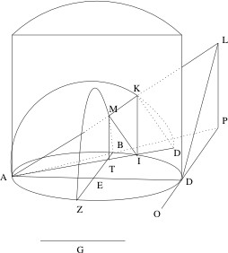
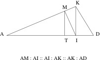

# Archytas
**First published Thu Jun 26, 2003; substantive revision Sat Mar 1, 2025**

*Huffman, Carl*

Archytas of Tarentum was a Greek mathematician, political leader and philosopher, active in the first half of the fourth century BC (i.e., during Plato’s lifetime). He was the last prominent figure in the early Pythagorean tradition and the dominant political figure in Tarentum, being elected general seven consecutive times. He sent a ship to rescue Plato from the clutches of the tyrant of Syracuse, Dionysius II, in 361, but his personal and philosophical connections to Plato are complex, and there are many signs of disagreement between the two philosophers. A great number of pseudepigrapha were written in Archytas’ name starting in the first century BC, and only four fragments of his genuine work survive, although these are supplemented by a number of important testimonia. Archytas was the first to solve one of the most celebrated mathematical problems in antiquity, the duplication of the cube. We also have his proof showing that ratios of the form (*n*+1) : *n*, which are important in music theory, cannot be divided by a mean proportional. He was the most sophisticated of the Pythagorean harmonic theorists and provided mathematical accounts of musical scales used by the practicing musicians of his day. Fr. 1 of Archytas may be the earliest text to identify the group of four canonical sciences (logistic [arithmetic], geometry, astronomy and music), which would become known as the *quadrivium* in the middle ages. There are also some indications that he contributed to the development of the science of optics and laid the mathematical foundations for the science of mechanics. He saw the ultimate goal of the sciences as the description of individual things in the world in terms of ratio and proportion and accordingly regarded logistic, the science of number and proportion, as the master science. Rational calculation and an understanding of proportion were also the bases of the just state and of the good life for an individual. He gave definitions of things that took account of both their matter and their form. Although we have little information about his cosmology, he developed the most famous argument for the infinity of the universe in antiquity.

## 1. Life and Works

### 1.1 Family, Teachers, and Pupils; Date

Archytas, son of Hestiaeus (see Aristoxenus in Diels-Kranz 1952, chap. 47, passage A1; abbreviated as DK47 A1)[^diels-1952], lived in the Greek city of Tarentum, on the heel of the boot of Italy. The later tradition almost universally identifies him as a Pythagorean (e.g., A1, A2, A7, A16). Aristotle and his pupil Eudemus do not explicitly call Archytas a Pythagorean and appear to treat him as an important independent thinker. Plato never refers to Archytas by name except in the *Seventh Letter*, if that is by Plato (see §1.4 below), and he is not called a Pythagorean there. In the *Republic*, however, when Plato quotes a sentence which appears in Fr. 1 of Archytas (DK47 B1), he explicitly labels it as part of Pythagorean harmonics (530d). Cicero (*de Orat.* III 34. 139) reports that Archytas was the pupil of Philolaus, and this is not improbable. Philolaus was the most prominent Pythagorean of the preceding generation (ca. 470–390) and may have taught in Tarentum. Archytas’ achievements in mathematics depend on the work of Hippocrates of Chios, but we have no evidence that he studied with Hippocrates. The only pupil of Archytas who is more than a name, is Eudoxus (ca. 390–340), the prominent mathematician. Eudoxus presumably did not learn his famous hedonism from Archytas (see DK47 A9), and it is specifically geometry that he is said to have studied with Archytas (Diogenes Laertius VIII 86).

Archytas was, roughly speaking, a contemporary of Plato, but it is difficult to be more precise about his dates. Aristotle’s pupil, Eudemus, presents him as the contemporary of Plato (born 428/7) and Leodamas (born ca. 430), on the one hand, and of Theaetetus (born ca. 415), on the other (A6). Since it would be difficult to call him the contemporary of Theaetetus, if he were born much earlier than 435, this is the earliest he was likely to have been born. On the other hand, he could have been born as late as 410 and still be considered a contemporary of Plato. Strabo associates Archytas with the flourishing of Tarentum, before a period of decline, in which Tarentum hired mercenary generals (A4). Since the mercenaries appear ca. 340, it seems likely that Archytas was dead by 350 at the latest. Such a date is in accord with other evidence (A5 = [Demosthenes], *Erot. Or.* 61.46), which connects Archytas to Timotheus, who died ca. 355, and with Plato’s (?) *Seventh Letter* (350a), which presents Archytas as still active in Tarentum in 361. Thus Archytas was born between 435 and 410 and died between 360 and 350.

Some scholars (e.g., Ciaceri 1927–32: III 4)[^ciaceri-1927] have supposed that the speaker of the Roman poet, Horace’s, Archytas Ode (I 28 = A3) is Archytas himself and hence have concluded that Archytas died in a shipwreck. The standard interpretation, however, rightly recognizes that the speaker is not Archytas but a shipwrecked sailor who apostrophizes Archytas (Nisbet and Hubbard 1970, 317ff.)[^nisbet-1970]. The ode tells us nothing about Archytas’ death, but it is one of many pieces of evidence for the fascination with Archytas by Roman authors of the first century BC (Propertius IV 1b.77; Varro in B8; Cicero, *Rep.* I 38.59, I 10.16; *Fin.* V 29.87; *Tusc.* IV 36.78, V 23.64, *de Orat.* III 34.139; *Amic.* XXIII 88; *Sen.* XII 39–41), perhaps because Pythagoreanism had come to be seen as a native Italian philosophy, and not a Greek import (Burkert 1961; Powell 1995, 11 ff.)[^burkert-1961][^powell-1995].

### 1.2 Sources

Apart from the surviving fragments of his writings, our knowledge of Archytas’ life and work depends heavily on authors who wrote in the second half of the fourth century, in the fifty years after Archytas’ death. Archytas’ importance both as an intellectual and as a political leader is reflected in the number of writings about him in this period, although only fragments of these works have been preserved. Aristotle wrote a work in three volumes on the philosophy of Archytas, more than on any other of his predecessors, as well as a second work, consisting of a summary of Plato’s *Timaeus* and the writings of Archytas (A13). Unfortunately almost nothing of these works has survived. Scholars have generally regarded them as authentic (Huffman 2005: 583–94)[^huffman-2005] but Schofield has recently raised some doubts (2014: 81–2). Aristotle’s pupil Eudemus discussed Archytas prominently in his history of geometry (A6 and A14) and in his work on physics (A23 and A24). Another pupil of Aristotle’s, Aristoxenus, wrote a *Life of Archytas*, which is the basis for much of the biographical tradition about him (A1, A7, A9). Aristoxenus (375-ca. 300) was in a good position to have accurate information about Archytas. He was born in Tarentum and grew up during the height of Archytas’ prominence in the city. In addition to whatever personal knowledge he had of Archytas, he draws on his own father Spintharus, who was a younger contemporary of Archytas, as a source (e.g., A7). Aristoxenus began his philosophical career as a Pythagorean and studied with the Pythagorean Xenophilus at Athens, so that it is not surprising that his portrayal of Archytas is largely positive. Nonetheless, Archytas’ opponents are given a fair hearing (e.g., Polyarchus in A9), and Archytas himself is represented as not without small flaws of character (A7). Other fourth-century sources such as the *Seventh Letter* in the Platonic corpus and Demosthenes’ (?) *Erotic Oration* focus on the connection between Archytas and Plato (see below).

### 1.3 Archytas and Tarentum

Archytas is unique among Greek philosophers for the prominent role he played in the politics of his native city. He was elected general (*stratêgos*) seven years in succession at one point in his career (A1), a record that reminds us of Pericles at Athens. His election was an exception to a law, which forbade election in successive years, and thus attests to his reputation in Tarentum. Aristoxenus reports that Archytas was never defeated in battle and that, when at one point he was forced to withdraw from his post by the envy of his enemies, the Tarentines immediately suffered defeat (A1). He probably served as part of a board of generals (there was a board of ten at Athens). The analogy with Athens suggests that as a general he may also have had special privileges in addressing the assembly at Tarentum on issues of importance to the city, so that his position as general gave him considerable political as well as military power. At some point in his career, he may have been designated as a general *autokratôr* (“plenipotentiary”) (A2), which gave him special latitude in dealing with diplomatic and military matters without consulting the assembly, although this was not dictatorial power and all arrangements probably required the eventual approval of the assembly. We do not know when Archytas served his seven successive years as general. Some have supposed that they must coincide with the seven year period which includes Plato’s second and third visits to Italy and Sicily, 367–361 (e.g., Wuilleumier 1939, 68–9)[^wuilleumier-1939], but Archytas need not have been *stratêgos* to play the role assigned to him during these years in the *Seventh Letter*. The evidence suggests that most of Archytas’ military campaigns were directed not at other Greeks but at native Italic peoples such as the Messapians and Lucanians, with whom Tarentum had been in constant conflict since its founding.

It is important to recognize that the Tarentum in which Archytas exercised such influence was not some insignificant backwater. Spartan colonists founded it in 706. It was initially overshadowed by other Greek colonies in southern Italy such as Croton, although it had the best harbor on the south coast of Italy and was the natural stopping point for any ships sailing west from mainland Greece. Archytas will have grown up in a Tarentum that, in accord with its foundation by Sparta, took the Peloponnesian and Syracusan side against Athens in the Peloponnesian War (Thuc. VI 44; VI 104; VII 91). Athens allied with the Messapians (Thuc. VII 33), the long-standing enemy of the Tarentines, against whom Archytas would later lead expeditions (A7). After the Peloponnesian War, Tarentum appears to have avoided direct involvement in the conflict between the tyrant of Syracuse, Dionysius I, and a league of Greek cities in southern Italy headed by Croton. After Dionysius crushed the league, Tarentum emerged as the most powerful Greek state in southern Italy and probably became the new head of the league of Italiot Greek cities (A2). In the period from 380–350, when Archytas was in his prime and old age, Tarentum was one of the most powerful cities in the Greek world (Purcell 1994, 388)[^purcell-1994]. Strabo’s description of its military might (VI 3.4) compares favorably with Thucydides’ account of Athens at the beginning of the Peloponnesian war (II. 13).

Despite its ancestral connections to Sparta, which was an oligarchy, Tarentum appears to have been a democracy during Archytas’ lifetime. According to Aristotle (*Pol*. 1303a), the democracy was founded after a large part of the Tarentine aristocracy was killed in a battle with a native people, the Iapygians, in 473. Herodotus confirms that this was the greatest slaughter of Greeks of which he was aware (VII 170). There is no evidence that Tarentum was anything but a democracy between the founding of the democracy in 473 and Archytas’ death ca. 350. Some scholars have argued that Tarentum’s ties to Sparta and the supposed predilection of the Pythagoreans for aristocracy will have insured that Tarentum did not remain a democracy long and that it was not a democracy under Archytas (Minar 1942, 88–90; Ciaceri 1927–32, II 446–7)[^ciaceri-1927][^minar-1942]. Strabo, however, explicitly describes Tarentum as a democracy at the time of its flourishing under Archytas (A4), and the descriptions of Archytas’ power in Tarentum stress his popularity with the masses and his election as general by the citizens (A1 and A2). Finally, Aristotle’s account of the structure of the Tarentine government in the fourth century (*Pol*. 1291b14), while possibly consistent with other forms of government, makes most sense if Tarentum was a democracy. The same is true of fr. B3 of Archytas, with its emphasis on a more equal distribution of wealth.

### 1.4 Archytas and Plato

Archytas was most famous in antiquity and is most famous in the modern world for having sent a ship to rescue Plato from the tyrant of Syracuse, Dionysius II, in 361. In both the surviving ancient lives of Archytas (by Diogenes Laertius, VIII 79–83, and in the *Suda*) the first thing mentioned about him, after the name of his city-state and his father, is his rescue of Plato (A1 and A2). This story is told in greatest detail in the *Seventh Letter* ascribed to Plato. It has accordingly been typical to identify Archytas as “the friend of Plato” (Mathieu 1987)[^mathieu-1987]. Archytas first met Plato over twenty years earlier, when Plato visited southern Italy and Sicily for the first time in 388/7, during his travels after the death of Socrates (Pl. [?], *Ep. VII* 324a, 326b-d; Cicero, *Rep*. I 10. 16; Philodemus, *Acad. Ind.* X 5–11; cf. D.L. III 6). Some scholars have seen Archytas as the dominant figure in the relationship (Zhmud 2006, 93)[^zhmud-2006] and even as the “new model philosopher for Plato” (Vlastos 1991, 129)[^vlastos-1991] and the archetype of Plato’s philosopher-king (Guthrie 1962, 333)[^guthrie-1962]. The actual situation appears to be considerably more complicated. The ancient evidence, apart from the *Seventh Letter*, presents the relationship between Archytas and Plato in diametrically opposed ways. One tradition does present Archytas as the Pythagorean master at whose feet Plato sat, after Socrates had died (e.g., Cicero, *Rep*. I 10.16), but another tradition makes Archytas the student of Plato, to whom he owed his fame and success in Tarentum (Demosthenes [?], *Erotic Oration* 44).

The *Seventh Letter* itself is of contested authenticity. Many scholars regard it either as the work of Plato himself or of a student of Plato who had considerable familiarity with Plato’s involvement in events in Sicily (see e.g., Brisson 1987; Lloyd 1990; Schofield 2000)[^brisson-1987][^lloyd-1990][^schofield-2000], but grave doubts about this view have been raised by Burnyeat and Frede (2015). The letter appears to serve as an apologia for Plato’s involvement in events in Sicily. Lloyd has argued, however, that the letter also serves to distance Plato from Pythagoreanism and from Archytas (1990). Nothing in the letter suggests that Plato was ever the pupil of Archytas; instead the relationship is much closer to that presented in the *Erotic Oration*. Plato is presented as the dominant figure upon whom Archytas depends both philosophically and politically. Archytas writes to Plato claiming that Dionysius II has made great progress in philosophy, in order to urge Plato to come to Sicily a third time (339d-e). These claims are belied as soon as Plato arrives (340b). The letter thus suggests that, far from being the Pythagorean master from whom Plato learned his philosophy, Archytas had a very imperfect understanding of what Plato considered philosophy to be. The letter makes clear that Plato does have a relationship of *xenia*, “guest-friendship,” with Archytas and others at Tarentum (339e, 350a). This relationship could have been established on Plato’s first visit in 388/7, since Plato uses it as a basis to establish a similar relationship between Archytas and Dionysius II during his second visit in 367 (338c). It is also the relationship in terms of which Plato appeals to Archytas for help, when he is in danger after the third trip to Sicily goes badly (350a). Such a friendship need not imply any close personal intimacy, however. Aristotle classifies *xenia* as a friendship for utility and points out that such friends do not necessarily spend much time together or even find each other’s company pleasant (*EN* 1156a26 ff.). Apart from Archytas’ rescue of Plato in 361 (even this is described as devised by Plato [350a]), Plato is clearly the dominant figure in the relationship. Archytas is portrayed as Plato’s inferior in his understanding of philosophy, and Plato is even presented as responsible for some of Archytas’ political success, insofar as he establishes the relationship between Archytas and Dionysius II, which is described as of considerable political importance (339d).

How are we to unravel the true nature of the relationship between Plato and Archytas in the light of this conflicting evidence? Apart from the *Seventh Letter*, Plato never makes a direct reference to Archytas. He does, however, virtually quote a sentence from Archytas’ book on harmonics in Book VII of the *Republic* (530d), and his discussions of the science of stereometry shortly before this are likely to have some connections to Archytas’ work in solid geometry (528d). It is thus in the context of the discussion of the sciences that Plato refers to Archytas, and the remains of Archytas’ work focus precisely on the sciences (e.g., fr. B1). Both strands of the tradition can be reconciled, if we suppose that Plato’s first visit to Italy and Sicily was at least in part motivated by his desire to meet Archytas, as the first tradition claims, but that he sought Archytas out not as a new “model philosopher” but rather as an expert in the mathematical sciences, in which Plato had developed a deep interest. In *Republic* VII, Plato is critical of Pythagorean harmonics and of current work in solid geometry on philosophical grounds, so that, while he undoubtedly learned a considerable amount of mathematics from Archytas and important passages in Plato (e.g. *Gorgias* 507e6–8a8 with its mention of “geometrical equality” and *Philebus* 64d-e) may show the influence of Archytas’ work on proportion, he clearly disagreed with Archytas’ understanding of the philosophical uses of the sciences. In 388 Tarentum had not yet reached the height of its power, and Archytas is not likely to have achieved his political dominance yet, so that there may also be some truth to the claim of the second tradition that Archytas did not achieve his great practical success until after his contact with Plato; whether or not that success had any direct relationship to his contact with Plato is more doubtful. On their first meeting in 388/7, Plato and Archytas established a relationship of guest-friendship, which obligated them to further each other’s interests, which they did, as the events of 367–361 show. Plato and Archytas need not have been in agreement on philosophical issues and are perhaps better seen as competitive colleagues engaged in an ongoing debate as to the value of the sciences for philosophy (Huffman 2005, 32–42)[^huffman-2005].

### 1.5 The Authenticity Question

More pages of text have been preserved in Archytas’ name than in the name of any other Pythagorean. Unfortunately the vast majority of this material is rightly regarded as spurious. The same is true of the Pythagorean tradition in general; the vast majority of texts which purport to be by early Pythagoreans are, in fact, later forgeries (see further section 4.2 of the article on Pythagoreanism). Some of these forgeries were produced for purely monetary reasons; a text of a “rare” work by a famous Pythagorean could fetch a considerable sum from book collectors. There were characteristics unique to the Pythagorean tradition, however, that led to a proliferation of forgeries. Starting as early as the later fourth century BC, Pythagoras came to be regarded, in some circles, as the philosopher par excellence, to whom all truth had been revealed. All later philosophy, insofar as it was true, was a restatement of this original revelation (see, e.g., O’Meara 1989)[^o’meara-1989]. In order to support this view of Pythagoras, texts were forged in the name of Pythagoras and other early Pythagoreans, to show that they had, in fact, anticipated the most important ideas of Plato and Aristotle. These pseudo-Pythagorean texts are thus characterized by the use of central Platonic and Aristotelian ideas, expressed in the technical terminology used by Plato and Aristotle. Some of the forgeries even attempt to improve on Plato and Aristotle by adding refinements to their positions, which were first advanced several hundred years after their deaths. The date and place of origin of these pseudo-Pythagorean treatises is difficult to determine, but most seem to have been composed between 150 BC and 100 AD (Burkert 1972b; Centrone 1990; Moraux 1984)[^burkert-1972b][^centrone-1990][^moraux-1984]; Rome (Burkert 1972b)[^burkert-1972b] and Alexandria (Centrone 1990)[^centrone-1990] are the most likely places of origin. Archytas is the dominant figure in this pseudo-Pythagorean tradition, probably because of his connection to Plato and his consequent fame at the time when the pseudepigrapha were composed (Zhmud 2019; Centrone 2021)[^centrone-2021][^zhmud-2019]. In Thesleff 1965’s collection of the pseudo-Pythagorean writings, forty-five of the two-hundred and forty-five pages (2-48), about 20%, comprising some 1,200 lines, are devoted to texts forged in Archytas’ name. On the other hand, the fragments likely to be genuine, which are collected in DK, fill out only a hundred lines of text. Thus, over ten times more spurious than genuine material has been preserved in Archytas’ name. It may well be that the style and Doric dialect of the pseudo-Pythagorean writings were also based on the model of Archytas’ genuine writings.

### 1.6 Pseudepigrapha Ascribed to Archytas

The treatises under Archytas’ name collected in Thesleff 1965 have been almost universally regarded as not by the historical Archytas, except for *On Law and Justice*, where there has been considerable controversy. Most are only preserved in fragments, although there are two brief complete works. The most famous of these pseudepigrapha is *Concerning the Whole System [sc. of Categories]* or *Concerning the Ten Categories* (preserved complete, see Szlezak 1972)[^szlezak-1972]. This work along with the treatise *On Opposites* (Thesleff 1965, 15.3–19.2)[^thesleff-1965] and the much later *Ten Universal Assertions* (preserved complete, first ascribed to Archytas in the 15ᵗʰ century AD; see Szlezak 1972)[^szlezak-1972] represent the attempt to claim Aristotle’s doctrine of categories for Archytas and the Pythagoreans (see also Griffin 2015)[^griffin-2015]. This attempt was to some extent successful; both Simplicius and Iamblichus regarded the Archytan works on categories as genuine anticipations of Aristotle (*CAG* VIII. 2, 9–25). *Concerning the Ten Categories* and *On Opposites* are very frequently cited in the ancient commentaries on Aristotle’s *Categories*. Pseudo-Archytas identifies ten categories with names that are virtually identical to those used by Aristotle, and his language follows Aristotle closely in many places. The division of Archytas’ work into two treatises, *Concerning the Ten Categories* and *On Opposites*, reflects the work of Andronicus of Rhodes, who first separated the last six chapters of Aristotle’s *Categories* from the rest. Thus, the works in Archytas’ name must have been composed after Andronicus’ work in the first century BC. Other pseudepigrapha in metaphysics and epistemology include *On Principles* (Thesleff 1965, 19.3 – 20.17)[^thesleff-1965] and *On Intelligence and Perception* (Thesleff 1965, 36.12–39.25)[^thesleff-1965], which includes a paraphrase of the divided line passage in Plato’s *Republic*. Mansfeld has recently shown that Fragment 1 of the latter work in Thesleff’s collection belongs to the former work (Mansfeld 2019)[^mansfeld-2019]. De Cesaris and Horky (2018) provide commentary on *On Intelligence and Perception*, but much remains obscure in this difficult work. Mansfeld (2019)[^mansfeld-2019] shows that *On Intelligence and Perception* is not likely to have been an influence on the account of Pythagorean principles in Aetius *Placita* 1.3.8 as has been suggested by De Cesaris and Horky (2018). Ulacco (2017)[^ulacco-2017] establishes new texts (with commentary) for *On Principles*, *On Intelligence and Perception* and *On Opposites*. Further metaphysical and epistemological works include *On Being* (Thesleff 1965, 40.1–16)[^thesleff-1965] and *On Wisdom* (Thesleff 1965, 43.24–45.4)[^thesleff-1965]. The authenticity of this latter work has recently been defended on the grounds that its admitted similarities to passages in Aristotle are a result of Archytas’ influence on Aristotle rather than an indication that the work was forged on the basis of Aristotle (Johnson 2008, 193–194)[^johnson-2008]. It is indeed true that Aristotle devoted several lost works to Archytas and must have been familiar with his thought. However, the issue of authenticity within the Pythagorean tradition has a different character than is the case with other ancient authors. In the case of an author such as Plato, where the vast majority of surviving works are surely authentic, the onus of proof is on anyone who wants to argue that a work is spurious. In the Pythagorean tradition, on the other hand, where surely spurious works far outnumber genuine ones, the situation is reversed. The onus of proof rests on anyone who regards a Pythagorean work as genuine to show that it does not fit the pattern of the forged Pythagorean treatises and that its contents can be corroborated by evidence dating before the third century, when the Pythagorean pseudepigrapha start to be generated. Since *On Wisdom* does share with the pseudepigrapha the characteristic of using important Aristotelian distinctions (Huffman 2005, 598–599)[^huffman-2005], even if it is not as blatant a copy of Aristotle’s ideas as the works on categories ascribed to Archytas, it is much more likely that it was forged on the basis of Aristotle than that Aristotle is using *On Wisdom* without attribution. In order for the latter situation to be probable there would need to be fourth-century evidence independent of *On Wisdom* which ascribed the ideas found in it to Archytas. Horky 2015 includes *On Wisdom* among the pseudepigrapha and provides analysis of it. For recent discussions of the nature of the pseudepigrapha ascribed to Archytas see Bonazzi 2013 and Centrone 2014. For the nature of the appropriation of Aristotle in pseudepigrapha ascribed to Archytas and other early Pythagoreans see Ulacco 2016. Horky (2021a)[^horky-2021a] argues that the term ‘Pseudo-Archytas’ is problematic and examines Archytas’ role as both author and authenticator of Pythagorean texts.

There are also fragments of two pseudepigrapha on ethics and politics, which have recent editions with commentary: *On the Good and Happy Man* (Centrone 1990)[^centrone-1990], which shows connections to Arius Didymus, an author of the first century BC, and *On Moral Education* (Centrone 1990)[^centrone-1990], which has ties to Carneades (2nd c. BC). The status of one final treatise is less clear. The fragments of *On Law and Justice* (Thesleff 1965, 33.1–36.11)[^thesleff-1965] were studied in some detail by Delatte (1922)[^delatte-1922], who showed that the treatise deals with the political conceptions of the fourth century and who came to the modest conclusion that the work might be by Archytas, since there were no positive indications of late composition. Thesleff similarly concluded that the treatise “may be authentic or at least comparatively old” (1961, 112), while Minar maintained that “it has an excellent claim to authenticity” (1942, 111). Its authenticity was supported by Johnson (2008, 194–198)[^johnson-2008] but more recently Horky and Johnson argue that it was not written by Archytas himself and propose the somewhat Byzantine theory that it was written by an author who based it on a speech which they hypothesize that Aristoxenus assigned to Archytas in his *Life of Archytas* (2020: 459–460). On the other hand, DK did not include the fragments of *On Law and Justice* among the genuine fragments, and most recent scholars have argued that the treatise is spurious. Aalders provides the most detailed treatment, although a number of his arguments are inconclusive (1968, 13–20). Other opponents of authenticity are Burkert (1972a)[^burkert-1972a], Moraux (1984, 670–677)[^moraux-1984], Centrone (2000)[^centrone-2000] and most recently Schofield (2014)[^schofield-2014]. The connections of *On Law and Justice* to the genuine Fr. B2 of Archytas speak for its authenticity, but its similarities, sometimes word for word, to pseudo-Pythagorean treatises by “Diotogenes” (Thesleff 76.2–3, 71. 21–2), “Damippos” (Thesleff 68.26) and “Metopos” (Thesleff 119.28) argue for its spuriousness. Moreover, the authentic Fr. 3 of Archytas shows that calculation (*logismos*) was the key concept in his political philosophy. Its total absence from *On Law and Justice*, whose focus is political philosophy, along with the absence of other key terms in Fr. 3 (e.g., *pleonexia*, *homonoia* and *isotēs*) is hard to explain, if *On Law and Justice* is authentic (Huffman 2005, 599–606)[^huffman-2005]. For a recent argument against the authenticity of *On Law and Justice*, which further contrasts it with the authentic Fr. 3, see Schofield 2014: 82–5. For a recent argument that *On Law and Justice* and Fr. 3 are, on the contrary, closely connected see Scrofani 2021: 187–200. Even if the work belongs among the pseudepigrapha Horky and Johnson are surely right that the controversy about its authenticity has led scholars to neglect the philosophic content of the treatise (Horky and Johnson 2020: 487)[^horky-2020] and they provide a commentary that attempts to elucidate this difficult text. They regard the text as closely tied to genuine fragments of Archytas and suggest that it can help us understand those fragments, but the similarities are of a very general sort. As Zhmud has recently argued there is very little that is genuinely Pythagorean in the pseudepigrapha (Zhmud 2019)[^zhmud-2019] and that also appears to be true of *On Law and Justice*. Scrofani (2021: 178–187)[^scrofani-2021] shows that there are close connections between *On Law and Justice* and the pseudo-Platonic *Minos*.

Some testimonia suggest that there were even more pseudo-Archytan treatises, which have not survived even in fragments (Thesleff 47.8 ff.). Two spurious letters of Archytas survive. One is the letter to which the pseudo-Platonic *Twelfth Letter* is responding (D.L. VIII 79–80), and the other is the purported letter of Archytas to Dionysius II, which was sent along with the ship in order to secure Plato’s release in 361 (D.L. III 21–2). Archytas was a popular figure in the Middle Ages and early Renaissance, when works continued to be written in his name, usually with the spelling Architas or Archita. The *Ars geometriae*, which is ascribed to Boethius, but was in reality composed in the 12ᵗʰ century (Folkerts 1970, 105)[^folkerts-1970], ascribes discoveries in mathematics to Architas which are clearly spurious (Burkert 1972a, 406)[^burkert-1972a]. Several alchemical recipes involving the wax of the left ear of a dog and the heart of a wolf are ascribed to Architas in ps.-Albertus Magnus, *The Marvels of the World* (*De mirabilibus mundi* – 13ᵗʰ century AD). Numerous selections from a book entitled *On Events in Nature* (*de eventibus in natura*, also cited as *de effectibus in natura* and as *de eventibus futurorum*) by Archita Tharentinus (or Tharentinus, or just Tharen) are preserved in the medieval texts known as *The Light of the Soul* (*Lumen Animae*), which were composed in the fourteenth century and circulated widely in Europe in the fifteenth century as a manual for preachers (Rouse 1971; Thorndike 1934, III 546–60)[^rouse-1971][^thorndike-1934]. An apocryphal work, *The Circular Theory of the Things in the Heaven*, by Archytas Maximus [!], which has never been published in full, is preserved in Codex Ambrosianus D 27 sup. (See *Catalogus Codicum Astrologorum Graecorum*, ed. F. Cumont et al., Vol. III, p. 11).

### 1.7 Genuine Works and Testimonia

No list of Archytas’ works has come down to us from antiquity, so that we don’t know how many books he wrote. In the face of the large mass of spurious works, it is disappointing that only a few fragments of genuine works have survived. Most scholars accept as genuine the four fragments printed by Diels and Kranz (B1–4). Burkert (1972a, 220 n.14 and 379 n. 46) raised some concerns about the authenticity of even some of these fragments, but see the responses of Bowen (1982)[^bowen-1982] and Huffman (1985 and 2005). Our evidence for the titles of Archytas’ genuine writings depends largely on the citations given by the authors who quote the fragments. Fragments B1 and B2 are reported to come from a treatise entitled *Harmonics*, and the major testimonia about Archytas’ harmonic theory are likely to be ultimately based on this book (A16–19). This treatise began with a discussion of the basic principles of acoustics (B1), defined the three types of mean which are of importance in music theory (B2), and went on to present Archytas’ mathematical descriptions of the tetrachord (the fourth) in the three main genera (chromatic, diatonic, and enharmonic – A16-A19). B3 probably comes from a work *On Sciences*, which may have been a more general discussion of the value of mathematics for human life in general and for the establishment of a just state in particular. New support for its authenticity has been provided by Schofield (2009)[^schofield-2009]. B4 comes from a work entitled *Discourses* (*Diatribai*). The fragment itself asserts the priority of the science of calculation (*ha logistika*, “logistic”) to the other sciences, such as geometry, and thus suggests a technical work of mathematics. The title *Diatribai* would more normally suggest a treatise of ethical content, however, so that in this work the sciences may have been evaluated in terms of their contribution to the wisdom that leads to a good life.

A relatively rich set of testimonia, many from authors of the fourth century BC, indicate that Archytas wrote other books as well. Archytas’ famous argument for the unlimited extent of the universe (A24), his theory of vision (A25), and his account of motion (A23, A23a) all suggest that he may have written a work on cosmology. Aristotle’s comments in the *Metaphysics* suggest that Archytas may have written a book on definition (A22), and A20 and A21 might suggest a work on arithmetic. Perhaps there was a treatise on geometry or solid geometry in which Archytas’ solution to the problem of doubling the cube (A14–15) was published. There is also a tradition of anecdotes about Archytas, which probably ultimately derives from Aristoxenus’ *Life of Archytas* (A7, A8, A9, A11). It is possible that even the testimonia for Archytas’ argument for an unlimited universe and his theory of vision were derived from anecdotes preserved by Aristoxenus, and not at all from works of Archytas’ own.

It is uncertain whether the treatises *On Flutes* (B6), *On Machines* (B1 and B7), and *On Agriculture* (B1 and B8), which were in circulation under the name of Archytas, were in fact by Archytas of Tarentum or by other men of the same name. Diogenes Laertius lists three other writers with the name Archytas (VIII 82). The treatise *On the Decad* mentioned by Theon (B5) might be by Archytas, but the treatise by Philolaus with which it is paired is spurious (Huffman 1993, 347–350)[^huffman-1993], thus suggesting that the same may be true of the treatise under Archytas’ name.

## 2. Archytas as Mathematician and Harmonic Theorist

### 2.1 Doubling the Cube

Archytas was the first person to arrive at a solution to one of the most famous mathematical puzzles in antiquity, the duplication of the cube. The most romantic version of the story, which occurs in many variations and ultimately goes back to Eratosthenes (3rd c. BC), reports that the inhabitants of the Greek island of Delos were beset by a plague and, when they consulted an oracle for advice, were told that, if they doubled the size of a certain altar, which had the form of a cube, the plague would stop (Eutocius, *in Archim. sphaer. et cyl.* II [III 88.3–96.27 Heiberg/Stamatis]). The simple-minded response to the oracle, which is actually assigned to the Delians in some versions, is to build a second altar identical to the first one and set it on top of the first (Philoponus, *In Anal. post., CAG* XIII.3, 102.12–22). The resulting altar does indeed have a volume twice that of the first altar, but it is no longer a cube. The next simple-minded response is to assume that, since we want an altar that is double in volume, while still remaining a cube, we should build the new altar with a side that is double the length of the side of the original altar. This approach fails as well. Doubling the side of the altar produces a new altar that is not twice the volume of the original altar but eight times the volume. If the original altar had a side of two, then its volume would be 2³ or 8, while an altar built on a side twice as long will have a volume of 4³ or 64. What then is the length of the side which will produce a cube with twice the volume of the original cube? The Delians were at a loss and presented their problem to Plato in the Academy. Plato then posed the “Delian Problem,” as it came to be known, to mathematicians associated with the Academy, and no less than three solutions were devised, those of Eudoxus, Menaechmus, and Archytas.

It is not clear whether or not the story about the Delians has any basis in fact. Even if it does, it should not be understood to suggest that the problem of doubling the cube first arose in the fourth century with the Delians. We are told that the mathematician, Hippocrates of Chios, who was active in the second half of the fifth century, had already confronted the problem and had reduced it to a slightly different problem (Eutocius, *in Archim. sphaer. et cyl.* II [III 88.3–96.27 Heiberg/Stamatis]). Hippocrates recognized that if we could find two mean proportionals between the length of the side of the original cube G, and length D, where D = 2G, so that G : x :: x : y :: y : D, then the cube on length x will be double the cube on length G. Exactly how Hippocrates came to see this is conjectural and need not concern us here, but that he was right can be seen relatively easily. Each of the values in the continued proportion G : x :: x : y :: y : D is equal to G : x, so we can set them all equal to G : x. If we do this and multiply the three ratios together we get the value G³ : x³. On the other hand, if we take the same continued proportion and carry out the multiplication in the original terms, then G : x times x : y yields G : y, and G : y times the remaining term gives G : D. Thus G : D = G³ : x³, but D is twice G so x³ is twice G³. Remember that G was the length of the side of the original cube, so the cube that is twice the cube built on G, will be the cube built on x. The Greeks did not think of the problem as a problem in algebra but rather as a problem in geometry. After Hippocrates the problem of doubling the cube was always seen as the problem of finding two lines such that they were mean proportionals between G, the length of the side of the original cube, and D, a length which is double G. It was to this form of the problem that Archytas provided the first solution.

Archytas’ solution has been rightly hailed as “the most remarkable of all [the solutions]” and as a “bold construction in three dimensions” (Heath 1921, 246)[^heath-1921]; Mueller calls it “a *tour de force* of the spatial imagination” (1997, 312 n. 23); Netz hails it as “spectacular” and “fantastic” (2022, 62 and 70). We owe the preservation of Archytas’ solution to Eutocius, who in the sixth century AD collected some eleven solutions to the problem as part of his commentary on the second book of Archimedes’ *On the Sphere and Cylinder*. Eutocius’ source for Archytas’ solution was ultimately Aristotle’s pupil Eudemus, who in the late fourth century BC wrote a history of geometry. The solution is complex and it is not possible to go through it step by step here (see Huffman 2005, 342–401 and Netz 2022, 62–70 for detailed treatments of the solution)[^huffman-2005][^netz-2022]. Archytas proceeds by constructing a series of four similar triangles (see Figure 1 below) and then showing that the sides are proportional so that AM : AI :: AI : AK :: AK : AD, where AM was equal to the side of the original cube (G) and AD was twice AM. Thus the cube double the volume of the cube on AM should be built on AI. The real difficulty was in constructing the four similar triangles, where the given length of the side of the original cube and a length double that magnitude were two of the sides in the similar triangles. The key point for the construction of these triangles, point K, was determined as the intersection of two rotating plane figures. The first figure is a semicircle, which is perpendicular to the plane of the circle ABDZ and which starts on the diameter AED and, with point A remaining fixed, rotates to position AKD. The second is the triangle APD, which rotates up out of the plane of the circle ABDZ to position ALD. As each of these figures rotates, it traces a line on the surface of a semicylinder, which is perpendicular to the plane of ABDZ and has ABD as its base. The boldness and the imagination of the construction lies in envisioning the intersection at point K of the line drawn by the rotating semicircle on the surface of the semicylinder with the line drawn by the rotating triangle on the same surface. We simply don’t know what led Archytas to produce this amazing feat of spatial imagination, in order to construct the triangles with the sides in appropriate proportion. For a recent attempt to situate Archytas’ solution in the mathematics of his time and make it less “miraculous,” see Menn 2015.

> 
> 
> **Figure 1**

In the later tradition, Plato is reported to have criticized Archytas’ solution for appealing to “constructions that use instruments and that are mechanical” (Plutarch, *Table Talk* VIII 2.1 [718e]; *Marc.* XIV 5–6). Plato argued that the value of geometry and of the rest of mathematics resided in their ability to turn the soul from the sensible to intelligible realm. The cube with which geometry deals is not a physical cube or even a drawing of a cube but rather an intelligible cube that fits the definition of the cube but is not a sense object. By employing physical instruments, which “required much common handicraft,” and in effect constructing machines to determine the two mean proportionals, Archytas was focusing not on the intelligible world but on the physical world and hence destroying the value of geometry. Plato’s quarrel with Archytas is a charming story, but it is hard to reconcile with Archytas’ actual solution, which, as we have seen, makes no appeal to any instruments or machines. The story of the quarrel, which is first reported in Plutarch in the first century AD, is also hard to reconcile with our earliest source for the story of the Delian problem, Eratosthenes. Eratosthenes had himself invented an instrument to determine mean proportionals, the *mesolab* (“mean-getter”), and he tells the story of the Delian problem precisely to emphasize that earlier solutions, including that of Archytas, were in the form of geometrical demonstrations, which could not be employed for practical purposes. He specifically labels Archytas’ solution as *dysmêchana*, “hardly mechanical.” Some scholars attempt to reconcile Plutarch’s and Eratosthenes’ versions by focusing on their different literary goals (Knorr 1986, 22; van der Waerden 1963, 161; Wolfer 1954, 12 ff.; Sachs 1917, 150)[^knorr-1986][^sachs-1917][^waerden-1963][^wolfer-1954]; some suggest that the rotation of the semicircle and the triangle in Archytas’ solution, might be regarded as mechanical, since motion is involved (Knorr 1986, 22)[^knorr-1986]. It may be, however, that Plutarch’s story of a quarrel between Plato and Archytas over the use of mechanical devices in geometry is an invention of the later tradition (Riginos 1976, 146; Zhmud 1998, 217)[^riginos-1976][^zhmud-1998] and perhaps served as a sort of foundation myth for the science of mechanics, a myth which explained the separation of mechanics from philosophy as the result of a quarrel between two philosophers. In the *Republic*, Plato is critical of the solid geometry of his day, but his criticism makes no mention of the use of instruments. His criticism instead focuses on the failure of solid geometry to be developed into a coherent discipline alongside geometry and astronomy (528b-d). This neglect of solid geometry is ascribed to the failure of the Greek city-states to hold these difficult studies in honor, the lack of a director to organize the studies, and the arrogance of the current experts in the field, who would not submit to such a director. Since Archytas’ duplication of the cube shows him to be one of the leading solid geometers of the time, it is hard to avoid the conclusion that Plato regarded him as one of the arrogant experts, who focused on solving charming problems but failed to produce a coherent discipline of solid geometry. Since Archytas was a leading political figure in Tarentum, it is also possible that Plato was criticizing him for not making Tarentum a state which held solid geometry in esteem.

Brisson (2013)[^brisson-2013] takes a sceptical stance towards the evidence and concludes that Archytas never solved the problem of the duplication of the cube. He argues that Plato would have mentioned a solution to the problem if one existed in his day and that the mathematics of the solution ascribed to Archytas is impossible for someone of his time, since it employs conic sections, which were not developed until the third century (2013: 220–1). However, while Plato does criticize the state of stereometry (solid geometry) in his day, he also affirms that there are people studying it and that some of their results have charm and beauty (*Rep.* 528c-d). There is no reason that Archytas’ duplication could not be included among these results. Moreover, the mathematics used in Archytas’ solution in no way relies on conic sections but relies on mathematics found in Euclid’s *Elements* Books 1, 3, 4, 6, and 11, which rely on geometry of the fourth century when Archytas was active (Heath 1921, Knorr 1986, Mueller 1997 and Menn 2015 all regard the mathematics as appropriate for Archytas)[^heath-1921][^knorr-1986][^menn-2015][^mueller-1997]. Menaechmus, who lived two generations after Archytas, is the first person to solve the problem using conic sections (see Menn 2015: 415–6)[^menn-2015]. Brisson has to discount the explicit tradition that already in the fourth century Eudemus knew of Archytas’ solution and assume that the solution was developed by a compiler in the latter tradition, but it is implausible that such a compiler could have developed the sophisticated mathematics of the solution and that, if he were such an accomplished mathematician, he would ascribe it to Archytas.

### 2.2 Music and Mathematics

One of the most startling discoveries of early Greek science was that the fundamental intervals of music, the octave, the fourth, and the fifth, corresponded to whole number ratios of string length. Thus, if we pluck a string of length *x* and then a string of length 2*x*, we will hear the interval of an octave between the two sounds. If the two string lengths are in the ratio 4 : 3, we will hear a fourth, and, if the ratio is 3 : 2, we will hear a fifth. This discovery that the phenomena of musical sound are governed by whole number ratios must have played a central role in the Pythagorean conception, first expressed by Philolaus, that all things are known through number (DK 44 B4). The next step in harmonic theory was to describe an entire octave length scale in terms of mathematical ratios. The earliest such description of a scale is found in Philolaus fr. B6. Philolaus recognizes that, if we go up the interval of a fourth from any given note, and then up the interval of a fifth, the final note will be an octave above the first note. Thus, the octave is made up of a fourth and a fifth. In mathematical terms, the ratios that govern the fifth (3 : 2) and fourth (4 : 3) are added by multiplying the terms and thus produce an octave (3 : 2 × 4 : 3 = 12 : 6 = 2 : 1). The interval between the note that is a fourth up from the starting note and the note that is a fifth up was regarded as the basic unit of the scale, the whole tone, which corresponded to the ratio of 9 : 8 (subtraction of ratios is carried out by dividing the terms, or cross multiplying: 3 : 2 / 4 : 3 = 9 : 8). The fifth was thus regarded as a fourth plus a whole tone, and the octave can be regarded as two fourths plus a whole tone. The fourth consists of two whole tones with a remainder, which has the unlovely ratio of 256 : 243 (4 : 3 / 9 : 8 = 32 : 27 / 9 : 8 = 256 : 243). Philolaus’ scale thus consisted of the following intervals: 9 : 8, 9 : 8, 256 : 243 [these three intervals take us up a fourth], 9 : 8, 9 : 8, 9 : 8, 256 : 243 [these four intervals make up a fifth and complete the octave from our staring note]. This scale is known as the Pythagorean diatonic and is the scale that Plato adopted in the construction of the world soul in the *Timaeus* (36a-b).

Archytas took harmonic theory to a whole new level of theoretical and mathematical sophistication. Ptolemy, writing in the second century AD, identifies Archytas as having “engaged in the study of music most of all the Pythagoreans” (A16). First, Archytas provided a general explanation of pitch, arguing that the pitch of a sound depends on the speed with which the sound is propagated and travels (B1). Thus, if a stick is waved back and forth rapidly, it will produce a sound that travels rapidly through the air, which will be perceived as of a higher pitch than the sound produced by a stick waved more slowly. Archytas is correct to associate pitch with speed, but he misunderstood the role of speed. The pitch does not depend on the speed with which a sound reaches us but rather on the frequency of impacts in a given period of time. A string that vibrates more rapidly produces a sound of a higher pitch, but all sounds, regardless of pitch, travel at an equal velocity, if the medium is the same. Although Archytas’ account of pitch was ultimately incorrect, it was very influential. It was taken over and adapted by both Plato and Aristotle and remained the dominant theory throughout antiquity (Barker 1989, 41 n. 47; Barker 2014: 187)[^barker-1989][^barker-2014]. Second, Archytas introduced new mathematical rigor into Pythagorean harmonics. One of the important results of the analysis of music in terms of whole number ratios is the recognition that it is not possible to divide the basic musical intervals in half. The octave is not divided into two equal halves but into a fourth and a fifth, the fourth is not divided into two equal halves but into two whole tones and a remainder. The whole tone cannot be divided into two equal half tones. On the other hand, it is possible to divide a double octave in half. Mathematically this can be seen by recognizing that it is possible to insert a mean proportional between the terms of the ratio corresponding to the double octave (4 : 1) so that 4 : 2 :: 2 : 1. The double octave can thus be divided into two equal parts each having a ratio of 2 : 1. The ratios which govern the basic musical intervals (2 : 1, 4 : 3, 3 : 2, 9 : 8), all belong to a type of ratio known as a superparticular ratio – roughly speaking, ratios of the form (*n* + 1) : *n*. Archytas made a crucial contribution by providing a rigorous proof that there is no mean proportional between numbers in superparticular ratio (A19) and hence that the basic musical intervals cannot be divided in half. Archytas’ proof was later taken over and modified slightly in the *Sectio Canonis* ascribed to Euclid (Prop. 3; see Barker 1989, 195)[^barker-1989]. On Archytas’ proof see Huffman 2005: 451–70 and Barker 2007: 303–5.

Archytas’ final contribution to music theory has to do with the structure of the scale (for a more detailed account than what follows see Huffman 2005: 402–25 and Barker 2007: 292–302)[^huffman-2005][^barker-2007]. The Greeks used a number of different scales, which were distinguished by the way in which the fourth, or tetrachord, was constructed. These scales were grouped into three main types or genera. One genus was called the diatonic; one example of this is the Pythagorean diatonic described above, which is built on the tetrachord with the intervals 9 : 8, 9 : 8 and 256 : 243 and was used by Philolaus and Plato. There is no doubt that Archytas knew of this diatonic scale, but his own diatonic tetrachord was somewhat different, being composed of the intervals 9 : 8, 8 : 7 and 28 : 27. Archytas also defined scales in the two other major genera, the enharmonic and chromatic. Archytas’ enharmonic tetrachord is composed of the intervals 5 : 4, 36 : 35 and 28 : 27 and his chromatic tetrachord of the intervals 32 : 27, 243 : 224, and 28 : 27. There are several puzzles about the tetrachords which Archytas adopts in each of the genera. First, why does Archytas reject the Pythagorean diatonic used by Philolaus and Plato? Second, Ptolemy, who is our major source for Archytas’ tetrachords (A16), argues that Archytas adopted as a principle that all concordant intervals should correspond to superparticular ratios. The ratios in Archytas’ diatonic and enharmonic tetrachords are indeed superparticular, but two of the ratios in his chromatic tetrachord are not superparticular (32 : 27 and 243 : 224). Why are these ratios not superparticular as well? Finally, Plato criticizes Pythagorean harmonics in the *Republic* for seeking numbers in heard harmonies rather than ascending to generalized problems (531c). Can any sense be made of this criticism in light of Archytas’ tetrachords? The basis for an answer to all of these questions is contained in the work of Winnington-Ingram (1932)[^winnington-ingram-1932] and Barker (1989, 46–52)[^barker-1989]. The crucial point is that Archytas’ account of the tetrachords in each of the three genera can be shown to correspond to the musical practice of his day; Ptolemy’s criticisms miss the mark because of his ignorance of musical practice in Archytas’ day, some 500 years before Ptolemy (Winnington-Ingram 1932, 207)[^winnington-ingram-1932]. Archytas is giving mathematical descriptions of scales actually in use; although mathematical considerations did play a role (Barker 2007: 295–302)[^barker-2007], he arrived at his numbers in part by observation of the way in which musicians tuned their instruments (Barker 1989, 50–51)[^barker-1989]. He did not follow the Pythagorean diatonic scale because it did not correspond to any scale actually in use, although it does correspond to a method of tuning. The unusual numbers in Archytas’ chromatic tetrachord do correspond to a chromatic scale in use in Archytas’ day. Ptolemy was wrong to suggest that Archytas adhered to the principle that all concordant intervals should have superparticular ratios (Huffman 2005: 422–3)[^huffman-2005], although Barker suggests that he may have been following a different but related principle (2007: 301). Archytas thus provides a brilliant analysis of the music of his day, but it is precisely his focus on actual musical practice that draws Plato’s ire. Plato does not want him to focus on the music he hears about him (“heard harmonies”) but rather to ascend to consider quite abstract questions about which numbers are harmonious with which. Plato might well have welcomed a principle of concordance based solely on mathematical considerations, such as the principle that only superparticular ratios are concordant, but Archytas wanted to explain the numbers of the music he actually heard played. There is an important metaphysical issue at stake here. Plato is calling for the study of number in itself, apart from the sensible world, while Archytas, like Pythagoreans before him, envisages no split between a sensible and an intelligible world and is looking for the numbers which govern sensible things. For discussions of Archytas as the target of Plato’s complaints in the *Republic* see Huffman 2005: 423–5 and Barker 2014:192–3.

### 2.3 Evaluation of Archytas as Mathematician

There have been tendencies both to overvalue and to undervalue Archytas’ achievement as a mathematician. Van der Waerden went so far as to add to Archytas’ accomplishments both Book VIII of Euclid’s *Elements* and the treatise on the mathematics of music known as the *Sectio Canonis*, which is ascribed to Euclid in the ancient tradition (1962, 152–5). Although later scholars (e.g., Knorr 1975: 244)[^knorr-1975] repeat these assertions, they are based in part on a very subjective analysis of Archytas’ style. Archytas influenced the *Sectio Canonis*, since Proposition 3 is based on a proof by Archytas (A19), but the treatise cannot be by Archytas, because its theory of pitch and its account of the diatonic and enharmonic tetrachords differ from those of Archytas. On the other hand, some scholars have cast doubt on Archytas’ prowess as a mathematician, arguing that some of his work looks like “mere arithmology” and “mathematical mystification” (Burkert 1972a, 386; Mueller 1997, 289)[^burkert-1972a][^mueller-1997]. This judgment rests largely on a text (A17) that has been mistakenly interpreted as presenting Archytas’ own views, whereas, in fact, it presents Archytas’ report of his predecessors (Huffman 2005: 428–37; Barker 2007: 193–5)[^huffman-2005][^barker-2007]. The duplication of the cube and Archytas’ contributions to the mathematics of music (Barker 2007: 287 calls him “a heroic figure in the early history of mathematical harmonics”)[^barker-2007] show that there can be no doubt that he was one of the leading mathematicians of the first part of the fourth century BC. This was certainly the judgment of antiquity. In his history of geometry, Eudemus identified Archytas along with Leodamas and Theaetetus as the three most prominent mathematicians of Plato’s generation (A6 = Proclus, *in Eucl.*, prol. II 66, 14). Netz (2014)[^netz-2014] has recently argued that there were two networks that accounted for most of the progress in ancient Greek mathematics. The later used Archimedes as the paradigmatic figure, while the earlier used Archytas. Netz suggests that we should apply Bertrand Russell’s description of Pythagoras as “one of the most important men that ever lived” to Archytas instead both because of his mathematical genius and also because of his pivotal position in three different groups: (1) South Italian Pythagoreans, (2) Greek mathematicians, and (3) philosophers whose work was in dialogue with Plato (2014: 181–2).

## 3. Archytas on the Sciences

### 3.1 The Value of the Sciences

Archytas B1 is the beginning of his book on harmonics, and most of it is devoted to the basic principles of his theory of acoustics and, in particular, to his theory of pitch described in section 2.2 above. In the first five lines, however, Archytas provides a proem on the value of the sciences (*mathêmata*) in general. There are several important features of this proem. First, Archytas identifies a set of four sciences: astronomy, geometry, “logistic” (arithmetic) and music. B1 is thus probably the earliest text to identify the set of sciences that became known as the *quadrivium* in the middle ages and that constitute four of the seven liberal arts. Second, Archytas does not present this classification of sciences as his own discovery but instead begins with praise of his predecessors who have worked in these fields. Some scholars argue that, when he praises “those concerned with the sciences,” he is thinking only of the Pythagoreans (e.g., Zhmud 1997, 198 and Lasserre 1954, 36)[^zhmud-1997], but this is wrongly to assume that all early Greek mathematics is Pythagorean. Archytas gives no hint that he is limiting his remarks to Pythagoreans, and, in areas where we can identify those who influenced him most, these figures are not limited to Pythagoreans (e.g., Hippocrates of Chios in geometry, see section 2.1). He praises his predecessors in the sciences, because, “having discerned well about the nature of wholes, they were likely also to see well how things are in their parts” and to “have correct understanding about individual things as they are.” It is here that Archytas is putting forth his own understanding of the nature and value of the sciences; because of the brevity of the passage, much remains unclear. Archytas appears to be praising those concerned with the sciences for their discernment, their ability to make distinctions (*diagignôskein*). He argues that they begin by distinguishing the nature of wholes, the universal concepts of a science, and, because they do this well, they are able to understand particular objects (the parts). Archytas appears to follow exactly this procedure in his *Harmonics*. He begins by defining the most universal concept of the science, sound, and explains it in terms of other concepts such as impact, before going on to distinguish between audible and inaudible sounds and sounds of high and low pitch. The goal of the science is not the making of these distinctions concerning universal concepts, however, but knowledge of the true nature of individual things. Thus, Archytas’ harmonics ends with the mathematical description of the musical intervals that we hear practicing musicians use (see section 2.2 above). Astronomy will end with a mathematical description of the periods, risings and settings of the planets. One way to understand Archytas’ project is to see him as working out the program suggested by his predecessor in the Pythagorean tradition, Philolaus. One of Philolaus’ central theses was that we only gain knowledge of things insofar as we can give an account of them in terms of numbers (DK 44 B4). While Philolaus only took the first steps in this project, Archytas is much more successful in giving an account of individual things in the phenomenal world in terms of numbers, as his description of the musical intervals shows. Feke (2021: 125–127)[^feke-2021] argues that Archytas may not have seen mathematics and philosophy as radically different subjects and clearly regarded mathematics as solving philosophical problems in epistemology (B 1) and ethics (see B 3).

Plato’s account of the sciences in Book VII of the *Republic* can be seen as a response to Archytas’ view of the sciences. First Plato identifies a group of five rather than four sciences and decries the neglect of his proposed fifth science, stereometry (solid geometry), with a probable allusion to Archytas (see section 2.1). Plato quotes with approval Archytas’ assertion that “these sciences seem to be akin” (B1), although he applies it just to harmonics and astronomy rather than to Archytas’ *quadrivium* and does not mention him by name. In the same passage, however, Plato pointedly rejects the Pythagorean attempt to search for numbers in “heard harmonies.” In doing so Plato is disagreeing with Archytas’ attempt to determine the numbers that govern things in the sensible world. For Plato, the value of the sciences is their ability to turn the eye of the soul from the sensible to the intelligible realm. Book VII of the *Republic* with its elaborate argument for the distinction between the intelligible and sensible realm, between the cave and the intelligible world outside the cave, may be in large part directed at, what was, in Plato’s view, Archytas’ attempt to use mathematics only to explain the sensible world rather than to draw the soul to the intelligible world. As Aristotle repeatedly emphasizes, the Pythagoreans differed from Plato precisely in their refusal to separate numbers from things (e.g., *Metaph*. 987b27).

### 3.2 Logistic as the Master Science

In B4, Archytas asserts that “logistic seems to be far superior indeed to the other arts in regard to wisdom.” What does Archytas mean by “logistic”? It appears to be Archytas’ term for the science of number, which was mentioned as one of the four sister sciences in B1. There is simply not enough context in B4 or other texts of Archytas to determine the meaning of logistic from Archytas’ usage alone. It is necessary to rely to some extent on Plato, who is the only other early figure to use the term extensively. A later conception of logistic, as something that deals with numbered things rather than numbers themselves, which is found in, e.g., Geminus, should not be ascribed to Plato or Archytas (Klein 1968; Burkert 1972a, 447 n. 119)[^burkert-1972a]. In Plato, “logistic” can refer to everyday calculation, what we would call arithmetic (e.g. 3 × 700 = 2,100; see, *Hp. Mi.* 366c). In other passages, however, Plato defines logistic in parallel with *arithmêtikê*, and treats the two of them as together constituting the science of number, on which practical manipulation of number is based (Klein 1968, 23–24). Both *arithmêtikê* and logistic deal with the even and the odd. *Arithmêtikê* focuses not on quantities but on kinds of numbers (*Grg.* 451b), beginning with the even and the odd and presumably continuing with the types we find later in Nicomachus (*Ar.* 1.8 – 1.13), such as prime, composite and even-times even. Logistic, on the other hand, focuses on quantity, the “amount the odd and even have both in themselves and in respect to one another” (*Grg.* 451c). An example of one part of logistic might be the study of various sorts of means and proportions, which focus on the quantitative relations of numbers to one another (e.g., Nicomachus, *Ar.* II. 21 ff.). In B2, Archytas would probably consider himself to be doing logistic, when he defines the three types of means which are relevant to music (geometric, arithmetic, and harmonic). The geometric mean arises whenever three terms are so related that, as the first is to the second, so the second is to the third (e.g., 8 : 4 :: 4 : 2) and the arithmetic, when three terms are so related that the first exceeds the second by the same amount as the second exceeds the third (e.g., 6 : 4 :: 4 : 2). Archytas, like Plato (*R.* 525c), uses logistic not just in this narrow sense of the study of relative quantity, but also to designate the entire science of numbers including *arithmêtikê*.

Why does Archytas think that logistic is superior to the other sciences? In B4, he particularly compares it to geometry, arguing that logistic (1) “deals with what it wishes more vividly than geometry” and (2) “completes demonstrations” where geometry cannot, even “if there is any investigation concerning shapes.” This last remark is surprising, since the study of shapes would appear to be the proper domain of geometry. The most common way of explaining Archytas’ remark is to suppose that he is arguing that logistic is mathematically superior to geometry, in that certain proofs can only be completed by an appeal to logistic. Burkert sees this as a reason for doubting the authenticity of the fragment, since the exact opposite seems to be true. Archytas could determine the cube root of two geometrically, through his solution to the duplication of the cube, but could not do so arithmetically, since the cube root of two is an irrational number (1972a, 220 n. 14). Other scholars have pointed out, however, that certain proofs in geometry do require an appeal to logistic (Knorr 1975, 311; Mueller 1992b, 90 n. 12)[^knorr-1975], e.g., logistic is required to recognize the incomensurability of the diagonal with the side of the square, since incommensurability arises when two magnitudes “have not to one another the ratio which number has to number” (Euclid X 7). These suggestions show that logistic can be superior to geometry in certain cases, but they do not explain Archytas’ more general assertion that logistic deals with whatever problems it wants more clearly than geometry. Goldin (2021: 213–218)[^goldin-2021] argues that Archytas recognized that proofs in geometry are not as fully worked out as those in logistic, i.e. that they had gaps, but was unable to specify the precise respects in which they were deficient. Such specification was only achieved by Plato and Aristotle.

However, it may be that B4 is not in fact comparing logistic to the other sciences as sciences – in terms of their relative success in providing demonstrations. The title of the work from which B4 is said to come, *Discourses* (*Diatribai*), is most commonly used of ethical treatises. Moreover, it is specifically with regard to wisdom (*sophia*) that logistic is said to be superior, and, while *sophia* can refer to technical expertise, it more commonly refers to the highest sort of intellectual excellence, often the excellence that allows us to live a good life (Arist., *EN* 1141a12; Pl., *R*. 428d ff.). Is there any sense in which logistic makes us wiser than the other sciences? Since Archytas evidently agreed with Philolaus that we only understand individual things in the world insofar as we grasp the numbers that describe them, it seems quite plausible that Archytas would regard logistic as the science that makes us wise about the world. It is in this sense that logistic will always be superior to geometry, even when dealing with shapes. Perhaps the most famous statue of the classical period is the Doryphoros by the Argive sculptor Polyclitus, which he also referred to as the Canon (i.e., the standard). Although Polyclitus undoubtedly made use of geometry in constructing this magnificent shape, in a famous sentence from his book, also entitled *Canon*, he asserts that his statue came to be not through many shapes but “through many numbers” (DK40 B2, see Huffman 2002a)[^huffman-2002a]. Geometrical relations alone will not determine the form of a given object, we have to assign specific proportions, specific numbers. Archytas also thought that numbers and logistic were the basis of the just state and hence the good life. In B3 he argues that it is rational calculation (*logismos*) that produces the fairness on which the state depends. Justice is a relation that needs to be stated numerically and it is through such a statement that rich and poor can live together, each seeing that he has what is fair. Logistic will always be superior to the other sciences, because those sciences will in the end rely on numbers to give us knowledge of the sounds we hear, the shapes we see and the movements of the heavenly bodies which we observe.

### 3.3 Optics and Mechanics

Aristotle is the first Greek author to mention the sciences of optics and mechanics, describing optics as a subordinate science to geometry and mechanics as a subordinate science to solid geometry (*APo.* 78b34). Archytas does not mention either of these sciences in B1, when describing the work of his predecessors in the sciences, nor does Plato mention them. This silence suggests that the two disciplines may have first developed in the first half of the fourth century, when Archytas was most active, and it is possible that he played an important role in the development of both of them. In a recently identified fragment from his book on the Pythagoreans (Iamblichus, *Comm. Math.* XXV; see Burkert 1972a, 50 n. 112)[^burkert-1972a], Aristotle assigns a hitherto unrecognized importance to optics in Pythagoreanism. Just as the Pythagoreans were impressed with the fact that musical intervals were based on whole number ratios, so they were impressed that the phenomena of optics could be explained in terms of geometrical diagrams. In addition to being an accomplished mathematician, Archytas had a theory of vision and evidently tried to explain some of the phenomena involved in mirrors. In contrast to Plato, who argued that the visual ray, which proceeded from the eye, requires the support of and coalesces with external light, Archytas explained vision in terms of the visual ray alone (A25). It is tempting, then, to suppose that Archytas played a major role in the development of the mathematically based Pythagorean optics, to which Aristotle refers (Burnyeat 2005)[^burnyeat-2005]. On the other hand, when Aristotle refers to Pythagoreans, he generally means Pythagoreans of the fifth century. Elsewhere he treats Archytas independently of the Pythagorean tradition, writing works on Archytas which were distinct from his work on the Pythagoreans. It would thus be more natural to read Aristotle’s reference to Pythagorean optics as alluding to fifth-century Pythagoreans such as Philolaus. Archytas will then have been responsible for developing an already existing Pythagorean optical tradition into a science, rather than founding such a tradition.

Diogenes Laertius reports that Archytas was “the first to systematize mechanics by using mathematical first principles” (VIII 83 = A1), and Archytas is accordingly sometimes hailed by modern scholars as the founder of the science of mechanics. There is a puzzle, however, since no ancient Greek author in the later mechanical tradition (e.g., Heron, Pappus, Archimedes, Philon) ever ascribes any work in the field to Archytas. What did the ancients mean by mechanics? A rough definition would be “the description and explanation of the operation of machines” (Knorr 1996)[^knorr-1996]. The earliest treatise in mechanics, the *Mechanical Problems* ascribed to Aristotle, begins with problems having to do with a simple machine, the lever. Pappus (AD 320) refers to machines used to lift great weights, machines of war such as the catapult, water lifting machines, amazing devices (automata), and machines that served as models of the heavens (1024.12 – 1025.4, on Pappus, see Cuomo 2000)[^cuomo-2000]. Pappus emphasizes, however, that, in addition to this practical part of mechanics, there is a theoretical part that is heavily mathematical (1022. 13–15). Given his interest in describing physical phenomena in mathematical terms, it might seem logical that Archytas would make important contributions to mechanics. The actual evidence is less conclusive. A great part of the tendency to assign Archytas a role in the development of mechanics can be traced to Plutarch’s story about the quarrel between Plato and Archytas over Archytas’ supposed mechanical solution to the problem of doubling the cube. This story is likely to be false (see 2.1 above). Some scholars have argued that Archytas devised machines of war (Diels 1965; Cambiano 1998)[^cambiano-1998][^diels-1965], as Archimedes did later, but this conclusion is based on questionable inferences and no ancient source ascribes such machines to Archytas. The only mechanical device that can with some probability be assigned to Archytas, apart from the children’s toy known as a “clapper” (A10), is an automaton in the form of a wooden dove, which was connected to a pulley and counterweight and “flew” up from a lower perch to a higher one, when set in motion by a puff of air (A10a). Kingsley is deeply critical of scholars who see these inventions as toys and suggests connections to earlier Chinese inventors who produced a wooden bird that could fly for military purposes (2014: 155–9). Others have suggested that, since ancient siege devices were called by the names of animals (e.g., “tortoise” and “crow”), Archytas’ “dove” might have been an early catapult of his devising, or a projectile hurled by such a catapult, which was later misunderstood to be a mechanical dove (Berryman 2003: 355; 2009: 78)[^berryman-2003]. However, no ancient source explains the dove in this way. A complicating factor here is that Diogenes Laertius reports (A1) that there was a book on mechanics in circulation, which some thought to be by a different Archytas, so that it is possible that the flying dove is, in fact, the work of a separate Archytas. Archytas’ solution to the duplication of the cube, although it was not mechanical itself, was of enormous importance for mechanics, since the solution to the problem allows one not just to double a cube but also to construct bodies that are larger or smaller than a given body in any given ratio. Thus, the solution permits the construction of a full-scale machine on the basis of a working model. Pappus cites the solution to the duplication of the cube as one of the three most crucial geometrical theorems for practical mechanics (*Math. Coll.* 1028. 18–21). It may then be that Archytas’ primary contribution to mechanics was precisely his solution to the duplication of the cube and that it is this solution which constituted the mathematical first principles which Archytas provided for mechanics. For a recent discussion of these issues seen Berryman 2009: 87–97. It is more doubtful that Archytas wrote a treatise on mechanics. Schofield has recently argued that the evidence for Archytas’ work both in optics and in mechanics is so meagre that we should “be skeptical about Archytas’ alleged role” (2014: 86).

## 4. Definitions

In the *Metaphysics*, Aristotle praises Archytas for having offered definitions which took account of both form and matter (1043a14–26 = A22). The examples given are “windlessness” (*nênemia*), which is defined as “stillness [the form] in a quantity of air [the matter],” and “calm-on-the-ocean” (*galênê*), which is defined as “levelness [the form] of sea [the matter].” The terms form and matter are Aristotle’s, and we cannot be sure how Archytas conceptualized the two parts of his definitions. A plausible suggestion is that he followed his predecessor Philolaus in adopting limiters and unlimiteds as his basic metaphysical principles and that he saw his definitions as combinations of limiters, such as levelness and stillness, with unlimiteds, such as air and sea. The oddity of “windlessness” and “calm-on-the-sea” as examples suggests that they were not the by-products of some other sort of investigation, e.g. cosmology, but were chosen precisely to illustrate principles of definition. Archytas may thus have devoted a treatise to the topic. Horky (2021b: 57–60)[^horky-2021b], however, suggests that “windlessness” and “calm-on-the-sea” have a home in Archytas’ moral psychology. Archytas is presented as valuing calm in ethical anecdotes (see section 6 below) and windlessness is mentioned in Aristotle’s account of a Pythagorean view that soul is the motes in the air (or what moves these motes) which are constantly moving even when it is windless (*De Anima* 404a16–25). Unfortunately, there is no evidence that Archytas had a theory of the soul and the apperance of windlessness in his definitions may have nothing to do with Aristotle’s discussion of the motes in the air.

Aristotle elsewhere comments on the use of proportion in developing definitions and uses these same examples (*Top.* 108a7). The ability to recognize likeness in things of different genera is said to be the key. “Windlessness” and “calm-on-the-ocean” are recognized as alike, and this likeness can be expressed in the following proportion: as *nênemia* is to the air so *galênê* is to the sea. It is tempting to suppose that Archytas, who saw the world as explicable in terms of number and proportion, also saw proportion as the key in developing definitions. This would explain another reference to Archytas in Aristotle. At *Rhetoric* 1412a9–17 (= A12) Aristotle praises Archytas precisely for his ability to see similarity, even in things which differ greatly, and gives as an example Archytas’ assertion that an arbitrator and an altar are the same. DK oddly include this text among the testimonia for Archytas’ life, but it clearly is part of Archytas’ work on definition. The definitions of both an altar and an arbitrator will appeal to their common functions as a refuge, while recognizing the different context and way in which this function is carried out. For doubts about this reconstruction of Archytas’ theory of definition, see Barker 2006, 314–318, Schofield 2014, 80 and Payne 2021.

## 5. Cosmology and Physics

We have very little evidence for Archytas’ cosmology, yet he was responsible for one of the most famous cosmological arguments in antiquity, an argument which has been hailed as “the most compelling argument ever produced for the infinity of space” (Sorabji 1988, 125)[^sorabji-1988]. The argument is ascribed to Archytas in a fragment of Eudemus preserved by Simplicius (= A24), and it is probably to Archytas that Aristotle is referring when he describes the fifth and “most important” reason that people believe in the existence of the unlimited (*Ph.* 203b22 ff.). Archytas asks anyone who argues that the universe is limited to engage in a thought experiment (this is one of the first recorded thought experiments in antiquity): “If I arrived at the outermost edge of the heaven, could I extend my hand or staff into what is outside or not? It would be paradoxical [given our normal assumptions about the nature of space] not to be able to extend it.” The end of the staff, once extended will mark a new limit. Archytas can advance to the new limit and ask the same question again, so that there will always be something, into which his staff can be extended, beyond the supposed limit, and hence that something is clearly unlimited. Neither Plato nor Aristotle accepted this argument, and both believed that the universe was limited. Nonetheless, Archytas’ argument had great influence and was taken over and adapted by the Stoics, Epicureans (Lucretius I 968–983), Locke and Newton, among others, while eliciting responses from Alexander and Simplicius (Sorabji 1988, 125–141)[^sorabji-1988]. For a discussion of the relation between Archytas’ thought experiment and other thought experiments in antiquity see Ierodiakonou 2011. Not all scholars have been impressed by the argument (see Barnes 1982, 362)[^barnes-1982], and modern notions of space allow for it to be finite without having an edge, and without an edge Archytas’ argument cannot get started (but see Sorabji 1988, 160–163)[^sorabji-1988]. Beyond this argument, there is only exiguous evidence for Archytas’ system of the physical world. Eudemus praises Archytas for recognizing that the unequal and uneven are not identical with motion as Plato supposed (see *Ti.* 52e and 57e) but rather the causes of motion (A23). Another testimonium suggests that Archytas thought that all things are moved in accordance with proportion (Arist., *Prob*. 915a25–32 = A23a). The same testimonium indicates that different sorts of proportion defined different sorts of motion. Archytas asserted that “the proportion of equality” (arithmetic proportion?) defined natural motion, which he regarded as curved motion (for a different account of the proportion of equality see De Groot 2014: 195–207)[^de-2014]. This explanation of natural motion is supposed to explain why certain parts of plants and animals (e.g. the stem, thighs, arms and trunk) are rounded rather than triangular or polygonal. Some scholars argue that it was the influence of Archytas that led Plato and Eudemus to emphasize uniform circular movement in explaining the heavens (Zhmud 2006: 97)[^zhmud-2006]. An explanation of motion in terms of proportion fits well with the rest of evidence for Archytas, but the details remain obscure.

## 6. Ethics and Political Philosophy

Archytas’ search for the numbers in things was not limited to the natural world. Political relationships and the moral action of individuals were also explained in terms of number and proportion. In Fr. 3, rational calculation is identified as the basis of the stable state:

> Once calculation (*logismos*) was discovered, it stopped discord and increased concord. For people do not want more than their share, and equality exists, once this has come into being. For by means of calculation we will seek reconciliation in our dealings with others. Through this, then, the poor receive from the powerful, and the wealthy give to the needy, both in the confidence that they will have what is fair on account of this.

This glorification of calculation is reminiscent of Plato’s praise for “geometrical equality” in the *Gorgias* (507e6–508a8) and Plato may be thinking of Archytas Fr. 3 (Palmer 2014: 205–6; Huffman 2013: 259–61; for doubts see Horky 2019)[^horky-2019][^huffman-2013][^palmer-2014]. The emphasis on equality (*isotas*) and fairness (*to ison*) suggests that Archytas envisages rational calculation (*logismos*) as heavily mathematical. On the other hand, *logismos* is not identical to the technical science of number (logistic – see 3.2 above) but is rather a practical ability to understand numerical calculations, including basic proportions, an ability that is shared by most human beings. It is the clarity of calculation and proportion that does away with the constant striving for more (*pleonexia*), which produces discord in the state. Since the state is based on a widely shared human ability to calculate, an ability that the rich and poor share, Archytas was led to support a more democratic constitution (see 1.3 above) than Plato, who emphasizes the expert mathematical knowledge of a few (*R*. 546a ff.). Zhmud (2006: 60–76)[^zhmud-2006] points out connections between B3 and Isocrates and argues that Isocrates is referring to Archytas, when he says that some praise the sciences for their utility and others try to demonstrate that they contribute greatly to virtue (*Busiris* 23). However, Archytas seems to accept both of these views about the sciences, while Isocrates refers to two different groups of people. Isocrates’ reference is also very general and makes no allusion to the central terms of B3 so that it is doubtful that he has Archytas in mind. For further discussion of the argument of B3 see Huffman 2005: 182–224, Schofield 2008, and Scrofani 2021: 187–200.

Most of our evidence for Archytas’ ethical views is, unfortunately, not based on fragments of his writings but rather on anecdotes, which probably ultimately derive from Aristoxenus’ *Life of Archytas*. The good life of the individual, no less than the stability of the state, appears to have been founded on rational calculation. Aristoxenus presented a confrontation between the Syracusan hedonist, Polyarchus, and Archytas. Polyarchus’ long speech is preserved by Athenaeus and Archytas’ response by Cicero (A9 = *Deip.* 545a and *Sen.* XII 39–41 respectively). Schofield (2014: 70, n.2) raises doubts about whether Cicero really preserves Archytas’ response (See Huffman 2005: 323–37)[^huffman-2005]. Horky (2011: 120)[^horky-2011] assumes without argument that Aristoxenus presented Archytas as delivering his speech in the presence of Plato and the Samnite C. Pontius, but this is part of Cicero’s frame story and there is no evidence that it derives from Aristoxenus. Polyarchus’ defense of always striving for more (*pleonexia*) and of the pursuit of pleasure is reminiscent of Plato’s presentations of Callicles and Thrasymachus, but is not derived from those presentations and is better seen as an important parallel development (Huffman 2002b)[^huffman-2002b]. Archytas bases his response on the premise that reason (= rational calculation) is the best part of us and the part that should govern our actions. Polyarchus might grant such a premise, since his is a rational hedonism. Archytas responds once again with a thought experiment. We are to imagine someone in the throes of the greatest possible bodily pleasure (sexual orgasm?). Surely we must agree that a person in such a state is not able to engage in rational calculation. It thus appears that bodily pleasure is in itself antithetical to reason and that, the more we succeed in obtaining it, the less we are able to reason. Aristotle appears to refer to this argument in the *Nicomachean Ethics* (1152b16–18). Archytas’ argument is specifically directed against bodily pleasure and he did not think that all pleasure was disruptive; he enjoyed playing with children (A8) and recognized that the pleasures of friendship were part of a good life (Cicero, *Amic.* XXIII 88). Other anecdotes emphasize that our actions must be governed by reason rather than the emotions: Archytas refused to punish the serious misdeeds of his slaves, because he had become angry and did not want to act out of anger (A7); he restrained himself from swearing aloud by writing his curses on a wall instead (A11). Palmer argues that Archytas was working with a Pythagorean conception of the soul as divided into two parts: the intellect and a part responsible for the affective states such as emotions and appetites (2014: 209).

## 7. Importance and Influence

Archytas fits the common stereotype of a Pythagorean better than anyone else does. He is by far the most accomplished Pythagorean mathematician, making important contributions to geometry, logistic/arithmetic and harmonics. He was more successful as a political leader than any other ancient philosopher, and there is a rich anecdotal tradition about his personal self-control. It is striking, however, that there are essentially no testimonia connecting Archytas to metempsychosis or the religious aspect of Pythagoreanism. Archytas is a prominent figure in the rebirth of interest in Pythagoreanism in first century BC Rome: Horace, Propertius and Cicero all highlight him. As the last prominent member of the early Pythagorean tradition and as the Pythagorean with a direct connection to Plato, more pseudo-Pythagorean works came to be forged in his name than any other Pythagorean, including Pythagoras himself (see Centrone 2021 and section 4.2 of the article on Pythagoreanism)[^centrone-2021]. His name, with the spelling Architas, continued to exert power in Medieval and Renaissance texts, although the accomplishments assigned to him in those texts are fanciful.

Scholars have typically emphasized the continuities between Plato and Archytas (e.g., Kahn 2001, 56)[^kahn-2001], but the evidence suggests that Archytas and Plato were in serious disagreement on a number of issues. Plato’s only certain reference to Archytas is part of a criticism of his approach to harmonics in Book VII of the *Republic*, where there is probably also a criticism of his work in solid geometry. Plato’s attempt to argue for the split between the intelligible and sensible world in Books VI and VII of the *Republic* may well be a protreptic directed at Archytas, who refused to separate numbers from things. It is sometimes thought that the eponymous primary speaker in Plato’s *Timaeus*, who is described as a leading political figure and philosopher from southern Italy (20a), must be a stand-in for Archytas. The *Timaeus*, however, is a most un-Archytan document (Huffman 2013: 263–8)[^huffman-2013]. It is based on the split between the sensible and intelligible world, which Archytas did not accept. Plato argues that the universe is limited, while Archytas is famous for this argument to show that it is unlimited. Plato constructs the world soul according to ratios that are important in harmonic theory, but he uses Philolaus’ ratios rather than Archytas’. Plato does adopt Archytas’ theory of pitch with some modification, but Archytas and Plato disagree on the explanation of sight. For a different view of the relation between Plato and Archytas see Kingsley 2014: 156–7. Archytas’ refusal to split the intelligible from the sensible may have made him a more attractive figure to Aristotle, who devoted four books to him (Huffman 2005: 583–594)[^huffman-2005] and praised his definitions for treating the composite of matter and form, not of form separate from matter (*Metaph.* 1043a14–26). Archytas’ vision of the role of mathematics in the state is closer to Aristotle’s mathematical account of distributive and redistributive justice (*EN* 1130b30 ff.) than to Plato’s emphasis on the expert mathematical knowledge of the guardians. Clearly Archytas was an important influence on both Plato and Aristotle, but the exact nature of those philosophical relationships is complex.

## References（引用注释）

> 原文参考文献已转为脚注引用：文内“作者-年份”引用组后附 [^key] 标记，完整条目见本文末脚注定义。

### Texts and Commentaries

### General Bibliography

## Academic Tools

> |   | [How to cite this entry](https://plato.stanford.edu/cgi-bin/encyclopedia/archinfo.cgi?entry=archytas). |
> | --- | --- |
> |   | [Preview the PDF version of this entry](https://leibniz.stanford.edu/friends/preview/archytas/) at the [Friends of the SEP Society](https://leibniz.stanford.edu/friends/). |
> |   | [Look up topics and thinkers related to this entry](https://www.inphoproject.org/entity?sep=archytas&redirect=True) at the Internet Philosophy Ontology Project (InPhO). |
> |   | [Enhanced bibliography for this entry](https://philpapers.org/sep/archytas/) at [PhilPapers](https://philpapers.org/), with links to its database. |

## Other Internet Resources

- [Archytas](https://mathshistory.st-andrews.ac.uk/Biographies/Archytas/) (The MacTutor History of Mathematics Archive, School of Mathematics and Statistics, University of St Andrews, Scotland)

## Related Entries

Aristotle | Philolaus | Plato | Pythagoras | Pythagoreanism

[^diels-1952]: Diels, H. and W. Kranz, 1952, *Die Fragmente der Vorsokratiker* (in three volumes), 6ᵗʰ edition, Dublin and Zürich: Weidmann. The Archytas material is in Volume 1, Chapter 47, pp. 421–439 (Greek texts of the fragments and testimonia with translations in German). Referred to as **DK**.

[^huffman-2005]: Huffman, C. A., 2005, *Archytas of Tarentum: Pythagorean, Philosopher and Mathematician King*, Cambridge: Cambridge University Press (The most complete and up-to-date collection of fragments and testimonia with translations and commentary in English).

[^timpanaro-1958]: Timpanaro Cardini, M., 1958–64, *Pitagorici, Testimonianze e frammenti*, 3 vols., Firenze: La Nuova Italia, Vol. 2, 262–385 (Greek texts of the fragments and testimonia with translations and commentary in Italian).

[^barker-1989]: Barker, A. D., 1989, *Greek Musical Writings, Vol. II: Harmonic and Acoustic Theory*, Cambridge: Cambridge University Press. (A good account of Archytas’ harmonic theory.)

[^barker-1994]: –––, 1994, ‘Ptolemy’s Pythagoreans, Archytas, and Plato’s conception of mathematics’, *Phronesis*, 39(2): 113–135.

[^barker-2006]: –––, 2006, ‘Archytas Unbound: A Discussion of Carl A. Huffman, *Archytas of Tarentum*’, *Oxford Studies in Ancient Philosophy*, 31: 297–321.

[^barker-2007]: –––, 2007, *The Science of Harmonics in Classical Greece*, Cambridge: Cambridge University Press.

[^barker-2014]: –––, 2014, ‘Pythagorean Harmonics’, in Huffman (ed.), 2014: 185–203.

[^barnes-1982]: Barnes, J., 1982, *The Presocratic Philosophers*, London: Routledge.

[^berryman-2003]: Berryman, Sylvia, 2003, ‘Ancient Automata and Mechanical Explanation’, *Phronesis*, 48(4): 344–369.

[^berryman-2009]: –––, 2009, *The Mechanical Hypothesis in Ancient Greek Natural Philosophy*, Cambridge: Cambridge University Press.

[^betegh-2014]: Betegh, G., 2014, ‘Pythagoreans and the Derveni Papyrus,’ in *The Routledge Companion to Ancient Philosophy*, J. Warren and F. Sheffeld (eds.), New York and London: Routledge, 79–93.

[^blass-1884]: Blass, F., 1884, ‘De Archytae Tarentini fragmentis mathematicis’, in *Mélanges Graux*, Paris: Ernest Thorin, pp. 573–584.

[^bonazzi-2013]: Bonazzi, M., 2013, ‘Eudorus of Alexandria and the “ Pythagorean” Pseudepigrapha’, in *On Pythagoreanism*, G. Cornelli, R. McKirahan and C. Macris (eds.), Berlin: De Gruyter, pp. 385–404.

[^bowen-1982]: Bowen, A. C., 1982, ‘The foundations of early Pythagorean harmonic science: Archytas, fragment 1’, *Ancient Philosophy*, 2: 79–104.

[^brisson-1987]: Brisson, Luc, 1987, *Platon: Lettres*, Paris: Flammarion.

[^brisson-2013]: –––, 2013, ‘Archytas and the Duplication of the Cube’, in *On Pythagoreanism*, G. Cornelli, R. McKirahn, and C. Macris (eds.), Berlin: De Gruyter, pp. 203–33.

[^burkert-1961]: Burkert, W., 1961, ‘Hellenistische Pseudopythagorica’, *Philologus*, 105: 16–43, 226–246.

[^burkert-1972a]: –––, 1972a, *Lore and Science in Ancient Pythagoreanism*, E. Minar (tr.), Cambridge, Mass.: Harvard University Press; 1st German edn., 1962.

[^burkert-1972b]: –––, 1972b, ‘Zur geistesgeschichtlichen Einordnung einiger Pseudopythagorica’, in *Pseudepigrapha I*, Fondation Hardt Entretiens XVIII, Vandoeuvres-Genève, pp. 25–55.

[^burnyeat-2005]: Burnyeat, Myles, 2005, ‘Archytas and Optics’, *Science in Context*, 18: 35–53.

[^burnyeat-2015]: Burnyeat, Myles and Frede, Michael, 2015, *The Seventh Platonic Letter; A Seminar*, Dominic Scott (ed.), Oxford: Oxford University Press.

[^cambiano-1998]: Cambiano, Giuseppe, 1998, ‘Archimede Meccanico et La Meccanica di Archita’, *Elenchos*, 19(2): 291–324.

[^cassio-1988]: Cassio, Albio Cesare, 1988, ‘Nicomachus of Gerasa and the Dialect of Archytas, Fr. 1’, *Classical Quarterly* (New Series), 38: 135–139.

[^centrone-1990]: Centrone, Bruno, 1990, *Pseudopythagorica Ethica*, Naples: Bibliopolis.

[^centrone-1994a]: –––, 1994a, ‘Archytas de Tarente’, in *Dictionnaire des Philosophes Antiques*, vol. 1, Richard Goulet (ed.), Paris: CNRS Éditions, pp. 339–342.

[^centrone-1994b]: –––, 1994b, ‘Pseudo-Archytas’, in *Dictionnaire des Philosophes Antiques*, vol. 1, Richard Goulet (ed.), Paris: CNRS Éditions, pp. 342–345.

[^centrone-2000]: –––, 2000, ‘Platonism and Pythagoreanism in the early empire’, in *The Cambridge History of Greek and Roman Political Thought*, Christopher Rowe and Malcolm Schofield (eds.), Cambridge: Cambridge University Press, pp. 559–584.

[^centrone-2014]: –––, 2014, ‘The pseudo-Pythagorean Writings’, in Huffman 2014: 315–40.

[^centrone-2021]: –––, 2021, ‘Authority and Doctrine in the Pseudo-Pythagorean Writings’, in *Authority and Authoritative Texts in the Platonist Tradition*, M. Erler, J. E. Hessler and F. M. Petrucci (eds.), Cambridge: Cambridge University Press, 115–129.

[^ciaceri-1927]: Ciaceri, E., 1927–32, *Storia della Magna Grecia*, I–III, Milan-Rome: Albrighi, Segati & C.

[^cuomo-2000]: Cuomo, S., 2000, *Pappus of Alexandria and the Mathematics of Late Antiquity*, Cambridge: Cambridge University Press.

[^de-2018]: De Cesaris, G. and Horky, P. S., 2018, ‘Hellenistic Pythagorean Epistemology’, *Lexicon Philosophicum*, Special Issue: *Hellenistic Theories of Knowledge*, F. Verde and M. Catapano (eds.), Rome: CNR-ILIESI, pp. 221-262.

[^de-2014]: De Groot, J., 2014, *Aristotle’s Empiricism*, Las Vegas: Parmenides Publishing.

[^delatte-1922]: Delatte, A., 1922, *Essai sur la politique pythagoricienne*, Liège and Paris: H. Vaillant-Carmanne and Édouard Champion.

[^diels-1965]: Diels, H., 1965, *Antike Technik*, 3rd edition, Osnabrück: Otto Zeller.

[^diogenes-1925]: Diogenes Laertius, *Lives of Eminent Philosophers*, R. D. Hicks (tr.), Cambridge, Mass.: Harvard University Press, 1925.

[^eutocius-1915]: Eutocius, 1915, *Archimedis opera omnia cum commentariis Eutocii* (Volume 3), J. L. Heiberg and E. Stamatis (eds.), Leipzig: Teubner; reprinted, Stuttgart, 1972.

[^feke-2021]: Feke, Jacqueline, 2021, ‘On the Need to Re-examine the Relationship between the Mathematical Sciences and Philosophy in Greek Antiquity’, in *Anachronisms in the History of Mathematics: Essays on the Historical Interpretation of Mathematical Texts*, Niccolò Guicciardini (ed.), Cambridge: Cambridge University Press, 105–130

[^folkerts-1970]: Folkerts, M.,1970, *“Boethius” Geometrie II: Ein Mathematisches Lehrbuch des Mittelalters*, Wiesbaden: Franz Steiner.

[^frank-1923]: Frank, E., 1923, *Plato und die sogenannten Pythagoreer: Ein Kapitel aus der Geschichte des griechischen Geistes*, Halle: Max Niemeyer.

[^frischer-1984]: Frischer, Bernard, 1984, ‘Horace and the Monuments: A New Interpretation of the Archytas Ode (C.1.28)’, *Harvard Studies in Classical Philology*, 88: 71–102.

[^goldin-2021]: Goldin, O., 2021, ‘Pythagoreanism and the History of Demonstration,’ in *Brill’s Companion to the Reception of Presocratic Philosophy in Later Classical Thought*, C. C. Harry and J. Habash (eds.), Leiden and Boston: Brill, 193–220.

[^griffin-2015]: Griffin, M. J., 2015, *Aristotle’s* Categories *in the Early Roman Empire*, Oxford: Oxford University Press.

[^gruppe-1840]: Gruppe, O. F., 1840, *Über die Fragmente des Archytas und der ältern Pythagoreer*, Berlin: O. Sichler.

[^guthrie-1962]: Guthrie, W. K. C., 1962, *A History of Greek Philosophy* (Volume 1), Cambridge: Cambridge University Press.

[^harvey-1965]: Harvey, F. D., 1965–66, ‘Two Kinds of Equality’, *Classica et Mediaevalia*, 26: 101–146.

[^heath-1921]: Heath, T. L., 1921, *A History of Greek Mathematics*, 2 volumes, Oxford: Clarendon Press.

[^horky-2011]: Horky, P. S., 2011, ‘Herennius Pontius: The Construction of a Samnite Philosopher’, *Classical Antiquity*, 30(1): 119–47.

[^horky-2015]: –––, 2015, ‘Pseudo-Archytas’ Protreptics? *On Wisdom* in its Contexts’, in *Second Sailing: Alternative Perspectives on Plato*, D. Nails and H. Tarrant (eds.), Helsinki: Societas Scientiarum Fennica, pp. 21–39.

[^horky-2019]: –––, 2019, ‘When did *Kosmos* become the *Kosmos*?’, in *Kosmos in the Ancient World* , P. Horky (ed.), Cambridge: Cambridge University Press, pp. 22–41.

[^horky-2021a]: –––, 2021a, ‘Archytas: Author and Authenticator of Pythagoreanism’ in *Pythagoras Redivivus: Studies on the Texts Attributed to Pythagoras and the Pythagoreans*, C. Macris, T. Dorandi and L. Brisson (eds.), Baden-Baden: Academia, pp. 141–176.

[^horky-2021b]: –––, 2021b, ‘Pythagorean Immortality of the Soul?’, in *Immortality in Ancient Philosophy*, A. G. Long (ed.), Cambridge: Cambridge University Press, pp. 41–65.

[^horky-2020]: Horky, P. S. and Johnson, M. R., 2020, ‘*On Law and Justice*: Attributed to Archytas of Tarentum’, in *Early Greek Ethics*, D. Wolfsdorf (ed.), Oxford: Oxford University Press, pp. 455–490.

[^huffman-1985]: Huffman, C. A., 1985, ‘The Authenticity of Archytas Fr. 1’, *Classical Quarterly*, 35(2): 344–348.

[^huffman-1993]: –––, 1993, *Philolaus of Croton: Pythagorean and Presocratic*, Cambridge: Cambridge University Press.

[^huffman-2002a]: –––, 2002a, ‘Polyclète et les Présocratiques’, in *Qu’ est-ce que la Philosophie Présocratique?*, André Laks and Claire Louguet (eds.), Villeneuve d’Ascq: Septentrion, pp. 303–327.

[^huffman-2002b]: –––, 2002b, ‘Archytas and the Sophists’, in *Presocratic Philosophy: Essays in Honour of Alexander Mourelatos*, Victor Caston and Daniel W. Graham (eds.), Aldershot: Ashgate, pp. 251–270.

[^huffman-2013]: –––, 2013, ‘Plato and the Pythagoreans’, in *On Pythagoreanism*, G. Cornelli, R. McKirahan and C. Macris (eds.), Berlin: De Gruyter, pp. 237–70.

[^huffman-2014]: –––, (ed.), 2014, *A History of Pythagoreanism*, Cambridge: Cambridge University Press.

[^ierodiakonou-2011]: Ierodiakonou, K., 2011, ‘Remarks on the History of an Ancient Thought Experiment’, in *Thought Experiments in Methodological and Historical Contexts*, K. Ierodiakonou and S. Roux (eds.), Leiden: Brill, pp. 37–49.

[^johnson-2008]: Johnson, Monte Ransome, 2008, ‘Sources for the Philosophy of Archytas’, *Ancient Philosophy*, 28: 173–199.

[^kahn-2001]: Kahn, C., 2001, *Pythagoras and the Pythagoreans*, Indianapolis: Hackett.

[^kingsley-2010]: Kingsley, P., 2010, *A Story Waiting to Pierce You*, Point Reyes: Golden Sufi Center.

[^knorr-1975]: Knorr, W. R., 1975, *The Evolution of the Euclidean Elements*, Dordrecht: D. Reidel.

[^knorr-1986]: –––, 1986, *The Ancient Tradition of Geometric Problems*, Boston: Birkhäuser.

[^knorr-1989]: –––, 1989, *Textual Studies in Ancient and Medieval Geometry*, Boston: Birkhäuser.

[^knorr-1996]: –––, 1996, “Mechanics”, entry in *Oxford Classical Dictionary* (3rd edition), S. Hornblower and A. Spawforth (eds.), Oxford: Oxford University Press.

[^krafft-1970]: Krafft, Fritz, 1970, *Dynamishce und Statische Betrachtungsweise in der Antiken Mechanik*, Wiesbaden: Franz Steiner.

[^krischer-1995]: Krischer, Tilman (1995) ‘Die Rolle der Magna Graecia in der Geschichte der Mechanik’, *Antike und Abendland*, 41: 60–71.

[^lloyd-1979]: Lloyd, G. E. R., 1979, *Magic, Reason, and Experience*, Cambridge: Cambridge University Press.

[^lloyd-1987]: –––, 1987, *The Revolutions of Wisdom*, Cambridge: Cambridge University Press.

[^lloyd-1990]: –––, 1990, ‘Plato and Archytas in the Seventh Letter’, *Phronesis*, 35(2): 159–174.

[^mansfeld-2019]: Mansfeld, J., 2019, ‘Pythagoras’ and ps.-Archytas *On Principles*’, *Elenchos*, 40(1): 123–135.

[^masia-2016]: Masia, R., 2016, ‘A New Reading of Archytas’ Doubling of the Cube and its Implications’, *Archive for History of Exact Sciences*, 70: 175–204.

[^mathieu-1987]: Mathieu, Bernard, 1987, ‘Archytas de Tarente pythagoricien et ami de Platon’, *Bulletin de l’Association G. Budé*, 3: 239–255.

[^menn-2015]: Menn, S., 2015, ‘How Archytas Doubled the Cube’, in *The Frontiers of Ancient Science: Essays in Honor of Heinrich von Staden*, B. Holmes and K.-D. Fisher (eds.), Berlin: De Gruyter, pp. 407–35.

[^minar-1942]: Minar, Edwin L., 1942, *Early Pythagorean Politics in Practice and Theory*, Baltimore: Waverly Press.

[^moraux-1984]: Moraux, P., 1984, *Der Aristotelismus bei den Griechen von Andronikos bis Alexander von Aphrodisias, Zweiter Band: Der Aristotelismus im I. und II. Jh. n. Chr.*, Berlin: Walter De Gruyter.

[^mueller-1997]: Mueller, I., 1997, ‘Greek arithmetic, geometry and harmonics: Thales to Plato’, in *Routledge History of Philosophy* (Volume I: *From the Beginning to Plato*), C. C. W. Taylor (ed.), London: Routledge, pp. 271–322.

[^netz-1999]: Netz, R., 1999, *The Shaping of Deduction in Greek Mathematics*, Cambridge: Cambridge University Press.

[^netz-2014]: –––, 2014, ‘The Problem of Pythagorean Mathematics’, in Huffman 2014: 167–84.

[^netz-2022]: –––, 2022, *A New History of Greek Mathematics*, Cambridge: Cambridge University Press.

[^nisbet-1970]: Nisbet, R.G.M. and Hubbard, M.A., 1970, *A Commentary on Horace: Odes, Book 1*, Oxford: Clarendon Press.

[^o’meara-1989]: O’Meara, D. J., 1989, *Pythagoras Revived. Mathematics and Philosophy in Late Antiquity*, Oxford: Clarendon Press.

[^o’meara-2003]: –––, 2003, *Platonopolis: Platonic Political Philosophy in Late Antiquity*, Oxford: Clarendon Press.

[^oxford-2003]: *Oxford Classical Dictionary*, 2003, third edition, Simon Hornblower and Antony Spawforth (eds.), Oxford: Clarendon Press.

[^palmer-2014]: Palmer, J. 2014, ‘The Pythagoreans and Plato’, in Huffman 2014: 204–226.

[^payne-2021]: Payne, Andrew, 2021, ‘Definition and Inquiry in Archytas’, *Ancient Philosophy Today*, 3(1): 98–119.

[^pappus-1876]: Pappus, 1876–78, *Pappi Alexandrini collectionis quae supersunt*, F. Hultsch (ed.), Berlin: Weidmann.

[^powell-1995]: Powell, J. G. F., 1995, *Cicero the Philosopher*, Oxford: Clarendon Press.

[^purcell-1994]: Purcell, Nicholas, 1994, ‘South Italy in the Fourth Century B. C.’, in *The Cambridge Ancient History: Volume VI: The Fourth Century B.C.*, D. M. Lewis, John Boardman, Simon Hornblower and M. Ostwald (eds.), Cambridge: Cambridge University Press, pp. 381–403.

[^riginos-1976]: Riginos, A. S., 1976, *Platonica*, Leiden: Brill.

[^rouse-1971]: Rouse, M.A. and R. H., 1971, ‘The Texts called *Lumen Animae*’, *Archivum Fratrum Praedicatorum*, 41: 5–113.

[^sachs-1917]: Sachs, E., 1917, *Die fünf Platonischen Körper*, Berlin: Weidmann.

[^schmidt-1904]: Schmidt, W., 1904, ‘Aus der antiken Mechanik’, *Neue Jahrbücher für das Klassische Altertum*, 13: 329–51.

[^schofield-2000]: Schofield, M., 2000, ‘Plato and Practical Politics’, in *The Cambridge History of Greek and Roman Political Thought*, Christopher Rowe and Malcolm Schofield (eds.), Cambridge: Cambridge University Press, pp. 293–302.

[^schofield-2009]: –––, 2009, ‘Review of C. Huffman, *Archytas of Tarentum*’, *Philosophical Review*, 118(1): 108–112.

[^schofield-2014]: –––, 2014, ‘Archytas’, in Huffman (ed.), 2014: 69–87.

[^schürmann-1991]: Schürmann, Astrid, 1991, *Griechische Mechanik und Antike Gesellschaft*, Stuttgart: Franz Steiner.

[^scrofani-2021]: Scrofani, Francesca, 2021, ‘Le Traité *Sur la loi et la justice* et le fragment 3 attribués à Archytas. Une théorie de la loi en rapport avec celle du *Minos* attribué à Platon’, in *Pythagoras Redivivus: Studies on the Texts Attributed to Pythagoras and the Pythagoreans*, C. Macris, T. Dorandi and L. Brisson (eds.), Baden-Baden: Academia, pp. 177–204.

[^sorabji-1988]: Sorabji, Richard, 1988, *Matter, Space and Motion*, Ithaca: Cornell University Press.

[^strabo-1917]: Strabo, 1917, *Geography*, Horace Leonard Jones (tr.), Cambridge, MA: Harvard University Press.

[^szlezak-1972]: Szlezak, T. A., 1972, *Pseudo-Archytas über Die Kategorien*, Berlin: Walter De Gruyter.

[^tannery-1887]: Tannery, P., 1887, *La Géométrie Grecque*, Paris: Gauthier-Villars.

[^tannery-1905]: –––, 1905, ‘Un traité Grec d’arithmétique antérieur à Euclide’, *Bibliotheca Mathematica*, 3(6): 225–229, reprinted in *Mémoires scientifiques*, III: 244–250.

[^tannery-1912]: –––, 1912–15., *Mémoires scientifiques*, 3 volumes, Toulouse: Privat and Paris: Gauthier-Villars.

[^thesleff-1961]: Thesleff, H., 1961, *An Introduction to the Pythagorean Writings of the Hellenistic Period*, Åbo: Åbo Akademi.

[^thesleff-1962]: –––, 1962, ‘Okkelos, Archytas and Plato’, *Eranos*, 60: 8–36.

[^thesleff-1965]: –––, 1965, *The Pythagorean Texts of the Hellenistic Period*, Åbo: Åbo Akademi.

[^thesleff-1972]: –––, 1972, ‘On the Problem of the Doric Pseudo-Pythagorica. An Alternative Theory of Date and Purpose’, *Pseudepigrapha I*, Fondation Hardt Entretiens XVIII, Vandoeuvres-Genève, pp. 59-87.

[^thorndike-1934]: Thorndike, Lynn, 1934, *A History of Magic and Experimental Science*, New York: Columbia University Press.

[^ulacco-2016]: Ulacco, A., 2016, ‘The Appropriation of Aristotle in the Pseudopythagorean Treatises’, in *Brill’s Companion to the Reception of Aristotle in Antiquity*, A. Falcon (ed.), Brill: Leiden, pp. 202–217.

[^ulacco-2017]: –––, 2017, *Pseudopythagorica Dorica: I trattati di argomento metafisico, logico ed epistemologico attributi ad Archita ed Brotino*, Berlin-Boston: De Gruyter.

[^vlastos-1991]: Vlastos, G., 1991, *Socrates: Ironist and Moral Philosopher*, Ithaca: Cornell University Press.

[^vogel-1966]: de Vogel, C. J., 1966, *Pythagoras and Early Pythagoreanism*, Assen: Van Gorcum.

[^waerden-1943]: van der Waerden, B. L., 1943, ‘Die Harmonielehre der Pythagoreer’, *Hermes*, 78: 163–199.

[^waerden-1947]: –––, 1947–9, ‘Die Arithmetik der Pythagoreer’, *Mathematische Annalen*, 120: 127–153, 676–700.

[^waerden-1963]: –––, 1963, *Science Awakening*, A. Dresden (tr.), New York: John Wiley & Sons.

[^winnington-ingram-1932]: Winnington-Ingram, R. P., 1932, ‘Aristoxenus and the Intervals of Greek Music’, *Classical Quarterly*, 26: 195–208.

[^wolfer-1954]: Wolfer, E. P., 1954, *Eratosthenes von Kyrene als Mathematiker und Philosoph*, Groningen: P. Noordhoff.

[^wuilleumier-1939]: Wuilleumier, Pierre, 1939, *Tarente des Origines à la Conquête Romaine*, Paris: E. De Boccard.

[^zhmud-1997]: Zhmud, L., 1997, *Wissenschaft, Philosophie und Religion im frühen Pythagoreismus*, Berlin: Akademie Verlag.

[^zhmud-1998]: –––, 1998, ‘Plato as Architect of Science’, *Phronesis*, 43(3): 210–244.

[^zhmud-2002]: –––, 2002, ‘Eudemus’ History of Mathematics’, in *Eudemus of Rhodes*, W. W. Fortenbaugh and I. Bodnar (eds.), New Brunswick: Transaction, pp. 263–306.

[^zhmud-2006]: –––, 2006, *The Origin of the History of Science in Classical Antiquity*, Berlin: De Gruyter.

[^zhmud-2012]: –––, 2012, *Pythagoras and the Early Pythagoreans*, Oxford: Oxford University Press.

[^zhmud-2019]: –––, 2019, ‘What is Pythagorean in the Pseudo-Pythagorean Literature’, *Philologus*, 163(1): 72–94.
