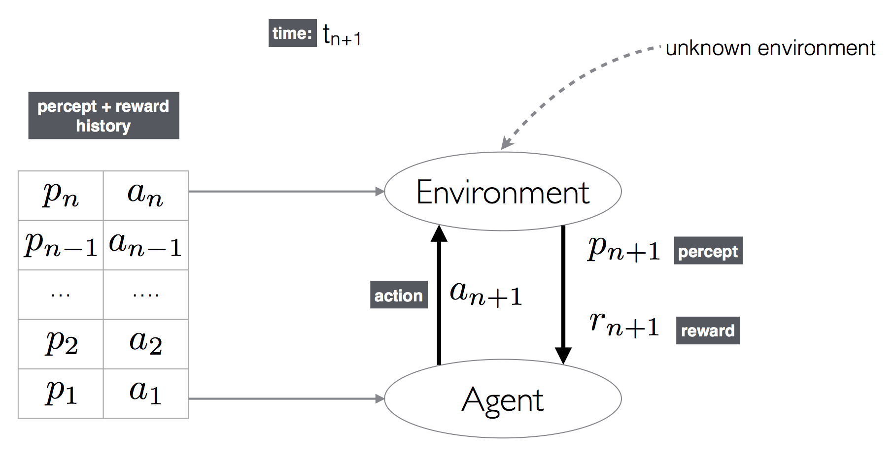

# artificial-intelligence — aixi（supplement）

> （《artificial-intelligence》词条补充材料，源：plato.stanford.edu/entries/artificial-intelligence/aixi.html）

#### Supplement to Artificial Intelligence

## The AIXI Architecture

One strategy when confronted with this complexity would be to construct an agent that behaves optimally in not just a single pair of $E$ and $U$, but in all possible such pairs. One such agent could work as follows. Without any knowledge about the environment it is located in, such an agent “at birth” would start by admitting that the class of environments that it is living in could be the entire class of possible environments $\bE$. As time goes by, and the agent gets more and more data from the environment, it will narrow down the class of possible environments it lives in to a smaller and smaller $\bE'$ that is compatible with data that the agent has seen so far. This process of “learning” what the real environment is is not far from simple and idealized formal models of the scientific process. In fact, early models of learning computationally have cast the learner as an ideal scientist. The most general form of learning, at least computationally, is one based on the learner interacting with a black-box computer that produces output $o_i$ in response to an input $a_i$. The learner has to hypothesize the program responsible for producing an input-output sequence $a_1,o_1,a_2,o_2,\ldots$.[^note-a1] If the output $o_i$ can be split into a reward $r_i$ and a percept $p_i$, we get Russell’s view of not just a learning agent, but an agent that has to behave optimally to maximize the reward $r_i$ received over time. Now a question arises, how do interwine learning about the environment with rational behavior?

Hutter (2005) offers a definition for an agent that combines learning with rational behavior when both $E \in\bE$ and $U$ are **Turing-computable**.[^note-a2] Hutter’s agent, termed **AIXI**, starts its life without any knowledge of the environment it lives in. The agent plays the role of a scientist and develops a model of the environment as it keeps interacting with it. In essence, as the agent interacts with the world, it learns more about the particular environment it lives in and its uncertainty about what environment it is located in keeps on decreasing. This lets the agent focus more on a smaller and smaller class of environments as time goes on. In Hutter’s world, time is discrete. Action $a_{n+1}$ by the agent at time $t_{n+1}$ in the environment $E$ produces a reward $r_{n+1}$ and a percept $p_{n+1}$. The goal of the agent is to maximize the rewards that it receives over its life time $L$. (See the figure immediately below.)

*Hutter’s Model of Agent-Environment Interaction*

The agent is assumed to have very little knowledge about the environment. We can think of environments as functions mapping the current action, and previous percept-reward sequences to a new percept and reward pair. Hutter’s agent can then model the environment as a computer program that is consistent with the input-output behavior, $h_n = \langle a_1, p_1, r_1, a_1, p_2, r_2,\ldots, a_n, p_n, r_n \rangle$, that it has witnessed so far. Let the set of all such environments that are consistent with the history $h_n$ be $Q_{h_n}$. The sequence $h_n \bullet a_{n+1}$ that is obtained by concatenating $a_{n+1}$ to $h_n$ denotes that the agent has performed action $a_{n+1}$ with history $h_n$. The agent also has some mechanism for assigning a probability that an environment $q$ would produce a percept-reward pair $ \langle p_{n+1}, r_{n+1}\rangle$ given an input history $h_n$:

$$ P\left(q(h_n)=\hutterresponse \gggiven h_n \bullet a_{n+1}\right) $$

Let us say the agent also has some mechanism for computing prior probabilities of environments $P(q)$. One way that the agent could do this is by subscribing to Occam’s Razor. The agent will then be acting as an ideal scientist and would consider simpler environments more probable, everything else being equal. The agent could then use some measure of complexity for environments. Since environments are just computer programs, measures for complexity of programs abound. For our agent, a measure such as the Kolmogorov complexity would suffice. Let us assume that the agent has a measure of complexity $\mathcal C$ that it uses to compute the prior probability $P_{\mathcal{C}}$. Then the agent could compute the probability that a percept, reward pair is produced as below at the next instant $n+1$:

$$\begin{align*} &P\left(\hutterresponse \gggiven h_n \bullet \mathbf{a_{n+1}} \right)= \\ &\qquad\sum_{q\in Q_{h_n}} P_{\mathcal{C}}(q) . P\left(q\left(h_n\right)=\hutterresponse \gggiven q, h_n\bullet\mathbf{a_{n+1}}\right) \end{align*}$$

Then for the next time step $n+1$, the agent’s expected reward $\mathbf{R}_{n+1}$ given action $\mathbf{a_{n+1}}$ would be:

$$ {\mathbf{R}_{n+1} = \sum_{\hutterresponse} r_{n+1}. P\left(\langle p_{n+1}, r_{n+1} \rangle \gggiven h_n \bullet\mathbf{a_{n+1}}\right)} $$

The optimal action to maximize the reward obtained at the next time step would simply be:

$$ {\mathbf{a}^\ast_{n+1} =\argmax_{\mathbf{a}} \sum_{\hutterresponse} r_{n+1}. P\left(\langle p_{n+1}, r_{n+1} \rangle \gggiven h_n \bullet\mathbf{a}\right)} $$

Denote the expected reward from time $a$ to $b$ by $\mathbf{R}_{a:b}$. If the agent would live only till time $L$, we would then be interested at time $n+1$ only in $\mathbf{R}_{n+1:L}$. This would then simply be:

$$ \mathbf{R}_{n+1:L} = \sum_{\langle p_{n+1}, r_{n+1} \rangle}\left(r_{n+1} + \mathbf{R}_{n+2:L}\right). P\left(\langle p_{n+1}, r_{n+1} \rangle \gggiven h_n \bullet\mathbf{y_{n+1}}\right) $$

The optimal agent is then the agent which maximizes $\mathbf{R}_{1:n}$. Hutter (2005) gives a more extensive treatment in which he considers, among other extensions, environments that are also non-deterministic, agents with non-finite lifespans, etc. This treatment is compatible with Russell’s brand of rational agents. Hutter’s definition has simply stated that rational behavior includes being an ideal scientist. It should be noted that Russell’s/Hutter’s pictures are merely formal models of what AI should be constructing and are far from being a blueprint for a solution. For example, solving the above equation to compute an optimal action in the general case is not only intractable or difficult but *Turing-uncomputable*.

## Notes（原文脚注，引自主文）

[^note-a1]: A1. The study of this process goes by various names such as *computational learning theory*, *language learning* or *formal models of science* (Osherson et al. 1986). One crucial component missing in such models is **justification**. Scientists are much more than hypothesis generating machines. Each hypothesis needs to have some justification or argument that builds upon accepted knowledge or experimental evidence and proceeds via correct rules of inference. This requires a much more expressive formalism than agents divining the contents of a black box computer, some ingredients of such a formalism are discussed in our (Bringsjord et al. 2010).

[^note-a2]: A2. Though there has been some work in what the authors of this entry term as a *[Serious Computational Science of Intelligence](http://kryten.mm.rpi.edu/WORKSHOPS/AGI10/SB_NSG_AGI10wshop.pdf)*, very few approaches fall under this umbrella. The [ Universal Artificial Intelligence](http://hutter1.net/ai/uaibook.htm) (UAI) model from Hutter (2005), of which AIXI is a part, comes closest. See [the workshop paper](http://kryten.mm.rpi.edu/WORKSHOPS/AGI10/SB_NSG_AGI10wshop.pdf) for a scorecard of different related formalisms.