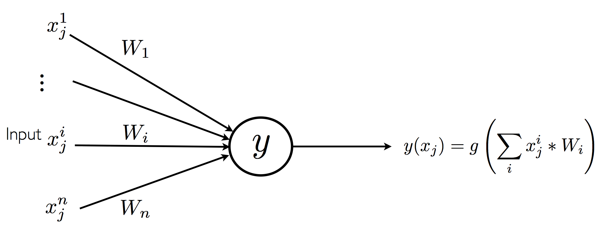
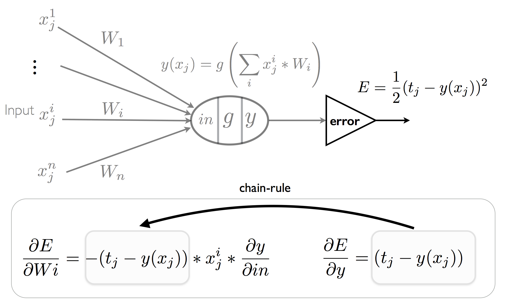

# artificial-intelligence — neural-nets（supplement）

> （《artificial-intelligence》词条补充材料，源：plato.stanford.edu/entries/artificial-intelligence/neural-nets.html）

#### Supplement to Artificial Intelligence

## Neural Nets

Neural networks are predominantly used for building function learning systems of the sort mentioned above. Training such a network is an iterative procedure. We are given a set of representative input and output pairs, $\{\langle x_j,t_j\rangle\}_{j=1}^N$. Consider a network with just one neuron $y$ directly connected to the inputs. The inputs $x_j$ can be thought of as a vector with $n$ components. Let $x^i_j$ be the $i^{th}$ component in the $j^{th}$ training input.

*A single neuron network*

For training, the network is started off with random weights. The network’s outputs are computed on one or more inputs and the total error over these of inputs is computed. Consider the single neuron $y$ that produces output $y(x_j)$ with training data $x_j$ that has ideal output $t_j$. The **error**, $E,$ on a single input $j$ is usually defined as: $\frac{1}{2}(t_j-y(x_j))^2$. We can also view the network as computing the error as show in the figure below. **Gradient descent** training moves the weights in the direction that they have the greatest impact on the error, that is, the weights are then moved in the direction that the error reduces the most. The equation for changing the weights in round $r+1$ is:

$$\tag{2}\label{eq2} W_{i}(r+1) = W_{i}(r) - \epsilon\frac{\partial E}{\partial W_{i}} $$

If the function $g$ is differentiable, an application of the chain-rule for derivation lets us compute the rate of change of the error function with respect to the weights from the rate of change of the error with respect to the output. For an input $x_j$, the derivative of the error with respect to the output is just:

$$\begin{aligned} \frac{\partial E}{\partial y} &= -(t_j-y(x_j)) \end{aligned}$$

Now using the chain-rule, we can easily get the derivative of the error with respect to any weight:

$$\begin{aligned} \frac{\partial E}{\partial Wi} &= \frac{\partial E}{\partial in}\frac{\partial in}{\partial Wi}\\ &= \frac{\partial E}{\partial y}\frac{\partial y}{\partial in}\frac{\partial in}{\partial Wi} \\ &= -(t_j-y(x_j)) * x_i \frac{\partial y}{\partial in} \end{aligned}$$

This can then be plugged into equation $\eqref{eq2}$ to get a rule that lets us calculate how the weights should be updated.

*A single neuron network with error calculation*

Multi-layered networks can then be trained in a similar manner by repeated applications of the chain-rule. For multi-layered networks, the error derivative with respect to the weights from layer $i$ to layer $i+1$ involves the use of the derivatives of the error with respect to the inputs in layer $i+1$, hence the name “backpropagation” (Rumelhart et al. 1986). The backpropagation algorithm is a special case of **automatic differentiation**, a technique that computes a program $P'$ for the derivative $f'$ of a function $f$ given a program $P$ for a function $f$ (Griewank 2000). More specifically, backpropagation is a special case of **reverse mode** automatic differentiation (Baydin et al. 2015).
