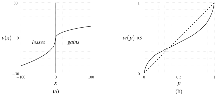
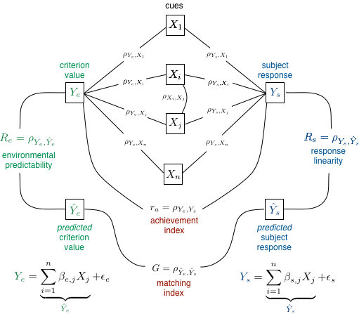
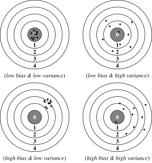

# Bounded Rationality
**First published Fri Nov 30, 2018; substantive revision Fri Dec 13, 2024**

*Wheeler, Gregory*

Herbert Simon introduced the term ‘bounded rationality’ (Simon 1957b: 198; see also Klaes & Sent 2005)[^klaes-2005][^simon-1957b] as shorthand for his proposal to replace the perfect rationality assumptions of *homo economicus* with a concept of rationality better suited to cognitively limited agents:

> Broadly stated, the task is to replace the global rationality of economic man with the kind of rational behavior that is compatible with the access to information and the computational capacities that are actually possessed by organisms, including man, in the kinds of environments in which such organisms exist. (Simon 1955a: 99)[^simon-1955a]

*Bounded rationality* now describes a wide range of descriptive, normative, and prescriptive accounts of effective behavior which depart from the assumptions of perfect rationality. This entry aims to highlight key contributions—from the decision sciences, economics, cognitive- and neuropsychology, biology, physics, computer science, and philosophy—to our current understanding of bounded rationality.

## 1. Homo Economicus and Expected Utility Theory

Bounded rationality has come to encompass models of effective behavior that weaken, or reject altogether, the idealized conditions of perfect rationality assumed by models of economic man. In this section we state what models of economic man are committed to and their relationship to expected utility theory. In later sections we review proposals for departing from expected utility theory.

The perfect rationality of *homo economicus* imagines a hypothetical agent who has complete information about the options available for choice, perfect foresight of the consequences from choosing those options, and the wherewithal to solve an optimization problem (typically of considerable complexity) that identifies an option which maximizes the agent’s personal utility.

### 1.1 The Evolution of Homo Economicus

The meaning of ‘economic man’ has evolved significantly over time. John Stuart Mill first described this hypothetical individual as a self-interested agent who seeks to maximize his personal utility (1844). William Jevons later formalized the notion of marginal utility to represent an economic consumer, affording a model of economic behavior (1871). Frank Knight extended Jevon’s *calculator man* by introducing the *slot-machine man* in neo-classical economics (1921), which is Jevon’s *calculator man* augmented with perfect foresight and clearly defined risks. The modern view of a rational economic agent is conceived in terms of Paul Samuelson’s *revealed preference* formulation of utility (1947; Wong 2006)[^wong-2006] which, together with von Neumann and Morgenstern’s axiomatization (1944), changed the focus of economic modeling from reasoning behavior to choice behavior, emphasizing decisions over purely logical reasoning.

Modern economic theory begins with the observation that human beings like some consequences better than others, even if they only assess those consequences hypothetically. A perfectly rational person, according to the canonical paradigm of synchronic decision making under risk, is one whose comparative assessments of a set of consequences adhere to the principle of maximizing utility. This means their decisions consistently follow a rational evaluation of potential outcomes, aiming to achieve the highest possible expected benefit based on probabilistic reasoning.

Yet, this recommendation to maximize expected utility presupposes that qualitative comparative judgements of those consequences (i.e., preferences) are structured in such a way (i.e., satisfy specific axioms) so as to admit a mathematical representation that places those objects of comparison on the real number line (i.e., as inequalities of mathematical expectations), ordered from worst to best. This structuring of preference through axioms to admit a numerical representation is the subject of expected utility theory.

### 1.2 Expected Utility Theory

We present here one such axiom system to derive expected utility theory, a simple set of axioms for the binary relation $\succeq$, which represents the relation “is weakly preferred to”. The objects of comparison for this axiomatization are *prospects*, which associate probabilities to a fixed set of consequences, where both probabilities and consequences are known to the agent. To illustrate, the prospect (−€10, ½; €20, ½) concerns two consequences, *losing 10 Euros* and *winning 20 Euros*, each assigned the probability one-half. A rational agent will prefer this prospect to another with the same consequences but greater chance of losing than winning, such as ($-$€10, ⅔; €20, ⅓)—assuming his aim is to maximize his financial welfare. More generally, suppose that $X = \{x_1, x_2, \ldots, x_n\}$ is a mutually exclusive and exhaustive set of consequences and that $p_i$ denotes the probability of $x_i$, where each $p_i \geq 0$ and $\sum_{i}^{n} p_i = 1$. A prospect *P* is simply the set of consequence-probability pairs, $P = (x_1, p_1; \ x_2, p_2; \ldots; \ x_n, p_n)$. By convention, a prospect’s consequence-probability pairs are ordered by the value of each consequence, from least favorable to most. When prospects *P*, *Q*, *R* are comparable under a specific preference relation, $\succeq$, and the (ordered) set of consequences *X* is fixed, then prospects may be simply represented by a vector of probabilities.

The *expected utility hypothesis* Bernoulli (1738)[^bernoulli-1738] states that rational agents ought to maximize expected utility. If your qualitative preferences $\succeq$ over prospects satisfy the following three constraints, *ordering*, *continuity*, and *independence*, then your preferences will maximize expected utility (Neumann & Morgenstern 1944)[^neumann-1944].

**A1.**

**Ordering**. The ordering condition states that preferences are both *complete* and *transitive*. For all prospects *P*, *Q*, completeness entails that either $P \succeq Q$, $Q \succeq P$, or both $Q \succeq P$ and $Q \succeq P$, written $P \sim Q$. For all prospects $P, Q, R$, transitivity entails that if $P \succeq Q$ and $Q \succeq R$, then $P \succeq R$.

**A2.**

**Archimedean**. For all prospects $P, Q, R$ such that $P \succeq Q$ and $Q \succeq R$, then there exists some $p \in (0,1)$ such that $(P, p; \ R, (1-p)) \sim Q$, where $(P, p; R, (1-p))$ is the *compound prospect* that yields the prospect *P* as a consequence with probability *p* or yields the prospect *R* with probability $1-p$.[^note-1]

**A3.**

**Independence**. For all prospects $P, Q, R$, if $P \succeq Q$, then $$(P, p; \ R, (1-p)) \succeq (Q, p; \ R, (1-p))$$ for all *p*.

Specifically, if A1, A2, and A3 hold, then there is a real-valued function $V(\cdot)$ of the form

$$\label{eq:seu} V(P) = \sum_i (p_i \cdot u(x_i))$$

where *P* is any prospect and $u(\cdot)$ is a von Neumann and Morgenstern utility function defined on the set of consequences *X*, such that $P \succeq Q$ if and only if $V(P) \geq V(Q)$. In other words, if your qualitative comparative judgments of prospects at a given time satisfy A1, A2, and A3, then those qualitative judgments are representable numerically by inequalities of functions of the form $V(\cdot)$, yielding a logical calculus on an interval scale for determining the consequences of your qualitative comparative judgments at that time.

### 1.3 Axiomatic Departures from Expected Utility Theory

It is commonplace to explore alternatives to an axiomatic system and expected utility theory is no exception. To be clear, not all departures from expected utility theory are candidates for modeling bounded rationality. Nevertheless, some misguided rhetoric over how to approach the problem of modeling bounded rationality stems from unfamiliarity with the breadth of contemporary statistical decision theory. Here we highlight some axiomatic departures from expected utility theory that are motivated by bounded rationality considerations, all framed in terms of our particular axiomatization from section 1.2.

#### 1.3.1 Alternatives to A1

Weakening the ordering axiom introduces the possibility for an agent to forgo comparing a pair of alternatives, an idea both Keynes and Knight advocated (Keynes 1921; Knight 1921)[^keynes-1921][^knight-1921]. Specifically, dropping the completeness axiom allows an agent to be in a position to neither prefer one option to another nor be indifferent between the two (Koopman 1940; Aumann 1962; Fishburn 1982)[^aumann-1962][^fishburn-1982][^koopman-1940]. Decisiveness, which the completeness axiom encodes, is more mathematical convenience than principle of rationality. The question, which is the question that every proposed axiomatic system faces, is what logically follows from a system which allows for incomplete preferences. Led by Aumann (1962)[^aumann-1962], early axiomatizations of rational incomplete preferences were suggested by Giles (1976)[^giles-1976] and Giron & Rios (1980), and later studied by Karni (1985)[^karni-1985], Bewley (2002)[^bewley-2002], Walley (1991)[^walley-1991], Seidenfeld, Schervish, & Kadane (1995), Ok (2002), Nau (2006)[^nau-2006], Galaabaatar & Karni (2013) and Zaffalon & Miranda (2017). In addition to accommodating indecision (Wheeler 2022)[^wheeler-2022], such systems also allow for you to reason about someone else’s (possibly) complete preferences when your information about that other agent’s preferences is incomplete.

Dropping transitivity limits extendability of elicited preferences (Luce & Raiffa 1957)[^luce-1957], since the omission of transitivity as an axiomatic constraint allows for cycles and preference reversals. Although violations of transitivity have been long considered both commonplace and a sign of human irrationality (May 1954; Tversky 1969)[^may-1954][^tversky-1969], reassessments of the experimental evidence challenge this received view (Mongin 2000; Regenwetter, Dana, & Davis-Stober 2011)[^mongin-2000][^regenwetter-2011]. The axioms impose synchronic consistency constraints on preferences, whereas the experimental evidence for violations of transitivity commonly conflate dynamic and synchronic consistency (Regenwetter et al. 2011)[^regenwetter-2011]. Specifically, a person’s preferences at one moment in time that are inconsistent with his preferences at another time is no evidence for that person holding logically inconsistent preferences at a single moment in time, thus offer no evidence for irrationality. People change their minds, after all. Arguments to limit the scope of transitivity in normative accounts of rational preference similarly point to diachronic or group preferences, which likewise do not contradict the axioms (Kyburg 1978; Anand 1987; Bar-Hillel & Margalit 1988; Schick 1986)[^anand-1987][^bar-hillel-1988][^kyburg-1978][^schick-1986]. Arguments that point to psychological processes or algorithms that admit cycles or reversals of preference over time also point to a misapplication of, rather than a counter-example to, the ordering condition. Finally, for decisions that involve explicit comparisons of options over time, violating transitivity may be rational. For example, given the goal of maximizing the rate of food gain, an organism’s current food options may reveal information about food availability in the near future by indicating that a current option may soon disappear or that a better option may soon reappear. Information about availability of options over time can, and sometimes does, warrant non-transitive choice behavior over time that nevertheless maximizes food gain (McNamara, Trimmer, & Houston 2014, McNamara and Leimar 2020)[^mcnamara-2014].

#### 1.3.2 Alternatives to A2

Dropping the Archimedean axiom allows for an agent to have *lexicographic preferences* (Blume, Brandenburger, & Dekel 1991)[^blume-1991]; that is, the omission of A2 allows the possibility for an agent to prefer one option infinitely more than another. One motivation for developing a non-Archimedean version of expected utility theory is to address a gap in the foundations of the standard subjective utility framework that prevents a full reconciliation of *admissibility* (i.e., the principle that one ought not select a weakly dominated option for choice) with *full conditional preferences* (i.e., that for any event, there is a well-defined conditional probability to represent the agent’s conditional preferences; Pedersen 2014)[^pedersen-2014][^pedersen-2014-2]. Specifically, the standard subjective expected utility account cannot accommodate conditioning on zero-probability events, which is of particular importance to game theory (P. Hammond 1994)[^hammond-1994]. Non-Archimedean variants of expected utility theory turn to techniques from nonstandard analysis (Goldblatt 1998)[^goldblatt-1998], full conditional probabilities (Rényi 1955; Coletii & Scozzafava 2002; Dubins 1975; Popper 1959)[^coletii-2002][^dubins-1975][^popper-1959][^rényi-1955], and lexicographic probabilities (Halpern 2010; Brickhill & Horsten 2016 [Other Internet Resources])[^halpern-2010], and are all linked to imprecise probability theory (Wheeler and Cozman 2021)[^wheeler-2021][^wheeler-2021-2].

Non-compensatory single-cue decision models, such as the Take-the-Best heuristic (section 5.2), appeal to lexicographically ordered cues, and admit a numerical representation in terms of non-Archimedean expectations (Arló-Costa & Pedersen 2011)[^arló-costa-2011].

#### 1.3.3 Alternatives to A3

A1 and A2 together entail that $V(\cdot)$ assigns a real-valued index to prospects such that $P \succeq Q$ if and only if $V(P) \geq V(Q)$. The independence axiom, A3, encodes a separability property for choice, one that ensures that expected utilities are linear in probabilities. Motivations for dropping the independence axiom stem from difficulties in applying expected utility theory to describe choice behavior, including an early observation that humans evaluate possible losses and possible gains differently. Although expected utility theory can represent a person who either gambles or purchases insurance, Friedman and Savage remarked in their early critique of von Neumann and Morgenstern’s axiomatization, it cannot simultaneously do both (M. Friedman & Savage 1948)[^friedman-1948].

The principle of loss aversion (Kahneman & Tversky 1979; Rabin 2000)[^kahneman-1979][^rabin-2000] suggests that the subjective weight that we assign to potential losses is greater than that we assign to commensurate potential gains. For example, the *endowment effect* (Thaler 1980)[^thaler-1980]—the observation that people tend to view the value of a good higher when viewed as a potential loss than when viewed as a potential gain—is supported by neurological evidence for gains and losses being processed by different regions of the brain (Rick 2011)[^rick-2011]. However, even granting the affective differences in how we process losses and gains, those differences do not necessarily translate to a general “negativity bias” (Baumeister, Bratslavsky, & Finkenauer 2001)[^baumeister-2001] in choice behavior (Hochman & Yechiam 2011; Yechiam 2019)[^hochman-2011][^yechiam-2019]. Yechiam and colleagues report experiments in which participants do not exhibit loss aversion in their choices, such as cases in which participants respond to repetitive situations that issue losses and gains and single-case decisions involving small stakes. That said, observations of risk aversion (Allais 1953)[^allais-1953] and ambiguity aversion (Ellsberg 1961)[^ellsberg-1961] have led to alternatives to expected utility theory, all of which abandon A3. Those alternative approaches include prospect theory (section 2.4), regret theory (Bell 1982; Loomes & Sugden 1982)[^bell-1982][^loomes-1982], and rank-dependent expected utility (Quiggin 1982)[^quiggin-1982].

Most models of bounded rationality do not fit neatly into this broad axiomatic framework we’ve outlined. This is partly because bounded rationality emphasizes the processes, algorithms, and psychological mechanisms involved in decision making (section 2), aspects that Samuelson’s shift from reasoning behavior to choice behavior deliberately abstracted away, considering them beyond the scope of rational choice theory. Simon, however, saw this abstraction as precisely the problem with rational choice theory. Additionally, bounded rationality often focuses on adaptive behavior suited to an organism’s environment (section 3). Ecological modeling involves goal-directed behavior influenced by the organism’s constitution and stable features of its environment, making (synchronic) coherent comparative judgments less relevant to framing the problem.

However, it is important to avoid overgeneralizing the limited role of decision-theoretic tools in studying bounded rationality. Decision theory, broadly construed to include statistical decision theory (Berger 1985)[^berger-1985], provides a robust mathematical toolbox. While traditional decision theory has relied on psychological assumptions like “degrees of belief” and logical omniscience (section 1.4), exploring axiomatic departures from expected utility theory can both challenge Bayesian orthodoxy and expand the practical application of powerful mathematical methods.

### 1.4 Limits to Logical Omniscience

Most formal models of judgement and decision making assume logical omniscience, meaning that a decision maker is presumed to have complete knowledge of all that logically follows from his current commitments and the options available for choice. This assumption is both psychologically unrealistic and technically challenging to avoid (Stalnaker 1991)[^stalnaker-1991]. Any theory that recommends disbelieving a claim when the evidence is logically inconsistent, for example, will be unworkable when the belief in question is sufficiently complicated for all but logically omniscient agents. Further, this policy remains unworkable even for non-omniscient agents that have access to unlimited computational resources (Kelly and Schulte 1995)[^kelly-1995].

The problem of logical omniscience is particularly acute for expected utility theory in general, and the theory of subjective probability in particular. For the postulates of subjective probability imply that an agent knows all the logical consequences of her commitments, thereby mandating logical omniscience. This limits the applicability of the theory, however. For example, it prohibits having uncertain judgments about mathematical and logical statements. In an article from 1967, “Difficulties in the theory of personal probability”, reported in Hacking 1967 and Seidenfeld, Schervish, & Kadane 2012 but misprinted in Savage 1967, Savage raises the problem of logical omniscience for the subjective theory of probability:

> The analysis should be careful not to prove too much; for some departures from theory are inevitable, and some even laudable. For example, a person required to risk money on a remote digit of *π* would, in order to comply fully with the theory, have to compute that digit, though this would really be wasteful if the cost of computation were more than the prize involved. For the postulates of the theory imply that you should behave in accordance with the logical implication of all that you know. Is it possible to improve the theory in this respect, making allowances within it for the cost of thinking, or would that entail paradox, as I am inclined to believe but unable to demonstrate? (Savage 1967 excerpted from Savage’s prepublished draft; see notes in Seidenfeld et al. 2012)[^savage-1967][^seidenfeld-2012]

Responses to Savage’s problem include a game-theoretic treatment proposed by I.J. Good (1983)[^good-1983], which swaps the extensional variable that is necessarily true for an intensional variable representing an accomplice who knows the necessary truth but withholds enough information from you, allowing you to be (coherently) uncertain about what your accomplice knows. This trick changes the subject of your uncertainty, from a necessarily true proposition that you cannot coherently doubt to a coherent guessing game about that truth facilitated by your accomplice’s incomplete description. Another response sticks to the classical line that failures of logical omniscience are deviations from the normative standard of perfect rationality but introduces an index for incoherence to accommodate reasoning with incoherent probability assessments (Schervish, Seidenfeld, & Kadane 2012, Konek 2023)[^konek-2023][^schervish-2012][^seidenfeld-2012]. A third approach, suggested by de Finetti (1970)[^finetti-1970], is to restrict possible states of affairs to observable states with a finite verifiable procedure—which may rule out theoretical states or any other that does not admit a verification protocol. Originally, what de Finetti was after was a principled way to construct a partition over possible outcomes to distinguish serious possible outcomes of an experiment from wildly implausible but logically possible outcomes, yielding a method for distinguishing between genuine doubt and mere “paper doubts” (Peirce 1955)[^peirce-1955]. Other proposals follow de Finetti’s line by tightening the admissibility criteria and include *epistemically possible* events, which are events that are logically consistent with the agent’s available information; *apparently possible* events, which include any event by default unless the agent has determined that it is inconsistent with his information; and *pragmatically possible* events, which only includes events that are judged sufficiently important (Walley 1991: section 2.1)[^walley-1991].

The notion of *apparently possible* refers to a procedure for determining inconsistency, which is a form of bounded procedural rationality (section 2). The challenges of avoiding paradox, which Savage alludes to, are formidable. However, work on bounded fragments of Peano arithmetic (Parikh 1971)[^parikh-1971] provide coherent foundations for exploring these ideas, which have been taken up specifically to formulate bounded-extensions of default logic for *apparent possibility* (Wheeler 2004)[^wheeler-2004] and more generally in models of *computational rationality* (Lewis, Howes, & Singh 2014)[^lewis-2014].

### 1.5 Descriptions, Prescriptions, and Normative Standards

It is common to distinguish how people actually render judgements or make decisions from how they should ideally do so. However, the study of bounded rationality suggests distinguishing three aims of inquiry rather than two: a *descriptive theory* that explains or predicts what judgments or decisions people actually make; a *prescriptive theory* that explains or recommends the judgments or decisions people ought to make; a *normative theory* that specifies the normative standards to use when evaluating the effectiveness of a judgement or decision.

To illustrate these types, consider arithmetic. A descriptive theory of arithmetic might address the psychology of arithmetic reasoning, a model of numeracy in animals, or an algorithm for arbitrary-precision arithmetic in computers. The normative standard of full arithmetic is Peano’s axiomatization, which defines natural number arithmetic through succession and mathematical induction. Alternative standards include Robinson’s induction-free fragment of Peano arithmetic (Tarski, Mostowski, and Robinson 1953)[^tarski-1953] and various systems of cardinal arithmetic in the hierarchy for large cardinals. A prescriptive theory references both a fixed normative standard and relevant facts about the arithmetic capabilities of the organism or machine. For example, curricula for improving arithmetic performance will differ between children and adults due to psychological differences, even though Peano arithmetic is the normative standard for both groups. Peano’s axioms, while the normative standard for full arithmetic, are not prescriptive advice for teaching arithmetic, nor are they descriptive of arithmetic reasoning. Nevertheless, a descriptive theory of arithmetic assumes Peano’s axioms implicitly, since summing two numbers presumes an intent to perform arithmetic, not concatenate, sequence, encode, or any other operation on numbers.

Finally, consider developing a pedagogy for teaching cardinal arithmetic to children, based on an effective method for teaching arithmetic. A prescriptive theory might adapt successful methods from full arithmetic while anticipating that some approaches will not apply to ZFC+. Differences might arise directly from the change in normative standards or from the interplay between the new task and children’s psychological capabilities.

To be sure, there are important differences between arithmetic and rational behavior. The objects of arithmetic (numerals and the numbers they represent) are relatively clear-cut, whereas the objects of rational behavior vary even when the same theoretical framework is used. For instance, in expected utility theory an agent might be seen as choosing options to maximize personal welfare, acting *as if* doing so but without actual deliberation, or as playing a non-deliberative role in the population fitness of their kind.

Separating the choice of a normative standard from the evaluation or description of behavior is crucial for avoiding misunderstandings in discussions of bounded rationality. Although Peano’s axioms are not prescribed to improve or describe arithmetic reasoning, they remain necessary to both descriptive and prescriptive theories of arithmetic. While it remains an open question whether the normative standards for human rational behavior are axiomatizable, clear normative standards nevertheless help to advance our understanding of how people make judgements and decisions, and how they ought to do so.

## 2. The Emergence of Procedural Rationality

Simon thought the shift in focus from reasoning behavior to choice behavior was a mistake. Since, in the 1950s, little was known about the processes involved in making judgments or reaching decisions, abstracting away those features from our mathematical models was premature. Yet, this ignorance raised the question of how to proceed. The answer was to attend to the costs in effort involved in operating a decision-making procedure and compare those costs to the resources available to the organism. Conversely, the performance of the organism in terms of accuracy (section 7.2) with its limited cognitive resources was compared to models with similar accuracy within those resource bounds. Managing the trade-off between decision costs and decision quality involves another type of rationality, which Simon later called *procedural rationality* (Simon 1976, p. 69)[^simon-1976].

Process models emphasize the cognitive and procedural aspects of decision making. By focusing on the algorithms and psychological processes involved, process models shed light on how individuals navigate complex decisions within their cognitive limitations. In this section we highlight early, key contributions to modeling procedures for boundedly rational judgment and decision making, including the origins of the *accuracy-effort trade-off*, Simon’s *satisficing strategy*, *improper linear models*, and the earliest effort to systematize several features of high-level, cognitive judgment and decision making: *cumulative prospect theory*.

### 2.1 Accuracy and Effort

Herbert Simon and I.J. Good were each among the first to call attention to the cognitive demands of subjective expected utility theory, although neither one in his early writings abandoned the principle of expected utility as the normative standard for rational choice. Good, for instance, referred to the recommendation to maximize expected utility as the *ordinary principle of rationality*, whereas Simon called the expected utility principle *objective rationality* and considered it the central tenant of *global rationality*. The rules of rational behavior are costly to operate in both time and effort, Good observed, so real agents have an interest in minimizing those costs (Good 1952, §7(i)). Efficiency dictates that one choose from available alternatives an option that yields the largest result given the resources available, which Simon emphasized is not necessarily an option that yields the largest result overall (Simon 1947, p. 79)[^simon-1947]. So reasoning judged deficient without considering the associated costs may be found meritorious once all those costs are accounted for—a conclusion that a range of authors endorsed, including Amos Tversky:

> It seems impossible to reach any definitive conclusions concerning human rationality in the absence of a detailed analysis of the sensitivity of the criterion and the cost involved in evaluating the alternatives. When the difficulty (or the costs) of the evaluations and the consistency (or the error) of the judgments are taken into account, a [transitivity-violating method] may prove superior. (Tversky 1969)[^tversky-1969]

Balancing the quality of a decision against its costs soon became a popular conception of bounded rationality, particularly in economics (Stigler 1961)[^stigler-1961], where it remains commonplace to formulate boundedly rational decision making as a constrained optimization problem. On this view boundedly rational agents are utility maximizers after all, once all the constraints are made clear (Arrow 2004)[^arrow-2004]. Another reason for the popularity of this conception of bounded rationality is its compatibility with Milton Friedman’s *as if* methodology (Friedman 1953)[^friedman-1953], which licenses models of behavior that ignore the causal factors underpinning judgment and decision making. To say that an agent behaves as if he is a utility maximizer is at once to concede that he is not but that his behavior proceeds as if he were. Similarly, to say that an agent behaves as if he is a utility maximizer under certain constraints is to concede that he does not solve constrained optimization problems but nevertheless behaves as if he did so.

Simon’s focus on computationally efficient methods that yield solutions that are good enough contrasts with Friedman’s as if methodology, since evaluating whether a solution is “good enough”, in Simon’s terms, involves search procedures, stopping criteria, and how information is integrated in the course of making a decision. Simon offers several examples to motivate inquiry into computationally efficient methods. Here is one. Applying the game-theoretic minimax algorithm to the game of chess calls for evaluating more chess positions than the number of molecules in the universe (Simon 1957, p. 6). Yet if the game of chess is beyond the reach of exact computation, why should we expect everyday problems to be any more tractable? Simon’s question is to explain how human beings manage to solve complicated problems in an uncertain world given their meager resources. Answering Simon’s question, as opposed to applying Friedman’s method to fit a constrained optimization model to observed behavior, is to demand a model with better predictive power concerning boundedly rational judgment and decision making. In pressing this question of how human beings solve uncertain inference problems, Simon opened two lines of inquiry that continue today, namely:

1. How do human beings actually make decisions “in the wild”?
2. How can the standard theories of global rationality be simplified to render them more tractable?

Simon’s initial efforts aimed to simplify global rationality. Due to the limited psychological knowledge about decision making at the time, he relied on a layman’s “acquaintance with the gross characteristics of human choice” (Simon 1955a, p. 100)[^simon-1955a]. He proposed replacing the complex optimization problem of maximizing expected utility with a simpler decision criterion he called *satisficing*. This approach, along with models with better predictive power, sought to more accurately reflect how decisions are made in practice.

### 2.2 Satisficing

Satisficing is the strategy of considering the options available to you for choice until you find one that meets or exceeds a predefined threshold—your aspiration level—for a minimally acceptable outcome. Although Simon originally thought of procedural rationality as a poor approximation of global rationality, and thus viewed the study of bounded rationality to concern “the behavior of human beings who *satisfice* because they have not the wits to *maximize*” (Simon 1957a: xxiv)[^simon-1957a], there are a range of applications of satisficing models to sequential choice problems, aggregation problems, and high-dimensional optimization problems, which are increasingly common in machine learning and economics.

Given a specification of what will count as a good-enough outcome, satisficing replaces the optimization objective from expected utility theory of selecting an undominated outcome with the objective of picking an option that meets your aspirations. The model has since been applied to business (Bazerman & Moore 2008; Long, Sim, and Zhou 2022)[^bazerman-2008][^long-2022], mate selection (Todd & Miller 1999)[^todd-1999], survey methodology (Roberts, et al. 2019,)[^roberts-2019] and other practical sequential-choice problems, including selecting a parking spot (Hutchinson, Fanselow, et al. 2012)[^hutchinson-2012]. Ignoring the procedural aspects of Simon’s original formulation of satisficing, if one has a fixed aspirational level for a given decision problem, then admissible choices from satisficing can be captured by so-called *ε*-efficiency methods (Loridan 1984; White 1986; Yongacoglu, et al. 2023)[^loridan-1984][^white-1986][^yongacoglu-2023].

Hybrid optimization-satisficing techniques are used in machine learning when many metrics are available but no sound or practical method is available for combining them into a single value. Instead, hybrid optimization-satisficing methods select one metric to optimize and satisfice the remainder. For example, a machine learning classifier might optimize accuracy (i.e., maximize the proportion of examples for which the model yields the correct output; see section 7.2) but set aspiration levels for the false positive rate, coverage, and runtime.

Selten’s *aspiration adaption theory* models decision tasks as problems with multiple incomparable goals that resist aggregation into a complete preference order over all alternatives (Selten 1998)[^selten-1998]. Instead, the decision-maker will have a vector of goal variables, where vectors are comparable by weak dominance. If vector A and vector B are possible assignments for my goals, then A dominates vector B if there is no goal in the sequence in which B assigns a value that is strictly less than A, and there is some goal for which A assigns a value strictly greater than B. Selten’s model imagines an aspiration level for each goal, which itself can be adjusted upward or downwards depending on the set of feasible (admissible) options. Aspiration adaption theory is a highly procedural and local account in the tradition of Newell and Simon’s approach to human problem solving (Newell & Simon 1972)[^newell-1972], although it was not initially offered as a psychological process model.

*Level-k thinking* is a variant of satisficing adapted to iterative and strategic decisions, with agents forming expectations based on a finite number of iterative steps (Camerer 2003)[^camerer-2003]. Within this model, agents are categorized based on the number of iterations they perform, where *level-0* agents use a simple naive strategy without considering other agents’ potential decisions, *level-1* agents best responds to a level-o agent, *level-2* agents best respond to a strategy of level-1 agents, and so on. By limiting the number of reasoning steps, level-*k* thinking is offered as a more realistic portrayal of human strategic decision-making based their limited expectations of others’ behavior (Chong, Camerer, and Ho 2005), including cases where backward induction is infeasible (Ho and Su 2024).

### 2.3 Proper and Improper Linear Models

Proper linear models represent another important class of optimization models. A *proper linear model* is one where predictor variables are assigned weights, which are selected so that the linear combination of those weighted predictor variables optimally predicts a target variable of interest. For example, linear regression is a proper linear model that selects weights such that the squared “distance” between the model’s predicted value of the target variable and the actual value (given in the data set) is minimized.

Paul Meehl’s review in the 1950s of psychological studies using statistical methods versus clinical judgment cemented the statistical turn in psychology (Meehl 1954)[^meehl-1954]. Meehl’s review found that studies involving the prediction of a numerical target variable from numerical predictors is better done by a proper linear model than by the intuitive judgment of clinicians. Concurrently, the psychologist Kenneth Hammond formulated Brunswik’s lens model (section 3.2) as a composition of proper linear models to model the differences between clinical versus statistical predictions (K. Hammond 1955)[^hammond-1955]. Proper linear models have since become a workhorse in cognitive psychology in areas that include decision analysis (Keeney & Raiffa 1976; Kaufmann & Wittmann 2016)[^kaufmann-2016][^keeney-1976], causal inference (Waldmann, Holyoak, & Fratianne 1995; Spirtes 2010)[^spirtes-2010][^waldmann-1995], and response-times to choice (Brown & Heathcote 2008; Turner, Rodriguez, et al. 2016)[^brown-2008][^turner-2016].

Robin Dawes, returning to Meehl’s question about statistical versus clinical predictions, found that even *improper linear models* perform better than clinical intuition (Dawes 1979)[^dawes-1979]. The distinguishing feature of improper linear models is that the weights of a linear model are selected by some non-optimal method. For instance, equal weights might be assigned to the predictor variables to afford each equal weight or a unit-weight, such as 1 or −1, to tally features supporting a positive or negative prediction, respectively. As an example, Dawes proposed an improper model to predict subjective ratings of marital happiness by couples based on the difference between their rates of lovemaking and fighting. The results? Among the thirty happily married couples, two argued more than they had intercourse. Yet all twelve unhappy couples fought more frequently. And those results replicated in other laboratories studying human sexuality in the 1970s. Both equal-weight regression and unit-weight *tallying* have since been found to commonly outperform proper linear models on small data sets. Although no simple improper linear model performs well across all common benchmark datasets, for almost every data set in the benchmark there is some simple improper model that performs well in predictive accuracy (Lichtenberg & Simsek 2016)[^lichtenberg-2016]. This observation, and many others in the heuristics literature, points to biases of simplified models that can lead to better predictions when used in the right circumstances (section 4).

Dawes’s original point was not that improper linear models outperform proper linear models in terms of accuracy, but rather that they are more efficient and (often) close approximations of proper linear models. “The statistical model may integrate the information in an optimal manner”, Dawes observed, “but it is always the individual …who chooses variables” (Dawes 1979: 573)[^dawes-1979]. Moreover, Dawes argued that it takes human judgment to know the direction of influence between predictor variables and target variables, which includes the knowledge of how to numerically code those variables to make this direction clear. Advances in machine learning chip away at Dawes’s claims about the unique role of human judgment, and results from Gigerenzer’s ABC Group about unit-weight tallying outperforming linear regression in out-of-sample prediction tasks with small samples is an instance of improper linear models outperforming proper linear models (Czerlinski, Gigerenzer, & Goldstein 1999)[^czerlinski-1999][^gigerenzer-1999]. Nevertheless, Dawes’s general observation about the relative importance of variable selection over variable weighting stands (Katsikopoulos, Schooler, & Hertwig 2010)[^katsikopoulos-2010][^katsikopoulos-2010-2].

### 2.4 Cumulative Prospect Theory

If both satisficing and improper linear models are examples addressing Simon’s second question at the start of this section—namely, how to simplify existing models to render them both tractable and effective—then Daniel Kahneman and Amos Tversky’s *cumulative prospect theory* addressed the first question by directly incorporating knowledge about how humans actually make decisions.

In our discussion in section 1.2 about alternatives to the Independence Axiom, (A3), we mentioned several observed features of human choice behavior that stand at odds with the prescriptions of expected utility theory. Kahneman and Tversky developed prospect theory around four of those observations about human decision-making (Kahneman & Tversky 1979; Wakker 2010)[^kahneman-1979][^wakker-2010].

1. **Reference Dependence**. Rather than make decisions by comparing the absolute magnitudes of welfare, as prescribed by expected utility theory, people instead tend to value prospects by their change in welfare with respect to a reference point. This reference point can be a person’s current state of wealth, an aspiration level, or a hypothetical point of reference from which to evaluate options. The intuition behind reference dependence is that our sensory organs have evolved to detect changes in sensory stimuli rather than store and compare absolute values of stimuli. Therefore, the argument goes, we should expect to see the cognitive mechanisms involved in decision-making to inherit this sensitivity to changes in perceptual attributes values. In prospect theory, reference dependence is reflected by utility changing sign at the origin of the valuation curve $v(\cdot)$ in Figure 1(a). The *x*-axis represents gains (right side) and losses (left side) in euros, and *y*-axis plots the value placed on relative gains and losses by a valuation function $v(\cdot)$, which is fit to experimental data on people’s choice behavior.
2. **Loss Aversion**. People are more sensitive to losses than gains of the same magnitude; the thrill of victory does not measure up to the agony of defeat. So, Kahneman and Tversky maintained, people will prefer an option that does not incur a loss to an alternative option that yields a comensurate gain. The disparity in how potential gains and losses are evaluated also accounts for the endowment effect (Thaler 1980)[^thaler-1980], which is the tendency for people to value a good that they own more than a comparatively valued substitute (Bruner, Calegari, and Handfield 2020). In prospect theory, loss aversion appears in Figure 1(a) in the steeper slope of $v(\cdot)$ to the left of the origin, representing losses relative to the subject’s reference point, than the slope of $v(\cdot)$ for gains on the right side of the reference point. Thus, for the same magnitude of change in reward *x* from the reference point, the corresponding magnitude of the consequence of gaining *x* is less than the magnitude of the consequence of losing *x*. Tversky and Kahneman (1992) originally estimated the loss aversion coefficient λ to be 2.25, suggesting that a loss looms more than twice as painful than the pleasure from a corresponding gain. Any value of λ > 1 indicates a loss-aversion effect and subsequent empirical results strongly confirm a loss-aversion effect. However, a meta-analysis reveals that the effect is weaker than initially assumed (section 1.3), with a mean of λ of 1.97 and median of 1.69 (Brown, Imai, Vieider, and Camerer 2024)[^brown-2024]. Note also that differences in affective attitudes toward, and the neurological processes responsible for processing, losses and gains do not necessarily translate to differences in people’s choice behavior (Yechiam and Hochman 2014)[^yechiam-2014].
3. **Diminishing Returns for both Gains and Losses**. Given a fixed reference point, people’s sensitivity to changes in asset values (*x* in Figure 1a) diminish the further one moves from that reference point, both in the domain of losses and the domain of gains. This is inconsistent with expected utility theory, even when the theory is modified to accommodate diminishing marginal utility (M. Friedman & Savage 1948)[^friedman-1948]. In prospect theory, the valuation function $v(\cdot)$ is concave for gains and convex for losses, representing a diminishing sensitivity to both gains and losses. Expected utility theory can be made to accommodate sensitivity effects, but the utility function is typically either strictly concave or strictly convex, not both.
4. **Probability Weighting**. Finally, for known exogenous probabilities, people do not calibrate their subjective probabilities by direct inference (Levi 1977)[^levi-1977], but instead systematically underweight high-probability events and overweight low-probability events, with a cross-over point of approximately one-third (Figure 1b). Thus, changes in very small or very large probabilities have greater impact on the evaluation of prospects than they would under expected utility theory. People are willing to pay more to reduce the number of bullets in the chamber of a gun from 1 to 0 than from 4 bullets to 3 in a hypothetical game of Russian roulette. Figure 1(b) plots the median values for the probability weighting function $w(\cdot)$ that takes the exogenous probability *p* associated with prospects, as reported in Tversky & Kahneman 1992. Roughly, below probability values of one-third people overestimate the probability of an outcome (consequence), and above probability one-third people tend to underestimate the probability of an outcome occurring. Traditionally, overweighting is thought to concern the systematic miscalibration of people’s subjective estimates of outcomes against a known exogenous probability, *p*, serving as the reference standard. In support of this view, miscalibration appears to disappear when people learn a distribution through sampling instead of learning identical statistics by description (Hertwig, Barron, Weber, & Erev 2004)[^hertwig-2004]. Miscalibration in this context ought to be distinguished from overestimating or underestimating subjective probabilities when the relevant statistics are not supplied as part of the decision task. For example, televised images of the aftermath of airplane crashes lead to an overestimation of the low-probability event of commercial airplanes crashing. Even though a person’s subjective probability of the risk of a commercial airline crash would be too high given the statistics, the mechanism responsible is different: here the *recency* or *availability* of images from the evening news is to blame for scaring him out of his wits, not the sober fumbling of a statistics table. An alternative view maintains that people understand that their weighted probabilities are different than the exogenous probability but nevertheless prefer to act as if the exogenous probability were so weighted (Wakker 2010)[^wakker-2010]. On this view, probability weighting is not a (mistaken) belief but a preference.

*Figure 1:* (a) plots the value function $v(\cdot)$ applied to consequences of a prospect; (b) plots the median value of the probability weighting function $w(\cdot)$ applied to positive prospects of the form $(x, p; 0, 1-p)$ with probability *p*. [An extended description of this figure is in the supplement.]

Prospect theory incorporates these components into models of human choice under risk by first identifying a reference point that either refers to the status quo or some other aspiration level. The consequences of the options under consideration then are framed in terms of deviations from this reference point. Extreme probabilities are simplified by rounding off, which yields miscalibration of the given, exogenous probabilities. Dominance reasoning is then applied, where dominated alternatives are eliminated from choice, along with additional steps to separate options without risk, probabilities associated with a specific outcome are combined, and a version of eliminating irrelevant alternatives is applied (Kahneman & Tversky 1979: 284–285)[^kahneman-1979].

Nevertheless, prospect theory comes with problems. For example, a shift of probability from less favorable outcomes to more favorable outcomes ought to yield a better prospect, all things considered, but the original prospect theory violates this principle of stochastic dominance. *Cumulative prospect theory* satisfies stochastic dominance, however, by appealing to a rank-dependent method for transforming probabilities (Quiggin 1982)[^quiggin-1982]. For a review of the differences between prospect theory and cumulative prospect theory, along with an axiomatization of cumulative prospect theory, see Fennema & Wakker 1997.

## 3. The Emergence of Ecological Rationality

Imagine an area of plants teeming with insects and few in flight. This environment favors a bird that gleans over one that hawks. In a similar fashion, a decision-making environment might be more favorable for one decision-making strategy than to another. Just as it would be “irrational” for a bird to hawk rather than glean, given the choice, so too what may be an irrational decision strategy in one environment may be entirely rational in another.

If procedural rationality attaches a cost to the making of a decision, then ecological rationality locates that procedure in the world. The questions ecological rationality ask is what features of an environment help or hinder decision making and how should we model judgment or decision-making ecologies (Neisser 1976; Shamay-Tsoory and Mendelsohn 2019; Osborne-Crowley 2020)[^shamay-tsoory-2019]. For example, people make causal inferences about patterns of covariation they observe—especially children, who then perform experiments testing their causal hypotheses (Glymour 2001)[^glymour-2001]. Unsurprisingly, people who draw the correct inferences about the true causal model do better than those who infer the wrong causal model (Meder, Mayrhofer, and Waldmann 2014)[^meder-2014]. More surprising, Meder and his colleagues found that those making correct causal judgments do better than subjects who make no causal judgments at all. And perhaps most surprising of all is that those with true causal knowledge also beat the benchmark standards in the literature which ignore causal structure entirely; the benchmarks encode, spuriously, the assumption that the best we can do is to make no causal judgments at all.

In this section, after reviewing Simon’s proposal for distinguishing between *behavioral constraints* and *environmental structure*, we turn to three historically important contributions: *the lens model*, *rational analysis*, and *cultural adaptation*. Finally, we review the *bias-variance trade-off*, which is frequently mentioned in the Fast and Frugal Heuristics literature (section 5.2).

### 3.1 Behavioral Constraints and Environmental Structure

Simon thought that both behavioral constraints and environmental structure ought to figure in a theory of bounded rationality, yet he cautioned against identifying behavioral and environmental properties with features of an organism and features of its physical environment, respectively:

> what we call “the environment” may lie, in part, within the skin of the biological organisms. That is, some of the constraints that must be taken as givens in an optimization problem may be physiological and psychological limitations of the organism (biologically defined) itself. For example, the maximum speed at which an organism can move establishes a boundary on the set of its available behavior alternatives. Similarly, limits on computational capacity may be important constraints entering into the definition of rational choice under particular circumstances. (Simon 1955a: 101)[^simon-1955a]

That said, what is classified as a behavioral constraint rather than an environmental affordance varies across disciplines and the theoretical tools put to use. For example, one computational approach to bounded rationality, *computational rationality theory* (Lewis, Howes, and Singh 2014)[^lewis-2014], classifies the cost to an organism of executing an optimal program as a behavioral constraint, classifies limits on memory as an environmental constraint, and treats the costs associated with searching for an optimal program to execute as exogenous. Anderson and Schooler’s study and computational modeling of human memory (Anderson and Schooler 1991)[^anderson-1991][^anderson-1991-2] within the ACT-R framework, on the other hand, views the limits on memory and search-costs as behavioral constraints which are adaptive responses to the structure of the environment. Still another broad class of computational approaches are found in *statistical signal processing*, such as adaptive filters (Haykin 2013)[^haykin-2013], which are commonplace in engineering and vision (Marr 1982; Ballard and Brown 1982)[^ballard-1982][^marr-1982]. Signal processing methods typically presume the sharp distinction between device and world that Simon cautioned against adopting, however. Still others have challenged the distinction between behavioral constraints and environmental structure by arguing that there is no clear way to separate organisms from the environments they inhabit (Gibson 1979)[^gibson-1979], or by arguing that features of cognition which appear body-bound may not be necessarily so (Clark & Chalmers 1998)[^clark-1998].

Bearing in mind the different ways the distinction between behavior and environment have been drawn, and challenges to what precisely follows from drawing such a distinction, ecological approaches to rationality all endorse the thesis that the ways in which an organism manages structural features of its environment are essential to understanding how deliberation occurs and effective behavior arises. In doing so theories of bounded rationality have traditionally focused on at least some of the following features, under this rough classification:

- **Behavioral Constraints**—may refer to bounds on computation, such as the *cost of searching* the best algorithm to run, an appropriate rule to apply, or a satisficing option to choose; the *cost of executing* an optimal algorithm, appropriate rule, or satisficing choice; and *costs of storing* the data structure of an algorithm, the constitutive elements of a rule, or the objects of a decision problem.
- **Ecological Structure**—may refer to *statistical*, *topological*, or other *perceptible invariances* of the task environment that an organism is adapted to; or to *architectural features* or *biological features* of the computational processes or cognitive mechanisms responsible for effective behavior, respectively.

### 3.2 Brunswik’s Lens Model

Egon Brunswik was a pioneer in applying probability and statistics to the study of human perception and emphasized the role of ecology in the generalizability of psychological findings. Brunswik thought psychology ought to aim for statistical descriptions of adaptive behavior (Brunswik 1943)[^brunswik-1943]. Instead of isolating a few independent variables to systematically manipulate and observe their effects on a dependent variable, he argued that psychological experiments should assess how an organism adapts to its environment. Experimental subjects should represent the population, and the experimental situations should represent the subjects’ natural environment (Brunswik 1955)[^brunswik-1955]. Thus, Brunswik advocated for a representative design in psychological experiments to preserve the causal structure of the subjects’ natural environment. For a review of the development of representative design and its use in the study of judgment and decision making, see (Dhami, Hertwig, & Hoffrage 2004)[^dhami-2004][^hertwig-2004].

Brunswik’s *lens model* centers on how behavioral and environmental conditions influence organisms in perceiving proximal cues to infer some distal features of their “natural-cultural habitat” (Brunswik 1955, p.198)[^brunswik-1955]. For instance, an organism may detect the color markings (distal object) of a potential mate through light contrasts reflected on its retina (proximal cues). Some proximal cues provide more information about distal objects, which Brunswik understood as differences in the “objective” correlations between proximal cues and the target distal objects. The ecological validity of proximal cues refers to their capacity to provide useful information about distal objects within a particular environment. Performance assessments of an organism thus compare its actual use of cue information to the cue’s information capacity.

Kenneth Hammond and colleagues (K. Hammond, Hursch, & Todd 1964)[^hammond-1964] formulated Brunswik’s lens model as a system of linear bivariate correlations, as depicted in Figure 2 (Hogarth & Karelaia 2007)[^hogarth-2007]. Informally, Figure 2 says that the accuracy of a subject’s judgment (response), $Y_s$, about a numerical target criterion, $Y_e$, given some informative cues (features) $X_1, \ldots, X_n$, is determined by the correlation between the subject’s response and the target. More specifically, the linear lens model imagines two large linear systems, one for the environment, *e*, and another for the subject, *s*, which both share a set of cues, $X_1, \ldots, X_n$. Note that cues may be associated with one another, i.e., it is possible that $\rho(X_i,X_j) \neq 0$ for indices $i\neq j$ from 1 to *n*.

The accuracy of the subject’s judgment $Y_s$ about the target criterion value $Y_e$ is measured by an *achievement index*, $r_a$, which is computed by Pearson’s correlation coefficient *ρ* of $Y_e$ and $Y_s$. The subject’s predicted response $\hat{Y}_s$ to the cues is determined by the weights $\beta_{s_i}$ the subject assigns to each cue $X_i$, and the linearity of the subject’s response, $R_s$, measures the noise in the system, $\epsilon_s$. Thus, the subject’s response is conceived to be a weighted linear sum of subject-weighted cues plus noise. The analogue of *response linearity* in the environment is *environmental predictability*, $R_e$. The environment, on this model, is thought to be probabilistic—or “chancy” as some say. Finally, the environment-weighted sum of cues, $\hat{Y}_e$, is compared to the subject-weighted sum of cues, $\hat{Y}_s$, by a *matching index*, *G*.

*Figure 2:* Brunswik’s Lens Model [An extended description of this figure is in the supplement.]

With this formulation of the lens model in mind, return to Simon’s remarks above concerning the classification of environmental affordance versus behavioral constraint. The lens models conception as a linear model is influenced by signal detection theory, originally developed to improve the accuracy of early radar systems. Thus, the model inherits from engineering a clean division between subject and environment. However, suppose for a moment that both the environmental mechanism producing the criterion value and the subject’s predicted response are linear. Now consider the error-term, $\epsilon_s$. That term may refer to biological constraints that are responses to adaptive pressures on the whole organism. If so, ought $\epsilon_s$ be classified as an environmental constraint rather than a behavioral constraint? The answer will depend on what follows from the reclassification, which will depend on the model and the goal of inquiry (section 7). If we were using the lens model to understand the ecological validity of an organism’s judgment, then reclassifying $\epsilon_s$ as an environmental constraint would only introduce confusion; If instead our focus was to distinguish between behavior that is subject to choice and behavior that is precluded from choice, then the proposed reclassification may herald clarity—but then we would surely abandon the lens model for something else, or in any case would no longer be referring to the parameter $\epsilon_s$ in Figure 2.

Finally, it should be noted that the lens model, like nearly all linear models used to represent human judgment and decision-making, does not scale well as a descriptive model. In multi-cue decision-making tasks involving more than three cues, people often turn to simplifying heuristics due to the complications involved in performing the necessary calculations (section 2.1; see also section 4). More generally, as we remarked in section 2.3, linear models involve calculating trade-offs that are difficult for people to perform. Lastly, the supposition that the environment is linear is a strong modeling assumption. Quite apart from the difficulties that arise for humans to execute the necessary computations, it becomes theoretically more difficult to justify model selection decisions as the number of features increases. The matching index *G* is a goodness-of-fit measure, but goodness-of-fit tests and residual analysis begin to lead to misleading conclusions for models with five or more dimensions. Machine learning techniques for supervised learning get around this limitation by focusing on analogues of the achievement index, construct predictive hypotheses purely instrumentally, and dispense with matching altogether (Wheeler 2017)[^wheeler-2017].

### 3.3 Rational Analysis

Rational analysis is a methodology applied in cognitive science and biology to explain why a cognitive system or organism engages in a particular behavior by appealing to the presumed goals of the organism, the adaptive pressures of its environment, and the organism’s computational limitations. Once an organism’s goals are identified, the adaptive pressures of its environment specified, and the computational limitations are accounted for, an optimal solution under those conditions is sought to explain why a behavior that is otherwise ineffective may nevertheless be effective in achieving that goal under those conditions (Marr 1982; Anderson 1991; Oaksford and Chater 1994; Palmer 1999)[^anderson-1991][^anderson-1991-2][^marr-1982][^oaksford-1994][^palmer-1999]. Rational analysis therefore assumes that evolution and learning have optimally adapted the human mind to its environment, an assumption supported by empirical evidence showing near-optimal human performance in perception (Knill and Richards 1996)[^knill-1996], motor control (Körding and Wolpert 2004), statistical learning (Fiser and Aslin 2002).

One theme to emerge from the rational analysis literature that has influenced bounded rationality is the study of memory (Anderson and Schooler 1991; Chater and Oaksford 1999)[^anderson-1991][^anderson-1991-2][^chater-1999]. For instance, given the statistical features of our environment, and the sorts of goals we typically pursue, forgetting is an advantage rather than a liability (Schooler and Hertwig 2005)[^schooler-2005]. Memory traces vary in their likelihood of being used, so the memory system will try to make readily available those memories which are most likely to be useful. This is a rational analysis style argument, which is a common feature of the Bayesian turn in cognitive psychology (Oaksford and Chater 2007; Friston 2010)[^friston-2010][^oaksford-2007]. More generally, spacial arrangements of objectives in the environment can simplify perception, choice, and the internal computation necessary for producing an effective solution (Kirsch 1995). Compare this view to the discussion of recency or availability effects distorting subjective probability estimates in section 2.4.

Rational analyses are typically formulated independently of the cognitive processes or biological mechanisms that explain how an organism realizes a behavior. Thus, when an organism’s observed behavior in an environment does not agree with the behavior prescribed by a rational analysis for that environment, there are traditionally three responses. One strategy is to change the specifications of the problem, by introducing an intermediate step or changing the goal altogether, or altering the environmental constraints, et cetera (Anderson & Schooler 1991; Oaksford & Chater 1994)[^anderson-1991][^anderson-1991-2][^oaksford-1994]. Another strategy is to argue that mechanisms matter after all, so details of human psychology are taken into an alternative account (Newell & Simon 1972; Gigerenzer, Todd, et al. 1999; Todd, Gigerenzer, et al. 2012)[^gigerenzer-1999][^newell-1972][^todd-1999][^todd-2012]. A third option is to enrich rational analysis by incorporating computational mechanisms directly into the model (Russell & Subramanian 1995; Chater 2014; Lieder and Griffiths 2020)[^chater-2014][^lieder-2020][^russell-1995]. Lewis, Howes, and Singh, for instance, propose to construct theories of rationality from (i) structural features of the task environment; (ii) the bounded machine the decision-process will run on, about which they consider four different classes of computational resources that may be available to an agent; and (iii) a utility function to specify the goal, numerically, so as to supply an objective function against which to score outcomes (Lewis et al. 2014)[^lewis-2014].

### 3.4 Cultural Adaptation

So far we have considered theories and models which emphasize an individual organism and its surrounding environment, which is typically understood to be either the physical environment or, if social, modeled as if those social structures were the physical environment. And we considered whether some features commonly understood to be behavioral constraints ought to be instead classified as environmental affordances.

Yet people and their responses to the world are also part of each person’s environment. Boyd and Richardson argue that human societies ought to be viewed as an adaptive environment, which in turn has consequences for how individual behavior is evaluated. Human societies contain a large reservoir of information that is preserved through generations and expanded upon, despite limited, imperfect learning by the members of human societies. Imitation, which is a common strategy in humans, including preverbal infants (Gergely, Bekkering, and Király 2002)[^gergely-2002], is central to cultural transmission (Boyd and Richerson 2005)[^boyd-2005] and the emergence of social norms (Bicchieri and Muldoon 2014)[^bicchieri-2014]. In our environment, only a few individuals with an interest in improving on the folk lore are necessary to nudge the culture to be adaptive. The main advantage that human societies have over other groups of social animals, this argument runs, is that cultural adaptation is much faster than genetic adaptation (Bowles and Gintis 2011)[^bowles-2011]. On this view, human psychology evolved to facilitate speedy adaptation. Natural selection did not equip our large-brained ancestors with rigid behavior, but instead selected for brains that allowed then to modify their behavior adaptively in response to their environment (Barkow, Cosmides, and Tooby 1992)[^barkow-1992].

But if human psychology evolved to facility fast social learning, it comes at the cost of human credulity. To have speedy adaptation through imitation of social norms and human behavior, the risk is the adoption of maladaptive norms or stupid behavior.

### 3.5. The Bias-Variance Trade-off

The *bias-variance trade-off* refers to a particular decomposition of overall prediction error for an estimator into its central tendency (bias) and dispersion (variance). Sometimes overall error can be reduced by increasing bias in order to reduce variance, or vice versa, effectively trading an increase in one type of error to afford a comparatively larger reduction in the other. To give an intuitive example, suppose your goal is to minimize your score with respect to the following targets.

*Figure 3* [An extended description of this figure is in the supplement.]

Ideally, you would prefer a procedure for delivering your “shots” that had both a low bias and low variance. Given the choice between a low bias and high variance procedure versus a high bias and low variance procedure, you would presumably prefer the latter procedure if it returned a lower overall error. Although a decision maker’s learning algorithm ideally will have low bias and low variance, in practice, reducing one type of error often increases the other.

The bias-variance decomposition highlights a trade-off between two extreme approaches to making a prediction (see the ([supplement on the bias-variance decomposition](bounded-rationality.bias-variance-decomp.md)). At one extreme, you might use a constant function as an estimator, which always gives the same prediction regardless of the data. For example, if your estimator always predicts $h(X) = 7$, the variance would be zero since the prediction never changes. However, unless your deterministic estimator happens by chance to align with a data generator that only produces the value 7, the bias of your estimate would be very high, massively underfitting your data.

At the other extreme, aiming for zero bias means making the predicted value $\hat{Y}$ match the actual value $Y$ perfectly for every sample $(x_i, y_i)$. Since you do not know the true function $r(X)$ and only have a sample data set $\mathcal{D}$, you will aspire to construct an estimator that ideally generalizes to new, unseen data. However, if you fit the estimator perfectly to $\mathcal{D}$, the variance will be very high because different data sets $\mathcal{D}^*$ from the true model will not be identical to $\mathcal{D}$. The variation between these data sets is the variance or irreducible error of the data generated by the true model. This leads to overfitting your data.

The bias-variance trade-off therefore concerns the question of how complex a model ought to be to make reasonably accurate predictions on unseen or out-of-sample examples. The problem is to strike a balance between an underfitting model, which erroneously ignores available information about the true function *r*, and an overfitting model, which erroneously includes information that is noise and thus gives misleading information about the true function *r*.

One thing that human cognitive systems do very well is to generalize from a limited number of examples. The difference between humans and machines is particularly striking when we compare how humans learn a complicated skill, such as driving a car, from how a machine learning system learns the same task. As harrowing an experience it is to teach a teenager how to drive a car, they do not need to crash into a utility pole thousands of times to learn that utility poles are not traversable. What teenagers learn as children about the world through play and observing other people drive lends to them an understanding that utility poles are to be steered around, a piece of commonsense that our current machine learning systems do not have but must learn from scratch on a case-by-case basis. Human beings have a remarkable capacity to transfer what we learn from one domain to another domain, a capacity fueled in part by our curiosity (Kidd & Hayden 2015)[^kidd-2015].

Viewed from the perspective of the bias-variance trade-off, the ability to make accurate predictions from sparse data suggests that variance is the dominant source of error but that our cognitive system often manages to keep these errors within reasonable limits (Gigerenzer & Brighton 2009)[^gigerenzer-2009]. Indeed, Gigerenzer and Brighton make a stronger argument, stating that “the bias-variance dilemma shows formally why a mind can be better off with an adaptive toolbox of biased, specialized heuristics” (Gigerenzer & Brighton 2009: 120)[^gigerenzer-2009]; see also section 5.2. However, the bias-variance decomposition (see the [bias-variance supplement](bounded-rationality.bias-variance-decomp.md)) is a decomposition of squared loss, which means that the decomposition above depends on how total error (loss) is measured. There are many loss functions, however, depending on the type of inference one is making along with the stakes in making it. If one were to use a 0-1 loss function, for example, where all non-zero errors are treated equally—meaning that “a miss as good as a mile”—the decomposition above breaks down. In fact, for 0-1 loss, bias and variance combine multiplicatively (J. Friedman 1997)[^friedman-1997]! A generalization of the bias-variance decomposition that applies to a variety of loss functions $\mathrm{L}(\cdot)$, including 0-1 loss, has been offered by (Domingos 2000)[^domingos-2000],

$$\mathrm{L}(h)\ = \ \textrm{Bias}(h)^2 \ + \ \beta_1\textrm{Var}(h) \ + \ \beta_2\mathrm{N}$$

where the original bias-variance decomposition, Equation 4 (in the bias-variance supplement), appears as a special case, namely when $\mathrm{L}(h) = \textrm{MSE}(h)$ and $\beta_1 = \beta_2 = 1$.

One point to observe is that the interpretation of the bias-variance trade-off as a tension between two sources of error originates from the frequentist school of statistics, which remains dominant in the judgment and decision-making community (see the [bias-variance supplement](bounded-rationality.bias-variance-decomp.md)). Within Bayesian statistics, however, bias and variance are integrated into a broader understanding of uncertainty, where bias—introduced through priors—is deliberately incorporated and viewed as beneficial rather than detrimental. For a Bayesian, the emphasis is to minimize overall uncertainty and improve the quality of inference or prediction, rather than minimize bias for its own sake (Gelman et al. 2013)[^gelman-2013]. Additionally, note that the term ‘bias’ is ambiguous, as it may be used as a descriptive term or a pejorative term, especially in discussions of “algorithmic bias” (Danks and London 2017)[^danks-2017] and heuristics (section 5.2).

## 4. Better with Bounds

Our discussion of improper linear models (section 2.3) highlighted a model that often approximates a proper linear model surprisingly well, and our examination of the bias-variance trade-off (section 3.5) considered how cognitive systems might make accurate predictions with minimal data. In this section, we review examples of models that deviate from normative standards of global rationality yet yield markedly improved outcomes—achieving results impossible under global rationality conditions. We will explore examples from the *statistics of small samples* and *game theory* to demonstrate some advantages of deviating from global rationality. Then, we turn to the *irreducible thermodynamic cost of information processing:* since information processing is inherently a physical process, it is bound by physical laws, implying that all rationality may be viewed as inherently bounded.

### 4.1 Homo Statisticus and Small Samples

In a review of experimental results assessing human statistical reasoning published in the late 1960s, which took stock of research conducted after psychology’s full embrace of statistical research methods (section 2.3), Petersen and Beach argued that the normative standard of probability theory and statistical optimization methods were “a good first approximation for a psychological theory of inference” (Peterson & Beach 1967: 42)[^peterson-1967]. Petersen and Beach’s view that humans were *intuitive statisticians* that closely approximate the ideal standards of *homo statisticus* fit into a broader consensus at that time about the close fit between the normative standards of logic and intelligent behavior (Newell & Simon 1956, 1976)[^newell-1956][^newell-1976][^simon-1976]. The assumption that human judgment and decision making closely approximate normative theories of probability and logic was later challenged by experimental results from Kahneman and Tversky, and the biases and heuristics program more generally (section 7.1).

Among Kahneman and Tversky’s earliest findings was that people tend to make statistical inferences from samples that are too small, even when given the opportunity to control the sampling procedure. They attributed this effect to a systematic failure of people to appreciate the biases inherent in small samples. Hertwig and colleagues provided further insight into this phenomenon by investigating how people make decisions from experience versus decisions from description (Hertwig, Barron et al. 2004)[^hertwig-2004]. Kahneman and Tversky attributed this effect to a systematic failure of people to appreciate the biases that attend small samples, although Hertwig and others have offered evidence that samples drawn from a single population are close to the known limits to working memory (Hertwig, Barron et al. 2004)[^hertwig-2004]. They found that when individuals make decisions from experience, they often rely on relatively small samples of information. This reliance is partly due to the cognitive limitations of working memory, which can handle only a limited amount of information at a time. Therefore, the tendency to make inferences from small samples can be seen as a reflection of these cognitive constraints, rather than a mere oversight.

Overconfidence can be understood as an artifact of small samples. The *Naïve Sampling Model* (Juslin, Winman, & Hansson 2007)[^juslin-2007] assumes that agents base judgments on a small sample retrieved from long-term memory at the moment a judgment is called for, even when there are a variety of other methods available to the agent. This model presumes that people are naïve statisticians (Fiedler & Juslin 2006)[^fiedler-2006] who assume, sometimes falsely, that samples are representative of the target population of interest and that sample properties can be used directly to yield accurate estimates of a population. The idea is that when sample properties are uncritically taken as estimators of population parameters a reasonably accurate probability judgment can be made with overconfidence, even if the samples are unbiased, accurately represented, and correctly processed by the cognitive mechanisms of the agent. When sample sizes are restricted, these effects are amplified.

However, sometimes effective behavior is aided by inaccurate judgments or cognitively adaptive illusions (Howe 2011)[^howe-2011]. The statistical properties of small samples are a case in point. One feature of small samples is that correlations are amplified, making them easier to detect (Kareev 1995)[^kareev-1995]. This fact about small samples, when combined with the known limits to human short-term memory, suggests that our working-memory limits may be an adaptive response to our environment that we exploit at different stages in our lives. Adult short-term working memory is widely believed to be limited to seven items, plus or minus two (Miller 1956)[^miller-1956], although more recent work suggests the limit is closer to four items (Cowan 2001)[^cowan-2001]. For correlations of 0.5 and higher, Kareev demonstrates that sample sizes between five and nine are most likely to yield a sample correlation that is greater than the true correlation in the population (Kareev 2000)[^kareev-2000], making those correlations nevertheless easier to detect. Furthermore, children’s short-term memories are even more restricted than adults, thus making correlations in the environment that much easier to detect. Of course, there is no free lunch: this small-sample effect comes at the cost of inflating estimates of the true correlation coefficients and admitting a higher rate of false positives (Juslin & Olsson 2005)[^juslin-2005]. However, in many contexts, including child development, the cost of error arising from under-sampling may be more than compensated by the benefits from simplifying choice (Hertwig & Pleskac 2008)[^hertwig-2008] and accelerating learning. In the spirit of Brunswik’s argument for representative experimental design (section 3.2), a body of literature cautions that the bulk of experiments on adaptive decision-making are performed in highly simplified environments that differ in important respects from the natural world in which human beings make decisions (Fawcett et al. 2014)[^fawcett-2014]. In response, Houston, MacNamara and colleagues argue, we should incorporate more environmental complexity in our models.

### 4.2 Game Theory

Pro-social behavior, such as cooperation, is challenging to explain through traditional evolutionary game theory, which predicts that individuals will forgo public goods in favor of personal utility maximization. Although behavior consistent with personal utility maximization is often observed in economic experiments, cooperative behavior is pervasive in broader society (Bowles & Gintis 2011)[^bowles-2011]. Exploring this discrepancy between the global rationality of utility maximization and pro-social behavior has led to a body of work demonstrating how bounded rationality can better account for observed cooperative behaviors. This research suggests that cognitive and environmental constraints, such as limited computational capacity, social network structures, and evolutionary dynamics, play crucial roles in fostering cooperation and other pro-social behaviors.

Traditional evolutionary explanations of human cooperation in terms of *reputation*, *reciprocation*, and *retribution* (Trivers 1971; R. Alexander 1987)[^alexander-1987][^trivers-1971] do not fully explain why cooperation is stable. If a group punishes individuals for failing to perform a behavior, and the punishment costs exceed the benefit of doing that behavior, then this behavior will become stable regardless of its social benefits. Anti-social norms arguably take root through a similar mechanism (Bicchieri & Muldoon 2014)[^bicchieri-2014]. Although reputation, reciprocation, and retribution may explain how large-scale cooperation is sustained in human societies, it does not explain how the behavior emerged (Boyd & Richerson 2005)[^boyd-2005]. Additionally, cooperation is observed in microorganisms (Damore & Gore 2012)[^damore-2012], suggesting that simpler mechanisms are sufficient for cooperative behavior.

Our understanding of the advantages deviating from global rationality that accrue to individual players or a group of players has advanced since the 1970s, when it was first widely recognized that improper models often yield good enough approximations of corresponding proper models (section 2.3). The 1980s and 1990s witnessed a series of results involving improper models yielding performance that was strictly better than what was prescribed by the corresponding proper model. In the early 1980s Robert Axelrod held a tournament to empirically test which among a collection of strategies for playing iterations of the prisoner’s dilemma performed best in a round-robin competition. The winner was a simple reciprocal altruism strategy called *tit-for-tat* (Rapoport & Chammah 1965)[^rapoport-1965], which simply starts off each game cooperating then, on each successive round, copies the strategy the opposing player played in the previous round. So, if your opponent cooperated in this round, then you will cooperate on the next round; and if your opponent defected this round, then you will defect the next. Subsequent tournaments have shown that tit-for-tat is remarkably robust against much more sophisticated alternatives (Axelrod 1984)[^axelrod-1984]. For example, even a rational utility maximizing player playing against an opponent who only plays tit-for-tat (i.e., will play tit-for-tat no matter whom he faces) must adapt and play tit-for-tat—or a strategy very close to it (Kreps, Milgrom, et al. 1982)[^kreps-1982].

Tit-for-tat’s simplicity allows us to explore rationality emerging in boundedly rational agents and observe those bounds contributing to pro-social norms. For instance, Rubinstein (1986)[^rubinstein-1986] studied finite automata in repeated prisoner’s dilemmas with the objective to maximize average payoff while minimizing the number of states of a machine. Rubinstein’s results showed that optimal solutions involve each player’s machine being optimal at every game stage. However, contrast this with Neyman’s study, where players of repeated games use finite automata with a fixed number of states, allowing traits like reputation to arise (Neyman 1985)[^neyman-1985]. Further, while cooperation is impossible in infinitely repeated prisoner’s dilemmas, a cooperative equilibrium exists in finitely repeated dilemmas for finite automata players with states less than exponential in the game rounds (Papadimitriou & Yannakakis 1994; Ho 1996)[^papadimitriou-1994]. The memory demands of these strategies may exceed human psychological capacities, however, even for simple strategies like tit-for-tat among a moderately sized group of players (Stevens, Volstorf, et al. 2011)[^stevens-2011]. So, while insightful, these theoretical models showing a number of simple paths to pro-social behavior may not, on their own, be simple enough to offer a plausible process model for human cooperation.

Attention then shifted to environmental constraints. Nowak and May’s study of spatial distribution in iterated prisoner’s dilemmas found that cooperation could emerge among players without memory or strategic foresight (Nowak & May 1992)[^nowak-1992]. This work led to the study of *network topology* as a factor in social behavior (Jackson 2010)[^jackson-2010], including social norms (Bicchieri 2005; J. Alexander 2007)[^alexander-2007][^bicchieri-2005], signaling (Skyrms 2003)[^skyrms-2003], and wisdom of crowd effects (Golub & Jackson 2010)[^golub-2010][^jackson-2010]. When social ties in a network follow a scale-free distribution, the resulting diversity in the number and size of public-goods games is found to promote cooperation, which contributes to explaining the emergence of cooperation in communities without reputation or punishment mechanisms (F. Santos, M. Santos, & Pacheco 2008)[^santos-2008].

Perhaps the simplest case for bounded rationality involves agents achieving desirable goals without deliberation. Insects, flowers, and bacteria exhibit evolutionary stable strategies (Maynard Smith 1982)[^maynard-1982], effectively arriving at Nash equilibria in strategic normal form games. For example, honey bees (*Apis mellifera*) and flowers interact based on genetic endowments, without foresight or choice, leading to *evolutionary dynamics*—a form of bounded rationality without foresight.

Nevertheless, improper model can misfire, as seen in the *ultimatum game* (Güth, Schmittberger, & Schwarze 1982)[^güth-1982]. The ultimatum game is a two-player game in which one player, endowed with a sum of money, is given the task of splitting the sum with another player who may either accept the offer—in which case the pot is accordingly split between the two players—or rejected, in which case both players receiving nothing. People receiving offers of 30 percent or less of the pot are often observed rejecting the offer, even when players are anonymous and therefore would not suffer from a negative reputation signal associated with accepting a very low offer. In such cases, one might reasonably argue that no proposed split is worse than the status quo of zero, so people ought to accept whatever amount they are offered.

### 4.3 Less is More Effects

Simon’s remark that people satisfice when they haven’t the wits to maximize (Simon 1957a: xxiv)[^simon-1957a] points to a common assumption, that there is a trade-off between effort and accuracy (section 2.1). Because the rules of global rationality are expensive to operate (Good 1952: 7(i)), people will trade a loss in accuracy for gains in cognitive efficiency (Payne, Bettman, & Johnson 1988)[^payne-1988]. The methodology of rational analysis (section 3.3) likewise appeals to this trade-off.

The results surveyed in Section 4.2 caution against blindly endorsing the accuracy-effort trade-off as universal, a point that has been pressed in the defense of heuristics as reasonable models for decision-making (Katsikopoulos 2010; Hogarth 2012)[^hogarth-2012][^katsikopoulos-2010][^katsikopoulos-2010-2]. Simple heuristics like *Tallying*, which is a type of improper linear model (section 2.3), and *Take-the-best* (section 5.2), when tested against linear regression on many data sets, have been both found to outperform linear regression on out-of-sample prediction tasks, particularly when the training-sample size is low (Czerlinski et al. 1999; Rieskamp & Dieckmann 2012)[^czerlinski-1999][^rieskamp-2012].

A fundamental principle of Bayesian rationality, called *Good’s principle*, compels decision makers to not turn down free information. The principle—a part of Bayesian lore remarked on by Ramsey (1931)[^ramsey-1931], argued for by Savage (1972, 107)[^savage-1972], partially formalized by Raiffa and Schlaifer (1961), asserted in textbooks starting with Lindley (1965)[^lindley-1965], then succinctly formalized by Good (1967)[^good-1967]—recommends to delay making a terminal decision between alternative courses of action if there is an opportunity to learn, at zero cost, the outcome of an experiment relevant to the decision (Pedersen and Wheeler 2015)[^pedersen-2015]. At issue is the value of information to rational decision making. Good’s principle assumes that, all else equal, a person facing a decision problem cannot be harmed and may only be helped from acquiring additional information, assuming the expected cost of acquisition does not exceed the expected benefits. Hence, if information is free, you can only be helped (in expectation) acquiring it. However, the conditions under which this maxim is true are narrower than first believed. Good’s principle does not apply in strategic interactions (Osborne 2003, 281)[^osborne-2003]: market failures from *adverse selection* provide a prominent counterexample to Good’s principle (Akerlof 1970)[^akerlof-1970]. Good’s principle also fails for decision problems under *Knightian uncertainty* (Knight 1921)[^knight-1921] involving dilating indeterminate or imprecise probabilities (Wheeler 2020)[^wheeler-2020].

### 4.5 All Rationality is Bounded

Our discussion has tacitly accepted a difference between bounded rationality and unbounded rationality. However, information processing of any kind incurs a thermodynamic cost, suggesting that *all* rationality is inherently bounded by physical laws.

Here is the argument. Moving from the revealed preferences of “economic man” (section 1.1) to the cognitive and procedural mechanisms of human decision making introduces bounds due to natural human limitations. However, this switch to procedural rationality (section 2) suggests that human limitations necessitate introducing bounds on rational decision making. What if instead *any* decision-making process is inherently bounded? Then it is the switch from formal coherence criteria (section 7.1) to ratiocination itself that entails bounds, not merely the inquiry into human decision making. This is the implication of the irreducible thermodynamic cost of information processing.

The foundation for the thermodynamic cost of computation is *Landauer’s Principle* (Landauer 1961)[^landauer-1961], which states that any logically irreversible operation, such as erasing a bit of information, necessarily incurs a minimum loss of heat energy. Landauer’s principle has since been generalized to include the minimum energy costs *any* computational process incurs (Wolpert 2019)[^wolpert-2019]. The idea is that computational processes necessitate the physical manipulation of information-bearing particles, which inevitably involves energy dissipation. This generalized *Landauer-Wolpert principle* establishes that information processing is rooted in physical thermodynamic laws, revealing intrinsic physical limitations of computation.

Energy costs therefore impose practical limits on the efficiency and feasibility of computation. The limitations are both in terms of energy resources and heat dissipation, which pose challenges and natural physical constraints on biological systems and microprocessors alike. The upshot is that *any* abstract computational model ought to be grounded in physical reality. Kolchinsky and Wolpert (Kolchinsky and Wolpert 2020)[^kolchinsky-2020] illustrate this point by discussing how thermodynamic constraints apply even to theoretical constructs like Turing machines. They argue that every computation, regardless of its abstraction, involves physical processes subject to thermodynamic laws. This means that the energy required for computation and the resulting heat dissipation are fundamental constraints that cannot be ignored. It follows therefore that models of rationality are subject to the same energy constraints.

## 5. Two Schools of Heuristics

Heuristics are simple rules of thumb for rendering a judgment or making a decision. Some examples that we have seen thus far include Simon’s satisficing, Dawes’s improper linear models, Rapoport’s tit-for-tat, imitation, and several effects observed by Kahneman and Tversky in our discussion of prospect theory.

There are two primary perspectives on heuristics, corresponding to the research traditions of Kahneman and Tversky’s *biases and heuristics* program and Gigerenzer’s *fast and frugal heuristics* program, respectively. A central dispute between these two research programs is the appropriate normative standard for judging human behavior (Vranas 2000)[^vranas-2000]. According to Gigerenzer, the biases and heuristics program mistakenly classifies all biases as errors (Gigerenzer, Todd, et al. 1999; Gigerenzer & Brighton 2009)[^gigerenzer-2009][^gigerenzer-1999][^todd-1999] despite evidence pointing to some biases in human psychology being adaptive. In contrast, in a rare exchange with a critic, Kahneman and Tversky maintain that the dispute is merely terminological (Kahneman & Tversky 1996; Gigerenzer 1996)[^gigerenzer-1996][^gigerenzer-1996-2][^kahneman-1996].

In this section, we briefly survey each of these two schools. Our aim is to give a characterization of each research program rather than provide an exhaustive overview.

### 5.1 Biases and Heuristics

Beginning in the 1970s, Kahneman and Tversky conducted a series of experiments showing various ways that human participants’ responses to decision tasks deviate from answers purportedly derived from the appropriate normative standards (sections 2.4 and 5.1). These deviations were given names, such as *availability* (Tversky & Kahneman 1973)[^tversky-1973], *representativeness*, and *anchoring* (Tversky & Kahneman 1974)[^tversky-1974]. The set of cognitive biases now numbers into the hundreds, although some are minor variants of other well-known effects, such as “The IKEA effect” (Norton, Mochon, & Ariely 2012)[^norton-2012] being a version of the well-known endowment effect (section 1.2). Nevertheless, core effects studied by the biases and heuristics program, particularly those underpinning prospect theory (section 2.4), are entrenched in cognitive psychology (Kahneman, Slovic, & Tversky 1982)[^kahneman-1982].

An example of a probability judgment task is Kahneman and Tversky’s Taxi-cab problem, which purports to show that subjects neglect base rates:

> A cab was involved in a hit-and-run accident at night. Two cab companies, the Green and the Blue, operate in the city. You are given the following data:
>
> - 85% of the cabs in the city are Green and 15% are Blue.
> - A witness identified the cab as a Blue cab. The court tested his ability to identify cabs under the appropriate visibility conditions. When presented with a sample of cabs (half of which were Blue and half of which were Green) the witness made correct identifications in 80% of the cases and erred in 20% of the cases.
>
> Question: What is the probability that the cab involved in the accident was Blue rather than Green? (Tversky & Kahneman 1977: 3–3)[^tversky-1977].

Continuing, Kahneman and Tversky report that several hundred subjects have been given slight variations of this question and for all versions the modal and median responses was 0.8, instead of the correct answer of $\bfrac{12}{29}$ ($\approx 0.41$).

> Thus, the intuitive judgment of probability coincides with the credibility of the witness and ignores the relevant base-rate, i.e., the relative frequency of Green and Blue cabs. (Tversky & Kahneman 1977: 3–3)[^tversky-1977]

Critical responses to results of this kind fall into three broad categories. The first types of reply is to argue that the experimenters, rather than the subjects, are in error (Cohen 1981)[^cohen-1981]. In the Taxi-cab problem, arguably Bayes sides with the folk (Levi 1983)[^levi-1983] or, alternatively, is inconclusive because the normative standard of the experimenter and the presumed normative standard of the subject requires a theory of witness testimony, neither of which is specified (Birnbaum 1979). Other cognitive biases have been ensnared in the replication crises (Camerer, et al. 2018; Wiggins and Christopherson 2019)[^camerer-2018], such as *implicit bias* (Oswald, Mitchell, et al. 2013; Forscher, Lai et al. 2017)[^oswald-2013] and *social priming* (Doyen, Klein, et al. 2012; Kahneman 2017 [Other Internet Resources])[^doyen-2012].

The second response is to argue that there is an important difference between identifying a normative standard for combining probabilistic information and applying it across a range of cases (section 8.2), and it is difficult in practice to determine that a decision-maker is representing the task in the manner that the experimenters intend (Koehler 1996)[^koehler-1996]. Observed behavior that appears to be boundedly rational or even irrational may result from a difference between the intended specification of a problem and the actual problem subjects face.

For example, consider the systematic biases in people’s perception of randomness reported in some of Kahneman and Tversky’s earliest work (Kahneman & Tversky 1972)[^kahneman-1972]. For sequences of flips of a fair coin, people expect to see, even for small samples, a roughly-equal number heads and tails and alternation rates between heads and tails that are slightly higher than long-run averages (Bar-Hillel & Wagenaar 1991)[^bar-hillel-1991]. This effect is thought to explain the *gambler’s fallacy*, the false belief that a run of heads from an i.i.d. sequence of fair coin tosses will make the next flip more likely to land tails. Hahn and Warren argue that the limited nature of people’s experiences with random sequences is a better explanation than to view them as cognitive deficiencies. Specifically, people only ever experience finite sequence of outputs from a randomizer, such as a sequence of fair coin tosses, and the limits to their memory (section 5.1) of past outcomes in a sequence will mean that not all possible sequences of a given length with appear to them with equal probability. Therefore, there is a psychologically plausible interpretation of the question, “is it more likely to see *HHHT* than *HHHH* from flips of a fair coin?”, for which the correct answer is, “Yes” (Hahn & Warren 2009)[^hahn-2009]. If the gambler’s fallacy boils down to a failure to distinguish between sampling with and without replacement, Hahn and Warren’s point is that our intuitive statistical abilities acquired through experience alone is unable to make the distinction between these two sampling methods. Analytical reasoning is necessary.

Consider also the risky-choice framing effect that was mentioned briefly in section 2.4. An example is the Asian disease example:

- If program *A* is adopted, 200 people will be saved.
- If program *B* is adopted, there is a ⅓ probability that 600 people will be saved, and a ⅔ probability that no people will be saved (Tversky & Kahneman 1981: 453)[^tversky-1981].

Tversky and Kahneman report that a majority of respondents (72 percent) chose option (a), whereas a majority of respondents (78 percent) shown an equivalent reformulation of the problem in terms of the number of people who would die rather than survive chose (b). A meta-analysis of subsequent experiments has shown that the framing condition accounts for most of the variance, but it also reveals no linear combination of formally specified predictors that are used in prospect theory, cumulative prospect theory, and Markowitz’s utility theory, suffices to capture this framing effect (Kühberger, Schulte-Mecklenbeck, & Perner 1999)[^kühberger-1999]. Furthermore, the use of an indicative conditional in this and other experiments to express the consequences is also not adequately understood. Experimental evidence collected about how people’s judgments change when learning an indicative conditional, while straight-forward and intuitive, cannot be accommodated by existing theoretical frameworks for conditionals (Collins, Krzyżanowska, Hartmann, Wheeler, and Hahn 2020)[^collins-2020][^wheeler-2020].

The point to this second line of criticism is not that people’s responses are at variance with the correct normative standard but rather that the explanation for why they are at variance will matter not only for assessing the rationality of people but what prescriptive interventions ought to be taken to counter the error. It is rash to conclude that people, rather than the peculiarities of the task or the theoretical tools available to us at the moment, are in error.

Lastly, the third type of response is to accept the experimental results but challenge the claim that they are generalizable. In a controlled replication of Kahneman and Tversky’s lawyer-engineer example (Tversky & Kahneman 1977)[^tversky-1977], for example, a crucial assumption is whether the descriptions of the individuals were drawn at random, which was tested by having subjects draw blindly from an urn (Gigerenzer, Hell, & Blank 1988)[^gigerenzer-1988]. Under these conditions, base-rate neglect disappeared. In response to the Linda example (Tversky & Kahneman 1983)[^tversky-1983], rephrasing the example in terms of *which alternative is more frequent* rather than *which alternative is more probable* reduces occurrences of the conjunction fallacy among subjects from 77% to 27% (Fiedler 1988)[^fiedler-1988]. More generally, a majority of people presented with the Linda example appear to interpret ‘probability’ non-mathematically but switch to a mathematical interpretation when asked for frequency judgments (Hertwig & Gigerenzer 1999)[^gigerenzer-1999][^hertwig-1999]. Ralph Hertwig and colleagues have since noted a variety of other effects involving probability judgments to diminish or disappear when subjects are permitted to learn the probabilities through sampling, suggesting that people are better adapted to making a *decision by experience* of the relevant probabilities as opposed to making a decision by their *description* (Hertwig, Barron et al. 2004; Appelhoff, Hertwig, and Spitzer 2023)[^appelhoff-2023][^hertwig-2004].

### 5.2 Fast and Frugal Heuristics

The Fast and Frugal school and the Biases and Heuristics school both agree that heuristics are biased. Where they disagree, and disagree sharply, is whether those biases are necessarily a sign of irrationality. For the Fast and Frugal program the question is under what environmental conditions, if any, does a particular heuristic perform effectively. If the heuristic’s structural bias is well-suited to the task environment, then the bias of that heuristic may be an advantage for making accurate judgments rather than a liability (section 3.5). We saw this adaptive strategy before in our discussion of Brunswik’s lens model (section 3.2), although there the bias in the model was to assume that both the environment and the subject’s responses were linear. The aim of the Fast and Frugal program is to adapt this Brunswikian strategy to a variety of improper models.

This general goal of the Fast and Frugal program leads to a second difference between the two schools. Because the Fast and Frugal program aims to specify the conditions under which a heuristic will lead to better outcomes than competing models, heuristics are treated as algorithmic models of decision-making rather than descriptions of errant effects; heuristics are themselves objects of study. To that end, all heuristics in the fast and frugal tradition are conceived to have three components: **(i)** a search rule, **(ii)** a stopping rule, and **(iii)** a decision rule. For example, *Take-the-Best* (Gigerenzer & Goldstein 1996)[^gigerenzer-1996][^gigerenzer-1996-2], is a heuristic applied to binary, forced-choice problems. Specifically, the task is to pick the correct option according to an external criterion, such as correctly picking which of a pair of cities has a larger population, based on cue information that is available to the decision-maker, such as whether she has heard of one city but not the other, whether one city is known to have a football franchise in the professional league, et cetera. One can then compute the predictive validity of different cues, and thus derive their weights. Take-the-Best then has the following structure: *Search rule:* Look up the cue with the highest cue-validity; *Stopping rule:* If the pair of objects have different cue values, that is, one is positive and the other negative, stop the search. If the cue values are the same, continue searching down the cue-order; *Decision rule:* Predict that the alternative with the positive cue value has the higher target-criterion value. If all cues fail to discriminate, that is, if all cue values are the same, then predict the alternative randomly by a coin flip. The bias of Take-the-Best is that it ignores relevant cues. Another example is *tallying*, which is a type of improper linear model (section 2.3). Tallying has the following structure for a binary, forced-choice task: *Search rule:* Look up cues in a random order; *Stopping rule:* After some exogenously determined *m* $(1 < m \leq N)$ of the *N* available cues are evaluated, stop the search; *Decision rule:* Predict that the alternative with the higher number of positive cue values has the higher target-criterion value. The bias in tallying is that it ignores cue weights. One can see then how models are compared to one another by how they process cues and their performance is evaluated with respect to a specified criterion for success, such as the number of correct answers to the city population task.

Because Fast and Frugal heuristics are computational models, this leads to a third difference between the two schools. Kahneman endorses the System I and System II theory of cognition (Stanovich & West 2000)[^stanovich-2000]. Furthermore, Kahneman classifies heuristics as fast, intuitive, and non-deliberative System I thinking. Gigerenzer, by contrast, does not endorse the System I and System II hypothesis, thus rejects classifying heuristics as, necessarily, non-deliberative cognitive processes. Because heuristics are computational models in the Fast and Frugal program, in principle each may be used deliberatively by a decision-maker or used by a decision-modeler to explain or predict a decision-maker’s non-deliberative behavior. The Linear Optical Trajectory (LOT) heuristic (McBeath, Shaffer, & Kaiser 1995)[^mcbeath-1995] that baseball players use intuitively, without deliberation, to catch fly balls, and which some animals appear to use to intercept prey, is the same heuristic that the “Miracle on the Hudson” airline pilots used deliberatively to infer that they could not reach an airport runway and decided instead to land their crippled plane in the Hudson river.

Here are a list of heuristics studied in the Fast and Frugal program (Gigerenzer, Hertwig, & Pachur 2011)[^gigerenzer-2011], along with an informal description for each along with historical and selected contemporary references.

1. **Imitation.** *People have a strong tendency to imitate the successful members of their communities* (Henrich & Gil-White 2001)[^henrich-2001]. If some one man in a tribe …invented a new snare or weapon, or other means of attack or defense, the plainest self-interest, without the assistance of much reasoning power, would prompt other members to imitate him. (Darwin 1871, 155)[^darwin-1871] Imitation is presumed to be fundamental to the speed of cultural adaptation including the adoption of social norms (section 3.4).
2. **Preferential Attachment.** *When given the choice to form a new connection to someone, pick the individual with the most connections to others* (Yule 1925; Barabási & Albert 1999; Simon 1955b)[^barabási-1999][^simon-1955b][^yule-1925].
3. **Default rules.** *If there is an applicable default rule, and no apparent reason for you to do otherwise, follow the rule.* (Fisher 1936; Reiter 1980; Thaler & Sustein 2008; Wheeler 2004)[^fisher-1936][^reiter-1980][^thaler-2008][^wheeler-2004].
4. **Satisficing.** *Search available options and choose the first one that exceeds your aspiration level.* (Simon 1955a; Hutchinson et al. 2012)[^hutchinson-2012][^simon-1955a].
5. **Tallying.** *To estimate a target criterion, rather than estimate the weights of available cues, instead count the number of positive instances* (Dawes 1979; Dana & Dawes 2004)[^dana-2004][^dawes-1979].
6. **One-bounce Rule (Hey’s Rule B).** *Have at least two searches for an option. Stop if a price quote is larger than the previous quote.* The one-bounce rule plays “winning-streaks” by continuing search while you keep receiving a series of lower and lower quotes, but stops as soon as your luck runs out (Hey 1982; Charness & Kuhn 2011)[^charness-2011][^hey-1982].
7. **Tit-for-tat.** *Begin by cooperating, then respond in kind to your opponent; If your opponent cooperates, then cooperate; if your opponent defects, then defect* (Axelrod 1984; Rapaport, Seale, & Colman 2015)[^axelrod-1984].
8. **Linear Optical Trajectory (LOT).** *To intersect with another moving object, adjust your speed so that your angle of gaze remains constant.* (McBeath et al. 1995; Gigerenzer 2007)[^gigerenzer-2007][^mcbeath-1995].
9. **Take-the-best.** *To decide which of two alternatives has a higher value on a specific criterion, (i) first search the cues in order of their predictive validity; (ii) next, stop search when a cue is found which discriminates between the alternatives; (iii) then, choose the alternative selected by the discriminating cue. (iv) If all cues fail to discriminate between the two alternatives, then choose an alternative by chance* (Einhorn 1970; Gigerenzer & Goldstein 1996)[^einhorn-1970][^gigerenzer-1996][^gigerenzer-1996-2].
10. **Recognition:** *To decide which of two alternatives has a higher value on a specific criterion and one of the two alternatives is recognized, choose the alternative that is recognized* (Goldstein & Gigerenzer 2002; Davis-Stober, Dana, & Budescu 2010; Pachur, Todd, et al. 2012)[^davis-stober-2010][^goldstein-2002][^pachur-2012][^todd-2012].
11. **Fluency:** *To decide which of two alternatives has a higher value on a specific criterion, if both alternatives are recognized but one is recognized faster, choose the alternative that is recognized faster* (Schooler & Hertwig 2005; Herzog & Hertwig 2013)[^herzog-2013][^schooler-2005].
12. **$\frac{1}{N}$ Rule:** *For N feasible options, invest resources equally across all N options* (Hertwig, Davis, & Sulloway 2002; DeMiguel, Garlappi, & Uppal 2009)[^demiguel-2009][^hertwig-2002].

There are three lines of responses to the Fast and Frugal program to mention. Take-the-Best is an example of a *non-compensatory* decision rule, which means that the first discriminating cue cannot be “compensated” by the cue-information remaining down the order. This condition, when it holds, is thought to warrant taking a decision on the first discriminating cue and ignoring the remaining cue-information. The computational efficiency of Take-the-Best is supposed to come from only evaluating a few cues, which number less than 3 on average in benchmarks tests (Czerlinski et al. 1999)[^czerlinski-1999]. However, all of the cue validities need to be known by the decision-maker and sorted before initiating the search. So, Take-the-Best by design treats a portion of the necessary computational costs to execute the heuristic as exogenous. Although the lower-bound for sorting cues by comparison is $O(n \log n)$, there is little evidence to suggest that humans sort cues by the most efficient sorting algorithms in this class. On the contrary, such operations are precisely of the kind that qualitative probability judgments demand (section 1.2). Furthermore, in addition to the costs of ranking cue validities, there is the cost of acquisition and the determination that the agent’s estimates are non-compensatory. Although the exact accounting of the cognitive effort presupposed is unknown, and argued to be lower than critics suggest (Katsikopoulos et al. 2010)[^katsikopoulos-2010][^katsikopoulos-2010-2], nevertheless these necessary steps threaten to render Take-the-Best non-compensatory in execution but not in what is necessary prior to setting up the model to execute.

A second line of criticism concerns the cognitive plausibility of Take the Best (Chater, Oaksford, Nakisa, & Redington 2003)[^chater-2003]. Nearly all of the empirical data on the performance characteristics of Take-the-Best are by computer simulations, and those original competitions pitted Take the Best against standard statistical models (Czerlinski et al. 1999)[^czerlinski-1999] but omitted standard machine learning algorithms that Chater, Oaksford and colleagues found performed just as well as Take the Best. Since these initial studies, the focus has shifted to machine learning, and includes variants of Take-the-Best, such as “greedy cue permutation” that performs provably better than the original and is guaranteed to always find accurate solutions when they exist (Schmitt & Martignon 2006)[^schmitt-2006]. Setting aside criticisms targeting the comparative performance advantages of Take the Best qua decision model, others have questioned the plausibility of using Take-the-Best as a cognitive model. For example, Take-the-Best presumes that cue-information is processed serially, but the speed advantages of the model translate to an advantage in human decision-making derives only if humans process cue information on a serial architecture. If instead people process cue information on a parallel cognitive architecture, then the comparative speed advantages of Take-the-Best would become moot (Chater et al. 2003)[^chater-2003].

The third line of objection concerns whether the Fast-and-Frugal program truly mounts a challenge to the normative standards of optimization, dominance-reasoning, and consistency, as advertised. Take-the-Best is an algorithm for decision-making that does not comport with the axioms of expected utility theory. For one thing, its lexicographic structure violates the Archimedean axiom (section 1.3, A2). For another, it is presumed to violate the transitivity condition of the Ordering axiom (A1). Further still, the “less-is-more” effects appear to violate Good’s principle (Good 1967)[^good-1967], a central pillar of Bayesian decision theory, which recommends to delay making a terminal decision between alternative options if the opportunity arises to acquire free information. In other words, according canonical Bayesianism, free advice is a bore but no one ought to turn down free information (Pedersen & Wheeler 2014; 2015)[^pedersen-2014][^pedersen-2014-2]. If noncompensatory decision rules like Take-the-Best violate Good’s principle, then perhaps the whole Bayesian machinery ought to go (Gigerenzer & Brighton 2009)[^gigerenzer-2009].

But these points merely tell us that attempts to formulate Take-the-Best in terms of an ordering of prospects on a real-valued index won’t do, not that ordering and numerical indices have all got to go. As we saw in section 1.2, there is a long and sizable literature on lexicographic probabilities and non-standard analysis, including early work specifically addressing non-compensatory nonlinear models (Einhorn 1970)[^einhorn-1970]. Second, Gigerenzer argues that “cognitive algorithms…need to meet more important constraints than internal consistency” (Gigerenzer & Goldstein 1996)[^gigerenzer-1996][^gigerenzer-1996-2], which includes transitivity, and elsewhere advocates abandoning coherence as a normative standard (Arkes, Gigerenzer, & Hertwig 2016)[^arkes-2016]. However, Take-the-Best presupposes that cues are ordered by cue validity, which naturally entails transitivity, otherwise Take-The-Best could neither be coherently specified nor effectively executed. More generally, the Fast and Frugal school’s commitment to formulating heuristics algorithmically and implementing them as computational models commits them to the normative standards of optimization, dominance reasoning, and logical consistency.

Finally, Good’s principle states that a decision-maker facing a single-person decision-problem cannot be worse (in expectation) from receiving free information. Exceptions are known in game theory (Osborne 2003: 283)[^osborne-2003], however, that involve asymmetric information among two or more decision-makers. But there is also an exception for single-person decision-problems involving indeterminate or imprecise probabilities (Wheeler 2020)[^wheeler-2020]. The point is that Good’s principle is not a fundamental principle of probabilistic methods, but instead is a specific result that holds for the canonical theory of single-person decision-making with determinate probabilities.

## 6. Aumann’s Five Arguments for Bounded Rationality

In this section we summarize Aumman’s arguments in favor of bounded rationality. We have postponed this review to allow us to organically develop the origins of each argument, allowing us to connect each to the various facets of bounded rationality covered above.

Aumann (1997)[^aumann-1997] advanced five arguments for bounded rationality, which we paraphrase here.

1. Even in very simple decision problems, most economic agents are not (deliberate) maximizers. People do not scan the choice set and consciously pick a maximal element from it.
2. Even if economic agents aspired to pick a maximal element from a choice set, performing such maximizations are typically difficult and most people are unable to do so in practice.
3. Experiments indicate that people fail to satisfy the basic assumptions of rational decision theory.
4. Experiments indicate that the conclusions of rational analysis (broadly construed to include rational decision theory) do not match observed behavior.
5. Some conclusions of rational analysis appear normatively unreasonable.

In the previous sections we covered the origins of each of Aumann’s arguments. Here we briefly review each, highlighting material in other sections under this context.

The first argument, that people are not deliberate maximizers, was a working hypothesis of Simon’s, who maintained that people tend to satisfice rather than maximize (section 2.2). Kahneman and Tversky gathered evidence for the reflection effect in estimating the value of options, which is the reason for reference points in prospect theory (section 2.4) and analogous properties within rank-dependent utility theory more generally (sections 1.3 and 2.4). Gigerenzer’s and Hertwig’s groups at the Max Planck Institute for Human Development both study the algorithmic structure of simple heuristics and the adaptive psychological mechanisms which explain their adoption and effectiveness; both of their research programs start from the assumption that expected utility theory is not the right basis for a descriptive theory of judgment and decision-making (sections 3, 4.3, and 5.2).

The second argument, that people are often unable to maximize even if they aspire to, was made by Simon and Good, among others, and later by Kahneman and Tversky. Simon’s remarks about the complexity of *Γ*-maxmin reasoning in working out the end-game moves in chess (section 2.2) is one of many examples he used over the span of his career, starting before his seminal papers on bounded rationality in the 1950s. The *biases and heuristics* program spurred by Tversky and Kahneman’s work in the late 1960s and 1970s (section 5.1) launched the systematic study of when and why people’s judgments deviate from the normative standards of expected utility theory and logical consistency.

The third argument, that experiments indicate that people fail to satisfy the basic assumptions of expected utility theory, was known from early on and emphasized by the very authors who formulated and refined the homo economicus hypothesis (section 1) and whose names are associated with the mathematical foundations. We highlighted an extended quote from Savage in section 1.4, but could mention as well a discussion of the theory’s limitations by de Finetti and Savage (1962), and even a closer reading of the canonical monographs of each, namely Savage 1954 and de Finetti 1970. A further consideration, which we discussed in section 1.4 is the demand of *logical omniscience* in expected utility theory and nearly all axiomatic variants.

The fourth argument, regarding the differences between the predictions of rational analysis and observed behavior, we addressed in discussions of Brunswik’s notion of ecological validity (section 3.2) and the traditional responses to these observations by rational analysis (section 3.3). The fifth argument, that some of the conclusions of rational analysis do not agree with a reasonable normative standard, was touched on in sections 1.3, 1.4, and the subject of section 4.

Implicit in Aumann’s first four arguments is the notion that global rationality (section 2) is a reasonable normative standard but problematic for descriptive theories of human judgment and decision-making (section 7). Even the literature standing behind Aumann’s fifth argument, namely that there are problems with expected utility theory as a normative standard, nevertheless typically address those shortcomings through modifications to, or extensions of, the underlying mathematical theory (section 1.3). This broad commitment to optimization methods, dominance reasoning, and logical consistency as bedrock normative principles is behind approaches that view bounded rationality as *optimization under constraints*:

> Boundedly rational procedures are in fact fully optimal procedures when one takes account of the cost of computation in addition to the benefits and costs inherent in the problem as originally posed (Arrow 2004)[^arrow-2004].

For a majority of researchers across disciplines, bounded rationality is identified with some form of optimization problem under constraints.

Gerd Gigerenzer is among the most prominent and vocal critics of the role that optimization methods and logical consistency plays in commonplace normative standards for human rationality (Gigerenzer & Brighton 2009)[^gigerenzer-2009], especially the role those standards play in Kahneman and Tversky’s biases and heuristics program (Kahneman & Tversky 1996; Gigerenzer 1996)[^gigerenzer-1996][^gigerenzer-1996-2][^kahneman-1996]. We discuss this debate in section 5.

## 7. Appraising Human Rationality

The rules of logic, the axioms of probability, the principles of utility theory—humans flout them all, and do so as a matter of course. But are we irrational to do so? That depends on what being rational amounts to. For a Bayesian, any qualitative comparative judgment that does not abide by the axioms of probability is, by definition, irrational. For a baker, any recipe for bread that includes equal parts salt and flour is irrational, even if coherent. Yet Bayesians do not war with bakers. Why? Because bakers are satisfied with the term ‘inedible’ and do not aspire to commandeer ‘irrational’.

The two schools of heuristics (section 7) reach sharply different conclusions about human rationality. Unlike bakers, their disagreement involves the meaning of ‘rationality’ and how we ought to appraise human judgment and decision making. The “rationality wars” are not the result of “rhetorical flourishes” concealing a broad consensus (cf., Samuels, Stich, & Bishop 2002)[^samuels-2002], but rather substantive disagreements (section 7.2) that are obscured by ambiguous use of terms like ‘bias’ (section 3.5) and ‘rationality’.

In this section, we first distinguish seven different notions of rationality, highlighting the differences in aim, scope, standards of assessment, and objects of evaluation. We then consider two importantly different normative standards used in bounded rationality, followed by an example, the *perception-cognition gap*, illustrating how slight variations of classical experimental designs in the biases and heuristics literature change both the results and the normative standards used to evaluate those results.

### 7.1 Rationality

While Aristotle is credited with saying that humans are rational, Bertrand Russell later confessed to searching a lifetime in vain for evidence in Aristotle’s favor. Yet ‘rationality’ is what Marvin Minsky called a suitcase word, a term that needs to be unpacked *before* getting anywhere.

One conception of rationality, central to decision theory, is *coherence*, which is merely the requirement that your commitments not be self-defeating. The subjective Bayesian representation of rational preference over options as inequalities in subjective expected utility delivers coherence by applying a dominance principle to (suitably structured) preferences. A closely related application of dominance reasoning is the minimization of expected loss (or maximization of expected gain) according to a suitable loss function (suitable index of welfare), which may even be asymmetric (Elliott, Komunjer, & Timmermann 2005)[^elliott-2005] or applied to radically restricted agents, such as finite automata (Rubinstein 1986)[^rubinstein-1986]. Coherence and dominance reasoning underpin expected utility theory (section 1.1), too.

A second meaning of rationality refers to an interpretive stance or disposition we take to understand the beliefs, desires, and actions of another person (Dennett 1971)[^dennett-1971] or anything they might say in a shared language (Davidson 1974)[^davidson-1974]. On this view, rationality refers to a bundle of assumptions we grant to another person in order to understand their behavior, including speech. When we offer a reasons-giving explanation for another person’s behavior, we take such a stance. If I say “*the driver laughed because she made a joke*” you would not get far in understanding me without granting to me, and even this imaginary driver and woman, a lot. So, in contrast to the lofty normative standards of coherence that few if any mortals meet, the standards of rationality associated with an interpretive stance are afforded to practically everyone.

A third meaning of rationality, due to Hume (1738)[^hume-1738], applies to your beliefs, appraising them in how well they are calibrated with your experience. If in your experience the presence of one thing is invariably followed by an experience of another, then believing that the latter follows the former is rational. We might even go so far as to say that your expectation of the latter given your experience of the former is rational. This view of rationality is an evaluation of a person’s commitments, like coherence standards; but unlike coherence, Hume’s notion of rationality seeks to tie the rational standing of a belief directly to evidence from the world. Much of contemporary epistemology endorses this concept of rationality while attempting to specify the conditions under which to correctly attribute knowledge to someone.

A fourth meaning of rationality, called *substantive rationality* by Max Weber (1905)[^weber-1905], applies to the evaluation of your aims of inquiry. Substantive rationality invokes a Kantian distinction between the worthiness of a goal, on the one hand, and how well you perform instrumentally in achieving that goal, on the other. Aiming to count the blades of grass in your lawn is arguably not a substantively rational end to pursue, even if you were to use the instruments of rationality flawlessly to arrive at the correct count.

A fifth meaning of rationality, due to Charles Peirce (1955)[^peirce-1955] and taken up by the American pragmatists, applies to the process of changing a belief rather than the Humean appraisal of a currently held belief. On Peirce’s view, people are plagued by doubt rather than by belief; we don’t expend effort testing the sturdiness of our beliefs, but instead focus on our commitments that come into doubt. Since inquiry is pursued to remove the doubts we have, not certify the stable beliefs we already possess, principles of rationality ought to apply to the methods for removing doubt (Dewey 1960)[^dewey-1960]. On this view, questions of what is or is not substantively rational will be answered by the inquirer: for an agronomist interested in grass cover sufficient to crowd out an invasive weed, obtaining the grass-blade count of a lawn might be a substantively rational aim to pursue.

A sixth meaning of rationality appeals to an organism’s capacities to assimilate and exploit complex information and revise or modify it when it is no longer suited to task. The object of rationality according to this notion is *effective behavior*. Jonathan Bennett discusses this notion of rationality in his case study of bees:

> All our *prima facie* cases of rationality or intelligence were based on the observation that some creature’s behaviour was in certain dependable ways successful or appropriate or apt, relative to its presumed wants or needs. …There are canons of appropriateness whereby we can ask whether an apian act is appropriate not to that which is particular and present to the bee but rather to that which is particular and past or to that which is not particular at all but universal. (Bennett 1964: 85)[^bennett-1964]

Like Hume’s conception, Bennett’s view ties rationality to successful interactions with the world. Further, like the pragmatists, Bennett includes for appraisal the dynamic process rather than simply the synchronic state of one’s commitments or the current merits of a goal. But unlike the pragmatists, Bennett conceives of rationality to apply to a wider range of behavior than the logic of deliberation, inquiry, and belief change.

A seventh meaning of rationality resembles the notion of coherence by defining rationality as the absence of a defect. For Bayesians, sure-loss is the epitome of *irrationality* and coherence is simply its absence. Sorensen has suggested a generalization of this strategy, one where rationality is conceived as the absence of irrationality *tout court*, just as cleanliness is the absence of dirt. Yet, owing to the long and varied ways that irrationality can arise, a consequence of this view is that there then would be no unified notion of rationality to capture the idea of thinking as one ought to think (Sorensen 1991)[^sorensen-1991].

These seven accounts of rationality are neither exhaustive nor complete. For instance, we have focused on the rationality of individuals rather than groups, which raise additional complications (Hahn 2022)[^hahn-2022]. However, they suffice to illustrate the range of differences among rationality concepts, from the objects of evaluation and the standards of assessment, to the roles, if any, that rationality is conceived to play in reasoning, planning, deliberation, explanation, prediction, signaling, and interpretation. One consequence of this hodgepodge of rationality concepts is a pliancy in the attribution of irrationality that resembles Victorian methods for diagnosing the vapors. The time may have come to retire talk of rationality altogether, or at the very least to demand a specification of the objects of evaluation, the normative standards to be used for assessment, and ample attention to the implications that follow from those commitments.

### 7.2 Normative Standards in Bounded Rationality

What are the standards against which our judgments and decisions ought to be evaluated? A property like systematic bias may be viewed as a fault or an advantage depending on how outcomes are scored (section 4). A full reckoning of the costs of operating a decision procedure may tip the balance in favor of a model that is sub-optimal when costs are no constraint, even when there is agreement of how outcomes are to be scored (sections 2.1). Desirable behavior, such as prosocial norms, may be impossible within an idealized model but commonplace in several different types of non-idealized models (section 5.2).

Accounts of bounded rationality typically invoke one of two types of normative standards, a coherence standard or an accuracy standard. Among the most important insights from the study of boundedly rational judgment and decision making is that, not only is it possible to meet one standard without meeting the other, but meeting one standard may inhibit meeting the other.

Coherence standards in bounded rationality typically appeal to probability, statistical decision theory, or propositional logic. The “standard picture” of rational reasoning, according to Edward Stein,

> is to reason in accordance with principles of reasoning that are based on rules of logic, probability theory, and so forth. If the standard picture of reasoning is right, principles of reasoning that are based on such rules are *normative principles of reasoning*, namely they are principles we *ought* to reason in accordance with. (Stein 1996: 1.2)[^stein-1996]

Logic and probability coherence standards are usually invoked when there are experimental results pointing to violations of those standards, particularly in the heuristics and biases literature (section 7.1). However, little is said about how and when our reasoning ought to be in accordance with these standards or even what, precisely, the normative standards of logic and probability amount to. Stein discusses the logical rule of *And-Elimination* and a normative principle for belief that it supports, one where believing the conjunction *birds sing and bees waggle* commits you rationally to believing each conjunct. Yet Stein switches to probability to discuss what principle ought to govern conjoining two beliefs. Why?

Propositional logic and probability are very different formalisms (Haenni, Romeijn, Wheeler, & Williamson 2011)[^haenni-2011]. For one thing, the truth-functional semantics of logic is compositional whereas probability is not compositional, except when events are probabilistically independent. Why then is the elimination rule from logic and the introduction rule from probability the standard rather than the elimination rule from probability (marginalization) and the introduction rule from logic (adjunction)? Answering this question requires a positive account of what “based on”, “anchored in”, or other metaphorical relationships amount to. By way of comparison, there is typically no analog to the representation theorems of expected utility theory (section 1.1) specifying the relationship between qualitative judgment and quantitative representation, and no accounting for the conditions under which that relationship holds (Wheeler 2021)[^wheeler-2021][^wheeler-2021-2].

The second type of normative standard assesses the accuracy of a judgment or decision making process, where the focus is getting the correct answer. Consider the accuracy of a categorical judgment, such as predicting whether a credit-card transaction is fraudulent ($Y = 1$) or legitimate ($Y = 0$). *Classification accuracy* is the number of correct predictions from all predictions made, which is often expressed as a ratio. But classification accuracy can yield a misleading assessment. For example, a method that always reported transactions as legitimate, $Y = 0$, would in fact yield a very high accuracy score (>97%) due to the very low rate (<3%) of fraudulent credit card transactions. The problem here is that classification accuracy is a poor metric for problems that involve imbalanced classes with few positive instances (i.e., few cases where $Y=1$). More generally, a model with no predictive power can have high accuracy, and a model with comparatively lower accuracy can have greater predictive power. This observation is referred to as the *accuracy paradox*.

The accuracy paradox is one motivation for introducing other measures of predictive performance. For our fraud detection problem there are two ways your prediction can be correct and two ways it can be wrong. A prediction can be correct by predicting that $Y=1$ when in fact a transaction is fraudulent (a *true positive*) or predicting $Y=0$ when in fact a transaction is legitimate (a *true negative*). Correspondingly, one may err by either predicting $\hat{Y}=1$ when in fact $Y=0$ (a *false positive*) or predicting $\hat{Y}=0$ when in fact a transaction is fraudulent (a *false negative*). These four possibilities are presented in the following two-by-two contingency table, which is referred to as a *confusion matrix*:

|   | **Actual Class** |   |   |
| --- | --- | --- | --- |
|   | $Y$ | 1 | 0 |
| **Predicted Class** | 1 | *true positive* | *false positive* |
| 0 | *false negative* | *true negative* |   |

For a binary classification problem involving *N* examples, each prediction will fall into one of these four categories. The performance of your classifier with respect to those *N* examples can then be assessed. A perfectly inaccurate classifier will have all zeros in the diagonal; a perfectly accurate classifier will have all zeros in the counterdiagonal. The *precision* of your classifier is the ratio of true positives to all positive predictions, that is *true positives* / (*true positives* + *false positives*). The *recall* of your classifier is the ratio of true positives to all true predictions, that is *true positives* / (*true positives* + *false negatives*).

There are two key points to note. First, there is typically a trade-off between precision and recall, and the costs associated with each will vary from one problem to another. A trade-off of precision and recall that suits detecting credit card fraud may not suit detecting cancer, even if the frequencies of positive instances are identical. The purpose of training a classifier on known data is to make predictions on out-of-sample instances. Therefore, tuning your classifier to yield a suitable trade-off between precision and recall on your training data does not guarantee that this trade-off will generalize.

The moral is that to evaluate the performance of your classifier it is necessary to specify the purpose of the classification. Even then, good performance on your training data may not generalize. None of this contradicts coherence reasoning per se, as we are making comparative judgments and reasoning by dominance. However, framing the argument in terms of coherence changes the objects of evaluation, shifting from the first-person perspective of the decision maker to the third-person perspective of the decision modeler.

### 7.3 The Perception-Cognition Gap

Do human beings systematically violate the norms of probability and statistics? Petersen and Beach (1967) thought not. In their view, human beings are intuitive statisticians (section 5.1), making probability theory and statistics a good first approximation of human judgement and decision making. However, just as their optimistic review appeared to cement a consensus view about human rationality, Amos Tversky and Daniel Kahneman began their work to undo it. According to the heuristics and biases program (section 7.1), people are particularly bad at probability and statistics, indicating that probability theory, statistics, and even logic do not offer a good approximation of human decision making. One controversy over these negative findings concerns the causes of those effects—whether the observed responses point to minor flaws in otherwise adaptive human behavior or something much more troubling about our habits and constitution.

In contrast to this poor showing on cognitive tasks, people are generally thought to be optimal or near-optimal in performing low-level motor control and perception tasks. Planning goal-directed movement, like pressing an elevator button with your finger or placing your foot on a slippery river stone, requires your motor control system to pick one among a dizzying number of possible movement strategies to achieve your goal while minimizing biomechanical costs (Trommershäuser, Maloney, & Landy 2003)[^trommershäuser-2003]. The loss function that our motor control system appears to use increases approximately quadratically with error for small errors but significantly less for large errors, suggesting that our motor control system is also robust to outliers (Körding & Wolpert 2004)[^körding-2004]. What is more, advances in machine learning have been guided by treating human performance errors for a range of perception tasks as proxies for Bayes error, yielding an observable, near-perfect normative standard. Unlike cognitive decisions, there is very little controversy concerning the overall optimality of our motor-perceptual decisions. This difference between high-level and low-level decisions is called the *perception-cognition gap*.

Some view the perception-cognition gap as evidence for the claim that people use fundamentally different strategies for each type of task (section 7.2). An approximation of an optimal method is not necessarily an optimal approximation of that method, and the study of cognitive judgments and deliberative decision-making is led astray by assuming otherwise (Mongin 2000)[^mongin-2000]. Another view of the perception-cognition gap is that it is largely an artifact of methodological differences across studies rather than a robust feature of human behavior. We review evidence for this second argument here.

Classical studies of decision-making present choice problems to subjects where probabilities are described. For example, you might be asked to choose the prospect of winning €300 with probability 0.25 or the prospect of winning €400 with probability 0.2. Here, subjects are given a numerical description of probabilities, are typically asked to make one-shot decisions without feedback, and their responses are found to deviate from the expected utility hypothesis. However, in motor control tasks, subjects have to use internal, implicit estimates of probabilities, often learned with feedback, and these internal estimates are near optimal. Are perceptual-motor control decisions better because they provide feedback whereas classical decision tasks do not, or are perceptual-motor control decisions better because they are non-cognitive?

Jarvstad et al. (2013) explored the robustness of the perception-cognition gap by designing (a) a finger-pointing task that involved varying target sizes on a touch-screen computer display; (b) an arithmetic learning task involving summing four numbers and accepting or rejecting a proposed answer with a target tolerance, where the tolerance range varied from problem to problem, analogous to the width of the target in the motor-control task; and (c) a standard classical probability judgment task that involved computing the expected value of two prospects. The probability information across the tasks was in three formats: low-level, high-level, and classical, respectively.

Once confounding factors across the three types of tasks are controlled for, Jarvstad et al.’s results suggest that (i) the perception-cognition gap is largely explained by differences in how performance is assessed; (ii) the *decisions by experience* vs *decisions by description* gap (Hertwig, Barron et al. 2004)[^hertwig-2004] is due to assuming that exogenous objective probabilities and subjective probabilities match; (iii) people’s ability to make high-level decisions is better than the biases and heuristics literature suggests (section 7.1); and (iv) differences between subjects are more important for predicting performance than differences between the choice tasks (Jarvstad et al. 2013)[^jarvstad-2013].

The upshot, then, is that once the methodological differences are controlled for, the perception-cognition gap appears to be an artifact of two different normative standards applied to tasks. If the standards applied to assessing perceptual-motor tasks are applied to classical cognitive decision-making tasks, then both appear to perform well. If instead the standards used for assessing the classical cognitive tasks are applied to perceptual-motor tasks, then both will appear to perform poorly.

## References（引用注释）

> 原文参考文献已转为脚注引用：文内“作者-年份”引用组后附 [^key] 标记，完整条目见本文末脚注定义。

## Academic Tools

> |   | [How to cite this entry](https://plato.stanford.edu/cgi-bin/encyclopedia/archinfo.cgi?entry=bounded-rationality). |
> | --- | --- |
> |   | [Preview the PDF version of this entry](https://leibniz.stanford.edu/friends/preview/bounded-rationality/) at the [Friends of the SEP Society](https://leibniz.stanford.edu/friends/). |
> |   | [Look up topics and thinkers related to this entry](https://www.inphoproject.org/entity?sep=bounded-rationality&redirect=True) at the Internet Philosophy Ontology Project (InPhO). |
> |   | [Enhanced bibliography for this entry](https://philpapers.org/sep/bounded-rationality/) at [PhilPapers](https://philpapers.org/), with links to its database. |

## Other Internet Resources

- Brickhill, Hazel and Leon Horsten, 2016, “[Popper Functions, Lexicographical Probability, and Non-Archimedean Probability](https://arxiv.org/abs/1608.02850)”, manuscript available at arXiv.org (1608.02850v1).
- Forscher, Patrick, Calvin K. Lai, Jordan R. Axt, Charles R. Ebersole, Michelle Herman, Patricia G. Devine, and Brian A. Nosek, 2017, “[A Meta-Analysis of Procedures to Change Implicit Measures](https://psyarxiv.com/dv8tu/)”, manuscript at psyarxiv.com.
- Kahneman, Daniel, 2017, “[Reply to Schimmack, Heene, and Kesavan’s ‘Reconstruction of a Train Wreck: How Priming Research Went Off the Rails’](https://replicationindex.wordpress.com/2017/02/02/reconstruction-of-a-train-wreck-how-priming-research-went-of-the-rails/comment-page-1/#comment-1454)”, blog post, *Replicability-Index*, Ulrich Schimmack (ed.), 2 February 2017.

## Related Entries

computational complexity theory | decision theory | decision theory: descriptive | economics: philosophy of | game theory: evolutionary | models in science | normative cognition, psychology of | probabilities, imprecise | rational choice, normative: expected utility | risk | social norms

### Acknowledgments

Thanks to Sebastian Ebert, Ulrike Hahn, Ralph Hertwig, Konstantinos Katsikopoulos, Jan Nagler, Christine Tiefensee, Conor Mayo-Wilson, and an anonymous referee for helpful comments on earlier drafts of this article.

## Notes（原文脚注）

[^note-1]: For compound prospects with an uncountable number of consequences, the Archimedean condition is replaced by a **continuity** condition, which maintains that $\forall p \in P$ are closed in the topology of weak convergence.

[^akerlof-1970]: Akerlof, George A., 1970, “The Market for ‘Lemons’: Quality, Uncertainty and the Market Mechanism”, *The Quarterly Journal of Economics*, 84(3): 488–500.

[^alexander-2007]: Alexander, Jason McKenzie, 2007, *The Structural Evolution of Morality*, New York: Cambridge University Press. doi:10.1017/CBO9780511550997

[^alexander-1987]: Alexander, Richard D., 1987, *The Biology of Moral Systems*, London: Routledge.

[^allais-1953]: Allais, Maurice, 1953, “Le Comportement de L’homme Rationnel Devant Le Risque: Critique Des Postulats et Axiomes de L’école Américaine”, *Econometrica*, 21(4): 503–546. doi:10.2307/1907921

[^anand-1987]: Anand, Paul, 1987, “Are the Preference Axioms Really Rational?” *Theory and Decision*, 23(2): 189–214. doi:10.1007/BF00126305

[^anderson-1991]: Anderson, John R., 1991, “The Adaptive Nature of Human Categorization”, *Psychological Review*, 98(3): 409–429. doi:10.1037/0033-295X.98.3.409

[^anderson-1991-2]: Anderson, John R. and Lael J. Schooler, 1991, “Reflections of the Environment in Memory”, *Psychological Science*, 2(6): 396–408. doi:10.1111/j.1467-9280.1991.tb00174.x

[^appelhoff-2023]: Appelhoff, Stefan, Ralph Hertwig, and Bernhard Spitzer, 2023, “Emergence of Scaling in Random Networks”, *Cerebral Cortex*, 33: 207–221.

[^arkes-2016]: Arkes, Hal R., Gerd Gigerenzer, and Ralph Hertwig, 2016, “How Bad Is Incoherence?”, *Decision*, 3(1): 20–39. doi:10.1037/dec0000043

[^arló-costa-2011]: Arló-Costa, Horacio and Arthur Paul Pedersen, 2011, “Bounded Rationality: Models for Some Fast and Frugal Heuristics”, in A. Gupta, Johan van Benthem, & Eric Pacuit (eds.), *Games, Norms and Reasons: Logic at the Crossroads*, Dordrecht: Springer Netherlands. doi:10.1007/978-94-007-0714-6_1

[^arrow-2004]: Arrow, Kenneth, 2004, “Is Bounded Rationality Unboundedly Rational? Some Ruminations”, in M. Augier & J. G. March (eds.), *Models of a Man: Essays in Memory of Herbert A. Simon*, Cambridge, MA: MIT Press, pp. 47–55.

[^aumann-1962]: Aumann, Robert J., 1962, “Utility Theory without the Completeness Axiom”, *Econometrica*, 30(3): 445–462. doi:10.2307/1909888

[^aumann-1997]: –––, 1997, “Rationality and Bounded Rationality”, *Games and Economic Behavior*, 21(1–2): 2–17. doi:10.1006/game.1997.0585

[^axelrod-1984]: Axelrod, Robert, 1984, *The Evolution of Cooperation*, New York: Basic Books.

[^ballard-1982]: Ballard, Dana H. and Christopher M. Brown, 1982, *Computer Vision*, Englewood Cliffs, NJ: Prentice Hall.

[^bar-hillel-1988]: Bar-Hillel, Maya and Avishai Margalit, 1988, “How Vicious Are Cycles of Intransitive Choice?” *Theory and Decision*, 24(2): 119–145. doi:10.1007/BF00132458

[^bar-hillel-1991]: Bar-Hillel, Maya and Willem A Wagenaar, 1991, “The Perception of Randomness”, *Advances in Applied Mathematics*, 12(4): 428–454. doi:10.1016/0196-8858(91)90029-I

[^barabási-1999]: Barabási, Albert-László and Reka Albert, 1999, “Emergence of Scaling in Random Networks”, *Science*, 286(5439): 509–512. doi:10.1126/science.286.5439.509

[^barkow-1992]: Barkow, Jerome, Leda Cosmides, and John Tooby (eds.), 1992, *The Adapted Mind: Evolutionary Psychology and the Generation of Culture*, New York: Oxford University Press.

[^baumeister-2001]: Baumeister, Roy F., Ellen Bratslavsky, Catrin Finkenauer, and Kathleen D. Vohs, 2001, “Bad Is Stronger than Good.”, *Review of General Psychology*, 5(4): 323–370. doi:10.1037/1089-2680.5.4.323

[^bazerman-2008]: Bazerman, Max H. and Don A. Moore, 2008, *Judgment in Managerial Decision Making* seventh edition, New York: Wiley.

[^bell-1982]: Bell, David E., 1982, “Regret in Decision Making Under Uncertainty”, *Operations Research*, 30(5): 961–981. doi:10.1287/opre.30.5.961

[^bennett-1964]: Bennett, Jonathan, 1964, *Rationality: An Essay Towards an Analysis*, London: Routledge.

[^berger-1985]: Berger, James O., 1985, *Statistical Decision Theory and Bayesian Analysis*, second edition, New York: Springer. doi:10.1007/978-1-4757-4286-2

[^bernoulli-1738]: Bernoulli, Daniel, 1738, “Exposition of a New Theory on the Measurement of Risk”, *Econometrica*, 22(1): 23–36. doi:10.2307/1909829

[^bewley-2002]: Bewley, Truman S., 2002, “Knightian Decision Theory: Part I”, *Decisions in Economics and Finance*, 25(2): 79–110. doi:10.1007/s102030200006

[^bicchieri-2005]: Bicchieri, Cristina, 2005, *The Grammar of Society: The Nature and Dynamics of Social Norms*, Cambridge: Cambridge University Press. doi:10.1017/CBO9780511616037

[^bicchieri-2014]: Bicchieri, Cristina and Ryan Muldoon, 2014, “Social Norms”, in *The Stanford Encyclopedia of Philosophy*, (Spring 2014), Edward N. Zalta (ed.), URL = <[https://plato.stanford.edu/archives/spr2014/entries/social-norms/](https://plato.stanford.edu/archives/spr2014/entries/social-norms/)>

[^birnbaum-1983]: Birnbaum, Michael H., 1983, “Base Rates in Bayesian Inference: Signal Detection Analysis of the Cab Problem”, *The American Journal of Psychology*, 96(1): 85–94. doi:10.2307/1422211

[^bishop-2006]: Bishop, Christopher M., 2006, *Pattern Recognition and Machine Learning*, New York: Springer.

[^blume-1991]: Blume, Lawrence, Adam Brandenburger, and Eddie Dekel, 1991, “Lexicographic Probabilities and Choice Under Uncertainty”, *Econometrica*, 58(1): 61–78. doi:10.2307/2938240

[^bowles-2011]: Bowles, Samuel and Herbert Gintis, 2011, *A Cooperative Species: Human Reciprocity and Its Evolution*, Princeton, NJ: Princeton University Press. doi:10.23943/princeton/9780691151250.001.0001

[^boyd-2005]: Boyd, Robert and Peter J. Richerson, 2005, *The Origin and Evolution of Cultures*, New York: Oxford University Press.

[^brown-2024]: Brown, Alexander L., Taisuke Imai, Ferdinand M. Vieider, and Colin F. Camerer, 2024, “Meta-Analysis of Empirical Estimates of Loss-Aversion”, *Journal of Economic Literature*, 62(2): 485–516.

[^brown-2008]: Brown, Scott D. and Andrew Heathcote, 2008, “The Simplest Complete Model of Choice Response Time: Linear Ballistic Accumulation”, *Cognitive Psychology*, 57(3): 153–178. doi:10.1016/j.cogpsych.2007.12.002

[^brunswik-1943]: Brunswik, Egon, 1943, “Organismic Achievement and Environmental Probability”, *Psychological Review*, 50(3): 255–272. doi:10.1037/h0060889

[^brunswik-1955]: –––, 1955, “Representative Design and Probabilistic Theory in a Functional Psychology”, *Psychological Review*, 62(3): 193–217. doi:10.1037/h0047470

[^camerer-2003]: Camerer, Colin F., 2003, *Behavioral Game Theory: Experiments in Strategic Interaction*, Princeton University Press.

[^camerer-2018]: Camerer, Colin F., Anna Dreber, Felix Holzmeister, Hua-Teck Ho, Jürgen Huber, Magnus Johannesson, Michael Kirchler, Gideon Nave, Brian A. Nosek, Thomas Pfeiffer, Adam Altmeid, Bick Buttrick, Chan Taizan, Yiling Chen, Eskil Forsell, Anup Gampa, Emma Heikensten, Lily Hummer, Taisuke Imai, Siri Isaksson, Dylan Manfredi, Julia Rose, Eric-Jan Wagenmakers, and Huan Wu, 2018, “Evaluating the Replicability of Social Science Experiments in Nature and Science Between 2010 and 2015”, *Nature Human Behavior*, 2(9): 637–644.

[^charness-2011]: Charness, Gary and Peter J. Kuhn, 2011, “Lab Labor: What Can Labor Economists Learn from the Lab?” in *Handbook of Labor Economics*, Vol. 4, pp. 229–330, Elsevier. doi:10.1016/S0169-7218(11)00409-6

[^chater-2014]: Chater, Nick, 2014, “Cognitive Science as an Interface Between Rational and Mechanistic Explanation”, *Topics in Cognitive Science*, 6(2): 331–337. doi:10.1111/tops.12087

[^chater-1999]: Chater, Nick and Mike Oaksford, 1999, “Ten Years of the Rational Analysis of Cognition”, *Trends in Cognitive Science*, 3(2): 57–65.

[^chater-2003]: Chater, Nick, Mike Oaksford, Ramin Nakisa, and Martin Redington, 2003, “Fast, Frugal, and Rational: How Rational Norms Explain Behavior”, *Organizational Behavior and Human Decision Processes*, 90(1): 63–86. doi:10.1016/S0749-5978(02)00508-3

[^clark-1998]: Clark, Andy and David Chalmers, 1998, “The Extended Mind”, *Analysis*, 58(1): 7–19. doi:10.1093/analys/58.1.7

[^cohen-1981]: Cohen, L. Jonathan, 1981, “Can Human Irrationality Be Experimentally Demonstrated?” *Behavioral and Brain Sciences*, 4(3): 317–331. doi:10.1017/S0140525X00009092

[^coletii-2002]: Coletii, Giulianella and Romano Scozzafava, 2002, *Probabilistic Logic in a Coherent Setting*, (Trends in Logic, 15), Dordrecht: Springer Netherlands. doi:10.1007/978-94-010-0474-9

[^collins-2020]: Collins, Peter, Karolina Krzyżanowska, Stephan Hartmann, Gregory Wheeler and Ulrike Hahn, 2020, “Conditionals and Testimony”, *Cognitive Psychology*, 122: 101329.

[^cowan-2001]: Cowan, Nelson, 2001, “The Magical Number 4 in Short-Term Memory: A Reconsideration of Mental Storage Capacity”, *Behavioral and Brain Sciences*, 24(1): 87–114.

[^czerlinski-1999]: Czerlinski, Jean, Gerd Gigerenzer, and Daniel G. Goldstein, 1999, “How Good Are Simple Heuristics?” in Gigerenzer et al. 1999: 97–118.

[^damore-2012]: Damore, James A. and Jeff Gore, 2012, “Understanding Microbial Cooperation”, *Journal of Theoretical Biology*, 299: 31–41. doi:10.1016/j.jtbi.2011.03.008

[^dana-2004]: Dana, Jason and Robin M. Dawes, 2004, “The Superiority of Simple Alternatives to Regression for Social Science Predictions”, *Journal of Educational and Behavioral Statistics*, 29(3): 317–331. doi:10.3102/10769986029003317

[^danks-2017]: Danks, David and Alex John London, 2017, “Algorithmic Bias in Autonomous Systems”, *Proceedings of the Twenty-Sixth International Joint Conference on Artificial Intelligence, IJCAI-17*, Melbourne: 4691–4697. doi: 10.24963/ijcai.2017/654.

[^darwin-1871]: Darwin, Charles, 1871, *The Descent of Man*, New York: D. Appleton and Company.

[^davidson-1974]: Davidson, Donald, 1974, “Belief and the Basis of Meaning”, *Synthese*, 27(3–4): 309–323. doi:10.1007/BF00484597

[^davis-stober-2010]: Davis-Stober, Clintin P., Jason Dana, and David V. Budescu, 2010, “Why Recognition Is Rational: Optimality Results on Single-Variable Decision Rules”, *Judgment and Decision Making*, 5(4): 216–229.

[^dawes-1979]: Dawes, Robin M., 1979, “The Robust Beauty of Improper Linear Models in Decision Making”, *American Psychologist*, 34(7): 571–582. doi:10.1037/0003-066X.34.7.571

[^finetti-1970]: de Finetti, Bruno, 1970 [1974], *Teoria Delle Probabilita*, Italy: Giulio Einaudi. Translated as *Theory of Probability: A Critical Introductory Treatment*. Vol. 1 and 2, Antonio Machí and Adrian Smith (trans.), Chichester: Wiley. doi:10.1002/9781119286387

[^finetti-1962]: de Finetti, Bruno and Leonard J. Savage, 1962, “Sul Modo Di Scegliere Le Probabilità Iniziali”, *Biblioteca Del Metron, Serie C*, 1: 81–154.

[^demiguel-2009]: DeMiguel, Victor, Lorenzo Garlappi, and Raman Uppal, 2009, “Optimal Versus Naive Diversification: How Inefficient Is the $\frac{1}{N}$ Portfolio Strategy?”, *Review of Financial Studies*, 22(5): 1915–1953. doi:10.1093/rfs/hhm075

[^dennett-1971]: Dennett, Daniel C., 1971, “Intentional Systems”, *Journal of Philosophy*, 68(4): 87–106. doi:10.2307/2025382

[^dewey-1960]: Dewey, John, 1960, *The Quest for Certainty*, New York: Capricorn Books.

[^dhami-2004]: Dhami, Mandeep K., Ralph Hertwig, and Ulrich Hoffrage, 2004, “The Role of Representative Design in an Ecological Approach to Cognition”, *Psychological Bulletin*, 130(6): 959–988. doi:10.1037/0033-2909.130.6.959

[^domingos-2000]: Domingos, Pedro, 2000, “A Unified Bias-Variance Decomposition and Its Applications”, in *Proceedings of the 17th International Conference on Machine Learning*, Morgan Kaufmann, pp. 231–238.

[^doyen-2012]: Doyen, Stéphane, Olivier Klein, Cora-Lise Pichton, and Axel Cleeremans, 2012, “Behavioral Priming: It’s All in the Mind, but Whose Mind?” *PLoS One*, 7(1): e29081. doi:10.1371/journal.pone.0029081

[^dubins-1975]: Dubins, Lester E., 1975, “Finitely Additive Conditional Probability, Conglomerability, and Disintegrations”, *Annals of Probability*, 3(1): 89–99. doi:10.1214/aop/1176996451

[^einhorn-1970]: Einhorn, Hillel J., 1970, “The Use of Nonlinear, Noncompensatory Models in Decision Making”, *Psychological Bulletin*, 73(3): 221–230. doi:10.1037/h0028695

[^elliott-2005]: Elliott, Graham, Ivana Komunjer, and Allan Timmermann, 2005, “Estimation and Testing of Forecast Rationality under Flexible Loss”, *Review of Economic Studies*, 72(4): 1107–1125. doi:10.1111/0034-6527.00363

[^ellsberg-1961]: Ellsberg, Daniel, 1961, “Risk, Ambiguity and the Savage Axioms”, *Quarterly Journal of Economics*, 75(4): 643–669. doi:10.2307/1884324

[^fawcett-2014]: Fawcett, Tim W., Benja Fallenstein, Andrew D. Higginson, Alasdair I. Houston, Dave E.W. Mallpress, Pete C. Trimmer, and John M. McNamara, 2014, “The Evolution of Decision Rules in Complex Environments”, *Trends in Cognitive Sciences*, 18(3): 153–161. doi:10.1016/j.tics.2013.12.012

[^fennema-1997]: Fennema, Hein and Peter Wakker, 1997, “Original and Cumulative Prospect Theory: A Discussion of Empirical Differences”, *Journal of Behavioral Decision Making*, 10(1): 53–64. doi:10.1002/(SICI)1099-0771(199703)10:1<53::AID-BDM245>3.0.CO;2-1

[^fiedler-1988]: Fiedler, Klaus, 1988, “The Dependence of the Conjunction Fallacy on Subtle Linguistic Factors”, *Psychological Research*, 50(2): 123–129. doi:10.1007/BF00309212

[^fiedler-2006]: Fiedler, Klaus and Peter Juslin (eds.), 2006, *Information Sampling and Adaptive Cognition*, Cambridge: Cambridge University Press. doi:10.1017/CBO9780511614576

[^fishburn-1982]: Fishburn, Peter C., 1982, *The Foundations of Expected Utility*, Dordrecht: D. Reidel. doi:10.1007/978-94-017-3329-8

[^fisher-1936]: Fisher, Ronald Aylmer, 1936, “Uncertain Inference”, *Proceedings of the American Academy of Arts and Sciences*, 71(4): 245–258. doi:10.2307/20023225

[^friedman-1997]: Friedman, Jerome, 1997, “On Bias, Variance, 0-1 Loss and the Curse of Dimensionality”, *Journal of Data Mining and Knowledge Discovery*, 1(1): 55–77. doi:10.1023/A:1009778005914

[^friedman-1953]: Friedman, Milton, 1953, “The Methodology of Positive Economics”, in *Essays in Positive Economics*, Chicago: University of Chicago Press, pp. 3–43.

[^friedman-1948]: Friedman, Milton and Leonard J. Savage, 1948, “The Utility Analysis of Choices Involving Risk”, *Journal of Political Economy*, 56(4): 279–304. doi:10.1086/256692

[^friston-2010]: Friston, Karl, 2010, “The Free-Energy Principle: A Unified Brain Theory?”, *Nature Reviews Neuroscience*, 11(2): 127–138. doi:10.1038/nrn2787

[^galaabaatar-2013]: Galaabaatar, Tsogbadral and Edi Karni, 2013, “Subjective Expected Utility with Incomplete Preferences”, *Econometrica*, 81(1): 255–284. doi:10.3982/ECTA9621

[^gelman-2013]: Gelman, Andrew, John B. Carlin, Hal S. Stern, David B. Dunson, Aki Vehrari, and Donald B. Rubin, 2013, *Bayesian Data Analysis*, 3rd edition, Boca Raton, FL: CRC Press.

[^gergely-2002]: Gergely, György, Harold Bekkering, and Ildikó Király, 2002, “Developmental Psychology: Rational Imitation in Preverbal Infants”, *Nature*, 415(6873): 755–755. doi:10.1038/415755a

[^gibson-1979]: Gibson, James J., 1979, *The Ecological Approach to Visual Perception*, Boston: Houghton Mifflin.

[^gigerenzer-1996]: Gigerenzer, Gerd, 1996, “On Narrow Norms and Vague Heuristics: A Reply to Kahneman and Tversky”, *Psychological Review*, 103(3): 592–596. doi:10.1037/0033-295X.103.3.592

[^gigerenzer-2007]: –––, 2007, *Gut Feelings: The Intelligence of the Unconscious*, New York: Viking Press.

[^gigerenzer-2009]: Gigerenzer, Gerd and Henry Brighton, 2009, “Homo Heuristicus: Why Biased Minds Make Better Inferences”, *Topics in Cognitive Science*, 1(1): 107–143. doi:10.1111/j.1756-8765.2008.01006.x

[^gigerenzer-1996-2]: Gigerenzer, Gerd and Daniel G. Goldstein, 1996, “Reasoning the Fast and Frugal Way: Models of Bounded Rationality”, *Psychological Review*, 103(4): 650–669. doi:10.1037/0033-295X.103.4.650

[^gigerenzer-1988]: Gigerenzer, Gerd, Wolfgang Hell, and Hartmut Blank, 1988, “Presentation and Content: The Use of Base Rates as a Continuous Variable.”, *Journal of Experimental Psychology: Human Perception and Performance*, 14(3): 513–525. doi:10.1037/0096-1523.14.3.513

[^gigerenzer-2011]: Gigerenzer, Gerd, Ralph Hertwig, and Thorsten Pachur (eds), 2011, *Heuristics: The Foundations of Adaptive Behavior*, Oxford University Press. doi:10.1093/acprof:oso/9780199744282.001.0001

[^gigerenzer-1999]: Gigerenzer, Gerd, Peter M. Todd, and the ABC Group (eds.), 1999, *Simple Heuristics That Make Us Smart*, Oxford: Oxford University Press.

[^giles-1976]: Giles, Robin, 1976, “A Logic for Subjective Belief”, in *Foundations of Probability Theory, Statistical Inference, and Statistical Theories of Science*, William L. Harper and Clifford Alan Hooker (eds.), Dordrecht: Springer Netherlands, vol. I: 41–72. doi:10.1007/978-94-010-1853-1_4

[^giron-1980]: Giron, F. J., and S. Rios, 1980, “Quasi-Bayesian Behavior: A More Realistic Approach to Decision Making?” *Trabajos de Estadistica Y de Investigacion Operativa*, 31(1): 17–38. doi:10.1007/BF02888345

[^glymour-2001]: Glymour, Clark, 2001, *The Mind’s Arrows*, Cambridge, MA: MIT Press.

[^goldblatt-1998]: Goldblatt, Robert, 1998, *Lectures on the Hyperreals: An Introduction to Nonstandard Analysis*, (Graduate Texts in Mathematics 188), New York: Springer New York. doi:10.1007/978-1-4612-0615-6

[^goldstein-2002]: Goldstein, Daniel G. and Gerd Gigerenzer, 2002, “Models of Ecological Rationality: The Recognition Heuristic.”, *Psychological Review*, 109(1): 75–90. doi:10.1037/0033-295X.109.1.75

[^golub-2010]: Golub, Benjamin and Matthew O Jackson, 2010, “Naïve Learning in Social Networks and the Wisdom of Crowds”, *American Economic Journal: Microeconomics*, 2(1): 112–149. doi:10.1257/mic.2.1.112

[^good-1952]: Good, Irving J., 1952, “Rational Decisions”, *Journal of the Royal Statistical Society. Series B*, 14(1): 107–114. Reprinted in Good 1983: 3–14

[^good-1967]: –––, 1967, “On the Principle of Total Evidence”, *The British Journal for the Philosophy of Science*, 17(4): 319–321. Reprinted in Good 1983: 178–180. doi:10.1093/bjps/17.4.319

[^good-1971]: –––, 1971 [1983], “Twenty-Seven Principles of Rationality”, *Foundations of Statistical Inference*, V. P. Godambe and D. A. Sprott (eds), Toronto: Holt, Rinehart & Winston. Reprinted in Good 1983: 15–20.

[^good-1983]: –––, 1983, *Good Thinking: The Foundations of Probability and Its Applications*, Minneapolis: University of Minnesota Press.

[^güth-1982]: Güth, Werner, Rolf Schmittberger, and Bernd Schwarze, 1982, “An Experimental Analysis of Ultimatum Bargaining”, *Journal of Economic Behavior and Organization*, 3(4): 367–388. doi:10.1016/0167-2681(82)90011-7

[^hacking-1967]: Hacking, Ian, 1967, “Slightly More Realistic Personal Probability”, *Philosophy of Science*, 34(4): 311–325. doi:10.1086/288169

[^haenni-2011]: Haenni, Rolf, Jan-Willem Romeijn, Gregory Wheeler, and Jon Williamson, 2011, *Probabilistic Logics and Probabilistic Networks*, Dordrecht: Springer Netherlands. doi:10.1007/978-94-007-0008-6

[^hahn-2022]: Hahn, Ulrike, 2022, “Collective and Epistemic Rationality”, *Topics in Cognitive Science*, 14(3): 602–620.

[^hahn-2009]: Hahn, Ulrike and Paul A. Warren, 2009, “Perceptions of Randomness: Why Three Heads Are Better Than Four”, *Psychological Review*, 116(2): 454–461. doi:10.1037/a0015241

[^halpern-2010]: Halpern, Joseph Y., 2010, “Lexicographic Probability, Conditional Probability, and Nonstandard Probability”, *Games and Economic Behavior*, 68(1): 155–179. doi:10.1016/j.geb.2009.03.013

[^hammond-1955]: Hammond, Kenneth R., 1955, “Probabilistic Functioning and the Clinical Method”, *Psychological Review*, 62(4): 255–262. doi:10.1037/h0046845

[^hammond-1964]: Hammond, Kenneth R., Carolyn J. Hursch, and Frederick J. Todd, 1964, “Analyzing the Components of Clinical Inference”, *Psychological Review*, 71(6): 438–456. doi:10.1037/h0040736

[^hammond-1994]: Hammond, Peter J., 1994, “Elementary Non-Archimedean Representations of Probability for Decision Theory and Games”, in Paul Humphreys (ed.), *Patrick Suppes: Scientific Philosopher*, Vol. 1: Probability and Probabilistic Causality, Dordrecht, The Netherlands: Kluwer, pp. 25–59. doi:10.1007/978-94-011-0774-7_2

[^haykin-2013]: Haykin, Simon O., 2013, *Adaptive Filter Theory*, fifth edition, London: Pearson.

[^henrich-2001]: Henrich, Joseph and Francisco J Gil-White, 2001, “The Evolution of Prestige: Freely Conferred Deference as a Mechanism for Enhancing the Benefits of Cultural Transmission”, *Evolution and Human Behavior*, 22(3): 165–196. doi:10.1016/S1090-5138(00)00071-4

[^hertwig-1999]: Hertwig, Ralph and Gerd Gigerenzer, 1999, “The ‘Conjunction Fallacy’ Revisited: How Intelligent Inferences Look Like Reasoning Errors”, *Journal of Behavioral Decision Making*, 12(4): 275–305. doi:10.1002/(SICI)1099-0771(199912)12:4<275::AID-BDM323>3.0.CO;2-M

[^hertwig-2008]: Hertwig, Ralph and Timothy J. Pleskac, 2008, “The Game of Life: How Small Samples Render Choice Simpler”, in *The Probabilistic Mind: Prospects for Bayesian Cognitive Science*, Nick Chater and Mike Oaksford (eds.), Oxford: Oxford University Press, 209–236. doi:10.1093/acprof:oso/9780199216093.003.0010

[^hertwig-2004]: Hertwig, Ralph, Greg Barron, Elke U. Weber, and Ido Erev, 2004, “Decisions from Experience and the Effect of Rare Events in Risky Choice”, *Psychological Science*, 15(8): 534–539. doi:10.1111/j.0956-7976.2004.00715.x

[^hertwig-2002]: Hertwig, Ralph, Jennifer Nerissa Davis, and Frank J. Sulloway, 2002, “Parental Investment: How an Equity Motive Can Produce Inequality”, *Psychological Bulletin*, 128(5): 728–745. doi:10.1037/0033-2909.128.5.728

[^herzog-2013]: Herzog, Stefan M. and Ralph Hertwig, 2013, “The Ecological Validity of Fluency”, in Christian Unkelbach & Rainer Greifeneder (eds.), *The Experience of Thinking: How Fluency of Mental Processes Influences Cognition and Behavior*, Psychology Press, pp. 190–219.

[^hey-1982]: Hey, John D., 1982, “Search for Rules for Search”, *Journal of Economic Behavior and Organization*, 3(1): 65–81. doi:10.1016/0167-2681(82)90004-X

[^ho-1996]: Ho, Teck-Hua, 1996, “Finite Automata Play Repeated Prisoner’s Dilemma with Information Processing Costs”, *Journal of Economic Dynamics and Control*, 20(1–3): 173–207. doi:10.1016/0165-1889(94)00848-1

[^ho-2024]: Ho, Tech-Hua and Xuanming Su, 2024, “A Dynamic Level-*k* Model in Sequential Games”, *Management Science*, 59(2): 452–469.

[^hochman-2011]: Hochman, Guy and Eldad Yechiam, 2011, “Loss Aversion in the Eye and in the Heart: The Autonomic Nervous System’s Responses to Losses”, *Journal of Behavioral Decision Making*, 24(2): 140–156. doi:10.1002/bdm.692

[^hogarth-2012]: Hogarth, Robin M., 2012, “When Simple Is Hard to Accept”, in Todd et al. 2012: 61–79. doi:10.1093/acprof:oso/9780195315448.003.0024

[^hogarth-2007]: Hogarth, Robin M. and Natalia Karelaia, 2007, “Heuristic and Linear Models of Judgment: Matching Rules and Environments”, *Psychological Review*, 114(3): 733–758. doi:10.1037/0033-295X.114.3.733

[^howe-2011]: Howe, Mark L., 2011, “The Adaptive Nature of Memory and Its Illusions”, *Current Directions in Psychological Science*, 20(5): 312–315. doi:10.1177/0963721411416571

[^hume-1738]: Hume, David, 1738 [2008], *A Treatise of Human Nature*, Jonathan Bennett (ed.), www.earlymoderntexts.com, 2008. [[Hume 1738 available online](http://www.earlymoderntexts.com/authors/hume)]

[^hutchinson-2012]: Hutchinson, John M., Carola Fanselow, and Peter M. Todd, 2012, “Car Parking as a Game Between Simple Heuristics”, in Todd et al. 2012: 454–484. doi:10.1093/acprof:oso/9780195315448.003.0133

[^jackson-2010]: Jackson, Matthew O., 2010, *Social and Economic Networks*, Princeton, NJ: Princeton University Press.

[^jarvstad-2013]: Jarvstad, Andreas, Ulrike Hahn, Simon K. Rushton, and Paul A. Warren, 2013, “Perceptuo-Motor, Cognitive, and Description-Based Decision-Making Seem Equally Good”, *Proceedings of the National Academy of Sciences*, 110(40): 16271–16276. doi:10.1073/pnas.1300239110

[^jevons-1871]: Jevons, William Stanley, 1871, *The Theory of Political Economy*, London: Macmillian; Company.

[^juslin-2005]: Juslin, Peter and Henrik Olsson, 2005, “Capacity Limitations and the Detection of Correlations: Comment on Kareev”, *Psychological Review*, 112(1): 256–267. doi:10.1037/0033-295X.112.1.256

[^juslin-2007]: Juslin, Peter, Anders Winman, and Patrik Hansson, 2007, “The Naïve Intuitive Statistician: A Naïve Sampling Model of Intuitive Confidence Intervals.”, *Psychological Review*, 114(3): 678–703. doi:10.1037/0033-295X.114.3.678

[^kahneman-1972]: Kahneman, Daniel and Amos Tversky, 1972, “Subjective Probability: A Judgment of Representativeness”, *Cognitive Psychology*, 3(3): 430–454. doi:10.1016/0010-0285(72)90016-3

[^kahneman-1979]: –––, 1979, “Prospect Theory: An Analysis of Decision Under Risk”, *Econometrica*, 47(2): 263–291. doi:10.2307/1914185

[^kahneman-1996]: –––, 1996, “On the Reality of Cognitive Illusions”, *Psychological Review*, 103(3): 582–591. doi:10.1037/0033-295X.103.3.582

[^kahneman-1982]: Kahneman, Daniel, Baruch Slovic, and Amos Tversky (eds.), 1982, *Judgment Under Uncertainty: Heuristics and Biases*, Cambridge: Cambridge University Press. doi:10.1017/CBO9780511809477

[^kareev-1995]: Kareev, Yaakov, 1995, “Through a Narrow Window: Working Memory Capacity and the Detection of Covariation”, *Cognition*, 56(3): 263–269. doi:10.1016/0010-0277(95)92814-G

[^kareev-2000]: –––, 2000, “Seven (Indeed, Plus or Minus Two) and the Detection of Correlations”, *Psychological Review*, 107(2): 397–402. doi:10.1037/0033-295X.107.2.397

[^karni-1985]: Karni, Edi, 1985, *Decision Making Under Uncertainty: The Case of State-Dependent Preferences*, Cambridge, MA: Harvard University.

[^katsikopoulos-2010]: Katsikopoulos, Konstantinos V., 2010, “The Less-Is-More Effect: Predictions and Tests”, *Judgment and Decision Making*, 5(4): 244–257.

[^katsikopoulos-2010-2]: Katsikopoulos, Konstantinos V., Lael J. Schooler, and Ralph Hertwig, 2010, “The Robust Beauty of Ordinary Information”, *Psychological Review*, 117(4): 1259–1266. doi:10.1037/a0020418

[^kaufmann-2016]: Kaufmann, Esther and Werner W. Wittmann, 2016, “The Success of Linear Bootstrapping Models: Decision Domain-, Expertise-, and Criterion-Specific Meta-Analysis”, *PLoS One*, 11(6): e0157914. doi:10.1371/journal.pone.0157914

[^keeney-1976]: Keeney, Ralph L. and Howard Raiffa, 1976, *Decisions with Multiple Objectives: Preferences and Value Trade-Offs*, New York: Wiley.

[^kelly-1995]: Kelly, Kevin T. and Oliver Schulte, 1995, “The Computable Testability of Theories Making Uncomputable Predictions”, *Erkenntnis*, 43(1): 29–66. doi:10.1007/BF01131839

[^keynes-1921]: Keynes, John Maynard, 1921, *A Treatise on Probability*, London: Macmillan.

[^kidd-2015]: Kidd, Celeste and Benjamin Y. Hayden, 2015, “The Psychology and Neuroscience of Curiosity”, *Neuron*, 88(3): 449–460. doi:10.1016/j.neuron.2015.09.010

[^kirsh-1995]: Kirsh, David, 1995, “The Intelligent Use of Space”, *Artificial Intelligence*, 73(1–2): 31–68. doi:10.1016/0004-3702(94)00017-U

[^klaes-2005]: Klaes, Matthias and Esther-Mirjam Sent, 2005, “A Conceptual History of the Emergence of Bounded Rationality”, *History of Political Economy*, 37(1):27–59. doi:10.1215/00182702-37-1-27

[^knight-1921]: Knight, Frank H., 1921, *Risk, Uncertainty and Profit*, Boston: Houghton Mifflin.

[^knill-1996]: Knill, David C. and Whitman Richards, 1996, *Perception as Bayesian Inference*, Cambridge: Cambridge University Press.

[^koehler-1996]: Koehler, Jonathan J., 1996, “The Base Rate Fallacy Reconsidered: Descriptive, Normative, and Methodological Challenges”, *Behavioral and Brain Sciences*, 19(1): 1–53. doi:10.1017/S0140525X00041157

[^kolchinsky-2020]: Kolchinsky, Artemy and David H. Wolpert, 2020, “Thermodynamic Costs of Turing Machines”, *Physical Review Research*, 2: 033312.

[^konek-2023]: Konek, Jason, 2023, “Degrees of Incoherence, Dutch Bookability, and Guidance Value”, *Philosophical Studies*, 180: 395–428.

[^koopman-1940]: Koopman, Bernard O., 1940, “The Axioms and Algebra of Intuitive Probability”, *Annals of Mathematics*, 41(2): 269–292. doi:10.2307/1969003

[^körding-2004]: Körding, Konrad Paul and Daniel M. Wolpert, 2004, “The Loss Function of Sensorimotor Learning”, *Proceedings of the National Academy of Sciences*, 101(26): 9839–9842. doi:10.1073/pnas.0308394101

[^kreps-1982]: Kreps, David M, Paul Milgrom, John Roberts, and Robert Wilson, 1982, “Rational Cooperation in the Finitely Repeated Prisoners’ Dilemma”, *Journal of Economic Theory*, 27(2): 245–252. doi:10.1016/0022-0531(82)90029-1

[^kühberger-1999]: Kühberger, Anton, Michael Schulte-Mecklenbeck, and Josef Perner, 1999, “The Effects of Framing, Reflection, Probability, and Payoff on Risk Preference in Choice Tasks”, *Organizational Behavior and Human Decision Processes*, 78(3): 204–231. doi:10.1006/obhd.1999.2830

[^kyburg-1978]: Kyburg, Henry E., Jr., 1978, “Subjective Probability: Criticisms, Reflections, and Problems”, *Journal of Philosophical Logic*, 7(1): 157–180. doi:10.1007/BF00245926

[^landauer-1961]: Landauer, Rolf, 1961, “Irreversibility and Heat Generation in the Computing Process”, *IBM Journal of Research and Development*, 5(3): 183–191.

[^levi-1977]: Levi, Isaac, 1977, “Direct Inference”, *Journal of Philosophy*, 74: 5–29. doi:10.2307/2025732

[^levi-1983]: –––, 1983, “Who Commits the Base Rate Fallacy?”, *Behavioral and Brain Sciences*, 6(3): 502–506. doi:10.1017/S0140525X00017209

[^lewis-2014]: Lewis, Richard L., Andrew Howes, and Satinder Singh, 2014, “Computational Rationality: Linking Mechanism and Behavior Through Bounded Utility Maximization”, *Topics in Cognitive Science*, 6(2): 279–311. doi:10.1111/tops.12086

[^lichtenberg-2016]: Lichtenberg, Jan Malte and Özgür Simsek, 2016, “Simple Regression Models”, *Proceedings of Machine Learning Research*, 58: 13–25.

[^loomes-1982]: Loomes, Graham and Robert Sugden, 1982, “Regret Theory: An Alternative Theory of Rational Choice Under Uncertainty”, *Economic Journal*, 92(368): 805–824. doi:10.2307/2232669

[^lieder-2020]: Lieder, Falk and Thomas L. Griffiths, 2020, “Resource-rational analysis: Understanding human cognition as the optimal use of limited computational resources”, *Behavioral and Brain Sciences*, 43(e1): 1–16

[^lindley-1965]: Lindley, Dennis Victor, 1965, *Introduction to Probability and Statistics*, Cambridge: Cambridge University Press.

[^long-2022]: Long, Daniel Zhuoyu, Melvyn Sim, and Minglong Zhou, 2022, “Robust Satisficing”, *Operations Research*, 71(2): 61–82.

[^loridan-1984]: Loridan, P., 1984, “*ε*-Solutions in Vector Minimization Problems”, *Journal of Optimization Theory and Applications*, 43(2): 265–276. doi:10.1007/BF00936165

[^luce-1957]: Luce, R. Duncan and Howard Raiffa, 1957, *Games and Decisions: Introduction and Critical Suvey*, New York: Dover.

[^marr-1982]: Marr, D. C., 1982, *Vision*, New York: Freeman.

[^may-1954]: May, Kenneth O., 1954, “Intransitivity, Utility, and the Aggregation of Preference Patterns”, *Econometrica*, 22(1): 1–13. doi:10.2307/1909827

[^maynard-1982]: Maynard Smith, John, 1982, *Evolution and the Theory of Games*, Cambridge: Cambridge University Press. doi:10.1017/CBO9780511806292

[^mcbeath-1995]: McBeath, Michael K., Dennis M. Shaffer, and Mary K. Kaiser, 1995, “How Baseball Outfielders Determine Where to Run to Catch Fly Balls”, *Science*, 268(5210): 569–573. doi:10.1126/science.7725104

[^mcnamara-2014]: McNamara, John M., Pete C. Trimmer, and Alasdair I. Houston, 2014, “Natural Selection Can Favour `Irrational’ Behavior”, *Biology Letters*, 10(1): 20130935. doi:10.1098/rsbl.2013.0935

[^meder-2014]: Meder, Björn, Ralf Mayrhofer, and Michael R. Waldmann, 2014, “Structure Induction in Diagnostic Causal Reasoning”, *Psychological Review*, 121(3): 277–301. doi:10.1037/a0035944

[^meehl-1954]: Meehl, Paul, 1954, *Clinical Versus Statistical Prediction: A Theoretical Analysis and a Review of the Evidence*, Minneapolis: Minnesota Press.

[^mill-1844]: Mill, John Stuart, 1844, “On the Definition of Political Economy”, reprinted in John M. Robson (ed.), *The Collected Works of John Stuart Mill*, Vol. IV, Toronto: University of Toronto Press.

[^miller-1956]: Miller, George A., 1956, “The Magical Number Seven, Plus or Minus Two”, *Psychological Review*, 63(2): 81–97.

[^mongin-2000]: Mongin, Philippe, 2000, “Does Optimization Imply Rationality”, *Synthese*, 124(1–2): 73–111. doi:10.1023/A:1005150001309

[^nau-2006]: Nau, Robert, 2006, “The Shape of Incomplete Preferences”, *The Annals of Statistics*, 34(5): 2430–2448. doi:10.1214/009053606000000740

[^neumann-1944]: Neumann, John von and Oskar Morgenstern, 1944, *Theory of Games and Economic Behavior*, Princeton, NJ: Princeton University Press.

[^newell-1956]: Newell, Allen and Herbert A. Simon, 1956, *The Logic Theory Machine: A Complex Information Processing System* (No. P-868), Santa Monica, CA: The Rand Corporation.

[^newell-1972]: –––, 1972, *Human Problem Solving*, Englewood Cliffs, NJ: Prentice-Hall.

[^newell-1976]: –––, 1976, “Computer Science as Empirical Inquiry: Symbols and Search”, *Communications of the ACM*, 19(3): 113–126. doi:10.1145/360018.360022

[^neyman-1985]: Neyman, Abraham, 1985, “Bounded Complexity Justifies Cooperation in the Finitely Repeated Prisoners’ Dilemma”, *Economics Letters*, 19(3): 227–229. doi:10.1016/0165-1765(85)90026-6

[^norton-2012]: Norton, Michael I., Daniel Mochon, and Dan Ariely, 2012, “The IKEA Effect: When Labor Leads to Love”, *Journal of Consumer Psychology*, 22(3): 453–460. doi:10.1016/j.jcps.2011.08.002

[^nowak-1992]: Nowak, Martin A. and Robert M. May, 1992, “Evolutionary Games and Spatial Chaos”, *Nature*, 359(6398): 826–829. doi:10.1038/359826a0

[^oaksford-1994]: Oaksford, Mike and Nick Chater, 1994, “A Rational Analysis of the Selection Task as Optimal Data Selection”, *Psychological Review*, 101(4): 608–631. doi:10.1037/0033-295X.101.4.608

[^oaksford-2007]: –––, 2007, *Bayesian Rationality*, Oxford: Oxford University Press. doi:10.1093/acprof:oso/9780198524496.001.0001

[^ok-2002]: Ok, Efe A., 2002, “Utility Representation of an Incomplete Preference Relation”, *Journal of Economic Theory*, 104(2): 429–449. doi:10.1006/jeth.2001.2814

[^osborne-2003]: Osborne, Martin J., 2003, *An Introduction to Game Theory*, Oxford: Oxford University Press.

[^osborne-crawley-2020]: Osborne-Crawley, Katherine, 2020, “Social Cognition in the Real World: Reconnecting the Study of Social Cognition with Social Reality”, *Review of General Psychology*, 24(2): 144–158.

[^oswald-2013]: Oswald, Frederick L., Gregory Mitchell, Hart Blanton, James Jaccard, and Philip E. Tetlock, 2013, “Predicting Ethnic and Racial Discrimination: A Meta-Analysis of IAT Criterion Studies.”, *Journal of Personality and Social Psychology*, 105(2): 171–192. doi:10.1037/a0032734

[^pachur-2012]: Pachur, Thorsten, Peter M. Todd, Gerd Gigerenzer, Lael J. Schooler, and Daniel Goldstein, 2012, “When Is the Recognition Heuristic an Adaptive Tool?” in Todd et al. 2012: 113–143. doi:10.1093/acprof:oso/9780195315448.003.0035

[^palmer-1999]: Palmer, Stephen E., 1999, *Vision Science*, Cambridge, MA: MIT Press.

[^papadimitriou-1994]: Papadimitriou, Christos H. and Mihalis Yannakakis, 1994, “On Complexity as Bounded Rationality (Extended Abstract)”, in *Proceedings of the Twenty-Sixth Annual ACM Symposium on Theory of Computing - STOC ’94*, Montreal: ACM Press, 726–733. doi:10.1145/195058.195445

[^parikh-1971]: Parikh, Rohit, 1971, “Existence and Feasibility in Arithmetic”, *Journal of Symbolic Logic*, 36(3): 494–508. doi:10.2307/2269958

[^payne-1988]: Payne, John W., James R. Bettman, and Eric J. Johnson, 1988, “Adaptive Strategy Selection in Decision Making.”, *Journal of Experimental Psychology: Learning, Memory, and Cognition*, 14(3): 534–552. doi:10.1037/0278-7393.14.3.534

[^pedersen-2014]: Pedersen, Arthur Paul, 2014, “Comparative Expectations”, *Studia Logica*, 102(4): 811–848. doi:10.1007/s11225-013-9539-7

[^pedersen-2014-2]: Pedersen, Arthur Paul and Gregory Wheeler, 2014, “Demystifying Dilation”, *Erkenntnis*, 79(6): 1305–1342. doi:10.1007/s10670-013-9531-7

[^pedersen-2015]: –––, 2015, “Dilation, Disintegrations, and Delayed Decisions”, in *Proceedings of the 9th Symposium on Imprecise Probabilities and Their Applications (Isipta)*, Pescara, Italy, pp. 227–236.

[^peirce-1955]: Peirce, Charles S., 1955, *Philosophical Writings of Peirce*, Justus Buchler (ed.), New York: Dover.

[^peterson-1967]: Peterson, Cameron R. and Lee Roy Beach, 1967, “Man as an Intuitive Statistician”, *Psychological Bulletin*, 68(1): 29–46. doi:10.1037/h0024722

[^popper-1959]: Popper, Karl R., 1959, *The Logic of Scientific Discovery*, London: Routledge.

[^quiggin-1982]: Quiggin, John, 1982, “A Theory of Anticipated Utility”, *Journal of Economic Behavior and Organization*, 3(4): 323–343. doi:10.1016/0167-2681(82)90008-7

[^rabin-2000]: Rabin, Matthew, 2000, “Risk Aversion and Expected-Utility Theory: A Calibration Theorem”, *Econometrica*, 68(5): 1281–1292. doi:10.1111/1468-0262.00158

[^raiffa-1961]: Raiffa, Howard and Robert Schlaifer, 1961, *Applied Statistical Decision Theory* (Studies in Managerial Economics: Volume 1), Cambridge, MA: Division of Research, Graduate School of Business Administration, Harvard University.

[^ramsey-1931]: Ramsey, Frank, 1931, *The Foundations of Mathematics and Other Essays* (Volume 1), New York: Humanities Press.

[^rapoport-2015]: Rapoport, Amnon, Darryl A. Seale, and Andrew M. Colman, 2015, “Is Tit-for-Tat the Answer? On the Conclusions Drawn from Axelrod’s Tournaments”, *PLoS One*, 10(7): e0134128. doi:10.1371/journal.pone.0134128

[^rapoport-1965]: Rapoport, Anatol and A.M. Chammah, 1965, *Prisoner’s Dilemma: A Study in Conflict and Cooperation*, Ann Arbor: University of Michigan Press.

[^regenwetter-2011]: Regenwetter, Michel, Jason Dana, and Clintin P. Davis-Stober, 2011, “Transitivity of Preferences”, *Psychological Review*, 118(1): 42–56. doi:10.1037/a0021150

[^reiter-1980]: Reiter, Ray, 1980, “A Logic for Default Reasoning”, *Artificial Intelligence*, 13(1–2): 81–132. doi:10.1016/0004-3702(80)90014-4

[^rényi-1955]: Rényi, Alfréd, 1955, “On a New Axiomatic Theory of Probability”, *Acta Mathematica Academiae Scientiarum Hungaricae*, 6(3–4): 285–335. doi:10.1007/BF02024393

[^rick-2011]: Rick, Scott, 2011, “Losses, Gains, and Brains: Neuroeconomics Can Help to Answer Open Questions About Loss Aversion”, *Journal of Consumer Psychology*, 21(4): 453–463. doi:10.1016/j.jcps.2010.04.004

[^rieskamp-2012]: Rieskamp, Jörg and Anja Dieckmann, 2012, “Redundancy: Environment Structure That Simple Heuristics Can Exploit”, in Todd et al. 2012: 187–215. doi:10.1093/acprof:oso/9780195315448.003.0056

[^roberts-2019]: Roberts, Caroline, Emily Gilbert, Nick Allum, and Léïla Eisner, 2019, “Research Synthesis: Satisfying in Surveys: A Systematic Review of the Literature”, *Public Opinion Quarterly*, 83(3): 598–626.

[^rubinstein-1986]: Rubinstein, Ariel, 1986, “Finite Automata Play the Repeated Prisoner’s Dilemma”, *Journal of Economic Theory*, 39(1): 83–96. doi:10.1016/0022-0531(86)90021-9

[^russell-1995]: Russell, Stuart J., and Subramanian, Devika, 1995, “Provably Bounded-Optimal Agents”, *Journal of Artificial Intelligence Research*, 2(1): 575–609. doi:10.1613/jair.133

[^samuels-2002]: Samuels, Richard, Stephen Stich, and Michael Bishop, 2002, “Ending the Rationality Wars: How to Make Disputes About Human Rationality Disappear”, in *Common Sense, Reasoning, and Rationality*, Renee Elio (ed.), New York: Oxford University Press, 236–268. doi:10.1093/0195147669.003.0011

[^samuelson-1947]: Samuelson, Paul, 1947, *Foundations of Economic Analysis*, Cambridge, MA: Harvard University Press.

[^santos-2008]: Santos, Francisco C., Marta D. Santos, and Jorge M. Pacheco, 2008, “Social Diversity Promotes the Emergence of Cooperation in Public Goods Games”, *Nature*, 454(7201): 213–216. doi:10.1038/nature06940

[^savage-1954]: Savage, Leonard J., 1954, *Foundations of Statistics*, New York: Wiley.

[^savage-1967]: –––, 1967, “Difficulties in the Theory of Personal Probability”, *Philosophy of Science*, 34(4): 305–310. doi:10.1086/288168

[^savage-1972]: –––, 1972, *Foundations of Statistics*, 2nd edition, New York: Dover.

[^schervish-2012]: Schervish, Mark J., Teddy Seidenfeld, and Joseph B. Kadane, 2012, “Measures of Incoherence: How Not to Gamble If You Must, with Discussion”, in José Bernardo, A. Phlip Dawid, James O. Berger, Mike West, David Heckerman, M.J. Bayarri, & Adrian F. M. Smith (eds.), *Bayesian Statistics 7: Proceedings of the 7th Valencia International Meeting*, Oxford: Clarendon Press, pp. 385–402.

[^schick-1986]: Schick, Frederic, 1986, “Dutch Bookies and Money Pumps”, *Journal of Philosophy*, 83(2): 112–119. doi:10.2307/2026054

[^schmitt-2006]: Schmitt, Michael, and Laura Martignon, 2006, “On the Complexity of Learning Lexicographic Strategies”, *Journal of Machine Learning Research*, 7(Jan): 55–83. [[Schmitt & Martignon 2006 available online](http://www.jmlr.org/papers/v7/schmitt06a.html)]

[^schooler-2005]: Schooler, Lael J. and Ralph Hertwig, 2005, “How Forgetting Aids Heuristic Inference”, *Psychological Review*, 112(3): 610–628. doi:10.1037/0033-295X.112.3.610

[^seidenfeld-1995]: Seidenfeld, Teddy, Mark J. Schervish, and Joseph B. Kadane, 1995, “A Representation of Partially Ordered Preferences”, *The Annals of Statistics*, 23(6): 2168–2217. doi:10.1214/aos/1034713653

[^seidenfeld-2012]: –––, 2012, “What Kind of Uncertainty Is That? Using Personal Probability for Expressing One’s Thinking about Logical and Mathematical Propositions”, *Journal of Philosophy*, 109(8–9): 516–533. doi:10.5840/jphil20121098/925

[^selten-1998]: Selten, Reinhard, 1998, “Aspiration Adaptation Theory”, *Journal of Mathematical Psychology*, 42(2–3): 191–214. doi:10.1006/jmps.1997.1205

[^shamay-tsoory-2019]: Shamay-Tsoory, Simone G. and Avi Mendelsohnm, 2019, “Real-Life Neuroscience: An Ecological Approach to Brain and Behavior Research”, *Perspectives on Psychological Science*, 14(5): 841–859.

[^simon-1947]: Simon, Herbert A., 1947, *Administrative Behavior: A Study of Decision-Making Processes in Administrative Organization*, first edition, New York: Macmillan.

[^simon-1955a]: –––, 1955a, “A Behavioral Model of Rational Choice”, *Quarterly Journal of Economics*, 69(1): 99–118. doi:10.2307/1884852

[^simon-1955b]: –––, 1955b, “On a Class of Skew Distribution Functions”, *Biometrika*, 42(3–4): 425–440. doi:10.1093/biomet/42.3-4.425

[^simon-1957a]: –––, 1957a, *Administrative Behavior: A Study of Decision-Making Processes in Administrative Organization*, second edition, New York: Macmillan.

[^simon-1957b]: –––, 1957b, *Models of Man*, New York: John Wiley.

[^simon-1976]: –––, 1976, “From Substantive to Procedural Rationality”, in *25 Years of Economic Theory*, T. J. Kastelein, S. K. Kuipers, W. A. Nijenhuis, and G. R. Wagenaar (eds.), Boston, MA: Springer US, 65–86. doi:10.1007/978-1-4613-4367-7_6

[^skyrms-2003]: Skyrms, Brian, 2003, *The Stag Hunt and the Evolution of Social Structure*, Cambridge: Cambridge University Press. doi:10.1017/CBO9781139165228

[^sorensen-1991]: Sorensen, Roy A., 1991, “Rationality as an Absolute Concept”, *Philosophy*, 66(258): 473–486. doi:10.1017/S0031819100065128

[^spirtes-2010]: Spirtes, Peter, 2010, “Introduction to Causal Inference”, *Journal of Machine Learning Research*, 11(May): 1643–1662. [[Spirtes 2010 available online](http://www.jmlr.org/papers/v11/spirtes10a.html)]

[^stalnaker-1991]: Stalnaker, Robert, 1991, “The Problem of Logical Omniscience, I”, *Synthese*, 89(3): 425–440. doi:10.1007/BF00413506

[^stanovich-2000]: Stanovich, Keith E. and Richard F. West, 2000, “Individual Differences in Reasoning: Implications for the Rationality Debate?” *Behavioral and Brain Sciences*, 23(5): 645–65.

[^stein-1996]: Stein, Edward, 1996, *Without Good Reason: The Rationality Debate in Philosophy and Cognitive Science*, Oxford: Clarendon Press. doi:10.1093/acprof:oso/9780198237730.001.0001

[^stevens-2011]: Stevens, Jeffrey R., Jenny Volstorf, Lael J. Schooler, and Jörg Rieskamp, 2011, “Forgetting Constrains the Emergence of Cooperative Decision Strategies”, *Frontiers in Psychology*, 1: article 235. doi:10.3389/fpsyg.2010.00235

[^stigler-1961]: Stigler, George J., 1961, “The Economics of Information”, *Journal of Political Economy*, 69(3): 213–225. doi:10.1086/258464

[^tarski-1953]: Tarski, Alfred, Andrzej Mostowski, and Raphael M. Robinson, 1953, *Undecidable Theories*, Amsterdam: North-Holland Publishing Co.

[^thaler-1980]: Thaler, Richard H., 1980, “Toward a Positive Theory of Consumer Choice”, *Journal of Economic Behavior and Organization*, 1(1): 39–60. doi:10.1016/0167-2681(80)90051-7

[^thaler-2008]: Thaler, Richard H. and Cass R. Sustein, 2008, *Nudge: Improving Decisions About Health, Wealth, and Happiness*, New Haven: Yale University Press.

[^todd-1999]: Todd, Peter M. and Geoffrey F. Miller, 1999, “From Pride and Prejudice to Persuasion: Satisficing in Mate Search”, in Gigerenzer et al. 1999: 287–308.

[^todd-2012]: Todd, Peter M., Gerd Gigerenzer, and ABC Research Group (eds.), 2012, *Ecological Rationality: Intelligence in the World*, New York: Oxford University Press. doi:10.1093/acprof:oso/9780195315448.001.0001

[^trivers-1971]: Trivers, Robert L., 1971, “The Evolution of Reciprocal Altruism”, *The Quarterly Review of Biology*, 46(1): 35–57. doi:10.1086/406755

[^trommershäuser-2003]: Trommershäuser, Julia, Laurence T. Maloney, and Michael S. Landy, 2003, “Statistical Decision Theory and Trade-Offs in the Control of Motor Response”, *Spatial Vision*, 16(3–4): 255–275. doi:10.1163/156856803322467527

[^turner-2016]: Turner, Brandon M., Christian A. Rodriguez, Tony M. Norcia, Samuel M. McClure, and Mark Steyvers, 2016, “Why More Is Better: Simultaneous Modeling of EEG, FMRI, and Behavioral Data”, *NeuroImage*, 128(March): 96–115. doi:10.1016/j.neuroimage.2015.12.030

[^tversky-1969]: Tversky, Amos, 1969, “Intransitivity of Preferences”, *Psychological Review*, 76(1): 31–48. doi:10.1037/h0026750

[^tversky-1973]: Tversky, Amos and Daniel Kahneman, 1973, “Availability: A Heuristic for Judging Frequency and Probability”, *Cognitive Psychology*, 5(2): 207–232. doi:10.1016/0010-0285(73)90033-9

[^tversky-1974]: –––, 1974, “Judgment Under Uncertainty: Heuristics and Biases”, *Science*, 185(4157): 1124–1131. doi:10.1126/science.185.4157.1124

[^tversky-1977]: –––, 1977, *Causal Schemata in Judgments Under Uncertainty* (No. TR-1060-77-10), Defense Advanced Research Projects Agency (DARPA).

[^tversky-1981]: –––, 1981, “The Framing of Decisions and the Psychology of Choice”, *Science*, 211(4481): 483–458. doi:10.1126/science.7455683

[^tversky-1983]: –––, 1983, “Extensional Versus Intuitive Reasoning: The Conjunction Fallacy in Probability Judgment”, *Psychological Review*, 90(4): 293–315. doi:10.1037/0033-295X.90.4.293

[^tversky-1992]: –––, 1992, “Advances in Prospect Theory: Cumulative Representation of Uncertainty”, *Journal of Risk and Uncertainty*, 5(4): 297–323. doi:10.1007/BF00122574

[^vranas-2000]: Vranas, Peter B.M., 2000, “Gigerenzer’s Normative Critique of Kahneman and Tversky”, *Cognition*, 76(3): 179–193. doi:10.1016/S0010-0277(99)00084-0

[^wakker-2010]: Wakker, Peter P., 2010, *Prospect Theory: For Risk and Ambiguity*, Cambridge: Cambridge University Press. doi:10.1017/CBO9780511779329

[^waldmann-1995]: Waldmann, Michael R., Keith J. Holyoak, and Angela Fratianne, 1995, “Causal Models and the Acquisition of Category Structure.”, *Journal of Experimental Psychology: General*, 124(2): 181–206. doi:10.1037/0096-3445.124.2.181

[^walley-1991]: Walley, Peter, 1991, *Statistical Reasoning with Imprecise Probabilities*, London: Chapman; Hall.

[^weber-1905]: Weber, Max, 1905, *The Protestant Ethic and the Spirit of Capitalism*, London: Allen; Unwin.

[^wheeler-2004]: Wheeler, Gregory, 2004, “A Resource Bounded Default Logic”, in James Delgrande & Torsten Schaub (eds.), *10th International Workshop on Non-Monotonic Reasoning (Nmr 2004)*, Whistler, Canada, pp. 416–422.

[^wheeler-2017]: –––, 2017, “Machine Epistemology and Big Data”, in Lee McIntyre & Alex Rosenberg (eds.), *The Routledge Companion to Philosophy of Social Science*, Routledge, pp. 321–329.

[^wheeler-2020]: –––, 2020, “Less is More for Bayesians, too”, in Riccardo Viale (ed.), *The Routledge Handbook on Bounded Rationality*, London: Routledge, pp. 471–483.

[^wheeler-2021]: –––, 2021, “Moving Beyond Sets of Probabilities”, *Statistical Science*, 36(2): 201–204.

[^wheeler-2022]: –––, 2022, “A Gentle Approach to Imprecise Probabilities”, in Thomas Augustin, Fabio Cozman and Gregory Wheeler (eds.), *Reflections on the Foundations of Statistics: Essays in Honor of Teddy Seidenfeld* (Theory and Decision Library A), Cham: Springer, pp. 37–67.

[^wheeler-2021-2]: Wheeler, Gregory and Fabio Cozman, 2021, “On the Imprecision of Full Conditional Probabilities”, *Synthese*, 199: 3761–3782. doi:10.1007/s11229-020-02954-z

[^white-1986]: White, D. J., 1986, “Epsilon Efficiency”, *Journal of Optimization Theory and Applications*, 49(2): 319–337. doi:10.1007/BF00940762

[^wiggins-2023]: Wiggins, Bradford and Cody Christopherson, 2023, “The replication crisis in psychology: An overview for theoretical and philosophical psychology”, *Journal of Theoretical and Philosophical Psychology*, 39(4): 202–217.

[^wolpert-2019]: Wolpert, David H., 2019, “The Stochastic Thermodynamics of Computation”, *Journal of Physics A: Mathematical and Theoretical*, 52: 193001. doi: 10.1088/1751-8121/ab0850.

[^wong-2006]: Wong, Stanley, 2006, *Foundations of Paul Samuelson’s Revealed Preference Theory*, London: Routledge.

[^yechiam-2019]: Yechiam, Eldad, 2019, “Acceptable Losses: The Debatable Origins of Loss Aversion”, *Psychological Research*, 83: 1327–1339.

[^yechiam-2014]: ––– and Guy Hochman, 2014, “Loss Attention in a Dual-Task Setting”, *Psychological Science*, 25(2): 494–502. doi:10.1177/0956797613510725.

[^yongacoglu-2023]: Yongacoglu, Bora, Gürdal Arslan and Serdar Yüksel, 2023, “Satisficing Paths and Independent Multiagent Reinforcement Learning in Stochastic Games”, *Siam (Society for Industrial and Applied Mathematics) Journal on Mathematics of Data Science*, 5(3): 745–773.

[^yule-1925]: Yule, G. Udny, 1925, “A Mathematical Theory of Evolution, Based on the Conclusions of Dr. J. C. Williss, F.R.S.”, *Philosophical Transactions of the Royal Society of London. Series B, Containing Papers of a Biological Character*, 213(402–410): 21–87. doi:10.1098/rstb.1925.0002

[^zaffalon-2017]: Zaffalon, Marco and Enrique Miranda, 2017, “Axiomatising Incomplete Preferences through Sets of Desirable Gambles”, *Journal of Artificial Intelligence Research*, 60(December): 1057–1126. doi:10.1613/jair.5230
