# The Metaphysics of Causation
**First published Thu Apr 14, 2022**

*Gallow, J. Dmitri*

Consider the following claims:

1. The drought caused the famine.
2. Drowsy driving causes crashes.
3. How much I water my plant influences how tall it grows.
4. How much novocaine a patient receives affects how much pain they will feel during dental surgery.

The metaphysics of causation asks questions about what it takes for claims like these to be true—what kind of relation the claims are about, and in virtue of what these relations obtain.

Although both 1 and 2 are broadly causal claims, some think that they are not claims about the same *kind* of causal relation. These causal relations may be differentiated by their relata. Claim 1 relates *tokens*. It talks about a *particular* drought and famine, not droughts and famines *in general*. On the other hand, claim 2 relates *types*—it is not talking about any particular instance of drowsy driving, but rather drowsy driving *in general*. A prominent view is that there are different kinds of causal relation corresponding to these different kinds of relata. (See, for instance, Sober 1985 and Eells 1991.)[^eells-1991][^sober-1985]

Contrast 1 and 2 with claims like 3 and 4. In claim 3, the causal verb “influences” is not flanked by token happenings, nor types of happenings. Instead, it is flanked by what we can call *variable expressions*. Variable expressions are interrogative clauses like “how much I weigh”, “what the scale reads”, “when the game ends”, and “whether I catch the bus”. We can call the denotation of variable expressions *variables*. Just as we distinguish between token happenings and types of happenings, we may distinguish between token variables and type variables. For instance, *how much I weigh* is a token variable whose value depends upon my weight. *How much Barack Obama weighs* is a different token variable whose value depends upon Obama’s weight. We may say that how much I exercise affects how much I weigh. And we may say that how much Obama exercises affects how much Obama weighs. These are two different claims are about causal relations between token variables. Alternatively, we could claim that how much one exercises affects how much one weighs. On its face, this is not a claim about any particular variable. Instead, it is talking about how exercise affects weight *in general*. It asserts a relationship between two *types* of variables. Likewise, 4 doesn’t make a claim about the relationship between any particular individual’s novocaine and sensation. Instead, it says something about how novocaine affects sensation *in general*.

We will be careful to distinguish these four different kinds of causal claims. Unfortunately, there is no standard terminology to mark the distinction between causal claims likes like 1 & 2 and causal claims like 3 & 4. So let us introduce new conventions. To mark their contrast with variables, call causal relata like droughts, famines, and car crashes (whether type or token) “constants”. Then, let us call the relation which holds between constants *causation*. A causal claim that relates token constants will be called a claim about *token causation*. (This is sometimes called *singular causation*, or *actual causation*.) A causal claim that relates types of constants will be called a claim about *type causation*. (This is sometimes called *general causation*.) On the other hand, the relation which holds between variables (whether type or token) will be called *influence*. A causal claim that relates token variables will be called a claim about *token influence*. (Hitchcock 2007a, uses *token causal structure* for a network of relations of token influence.)[^hitchcock-2007a] A causal claim that relates types of variables will be called a claim about *type influence*.

|   | *Tokens* | *Types* |
| --- | --- | --- |
| *Constants* | Token Causation | Type Causation |
| *Variables* | Token Influence | Type Influence |

For each of these putative causal relations, we can raise metaphysical questions: What are their relata? What is their arity? In virtue of what do those relata stand in the relevant causal relation? And how does this kind of causal relation relate to the others? Of course, there is disagreement about whether each—or any—of these relations exists. Russell (1912: 1)[^russell-1912] famously denied that there are any causal relations at all, quipping that causation is “a relic of a bygone age, surviving, like the monarchy, only because it is erroneously supposed to do no harm” (see also Norton 2003)[^norton-2003]. Others may deny that there is a relation of general causation or influence at all, contending that claims like 2 and 3 are simply generalizations about token causal relations (see §2.1 below). There will also be disagreement about whether these relations are reducible, and, if so, what they can be reduced to—probabilities, regularities, counterfactuals, processes, dispositions, mechanisms, agency, or what-have-you. This entry will not attempt to survey the range of potential answers to these questions. Instead, it will focus on more general questions about the causal relata, the arity of the causal relation, prominent or controversial *instances* of these causal relations, how the different relations are themselves related, and so on.

## 1. Token Causation

### 1.1 Relata

Claims like 1 describe a relation which holds between *token* causes and effects—but what are token causes and effects? What are the relata of the token causal relations described by claims like 1? One popular view is that token causes and effects are *events* (Davidson 1963, 1967; Kim 1973; Lewis 1986b—see the entry on events)[^davidson-1963][^davidson-1967][^kim-1973][^lewis-1986b]. Others hold that token causes and effects are facts (Bennett 1988; Mellor 1995—see the entry on facts)[^bennett-1988][^mellor-1995]. Within the causal modeling approach (see the entry on causal models), it is often assumed that causes and effects are the *values of variables* (Hitchcock 2001a; Woodward 2003; Halpern & Pearl 2005; Hall 2007; Halpern 2016a)[^hall-2007][^halpern-2016a][^halpern-2005][^hitchcock-2001a][^woodward-2003]. One also finds support for other relata like *conditions* (J. L. Mackie 1965)[^mackie-1965], *event allomorphs* (Dretske 1977)[^dretske-1977], *tropes* (Campbell 1990)[^campbell-1990], *states of affairs* (Armstrong 1997; Dowe 2000: ch. 7)[^armstrong-1997][^dowe-2000], *situations* (Menzies 1989a)[^menzies-1989a], and *aspects* (Paul 2000)[^paul-2000]. Allegiances are complicated by disagreements over what events, facts, and these other creatures are. For instance, for both Bennett and Mellor, facts are just states-of-affairs which obtain, bringing their position in line with Armstrong’s. And, amongst those who agree that the causal relata are events, there is considerable disagreement about what exactly events are.

#### 1.1.1 Events

Let’s begin with events. Some have proposed that events are just regions of spacetime (Lemmon 1966; Quine 1985)[^lemmon-1966][^quine-1985]. That is: they propose that events are individuated by the time and place of their occurrence. This is a very coarse-grained view of events. According to it, no two distinct events can occur at the same place and time. To see why some think this individuates events *too* coarsely, consider the example form Davidson (1969)[^davidson-1969]: A metal ball is spun on a hotplate. As it rotates, the ball heats up. It heats up and rotates within precisely the same region of spacetime. So, if we individuate events in terms of the time and place of their occurrence, then we must say that the ball’s heating up and its rotation are one and the same event. But it can seem that the ball’s heating up and its rotation differ causally. The ball’s heating up caused the surroundings to warm, but it does not appear that the ball’s rotation caused the surroundings to warm. Similarly, the ball’s being spun caused it to rotate, but didn’t cause it to heat up. And the hotplate caused the ball to heat up, but didn’t cause it to rotate. Moved by examples like these, Davidson (1969)[^davidson-1969] suggests individuating events by their causes and effects. That is, Davidson proposes that *x* and *y* are the same event iff, for every event *z*, both *z* caused *x* iff *z* caused *y* and *x* caused *z* iff *y* caused *z*. The left-to-right direction of this biconditional follows from the Indiscernability of Identicals, so the right-to-left is the substantive direction; it tells us that we should not draw any more distinctions between events than are needed to account for differences in causation. This imposes a constraint on how a theory of events must relate to a theory of causation, but on its own, it does not tell us what events are, nor how finely they are individuated. After all, without some additional claims about which events are causally related, Davidson’s thesis is entirely consistent with the claim that the ball’s rotation and its heating are identical.

Kim (1976)[^kim-1976] provides a more detailed fine-grained theory of events. According to him, events are individuated by the properties or relations they involve, the objects which exemplify those properties or relations, and the times during which they exemplify those properties or relations. For instance, the event of the ball rotating is the triple of the property of rotation, the object of the ball, and the time interval during which the ball rotates: ⟨is rotating, the ball, *t*₁–*t*₂⟩. And the event of the ball heating is the triple of the property of heating, the object of the ball, and the time interval during which the ball heats: ⟨is heating, the ball, *t*₁–*t*₂⟩. These two triples involve different properties, so they are different events.

Lewis (1986b)[^lewis-1986b] gives a different fine-grained theory of events. On Lewis’s view, events are properties of a spacetime region. For Lewis, properties are intensions, or classes of possible individuals. So, on Lewis’s view, events are classes of spacetime regions at possible worlds. What it is for an event to occur at a world, *w*, is for the event to contain a spacetime region from *w*. Lewis is also able to distinguish the ball’s rotation from its heating; though these events occupy the same region of spacetime at the actual world, they do not necessarily co-occur. It is possible for the ball to heat without rotating, and it is possible for the ball to rotate without heating. So the class of spacetime regions in which the ball rotates is not the same as the class of spacetime regions in which the ball heats, and if Lewis identifies the former class with the event of the ball rotating, and the latter with the event of the ball heating, then he may distinguish these two events.

#### 1.1.2 Facts

One reason to be unhappy with the view that token causes and effects are events is that it appears that *absences* or *omissions* can be involved in causal relations. For instance, Anna’s failure to water her plant may cause it to die. Here, we have an absence as a token cause. Likewise, Anna’s vacation may have caused her to not water the plant. Here, we have an absence as a token effect. But it does not seem that absences or omissions are events. They are *nothings*, non-occurrences, and are hence not identical to any occurrent events. This motivates taking token causes and effects to be *facts*, rather than events. Even if there is no event which is Anna’s failing to water her plant, it is nonetheless a fact that Anna didn’t water her plant.

Some are not moved by this consideration because they deny that absences can be token causes and effects. For instance, Armstrong claims

> Omissions and so forth are not part of the real driving force in nature. Every causal situation develops as it does as a result of the presence of positive factors alone. (1999: 17, see also Thomson 2003, Beebee 2004a, and Moore 2009)[^beebee-2004a][^moore-2009][^thomson-2003]

This position doesn’t necessarily preclude one from admitting that absences can stand in some cause-like relation; for instance, Dowe (2000, 2001)[^dowe-2000][^dowe-2001] develops an account of ersatz causation (causation\*) which relates absences, even though he denies that causation proper ever relates absences. Others are unmoved because they think that absences are events. For instance, a Kimian could take Anna’s failure to water her plant to be her exemplification of a negative property (the property of not watering her plant) throughout some time interval. Alternatively, Hart and Honoré propose that

> negative statements like “he did not pull the signal” are ways of describing the world, just as affirmative statements are, but they describe it by *contrast* not by *comparison* as affirmative statements do. (1959 [1985: 38])

For example, suppose that, instead of watering the plant, Anna took a stroll. Then we could take “Anna’s failure to water her plant” to be a contrastive way of describing Anna’s stroll; we could then allow that the event of Anna’s stroll caused the plant to die.

#### 1.1.3 Variable Values

In contrast to the extensive literature on events and facts, there has been comparatively less discussion of the metaphysics of variables and variable values. When the issue is discussed, many find it congenial to reduce variable values in some way or other to one of the other kinds of entities which have been proposed as token causal relata. In many applications, binary variables (variables which take on two potential values, usually 0 and 1) are used for *whether a certain event occurs*. Then, questions about what it takes for the variable to take on a value can be translated into questions about what it takes for the relevant event to occur. Hitchcock (2012)[^hitchcock-2012] suggests that the values of variables be taken to be Lewsian *event alterations*. (For Lewis [2000], an *alteration* of an event, *e*, is a modally fragile event—an event which would not occur, were it ever-so-slightly different—which is not too different from *e* itself. Some alterations of *e* will be ways for *e* to occur, and some will be ways for *e* to fail to occur, but they are all alterations of *e*.) An unabridged draft of Hall (2007, see reference for link) proposes that a variable is a family of pairwise incompatible propositions, where each proposition is

> about the state of a particular physical system or region of space at or during a particular time or time-interval.

On this understanding, a variable’s actual value just corresponds to the true proposition in the family. If we assume that facts are just true propositions, we get a view on which the token causal relata are just facts (of a particular kind).

In general, it seems that we can take any pre-existing view about token causes and effects and translate it into a view about variable values. For instance, take a Kimian view of events, on which, for any property *F*, any individual *a*, and any time or time interval *t*, ⟨*F*, *a*, *t*⟩ is an event. Then, we could have a view on which each value of a given variable corresponds to one of these Kimian triples. What’s distinctive about variable values as causal relata, then, isn’t the individual values, but rather, how they are packaged together into a single variable. For instance, taking the Kimian view as our point of departure, we could have a variable, call it *who steals the bike*, whose potential values include ⟨steals the bike, Susan, *t*⟩ and ⟨steals the bike, Alex, *t*⟩. Or we could have a variable, call it *what Susan steals*, whose potential values include ⟨steals the bike, Susan, *t*⟩ and ⟨steals the canoe, Susan, *t*⟩. And there’s a third variable, call it *what Susan does to the bike*, whose potential values include ⟨steals the bike, Susan, *t*⟩ and ⟨buys the bike, Susan, *t*⟩. Now, there’s an additional metaphysical question faced by those who think that the token causal relata are variable values—a question not faced by Kim—which is: are the variable values *who steals the bike =* ⟨steals the bike, Susan, *t*⟩, *what Susan steals =* ⟨steals the bike, Susan, *t*⟩, and *what Susan does to the bike* = ⟨steals the bike, Susan, *t*⟩ all the same causal relatum, or are they different? (For more on these kinds of questions, see §3.1 below.)

Here is an argument (adapted from Dretske 1977)[^dretske-1977] that the variable values *what Susan steals =* ⟨steals the bike, Susan, *t*⟩ and *what Susan does to the bike* = ⟨steals the bike, Susan, *t*⟩ should be treated differently. Suppose that the store has water-tight security, so that, if Susan steals anything at all—be it the bike, the canoe, or what-have-you—she will be arrested. Then, consider the sentences 5 and 6 (read them with additional stress on the emphasized words):

1. Susan’s stealing *the bike* caused her to be arrested.
2. Susan’s *stealing* the bike caused her to be arrested.

As Dretske notes, while 5 sounds false, 6 sounds true. Dretske uses this to argue for token causal relata which are more fine-grained than events. He calls them *event allomorphs*. But, if we think that the causal relata are the values of variables, then it’s natural to account for the apparent difference in truth-value between 5 and 6 by contending that, while 5 is talking about a variable like *what Susan steals*, 6 is talking about a variable like *what Susan does to the bike*. But then, in order to say that 5 is false while 6 is true, we must say that the variable value *what Susan steals =* ⟨steals the bike, Susan, *t*⟩ is a different causal relatum than *what Susan does to the bike* = ⟨steals the bike, Susan, *t*⟩. The former caused Susan to be arrested, whereas the latter did not.

#### 1.1.4 Fineness of Grain and Causal Differences

We’ve now twice encountered arguments of the following form: “*c* caused *e*” is true, but “*c\** caused *e*” is false, so it must be that “*c*” and “*c*\*” denote two different causal relata. In short: where there are differences in causation, there must be differences in the causal relata. Call this the *causal differences* argument. This argument was used to show that token causes cannot just be regions of spacetime—for then, the ball’s rotation and its heating would be one and the same event, but the ball’s rotation differs causally from its heating. It was again used to show that “Susan’s stealing *the bike*” must be a different token cause than “Susan’s *stealing* the bike”. This second example shows us that the style of argument can lead to a *very* fine-grained view of the causal relata. It is, after all, necessary that Susan *steals* the bike if and only if Susan steals *the bike*, so it looks like this style of argument leads us to draw hyperintensional distinctions between causal relata. Some may see hyperintensional distinctions between causal relata as a *reductio*, and conclude that something must be wrong with the causal differences argument.

We could resist the argument in at least three different ways. Firstly, we could contend that causal claims like 5 and 6 are not in fact *causal* claims. Strevens (2008)[^strevens-2008] proposes that apparently causal claims like 5 and 6 are in fact *causal-explanatory* claims. As Strevens puts it:

> claims of the form *c was a cause of e*…do not assert the existence of a raw metaphysical relation between two events *c* and *e*; rather, they are causal-explanatory claims that assert that *c* is a part of the causal explanation for *e*. (2008: 4)

(See also Davidson 1967, 1970; Strawson 1985.)[^davidson-1967][^davidson-1970][^strawson-1985] On a view like this, we can maintain that, while *causation* relates coarse-grained entities like regions of spacetime, *causal explanation* relates more fine-grained entities like propositions, or events under-a-description.

Secondly, we could claim that “…causes…” is an *intensional* context, which does not allow the substitution of co-referring terms without a change of truth-value (see Anscombe 1975; Achinstein 1975, 1983; and McDermott 1995)[^achinstein-1975][^achinstein-1983][^anscombe-1975][^mcdermott-1995]. By way of explanation: names of events are uncontroversially not intersubstitutable within quotation marks. From “‘Caesar’s crossing the Rubicon’ has four words” and “Caesar’s crossing the Rubicon = The start of the Roman Civil War”, we cannot conclude “‘The start of the Roman Civil War’ has four words”. If we think that flanking the verb “to cause” is like appearing within quotation marks in this way, then we can likewise reject the inference from “Turning on the hotplate caused the ball’s heating” and “The ball’s heating = the ball’s rotation” to “Turning on the hotplate caused the ball’s rotation”.

Thirdly, we could appeal to a kind of contrastivism on which the causal relation is four-place, rather than two-place (Schaffer 2005: §4)[^schaffer-2005]. On this view, causal claims have the logical form “*c*, rather than *c\**, caused *e*, rather than *e\**” (where *c\** and *e\** are contrast causes and effects, or perhaps sets thereof). Then, we could suggest that claims like 5 and 6 suggest different contrasts, which make a causal difference without requiring any difference in the first or third argument places. In short: there are causal differences without differences in causes or effects; some causal differences are due to different *contrasts*. This kind of view would allow us to retain even the very coarse theory of events from Quine (1985)[^quine-1985], according to which an event is just a region of spacetime. The entry discusses contrastivism further in §1.2.2 below.

### 1.2 Relation

#### 1.2.1 Instances

There are a wide variety of theories of the token causal relation—theories of what it takes for one event, fact, or what-have-you to be a token cause of another. This entry won’t attempt to survey the available options. The interested reader should consult the entries on counterfactual theories of causation, causation and manipulability, probabilistic causation, regularity theories of causation, dispositions, and mechanisms in science. Process theories of causation are discussed in the entries on causation in physics and Wesley Salmon (see also Dowe 1997 [2008])[^dowe-1997]. Instead, this entry will survey some of the most philosophically interesting and persistently troublesome *instances* of token causation, and discuss what these instances might teach us about the token causal relation.

**Preemption.** Cases of what’s been called *preemption* share a common structure: there is a backup, would-be cause of *e* (call it “*b*”, for *b*ackup). Had *c* not happened, the backup *b* would have been a cause of *e*, but *c* *preempted b*, causing *e* to happen, and simultaneously making it so that *b* is not a cause of *e*. Here are two vignettes with this structure:

1. Suzy has a grievance against her neighbor and wants to retaliate by shattering his window. Billy is also aggrieved, and tells Suzy that he will throw the rock. So Suzy stays at home to establish an alibi while Billy leaves and throws a rock at the window. The rock hits and the window shatters. Here, Suzy’s grievance is a backup, would-be cause of the window’s shattering. Had Billy not been aggrieved, Suzy would have caused the window to shatter. But she was preempted by Billy.
2. Patricia is suffering from a terminal disease. To ease her pain, the doctors give her a palliative dose of morphine. Due to a clerical error, she is given too much morphine and dies from an overdose. Here, the terminal disease is a backup, would-be cause of Patricia’s death. Had she not been given the morphine, the disease would have killed her. But the disease was preempted by the overdose of morphine.

In cases of preemption, the nearly universally shared judgment is that the “preempting” *c* is a cause of *e*. For instance, Billy’s grievance is a cause of the window’s shattering, and the morphine is a cause of Patricia’s death. (There are dissenters to the consensus; Beckers and Vennekens (2017, 2018) insist that the “preempting” *c* is not a cause of *e* in cases like these.)

The first of these vignettes is a case of what’s come to be known as *early* preemption, whereas the second is a case of what’s come to be known as *late* preemption. Cases of early preemption have roughly the same structure as the following “neuron diagram”:

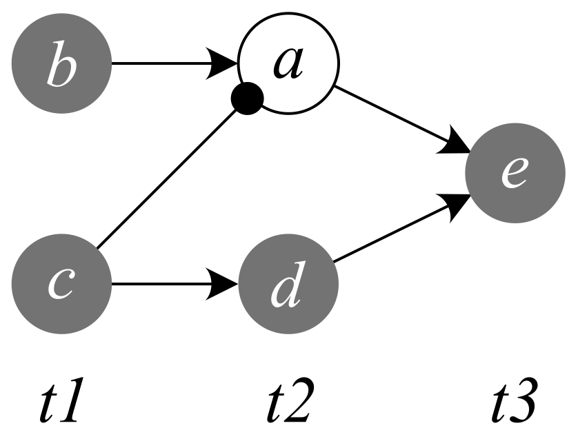

*Figure 1:* Early preemption neuron diagram 1. [An extended description of figure 1 is in the supplement.]

Here’s how to read this diagram: every circle represents a *neuron*. Associated with each neuron is a certain time—here, the time written beneath that neuron. A neuron can either fire or not fire at its designated time. If the circle is colored grey, this indicates that the neuron fired. If it is colored white, this indicates that the neuron did not fire. So, in the diagram above, *b*, *c*, *d*, and *e* fired, and *a* did not fire. Arrows represent *stimulatory* connections between neurons. If the neuron at the base of an arrow fires, then the neuron at its head will fire so long as that neuron is not inhibited. The circle-headed lines represent *inhibitory* connections between neurons. If the neuron at the base of one of these connections fires, then the neuron at its head will *not* fire. So, in the diagram above, *a* doesn’t fire, even though *b* did, because *c* inhibited *a*.

Here, “*c*” stands both for the neuron *c* and for the event of the neuron *c* firing (or the fact that *c* fired, or whatever), and likewise for the other letters. Then, this neuron diagram has the structure of *preemption: b* is a backup, would-be cause of *e*’s firing. Had *c* not fired, the neuron system would have looked like this:

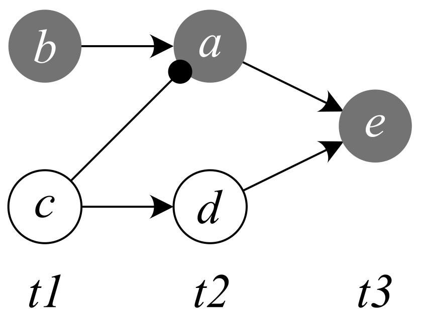

*Figure 2:* Early preemption neuron diagram 2. [An extended description of figure 2 is in the supplement.]

Here, *b* is a cause of *e*. So, in the original neuron system, *b* is a backup, would-be cause of *e*; had *c* not fired, *b* would have been a cause of *e*, but *c* preempts *b* and causes *e* itself.

As a brief aside, some authors use neuron diagrams like these as representational tools for modelling the causal structure of cases described by vignettes. So, they might say that the neuron *b* represents whether Suzy is aggrieved, *a* represents whether Suzy throws a rock at the neighbor’s window, and *e* represents whether the window shatters. Hitchcock (2007b)[^hitchcock-2007b] gives reasons to worry about this use of neuron diagrams, and argues that we should instead use causal models as a representational tool (see the entry on causal models, and §3.2 below). Whatever we think about using neuron diagrams to represent the causal structure of scenarios described in vignettes, there should be little objection to using them to model *systems of neurons*, hooked up with stimulatory and inhibitory connections in the ways indicated in the diagram (Hitchcock 2007b agrees)[^hitchcock-2007b]. That’s how neuron diagrams will be understood here. So the neuron diagram isn’t being used to model Suzy and Billy’s situation. It is used to model a very simple system of five neurons, and, arguably, the system of neurons has a similar causal structure to the vignette involving Billy and Suzy.

What makes cases of early preemption *early* is that there is some time before *e* happens at which the backup causal chain is cut. In our neuron diagram, at time *t2*, once *a* fails to fire, the backup *b* no longer has any hope of being a cause of *e*’s firing. So, if *d* had not fired (in violation of the neuron laws), *e* would not have fired. In the case of Billy and Suzy, once Billy tells Suzy he’s going to throw a rock at the window, the potential causal chain leading from Suzy’s grievance to the window’s shattering is cut. Now that’s she’s at home establishing an alibi, she has no hope of causing the window to shatter. Many counterfactual theories of causation appeal to this feature of early preemption in order to secure the verdict that *c* is a cause of *e*. (See, for instance, Ramachandran (1997, 1998)[^ramachandran-1997][^ramachandran-1998], Ganeri et al. (1996, 1998), Yablo (2002, 2004)[^yablo-2002][^yablo-2004], Hitchcock (2001a)[^hitchcock-2001a], Halpern and Pearl (2005), Woodward (2003)[^woodward-2003], Halpern (2016a)[^halpern-2016a], Andreas and Günther (2020, 2021), and Weslake (ms.—see Other Internet Resources).)

Matters are different in cases of *late preemption*. What makes cases of late preemption *late* is that the causal chain from the potential backup is only cut short *after* the effect *e* happens. There was no time prior to her death at which Patricia’s terminal disease stopped being deadly. So, at any time prior to her death by overdose, were the morphine or any of its effects to be taken away, Patricia would still have died from the disease.

Many cases of late preemption are cases in which the cause *hastens* the effect. That is, had the cause been absent, the effect—or, in any case, something very similar to the effect—would have happened later than it actually did. But this isn’t an essential feature of the case. Consider the following: Quentin is given chemotherapy to fight his cancer. The chemotherapy compromises his immune system, and after catching a flu, Quentin dies from pneumonia. It is easy to suppose that the chemotherapy prolonged Quentin’s life. Suppose that, had he not received chemo, the cancer would have killed him in January. And suppose that the pneumonia killed him in February. So the chemotherapy did not hasten Quentin’s death; it delayed it. Nonetheless, this could easily be a case of late preemption. The chemotherapy prevented the cancer from killing Quentin, but we may easily suppose that there is no time prior to his death at which removing the chemotherapy, or the flu, or the pneumonia, would have prevented him from dying. We may easily suppose that the cancer remained deadly throughout. (For more on causes, hasteners, and delayers, see Bennett 1987; Lombard 1990; P. Mackie 1992; Paul 1998a; Sartorio 2006; Hitchcock 2012; and Touborg 2018.)[^bennett-1987][^hitchcock-2012][^lombard-1990][^mackie-1992][^paul-1998a][^sartorio-2006][^touborg-2018] The case of Quentin can easily be modified so that, had he not received chemo, he would have died at exactly the same time that he actually died. This version gives us a case of late preemption in which, had the cause been absent, the effect—or, in any case, something very similar to the effect—would have happened at the very same time that it actually did.

Cases of preemption show us that causes need not be *necessary* for their effects. The effect *e* did not depend upon its cause *c*. Had *c* been absent, *e* would still have happened, due to the backup *b*. They moreover suggest that there is something important about the process whereby causes and effects are connected. Both *c* and the backup *b* were sufficient for *e* to happen. What seems to make the difference between them is that there is the right kind of connecting process leading from *c* to *e*, and there is not the right kind of connecting process leading from *b* to *e*. For this reason, while counterfactual, probabilistic, agential, and regularity theories often stumble on cases of preemption, they are more easily treated by process theories.

Schaffer (2000a)[^schaffer-2000a] introduces cases of what he calls *trumping preemption*. In these cases, there is preemption even though there is no “cutting” of the backup causal process. That is: there is no missing part of the process leading from the backup *b* to *e*, but nonetheless, *b* does not count as a cause of *e* because *c* “trumps” *b*. Here are two cases like this:

1. The laws of magic say that the first spell cast on a given day goes into effect at midnight; spells cast after the first are ineffective. On Monday, there are only two spells cast. In the morning, Merlin casts a spell to turn the prince into a frog. And in the evening, Morgana casts a spell to turn the prince into a frog. At midnight, the prince turns into a frog.
2. The Major outranks the Sergeant, who outranks the Corporal. The Corporal will follow the orders of the highest-ranking officer. The Major and the Sergeant both give the Corporal the order to advance, and the Corporal advances.

In the first case, Schaffer contends that Merlin’s spell caused the prince to turn into a frog and that Morgana’s spell did not. Merlin’s spell, after all, was the first spell of the day, and that’s what the laws of magic identify as the relevant feature. And, in the second case, Schaffer contends that the Major caused the Corporal to advance, and the Sergeant did not. After all, the Corporal listens to the orders of the highest ranking officer, and in this case, that’s the Major. (For further discussion, see Lewis 2000; Halpern & Pearl 2005; Hitchcock 2007a; Halpern & Hitchcock 2010: §4.2; and Paul & Hall 2013: §4.3.4.)[^halpern-2010][^halpern-2005][^hitchcock-2007a][^lewis-2000][^paul-2013]

**Prevention.** Cases of preemption tend to be handled easily by process theories of causation, whereas counterfactual, manipulation, probabilistic, and regularity theories have more difficulty saying both that the preempting *c* is a cause of *e* and that the preempted backup *b* is not a cause of *e*. For, in cases of preemption, we can easily trace out the process whereby *c* leads to *e*, whereas the process which would have led from *b* to *e* was interrupted by *c*. On the other hand, process theories have more difficulty with cases of *prevention*. Here’s a case of prevention: over the Atlantic ocean, James Bond shoots down a missile which is heading for Blofield’s compound, and Blofield survives unscathed. Bond prevented Blofield from dying. If we understand prevention as causation-not (*c* prevents *e* iff *c* caused it to be the case that *e* didn’t happen), then Bond caused Blofield to not die. But there does not appear to be any causal *process* leading from Bond to Blofield—both Bond and the missile were thousands of miles away.

Some deny that cases of prevention are genuinely causal (see Aronson 1971; Dowe 2000; Beebee 2004a; and Hall 2004)[^aronson-1971][^beebee-2004a][^dowe-2000][^hall-2004]. This response could be further justified with worries about absences being effects (recall §1.1.2). However, there are additional worries about the cases which Hall (2004)[^hall-2004] calls “double prevention”. In these cases, *c* prevents *d*, and, if *d* had happened, then *d* would have prevented *e*. So *c* prevents a preventer of *e*. For instance: Blofield launches a cyber attack on Europe’s electrical grid, plunging the continent into the dark. Had Bond not shot down the missile, it would have prevented Blofield from carrying out the cyber attack. So Bond prevented a potential preventer of the cyber attack. Here, there is an inclination to say that Bond was an (inadvertent) cause of the cyber attack. However, there is no connecting process leading from Bond to the cyber attack—there is no relevant energy-momentum flow, mark transmission, or persisting trope connecting them.

Cases of double prevention have roughly the structure of this neuron diagram:

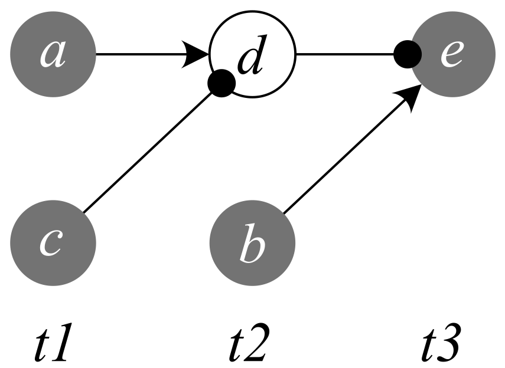

*Figure 3:* Double prevention neuron diagram. [An extended description of figure 3 is in the supplement.]

As Schaffer (2000c, 2012b)[^schaffer-2000c][^schaffer-2012b] argues, many paradigm cases of causation turn out, on closer inspection, to be instances of double prevention. Pam uses a catapult to hurl a rock through the window. It seems clear that Pam’s actions caused the window to shatter. But suppose the catapult works like this: a catch prevents the catapult from launching, and Pam’s releasing the catch prevents it from preventing the launch. Thus, the relationship between Pam’s releasing the catch and the shattering of the window is one of double prevention. Here, it is less comfortable to deny that Pam caused the window to shatter, though not all agree. Aronson denies that there is any causation in a similar case:

> Consider a weight that is attached to a stretched spring. At a certain time, the catch that holds the spring taut is released, and the weight immediately begins to accelerate. One might be tempted to say that the release of the catch was the cause of the weight’s acceleration. If so, then what did the release of the catch transfer to the weight? Nothing, of course. (1971: 425)

Aronson contends that, while the release of the catch was an enabling condition for the weight’s acceleration, it was not strictly speaking a *cause* of the weight’s acceleration.

**Preemptive Prevention.** There’s another interesting class of cases where one preventer *preempts* another (see McDermott 1995 and Collins 2000)[^collins-2000][^mcdermott-1995]. Here are two cases like this:

1. Either Bond or M could shoot down the missile headed for Blofield’s compound. Bond tells M that he will do it, so M goes home. Bond shoots down the missile, and Blofield survives.
2. Bond shoots down a missile headed for Blofield’s compound. However, Blofield’s compound has its own perfectly reliable anti-missile defense system. So, had Bond not shot the missile down, the anti-missile defense system would have, and Blofield would have survived unscathed.

By analogy with ordinary preemption, we can call the first case an instance of *early preemptive prevention*. Once Bond tells M that he will shoot down the missile, M is no longer a potential preventer of the missile strike. If, at the last minute, Bond had changed his mind, Blofield’s compound would have been destroyed. In contrast, we can call the second case an instance of *late preemptive prevention*. At no point does the missile defense system “step down”, and stop being a potential preventer of the compound’s destruction.

The first case has a structure similar to this neuron system,

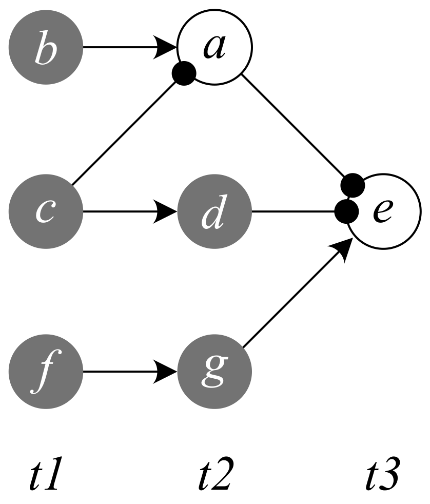

*Figure 4:* Early preemptive prevention neuron diagram. [An extended description of figure 4 is in the supplement.]

Whereas the second case has a structure similar to this neuron system,

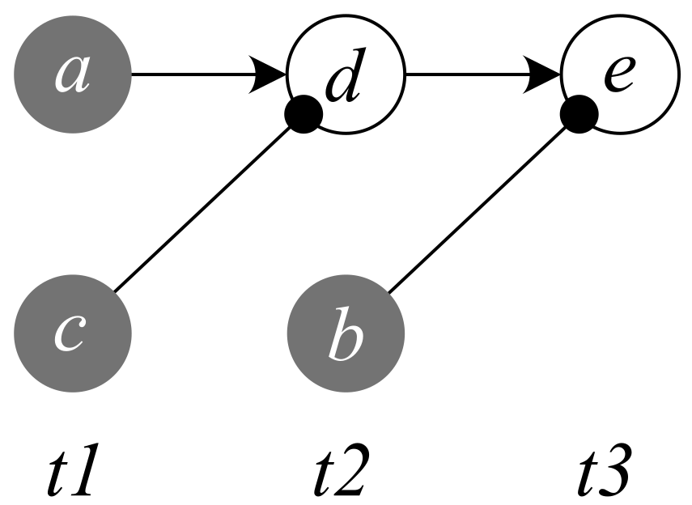

*Figure 5:* Late preemptive prevention neuron diagram. [An extended description of figure 5 is in the supplement.]

There seems to be more of an inclination to attribute causation in cases of early preemptive prevention than in cases of late preemptive prevention. As McDermott (1995)[^mcdermott-1995] puts it: in case (2), many are initially inclined to deny that Bond prevented the compound’s destruction; but, when they are asked “Of Bond and the missile defense system, which prevented the compound’s destruction?”, it feels very natural to answer with “Bond”. (As Collins 2000 notes, things begin to feel different if we suppose that the anti-missile defense system is less than perfectly reliable.)[^collins-2000]

**Switches.** Suppose that a lamp has two bulbs: one on the left, and one on the right. There is a switch which determines whether power will flow to the bulb on the left or the one on the right. If the power is on and the switch is set to the left, then the left bulb will be on, and the room will be illuminated. If the power is on and the switch is set to the right, then the right bulb will be on, and the room will be illuminated. If the power is off, then neither bulb will be on, and the room will be dark, no matter how the switch is set. To start, the power is off and the switch is set to the left. Filipa flips the switch to the right, and Phoebe turns on the power. The right bulb turns on, and the room is illuminated.

Cases like these are discussed by Hall (2000)[^hall-2000] and Sartorio (2005, 2013)[^sartorio-2005][^sartorio-2013], among others. This particular example comes from Pearl (2000)[^pearl-2000]. In these kinds of cases, there are five events (or facts, or what-have-you): *f*, *p*, *l*, *r*, and *e*, with the following features: if *p* happens, it will cause either *l* or *r* to happen, depending upon whether *f* happens. And if either *l* or *r* happens, it will cause *e* to happen. For instance, in our example, *f* is Filipa flipping the switch to the right, *p* is Phoebe turning on the power, *l* and *r* are the left and right bulbs turning on, respectively, and *e* is the room being illuminated. In this case, it can seem that there’s an important difference between Filipa and Phoebe. Whereas Filipa made a difference to *how* the room got illuminated (whether by the left bulb or the right one), she did not make a difference to *whether* the room got illuminated. Phoebe, in contrast, did make a difference to *whether* the room got illuminated. It seems natural to say that, while Phoebe’s turning on the power was a cause of the room being illuminated, Filipa’s flipping the switch was not.

Switching cases have roughly the same structure as the following neuron diagram:

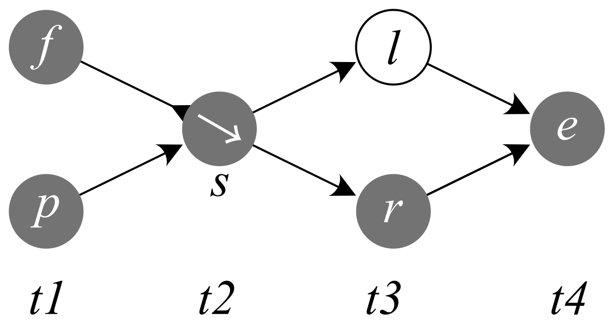

*Figure 6:* Switch neuron diagram 1. [An extended description of figure 6 is in the supplement.]

Here, the neuron *s* (the switch) is special. It can either be set to the left or to the right, indicated by the direction the arrow is pointing. Likewise, the connection between *f* and *s* is special. If *f* fires, then *s* will be set to the right. If *f* does not fire, then *s* will be set to the left. On the other hand, the connection between *p* and *s* is normal. If *p* fires, then *s* will fire. If *s* fires while set to the left, then *l* will fire. If *s* fires while set to the right, then *r* will fire. If either *l* or *r* fires, then *e* will fire.

If *f* hadn’t fired, *s* would have fired while set to the left, so *l* would have fired, and *e* would have fired.

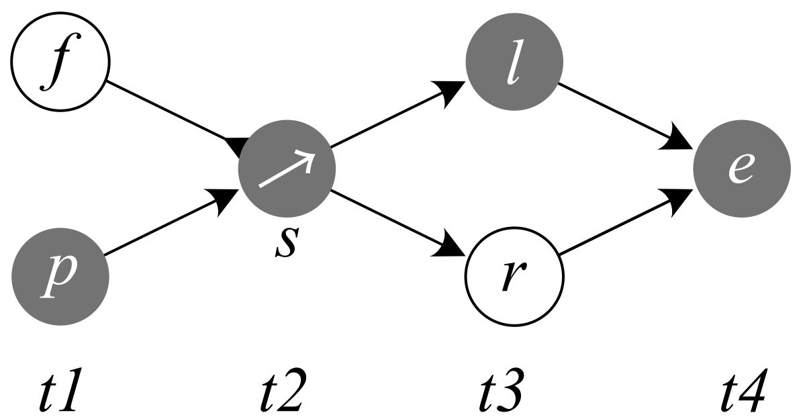

*Figure 7:* Switch neuron diagram 2. [An extended description of figure 7 is in the supplement.]

On the other hand, if *p* hadn’t fired, *s* would still have been set to the right, but it would not have fired, so neither *r* nor *e* would have fired:

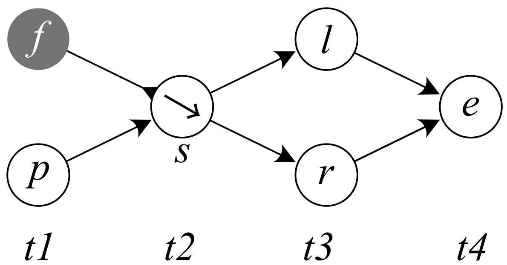

*Figure 8:* Switch neuron diagram 3. [An extended description of figure 8 is in the supplement.]

Reflection on switches can lead to the conclusion that token causation cannot be merely a matter of the intrinsic nature of the process leading from cause to effect. Consider the following variant: while the right bulb is functional, the left bulb is not. If the power had been turned on while the switch was set to the left, the left bulb would not have turned on, and the room would have remained dark. Given *this* setup, Filipa’s flipping the switch to the right *does* appear to be a cause of the room’s being illuminated. After all, with this setup, had Filipa not flipped the switch, the room would have remained dark. But, if we just look at the intrinsic features of the process leading from Filipa’s flipping the switch to the room’s illumination, there will be no difference. Or consider the following system of neurons:

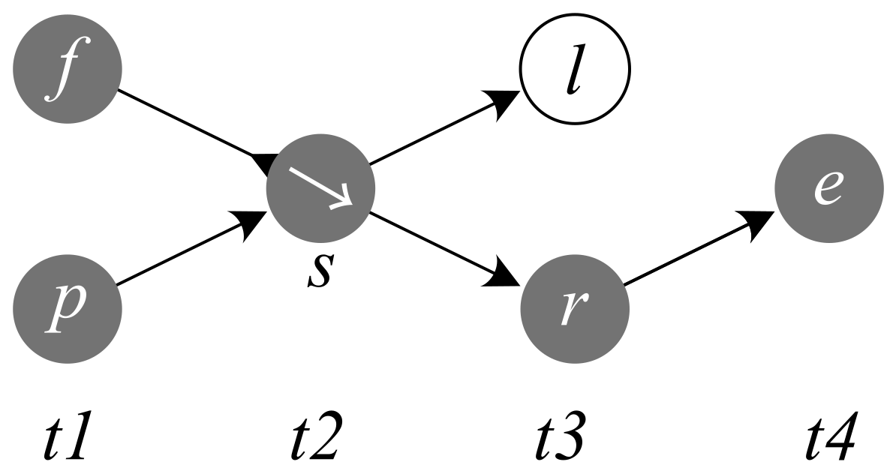

*Figure 9:* Switch neuron diagram 4. [An extended description of figure 9 is in the supplement.]

Here, *f*’s firing appears to be a cause of *e*’s firing (along with *p*). If *f* hadn’t fired, then the switch *s* would have been set to the left, so *e* would not have fired. So *f*’s firing was needed for *e* to fire. However, there doesn’t seem to be any difference between the process leading from *f*’s firing to *e*’s firing in *this* system of neurons and the process leading from *f*’s firing to *e*’s firing in the *original* system of neurons.

So switches suggest that whether one event (fact, or whatever), *c*, is a cause of another, *e*, is not just a matter of the intrinsic features of the process leading from *c* to *e*. It looks like we may also have to consider counterfactual information about what things would have been like in the absence of *c*. (See the discussion in Paul and Hall, 2013.)[^paul-2013]

Switches also pose a problem for the view that causation is transitive—that is, the view that, if *c* causes *d* and *d* causes *e*, then *c* causes *e*. For, in the original version of the case, it seems that Filipa’s flipping the switch to the right caused the right bulb to turn on. And it appears that the right bulb turning on caused the room to be illuminated. But it does not appear that Filipa’s flipping the switch to the right caused the room to be illuminated. (For further discussion of switches and the transitivity of causation, see McDermott 1995; Hall 2000, 2007; Paul 2000; Hitchcock 2001a; Lewis 2000; Maslen 2004; Schaffer 2005; Halpern 2016b; Beckers & Vennekens 2017; and McDonnell 2018.)[^beckers-2017][^hall-2000][^hall-2007][^halpern-2016b][^hitchcock-2001a][^lewis-2000][^maslen-2004][^mcdermott-1995][^mcdonnell-2018][^paul-2000][^schaffer-2005]

#### 1.2.2 Arity

The standard view is that causation is a binary relation between two relata: cause and effect. However, some suggest that causation may be a ternary or a quaternary relation. Inspired by van Fraassen (1980)’s work on contrastive explanation, we could take causation to be a ternary, or 3-place, relation between a cause, an effect, and a contrast for the effect. On this view, the logical form of the causal relation is: *c* is a cause of *e*, rather than *e\**. For instance, it seems correct to say that Adam’s being hungry caused him to eat the apple, rather than toss it aside. But it seems wrong to say that Adam’s being hungry caused him to eat the apple, rather than the pear. So changing the contrast for the effect seems to makes a difference to causation. Hitchcock (1993, 1995a, 1996)[^hitchcock-1993][^hitchcock-1995a][^hitchcock-1996] gives a contrastive probabilistic theory of causation, according to which causation is a ternary relation between a cause, a contrast for the cause, and an effect. On this view, the logical form of the causal relation is: *c*, rather than *c\**, is a cause of *e*. For instance, it can seem that Paul’s smoking a pack a day, rather than not at all, is a cause of his lung cancer. But it seems wrong that Paul’s smoking a pack a day, rather than two packs a day, is a cause of his lung cancer. Schaffer (2005)[^schaffer-2005] combines these two views, arguing that causation is a quaternary relation between a cause, a contrast for the cause, an effect, and a contrast for the effect. On this view, the logical form of the causal relation is: *c*, rather than *c\**, is a cause of *e*, rather than *e\**.

If we think that the causal relation is ternary or quaternary, then some of the arguments we considered earlier can look weaker. For instance, consider what we called the *causal differences* argument from §1.1.4. We argued that we must distinguish the cause “Susan’s stealing *the bike*” from “Susan’s *stealing* the bike”, since the latter, but not the former, caused her to be arrested. If we are contrastivists about causation, then we could insist that the differences in focal stress serve to make salient different contrasts for one and the same event: Susan’s stealing of the bike. When we emphasize “the bike”, we suggests a contrast event in which Susan steals something else. And Susan’s stealing the bike, rather than the canoe, didn’t cause her to be arrested. On the other hand, when we emphasize “stealing”, we suggest a contrast event in which Susan does something else to the bike—purchasing it, let’s say. And Susan’s stealing the bike, rather than purchasing it, *is* a cause of her arrest. Schaffer (2005)[^schaffer-2005] even suggests that, if causation is 4-place, then we could take the incredibly coarse-grained Quinean view of events.

Schaffer (2005)[^schaffer-2005] additionally suggests that, if we say that causation is quaternary, we can defend a version of transitivity. Of course, transitivity is a property of a binary relation, but Schaffer proposes that the quaternary relation satisfies the following constraint: if *c*, rather than *c\**, is a cause of *d*, rather than *d\**, and *d*, rather than *d\** is a cause of *e*, rather than *e\**, then *c*, rather than *c\** is a cause of *e*, rather than *e\**. Think of it like this: corresponding to the 4-place causal relation is a two-place relation between event-contrast *pairs*; and Schaffer maintains that this two-place relation between pairs of events and their contrasts is a transitive relation. It’s not immediately obvious how this helps with switches like the one we saw in §1.2.1 above. For it seems that Filipa’s flipping the switch to the right, rather than not flipping it, caused the right bulb to be on, rather than off. And it seems that the right bulb being on, rather than off, caused the room to be illuminated, rather than dark. But it doesn’t appear that Filipa’s flipping the switch to the right, rather than not flipping it, caused the room to be illuminated, rather than dark. The trick is that Schaffer has a view of events on which they are *world-bound*. So, in order to make the first causal claim true, the contrast “the right bulb’s being off” must be an event which only occurs in the world in which Filipa does not flip the switch to the right, and the left bulb is on. Therefore, the second causal claim will turn out to be false; the right bulb’s being on, rather than off *in a world in which the left bulb is on*, is not a cause of the room’s being illuminated, rather than dark.

#### 1.2.3 Normality

It is natural to distinguish between *causes* and *background*, or *enabling*, conditions. For instance, suppose that you strike a match and it lights. It’s natural to cite your striking the match as a cause of its lighting, but it’s far less natural to cite the presence of oxygen as a cause of its lighting, even though, without the oxygen, the match wouldn’t have lit. There’s some inclination to say that the presence of oxygen merely *enabled* the strike to cause the match to light, but did not cause it to light itself. Lewis (1973)[^lewis-1973] echoes a traditional, dismissive, attitude when he refers to the distinction between causes and background conditions as “invidious discrimination” (see also Mill 1843 and J. L. Mackie 1974)[^mackie-1974][^mill-1843]. On this view, the distinction is pragmatic, unsystematic, and dependent upon our interests. Alien scientists from Venus—where there is no oxygen in the atmosphere—might find it incredibly natural to point to the presence of oxygen as a cause of the fire. On the traditional view, neither we nor the Venusian scientists are making any objective error; we each simply have different expectations about the world, and so we find some features of it more noteworthy than others. There are ever-so-many causes out there, but we *select* some of them to call causes. The others, the ones we do not select, are regarded as mere background conditions.

Hart and Honoré (1959 [1985]) suggest that conditions which are *normal*, or *default*, are background conditions; whereas those which are *abnormal*, or *deviant*, are causes. This distinction between normal, default, or inertial conditions and abnormal, deviant, or non-inertial causes has been appearing with increasing regularity in the recent literature. For instance, McGrath (2005)[^mcgrath-2005] presents the following vignette: Abigail goes on vacation and asks her neighbor, Byron, to water her plant. Byron promises to water the plant, but doesn’t, and the plant dies. It sounds very natural to say that Byron’s failure to water the plant was a cause of its death; it sounds much worse to suggest that Abigail’s *other* neighbor, Chris, caused the plant to die by not watering it. However, it seems that the only relevant difference between Bryon and Chris is that Byron made a *promise* to water the plant, and Chris did not. So Byron’s failure to water the plant was abnormal, whereas Chris’s failure to water the plant was normal. McGrath’s example involves absences or omissions, but this feature of the case is incidental. Hitchcock and Knobe (2009) give the following case: while administrators are allowed to take pens, professors are not. Both Adriel the administrator and Piper the professor take pens. Later in the day, there are no pens left, and the Dean is unable to sign an important paper. Here, it seems much better to cite Piper than Adriel as a cause of the problem. And it seems that the only relevant difference is that Adriel was *permitted* to take the pen, but Piper was not. (For more, see Kahneman & Miller 1986; Thomson 2003; and Maudlin 2004.)[^kahneman-1986][^maudlin-2004][^thomson-2003]

Considering just these kinds of cases, it’s not unnatural to see the phenomenon as just more “selection effects”. Perhaps both Byron and Chris caused the plant to die, but for pragmatic reasons we find it more natural to cite the person who broke a promise as a cause. Hall (2007)[^hall-2007] presents a more challenging argument for the view that normality and defaults should figure in our theory of causation. He asks us to consider the following pair of neuron systems:

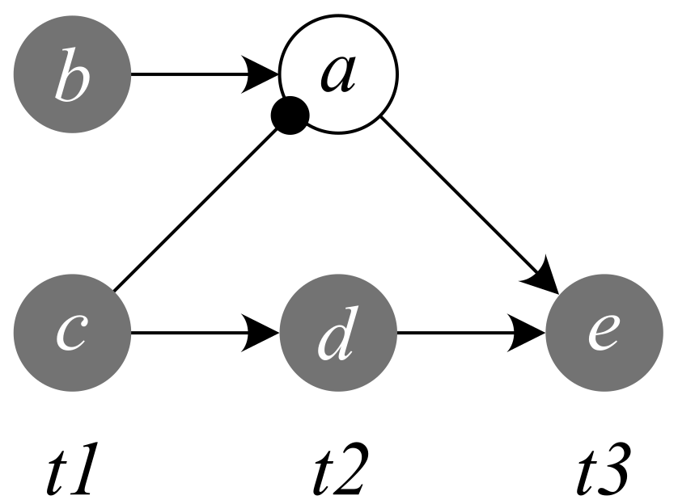

(a)

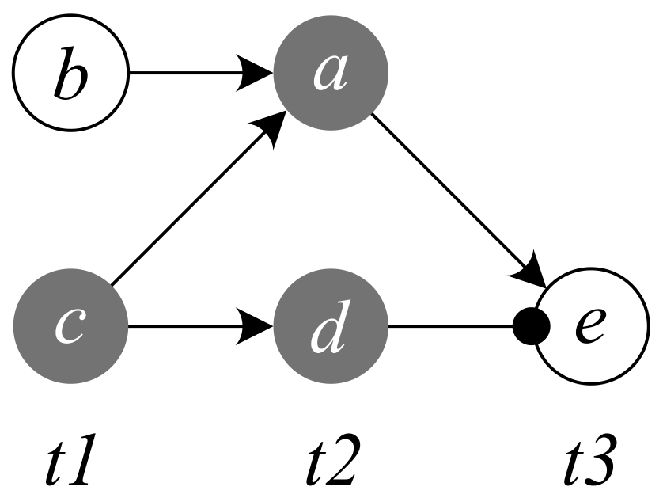

(b)

*Figure 10:* Pair of neuron diagrams. [An extended description of figure 10 is in the supplement.]

In figure 10(a), we have the case of *early preemption* from §1.2.1. Here, *c*’s firing is a cause of *e*’s firing. In figure 10(b), we have a case of what Hall calls a “short circuit”. When *c* fires, it both initiates a threat to *e*’s dormancy (by making *a* fire) and neutralizes that very threat (by making *d* fire). Here’s a vignette with a similar structure (see Hall 2004, and Hitchcock 2001a)[^hall-2004][^hitchcock-2001a]: a boulder becomes dislodged and careens down the hill towards Hiker. Seeing the boulder coming, Hiker jumps out of the way, narrowly averting death. In this case, the boulder’s fall both initiates a threat to Hiker’s life and neutralizes that very threat (by alerting them to its presence). Hall contends that the boulder’s becoming dislodged did not cause Hiker to survive; and, in the case of the short circuit, *c*’s firing did not cause *e* to not fire. Intuitively, *c* accomplished nothing *vis-a-vis* *e*. But Hall notes that these two neuron systems are isomorphic to each other. We can make the point with systems of structural equations (see the entry on causal models, and §3.2 below). Start with the case of early preemption, and use binary variables, *A*, *B*, *C*, *D*, and *E* for whether *a*, *b*, *c*, *d*, and *e* fire, respectively. These variables takes on the value 1 if their paired neuron fires, and they take on the value 0 if they do not. Then, we can represent the causal structure of early preemption with this system of equations:

$$\begin{aligned} A & \coloneqq B \wedge \neg C \\ D & \coloneqq C\\ E & \coloneqq A \vee D \\ \end{aligned}$$

Turning to the short circuit, notice that we can use *A\**, *B\**, and *E\** as binary variables for whether the neurons *a*, *b*, and *e* *do not* fire. These variables take on the values 1 if their paired neuron *doesn’t* fire, and they take on the value 0 if it *does*. And, again, we can use *C* and *D* as variables for whether the neurons *c* and *d* fire; these non-asterisked variables take on the value 1 if their paired neuron *does* fire, and 0 if it *doesn’t*. With these conventions in place, we can then write down the following *isomorphic* system of equations for the neuron system of short circuit:

$$\begin{aligned} A^{*} & \coloneqq B^{*} \wedge \neg C \\ D & \coloneqq C \\ E^{*} & \coloneqq A^{*} \vee D \end{aligned}$$

These equations are isomorphic to the ones we wrote down for the case of early preemption. Moreover, the values of the variables are precisely the same in each case. In the case of early preemption, $A=0$ and $B = C = D = E = 1$; whereas, in the case of short circuit, $A^*=0$ and $B^* = C = D = E^* = 1$ (similar cases are discussed in Hiddleston 2005)[^hiddleston-2005].

Therefore, if we want to claim that *c* is a cause of *e* in the case of early preemption, but deny that *c* is a cause of *e* in the case of short circuit, we will have to point to some information which is not contained in these equations and the values of these variables. And several authors have reached for the distinction between *default*, *normal* states and *deviant, abnormal* events (see, for instance, Hall 2007; Hitchcock 2007a; Halpern 2008, 2016a; Paul & Hall 2013; Halpern & Hitchcock 2015; and Gallow 2021. For criticism, see Blanchard & Schaffer, 2017)[^blanchard-2017][^gallow-2021][^hall-2007][^halpern-2008][^halpern-2016a][^halpern-2015][^hitchcock-2007a][^paul-2013].

On a traditional picture, there is a broad, indiscriminate notion of causation which makes no appeal to normality; considerations of normality are used, pragmatically, to “select” which of the indiscriminate causes we call “causes” and which we call “background conditions”. The isomorphism between early preemption and short circuit challenges this picture, for two reasons. Firstly, *c*’s firing is presumably just as deviant in early preemption as it is in short circuit, so it can’t just be the normality of the putative cause which makes the difference. Secondly, those who want to deny that *c*’s firing is a cause of *e*’s failure to fire in short circuit do not want to claim that *c*’s firing was even a background condition for *e*’s failure to fire. The inclination is to say that *c*’s firing had *nothing at all* to do with *e*’s failure to fire.

## 2. Type Causation

### 2.1 Relationship to Token Causation

Type causal relations are described by generic claims like “Drowsy driving causes crashes” or “Smoking causes cancer”. One prominent question concerns the relationship between type and token causal claims. One view has it that type causal claims are just generalizations or generics about token causal claims (see Lewis 1973; Hausman 1998: chapter 5; and Hausman 2005)[^hausman-1998][^hausman-2005][^lewis-1973]. For instance, to say that smoking causes cancer is just to say that token cancers are generally caused by token histories of smoking. And to say that drowsy driving causes crashes is just to say that, in general, token episodes of drowsy driving cause token crashes. Generic claims like these shouldn’t be understood as saying that *most* or even *many* token episodes of drowsy driving are token causes of car crashes. Compare: “mosquitos carry the West Nile virus”, which is a true generic despite the fact that most mosquitos do not carry the West Nile virus. (See the entry on generics.) On this view, type causal claims are ultimately about token causal relations.

Another view has it that type causal relations are more fundamental than token causal relations; what makes it the case that *Chris’s* smoking caused his cancer is, at least in part, that smoking causes cancer, Chris smoked, and he got cancer. This kind of view is defended by theorists like Hume (1739–40, 1748), Mill (1843)[^mill-1843], J. L. Mackie (1965)[^mackie-1965], Hempel (1965)[^hempel-1965], and Davidson (1967)[^davidson-1967]. These theorists begin by giving an analysis of causal relations between types of events, facts, or what-have-you. For instance: Hume says that what it is for the type *C* to cause the type *E* is for things of type *C* to be constantly conjoined with things of type *E*. This general regularity is then used to explain why it is that any particular thing of type *C* is a token cause of any particular thing of type *E*. Subsequent regularity and “covering law” theories add additional bells and whistles; but they retain the idea that a token causal relation between *c* and *e* holds in virtue of some broader regularity or law which subsumes the particular relationship between *c* and *e*.

One reason to doubt that token causal relations are just instantiations of type causal relations is that there appear to be token causal relations without any corresponding type causal relation, and there appear to be token causal relations which go against the corresponding type causal relations. Scriven (1962)[^scriven-1962] gives the following example: you reach for your cigarettes, accidentally knocking over an ink bottle and staining the carpet. Your reaching for your cigarettes caused the carpet to be stained, but it’s not the case that reaching for cigarettes causes carpet stains in general. Suppes (1970)[^suppes-1970] attributes this example to Deborah Rosen: at the golf course, you hit the ball into a tree, the ball rebounds and, fantastically enough, goes into the hole. In this case, hitting the ball into the tree caused the hole-in-one, but hitting the ball into trees does not cause holes-in-one in general.

A third position, defended by Ellery Eells (1991)[^eells-1991], is that neither token nor type causal relations are more fundamental than the other. Eells gives two probabilistic analyses of causation: one for type causation, and another for token causation. Eells thinks that type causal claims cannot just be generalizations about token causal claims because of examples like this: drinking a quart of plutonium causes death, even though nobody has ever drank a quart of plutonium, and so no particular persons’s death has been caused by drinking a quart of plutonium. So this type causal claim cannot be a generalization over token causal claims. (See Hausman 1998: chapter 5, for a response.)[^hausman-1998]

For more on the relationship between token and type causation, particularly within a probabilistic approach to causation, see Hitchcock (1995a)[^hitchcock-1995a].

### 2.2 Net and Component Effects

Consider the following case, adopted from Hesslow (1976)[^hesslow-1976]: suppose that birth control pills (*B*) prevent pregnancy (*P*). However, they can also have the unintended side-effect of thrombosis (*T*). So we might be inclined to accept the type causal claim “birth control pills cause thrombosis”. But wait: *another* potential cause of thrombosis is pregnancy. And birth control pills inhibit pregnancy. The general structure of the case is as shown below.

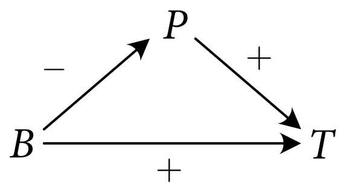

*Figure 11:* Hesslow’s birth control case [An extended description of figure 11 is in the supplement.]

Birth control pills *directly* promote thrombosis, but at the same time, they prevent pregnancy, which itself promotes thrombosis. By adjusting the probabilities, we can make it so that, overall, taking birth control makes no difference to the probability of thrombosis. Then, we might be inclined to accept the type causal claim “birth control pills have no effect on thrombosis”—after all, your chances of getting thrombosis are exactly the same, whether or not you take birth control. Hitchcock (2001b)[^hitchcock-2001b] argues that cases like this require us to distinguish two different kinds of effects which type causes can have: what he calls a *net effect*, on the one hand, and what he calls *component effect*, on the other. In Hesslow’s case, birth control pills have no *net* effect on thrombosis. This is the sense in which it’s true to say “birth control pills have no effect on thrombosis”. At the same time, birth control pills have a *component*—or *path-specific*—effect on thrombosis. Along the path *B* → *T*, birth control promotes thrombosis. This is the sense in which it’s true to say “birth control pills cause thrombosis”. For further discussion, see Woodward (2003: §2.3) and Weinberger (2019)[^weinberger-2019].

## 3. Influence

### 3.1 Relata

As emphasized in §1.1 above, any theory of events or facts can easily be transposed into a theory of the values of token variables. And, plausibly, token variables are individuated by their values. So, when it comes to token influence between variables, we will face many of the same questions and debates about the causal relata: how fine- or coarse-grained are they? When are two variables the same; when are they different? Can variables include absences or omissions as values? There is, however, an additional question to be a asked about the metaphysics of variables: when can some collection of variable *values* be grouped together into a single variable? All agree that the potential values of a variable must *exclude* each other. That is: if $v$ and $v^*$ are two values of the variable $V$, then it should be impossible that $V=v \wedge V=v^*$ (here, $V=v$ is the proposition that the variable $V$ takes on the value $v$, and likewise $V=v^*$ is the proposition that the variable $V$ takes on the value $v^*$).

But there are additional questions to be asked about which values may be grouped together into token variables. For instance: must the values of a variable concern the same time? Or can a single variable have multiple values which concern different times? Suppose Patricia died on Monday from an overdose of morphine; had she not received the morphine, she would have died on Tuesday. Then, there are several different variables we might try to use when thinking about Patricia’s death. We could use a single variable for *whether Patricia died*. This variable would take on one value if Patricia died on Monday or Tuesday, and another value if she remained alive throughout Monday and Tuesday. Or we could use a single variable for *when Patricia died*. This variable would take on one value if she died on Monday, and another value if she died on Tuesday. Alternatively, we could use a collection of time-indexed variables, *whether Patricia had died by time t*, for some range of times *t*. As Hitchcock (2012)[^hitchcock-2012] puts it: the question is whether Patricia’s dying on Monday and Patricia’s dying on Tuesday

> correspond to the *same value* of the *same variable*, to *different values* of the *same variable*, or to values of different *variables*. (2012: 90)

Of course, this question carries the presupposition that we must choose between these options. You might instead think that *all* of these variables exist, and each enter into different relations of influence.

When it comes to type variables, there are additional questions about how token variables are to be type-individuated, over and above questions about the individuation conditions of the token variables themselves. This question is not much discussed, but it is natural to think that the type individuation of variables is inherited from the type-individuation of their values. That is: $X_1$ and $X_2$ are of the same type if and only if $X_1$ and $X_2$ have the same number of potential values, and each those values are of the same type. For instance, the token variables *how much I weigh* and *how much Obama weighs* are of the same type, as they both have the same type of potential values (1 kg, 2 kg, etc); on the other hand, *how much I weigh* and *how many pounds of arugula Obama eats* are not of the same type, since their potential values are not of the same type.

### 3.2 Models

Relations of influence between variables are often encoded in formal models. Just as the causal relations between tokens and types can be either deterministic or probabilistic, so too can the relations of influence between variables be either deterministic or probabilistic. Deterministic relations between variables are represented with structural equations models; whereas indeterministic relations between variables can be represented with probabilistic models (sometimes with structural equations models with random errors—see the entry on causal models—or often with just a causal graph paired with a probability distribution over the values of the variables appearing in that graph—see the entry on probabilistic causation.)

In the deterministic case, the relations of influence between variables can be encoded in a system of structural equations. For illustration, consider again the neuron system we used in §1.2.1 above to illustrate early preemption. As we saw in §1.2.3, for each neuron in the system, we can introduce a variable for whether that neuron fires at the relevant time. Once we’ve done so, the following system of structural equations describes the causal relations between these variables.

$$\begin{aligned} A & \coloneqq B \wedge \neg C \\ D & \coloneqq C \\ E & \coloneqq A \vee D \end{aligned}$$

Before getting to the metaphysical questions about what kinds of relations these equations represent, and what it takes for a system of equations like this to be correct, let us first focus on how these equations are *used* in practice. It’s important to recognize that there is meant to be a difference between *structural* equations and ordinary equations. The equation $D = C$ is symmetric. It could be re-written, equivalently, as $C=D$. In contrast, the *structural* equation $D \coloneqq C$ is *nonsymmetric*. It tells us that the variable $D$ is causally influenced by the variable $C$. And this form of causal influence is not symmetric. To emphasize that these equations are not symmetric, “$\coloneqq$” is used, rather than “$=$”.

Some terminology: given a system of structural equations, the variables which appear on the left-hand-side of some equation are called the *endogenous* variables. The variables which only ever appear on the right-hand-side of the equations are called *exogenous*. The model does not tell us anything about how the values of the exogenous variables are determined; but it does tell us something about how the values of the endogenous variables are causally determined by the values of the other variables in the model.

In this case, an assignment of values to the exogenous variables is enough to tell us the value of every endogenous variable in the model. That is: if you know that $B=C=1$, you also know that $A=0$ and $D=E=1$. That needn’t be the case in general. For instance, consider the following system of equations:

$$\begin{aligned} Y &\coloneqq X + Z \\ X &\coloneqq Y - Z \end{aligned}$$

In this system of structural equations, even after you know that the exogenous variable $Z = 10$, you are not able to solve for the values of the two endogenous variables, $X$ and $Y$. The reason for this is that, in this system of equations, there is a *cycle* of influence: $X$ influences $Y$, and $Y$ influences $X$. When there are cycles of influence like this, even a deterministic system of equations, together with an assignment of values to the exogenous variables, will not determine the values of all of the endogenous variables. (See the entry on backwards causation and the section on causal loops in the entry on time travel.) However, if we rule out cycles of influence like this, then an assignment of values to the exogenous variables will determine the values of all of the variables in the model. Likewise, any probability distribution over the exogenous variables will induce a probability distribution over the endogenous variables, as well.

It is often assumed that each of the structural equations in the system is independently disruptable. For instance: there is, at least in principle, some way of disrupting $C$’s causal influence on $D$—some way of making it so that the structural equation $D \coloneqq C$ no longer holds—which leaves it so that both of the structural equations $A\coloneqq B \wedge \neg C$ and $E\coloneqq A \vee D$ continue to hold. Not every way of disrupting the causal relation between the variables $C$ and $D$ will be like this. For instance, suppose that we remove all of the connections emanating *out* of the neuron *c*. This will disrupt the causal connection between $C$ and $D$, but it will also disrupt the causal connection between $C$ and $A$; it will make it so that the structural equation $A\coloneqq B \wedge \neg C$ no longer holds. (This equation tells us that, if $C=1$, then $A=0$; but, with the connection between *c* and *a* severed, this is no longer true.) This property of a system of structural equations—that each of the equations may be disrupted without affecting any of the other equations in the model—is known as *modularity*. (For criticism of this requirement, see Cartwright 2002; for a defense, see Hausman & Woodward 1999, 2004. For more on modularity, see Woodward 2003.)[^cartwright-2002][^hausman-1999][^hausman-2004][^woodward-2003]

If the system of equations is modular, then it is at least in principle possible to disrupt one of the equations without affecting any of the others. Suppose that happens, and we disrupt the equation $A\coloneqq B \wedge \neg C$ without affecting any of the other equations, for instance. Suppose further that we do this in such a way as to determine the value of $A$, or to determine a probability distribution over the values of $A$. Then, we have performed *an intervention* on the variable $A$. Note that this notion of an intervention is relative to a system of equations. Whether some way of disrupting an equation and directly setting the value of the variable on its left-hand-side counts as an intervention or not will vary from causal model to causal model. In general, *an intervention* on an endogenous variable, $V$ (relative to some model) is some way of making it so that $V$’s structural equation (the equation with $V$ on the left-hand-side) no longer holds, even though every other structural equation in the model continues to hold, and directly setting the value of $V$, or directly determining a probability distribution over the values of $V$.

Given a deterministic causal model—a system of structural equations—the way to formally represent an intervention on an endogenous variable, $V$, is straightforward: you remove the structural equation which has that variable on its left-hand-side, and leave all the other equations unchanged. You go on to treat $V$ as if it were an exogenous variable, with the value or the probability distribution it was given through the intervention. Assuming the system of equations is acyclic, you can then work out the value of the other variables in the model, or the probability distribution over the values of the other variables in the model, as before.

Interventions like these have been used by many to provide a semantics for what will here be called *causal* counterfactual conditionals. As the term is used here, what makes a counterfactual *causal* is that it holds fixed factors which are causally independent of its antecedent. It doesn’t say anything about what would have to *have been* different in order for the antecedent to obtain. That is: it says nothing about the necessary causal precursors of the antecedent. It holds fixed all factors which are not causally downstream of the antecedent, and only allows to swing free factors which are causally downstream of the antecedent. Within a system of structural equations, this is accomplished by modeling an *intervention* to bring about the truth of the antecedent. (For more on this “interventionist” treatment of counterfactuals, see Galles & Pearl 1998; Briggs 2012; Huber 2013, and the entry on counterfactuals.)[^briggs-2012][^galles-1998][^huber-2013]

### 3.3 Relationship to Token Causation

Several authors have provided theories of token causation which use causal models like these. (See, for instance, Hitchcock 2001a, 2007a; Woodward, 2003, Menzies 2004, 2006 [Other Internet Resources]; Halpern & Pearl 2005; Hall 2007; Halpern 2008, 2016a, 2016b; Beckers & Vennekens 2017, 2018; Andreas & Günther 2020, 2021; Gallow 2021; Weslake ms.—see Other Internet Resources.)[^andreas-2020][^andreas-2021][^beckers-2017][^beckers-2018][^gallow-2021][^hall-2007][^halpern-2008][^halpern-2016a][^halpern-2016b][^halpern-2005][^hitchcock-2001a][^hitchcock-2007a][^menzies-2004][^woodward-2003] The theories almost always understand the causal models as describing relations of influence between *token* variables. Most of these theories are roughly counterfactual. They attempt to use the interventionist semantics for causal counterfactuals to provide an account of when one variable value is a token cause of another. On this approach, the networks of influence encoded in a causal model provide the pathways along which token causation propagates. If one variable value, $C=c$, is going to be a token cause of another, $E=e$, then there must be some path of influence leading from the variable *C* to the variable *E*,

$$C \to D_1 \to D_2 \to \dots \to D_N \to E.$$

The theories diverge in what additional conditions must be met for $C=c$ to be a token cause of $E=e$. Many, though not all, agree that counterfactual dependence between $C=c$ and $E=e$ is sufficient for $C=c$ being a token cause of $E=e$. (For more, see the entry on counterfactual theories of causation.)

### 3.4 The Metaphysics of the Models

This section discusses what it takes for these models to be accurate—what the world must be like to host the relations of influence described by the model. However, it must be noted that not every author in the literature would be happy with the way this question is posed. Many prefer to talk about whether a model is *appropriate* or *apt*. This is in part because they recognize that many of the models written down and used in practice misrepresent the world. For instance, the models portray systems as deterministic, neglecting minute quantum mechanical chances. Thus, Halpern writes that

> I am not sure that there are any “right” models, but some models may be more useful, or better representations of reality, than others. (2016a: 108)

Of course, if we are going to say that a causal model *mis*represents the world, we must have a prior understanding of what the model represents. To misrepresent is to represent inaccurately. This section is going to be focused on the question of what it is for a causal model to represent accurately. There is of course a further and subsequent question to be asked about when the inaccuracies of the model are negligible enough that the model may be *appropriate* or *apt* to use in a given context.

In one sense, this question should be seen as stipulative; the models come from humans, not gods. It is for us to say what they do and do not represent. Nonetheless, we should take care that our stipulations don’t undermine the purposes for which the models were designed, nor the use to which they are standardly put. Insofar as they are meant to capture the notion of *influence* which appears in causal claims like “how much I water my plant influences how tall it grows”, and insofar as they are meant to forge connections between influence and counterfactuals—or influence and and token causation, or influence and control, or influence and chance—not just any stipulations will serve our purposes. Whether these connections are plausible or defensible will depend upon how we understand the models; what we take them to be saying about the world.

The formalism of the models is much the same, whether we are representing token influence or type influence. But when it comes to explaining what it takes for these models to be accurate, it will matter whether we are talking about token influence or type influence. In the case of token influence, Hitchcock (2001a: 283–284)[^hitchcock-2001a] suggests that what it takes for a causal model to be correct is for a certain family of counterfactuals to be true:

> A system of structural equations is an elegant means for representing a whole family of counterfactuals…The correctness of a set of structural equations…depends upon the truth of these counterfactuals.

On this kind of view, what it takes for a system of structural equations to correctly represent a network of token influence is for some corresponding counterfactuals to be true. There is a weaker and a stronger version of this requirement. On the stronger version, we require that *all* of the (infinitely many) counterfactuals which can be derived from the model (*via* the interventionist procedure outlined in the previous subsection) are true. On the weaker version, we require only the more limited class of counterfactuals which say that, were any subset of the variables to have their values set *via* an intervention, the equations for the non-intervened upon variables would continue to be true. For illustration, take the following system of equations,

$$\begin{aligned} Z &\coloneqq X + Y \\ Y &\coloneqq X \end{aligned}$$

The weak requirement is that, for any values $x, y, z$, the following counterfactuals hold:

$$\begin{align} \tag{1} X = x &{}\boxto ( Y=x \wedge Z= x + Y) \\ Y = y &{}\boxto Z = X + y \\ Z = z &{}\boxto Y = X \\ (X=x \wedge Y=y) &{}\boxto Z= x + y \\ (X=x \wedge Z=z) &{}\boxto Y = x \end{align}$$

One worry with the weak requirement is that the counterfactuals in (1) fail to capture the modularity of the structural equations. Recall: it’s important to distinguish between the *structural* equations $Y \coloneqq X$ and $Z \coloneqq X + Y$ and the *equations* $Y = X$ and $Z=X+Y$. Modularity is not just the claim that, if we were to intervene to set *X* equal to *x*, the equations $Y = X$ and $Z=X+Y$ would continue to be true. It is the claim that, if we were to intervene to set *X* equal to *x*, the *structural* equations $Y \coloneqq X$ and $Z \coloneqq X + Y$ would continue to *hold*. This requires, at least, that the counterfactuals

$$\begin{aligned} X=x' &{}\boxto Y=x' \\ (X=x' \wedge Y=y) &{}\boxto Z = x' + y \end{aligned}$$

*would still* be true, for any values $x'$ and $y$, were we to intervene to set *X* equal to *x*. So it requires that the nested counterfactuals

$$\begin{aligned} X=x & {}\boxto (X=x' \boxto Y=x') \\ X = x &{}\boxto ((Y=y \wedge X=x') \boxto Z= x' + y) \end{aligned}$$

are actually true. (And, indeed, these nested counterfactuals follow from the system of equations, on the causal modeling semantics.) However, on many semantics for counterfactuals, this nested counterfactual does not follow from the counterfactuals given in (3.4.1) above. We might attempt to reduce nested counterfactuals like these to counterfactuals with conjunctive antecedents by appeal to a principle of exportation, according to which $\phi \boxto (\psi \boxto \chi)$ follows from $(\phi \wedge \psi) \boxto \chi$. However, on the causal modeling semantics, exportation is not valid in general. Take the causal model above. Assuming counterfactuals with necessarily false antecedents are vacuously true,

$$(X=x \wedge X = x') \boxto Y = x $$

will be deemed true so long as $x \neq x'$. But

$$X = x {}\boxto (X=x' \boxto Y = x) $$

will be deemed false. (See Briggs 2012, for related discussion, and Gallow 2016, for an alternative approach.)[^briggs-2012][^gallow-2016]

Some think that more than a family of true counterfactuals is required in order for a token causal model to be correct—or, at least, in order for a causal model to provide us with a guide to token causation (see §3.3). Many, persuaded by the considerations from §1.2.3 above, include information about which variable values are more or less normal than which others. And Handfield et al. (2008) suggest that the models must only represent relations of influence which correspond to “connecting processes”, in the sense of Fair (1979)[^fair-1979], Salmon (1984, 1994)[^salmon-1984][^salmon-1994], or Dowe (2000)[^dowe-2000]. The idea is this: if a variable, *X*, shows up on the right-hand-side of *Y*’s structural equation, then there must be some possible state of the system (some possible assignment of values to the variables in the model) such that, in that state, there is a connecting process leading from *X*’s value to *Y*’s value.

Woodward (2003)[^woodward-2003] focuses on systems of *type* influence. He proposes a series of non-reductive definitions which jointly characterize what it is for one type of variable, *X*, to directly influence another type of variable, *Y*, relative to a set of variables types, $\mathbf{V}$, which contains both *X* and *Y*. First, we are told:

> *X* directly influences *Y*, relative to a set of variables $\mathbf{V}$, iff there is a possible intervention on *X* which will change *Y* when all other variables in $\mathbf{V}$ are held fixed at some value by interventions.

The definition makes reference to the notion of an *intervention*. (Notice: though Woodward is explicating the relation of *type* influence, any particular intervention will be a *token* occurrence.) We saw how interventions are formally modeled in the previous subsection; but Woodward gives the following definition of an intervention in terms of an *intervention variable*. We are told:

> *I*’s assuming some value *I=i* is an intervention on *X* (with respect to *Y*) iff *I* is an intervention variable for *X* (with respect to *Y*) and *I=i* is a token cause of the value taken on by *X*.

This definition relies upon the notion of an *intervention variable* (for *X* with respect to *Y*). We are told:

> *I* is an intervention variable for *X* with respect to *Y*, relative to $\mathbf{V}$, iff:
>
> 1. *I* influences *X*;
> 2. there are values of *I* such that, when *I* takes on those values, *X*’s value does not change when any of the other variables in $\mathbf{V}$ which influence *X* change their values; instead, the value of *X* is determined by the value of *I* alone;
> 3. every directed path of influence leading from *I* to *Y* travels through *X*—that is, if there’s some collection of variables $Z_1, Z_2, \dots, Z_N \in \mathbf{V}$ such that $I$ directly influences $Z_1$, $Z_1$ directly influences $Z_2$, $\dots$, and $Z_N $ directly influences $Y$, then $X = Z_i$, for some $i \in \{ 1, 2, \dots, N \}$
> 4. *I* is statistically independent of any variable *Z* which directly influences *Y* and which is on a directed path of influence which does not go through *X*.

This definition appeals to the notion of (type) influence; so it will not allow us to gives a reductive analysis of influence. But notice that it doesn’t appeal to influence between *X* and *Y*—and that is the relation which Woodward is attempting to characterize. So while the series of definitions are not reductive, they are not *viciously* circular. They tell us something about how influence between *X* and *Y* relates to influence between variables besides *X* and *Y*. (See the entry on causation and manipulability for more.)

## References（引用注释）

> 原文参考文献已转为脚注引用：文内“作者-年份”引用组后附 [^key] 标记，完整条目见本文末脚注定义。

## Academic Tools

> |   | [How to cite this entry](https://plato.stanford.edu/cgi-bin/encyclopedia/archinfo.cgi?entry=causation-metaphysics). |
> | --- | --- |
> |   | [Preview the PDF version of this entry](https://leibniz.stanford.edu/friends/preview/causation-metaphysics/) at the [Friends of the SEP Society](https://leibniz.stanford.edu/friends/). |
> |   | [Look up topics and thinkers related to this entry](https://www.inphoproject.org/entity?sep=causation-metaphysics&redirect=True) at the Internet Philosophy Ontology Project (InPhO). |
> |   | [Enhanced bibliography for this entry](https://philpapers.org/sep/causation-metaphysics/) at [PhilPapers](https://philpapers.org/), with links to its database. |

## Other Internet Resources

- Menzies, Peter, 2006, “[A Structural Equations Account of Negative Causation](http://philsci-archive.pitt.edu/2962)”, PhilSci-Archive, deposited 10 October 2006.
- Weslake, Brad, [unpublished manuscript](http://bweslake.s3.amazonaws.com/research/papers/weslake_ac.pdf).
- [Causality](https://en.wikipedia.org/wiki/Causality), entry in Wikipedia.
- [Causation, Laws, etc.](https://philpapers.org/browse/causation-laws-etc), category at PhilPapers.
- Schaffer, Jonathan, “The Metaphysics of Causation”, *Stanford Encyclopedia of Philosophy* (Sprin 2022 Edition), Edward N. Zalta (ed.), URL = <[https://plato.stanford.edu/archives/spr2022/entries/causation-metaphysics/](https://plato.stanford.edu/archives/spr2022/entries/causation-metaphysics/)>. [This was the previous entry on this topic in the *Stanford Encyclopedia of Philosophy* — see the [version history](https://plato.stanford.edu/cgi-bin/encyclopedia/archinfo.cgi?entry=causation-metaphysics).]

## Related Entries

causal models | causation: and manipulability | causation: backward | causation: counterfactual theories of | causation: in physics | causation: in the law | causation: probabilistic | causation: regularity and inferential theories of | conditionals: counterfactual | decision theory: causal | determinism: causal | events | Hume, David | laws of nature | mental causation | metaphysics | Salmon, Wesley

### Acknowledgments

Thanks to Phillip Bricker, Christopher Read Hitchcock, Doug Kutach, Laurie Paul, and Ignacio Silva.

[^achinstein-1975]: Achinstein, Peter, 1975, “Causation, Transparency, and Emphasis”, *Canadian Journal of Philosophy*, 5(1): 1–23. doi:10.1080/00455091.1975.10716094

[^achinstein-1983]: –––, 1983, *The Nature of Explanation*, New York/London: Oxford University Press.

[^albert-2000]: Albert, David, 2000, *Time and Chance*, Cambridge, MA: Harvard University Press.

[^andreas-2020]: Andreas, Holger and Mario Günther, 2020, “Causation in Terms of Production”, *Philosophical Studies*, 177(6): 1565–1591. doi:10.1007/s11098-019-01275-3

[^andreas-2021]: –––, 2021, “A Ramsey Test Analysis of Causation for Causal Models”, *The British Journal for the Philosophy of Science*, 72(2): 587–615. doi:10.1093/bjps/axy074

[^anscombe-1975]: Anscombe, G. E. M., 1975, “Causality and Determination”, in Sosa 1975: 63–81.

[^armstrong-1997]: Armstrong, D. M., 1997, *A World of States of Affairs*, Cambridge: Cambridge University Press.

[^armstrong-1999]: –––, 1999, “The Open Door: Counterfactual Versus Singularist Theories of Causation”, in Sankey 1999: 175–185. doi:10.1007/978-94-015-9229-1_16

[^armstrong-2004]: –––, 2004, “Going through the Open Door Again: Counterfactual versus Singularist Theories of Causation”, in Collins, Hall, and Paul 2004b: 445–457.

[^aronson-1971]: Aronson, Jerrold L., 1971, “On the Grammar of ‘Cause’”, *Synthese*, 22(3–4): 414–430. doi:10.1007/BF00413436

[^beauchamp-1981]: Beauchamp, Tom and Alex Rosenberg, 1981, *Hume and the Problem of Causation*, Oxford: Oxford University Press.

[^beckers-2017]: Beckers, Sander and Joost Vennekens, 2017, “The Transitivity and Asymmetry of Actual Causation”, *Ergo*, 4: art. 1. doi:10.3998/ergo.12405314.0004.001

[^beckers-2018]: –––, 2018, “A Principled Approach to Defining Actual Causation”, *Synthese*, 195(2): 835–862. doi:10.1007/s11229-016-1247-1

[^beebee-2004a]: Beebee, Helen, 2004a, “Causing and Nothingness”, in Collins, Hall, and Paul 2004b: 291–308.

[^beebee-2004b]: –––, 2004b, “Chance-changing Causal Processes”, in Dowe and Noordhof 2004: 39–57.

[^bennett-1987]: Bennett, Jonathan, 1987, “Event Causation: The Counterfactual Analysis”, in James E. Tomberlin (editor), *Philosophical Perspectives I: Metaphysics*, Atascadero, CA: Ridgeview Publishing Company: 367–386.

[^bennett-1988]: –––, 1988, *Events and their Names*, Indianapolis, IN: Hackett Publishers.

[^black-1956]: Black, Max, 1956, “Why Cannot an Effect Precede Its Cause?”, *Analysis*, 16(3): 49–58. doi:10.1093/analys/16.3.49

[^blanchard-2017]: Blanchard, Thomas and Jonathan Schaffer, 2017, “Cause without Default”, in *Making a Difference*, Helen Beebee, Christopher Hitchcock, and Huw Price (eds.), Oxford: Oxford University Press, ch. 10.

[^brand-1980]: Brand, Myles, 1980, “Simultaneous Causation”, in van Inwagen 1980: 137–153.

[^briggs-2012]: Briggs, Rachael, 2012, “Interventionist Counterfactuals”, *Philosophical Studies*, 160(1): 139–166. doi:10.1007/s11098-012-9908-5

[^campbell-1990]: Campbell, Keith, 1990, *Abstract Particulars*, Oxford: Basil Blackwell.

[^carroll-1994]: Carroll, John, 1994, *Laws of Nature*, Cambridge: Cambridge University Press.

[^cartwright-1983]: Cartwright, Nancy, 1983, *How the Laws of Physics Lie*, Oxford: Clarendon Press.

[^cartwright-2002]: –––, 2002, “Against Modularity, the Causal Markov Condition, and Any Link Between the Two: Comments on Hausman and Woodward”, *The British Journal for the Philosophy of Science*, 53(3): 411–453. doi:10.1093/bjps/53.3.411

[^castañeda-1984]: Castañeda, Hector-Neri, 1984, “Causes, Causity, and Energy”, *Midwest Studies in Philosophy*, 9: 17–27. doi:10.1111/j.1475-4975.1984.tb00050.x

[^coady-2004]: Coady, David, 2004, “Preempting Preemption”, in Collins, Hall, and Paul 2004b: 325–340.

[^collingwood-1940]: Collingwood, R. G., 1940, *An Essay on Metaphysics*, Oxford: Clarendon Press.

[^collins-2000]: Collins, John, 2000, “Preemptive Prevention”, *The Journal of Philosophy*, 97(4): 223–234. doi:10.2307/2678391

[^collins-2004a]: Collins, John, Ned Hall, and L. A. Paul, 2004a, “Counterfactuals and Causation: History, Problems, and Prospects”, in Collins, Hall, and Paul 2004b: 1–58.

[^collins-2004b]: ––– (eds.), 2004b, *Causation and Counterfactuals*, (Representation and Mind), Cambridge, MA: MIT Press.

[^davidson-1963]: Davidson, Donald, 1963 [1980], “Actions, Reasons, and Causes”, *The Journal of Philosophy*, 60(23): 685–700. Reprinted in Davidson 1980: 3–19. doi:10.2307/2023177

[^davidson-1967]: –––, 1967 [1980], “Causal Relations”, *The Journal of Philosophy*, 64(21): 691–703. Reprinted in Davidson 1980: 149–162. doi:10.2307/2023853

[^davidson-1969]: –––, 1969 [1980], “The Individuation of Events”, in *Essays in Honor of Carl G. Hempel*, Nicholas Rescher (ed.), Dordrecht: D. Reider. Reprinted in Davidson 1980: 163–80.

[^davidson-1970]: –––, 1970 [1980], “Mental Events”, in *Experience and Theory*, Lawrence Foster and J. W. Swanson (eds), Amherst, MA: University of Massachusetts Press. Reprinted in Davidson 1980: 207–227.

[^davidson-1980]: –––, 1980, *Essays on Actions and Events*, Oxford: Clarendon Press.

[^davidson-1985]: –––, 1985, “Reply to Quine on Events”, in LePore and McLaughlin 1985: 172–176.

[^davidson-1993]: –––, 1993, “Thinking Causes”, in J. Heil and A. Mele (eds.), *Mental Causation*, Oxford: Clarendon Press, pp. 3–17.

[^dowe-1992]: Dowe, Phil, 1992, “Wesley Salmon’s Process Theory of Causality and the Conserved Quantity Theory”, *Philosophy of Science*, 59(2): 195–216. doi:10.1086/289662

[^dowe-1997]: –––, 1997 [2008], *Causal Processes* (Fall 2008 edition), Edward N. Zalta (ed.), first version published 1997. URL= <[https://plato.stanford.edu/archives/fall2008/entries/causation-process/](https://plato.stanford.edu/archives/fall2008/entries/causation-process/)>

[^dowe-2000]: –––, 2000, *Physical Causation*, Cambridge: Cambridge University Press. doi:10.1017/CBO9780511570650

[^dowe-2001]: –––, 2001, “A Counterfactual Theory of Prevention and ‘Causation’ by Omission”, *Australasian Journal of Philosophy*, 79(2): 216–226. doi:10.1080/713659223

[^dowe-2004]: Dowe, Phil and Paul Noordhof (eds.), 2004, *Cause and Chance: Causation in an Indeterministic World*, London: Routledge. doi:10.4324/9780203494660

[^dretske-1977]: Dretske, Fred I., 1977, “Referring to Events”, *Midwest Studies in Philosophy*, 2: 90–99. doi:10.1111/j.1475-4975.1977.tb00030.x

[^ducasse-1926]: Ducasse, C. J., 1926, “On the Nature and the Observability of the Causal Relation”, *The Journal of Philosophy*, 23(3): 57–68. doi:10.2307/2014377

[^dummett-1964]: Dummett, Michael, 1964, “Bringing About the Past”, *Philosophical Review*, 73(3): 338–359. doi:10.2307/2183661

[^eells-1991]: Eells, Ellery, 1991, *Probabilistic Causality*, Cambridge: Cambridge University Press.

[^ehring-1986]: Ehring, Douglas, 1986, “The Transference Theory of Causation”, *Synthese*, 67(2): 249–258. doi:10.1007/BF00540071

[^ehring-1997]: –––, 1997, *Causation and Persistence*, Oxford: Oxford University Press.

[^ellis-1999]: Ellis, Brian, 1999, “Causal Powers and Laws of Nature”, in Sankey 1999: 19–34. doi:10.1007/978-94-015-9229-1_2

[^fair-1979]: Fair, David, 1979, “Causation and the Flow of Energy”, *Erkenntnis*, 14(3): 219–250. doi:10.1007/BF00174894

[^fales-1990]: Fales, Evan, 1990, *Causation and Universals*, London: Routledge Press.

[^galles-1998]: Galles, David and Judea Pearl, 1998, “An Axiomatic Characterization of Causal Counterfactuals”, *Foundations of Science*, 3(1): 151–182. doi:10.1023/A:1009602825894

[^gallow-2016]: Gallow, J. Dmitri, 2016, “A Theory of Structural Determination”, *Philosophical Studies*, 173(1): 159–186. doi:10.1007/s11098-015-0474-5

[^gallow-2021]: –––, 2021, “A Model-Invariant Theory of Causation”, *The Philosophical Review*, 130(1): 45–96. doi:10.1215/00318108-8699682

[^ganeri-1996]: Ganeri, Jonardon, Paul Noordhof, and Murali Ramachandran, 1996, “Counterfactuals and Preemptive Causation”, *Analysis*, 56(4): 219–225. doi:10.1093/analys/56.4.219

[^ganeri-1998]: –––, 1998, “For a (Revised) PCA-analysis”, *Analysis*, 58(1): 45–47.

[^gasking-1955]: Gasking, Douglas, 1955, “Causation and Recipes”, *Mind*, 64(256): 479–487. doi:10.1093/mind/LXIV.256.479

[^gödel-1949]: Gödel, Kurt, 1949, “A Remark about the Relationship between Relativity Theory and Idealistic Philosophy”, in P. Schilpp (ed.), *Albert Einstein: Philosopher-Scientist*, La Salle: Open Court, pp. 557–62.

[^good-1961a]: Good, I. J., 1961a, “A Causal Calculus (I)”, *The British Journal for the Philosophy of Science*, 11(44): 305–318. doi:10.1093/bjps/XI.44.305

[^good-1961b]: –––, 1961b, “A Causal Calculus (II)”, *The British Journal for the Philosophy of Science*, 12(45): 43–51. doi:10.1093/bjps/XII.45.43

[^hall-2000]: Hall, Ned, 2000, “Causation and the Price of Transitivity”, *The Journal of Philosophy*, 97(4): 198–222. doi:10.2307/2678390

[^hall-2004]: –––, 2004, “Two Concepts of Causation” in Collins, Hall, and Paul 2004b: 181–204.

[^hall-2007]: –––, 2007, “Structural Equations and Causation”, *Philosophical Studies*, 132(1): 109–136. [[Hall 2007 unabridged draft available online](https://dash.harvard.edu/handle/1/3710361)] doi:10.1007/s11098-006-9057-9

[^halpern-2008]: Halpern, Joseph, 2008, “Defaults and Normality in Causal Structures” in G. Brewka and J. Lang (eds.), *Principles of Knowledge Representation and Reasoning*, Palo Alto: AAAI Press, pp. 198–208.

[^halpern-2016a]: –––, 2016a, *Actual Causality*, Cambridge, MA: MIT Press.

[^halpern-2016b]: –––, 2016b, “Sufficient Conditions for Causality to Be Transitive”, *Philosophy of Science*, 83(2): 213–226. doi:10.1086/684915

[^halpern-2010]: Halpern, Joseph Y. and Christopher Hitchcock, 2010, “Actual Causation and the Art of Modeling”, in *Causality, Probability, and Heuristics: A Tribute to Judea Pearl*, London: College Publications, pp. 383–406.

[^halpern-2015]: –––, 2015, “Graded Causation and Defaults”, *The British Journal for the Philosophy of Science*, 66(2): 413–457. doi:10.1093/bjps/axt050

[^halpern-2005]: Halpern, Joseph Y. and Judea Pearl, 2005, “Causes and Explanations: A Structural-Model Approach. Part I: Causes”, *The British Journal for the Philosophy of Science*, 56(4): 843–887. doi:10.1093/bjps/axi147

[^handfield-2008]: Handfield, Toby, Charles R. Twardy, Kevin B. Korb, and Graham Oppy, 2008, “The Metaphysics of Causal Models: Where’s the Biff?”, *Erkenntnis*, 68(2): 149–168. doi:10.1007/s10670-007-9060-3

[^hart-1959]: Hart, H. L. A. and A. M. Honoré, 1959 [1985], *Causation in the Law*, Oxford: Clarendon Press. Second extended edition, 1985.

[^hausman-1998]: Hausman, Daniel M., 1998, *Causal Asymmetries*, Cambridge: Cambridge University Press. doi:10.1017/CBO9780511663710

[^hausman-2005]: –––, 2005, “Causal Relata: Tokens, Types, or Variables?”, *Erkenntnis*, 63(1): 33–54. doi:10.1007/s10670-005-0562-6

[^hausman-1999]: Hausman, Daniel M. and James Woodward, 1999, “Independence, Invariance and the Causal Markov Condition”, *The British Journal for the Philosophy of Science*, 50(4): 521–583. doi:10.1093/bjps/50.4.521

[^hausman-2004]: –––, 2004, “Modularity and the Causal Markov Condition: A Restatement”, *The British Journal for the Philosophy of Science*, 55(1): 147–161. doi:10.1093/bjps/55.1.147

[^hempel-1965]: Hempel, Carl, 1965, *Aspects of Scientific Explanation*, New York, NY: Free Press.

[^hesslow-1976]: Hesslow, Germund, 1976, “Two Notes on the Probabilistic Approach to Causality”, *Philosophy of Science*, 43(2): 290–292. doi:10.1086/288684

[^hiddleston-2005]: Hiddleston, Eric, 2005, “Causal Powers”, *The British Journal for the Philosophy of Science*, 56(1): 27–59. doi:10.1093/phisci/axi102

[^hitchcock-1993]: Hitchcock, Christopher Read, 1993, “A Generalized Probabilistic Theory of Causal Relevance”, *Synthese*, 97(3): 335–364. doi:10.1007/BF01064073

[^hitchcock-1995a]: –––, 1995a, “The Mishap at Reichenbach Fall: Singular vs. General Causation”, *Philosophical Studies*, 78(3): 257–291. doi:10.1007/BF00990114

[^hitchcock-1995b]: –––, 1995b, “Salmon on Explanatory Relevance”, *Philosophy of Science*, 62(2): 304–320. doi:10.1086/289858

[^hitchcock-1996]: –––, 1996, “The Role of Contrast in Causal and Explanatory Claims”, *Synthese*, 107(3): 395–419. doi:10.1007/BF00413843

[^hitchcock-2001a]: –––, 2001a, “The Intransitivity of Causation Revealed in Equations and Graphs”, *The Journal of Philosophy*, 98(6): 273–299. doi:10.2307/2678432

[^hitchcock-2001b]: –––, 2001b, “A Tale of Two Effects”, *Philosophical Review*, 110(3): 361–396. doi:10.1215/00318108-110-3-361

[^hitchcock-2004]: –––, 2004, “Do All and Only Causes Raise the Probabilities of Effects?” in Collins, Hall, and Paul 2004b: 403–418.

[^hitchcock-2007a]: –––, 2007a, “Prevention, Preemption, and the Principle of Sufficient Reason”, *Philosophical Review*, 116(4): 495–532. doi:10.1215/00318108-2007-012

[^hitchcock-2007b]: –––, 2007b, “What’s Wrong with Neuron Diagrams?” in J. K. Campbell, M. O’Rourke, and H. S. Silverstein (eds.), *Causation and Explanation*, Cambridge, MA: The MIT Press, pp. 69–92.

[^hitchcock-2011]: –––, 2011, “Trumping and Contrastive Causation”, *Synthese*, 181(2): 227–240. doi:10.1007/s11229-010-9799-y

[^hitchcock-2012]: –––, 2012, “Events and Times: A Case Study in Means-Ends Metaphysics”, *Philosophical Studies*, 160(1): 79–96. doi:10.1007/s11098-012-9909-4

[^hitchcock-2009]: Hitchcock, Christopher and Joshua Knobe, 2009, “Cause and Norm”:, *The Journal of Philosophy*, 106(11): 587–612. doi:10.5840/jphil20091061128

[^horwich-1987]: Horwich, Paul, 1987, *Asymmetries in Time*, Cambridge, MA: The MIT Press.

[^huber-2013]: Huber, Franz, 2013, “Structural Equations and Beyond”, *The Review of Symbolic Logic*, 6(4): 709–732. doi:10.1017/S175502031300018X

[^hume-1739]: Hume, David, 1739–40, *A Treatise of Humean Nature*, London: John Noon. New edition, L. A. Selby-Bigge and P. H. Nidditch (eds), Oxford: Clarendon Press, 1975.

[^hume-1748]: –––, 1748, *An Enquiry Concerning Human Understanding*, London. Included in *Enquiries concerning Human Understanding and concerning the Principles of Morals*, L. A. Selby-Bigge and P. H. Niddith (eds), third edition, Oxford: Clarendon Press, 1975.

[^kahneman-1986]: Kahneman, Daniel and Dale T. Miller, 1986, “Norm Theory: Comparing Reality to Its Alternatives.”, *Psychological Review*, 93(2): 136–153. doi:10.1037/0033-295X.93.2.136

[^kant-1781]: Kant, Immanuel, 1781 [1965], *Critique of Pure Reason*, trans. N. Kemp Smith. New York: Macmillan Press.

[^kim-1973]: Kim, Jaegwon, 1973, “Causation, Nomic Subsumption, and the Concept of Event”, *The Journal of Philosophy*, 70(8): 217–236. doi:10.2307/2025096

[^kim-1976]: –––, 1976, “Events as Property Exemplifications”, in M. Brand and D. Walton (eds.), *Action Theory*, Dordrecht: D. Reidel Publishing, pp. 159–77.

[^kistler-1998]: Kistler, Max, 1998, “Reducing Causality to Transmission”, *Erkenntnis*, 48(1): 1–25. doi:10.1023/A:1005374229251

[^kutach-2007]: Kutach, Douglas, 2007, “The Physical Foundations of Causation”, in Price and Corry 2007: 327–50.

[^kvart-1986]: Kvart, Igal, 1986, *A Theory of Counterfactuals*, Indianapolis, IN: Hackett Publishing.

[^kvart-1997]: –––, 1997, “Cause and Some Positive Causal Impact”, in J. Tomberlin (ed.), *Philosophical Perspectives 11: Mind, Causation, and World*, Oxford: Basil Blackwell, pp. 401–32.

[^kvart-2004]: –––, 2004, “Probabilistic Cause, Edge Conditions, Late Preemption and Discrete Cases”, in Dowe and Noordhof 2004: 163–187.

[^lemmon-1966]: Lemmon, E. J., 1966, “Comments on ‘The Logical Form of Action Sentences’”, in N. Rescher (ed.), *The Logic of Decision and Action*, Pittsburgh, PA: University of Pittsburgh Press, pp. 96–103.

[^lepore-1985]: LePore, Ernest and Brian P. McLaughlin (eds.), 1985, *Actions and Events: Perspectives on the Philosophy of Donald Davidson*, Oxford/New York: B. Blackwell.

[^lewis-1973]: Lewis, David, 1973, “Causation”, *The Journal of Philosophy*, 70(17): 556–567. doi:10.2307/2025310

[^lewis-1979]: –––, 1979, “Counterfactual Dependence and Time’s Arrow”, *Noûs*, 13(4): 455–476.

[^lewis-1986a]: –––, 1986a, “Postscript to ‘Causation’”, in *Philosophical Papers, Volume 2*, Oxford: Oxford University Press, 172–213.

[^lewis-1986b]: –––, 1986b, “Events”, in *Philosophical Papers, Volume 2*, Oxford: Oxford University Press, 241–69.

[^lewis-2000]: –––, 2000, “Causation as Influence”, *The Journal of Philosophy*, 97(4): 182–197. doi:10.2307/2678389

[^lewis-2004]: –––, 2004, “Void and Object”, in Collins, Hall, and Paul 2004b: 277–290.

[^loewer-2007]: Loewer, Barry, 2007, “Counterfactuals and the Second Law”, in Price and Corry 2007: 293–326.

[^lombard-1990]: Lombard, Lawrence Brian, 1990, “Causes, Enablers, and the Counterfactual Analysis”, *Philosophical Studies*, 59(2): 195–211. doi:10.1007/BF00368206

[^mackie-1965]: Mackie, J. L., 1965, “Causes and Conditions”, *American Philosophical Quarterly*, 2(4): 245–264.

[^mackie-1974]: –––, 1974, *The Cement of the Universe*, Oxford: Oxford University Press.

[^mackie-1992]: Mackie, Penelope, 1992, “Causing, Delaying, and Hastening: Do Rains Cause Fires?”, *Mind*, 101(403): 483–500. doi:10.1093/mind/101.403.483

[^maslen-2004]: Maslen, Cei, 2004, “Causes, Contrasts, and the Nontransitivity of Causation”, in Collins, Hall, and Paul 2004b: 341–358.

[^maudlin-2004]: Maudlin, Tim, 2004, “Causation, Counterfactuals, and the Third Factor”, in Collins, Hall, and Paul 2004b: 419–443.

[^maudlin-2007]: –––, 2007, “On the Passing of Time”, in his *The Metaphysics within Physics*, Oxford: Oxford University Press, pp. 104–142.

[^mcdermott-1995]: McDermott, Michael, 1995, “Redundant Causation”, *The British Journal for the Philosophy of Science*, 46(4): 523–544. doi:10.1093/bjps/46.4.523

[^mcdermott-2002]: –––, 2002, “Causation: Influence Versus Sufficiency”, *The Journal of Philosophy*, 99(2): 84–101. doi:10.5840/jphil200299219

[^mcdonnell-2018]: McDonnell, Neil, 2018, “Transitivity and Proportionality in Causation”, *Synthese*, 195(3): 1211–1229. doi:10.1007/s11229-016-1263-1

[^mcgrath-2005]: McGrath, Sarah, 2005, “Causation By Omission: A Dilemma”, *Philosophical Studies*, 123(1–2): 125–148. doi:10.1007/s11098-004-5216-z

[^mellor-1981]: Mellor, D. H., 1981, *Real Time*, Cambridge: Cambridge University Press.

[^mellor-1988]: –––, 1988, “On Raising the Chances of Effects”, in J. Fetzer (ed.), *Probability and Causality*, Dordrecht: D. Reidel Publishing, pp. 229–40.

[^mellor-1995]: –––, 1995, *The Facts of Causation*, London: Routledge Press.

[^menzies-1989a]: Menzies, Peter, 1989a, “A Unified Account of Causal Relata”, *Australasian Journal of Philosophy*, 67(1): 59–83. doi:10.1080/00048408912343681

[^menzies-1989b]: –––, 1989b, “Probabilistic Causation and Causal Processes: A Critique of Lewis”, *Philosophy of Science*, 56(4): 642–663. doi:10.1086/289518

[^menzies-1996]: –––, 1996, “Probabilistic Causation and the Pre-Emption Problem”, *Mind*, 105(417): 85–117. doi:10.1093/mind/105.417.85

[^menzies-2004]: –––, 2004, “Difference-Making in Context”, in Collins, Hall, and Paul 2004b: 139–180.

[^menzies-2007]: –––, 2007, “Causation in Context”, in Price and Corry 2007: 191–223.

[^menzies-1993]: Menzies, Peter and Huw Price, 1993, “Causation as a Secondary Quality”, *The British Journal for the Philosophy of Science*, 44(2): 187–203. doi:10.1093/bjps/44.2.187

[^mill-1843]: Mill, John Stuart, 1843, *A System of Logic, Ratiocinative and Inductive: Being a Connected View of the Principles of Evidence, and Methods of Scientific Investigation*, London: J.W. Parker.

[^moore-2009]: Moore, Michael S., 2009, *Causation and Responsibility: An Essay in Law, Morals, and Metaphysics*, Oxford: Oxford University Press. doi:10.1093/acprof:oso/9780199256860.001.0001

[^noordhof-1999]: Noordhof, Paul, 1999, “Probabilistic Causation, Preemption and Counterfactuals”, *Mind*, 108(429): 95–125. doi:10.1093/mind/108.429.95

[^northcott-2008]: Northcott, Robert, 2008, “Causation and Contrast Classes”, *Philosophical Studies*, 139(1): 111–123. doi:10.1007/s11098-007-9105-0

[^norton-2003]: Norton, John D., 2003, “Causation as Folk Science”, *Philosopher’s Imprint*, 3: art. 4. [[Norton 2003 available online](http://hdl.handle.net/2027/spo.3521354.0003.004)]

[^papineau-1993]: Papineau, David, 1993, “Can We Reduce Causal Direction to Probabilities?”, in Hull, D. M. Forbes, and K. Okruhlik (eds.), *PSA 1992* (Volume 2), East Lansing: Philosophy of Science Association, pp. 238–52.

[^paul-1998a]: Paul, L. A., 1998a, “Keeping Track of the Time: Emending the Counterfactual Analysis of Causation”, *Analysis*, 58(3): 191–198. doi:10.1093/analys/58.3.191

[^paul-1998b]: –––, 1998b, “Problems with Late Preemption”, *Analysis*, 58(1): 48–53. doi:10.1093/analys/58.1.48

[^paul-2000]: –––, 2000, “Aspect Causation”, *The Journal of Philosophy*, 97(4): 235–256. doi:10.2307/2678392

[^paul-2013]: Paul, L. A. and Ned Hall, 2013, *Causation: A User’s Guide*, Oxford: Oxford University Press. doi:10.1093/acprof:oso/9780199673445.001.0001

[^pearl-2000]: Pearl, Judea, 2000, *Causality*, Cambridge: Cambridge University Press.

[^price-1991]: Price, Huw, 1991, “Agency and Probabilistic Causality”, *The British Journal for the Philosophy of Science*, 42(2): 157–176. doi:10.1093/bjps/42.2.157

[^price-1996]: –––, 1996, *Time’s Arrow and Archimedes’ Point*, Oxford: Oxford University Press.

[^price-2007]: –––, 2007, “Causal Perspectivalism”, in Price and Corry 2007: 250–92.

[^price-2007-2]: Price, Huw and Richard Corry (eds.), 2007, *Causation, Physics, and the Constitution of Reality: Russell’s Republic Revisited*, Oxford: Clarendon Press.

[^quine-1966]: Quine, W. V. O., 1966, *The Ways of Paradox*, New York: Random House.

[^quine-1985]: –––, 1985, “Events and Reification”, in LePore and McLaughlin 1985: 162–171.

[^ramachandran-1997]: Ramachandran, Murali, 1997, “A Counterfactual Analysis of Causation”, *Mind*, 106(422): 263–277. doi:10.1093/mind/106.422.263

[^ramachandran-1998]: –––, 1998, “The M-Set Analysis of Causation: Objections and Responses”, *Mind*, 107(426): 465–471. doi:10.1093/mind/107.426.465

[^russell-1912]: Russell, Bertrand, 1912, “On the Notion of Cause”, *Proceedings of the Aristotelian Society*, 13: 1–26. doi:10.1093/aristotelian/13.1.1

[^russell-1948]: –––, 1948, *Human Knowledge: Its Scope and Limits*, New York: Simon and Schuster.

[^salmon-1984]: Salmon, Wesley C., 1984, *Scientific Explanation and the Causal Structure of the World*, Princeton, NJ: Princeton University Press.

[^salmon-1994]: –––, 1994, “Causality without Counterfactuals”, *Philosophy of Science*, 61(2): 297–312. doi:10.1086/289801

[^salmon-1997]: –––, 1997, “Causality and Explanation: A Reply to Two Critiques”, *Philosophy of Science*, 64(3): 461–477. doi:10.1086/392561

[^salmon-1998]: –––, 1998, *Causality and Explanation*, Oxford: Oxford University Press.

[^sankey-1999]: Sankey, Howard (ed.), 1999, *Causation and Laws of Nature*, Dordrecht: Kluwer. doi:10.1007/978-94-015-9229-1

[^sartorio-2005]: Sartorio, Carolina, 2005, “Causes As Difference-Makers”, *Philosophical Studies*, 123(1–2): 71–96. doi:10.1007/s11098-004-5217-y

[^sartorio-2006]: –––, 2006, “On Causing Something to Happen in a Certain Way Without Causing It to Happen”, *Philosophical Studies*, 129(1): 119–136. doi:10.1007/s11098-005-3023-9

[^sartorio-2013]: –––, 2013, “Making a Difference in a Deterministic World”, *Philosophical Review*, 122(2): 189–214. doi:10.1215/00318108-1963707

[^sayre-1977]: Sayre, Kenneth M., 1977, “Statistical Models of Causal Relations”, *Philosophy of Science*, 44(2): 203–214. doi:10.1086/288738

[^schaffer-2000a]: Schaffer, Jonathan, 2000a, “Trumping Preemption”, *The Journal of Philosophy*, 97(4): 165–181. doi:10.2307/2678388

[^schaffer-2000b]: –––, 2000b, “Overlappings: Probability-Raising without Causation”, *Australasian Journal of Philosophy*, 78(1): 40–46. doi:10.1080/00048400012349331

[^schaffer-2000c]: –––, 2000c, “Causation by Disconnection”, *Philosophy of Science*, 67(2): 285–300. doi:10.1086/392776

[^schaffer-2001]: –––, 2001, “Causes as Probability Raisers of Processes”, *The Journal of Philosophy*, 98(2): 75–92. doi:10.2307/2678483

[^schaffer-2005]: –––, 2005, “Contrastive Causation”, *Philosophical Review*, 114(3): 327–358. doi:10.1215/00318108-114-3-327

[^schaffer-2007]: –––, 2007, “Review of *Cause and Chance: Causation in an Indeterministic World*, by Phil Dowe and Paul Noordhof”, *The British Journal for the Philosophy of Science*, 58(4): 869–874. doi:10.1093/bjps/axm040

[^schaffer-2012a]: –––, 2012a, “Causal Contextualisms”, in *Contrastivism in Philosophy*, Martijn Blaauw (ed.), London: Routledge, pp. 35–63.

[^schaffer-2012b]: –––, 2012b, “Disconnection and Responsibility”, *Legal Theory*, 18(4): 399–435. doi:10.1017/S1352325212000092

[^scriven-1962]: Scriven, Michael, 1962, “Explanations, Predictions, and Laws”, *Minnesota Studies in the Philosophy of Science*, 3: 170–230.

[^shoemaker-1980]: Shoemaker, Sydney, 1980, “Causality and Properties”, in van Inwagen 1980: 109–135.

[^shoemaker-1998]: –––, 1998, “Causal and Metaphysical Necessity”, *Pacific Philosophical Quarterly*, 79(1): 59–77. doi:10.1111/1468-0114.00050

[^skyrms-1984]: Skyrms, Brian, 1984, “EPR: Lessons for Metaphysics”, *Midwest Studies in Philosophy*, 9: 245–255. doi:10.1111/j.1475-4975.1984.tb00062.x

[^sober-1985]: Sober, Elliott, 1985, “Two Concepts of Cause”, in P. Asquith and P. Kitcher (eds.), *PSA 1984* (Volume 2), East Lansing: Philosophy of Science Association, pp. 405–24.

[^sosa-1975]: Sosa, Ernest (ed.), 1975, *Causation and Conditionals*, (Oxford Readings in Philosophy), London: Oxford University Press.

[^spirtes-1993]: Spirtes, Peter, Clark Glymour, and Richard Scheines, 1993, *Causation, Prediction, and Search*, New York: Springer-Verlaag.

[^strawson-1985]: Strawson, P. F., 1985, “Causality and Explanation”, in B. Vermazen and M. Hintikka (eds.), *Essays on Davidson: Actions and Events*, Oxford: Clarendon Press, pp. 115–36.

[^steward-1997]: Steward, Helen, 1997, *The Ontology of Mind*, Oxford: Clarendon Press.

[^strevens-2008]: Strevens, Michael, 2008, *Depth: An Account of Scientific Explanation*, Cambridge, MA: Harvard University Press.

[^suppes-1970]: Suppes, Patrick, 1970, *A Probabilistic Theory of Causality*, Amsterdam: North Holland Publishing.

[^swain-1978]: Swain, Marshall, 1978, “A Counterfactual Analysis of Event Causation”, *Philosophical Studies*, 34(1): 1–19. doi:10.1007/BF00364685

[^taylor-1966]: Taylor, Richard, 1966, *Action and Purpose*, Upper Saddle River, NJ: Prentice Hall.

[^thomson-2003]: Thomson, Judith Jarvis, 2003, “Causation: Omissions”, *Philosophy and Phenomenological Research*, 66(1): 81–103. doi:10.1111/j.1933-1592.2003.tb00244.x

[^tooley-1987]: Tooley, Michael, 1987, *Causation: A Realist Approach*, Oxford: Clarendon Press.

[^tooley-2004]: –––, 2004, “Probability and causation”, in Dowe and Noordhof 2004: 77–119.

[^touborg-2018]: Touborg, Caroline Torpe, 2018, “Hasteners and Delayers: Why Rains Don’t Cause Fires”, *Philosophical Studies*, 175(7): 1557–1576. doi:10.1007/s11098-017-0923-4

[^van-1980]: Van Fraassen, Bas, 1980, *The Scientific Image*, Oxford: Oxford University Press.

[^van-1980-2]: Van Inwagen, Peter (ed.), 1980, *Time and Cause: Essays Presented to Richard Taylor*, Dordrecht: D. Reidel Publishing.

[^vendler-1984]: Vendler, Zeno, 1984, “Agency and Causation”, *Midwest Studies in Philosophy*, 9: 371–384. doi:10.1111/j.1475-4975.1984.tb00068.x

[^von-1975]: Von Wright, G. H., 1975, “On the Logic and Epistemology of the Causal Relation”, in Sosa 1975: 95–113.

[^weinberger-2019]: Weinberger, Naftali, 2019, “Path-Specific Effects”, *The British Journal for the Philosophy of Science*, 70(1): 53–76. doi:10.1093/bjps/axx040

[^woodward-1984]: Woodward, James, 1984, “A Theory of Singular Causal Explanation”, *Erkenntnis*, 21(3): 231–262. doi:10.1007/BF00169275

[^woodward-2003]: –––, 2003, *Making Things Happen: A Theory of Causal Explanation*, Oxford; Oxford University Press.

[^yablo-2002]: Yablo, Stephen, 2002, “De Facto Dependence”, *The Journal of Philosophy*, 99(3): 130–148. doi:10.2307/3655640

[^yablo-2004]: –––, 2004, “Advertisement for a Sketch of an Outline of a Prototheory of Causation”, in Collins, Hall, and Paul 2004b: 119–138 (ch. 5).
