# Probabilistic Causation
**First published Fri Jul 11, 1997; substantive revision Fri Mar 9, 2018**

*Hitchcock, Christopher*

“Probabilistic Causation” designates a group of theories that aim to characterize the relationship between cause and effect using the tools of probability theory. The central idea behind these theories is that causes change the probabilities of their effects. This article traces developments in probabilistic causation, including recent developments in causal modeling.

This entry surveys the main approaches to characterizing causation in terms of probability. Section 1 provides some of the motivation for probabilistic approaches to causation, and addresses a few preliminary issues. Section 2 surveys theories that aim to characterize causation in terms of probability-raising. Section 3 surveys developments in causal modeling. Section 4 covers probabilistic accounts of actual causation.

## 1. Motivation and Preliminaries

In this section, we will provide some motivation for trying to understand causation in terms of probabilities, and address a couple of preliminary issues.

### 1.1 Problems for Regularity Theories

According to David Hume, causes are invariably followed by their effects:

> We may define a cause to be *an object, followed by another, and where all the objects similar to the first, are followed by objects similar to the second*. (1748: section VII)

Attempts to analyze causation in terms of invariable patterns of succession are referred to as “regularity theories” of causation. There are a number of well-known problems facing regularity theories, at least in their simplest forms, and these may be used to motivate probabilistic approaches to causation. Moreover, an overview of these difficulties will help to give a sense of the kinds of problem that any adequate theory of causation would have to solve.

(i) *Imperfect Regularities*. The first difficulty is that most causes are not invariably followed by their effects. For example, smoking is a cause of lung cancer, even though some smokers do not develop lung cancer. Imperfect regularities may arise for two different reasons. First, they may arise because of the *heterogeneity* of circumstances in which the cause arises. For example, some smokers may have a genetic susceptibility to lung cancer, while others do not; some non-smokers may be exposed to other carcinogens (such as asbestos), while others are not. Second, imperfect regularities may also arise because of a failure of *physical determinism*. If an event is not determined to occur, then no other event can be (or be a part of) a sufficient condition for that event. The success of quantum mechanics—and to a lesser extent, other theories employing probability—has shaken our faith in determinism. Thus it has struck many philosophers as desirable to develop a theory of causation that does not presuppose determinism.

The central idea behind probabilistic theories of causation is that causes *change the probability* of their effects; an effect may still occur in the absence of a cause or fail to occur in its presence. Thus smoking is a cause of lung cancer, not because all smokers develop lung cancer, but because smokers are *more likely* to develop lung cancer than non-smokers. This is entirely consistent with there being some smokers who avoid lung cancer, and some non-smokers who succumb to it.

(ii) *Irrelevance*. A condition that is invariably followed by some outcome may nonetheless be irrelevant to that outcome. Salt that has been hexed by a sorcerer invariably dissolves when placed in water (Kyburg 1965)[^kyburg-1965], but hexing does not cause the salt to dissolve. Hexing does not *make a difference for* dissolution. Probabilistic theories of causation capture this notion of making a difference by requiring that a cause make a difference for the probability of its effect.

(iii) *Asymmetry*. If *A* causes *B*, then, typically, *B* will not also cause *A*. Smoking causes lung cancer, but lung cancer does not cause one to smoke. One way of enforcing the asymmetry of causation is to stipulate that causes precede their effects in time. But it would be nice if a theory of causation could provide some explanation of the directionality of causation, rather than merely stipulate it. Some proponents of probabilistic theories of causation have attempted to use the resources of probability theory to articulate a substantive account of the asymmetry of causation.

(iv) *Spurious Regularities*. Suppose that a cause is regularly followed by two effects. Here is an example from Jeffrey (1969)[^jeffrey-1969]: Suppose that whenever the barometric pressure in a certain region drops below a certain level, two things happen. First, the height of the column of mercury in a particular barometer drops below a certain level. Shortly afterwards, a storm occurs. This situation is shown schematically in Figure 1. Then, it may well also be the case that whenever the column of mercury drops, there will be a storm. If so, a simple regularity theory would seem to rule that the drop of the mercury column *causes* the storm. In fact, however, the regularity relating these two events is *spurious*. The ability to handle such spurious correlations is probably the greatest source of attraction for probabilistic theories of causation.

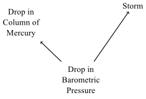

*Figure 1*

### 1.2 Probability

In this sub-section, we will review some of the basics of the mathematical theory of probability, and introduce some notation. Readers already familiar the mathematics of probability may wish to skip this section.

Probability is a function, P, that assigns values between zero and one, inclusive. Usually the arguments of the function are taken to be sets, or propositions in a formal language. The formal term for these arguments is ‘events’. We will here use the notation that is appropriate for propositions, with ‘$\nsim$’ representing negation, ‘&’ representing conjunction, and ‘$\vee$’ representing disjunction. Sometimes when there is a long conjunction, this is abbreviated by using commas instead of ampersands. The domain of a probability function has the structure of a *field* or a *Boolean algebra*. This means that the domain is closed under complementation and the taking of finite unions or intersections (for sets), or under negation, conjunction, and disjunction (for propositions). Thus if *A* and *B* are events in the domain of P, so are ${\nsim}A$, $A \amp B$, and $A \vee B$.

Some standard properties of probability are the following:

- If *A* is a contradiction, then $\PP(A) = 0$.
- If *A* is a tautology, then $\PP(A) = 1$.
- If $\PP(A \amp B) = 0$, then $\PP(A \vee B) = \PP(A) + \PP(B)$
- $\PP({\nsim}A) = 1 - \PP(A)$.

In addition to probability theory, the entry will use basic notation from set theory and logic. Sets will appear in boldface.

- $\varnothing$ is the empty set (the set that has no members or elements)
- $x \in \bX$ means that *x* is a member or element of the set $\bX$.
- $\bX \subseteq \bY$ means that $\bX$ is a subset of $\bY$; i.e., every member of $\bX$ is also a member of $\bY$. Note that both $\varnothing$ and $\bY$ are subsets of $\bY$.
- $\bX \setminus \bY$ is the set that results from removing the members of $\bY$ from $\bX$.
- $\forall$ and $\exists$ are the universal and existential quantifiers, respectively.

Some further definitions:

- The *conditional probability of A given B,* written $\PP(A \mid B)$, is standardly defined as follows: $$ \PP(A \mid B) = \frac{\PP(A \amp B)}{\PP(B)}. $$ If $\PP(B) = 0$, then the ratio in the definition of conditional probability is undefined. There are, however, a variety of technical developments that will allow us to define $\PP(A \mid B)$ when $\PP(B)$ is 0. We will ignore this problem here.
- A *random variable* for probability P is a function *X* that takes values in the real numbers, such that for any number $x, X = x$ is an event in the domain of P. For example, we might have a random variable $T_1$ that takes values in $\{1, 2, 3, 4, 5, 6\}$, representing the outcome of the first toss of a die. The event $T_1 = 3$ would represent the first toss as having outcome 3. We will write $T_1 \in \{1, 2, 3\}$ as shorthand for $T_1 = 1 \vee T_1 = 2 \vee T_1 = 3$.
- If *A* and *B* are in the domain of P, then *A* and *B* are *probabilistically independent* (with respect to P) just in case $\PP(A \amp B) = \PP(A) \times \PP(B). A$ and *B* are *probabilistically dependent* or *correlated* otherwise.
- *A* and *B* are *probabilistically independent conditional on* *C* if and only if $\PP(A \amp B \mid C) = \PP(A \mid C) \times \PP(B \mid C)$.
- Random variables *X* and *Y* are *probabilistically independent* if and only if all events of the form $X \in \bH$ are probabilistically independent of all events of the form $Y \in \bJ$, where $\bH$ and $\bJ$ are subsets of the range of *X* and *Y*, respectively.

As a convenient shorthand, a probabilistic statement that contains only a variable or set of variables, but no values, will be understood as a universal quantification over all possible values of the variable(s). Thus if $\bX = \{X_1 , \ldots ,X_m\}$ and $\bY = \{Y_1 , \ldots ,Y_n\}$, we may write

$$ \PP(\bX \mid \bY) = \PP(\bX) $$

as shorthand for

$$\begin{align} \forall x_1 \ldots \forall x_m\forall y_1 \ldots \forall y_n & [\PP(X_1 =x_1 ,\ldots ,X_m =x_m \mid Y_1 =y_1,\ldots ,Y_n =y_n)\\ & = \PP(X_1 =x_1 ,\ldots ,X_m =x_m)] \end{align}$$

(where the domain of quantification for each variable will be the range of the relevant random variable).

### 1.3 The Interpretation of Probability

Causal relations are normally thought to be objective features of the world. If they are to be captured in terms of probability theory, then probability assignments should represent some objective feature of the world. There are a number of attempts to interpret probabilities objectively, the most prominent being *frequency* interpretations and *propensity* interpretations. Most proponents of probabilistic theories of causation have understood probabilities in one of these two ways. Notable exceptions are Suppes (1970)[^suppes-1970], who takes probability to be a feature of a model of a scientific theory; and Skyrms (1980)[^skyrms-1980], who understands the relevant probabilities to be the subjective probabilities of a certain kind of rational agent.

### 1.4 General Causation and Actual Causation

It is common to distinguish between *general*, or *type-level* causation, on the one hand, and *singular*, *token-level* or *actual* causation, on the other. This entry adopts the terms *general causation* and *actual causation.* Causal claims usually have the structure ‘*C* causes *E*’. *C* and *E* are the *relata* of the causal claim; we will discuss causal relata in more detail in the next section. General causation and actual causation are often distinguished by their relata. *General* causal claims, such “smoking causes lung cancer” typically do not refer to particular individuals, places, or times, but only to event-types or properties. *Singular* causal claims, such as “Jill’s heavy smoking during the 2000s caused her to develop lung cancer”, typically do make reference to particular individuals, places, and times. This is an imperfect guide, however; for example, some theories of general causation to be discussed below take their causal relata to be time-indexed.

A related distinction is that general causation is concerned with a full range of possibilities, whereas actual causation is concerned with how events actually play out in a specific case. At a minimum, in claims of actual causation, “cause” functions as a success verb. The claim “Jill’s heavy smoking during the 2000s caused her to develop lung cancer” implies that Jill smoked heavily during the 2000s and that she developed lung cancer.

The theories to be discussed in Sections 2 and 3 below primarily concern general causation, while Section 4 discusses theories of actual causation.

### 1.5 Causal Relata

A number of different candidates have been proposed for the relata of causal relations. The relata of actual causal relations are often taken to be *events* (not to be confused with events in the purely technical sense), although some authors (e.g., Mellor 2004)[^mellor-2004] argue that they are *facts*. The relata of general causal relations are often taken to be *properties* or *event-types.* For purposes of definiteness, *events* will refer to the relata of actual causation, and *factors* will refer to the relata of general causation. These terms are not intended to imply a commitment to any particular view on the nature of the causal relata.

In probabilistic approaches to causation, causal relata are represented by events or random variables in a probability space. Since the formalism requires us to make use of negation, conjunction, and disjunction, the relata must be entities (or be accurately represented by entities) to which these operations can be meaningfully applied.

In some theories, the time at which an event occurs or a property is instantiated plays an important role. In such cases, it will be useful to include a subscript indicating the relevant time. Thus the relata might be represented by $C_t$ and $E_{t'}$. If the relata are particular events, this subscript is just a reminder; it adds no further information. For example, if the event in question is the opening ceremony of the Rio Olympic games, the subscript ‘8/5/2016’ is not necessary to disambiguate it from other events. In the case of properties or event-types, however, such subscripts do add further information. The time index need not refer to a date or absolute time. It could refer to a stage in the development of a particular kind of system. For example, exposure to lead paint in children can cause learning disabilities. Here the time index would indicate that it is exposure *in children*, that is, in the early stages of human life, that causes the effect in question. The time indices may also indicate relative times. Exposure to the measles virus causes the appearance of a rash approximately two weeks later. We might indicate this time delay by assigning exposure a time index of $t = 0$, and rash an index of $t = 14$ (for 14 days).

It is standard to assume that causes and effects must be *distinct* from one another. This means that they must not stand in logical relations or part-whole relations to one another. Lewis 1986a contains a detailed discussion of the relevant notion of distinctness. We will typically leave this restriction tacit.

### 1.6 Further Reading

Psillos 2009 provides an overview of regularity theories of causation. Lewis 1973 contains a brief but clear and forceful overview of problems with regularity theories. The entry for 20th century theories of scientific explanation contains discussions of some of these problems.

Hájek and Hitchcock 2016b is a short introduction to probability theory geared toward philosophical applications. Billingsley 1995 and Feller 1968 are two standard texts on probability theory. The entry for interpretations of probability includes a brief introduction to the formalism of probability theory, and discusses the various interpretations of probability. Galavotti 2005 and Gillies 2000 are good surveys of philosophical theories of probability. Hájek and Hitchcock 2016a includes essays covering the major interpretations of probability.

The Introduction of Eells 1991 provides a good overview of the distinction between general and actual causation.

Bennett 1988 is an excellent discussion of facts and events in the context of causation. Ehring 2009 is a survey of views about causal relata. See also the entries for the metaphysics of causation, events, facts, and properties.

## 2. Probability-raising Theories of Causation

The theories canvassed in this section all develop the basic idea that causes raise the probability of their effects. These theories were among the leading theories of causation during the second half of the 20ᵗʰ century. Today, they have largely been supplanted by the causal modeling approaches discussed in Section 3.

### 2.1 Probability-raising and Conditional Probability

The central idea that causes raise the probability of their effects can be expressed formally using conditional probability. *C* raises the probability of *E* just in case:

**$(\PR_1)$**

$\PP(E \mid C) \gt \PP(E)$.

In words, the probability that *E* occurs, given that *C* occurs, is higher than the unconditional probability that *E* occurs. Alternately, we might say that *C* raises the probability of *E* just in case:

**$(\PR_2)$**

$ \PP(E \mid C) \gt \PP(E \mid {\nsim}C)$;

the probability that *E* occurs, given that *C* occurs, is higher than the probability that *E* occurs, given that *C* does not occur. These two formulations turn out to be equivalent in the sense that inequality $\PR_1$ will hold just in case $\PR_2$ holds. Some authors (e.g., Reichenbach 1956, Suppes 1970, Cartwright 1979)[^cartwright-1979][^reichenbach-1956][^suppes-1970] have formulated probabilistic theories of causation using inequalities like $\PR_1$, others (e.g., Skyrms 1980, Eells 1991)[^eells-1991][^skyrms-1980] have used inequalities like $\PR_2$. This difference is mostly immaterial, but for consistency we will stick with ($\PR_2)$. Thus a first stab at a probabilistic theory of causation would be:

**(PR)**

*C* is a cause of *E* just in case $\PP(E \mid C) \gt \PP(E \mid {\nsim}C)$.

PR has some advantages over the simplest version of a regularity theory of causation (discussed in Section 1.1 above). PR is compatible with imperfect regularities: *C* may raise the probability of *E* even though instances of *C* are not invariably followed by instances of *E*. Moreover, PR addresses the problem of relevance: if *C* is a cause of *E*, then *C* makes a difference for the probability of *E*. But as it stands, PR does not address either the problem of asymmetry, or the problem of spurious correlations. PR does not address the problem of asymmetry because probability-raising turns out to be symmetric: $\PP(E \mid C) \gt \PP(E \mid {\nsim}C)$, if and only if $\PP(C \mid E) \gt \PP(C \mid {\nsim}E)$. Thus PR by itself cannot determine whether *C* is the cause of *E* or vice versa. PR also has trouble with *spurious correlations*. If *C* and *E* are both caused by some third factor, *A*, then it may be that $\PP(E \mid C) \gt \PP(E \mid {\nsim}C)$ even though *C* does not cause *E*. This is the situation shown in Figure 1 above. Here, *C* is the drop in the level of mercury in a barometer, and *E* is the occurrence of a storm. Then we would expect that $\PP(E \mid C) \gt \PP(E \mid {\nsim}C)$. In this case, atmospheric pressure is referred to as a *confounding* factor.

### 2.2 Screening off

Hans Reichenbach’s *The Direction of Time* was published posthumously in 1956. In it, Reichenbach is concerned with the origins of temporally asymmetric phenomena, particularly the increase in entropy dictated by the second law of thermodynamics. In this work, he presents the first fully developed probabilistic theory of causation, although some of the ideas can be traced back to an earlier paper from 1925 (Reichenbach 1925)[^reichenbach-1925].

Reichenbach introduced the terminology of *screening off* to describe a particular type of probabilistic relationship. If $\PP(E \mid A \amp C) = \PP(E \mid C)$, then *C* is said to screen *A* off from *E*. When $\PP(A \amp C) \gt 0$, this equality is equivalent to $\PP(A \amp E \mid C) = \PP(A \mid C) \times \PP(E \mid C)$; i.e., *A* and *E* are probabilistically independent conditional upon *C*.

Reichenbach recognized that there were two kinds of causal structure in which *C* will typically screen *A* off from *E*. The first occurs when *A* causes *C*, which in turn causes *E*, and there is no other route or process by which *A* effects *E*. This is shown in Figure 2.

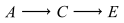

*Figure 2*

In this case, Reichenbach said that *C* is *causally between* *A* and *E*. We might say that *C* is an intermediate cause between *A* and *E*, or that *C* is a proximate cause of *E* and *A* a distal cause of *E*. For example, unprotected sex (*A*) causes AIDS (*E*) only by causing HIV infection (*C*). Then we would expect that among those already infected with HIV, those who became infected through unprotected sex would be no more likely to contract AIDS than those who became infected in some other way.

The second type of case that produces screening off occurs when *C* is a common cause of *A* and *E*, such as in the barometer example depicted in Figure 1. A drop in atmospheric pressure (*C*) causes both a drop in the level of mercury in a barometer (*A*) and a storm (*E*). (This notation is slightly different from one used earlier.) The atmospheric pressure will screen off the barometer reading from the weather: given that the atmospheric pressure has dropped, the reading of the barometer makes no difference for the probability of whether a storm will occur.

Reichenbach used the apparatus of screening off to address the problem of spurious correlations. In our example, while a drop in the column of mercury (*A*) raises the probability of a storm (*E*) overall, it does not raise the probability of a storm when we further condition on the atmospheric pressure. That is, if *A* and *E* are spuriously correlated, then *A* will be screened off from *E* by a common cause. More specifically, suppose that $C_t$ and $E_{t'}$ are events that occur at times *t* and $t'$ respectively. Then

**(Reich)**

$C_t$ is a cause of $E_{t'}$ if and only if: i. $t \lt t'$

**ii.**

$\PP(E_{t'} \mid C_t) \gt \PP(E_{t'} \mid {\nsim}C_t)$; and

**iii.**

There is no further event *B$_{t''}$*, occurring at a time $t''$ earlier than or simultaneously with *t*, that screens $E_{t'}$ off from $C_t$.

Note the restriction of $t''$ to times earlier than or simultaneously with the occurrence of $C_t$. That is because causal intermediates between $C_t$ and $E_{t'}$ will often screen $C_t$ off from $E_{t'}$. In such cases we still want to say that $C_t$ is a cause of $E_{t'}$, albeit a distal or indirect cause.

Suppes (1970)[^suppes-1970] independently offered an equivalent definition of causation, although his motivation for the no-screening-off condition was different from Reichenbach’s. Suppes extended the framework in a number of directions. While Reichenbach was interested in probabilistic causation primarily in connection with issues that arise within the foundations of statistical mechanics, Suppes was interested in defining causation within the framework of probabilistic models of scientific theories. For example, Suppes offers an extended discussion of causation in the context of psychological models of learning.

### 2.3 The Common Cause Principle

Reichenbach (1956)[^reichenbach-1956] formulated a principle he dubbed the ‘Common Cause Principle’ (CCP). Suppose that events *A* and *B* are positively correlated, i.e., that

1. $\PP(A \amp B) \gt \PP(A) \times \PP(B)$.

But suppose that neither *A* nor *B* is a cause of the other. Then Reichenbach maintained that there will be a common cause, *C*, of *A* and *B*, satisfying the following conditions:

1. $0 \lt \PP(C) \lt 1$
2. $\PP(A \amp B \mid C) = \PP(A \mid C) \times \PP(B \mid C)$
3. $\PP(A \amp B \mid {\nsim}C) = \PP(A \mid {\nsim}C) \times \PP(B \mid {\nsim}C)$
4. $\PP(A \mid C) \gt \PP(A \mid {\nsim}C)$
5. $\PP(B \mid C) \gt \PP(B \mid {\nsim}C)$.

When events *A*, *B*, and *C* satisfy these conditions, they are said to form a *conjunctive fork*. 5 and 6 follow from *C* being a cause of *A* and a cause of *B*. Conditions 2 and 3 stipulate that *C* and ${\nsim}C$ screen off *A* from *B*.

Conditions 2 through 6 mathematically entail 1. Reichenbach says that the common cause *explains* the correlation between *A* and *B*. The idea is that probabilistic correlations that are not the result of one event causing another are ultimately derived from probabilistic correlations that do result from a causal relationship.

Reichenbach’s definition of causation, discussed in Section 2.2 above, appeals to time order: it requires that a cause occur earlier than its effect. But Reichenbach also thought that the direction from causes to effects can be identified with a pervasive statistical asymmetry. Suppose that events *A* and *B* are correlated, and that *C* satisfies conditions 2–6 above, so that *ABC* form a conjunctive fork. If *C* occurs earlier than *A* and *B*, and there is no event satisfying 2 through 6 that occurs later than *A* and *B*, then *ACB* is said to form a conjunctive fork *open to the future*. Analogously, if there is a later event satisfying 2 through 6, but no earlier event, we have a conjunctive fork *open to the past*. If an earlier event *C* and a later event *D* both satisfy 2 through 6, then *ACBD* forms a *closed fork*. Reichenbach’s proposal was that the direction from cause to effect is the direction in which open forks predominate. In our world, there are a great many forks open to the future, few or none open to the past. However, we shall see in section 3.6 below that conjunctive forks are not the best structures for identifying causal direction.

### 2.4 Simpson’s Paradox and Background Contexts

In the Reichenbach-Suppes definition of causation, the inequality $\PP(E_{t'} \mid C_t) \gt \PP(E_{t'} \mid {\nsim}C_t)$ is necessary, but not sufficient, for causation. It is not sufficient, because it may hold in cases where $C_t$ and $E_{t'}$ share a common cause. Unfortunately, common causes can also give rise to cases where this inequality is not necessary for causation either. Suppose, for example, that smoking is highly correlated with living in the country: those who live in the country are much more likely to smoke as well. Smoking is a cause of lung cancer, but suppose that city pollution is an even stronger cause of lung cancer. Then it may be that smokers are, over all, less likely to suffer from lung cancer than non-smokers. Letting *C* represent smoking, *B* living in the country, and *E* lung cancer, $\PP(E \mid C) \lt \PP(E \mid {\nsim}C)$. Note, however, that if we conditionalize on whether one lives in the country or in the city, this inequality is reversed: $\PP(E \mid C \amp B) \gt \PP(E \mid {\nsim}C \amp B)$, and $\PP(E \mid C \amp{\nsim}B) \gt \PP(E \mid {\nsim}C \amp{\nsim}B)$. Such reversals of probabilistic inequalities are instances of “Simpson’s Paradox”. The problem that Simpson’s paradox creates for probabilistic theories of causation was pointed out by Nancy Cartwright (1979)[^cartwright-1979] and Brian Skyrms (1980)[^skyrms-1980] at about the same time.

Cartwright and Skyrms sought to rectify the problem by replacing conditions (ii) and (iii) of Reich with the requirement that causes must raise the probabilities of their effects in various *background contexts*. Cartwright proposed the following definition:

**(Cart)**

*C* causes *E* if and only if $\PP(E \mid C \amp B) \gt \PP(E \mid {\nsim}C \amp B)$ for every background context *B*.

Skyrms proposed a slightly weaker condition: a cause must raise the probability of its effect in at least one background context, and lower it in none. A background context is a conjunction of factors. When such a conjunction of factors is conditioned on, those factors are said to be “held fixed”. To specify what the background contexts will be, then, we must specify what factors are to be held fixed. In the previous example, we saw that the true causal relevance of smoking for lung cancer was revealed when we held country living fixed, either positively (conditioning on $B)$ or negatively (conditioning on ${\nsim}B)$. This suggests that in evaluating the causal relevance of *C* for *E*, we need to hold fixed other causes of *E*, either positively or negatively. This suggestion is not entirely correct, however. Let *C* and *E* be smoking and lung cancer, respectively. Suppose *D* is a causal intermediary, say the presence of tar in the lungs. If *C* causes *E* exclusively via *D*, then *D* will screen *C* off from *E*: given the presence (absence) of tar in the lungs, the probability of lung cancer is not affected by whether the tar got there by smoking. Thus we will not want to hold fixed any causes of *E* *that are themselves caused by C*. Let us call the set of all factors that are causes of *E*, but are not caused by *C*, the set of *independent* causes of *E*. A background context for *C* and *E* will then be a maximal conjunction, each of whose conjuncts is either an independent cause of *E*, or the negation of an independent cause of *E*.

Note that the specification of factors that need to be held fixed appeals to causal relations, so the theory no longer offers a *reductive analysis* of causation. Nonetheless, the theory imposes probabilistic constraints upon possible causal relations in the sense that a given set of probability relations will be incompatible with at least some systems of causal relations. Note also that we have dropped the subscripts referring to times. Cartwright claimed that it is not necessary to appeal to the time order of events to distinguish causes from effects in her theory. That is because it will no longer be true in general that if *C* raises the probability of *E* in every relevant background context *B*, then *E* raise will raise the probability of *C* in every background context $B'$. The reason is that the construction of the background contexts ensures that the background contexts relevant to assessing *C*’s causal relevance for *E* are different from those relevant to assessing *E*’s causal relevance for *C*. However, Davis (1988)[^davis-1988] and Eells (1991)[^eells-1991] both argue cogently that Cartwright’s account will still sometimes rule that effects bring about their causes.

### 2.5 Other Causal Relations

Cartwright defined a cause as a factor that increases the probability of its effect in every background context. But it is easy to see that there are other possible probability relations between *C* and *E*. Eells (1991)[^eells-1991] proposes the following taxonomy:

**(Eells)**

• $C_t$ is a *positive cause* (or simply *cause*) of $E_{t'}$ if and only if $t \lt t'$ and $\PP(E_{t'} \mid C_t \amp B) \gt \PP(E_{t'} \mid {\nsim}C_t \amp B)$ for every background context *B*.

**•**

$C_t$ is a *negative cause* of $E_{t'}$ (or $C_t$ *prevents* $E_{t'}$ or $C_t$ *inhibits* $E_{t'})$ if and only if $t \lt t'$ and $\PP(E_{t'} \mid C_t \amp B) \lt \PP(E_{t'} \mid {\nsim}C_t \amp B)$ for every background context *B*.

**•**

$C_t$ is *causally neutral* for $E_{t'}$ (or *causally irrelevant* for $E_{t'})$ if and only if $\PP(E_{t'} \mid C_t \amp B) = \PP(E_{t'} \mid {\nsim} C_t \amp B)$ for every background context *B*.

**•**

$C_t$ is a *mixed cause* (or *interacting cause*) of $E_{t'}$ if and only if $t \lt t'$ and $C_t$ *is not a positive or negative cause of* $E_{t'}$ and $C_t$ *is not causally neutral for* $E_{t'}$.

$C_t$ is *causally relevant* for $E_{t'}$ if and only if it is a positive, negative, or mixed cause of $E_{t'}$; i.e., if and only if $t \lt t'$ and $C_t$ is not causally neutral for $E_{t'}$.

It should be apparent that when constructing background contexts for *C* and *E* one should hold fixed not only (positive) causes of *E* that are independent of $C,$ but also negative and mixed causes of *E*; in other words, one should hold fixed all factors that are causally relevant for *E*, except those for which *C* is causally relevant. This suggests that causal relevance, rather than positive causation, is the most basic metaphysical concept.

Eells’s taxonomy brings out an important distinction. It is one thing to ask whether *C* is causally relevant to *E* *in some way*; it is another to ask *in which way* *C* is causally relevant to *E*. To say that *C* causes *E* is then potentially ambiguous: it might mean that *C* is causally relevant to *E*; or it might mean that *C* is a positive cause of *E*. Probabilistic theories of causation can be used to answer both types of question.

Eells claims that general causal claims must be relativized to a population. A very heterogeneous population will include a great many different background conditions, while a homogeneous population will contain few. A heterogeneous population can always be subdivided into homogeneous subpopulations. It will often happen that *C* is a mixed cause of *E* relative to a population P, while being a positive cause, negative cause, or causally neutral for *E* in various subpopulations of P.

### 2.6 Contextual-unanimity

According to both Cart and Eells, a cause must raise the probability of its effect in *every* background context. This has been called the requirement of *contextual-unanimity*. Dupré (1984)[^dupré-1984] raises the following counterexample to the contextual unanimity requirement. Suppose that there is a very rare gene that has the following effect: those that possess the gene have their chances of contracting lung cancer *lowered* when they smoke. In this scenario, there would be a background context in which smoking lowers the probability of lung cancer: thus smoking would not be a cause of lung cancer according to the contextual-unanimity requirement. Nonetheless, it seems unlikely that the discovery of such a gene would lead us to abandon the claim that smoking causes lung cancer.

Dupré suggests instead that we should deem *C* to be a cause of *E* if it raises the probability of *E* in a ‘fair sample’—a sample that is representative of the population as a whole. Mathematically, this amounts to the requirement that

**(Dupré)**

*C* causes *E* if and only if

$$\Sigma_B \PP(E \mid C \amp B) \times \PP(B) \gt \Sigma_B \PP(E \mid {\nsim}C \amp B) \times \PP(B)$$

where *B* ranges over the relevant background contexts. This is the same as requiring that *C* must raise the probability of *E* in a *weighted average* of background contexts, where each background context is weighted by the product of $\PP(B)$ and the absolute value of

$$\PP(E \mid C \amp B) - \PP(E \mid {\nsim}C \amp B).$$

Dupré’s account surely comes closer to capturing our ordinary use of causal language. Indeed, the inequality in Dupré is what one looks for in randomized trials. If one randomly determines which members of a population receive a treatment (*C*) and which do not $({\nsim}C)$, then the distribution of background conditions *B* ought to be the same in both groups, and ought to reflect the frequency of these conditions in the population. Thus we would expect the frequency of *E* to be higher in the treatment group just in case inequality Dupré holds.

On the other hand, Eells’s population-relative formulation allows us to make more precise causal claims: in the population as a whole, smoking is a mixed cause of lung cancer; in the sub-population of individuals who lack the protective gene, smoking is a positive cause of lung cancer; in the sub-population consisting of individuals who possess the gene, smoking is a negative cause of lung cancer.

In any event, this debate does not really seem to be about the metaphysics of causation. As we saw in the previous section, causal relevance is really the basic metaphysical concept. The dispute between Dupré and Eells is really a debate about how best to use the word ‘cause’ to pick out a particular species of causal relevance. Dupré’s proposed usage will count as (positive) causes many things that will be mixed causes in Eells’s proposed usage. But there does not seem to be any underlying disagreement about which factors are causally relevant. (For defense of a similar position, see Twardy and Korb 2004.)[^twardy-2004]

### 2.7 Conclusion and Further Reading

The program described in this section did much to illuminate the relationship between causation and probability. In particular, it helped us to better understand the way in which causal structure can give rise to probabilistic relations of screening off. However, despite the mathematical framework of the program, and points of contact with statistics and experimental methodology, this program did not give rise to any new computational tools, or suggest any new methods for detecting causal relationships. For this reason, the program has largely been supplanted by the causal modeling tools described in the next section.

The main works surveyed in this section are Reichenbach 1956, Suppes 1970, Cartwright 1979, Skyrms 1980, and Eells 1991. Williamson 2009 and Hitchcock 2016 are two further surveys that cover a number of the topics discussed in this section. The entries for Hans Reichenbach and Reichenbach’s Common Cause Principle include discussions of Reichenbach’s program and the status of his Common Cause Principle. Salmon (1984)[^salmon-1984] contains an extensive discussion of conjunctive forks. The entry for Simpson’s paradox contains further discussion of some of the issues raised in Section 2.4.

## 3. Causal Modeling

The discussion of the previous section conveys some of the complexity of the problem of inferring causal relationships from probabilistic correlations. Fairly recently, a number of techniques have been developed for representing systems of causal relationships, and for inferring causal relationships from probabilities. The name ‘causal modeling’ is often used to describe the new interdisciplinary field devoted to the study of methods of causal inference. This field includes contributions from statistics, artificial intelligence, philosophy, econometrics, epidemiology, and other disciplines. Within this field, the research programs that have attracted the greatest philosophical interest are those of the computer scientist Judea Pearl and his collaborators, and of the philosophers Peter Spirtes, Clark Glymour, and Richard Scheines (SGS) and their collaborators. The most significant works of these authors are Pearl (2009)[^pearl-2009] (first published in 2000), and Spirtes et al. (2000) (first published in 1993).

### 3.1 Graphical Causal Models

Every causal model involves a set of variables $\bV$. The variables in $\bV$ may include, for example, the education-level, income, and occupation of an individual. A variable could be binary, its values representing the occurrence or non-occurrence of some event, or the instantiation or non-instantiation of some property. But as the example of income suggests, a variable could have multiple values or even be continuous.

A probabilistic causal model also includes a probability measure P. P is defined over propositions of the form $X = x$, where *X* is a variable in $\bV$ and *x* is a value in the range of *X*. P is also defined over conjunctions, disjunctions, and negations of such propositions. It follows that conditional probabilities over such propositions will be well-defined whenever the event conditioned on has positive probability. P is usually understood to represent some kind of objective probability.

Causal relationships among the variables in $\bV$ are represented by *graphs*. We will consider two types of graphs. The first is the *directed acyclic graph* (DAG). A *directed graph* $\bG$ on variable set $\bV$ is a set of ordered pairs of variables in $\bV$. We represent this visually by drawing an arrow from *X* to *Y* just in case $\langle X, Y\rangle$ is in $\bG$. Figure 3 shows a directed graph on variable set $\bV = \{S, T, W, X, Y, Z\}$.

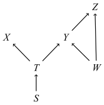

*Figure 3*

A *path* in a directed graph is a non-repeating sequence of arrows that have endpoints in common. For example, there is a path from *X* to *Z*, which we can write as $X \leftarrow T \rightarrow Y \rightarrow Z$. A *directed path* is a path in which all the arrows align by meeting tip-to-tail; for example, there is a directed path $S \rightarrow T \rightarrow Y \rightarrow Z$. A directed graph is *acyclic,* and hence a DAG, if there is no directed path from a variable to itself. The graph in Figure 3 is a DAG.

The relationships in the graph are often described using the language of genealogy. The variable *X* is a *parent* of *Y* just in case there is an arrow directed from *X* to *Y*. $\PA(Y)$ will denote the set of all parents of *Y*. In Figure 3, $\PA(Y) = \{T, W\}$. *X* is an *ancestor* of *Y* (and *Y* is a *descendant* of *X*) just in case there is a directed path from *X* to *Y*. However, it will be convenient to deviate slightly from the genealogical analogy and define ‘descendant’ so that every variable is also a descendant of itself. $\DE(X)$ denotes the set of all descendants of *X*. In Figure 3 $\DE(T) = \{T, X, Y, Z\}$.

An arrow from *Y* to *Z* in a DAG represents that *Y* is a *direct cause* of *Z*. Roughly, this means that the value of *Y* makes some causal difference for the value of *Z*, and that *Y* influences *Z* through some process that is not mediated by any other variable in $\bV$. Directness is relative to a variable set. We will call the system of direct causal relations represented in a DAG such as Figure 3 the *causal structure* on the variable set $\bV$.

A second type of graph that we will consider is an *acyclic directed mixed graph* (ADMG). An ADMG, will contain double-headed arrows, as well as single-headed arrows. A double-headed arrow represents a *latent* common cause. A latent common cause of variables *X* and *Y* is a common cause that is not included in the variable set $\bV$. For example, suppose that *X* and *Y* share a common cause *L* (Figure 4(a)). An ADMG on the variable set $\bV = \{X, Y\}$ will look like Figure 4(b).

| 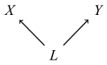 |   | 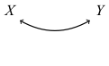 |
| --- | --- | --- |
| (a) |   | (b) |

*Figure 4*

We only need to represent missing common causes in this way when they are *closest* common causes. That is, a graph on $\bV$ should contain a double-headed arrow between *X* and *Y* when there is a variable *L* that is omitted from $\bV$, such that if *L* were added to $\bV$ it would be a *direct cause* of *X* and *Y*. Double-headed arrows do not give rise to “genealogical” relationships: in Figure 4(b), *X* is not a parent, ancestor, or descendant of *Y*.

In an ADMG, we expand the definition of a *path* to include double-headed arrows. Thus, $X \leftrightarrow Y$ is a path in the ADMG shown in Figure 4(b). *Directed path* retains the same meaning, and a directed path cannot contain double-headed arrows. An ADMG cannot include a directed path from a variable to itself.

We will adopt the convention that both DAGs and ADMGs represent the presence *and absence* of both direct causal relationships and latent common causes. For example the DAG in Figure 3 represents that *T* is a direct cause of *Y*, that *T* is not a direct cause of *Z*, and that there are no latent common causes of any variables.

### 3.2 Identification Problems

We will be interested in a variety of problems that have a general structure. There will be a *query* concerning some causal feature of the system being investigated. A query may concern:

- The qualitative causal structure on a set of variables. For instance, we may ask which DAG, or which ADMG, correctly describes the causal structure among the variables in $\bV = \{S, T, W, X, Y, Z\}$. Or we may be interested in some specific feature of the causal structure, such as whether *X* is a direct cause of *Y*. Problems with this type of query are sometimes called *causal discovery* problems.
- The effects of *interventions*. If we were to intervene in the causal structure and set the value of *X* to *x*, what is the probability that *Y* would take the value *y*? For instance, if we were to intervene by giving drugs to a patient, what is the probability that he would recover?

A given problem will also have a set of inputs. These fall into a variety of categories:

- Metaphysical and methodological assumptions: These are general assumptions about the relationship between causal structure and probability. These assumptions function like a probabilistic theory of causation. They tell us, in particular, how causal relationships constrain probabilistic relationships. The main assumptions that we will consider are the *Markov Condition* (MC), the *Minimality Condition*, and the *Faithfulness Condition.*
- Background assumptions about the causal structure: We may assume that a particular DAG or ADMG describes the causal structure on some set of variables, or assume that the correct graph does or does not include an arrow from *X* to *Y*. In particular, we may have time order information that constrains the possible causal structures. For instance, if we know that *X* concerns a time earlier than *Y*, then we can rule out causal structures in which *Y* causally influences *X*.
- Observations: Information about the probability distribution P over the variables in $\bV$.

In realistic scientific cases, we never directly observe the true probability distribution P over a set of variables. Rather, we observe finite data that approximate the true probability when sample sizes are large enough and observation protocols are well-designed. Since our primary concern is with the philosophical issue of how probabilities determine or constrain causal structure, we will not address these important practical concerns. An answer to a query that can be determined from the true probabilities is said to be *identifiable*. For instance, if we can determine the correct DAG on a variable set $\bV$ from the probability distribution on $\bV$, the DAG is identifiable.

### 3.3 The Markov Condition

The most important principle connecting the causal structure on $\bV$, as represented in a graph $\bG$, and the probability distribution P on $\bV$ is the *Markov Condition* (MC). Let us first consider the case where $\bG$ is a DAG. Then P satisfies the *Markov Condition* (MC) relative to $\bG$ if and only it satisfies these three conditions:

| (MC_{Screening_off}) | For every variable *X* in $\bV$, and every set of variables $\bY \subseteq \bV \setminus \DE(X)$, $\PP(X \mid \PA(X) \amp \bY) = \PP(X \mid \PA(X))$. |
| --- | --- |
| (MC_{Factorization}) | Let $\bV = \{X_1, X_2 , \ldots ,X_n\}$. Then $\PP(X_1, X_2 , \ldots ,X_n) = \prod_i \PP(X_i \mid \PA(X_i))$. |
| (MC_{*d*-separation}) | Let $X, Y \in \bV, \bZ \subseteq \bV \setminus \{X, Y\}$. Then $\PP(X, Y \mid \bZ) = \PP(X \mid \bZ) \times \PP(Y \mid \bZ)$ if $\bZ$ *d*-separates *X* and *Y* in $\bG$ (explained below). |

These three conditions are equivalent when $\bG$ is a DAG.

Let us take some time to explain each of these formulations.

MC_{Screening_off} says that the parents of variable *X* screen *X* off from all other variables, except for the descendants of *X*. Given the values of the variables that are parents of *X*, the values of the variables in $\bY$ (which includes no descendants of $X)$, make no further difference to the probability that *X* will take on any given value.

MC_{Factorization} tells us that once we know the conditional probability distribution of each variable given its parents, $\PP(X_i \mid \PA(X_i))$, we can compute the complete joint distribution over all of the variables. This captures Reichenbach’s idea that probability relations between variables that are not related as cause and effect are nonetheless derived from probability relations between causes and effects.

MC_{*d*-separation} uses the graphical notion of *d*-separation, introduced by Pearl (1988)[^pearl-1988]. Let $X, Y \in \bV, \bZ \subseteq \bV \setminus \{X, Y\}$. As noted above, a path from *X* to *Y* is a sequence of variables $\langle X = X_1 , \ldots ,X_k = Y\rangle$ such that for each $X_i$, $X_{i+1}$, there is either an arrow from $X_i$ to $X_{i+1}$ or an arrow from $X_{i+1}$ to $X_i$ in $\bG$. A variable $X_i , 1 \lt i \lt k$ is a *collider* on the path just in case there is an arrow from $X_{i-1}$ to $X_i$ and from $X_{i+1}$ to $X_i$. That is, $X_i$ is a collider on a path just in case two arrows converge on $X_i$ in the path. $\bZ$ *d*-separates *X* and *Y* just in case every path $\langle X = X_1 , \ldots ,X_k = Y\rangle$ from *X* to *Y* contains at least one variable $X_i$ such that either: (i) $X_i$ is a collider, and no descendant of $X_i$ (including $X_i$ itself) is in $\bZ$; or (ii) $X_i$ is not a collider, and $X_i$ is in $\bZ$. MC_{*d*-separation} states that *d*-separation is sufficient for conditional independence.

Note that MC provides sufficient conditions for variables to be probabilistically independent, conditional on others, but no necessary condition. The Markov Condition entails many of the same screening off relations as Reichenbach’s Common Cause Principle, discussed in Section 2.3 above. Here are some examples:

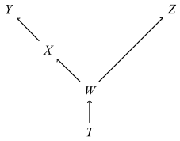

*Figure 5*

In Figure 5, MC implies that *X* screens *Y* off from all of the other variables, and that *W* screens *Z* off from all of the other variables. This is most easily seen from MC_{Screening off}. *W* also screens *T* off from all of the other variables, which is most easily seen from MC_{*d*-separation}. MC does not imply that *T* screens *Y* off from *Z* (or indeed anything from anything). While *Y* and *Z* do have a common cause that screens them off (*W*), not all common causes screen them off (*T* does not have to), and not everything that screens them off is a common cause (*X* screens them off but is not a common cause).

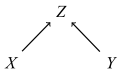

*Figure 6*

In Figure 6, MC entails that *X* and *Y* will be unconditionally independent, but not that they will be independent conditional on *Z*. This is most easily seen from MC_{*d*-separation}.

MC is not expected to hold for arbitrary sets of variables $\bV$, even when the graph $\bG$ accurately represents the causal relations among those variables. For example, MC will typically fail in the following kinds of case:

1. In an EPR (Einstein-Podolsky-Rosen) set-up, we have two particles prepared in the singlet state. If *X* represents a spin measurement on one particle, *Y* a spin measurement (in the same direction) on the other, then *X* and *Y* are perfectly anti-correlated. (One particle will be spin-up just in case the other is spin-down.) The measurements can be conducted sufficiently far away from each other that it is impossible for one outcome to causally influence the other. However, it can be shown that there is no (local) common cause *Z* that screens off the two measurement outcomes.
2. The variables in $\bV$ are not appropriately distinct. For example, suppose that *X*, *Y*, and *Z* are variables that are probabilistically independent and causally unrelated. Now define $U = X + Y$ and $W = Y + Z$, and let $\bV = \{U, W\}$. Then *U* and *W* will be probabilistically dependent, even though there is no causal relation between them.
3. MC may fail if the variables are too coarsely grained. Suppose *X*, *Y*, and *Z* are quantitative variables, *Z* is a common cause of *X* and *Y*, and neither *X* nor *Y* causes the other. Suppose we replace *Z* with a coarser variable, $Z'$ indicating only whether *Z* is high or low. Then we would not expect $Z'$ to screen *X* off from *Y*. The value of *X* may well contain information about the value of *Z* beyond what is given by $Z'$, and this may affect the probability of *Y*.

If there are latent common causes, we expect MC_{Screening off} and MC_{Factorization} to fail if we apply them in a naïve way. For example, suppose that the true causal structure on $\bV = \{X, Y, Z\}$ is shown by the ADMG in Figure 7.

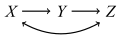

*Figure 7*

*Y* is the only parent of *Z* shown in the graph, and if we try to apply MC_{Screening_off}, it tells us that *Y* should screen *X* off from *Z*. However, we would expect *X* and *Z* to be correlated, even when we condition on *Y*, due to the latent common cause. The problem is that the graph is missing a relevant parent of *Z*, namely the omitted common cause. However, suppose that the probability distribution is such that *if* the latent cause *L* were added, the probability distribution over the expanded set of variables would satisfy MC with respect to the resulting DAG. Then it turns out that the probability distribution will *still* satisfy MC_{*d*-separation} with respect to the ADMG of Figure 8. This requires us to expand the definition of *d*-separation to include paths with double-headed arrows. For instance, *Z* is a collider on the path $Y \rightarrow Z \leftrightarrow X$ (since *Z* has two arrows pointing into it), but *X* is not a collider on the path $Y \leftarrow X \leftrightarrow Z$. Thus we will say that a probability distribution P satisfies the Markov Condition relative to an ADMG just in case it satisfies MC_{*d*-separation}.

Both SGS 2000 and Pearl 2009 contain statements of a principle called the *Causal Markov Condition* (CMC), but they mean different things. In Pearl’s formulation, CMC is just a statement of a mathematical theorem: Pearl and Verma (1991) prove if each variable in $\bV$ is a deterministic product of its parents in $\bV$, together with an error term; and the errors are probabilistically independent of each other; then the probability distribution on $\bV$ will satisfy MC with respect to the DAG $\bG$. Pearl interprets this result in the following way: Macroscopic systems, he believes, are deterministic. In practice, however, we never have access to all of the causally relevant variables affecting a macroscopic system. But if we include enough variables in our model so that the excluded variables are probabilistically independent of one another, then our model will satisfy the MC, and we will have a powerful set of analytic tools for studying the system. Thus MC characterizes a point at which we have constructed a useful approximation of the complete system.

In SGS 2000, the CMC has more the status of an empirical posit. If $\bV$ is set of macroscopic variables that are well-chosen, meaning that they are free from the sorts of defects described in points (ii) and (iii) above; $\bG$ is a graph representing the causal structure on $\bV$; and P is the objective probability distribution resulting from this causal structure; then P can be expected to satisfy MC relative to $\bG$. More precisely, P will satisfy all three versions of MC if $\bG$ is a directed acyclic graph, and P will satisfy MC_{*d*-separation} if $\bG$ is an ADMG with double-headed arrows. SGS defend this empirical posit in two different ways:

1. Empirically, it seems that a great many systems do in fact satisfy MC.
2. Many of the methods that are in fact used to detect causal relationships tacitly presuppose the MC. In particular, the use of randomized trials presupposes a special case of the MC. Suppose that an experimenter determines randomly which subjects will receive treatment with a drug $(D = 1)$ and which will receive a placebo $(D = 0)$, and that under this regimen, treatment is probabilistically correlated with recovery (*R*). The effect of randomization is to eliminate all of the parents of *D*, so MC tells us that if *R* is not a descendant of *D*, then *R* and *D* should be probabilistically independent. If we do not make this assumption, how can we infer from the experiment that *D* is a cause of *R*?

Cartwright (1993, 2007: chapter 8) has argued that MC need not hold for genuinely indeterministic systems. Hausman and Woodward (1999, 2004) attempt to defend MC for indeterministic systems.

A causal model that comprises a DAG and a probability distribution that satisfies MC is called a *causal Bayes net* (CBN). A causal model incorporating an ADMG and probability distribution satisfying MC_{*d*-separation} is called a *semi-Markov causal model* (SMCM).

### 3.4 The Minimality and Faithfulness Conditions

The MC states a sufficient condition but not a necessary condition for conditional probabilistic independence. As such, the MC by itself can never entail that two variables are conditionally or unconditionally dependent. The Minimality and Faithfulness Conditions are two principles that posit necessary conditions for probabilistic independence. The terminology comes from Spirtes et al. (2000). Pearl provides analogous conditions with different terminology.

(i) *The Minimality Condition*. Suppose that the acyclic directed graph $\bG$ on variable set $\bV$ satisfies MC with respect to the probability distribution P. The Minimality Condition asserts that no sub-graph of $\bG$ over $\bV$ also satisfies the Markov Condition with respect to P. (A subgraph of $\bG$ is a graph over $\bV$ that results from removing arrows from $\bG)$. As an illustration, consider the variable set $\{X, Y\}$, let there be an arrow from *X* to *Y*, and suppose that *X* and *Y* are probabilistically independent of each other according to probability function P. This graph would satisfy the MC with respect to P: none of the independence relations mandated by the MC are absent (in fact, the MC mandates no independence relations). But this graph would violate the Minimality Condition with respect to P, since the subgraph that omits the arrow from *X* to *Y* would also satisfy the MC. The Minimality Condition implies that if there is an arrow from *X* to *Y*, then *X* makes a probabilistic difference for *Y*, conditional on the other parents of *Y*. In other words, if $\bZ = \PA(Y) \setminus \{X\}$, there exist $\bz$, *y*, *x*, $x'$ such that

$$\PP(Y = y \mid X = x \amp \bZ = \bz) \ne \PP(Y = y \mid X = x' \amp \bZ = \bz).$$

(ii) *The Faithfulness Condition*. The Faithfulness Condition says that all of the (conditional and unconditional) probabilistic independencies that exist among the variables in $\bV$ are *required* by the MC. For example, suppose that $\bV = \{X, Y, Z\}$. Suppose also that *X* and *Y* are unconditionally independent of one another, but dependent, conditional upon *Z*. (The other two variable pairs are dependent, both conditionally and unconditionally.) The graph shown in Figure 8 does not satisfy the faithfulness condition with respect to this distribution (colloquially, the graph is not faithful to the distribution). MC, when applied to the graph of Figure 8, does not imply the independence of *X* and *Y*. By contrast, the graph shown in Figure 6 above is faithful to the described distribution. Note that Figure 8 does satisfy the Minimality Condition with respect to the distribution; no subgraph satisfies MC with respect to the described distribution. In fact, the Faithfulness Condition is strictly stronger than the Minimality Condition.

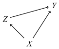

*Figure 8*

The Faithfulness Condition implies that the causal influences of one variable on another along multiple causal routes do not ‘cancel’. In Figure 8, *X* influences *Y* along two different directed paths. If the effect of one path is to exactly undo the influence along the other path, then *X* and *Y* will be probabilistically independent. The Faithfulness Condition forbids such exact cancellation. This ‘no canceling’ condition seems implausible as a metaphysical or conceptual constraint upon the connection between causation and probabilities. For example, if one gene codes for the production of a particular protein, and suppresses another gene that codes for the same protein, the operation of the first gene will be independent of the presence of the protein. Cartwright (2007: chapter 6) and Andersen (2103) argue that violations of faithfulness are widespread.

The Faithfulness Condition is a *methodological* principle rather than a metaphysical principle. Given a distribution on $\{X, Y, Z\}$ in which *X* and *Y* are independent, we should infer that the causal structure is that depicted in Figure 6, rather than Figure 8. This is not because Figure 8 is conclusively ruled out by the distribution, but rather because it is preferable to postulate a causal structure that *implies* the independence of *X* and *Y* rather than one that is merely *consistent* with independence.

### 3.5 Identifiability of Causal Structure

The original hope of Reichenbach and Suppes was to provide a reduction of causation to probabilities. To what extent has this hope been realized within the causal modeling framework? Causal modeling does not offer a reduction in the traditional philosophical sense; that is, it does not offer an analysis of the form ‘*X* causes *Y* if and only if…’ where the right hand side of the bi-conditional makes no reference to causation. Instead, it offers a series of postulates about how causal structure constrains the values of probabilities. Still, if we have a set of variables $\bV$ and a probability distribution P on $\bV$, we may ask if P suffices to pick out a unique causal graph $\bG$ on $\bV$.

Pearl (1988: Chapter 3) proves the following theorem:

(Identifiability with time-order)

If

1. the variables in $\bV$ are time-indexed, such that only earlier variables can cause later ones;
2. the probability P assigns positive probability to every possible assignment of values of the variables in $\bV$;
3. there are no latent common causes, so that the correct causal graph $\bG$ is a DAG;
4. and the probability measure P satisfies the Markov and Minimality Conditions with respect to $\bG$;

then it will be possible to uniquely identify $\bG$ on the basis of P.

In many ways, this result successfully executes the sort of project described in Section 2 above. That is, making the same sorts of assumptions about time-indexing, and substantive assumptions about the connection between probability and causation, it establishes that it is possible to identify causal structure using probabilities.

If we don’t have information about time ordering, or other substantive assumptions restricting the possible causal structures among the variables in $\bV$, then it will not always be possible to identify the causal structure from probability alone. In general, given a probability distribution P on $\bV$, it is only possible to identify a *Markov equivalence class* of causal structures. This will be the set of all DAGs on $\bV$ that (together with MC) imply all and only the conditional independence relations contained in P. The *PC algorithm* (SGS 2000: 84–85), named for its two creators (*P*eter Spirtes and *C*lark Glymour), is one algorithm that generates the Markov equivalence class for any given probability distribution.

Consider two simple examples involving three variables $\{X, Y, Z\}$. Suppose our probability distribution has the following properties:

- *X* and *Y* are dependent unconditionally, and conditional on *Z*
- *Y* and *Z* are dependent unconditionally, and conditional on *X*
- *X* and *Z* are dependent unconditionally, but independent conditional on *Y*

Then the Markov equivalence class is:

$$ \begin{align} X \rightarrow Y \rightarrow Z\\ X \leftarrow Y \leftarrow Z\\ X \leftarrow Y \rightarrow Z \end{align} $$

We cannot determine from the probability distribution, together with MC and Faithfulness, which of these structures is correct.

On the other hand, suppose the probability distribution is as follows:

- *X* and *Y* are dependent unconditionally, and conditional on *Z*
- *Y* and *Z* are dependent unconditionally, and conditional on *X*
- *X* and *Z* are independent unconditionally, but dependent conditional on *Y*

Then the Markov equivalence class is:

$$X \rightarrow Y \leftarrow Z$$

Note that the first probability distribution on $\{X, Y, Z\}$ is that characterized by Reichenbach’s Common Cause Principle. The second distribution reverses the relations between *X* and *Z*: they are unconditionally *independent* and conditionally *dependent*. Contrary to Reichenbach, it is actually the latter pattern of dependence relations that is most useful for orienting the causal arrows in the graph. In the last causal structure shown, *Y* is a collider on the path from *X* to *Z*. MC_{*d*-separation} implies that colliders give rise to distinctive conditional independence relations, while all three types of non-collider give rise to the same conditional independence relations. Many of the algorithms that have been developed for inferring causal structure from probabilities work by searching for colliders (see, e.g., SGS 2000: Chapter 5).

The identifiability results discussed so far all assume that the correct causal graph is a DAG. However, it is common that latent variables will be present, and even more common that we might wish to allow for the possibility of latent variables (whether they are actually there or not). If we allow that the correct causal graph may contain double-headed arrows, we can still apply MC_{*d*-separation}, and ask which graphs imply the same sets of conditional independence relations. The Markov equivalence class will be larger than it was when we did not allow for latent variables. For instance, given the last set of probability relations described above, the graph

$$X \rightarrow Y \leftarrow Z$$

is no longer the only one compatible with this distribution. The structure

$$X \leftrightarrow Y \leftrightarrow Z$$

is also possible, as are several others.

### 3.6 Interventions

A conditional probability such as $\PP(Y = y \mid X = x)$ gives us the probability that *Y* will take the value *y*, given that *X* has been *observed* to take the value *x*. Often, however, we are interested in predicting the value of *Y* that will result if we *intervene* to set the value of *X* equal to some particular value *x*. Pearl writes $\PP(Y = y \mid \do(X = x))$ to characterize this probability. What is the difference between observation and intervention? When we merely observe the value that a variable takes, we are learning about the value of the variable when it is caused in the normal way, as represented in our causal model. Information about the value of the variable will also provide us with information about its causes, and about other effects of those causes. However, when we intervene, we override the normal causal structure, forcing a variable to take a value it might not have taken if the system were left alone. The value of the variable is determined completely by our intervention, the causal influence of the other variables being completely overridden. Graphically, we can represent the effect of this intervention by eliminating the arrows directed into the variables intervened upon. Such an intervention is sometimes described as ‘breaking’ those arrows.

A causal model can be used to predict the effects of such an intervention. Suppose we have a causal model in which the probability distribution P satisfies MC on the causal DAG $\bG$ over the variable set $\bV = \{X_1, X_2 ,\ldots ,X_n\}$. The most useful version of MC for thinking about interventions is MC_{Factorization} (see Section 3.3), which tells us:

$$\PP(X_1, X_2 , \ldots ,X_n) = \prod_i \PP(X_i \mid \PA(X_i))$$

Now suppose that we intervene by setting the value of $X_k$ to $x_k$. The post-intervention probability $\PP'$ is the result of altering the factorization as follows:

$$\PP'(X_1, X_2 , \ldots ,X_n) = \PP'(X_k) \times \prod_{i\ne k} \PP(X_i \mid \PA(X_i)),$$

where $\PP'(X_k = x_k) = 1$. The conditional probabilities of the form $\PP(X_i \mid \PA(X_i))$ for $i \ne k$ remain unchanged by the intervention.

This treatment of interventions has been expanded in a number of directions. The ‘manipulation theorem’ (theorem 3.6 of SGS 2000) generalizes the formula to cover a much broader class of interventions, including ones that don’t break all the arrows into the variables that are intervened on. Pearl (2009: Chapter 3) develops an axiomatic system he calls the ‘do-calculus’ for computing post-intervention probabilities that can be applied to systems with latent variables.

### 3.7 Conclusion and Further Reading

Causal modeling is a burgeoning area of research. This entry has largely ignored work on computational methods, as well as applications of the tools discussed here. Rather, the focus has been on the conceptual underpinnings of recent programs in causal modeling, with special attention to the connection between causation and probability. It has also focused on what it possible to learn about causation “in principle” on the basis of probabilities, while ignoring the practical problems of making causal inferences on the basis of finite data samples (which inevitably deviate from the true probabilities).

The entry on Causal Models covers all of the material in this section in greater detail. The most important works surveyed in this section are Pearl 2009 and Spirtes, Glymour, & Scheines 2000. Pearl 2010 is a short overview of Pearl’s program, and Pearl et al. 2016 is a longer overview. The latter, in particular, assumes relatively little technical background. Scheines 1997 and the Introduction of Glymour & Cooper 1999 are accessible introductions to the SGS program. Neapolitan 2004 is a text book that treats Bayes nets in causal and noncausal contexts. Neapolitan & Jiang 2016 is a short overview of this topic. Hausman 1999, Glymour 2009, Hitchcock 2009, and Eberhardt 2017 are short overviews that cover some of the topics raised in this section. The entry on causation and manipulability contains extensive discussion of interventions, and some discussion of causal models.

## 4. Actual Causation

Many philosophers and legal theorists have been interested in the relation of *actual causation*. This concerns the assignment of causal responsibility for an event, based on how events actually play out. For example, suppose that Billy and Suzy each throw a rock at a bottle, and that each has a certain probability of hitting and breaking it. As it happens, Suzy’s rock hits the bottle, and Billy’s doesn’t. As things actually happened, we would say that Suzy’s throw caused the bottle to shatter, while Billy’s didn’t. Nonetheless, Billy’s throw increased the probability that the bottle would shatter, and it would be identified as a cause by the theories described in sections 2 and 3. Billy’s throw had a tendency to shatter the bottle; it was a potential cause of the bottle shattering; it was the sort of thing that generally causes shattering; but it did not actually cause the bottle to shatter.

A number of authors have attempted to provide probabilistic analyses of actual causation. Some, such as Eells (1991: chapter 6), Kvart (1997, 2004)[^kvart-1997][^kvart-2004], and Glynn (2011)[^glynn-2011], pay careful attention to the way in which probabilities change over time. Some, such as Dowe (2004)[^dowe-2004][^dowe-2004-2] and Schaffer (2001)[^schaffer-2001], combine probabilities with the resources of a process theory of causation. Some, such as Lewis (1986b)[^lewis-1986b], Menzies (1989)[^menzies-1989], and Noordhof (1999)[^noordhof-1999], employ probabilities together with counterfactuals to analyze actual causation. And others such as Beckers & Vennekens (2016), Fenton-Glynn (2017)[^fenton-glynn-2017], Halpern (2016: Section 2.5), Hitchcock (2004a)[^hitchcock-2004a], and Twardy & Korb (2011) employ causal modeling tools similar to those described in Section 3. We will describe two of those theories—Lewis (1986b)[^lewis-1986b] and Fenton-Glynn (2017)[^fenton-glynn-2017]—in more detail in sections 4.3 and 4.4 below.

### 4.1 A First Attempt

In Section 2.5 above, we saw that Eells (1991)[^eells-1991] defines a variety of different ways in which *C* can be causally relevant for *E*. *C* can be a positive, negative, or mixed cause of *E* depending upon whether *C* raises, lowers, or leaves unchanged the probability of *E* in various background conditions $B_i$. A natural suggestion is that (i) an actual cause of *E* is a type of positive cause of *E*; but (ii) for assessing actual causation, only the background condition that *actually* obtains is relevant. Putting these ideas together, we get:

**(AC1)**

$C_t$ is an actual cause of $E_{t'}$ just in case: (i)$t \lt t'$

**(ii)**

$\PP(E_{t'} \mid C_t \amp B_a) \gt \PP(E_{t'} \mid {\nsim}C_t \amp B_a)$ , where $B_a$ is the background condition that actually obtains

As we shall see in the next section, this type of analysis is vulnerable to two types of counterexamples: cases where causes seem to lower (or leave unchanged) the probabilities of their effects; and cases where non-causes seem to raise the probabilities of events that are not their effects. Most of the theories mentioned in the previous section can be seen as attempts to improve upon AC1 to deal with these types of counterexample.

### 4.2 Problem Cases

Actual causes can sometimes lower the probability of their effects in cases of *preemption*: Suppose that Billy and Suzy are aiming rocks at a bottle. Billy decides that he will give Suzy the opportunity to throw first; he will throw his rock just in case Suzy doesn’t throw hers. For mathematical convenience, we will assume that there is some small probability—0.1 say—that Billy does not faithfully execute his plan. Billy is a more accurate thrower than Suzy. If Billy throws his rock, there is a 90% chance that it will shatter the bottle; if Suzy throws, she has a 50% chance of success. Suzy throws her rock and Billy doesn’t; Suzy’s rock hits the bottle and smashes it. By throwing, Suzy lowered the probability of shattering from 81% (the probability that Billy would both throw and hit if Suzy hadn’t thrown) to 54.5% (accommodating the small probability that Billy will throw even if Suzy throws). Suzy’s throw *preempts* Billy’s throw: she prevents Billy from throwing, and substitutes her own, less reliable throw. Nonetheless, Suzy’s throw actually caused the bottle to shatter.

Changing the example slightly gives us a case of a probability-raising non-cause. Suppose that Billy and Suzy throw their rocks simultaneously. As it happens, Suzy’s throw hits the bottle and Billy’s misses. Nonetheless, Billy’s throw increased the probability that the bottle would shatter from 50% (the probability that Suzy would hit) to 95% (the probability that at least one of them would hit). But Billy’s throw did not in fact cause the bottle to shatter. In the terminology of Schaffer (2001)[^schaffer-2001], Billy’s throw is a *fizzler*. It had the potential to shatter the bottle, but it fizzled out, and something else actually caused the bottle to break.

### 4.3 Lewis’s Counterfactual Theory

David Lewis is the best-known advocate of a counterfactual theory of causation. In Lewis 1973, he offered a counterfactual theory of causation under the assumption of determinism. Lewis 1986b presented a probabilistic extension to this counterfactual theory of causation.

Lewis defines a relation of *causal dependence* that is sufficient, but not necessary for causation.

**(CD)**

Event *E* *causally depends upon* event *C* just in case: (i)*C* and *E* actually occur, at times *t* and $t'$ respectively.

**(ii)**

At time *t*, the probability of *E* was *x*. (iii)If *C* hadn’t occurred, then at time *t* the probability of *E* would have been less than or equal to *y*.

**(iv)**

$x \gg y$.

The counterfactual in (iii) is to be understood in terms of possible worlds: it says that in the nearest possible world(s) where *C* does not occur, the probability of *E* is less than or equal to *y*. (There needn’t be a single value that the probability would have been. It can take on different values in the closest possible worlds, as long as all of those values are less than or equal to *y*.) On this account, the relevant notion of ‘probability-raising’ is not understood in terms of conditional probabilities, but in terms of unconditional probabilities in different possible worlds.

Lewis defines causation (what we are calling “actual causation”) to be the *ancestral* of causal dependence; that is:

**(Lewis)**

*C* causes *E* just in case there is a sequence of events $D_1$, $D_2$, …, $D_n$, such that $D_1$ causally depends upon $C$, $D_2$ causally depends upon $D_1$, …, *E* causally depends upon $D_n$.

This definition guarantees that causation will be transitive: if *C* causes *D*, and *D* causes *E*, then *C* causes *E*. This modification is useful for addressing certain types of preemption. Consider the example from the previous section, where Suzy throws her rock, preempting Billy. We can interpolate an event *D* between Suzy’s throw, *C*, and the bottle’s shattering *E*. Let *D* be the presence of Suzy’s rock on its actual trajectory, at some time after Billy has already failed to throw. If Suzy hadn’t thrown, *D* would have been much less likely. And if *D* hadn’t occurred, *E* would have been much less probable. Since *D* occurs after Billy has already declined to throw, if *D* hadn’t occurred, there would not have been *any* rock on a trajectory toward the bottle. Thus there is a chain of causal dependence from *C* to *D* to *E*.

Despite this success, it has been widely acknowledged (even by Lewis himself) that Lewis’s probabilistic theory has problems with other types of preemption, and with probability-raising non-causes.

### 4.4. Fenton-Glynn’s Causal Modeling Account

Fenton-Glynn (2017)[^fenton-glynn-2017] offers an analysis of actual causation that is based on the definition of Halpern and Pearl (2005), who consider only the deterministic case. What follows here is a simplified version of Fenton-Glynn’s proposal, as one example of an analysis employing causal models.

Let $\bV$ be a set of time-indexed, binary variables, which we assume to include any common causes of variables in $\bV$ (so that the correct causal graph on $\bV$ is a DAG). Let $*$ be an assignment function that assigns to each variable $X$ in $\bV$ one of its possible values. Intuitively, $*$ identifies the *actual* value of each variable. We will denote $*(X)$ by $x^*$, and $x'$ will denote the non-actual value of $X$. If $\bX$ is a set of variables in $\bV$, $\bX$ = $\bx^*$ will be a proposition stating that each variable in $\bX$ takes the actual value assigned by $*$. Let P be a probability function on $\bV$ representing objective probability, which we assume to satisfy the Markov and Minimality Conditions (Sections 3.3 and 3.4 above). We also assume that P assigns positive probability to every possible assignment of values to variables in $\bV$.

Given the identifiability result described in Section 3.5 above, we can recover the correct causal graph $\bG$ from the probability function P together with the time-indices of the variables. We can now use P and $\bG$ to compute the effects of interventions, as described in section 3.6 above. We now define actual causation as follows:

**(F-G)**

Let $X, Y \in \bV$. $X = x^*$ is an actual cause of $Y = y^*$ just in case there is a partition $\{\bZ, \bW\}$ of the variables in $\bV \setminus \{X, Y\}$ such that for every $\bU \subseteq \bZ$: $$\begin{align} \PP(Y = y^* &\mid do(X = x^*, \bW = \bw^*, \bU = \bu^*))\\ \mathbin{\gt} &\PP(Y = y^* \mid do(X = x',\bW = \bw^*))\\ \end{align}$$

Intuitively, this is what is going on: If $X = x^*$ is an actual cause of $Y = y^*$ then there has to be at least one directed path from $X$ to $Y$. $\bZ$ will consist of variables that lie along some (but not necessarily all) of these paths. (If $X$ is a direct cause of $Y$, then $\bZ$ can be empty.). F-G requires that $X = x^*$ raises the probability of $Y = y^*$ in the sense that interventions that set $X$ to $x^*$ result in higher probabilities for $Y = y^*$ than interventions that set $X$ to $x'$. Specifically, $X = x^*$ must raise the probability of $Y = y^*$ when we also intervene to set the variables in $\bW$ to their actual values. $\bW = \bw^*$ is like a background context of the sort discussed in Section 2.4, except that $\bW$ may include some variables that are descendants of $X$. Moreover, $X = x^*$ must raise the probability of $Y = y^*$ in conjunction with any combination of variables in $\bZ$ being set to their actual values. The idea is that the probabilistic impact of $X$ on $Y$ is being constrained to flow through the variables in $\bZ$, and at every stage in the process, the value of the variables in $\{X\} \cup \bZ$ must confer a higher probability on $Y = y^*$ than the baseline probability that would have resulted if $X$ had been set to $x'$.

Let’s see how this account handles the problem cases from section 4.2. For the example of preemption, we will use the following variables:

- $\ST_0= 1$ if Suzy throws, 0 if not
- $\BT_1= 1$ if Billy throws, 0 if not
- $\BS_2 = 1$ if the bottle shatters, 0 if not

The subscripts indicate the relative times of the events, with larger numbers corresponding to later times. The actual values of the variables are $\ST_0= 1$, $\BT_1= 0$, and $\BS_2= 1$. The probabilities are:

$$\begin{align} \PP(\BT_1= 1 \mid \ST_0= 1) &{} = .1 \\ \PP(\BT_1= 1 \mid \ST_0= 0) &{} = .9 \\[1ex] \PP(\BS_2= 1 \mid \ST_0= 1 \amp \BT_1= 1) &{} = .95\\ \PP(\BS_2= 1 \mid \ST_0= 1 \amp \BT_1= 0) &{} = .5\\ \PP(\BS_2= 1 \mid \ST_0= 0 \amp \BT_1= 1) &{} = .9\\ \PP(\BS_2= 1 \mid \ST_0= 0 \amp \BT_1= 0) &{} = .01\\ \end{align}$$

(Note that we have added a small probability for the bottle to shatter due to some other cause, even if neither Suzy nor Billy throw their rock. This ensures that the probabilities of all assignments of values to the variables are positive.) The corresponding graph is shown in Figure 9.

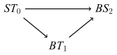

*Figure 9*

Applying F-G, we can take $\bW = \{\BT_1\}$, $\bZ = \varnothing$. We have:

$$\begin{align} \PP(\BS_2= 1 \mid \do(\ST_0= 1) \amp \do(\BT_1= 0)) &{} = .5\\ \PP(\BS_2= 1 \mid \do(\ST_0= 0) \amp \do(\BT_1= 0)) &{} = .01\\ \end{align}$$

Holding fixed that Billy doesn’t throw, Suzy’s throw raises the probability that the bottle will shatter. Thus the conditions are met for $\ST = 1$ to be an actual cause of $\BS = 1$.

To treat the case of fizzling from Section 4.2, let

- $\ST_0= 1$ if Suzy throws, 0 if not
- $\BT_0= 1$ if Billy throws, 0 if not
- $\SH_1= 1$ if Suzy’s rock hits the bottle, 0 if not
- $\BH_1= 1$ if Billy’s rock hits the bottle, 0 if not
- $\BS_2= 1$ if the bottle shatters, 0 if not

The actual values are $\ST_0= 1$, $\BT_0= 1$, $\SH_1= 1$, $\BH_1= 0$, and $\BS_2= 1$. The probabilities are:

$$\begin{align} \PP(\SH_1= 1 \mid \ST_0= 1) &{} = .5\\ \PP(\SH_1= 1 \mid \ST_0= 0) &{} = .01\\[2ex] \PP(\BH_1= 1 \mid \BT_0= 1) &{} = .9\\ \PP(\BH_1= 1 \mid \BT_0= 0) &{} = .01\\[2ex] \PP(\BS_2= 1 \mid \SH_1= 1 \amp \BH_1= 1) & {} = .998 \\ \PP(\BS_2= 1 \mid \SH_1= 1 \amp \BH_1= 0) & {} = .95\\ \PP(\BS_2= 1 \mid \SH_1= 0 \amp \BH_1= 1) & {} = .95 \\ \PP(\BS_2= 1 \mid \SH_1= 0 \amp \BH_1= 0) & {} = .01\\ \end{align}$$

As before, we have assigned probabilities close to, but not equal to, zero and one for some of the possibilities. The graph is shown in Figure 10.

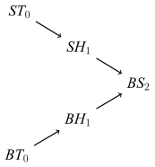

*Figure 10*

We want to show that $\BT_0= 1$ is not an actual cause of $\BS_2= 1$ according to F-G. We will show this by means of a dilemma: is $\BH_1\in \bW$ or is $\BH_1\in \bZ$?

Suppose first that $\BH_1\in \bW$. Then, regardless of whether $\ST_0$ and $\SH_1$ are in $\bW$ or $\bZ$, we will need to have

$$\begin{align} \PP(\BS_2 = 1 &\mid do(\BT_0= 1, \BH_1= 0, \ST_0= 1, \SH_1= 1))\\ \mathbin{\gt} &\PP(\BS_2 = 1 \mid do(\BT_0= 0,\BH_1= 0, \ST_0= 1, \SH_1= 1))\\ \end{align}$$

But in fact both of these probabilities are equal to .95. If we intervene to set $\BH_1$ to 0, intervening on $\BT_0$ makes no difference to the probability of $\BS_2= 1$.

So let us suppose instead that $\BH_1\in \bZ$. Then we will need to have

$$\begin{align} \PP(\BS_2 = 1 &\mid do(\BT_0= 1, \BH_1= 0, \ST_0= 1, \SH_1= 1))\\ \mathbin{\gt} &\PP(\BS_2 = 1 \mid do(\BT_0= 0, \ST_0= 1, \SH_1= 1))\\ \end{align}$$

This inequality is slightly different, since $\BH_1= 0$ does not appear in the second conditional probability. Nonetheless we have

$$ \PP(\BS_2 = 1 \mid do(\BT_0= 1, \BH_1= 0, \ST_0= 1, \SH_1= 1)) = .95 $$

and

$$ \PP(\BS_2 = 1 \mid do(\BT_0= 0, \ST_0= 1, \SH_1= 1)) = .9505 $$

(The second probability is a tiny bit larger, due to the very small probability that Billy’s rock will hit even if he doesn’t throw it.)

So regardless of whether $\BH_1\in \bW$ or is $\BH_1\in \bZ$, condition F-G is not satisfied, and $\BT_0= 1$ is not judged to be an actual cause of $\BS_2= 1$. The key idea is that it is not enough for Billy’s throw to raise the probability of the bottle shattering; Billy’s throw together with what happens afterwards has to raise the probability of shattering. As things actually happened, Billy’s rock missed the bottle. Billy’s throw *together with* his rock missing does not raise the probability of shattering.

Note that this treatment of fizzling requires that we include variables for whether the rocks hit the bottle. If we try to model this case using just three variables, $\BT$, $\ST$, and $\BS$, we will incorrectly judge that Billy’s throw is a cause of the bottle shattering. This raises the question of what is the “right” model to use, and whether we can know if we have included “enough” variables in our model. Fenton-Glynn (2017)[^fenton-glynn-2017] includes some discussion of these tricky issues.

### 4.5 Conclusion and Further Reading

While this section describes some success stories, it is safe to say that no analysis of actual causation is widely believed to perfectly capture all of our pre-theoretic intuitions about hypothetical cases. Indeed, it is not clear that these intuitions form a coherent set, or that they are perfectly tracking objective features of the world. Glymour et al. (2010) raise a number of challenges to the general project of trying to provide an analysis of actual causation.

The anthologies Collins et al. 2004 and Dowe & Noordhof 2004 contain a number of essays on topics related to the discussion of this section. Hitchcock 2004b has an extended discussion of the problem posed by fizzlers. Hitchcock 2015 is an overview of Lewis’s work on causation. The entry for counterfactual theories of causation discusses Lewis’s work, and counterfactual theories of causation more generally.

## References（引用注释）

> 原文参考文献已转为脚注引用：文内“作者-年份”引用组后附 [^key] 标记，完整条目见本文末脚注定义。

## Academic Tools

> |   | [How to cite this entry](https://plato.stanford.edu/cgi-bin/encyclopedia/archinfo.cgi?entry=causation-probabilistic). |
> | --- | --- |
> |   | [Preview the PDF version of this entry](https://leibniz.stanford.edu/friends/preview/causation-probabilistic/) at the [Friends of the SEP Society](https://leibniz.stanford.edu/friends/). |
> |   | [Look up topics and thinkers related to this entry](https://www.inphoproject.org/entity?sep=causation-probabilistic&redirect=True) at the Internet Philosophy Ontology Project (InPhO). |
> |   | [Enhanced bibliography for this entry](http://philpapers.org/sep/causation-probabilistic/) at [PhilPapers](http://philpapers.org/), with links to its database. |

## Other Internet Resources

- [Causal Analysis and Theory in Practice](http://causality.cs.ucla.edu/blog/)
- [Causality](http://bayes.cs.ucla.edu/BOOK-2K/), web page on Judea Pearl’s book.
- [The Tetrad Project](http://www.phil.cmu.edu/projects/tetrad/)
- [The Carnegie Mellon Curriculum on Causal and Statistical Reasoning](http://www.phil.cmu.edu/projects/csr/)

## Related Entries

causal models | causation: and manipulability | causation: backward | causation: counterfactual theories of | causation: the metaphysics of | determinism: causal | events | facts | Hume, David | Kant, Immanuel: and Hume on causality | probability, interpretations of | properties | quantum theory: the Einstein-Podolsky-Rosen argument in | Reichenbach, Hans | Reichenbach, Hans: common cause principle | Salmon, Wesley | scientific explanation: 20th century theories | Simpson’s paradox

### Acknowledgments

Thanks to Frederick Eberhardt, Luke Fenton-Glynn, Clark Glymour, Judea Pearl, Richard Scheines, Elliott Sober, Jim Woodward and the editors of the Stanford Encyclopedia of Philosophy for detailed comments, corrections, and discussion.

[^andersen-2013]: Andersen, Holly, 2013, “When to Expect Violations of Causal Faithfulness and Why it Matters”, *Philosophy of Science*, 80(5): 672–683. doi:10.1086/673937

[^beckers-2016]: Beckers, Sander and Joost Vennekens, 2016, “A General Framework for Defining and Extending Actual Causation Using CP-logic”, *International Journal of Approximate Reasoning*, 77: 105–126. doi:10.1016/j.ijar.2016.05.008

[^beebee-2009]: Beebee, Helen, Christopher Hitchcock, and Peter Menzies (eds.), 2009, *The Oxford Handbook of Causation*, Oxford: Oxford University Press.

[^bennett-1988]: Bennett, Jonathan, 1988, *Events and Their Names*, Indianapolis and Cambridge: Hackett.

[^billingsley-1995]: Billingsley, Patrick, 1995, *Probability and Measure*, third edition, New York: Wiley.

[^cartwright-1979]: Cartwright, Nancy, 1979, “Causal Laws and Effective Strategies”, *Noûs*, 13(4): 419–437. doi:10.2307/2215337

[^cartwright-1993]: –––, 1993, “Marks and Probabilities: Two Ways to Find Causal Structure”, in Fritz Stadler (ed.), *Scientific Philosophy: Origins and Development*, Dordrecht: Kluwer, pp. 113–119. doi:10.1007/978-94-017-2964-2_7

[^cartwright-2007]: –––, 2007, *Hunting Causes and Using Them*, Cambridge: Cambridge University Press. doi:10.1017/CBO9780511618758

[^collins-2004]: Collins, John, Ned Hall, and L.A. Paul (eds.), 2004, *Causation and Counterfactuals*, Cambridge MA: MIT Press.

[^davis-1988]: Davis, Wayne, 1988, “Probabilistic Theories of Causation”, in James Fetzer (ed.), *Probability and Causality*, Dordrecht: Reidel, pp. 133–160.

[^dowe-2004]: Dowe, Phil, 2004, “Chance-lowering Causes”, in Dowe and Noordhof 2004: 28–38.

[^dowe-2004-2]: Dowe, Phil and Paul Noordhof (eds.), 2004, *Cause and Chance*, London and New York: Routledge.

[^dupré-1984]: Dupré, John, 1984, “Probabilistic Causality Emancipated”, in Peter French, Theodore Uehling, Jr., and Howard Wettstein (eds), *Midwest Studies in Philosophy IX*, Minneapolis: University of Minnesota Press, pp. 169–175. doi:10.1111/j.1475-4975.1984.tb00058.x

[^eberhardt-2017]: Eberhardt, Frederick, 2017, “Introduction to the Foundations of Causal Discovery”, *International Journal of Data Science and Analytics*, 3(2): 81–91. doi:10.1007/s41060-016-0038-6

[^eells-1991]: Eells, Ellery, 1991, *Probabilistic Causality*, Cambridge: Cambridge University Press.

[^ehring-2009]: Ehring, Douglas, 2009, “Causal Relata”, in Beebee, Hitchcock, and Menzies 2009: 387–413.

[^feller-1968]: Feller, William, 1968, *An Introduction to Probability Theory and its Applications*, New York: Wiley.

[^fenton-glynn-2017]: Fenton-Glynn, Luke, 2017, “A Proposed Probabilistic Extension of the Halpern and Pearl Definition of ‘Actual Cause’”, *The British Journal for the Philosophy of Science*, 68(4): 1061–1124. doi:10.1093/bjps/axv056

[^galavotti-2005]: Galavotti, Maria Carla, 2005, *Philosophical Introduction to Probability*, Stanford, CA: CSLI Publications.

[^gillies-2000]: Gillies, Donald, 2000, *Philosophical Theories of Probability*, London and New York: Routledge.

[^glymour-2009]: Glymour, Clark, 2009, “Causality and Statistics”, in Beebee, Hitchcock, and Menzies 2009: 498–522.

[^glymour-1999]: Glymour, Clark and Gregory Cooper, 1999, *Computation, Causation, and Discovery*, Cambridge, MA: MIT Press.

[^glymour-2010]: Glymour, Clark, David Danks, Bruce Glymour, Frederick Eberhardt, Joseph Ramsey, Richard Scheines, Peter Spirtes, Choh Man Teng, and Jiji Zhang, 2010, “Actual Causation: a Stone Soup Essay”, *Synthese*, 175(2): 169–192. doi:10.1007/s11229-009-9497-9

[^glynn-2011]: Glynn, Luke, 2011, “A Probabilistic Analysis of Causation”, *British Journal for the Philosophy of Science*, 62(2): 343–392. doi:10.1093/bjps/axq015

[^hájek-2016a]: Hájek, Alan and Christopher Hitchcock, 2016a, *The Oxford Handbook of Probability and Philosophy*, Oxford: Oxford University Press.

[^hájek-2016b]: –––, 2016b, “Probability for Everyone—Even Philosophers”, in Hájek and Hitchcock 2016a: 5–30.

[^halpern-2016]: Halpern, Joseph Y., 2016, *Actual Causality*, Cambridge, MA: MIT Press.

[^halpern-2005]: Halpern, Joseph Y. and Judea Pearl, 2005, “Causes and Explanations: A Structural-Model Approach. Part I: Causes”, *British Journal for the Philosophy of Science*, 56(4): 843–887. doi:10.1093/bjps/axi147

[^hausman-1999]: Hausman, Daniel M., 1999, “The Mathematical Theory of Causation”, *British Journal for the Philosophy of Science*, 50(1): 151–62. doi:10.1093/bjps/50.1.151

[^hausman-1999-2]: Hausman, Daniel M. and James Woodward, 1999, “Independence, Invariance, and the Causal Markov Condition”, *British Journal for the Philosophy of Science*, 50(4): 521–583. doi:10.1093/bjps/50.4.521

[^hausman-2004]: –––, 2004, “Modularity and the Causal Markov Condition: a Restatement”, *British Journal for the Philosophy of Science*, 55(1): 147–61. doi:10.1093/bjps/55.1.147

[^hitchcock-2004a]: Hitchcock, Christopher, 2004a, “Routes, Processes, and Chance Lowering Causes”, in Dowe and Noordhof 2004: 138–151.

[^hitchcock-2004b]: –––, 2004b, “Do All and Only Causes Raise the Probabilities of Effects?” in Collins, Hall, and Paul 2004: 403–418.

[^hitchcock-2009]: –––, 2009, “Causal Models”, in Beebee, Hitchcock, and Menzies 2009: 299–314.

[^hitchcock-2015]: –––, 2015, “Lewis on Causation”, in B. Loewer and J. Schaffer (eds.), *A Companion to David Lewis*, Hoboken NJ: Wiley-Blackwell, pp. 295–312.

[^hitchcock-2016]: –––, 2016, “Probabilistic Causation”, in Hájek and Hitchcock 2016a: 815–32.

[^hume-1748]: Hume, David, 1748, *An Enquiry Concerning Human Understanding*, London.

[^jeffrey-1969]: Jeffrey, Richard, 1969, “Statistical Explanation vs. Statistical Inference”, in Nicholas Rescher (ed.), *Essays in Honor of Carl G. Hempel*, Reidel: Dordrecht, pp. 104–13.

[^kvart-1997]: Kvart, Igal, 1997, “Cause and Some Positive Causal Impact”, in James Tomberlin (ed.), *Philosophical Perspectives 11: Mind, Causation, and World*, Atascadero, CA: Ridgeview, pp. 401–432.

[^kvart-2004]: –––, 2004, “Causation: Probabilistic and Counterfactual Analyses”, in Collins, Hall, and Paul 2004: 359–387.

[^kyburg-1965]: Kyburg, Henry E., Jr., 1965, “Discussion: Salmon’s Paper”, *Philosophy of Science*, 32(2): 147–151. doi:10.1086/288034

[^lewis-1973]: Lewis, David, 1973, “Causation”, *Journal of Philosophy*, 70(17): 556–567. doi:10.2307/2025310

[^lewis-1986a]: –––, 1986a, “Events”, in Lewis 1986c: 241–270.

[^lewis-1986b]: –––, 1986b, “Postscripts to ‘Causation’”, in Lewis 1986c: 173–213.

[^lewis-1986c]: –––, 1986c, *Philosophical Papers, Volume II*, Oxford: Oxford University Press. doi:10.1093/0195036468.003.0006

[^mellor-2004]: Mellor, Hugh, 2004, “For Facts as Causes and Effects”, in Collins, Hall, and Paul 2004: 309–324.

[^menzies-1989]: Menzies, Peter, 1989, “Probabilistic Causation and Causal Processes: A Critique of Lewis”, *Philosophy of Science*, 56(4): 642–663. doi:10.1086/289518

[^neapolitan-2004]: Neapolitan, Richard, 2004, *Learning Bayesian Networks*, Upper Saddle River, NJ: Prentice Hall.

[^neapolitan-2016]: Neapolitan, Richard and Xia Jiang, 2016, “The Bayesian Network Story”, in Hájek and Hitchcock 2016a: 183–99.

[^noordhof-1999]: Noordhof, Paul, 1999, “Probabilistic Causation, Preemption and Counterfactuals”, *Mind*, 108(429): 95–125. doi:10.1093/mind/108.429.95

[^pearl-1988]: Pearl, Judea, 1988, *Probabilistic Reasoning in Intelligent Systems*, San Francisco: Morgan Kaufman.

[^pearl-2009]: –––, 2009, *Causality: Models, Reasoning, and Inference*, second edition, Cambridge: Cambridge University Press. First edition in 2000. doi:10.1017/CBO9780511803161

[^pearl-2010]: –––, 2010, “An Introduction to Causal Inference”, *The International Journal of Biostatistics*, 6(2): article 7. doi:10.2202/1557-4679.1203

[^pearl-2016]: Pearl, Judea, Madelyn Glymour, and Nicholas P. Jewell, 2016, *Causal Inference in Statistics: A Primer*, Chichester, UK: Wiley.

[^pearl-1991]: Pearl, Judea and Thomas Verma, 1991, “A Theory of Inferred Causation”, *Principles of Knowledge Representation and Reasoning: Proceedings of the 2ⁿᵈ International Conference*, San Mateo, CA: Morgan Kaufman, pp. 441–52.

[^psillos-2009]: Psillos, Stathis, 2009, “Regularity Theories of Causation”, in Beebee, Hitchcock, and Menzies 2009: 131–157.

[^reichenbach-1925]: Reichenbach, Hans, 1925, “Die Kausalstruktur der Welt und der Unterschied von Vergangenheit und Zukunft”, *Sitzungsberichte der Bayerische Akademie der Wissenschaft*, November: 133–175. English translation “The Causal Structure of the World and the Difference between Past and Future”, in Maria Reichenbach and Robert S. Cohen (eds.), *Hans Reichenbach: Selected Writings, 1909–1953*, Vol. II, Dordrecht and Boston: Reidel, 1978, pp. 81–119.

[^reichenbach-1956]: –––, 1956, *The Direction of Time*, Berkeley and Los Angeles: University of California Press.

[^salmon-1984]: Salmon, Wesley, 1984, *Scientific Explanation and the Causal Structure of the World*, Princeton: Princeton University Press.

[^schaffer-2001]: Schaffer, Jonathan, 2001, “Causes as Probability-Raisers of Processes”, *Journal of Philosophy*, 98(2): 75–92. doi:10.2307/2678483

[^scheines-1997]: Scheines, Richard, 1997, “An Introduction to Causal Inference” in V. McKim and S. Turner (eds.), *Causality in Crisis?*, Notre Dame: University of Notre Dame Press, pp. 185–199.

[^skyrms-1980]: Skyrms, Brian, 1980, *Causal Necessity*, New Haven and London: Yale University Press.

[^spirtes-2000]: Spirtes, Peter, Clark Glymour, and Richard Scheines [SGS], 2000, *Causation, Prediction and Search*, second edition, Cambridge, MA: MIT Press. First edition in 1993.

[^suppes-1970]: Suppes, Patrick, 1970, *A Probabilistic Theory of Causality*, Amsterdam: North-Holland Publishing Company.

[^twardy-2004]: Twardy, Charles R. and Kevin B. Korb, 2004, “A Criterion of Probabilistic Causation”, *Philosophy of Science*, 71(3): 241–262. doi:10.1086/421534

[^twardy-2011]: –––, 2011, “Actual Causation by Probabilistic Active Paths”, *Philosophy of Science*, 78(5): 900–913. doi:10.1086/662957

[^williamson-2009]: Williamson, Jon, 2009, “Probabilistic Theories of Causation”, in Beebee, Hitchcock, and Menzies 2009: 185–212.
