# cellular-automata — supplement（supplement）

> （《cellular-automata》词条补充材料，源：plato.stanford.edu/entries/cellular-automata/supplement.html）

#### Supplement to Cellular Automata

## The 256 Rules

As we have seen, in one-dimensional cellular automata with *range* = 1 and only two states there are 8 possible neighbors to be mapped to {1, 0}, giving a total of 256 possible rules. For illustration purposes, we collected the 200 time-steps evolution of all the 256 elementary rules (*black* = 1, *white* = 0), ordered by the Wolfram’s code: for any CA, at $t_0$ only the cell in the middle is black. To be sure, even if a rule is a Class 4 this does not guarantee that it will produce complex behavior starting from *any* possible configuration—as rule 54 clearly proves: compare its behavior below with the picture showed in the main entry.

*Rule 0*

*Rule 1*

*Rule 2*

*Rule 3*

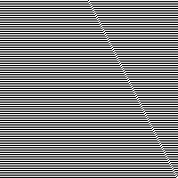

*Rule 4*

*Rule 5*

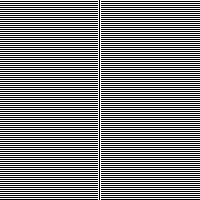

*Rule 6*

*Rule 7*

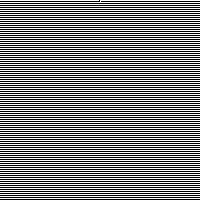

*Rule 8*

*Rule 9*

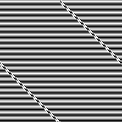

*Rule 10*

*Rule 11*

*Rule 12*

*Rule 13*

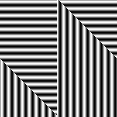

*Rule 14*

*Rule 15*

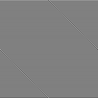

*Rule 16*

*Rule 17*

*Rule 18*

*Rule 19*

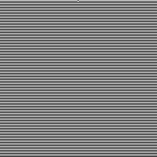

*Rule 20*

*Rule 21*

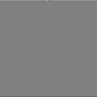

*Rule 22*

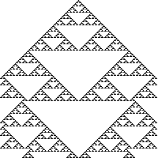

*Rule 23*

*Rule 24*

*Rule 25*

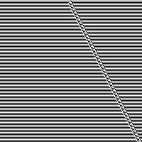

*Rule 26*

*Rule 27*

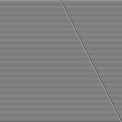

*Rule 28*

*Rule 29*

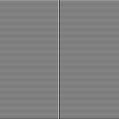

*Rule 30*

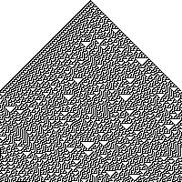

*Rule 31*

*Rule 32*

*Rule 33*

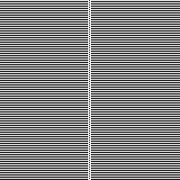

*Rule 34*

*Rule 35*

*Rule 36*

*Rule 37*

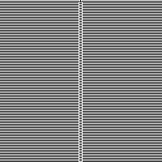

*Rule 38*

*Rule 39*

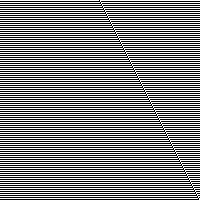

*Rule 40*

*Rule 41*

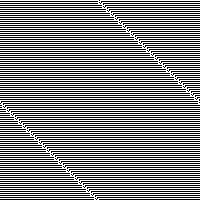

*Rule 42*

*Rule 43*

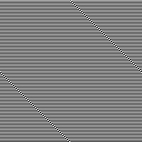

*Rule 44*

*Rule 45*

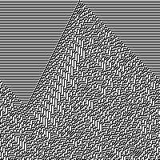

*Rule 46*

*Rule 47*

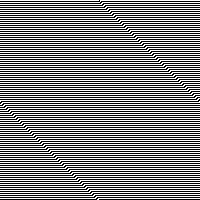

*Rule 48*

*Rule 49*

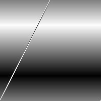

*Rule 50*

*Rule 51*

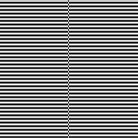

*Rule 52*

*Rule 53*

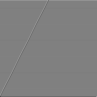

*Rule 54*

*Rule 55*

*Rule 56*

*Rule 57*

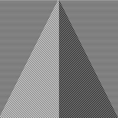

*Rule 58*

*Rule 59*

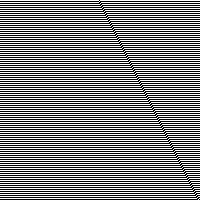

*Rule 60*

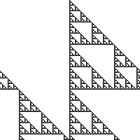

*Rule 61*

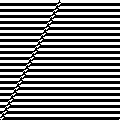

*Rule 62*

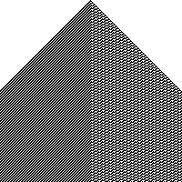

*Rule 63*

*Rule 64*

*Rule 65*

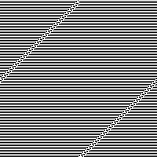

*Rule 66*

*Rule 67*

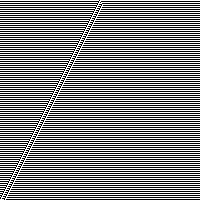

*Rule 68*

*Rule 69*

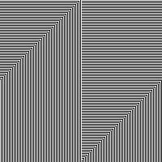

*Rule 70*

*Rule 71*

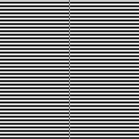

*Rule 72*

*Rule 73*

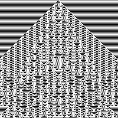

*Rule 74*

*Rule 75*

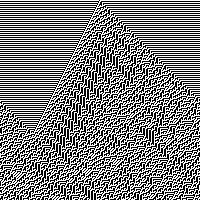

*Rule 76*

*Rule 77*

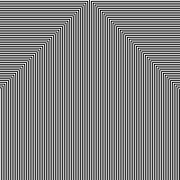

*Rule 78*

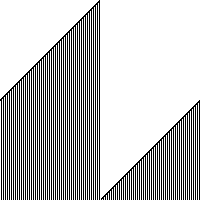

*Rule 79*

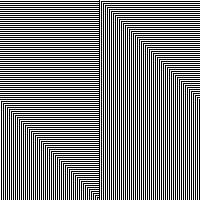

*Rule 80*

*Rule 81*

*Rule 82*

*Rule 83*

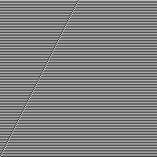

*Rule 84*

*Rule 85*

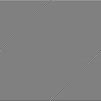

*Rule 86*

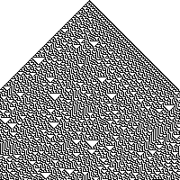

*Rule 87*

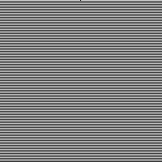

*Rule 88*

*Rule 89*

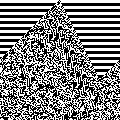

*Rule 90*

*Rule 91*

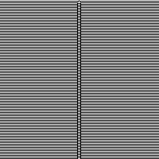

*Rule 92*

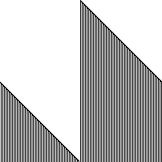

*Rule 93*

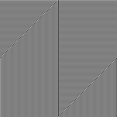

*Rule 94*

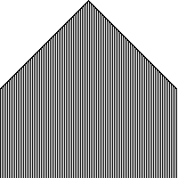

*Rule 95*

*Rule 96*

*Rule 97*

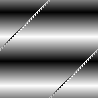

*Rule 98*

*Rule 99*

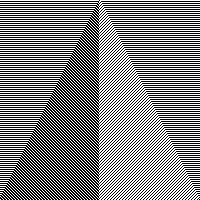

*Rule 100*

*Rule 101*

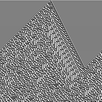

*Rule 102*

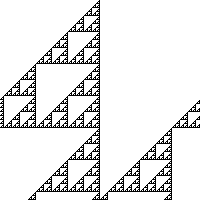

*Rule 103*

*Rule 104*

*Rule 105*

*Rule 106*

*Rule 107*

*Rule 108*

*Rule 109*

*Rule 110*

*Rule 111*

*Rule 112*

*Rule 113*

*Rule 114*

*Rule 115*

*Rule 116*

*Rule 117*

*Rule 118*

*Rule 119*

*Rule 120*

*Rule 121*

*Rule 122*

*Rule 123*

*Rule 124*

*Rule 125*

*Rule 126*

*Rule 127*

*Rule 128*

*Rule 129*

*Rule 130*

*Rule 131*

*Rule 132*

*Rule 133*

*Rule 134*

*Rule 135*

*Rule 136*

*Rule 137*

*Rule 138*

*Rule 139*

*Rule 140*

*Rule 141*

*Rule 142*

*Rule 143*

*Rule 144*

*Rule 145*

*Rule 146*

*Rule 147*

*Rule 148*

*Rule 149*

*Rule 150*

*Rule 151*

*Rule 152*

*Rule 153*

*Rule 154*

*Rule 155*

*Rule 156*

*Rule 157*

*Rule 158*

*Rule 159*

*Rule 160*

*Rule 161*

*Rule 162*

*Rule 163*

*Rule 164*

*Rule 165*

*Rule 166*

*Rule 167*

*Rule 168*

*Rule 169*

*Rule 170*

*Rule 171*

*Rule 172*

*Rule 173*

*Rule 174*

*Rule 175*

*Rule 176*

*Rule 177*

*Rule 178*

*Rule 179*

*Rule 180*

*Rule 181*

*Rule 182*

*Rule 183*

*Rule 184*

*Rule 185*

*Rule 186*

*Rule 187*

*Rule 188*

*Rule 189*

*Rule 190*

*Rule 191*

*Rule 192*

*Rule 193*

*Rule 194*

*Rule 195*

*Rule 196*

*Rule 197*

*Rule 198*

*Rule 199*

*Rule 200*

*Rule 201*

*Rule 202*

*Rule 203*

*Rule 204*

*Rule 205*

*Rule 206*

*Rule 207*

*Rule 208*

*Rule 209*

*Rule 210*

*Rule 211*

*Rule 212*

*Rule 213*

*Rule 214*

*Rule 215*

*Rule 216*

*Rule 217*

*Rule 218*

*Rule 219*

*Rule 220*

*Rule 221*

*Rule 222*

*Rule 223*

*Rule 224*

*Rule 225*

*Rule 226*

*Rule 227*

*Rule 228*

*Rule 229*

*Rule 230*

*Rule 231*

*Rule 232*

*Rule 233*

*Rule 234*

*Rule 235*

*Rule 236*

*Rule 237*

*Rule 238*

*Rule 239*

*Rule 240*

*Rule 241*

*Rule 242*

*Rule 243*

*Rule 244*

*Rule 245*

*Rule 246*

*Rule 247*

*Rule 248*

*Rule 249*

*Rule 250*

*Rule 251*

*Rule 252*

*Rule 253*

*Rule 254*

*Rule 255*

