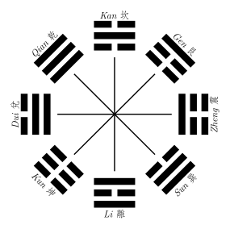
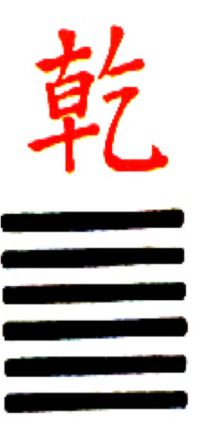

# chinese-change — appendix（supplement）

> （《chinese-change》词条补充材料，源：plato.stanford.edu/entries/chinese-change/appendix.html）

#### Supplement to Chinese Philosophy of Change (Yijing)

## Appendices

### Appendix 1. 8 Trigrams

Trigrams (and hexagrams) are described from the bottom line to the top line (e.g., line 1 is the lowest line). For accessibility, trigrams and hexagrams listed below are annotated in square brackets with ‘u’ for *yang* or unbroken lines and ‘w’ for *yin* or broken lines.

- *Kan* 坎 ☵ [wuw]
- *Qian* 乾 ☰ [uuu]
- *Dui* 兌 ☱ [uuw]
- *Kun* 坤 ☷ [www]
- *Li* 離 ☲ [uwu]
- *Sun* 巽 ☴ [wuu]
- *Zheng* 震 ☳ [uww]
- *Gen* 艮 ☶ [wwu]

### Appendix 2. 64 Hexagrams

| <table class="center cellpad-small-dense"> <tr> <td>8</td></tr> <tr> <td style="font-size:200%">&#19911;</td></tr> <tr> <td><em>Bi</em>   &#27604; </td></tr> </table> | <table class="center cellpad-small-dense"> <tr> <td>7</td></tr> <tr> <td style="font-size:200%">&#19910;</td></tr> <tr> <td><em>Shi</em>   &#24107;</td></tr> </table> | <table class="center cellpad-small-dense"> <tr> <td>6</td></tr> <tr> <td style="font-size:200%">&#19909;</td></tr> <tr> <td><em>Song</em>   &#35359;</td></tr> </table> | <table class="center cellpad-small-dense"> <tr> <td>5</td></tr> <tr> <td style="font-size:200%">&#19908;</td></tr> <tr> <td><em>Xu</em>   &#38656;</td></tr> </table> | <table class="center cellpad-small-dense"> <tr> <td>4</td></tr> <tr> <td style="font-size:200%">&#19907;</td></tr> <tr> <td><em>Meng</em>   &#33945;</td></tr> </table> | <table class="center cellpad-small-dense"> <tr> <td>3</td></tr> <tr> <td style="font-size:200%">&#19906;</td></tr> <tr> <td><em>Zhun</em>   &#23663;</td></tr> </table> | <table class="center cellpad-small-dense"> <tr> <td>2</td></tr> <tr> <td style="font-size:200%">&#19905;</td></tr> <tr> <td><em>Kun</em>   &#22372;</td></tr> </table> | <table class="center cellpad-small-dense"> <tr> <td>1</td></tr> <tr> <td style="font-size:200%">&#19904;</td></tr> <tr> <td><em>Qian</em>   &#20094;</td></tr> </table> |
| --- | --- | --- | --- | --- | --- | --- | --- |
| <table class="center cellpad-small-dense"> <tr> <td>16</td></tr> <tr> <td style="font-size:200%">&#19919; </td></tr> <tr> <td><em>Yu</em>   &#35947;</td></tr> </table> | <table class="center cellpad-small-dense"> <tr> <td>15</td></tr> <tr> <td style="font-size:200%"> &#19918;</td></tr> <tr> <td><em>Qian</em>   &#35609;</td></tr> </table> | <table class="center cellpad-small-dense"> <tr> <td>14</td></tr> <tr> <td style="font-size:200%">&#19917; </td></tr> <tr> <td><em>Dayou</em>   &#22823;&#26377; </td></tr> </table> | <table class="center cellpad-small-dense"> <tr> <td>13</td></tr> <tr> <td style="font-size:200%"> &#19916;</td></tr> <tr> <td><em>Tongren</em>   &#21516;&#20154; </td></tr> </table> | <table class="center cellpad-small-dense"> <tr> <td>12</td></tr> <tr> <td style="font-size:200%"> &#19915;</td></tr> <tr> <td><em>Pi</em>   &#21542;</td></tr> </table> | <table class="center cellpad-small-dense"> <tr> <td>11</td></tr> <tr> <td style="font-size:200%"> &#19914;</td></tr> <tr> <td><em>Tai</em>   &#27888;</td></tr> </table> | <table class="center cellpad-small-dense"> <tr> <td>10</td></tr> <tr> <td style="font-size:200%"> &#19913;</td></tr> <tr> <td><em> L&uuml;</em>   &#23653;</td></tr> </table> | <table class="center cellpad-small-dense"> <tr> <td>9 </td></tr> <tr> <td style="font-size:200%"> &#19912;</td></tr> <tr> <td><em>Xiaoxu</em>   &#23567;&#30044; </td></tr> </table> |
| <table class="center cellpad-small-dense"> <tr> <td>24. </td></tr> <tr> <td style="font-size:200%"> &#19927; </td></tr> <tr> <td><em>Fu</em>   &#24489;</td></tr> </table> | <table class="center cellpad-small-dense"> <tr> <td>23. </td></tr> <tr> <td style="font-size:200%"> &#19926; </td></tr> <tr> <td><em>Bo</em>   &#21085; </td></tr> </table> | <table class="center cellpad-small-dense"> <tr> <td>22. </td></tr> <tr> <td style="font-size:200%"> &#19925; </td></tr> <tr> <td><em>Bi</em>   &#36033; </td></tr> </table> | <table class="center cellpad-small-dense"> <tr> <td>21. </td></tr> <tr> <td style="font-size:200%"> &#19924; </td></tr> <tr> <td><em>Shike</em>   &#22124;&#21969; </td></tr> </table> | <table class="center cellpad-small-dense"> <tr> <td>20</td></tr> <tr> <td style="font-size:200%"> &#19923; </td></tr> <tr> <td><em>Guan</em>   &#35264; </td></tr> </table> | <table class="center cellpad-small-dense"> <tr> <td>19</td></tr> <tr> <td style="font-size:200%"> &#19922; </td></tr> <tr> <td><em>Lin</em>   &#33256; </td></tr> </table> | <table class="center cellpad-small-dense"> <tr> <td>18</td></tr> <tr> <td style="font-size:200%"> &#19921; </td></tr> <tr> <td><em>Gu</em>   &#34865; </td></tr> </table> | <table class="center cellpad-small-dense"> <tr> <td>17</td></tr> <tr> <td style="font-size:200%"> &#19920; </td></tr> <tr> <td><em>Sui</em>   &#38568; </td></tr> </table> |
| <table class="center cellpad-small-dense"> <tr> <td>32</td></tr> <tr> <td style="font-size:200%"> &#19935; </td></tr> <tr> <td><em>Heng</em>   &#24646; </td></tr> </table> | <table class="center cellpad-small-dense"> <tr> <td>31</td></tr> <tr> <td style="font-size:200%"> &#19934; </td></tr> <tr> <td><em>Xian</em>   &#21688; </td></tr> </table> | <table class="center cellpad-small-dense"> <tr> <td>30</td></tr> <tr> <td style="font-size:200%"> &#19933; </td></tr> <tr> <td><em>Li</em>   &#38626; </td></tr> </table> | <table class="center cellpad-small-dense"> <tr> <td>29</td></tr> <tr> <td style="font-size:200%"> &#19932; </td></tr> <tr> <td><em>Xikan</em>   &#32722;&#22350; </td></tr> </table> | <table class="center cellpad-small-dense"> <tr> <td>28</td></tr> <tr> <td style="font-size:200%"> &#19931; </td></tr> <tr> <td><em>Daguo</em>   &#22823;&#36942; </td></tr> </table> | <table class="center cellpad-small-dense"> <tr> <td>27</td></tr> <tr> <td style="font-size:200%"> &#19930; </td></tr> <tr> <td><em>Yi</em>   &#38948; </td></tr> </table> | <table class="center cellpad-small-dense"> <tr> <td>26</td></tr> <tr> <td style="font-size:200%"> &#19929; </td></tr> <tr> <td><em>Daxu</em>   &#22823;&#30044;</td></tr> </table> | <table class="center cellpad-small-dense"> <tr> <td>25. </td></tr> <tr> <td style="font-size:200%"> &#19928; </td></tr> <tr> <td><em>Wuwang</em>   &#26080; &#22916; </td></tr> </table> |
| <table class="center cellpad-small-dense"> <tr> <td>40</td></tr> <tr> <td style="font-size:200%"> &#19943; </td></tr> <tr> <td><em>Jie</em>   &#35299; </td></tr> </table> | <table class="center cellpad-small-dense"> <tr> <td>39</td></tr> <tr> <td style="font-size:200%"> &#19942; </td></tr> <tr> <td><em>Jian</em>   &#36423; </td></tr> </table> | <table class="center cellpad-small-dense"> <tr> <td>38</td></tr> <tr> <td style="font-size:200%"> &#19941; </td></tr> <tr> <td><em>Kui</em>   &#30589; </td></tr> </table> | <table class="center cellpad-small-dense"> <tr> <td>37</td></tr> <tr> <td style="font-size:200%"> &#19940; </td></tr> <tr> <td><em>Jiaren</em>   &#23478;&#20154; </td></tr> </table> | <table class="center cellpad-small-dense"> <tr> <td>36</td></tr> <tr> <td style="font-size:200%"> &#19939; </td></tr> <tr> <td><em>Mingyi</em>   &#26126;&#22839;</td></tr> </table> | <table class="center cellpad-small-dense"> <tr> <td>35</td></tr> <tr> <td style="font-size:200%"> &#19938; </td></tr> <tr> <td><em>Jin</em>   &#26185; </td></tr> </table> | <table class="center cellpad-small-dense"> <tr> <td>34</td></tr> <tr> <td style="font-size:200%"> &#19937; </td></tr> <tr> <td><em>Dazhuang</em>   &#22823;&#22767; </td></tr> </table> | <table class="center cellpad-small-dense"> <tr> <td>33</td></tr> <tr> <td style="font-size:200%"> &#19936; </td></tr> <tr> <td><em>Dun</em>   &#36975; </td></tr> </table> |
| <table class="center cellpad-small-dense"> <tr> <td>48</td></tr> <tr> <td style="font-size:200%"> &#19951; </td></tr> <tr> <td><em>Jing</em>   &#20117; </td></tr> </table> | <table class="center cellpad-small-dense"> <tr> <td>47</td></tr> <tr> <td style="font-size:200%"> &#19950; </td></tr> <tr> <td><em>Kun</em>   &#22256; </td></tr> </table> | <table class="center cellpad-small-dense"> <tr> <td>46</td></tr> <tr> <td style="font-size:200%"> &#19949; </td></tr> <tr> <td><em>Sheng</em>   &#21319; </td></tr> </table> | <table class="center cellpad-small-dense"> <tr> <td>45</td></tr> <tr> <td style="font-size:200%"> &#19948; </td></tr> <tr> <td><em>Cui</em>   &#33795; </td></tr> </table> | <table class="center cellpad-small-dense"> <tr> <td>44</td></tr> <tr> <td style="font-size:200%"> &#19947; </td></tr> <tr> <td><em>Gou</em>   &#23012; </td></tr> </table> | <table class="center cellpad-small-dense"> <tr> <td>43</td></tr> <tr> <td style="font-size:200%"> &#19946; </td></tr> <tr> <td><em>Guai</em>   &#22828; </td></tr> </table> | <table class="center cellpad-small-dense"> <tr> <td>42</td></tr> <tr> <td style="font-size:200%"> &#19945; </td></tr> <tr> <td><em>Yi</em>   &#30410; </td></tr> </table> | <table class="center cellpad-small-dense"> <tr> <td>41</td></tr> <tr> <td style="font-size:200%"> &#19944; </td></tr> <tr> <td><em>Sun</em>   &#25613; </td></tr> </table> |
| <table class="center cellpad-small-dense"> <tr> <td>56</td></tr> <tr> <td style="font-size:200%"> &#19959; </td></tr> <tr> <td><em>L&uuml;</em>   &#26053; </td></tr> </table> | <table class="center cellpad-small-dense"> <tr> <td>55</td></tr> <tr> <td style="font-size:200%"> &#19958; </td></tr> <tr> <td><em>Feng</em>   &#35920; </td></tr> </table> | <table class="center cellpad-small-dense"> <tr> <td>54</td></tr> <tr> <td style="font-size:200%"> &#19957; </td></tr> <tr> <td><em>Guimei</em>   &#27512;&#22969; </td></tr> </table> | <table class="center cellpad-small-dense"> <tr> <td>53</td></tr> <tr> <td style="font-size:200%"> &#19956; </td></tr> <tr> <td><em>Jian</em>   &#28472; </td></tr> </table> | <table class="center cellpad-small-dense"> <tr> <td>52</td></tr> <tr> <td style="font-size:200%"> &#19955; </td></tr> <tr> <td><em>Gen</em>   &#33390; </td></tr> </table> | <table class="center cellpad-small-dense"> <tr> <td>51</td></tr> <tr> <td style="font-size:200%"> &#19954; </td></tr> <tr> <td><em>Zhen</em>   &#38663; </td></tr> </table> | <table class="center cellpad-small-dense"> <tr> <td>50</td></tr> <tr> <td style="font-size:200%"> &#19953; </td></tr> <tr> <td><em>Ding</em>   &#40718; </td></tr> </table> | <table class="center cellpad-small-dense"> <tr> <td>49</td></tr> <tr> <td style="font-size:200%"> &#19952; </td></tr> <tr> <td><em>Ge</em>   &#38761; </td></tr> </table> |
| <table class="center cellpad-small-dense"> <tr> <td>64</td></tr> <tr> <td style="font-size:200%"> &#19967; </td></tr> <tr> <td><em>Weiji</em>   &#26410;&#28639; </td></tr> </table> | <table class="center cellpad-small-dense"> <tr> <td>63</td></tr> <tr> <td style="font-size:200%"> &#19966; </td></tr> <tr> <td><em>Jiji</em>   &#26082;&#28639; </td></tr> </table> | <table class="center cellpad-small-dense"> <tr> <td>62</td></tr> <tr> <td style="font-size:200%"> &#19965; </td></tr> <tr> <td><em>Xiaoguo</em>   &#23567;&#36942; </td></tr> </table> | <table class="center cellpad-small-dense"> <tr> <td>61</td></tr> <tr> <td style="font-size:200%"> &#19964; </td></tr> <tr> <td><em>Zhongfu</em>   &#20013;&#23386; </td></tr> </table> | <table class="center cellpad-small-dense"> <tr> <td>60</td></tr> <tr> <td style="font-size:200%"> &#19963; </td></tr> <tr> <td><em>Jie</em>   &#31680; </td></tr> </table> | <table class="center cellpad-small-dense"> <tr> <td>59</td></tr> <tr> <td style="font-size:200%"> &#19962; </td></tr> <tr> <td><em>Huan</em>   &#28185; </td></tr> </table> | <table class="center cellpad-small-dense"> <tr> <td>58.</td></tr> <tr> <td style="font-size:200%"> &#19961; </td></tr> <tr> <td><em>Dui</em>   &#20812; </td></tr> </table> | <table class="center cellpad-small-dense"> <tr> <td>57</td></tr> <tr> <td style="font-size:200%"> &#19960; </td></tr> <tr> <td><em>Xun</em>   &#24061; </td></tr> </table> |

### Appendix 3. Names of the 64 Hexagrams

Hexagrams (and trigrams) are described from the bottom line to the top line (e.g., line 1 is the lowest line). For accessibility, trigrams and hexagrams listed below are annotated in square brackets with ‘u’ for *yang* or unbroken lines and ‘w’ for *yin* or broken lines.

1. *Qian* 乾 (The Creative) ䷀ [uuu uuu]
2. *Kun* 坤 (The Receptive) ䷁ [www www]
3. *Zhun* 屯 (Difficulty at the Beginning) ䷂ [uww wuw]
4. *Meng* 蒙 (Youthful Folly) ䷃ [wuw wwu]
5. *Xu* 需 (Waiting) ䷄ [uuu wuw]
6. *Song* 訟 (Contention) ䷅ [wuw uuu]
7. *Shi* 師 (The Army) ䷆ [wuw www]
8. *Bi* 比 (Holding Together) ䷇ [www wuw]
9. *Xiaoxu* 小畜 (Lesser Domestication) ䷈ [uuu wuu]
10. *Lü* 履 (Treading) ䷉ [uuw uuu]
11. *Tai* 泰 (Peace) ䷊ [uuu www]
12. *Pi* 否 (Obstruction) ䷋ [www uuu]
13. *Tongren* 同人 (Fellowship) ䷌ [uwu uuu]
14. *Dayou* 大有 (Great Holdings) ䷍ [uuu uwu]
15. *Qian* 謙 (Modesty) ䷎ [wwu www]
16. *Yu* 豫 (Contentment) ䷏ [www uww]
17. *Sui* 隨 (Following) ䷐ [uww uuw]
18. *Gu* 蠱 (Ills to Be Cured) ䷑ [wuu wwu]
19. *Lin* 臨 (Overseeing) ䷒ [uuw www]
20. *Guan* 觀 (Viewing) ䷓ [www wuu]
21. *Shike* 噬嗑 (Bite Together) ䷔ [uww uwu]
22. *Bi* 賁 (Elegance) ䷕ [uwu wwu]
23. *Bo* 剝 (Peeling) ䷖ [www wwu]
24. *Fu* 復 (Return) ䷗ [uww www]
25. *Wuwang* 无妄 (No Errancy) ䷘ [uww uuu]
26. *Daxu* 大畜 (Great Domestication) ䷙ [uuu wwu]
27. *Yi* 頤 (Nourishment) ䷚ [uww wwu]
28. *Daguo* 大過 (Major Superiority) ䷛ [wuu uuw]
29. *Xikan* 習坎 (The Constant Sink Hole) ䷜ [wuw wuw]
30. *Li* 離 (Cohesion) ䷝ [uwu uwu]
31. *Xian* 咸 (Reciprocity) ䷞ [wwu uuw]
32. *Heng* 恆 (Perseverance) ䷟ [wuu uww]

1. *Dun* 遯 (Withdraw) ䷠ [wwu uuu]
2. *Dazhuang* 大壯 (Great Strength) ䷡ [uuu uww]
3. *Jin* 晉 (Advance) ䷢ [www uwu]
4. *Mingyi* 明夷 (Suppression of the Light) ䷣ [uwu www]
5. *Jiaren* 家人 (The Family) ䷤ [wuw wuu]
6. *Kui* 睽 (Contrariety) ䷥ [uuw uwu]
7. *Jian* 蹇 (Adversity) ䷦ [wwu wuw]
8. *Jie* 解 (Release) ䷧ [wuw uww]
9. *Sun* 損 (Diminution) ䷨ [uuw wwu]
10. *Yi* 益 (Increase) ䷩ [uww wuu]
11. *Guai* 夬 (Resolution) ䷪ [uuu uuw]
12. *Gou* 姤 (Encounter) ䷫ [wuu uuu]
13. *Cui* 萃 (Gathering) ䷬ [wws uuw]
14. *Sheng* 升 (Climbing) ䷭ [wuu www]
15. *Kun* 困 (Impasse) ䷮ [wuw uuw]
16. *Jing* 井 (The Well) ䷯ [wuu wuw]
17. *Ge* 革 (Radical Change) ䷰ [uwu uuw]
18. *Ding* 鼎 (The Cauldron) ䷱ [wuu uwu]
19. *Zhen* 震 (Quake) ䷲ [uww uww]
20. *Gen* 艮 (Restraint) ䷳ [wwu wwu]
21. *Jian* 漸 (Gradual Advance) ䷴ [wwu wuu]
22. *Guimei* 歸妹 (Marrying Maid) ䷵ [uuw uww]
23. *Feng* 豐 (Abundance) ䷶ [uwu uww]
24. *Lü* 旅 (The Wanderer) ䷷ [wwu uwu]
25. *Xun* 巽 (Compliance) ䷸ [wuu wuu]
26. *Dui* 兌 (Joy) ䷹ [uuw uuw]
27. *Huan* 渙 (Dispersion) ䷺ [wuw wuu]
28. *Jie* 節 (Control) ䷻ [uuw wuw]
29. *Zhongfu* 中孚 (Inner Trust) ䷼ [uuw wuu]
30. *Xiaoguo* 小過 (Minor Superiority) ䷽ [wwu uww]
31. *Jiji* 既濟 (Ferrying Complete) ䷾ [uwu wuw]
32. *Weiji* 未濟 (Ferrying Incomplete) ䷿ [wuw uwu]

### Appendix 4. Ten Wings

1. *Tuan* 彖 (Judgment) I
2. *Tuan* 彖 (Judgment) II
3. *Xiang* 象 (Image) I
4. *Xiang* 象 (Image) II
5. *Wenyang* 文言 (Words of Text)
6. *Xici* 繫辭 (Great Treatise) I
7. *Xici* 繫辭 (Great Treatise) II
8. *Xugua* 序卦 (Sequence of Hexagrams)
9. *Shuogua* 說卦 (Discussions of Trigrams)
10. *Zagua* 雜卦 (Miscellaneous Notes on Hexagrams)

### Appendix 5. *Qian* hexagram (#1)

6ᵗʰ line: Arrogant Dragon 5ᵗʰ line: Flying Dragon 4ᵗʰ line: Leaping Dragon 3ʳᵈ line: Diligent Gentleman 2ⁿᵈ line: Emerging Dragon 1ˢᵗ line: Hidden Dragon
