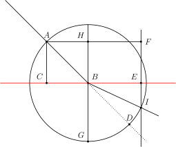
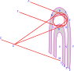
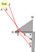
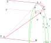

# descartes-method — figdesc（supplement）

> （《descartes-method》词条补充材料，源：plato.stanford.edu/entries/descartes-method/figdesc.html）

#### Supplement to Descartes’ Method

## Long descriptions for some figures in Descartes’ Method

### Figure 2 description

The person hits a tennis ball towards the ground at point B. Point B is the center of a circle; the ball enters the circle at point A and the perpendicular from A intersects the ground at point C (ABC form a right triangle with C being at the right angle). If the ball were not deflected it would have left the circle at point D (this line is dotted and ABD is a straight line with BD being a dotted line). Since the ball is deflected, point I is the actual point on the circle where it leaves. A vertical line from point I intersects the ground at point E (so CBE is a straight line). The vertical line continues up and intersects a horizontal line from A at point F. Point H is the point where the horizontal line AF intersects a vertical line from B. Point G is the point on the circle directly below B (i.e., the line GBH is a straight vertical line as is the line IEF).

### Figure 3 description

This seems to be an early version of figure 5. See the description there.

### Figure 4 description

The picture is of the sun (depicted as a yellow circle in the diagram) sending three rays (A, B, and C) at slightly different angles to a triangular prism which they hit (line MN) at right angles or nearly so (B does so exactly). The rays enter the prism (line MN) nearly straight but deflect when leaving (line NDEP, they leave within DE). They then hit a cloth (FGH) which is at right angles to NDEP; A which has deflected the most at H then B at G then C at F.

### Figure 5 description

The image is of a person looking to the right at a double rainbow (and raindrops falling) with various labeled lines and points. The SVG diagram is of the lines and points with the green curves indicating the edge of the red part of the inner primary rainbow and outer secondary rainbow. Point E is the eyes of the person either looking at the ground under the perceived rainbow (point M) and the line ME extending behind them to point Z). A solid line from E (eyes) also goes to the red part of the primary rainbow (D) and a dotted line from E to the red part of the secondary rainbow (K). From D the line deflects up to C then at right angles to B (all three of these points are on a circle). From K the dotted line deflects to I then right angles to H and then G (K, I, H, and G are on the same circle as D, C, and B). From B the line goes left to A and from G the line goes left to F. The inner primary rainbow is labeled (in to out) with T, S, and R and the outer secondary rainbow (in to out) with X and Y. V is used several times to indicate the area outside the rainbows.

### Figure 6 description

Descartes’ deduction of the rainbow (Garber 2001: 100). This is a series of linked questions followed by some linked deductions.

- Q1. What causes the rainbow (two regions of color)?
- note: [Rainbows appear only in the presence of water droplets; size is irrelevant to the phenomenon.]
- Q2. What causes the two regions of color in any spherical ball? This has two sets of linked questions. First
- Q2a. What causes the two regions?
- note: [The two regions result from two combinations of reflection and refraction.]
- Q3a. Why do the two combinations of reflection and refraction result in *discrete* regions? Then
- Q2b. What causes the color?
- note: [Color is produced without a curved surface and without reflection; it requires a restricted stream of light, and a refraction.]
- Q3b. How does *refraction* cause color under appropriate circumstances?
- Q4. How does light pass through media?
- Q5. What is light?
- *Intuition.* The nature of light, and how it passes through media [Cf. Q5, Q4]. From the intuition there is two sets of linked deductions which eventually merge. First,
- D1a. Law of refraction
- D2a. All parallel rays of light converge into two discrete streams after two refractions and one or two reflections, emerging from the drop (flask) in two discrete regions [Cf. Q3a]. Second,
- D1b. The only change in a restricted stream of light passing from one medium to another (refraction aside) is a differential tendency to rotation.
- D2b. Color can only be the differential tendency to rotation produced in passing from one medium to another in refraction [Cf. Q3b].
- D3. Parallel rays of light produce two discrete regions of color on a spherical ball of water [Cf. Q2].
- D4. Sunlight (parallel rays of light) on a region of water droplets will produce two regions of color [Cf. Q1].

### Figure 8 description

Two lines meet at point B to form an acute angle; points D and A with D further from B are on the lower line and points E and C with point E further from B are on the upper line; a line segment connects D and E and also A and C.

### Figure 9 description

A circle (dotted) with a center of N and bisected by the line segment OP (with O at approximately 160 degrees and P at -20 degrees). Point L is on the circle at -90 degrees from N. The line segment OP extends beyond the circle to intersect at point M with a horizontal line extending from L.
