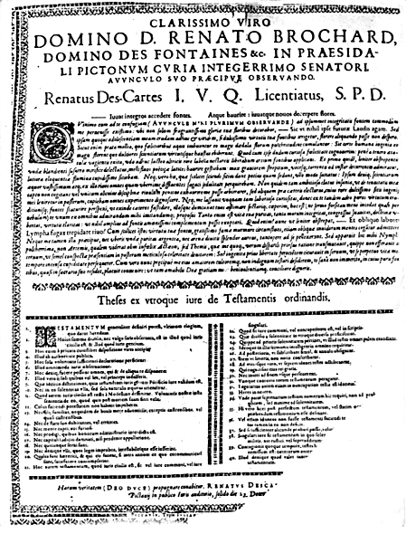

# descartes-works — originalaw（supplement）

> （《descartes-works》词条补充材料，源：plato.stanford.edu/entries/descartes-works/originalaw.html）

#### Supplement to Descartes’ Life and Works

## Descartes’ 1616 Law Thesis – Copy of the Original Document

### Further Documentation

> [Descartes’ 1616 Law Thesis – Latin Transcription](descartes-works.tlatin.md)
>
> [Descartes’ 1616 Law Thesis – English Translation](descartes-works.tenglish.md)

### Acknowledgments

Thanks to Roger Ariew and Helen Hattab for their advice on this project, and to Daniel Garber for providing me with a copy of the original document.

Return to Supplementary Document: Descartes’ Law Thesis
