# dynamic-epistemic — appendix-L-probability（supplement）

> （《dynamic-epistemic》词条补充材料，源：plato.stanford.edu/entries/dynamic-epistemic/appendix-L-probability.html）

#### Supplement to Dynamic Epistemic Logic

## Appendix L: Probabilistic update in Dynamic Epistemic Logic

Dynamic Epistemic Logics that incorporate probability have been studied by a number of authors. Van Benthem (2003), Kooi (2003), Baltag and Smets (2008a), and van Benthem, Gerbrandy, and Kooi (2009b) studied logics of finite probability spaces. Sack (2009) extended the work of Kooi (2003) and van Benthem, Gerbrandy, and Kooi (2009b) to full probability spaces (based on σ-algebras of events). For a broader perspective on connections between logic and probability, see the *Stanford Encyclopedia of Philosophy* entry Logic and Probability (Demey, Kooi, and Sack 2013). In this appendix, we focus on two approaches in DEL: the conditional probability model approach of Baltag and Smets (2008a) and the epistemic probability model approach of van Benthem, Gerbrandy, and Kooi (2009b).

- 1. Conditional probabilities and multi-agent probabilistic update
- 2. Probabilistic Dynamic Epistemic Logic

### 1. Conditional probabilities and multi-agent probabilistic update

Our focus here will be on the case of finitely many probabilistic outcomes and on logics that connect three areas of work: the Popper–Réyni–de Finetti extension of Bayesian probabilistic conditionalization, the theory of Belief Revision, and Dynamic Epistemic Logic.

Five key design principles for a DEL-style probabilistic theory of Belief Revision guide how we proceed:

1. Belief should be equated with subjective probability that is at or above a fixed nonzero threshold.
2. Belief should be closed under finite conjunctions.
3. Beliefs can be false.
4. Static belief change should proceed by probabilistic conditionalization.
5. Dynamic belief change should proceed by a DEL-style probabilistic product update.

The meaning of the first principle is that we are to fix a nonzero belief threshold *c* in the real-number unit interval $(0,1]$ and identify the statement that “agent *a* believes *F*” with the statement that “agent *a* assigns probability $P_a(F)\geq c$ to the event that *F* is true”. (A variant would be to take the strict inequality $P_a(F)>c$ instead, but we do not consider this variant here.) The second principle means that if an agent believes each of a finite number of statements $F_1,\dots,F_n$, then she should also believe the conjunction $F_1\land\cdots\land F_n$. Taken together, these two principles require us to choose the threshold $c=1$. The argument for this goes by way of the “Lottery Paradox” (van Fraassen 1995): for a fixed nonzero belief threshold $c\in(0,1)$ and an integer $n\geq\frac 1{1-c}$, the agent will believe that any one of the tickets in a fair *n*-ticket lottery is not a winner (because she assigns a probability $1-\frac 1n\geq c$ to the statement that ticket *i* is not a winner). So she believes that ticket $1$ is not a winner, that ticket $2$ is not a winner, and so on through ticket *n*. It follows by closure under finite conjunctions that she must believe that *no ticket is a winner*. However, she assigns probability $1\geq c$ to the event that *some ticket is a winner*, and therefore she also believes that *some ticket is a winner*—a contradiction. To avoid this contradiction and retain the first two design principles, we must choose the threshold $c=1$ for belief: to say that “agent *a* believes *F*” means that agent *a* assigns probability $1$ to the event the *F* is true. Written in a short motto, “belief is probability $1$”.

The third design principle reflects the fact that we are studying belief, which can fail to be true, as opposed to knowledge, which cannot. Allowing beliefs to be false in a “belief is probability $1$” setting means that an agent can assign probability $1$ to *F* even though *F* is false in the actual world. In such a circumstance, the agent must assign probability $0$ to the negation $\lnot F$. But then if we wish for the agent to statically revise her beliefs upon learning that her belief in *F* is mistaken, then what we seek is for the agent to revise on the event $\lnot F$ that she assigns probability $0$. Since we wish for this revision to proceed by way of conditionalization as per the fourth design principle, it follows that we seek a probabilistic conditionalization on an event of probability $0$. This is forbidden in classical probability theory. However, it is possible in the Popper–Rényi–de Finetti theory of conditional probabilities (Popper 2002 [1935]; van Fraassen 1976, 1995; Réyni 1964, 1955; Halpern 2001), which takes conditional probability as its basic notion and provides an axiomatization of this notion. Connections between the Popper–Rényi–de Finetti theory and Belief Revision have been studied by van Fraassen (1995), Boutilier (1995), Halpern (2003), and Arló-Costa and Parikh (2005). In Section 1, we follow the presentation, definitions, and results of Baltag and Smets (2008a) in extending this work over finite spaces to DEL, thereby implementing the fifth and final design principle.

The axiomatic theories of conditional probability proposed by Popper (2002 [1935]), Rényi (1964), and van Fraassen (1976) and the “conditional lexicographic probability spaces” of Game Theory are all equivalent in the case of finite spaces.

**Finite conditional probability space.** A *finite conditional probability space* is a pair $(W,\mu)$ consisting of a nonempty finite set *W* of objects (called “worlds”) and a function $\mu:\wp(W)\times \wp(W)\to[0,1]$ that maps any two sets of worlds $S,T\subseteq W$ to a real number $\mu(S\mid T)$ in the unit interval $[0,1]$ and that satisfies the axioms that make it a *Popper function* on *W*:

- $\mu(S\mid S)=1$,
- $\mu(S\cup T\mid U)=\mu(S\mid U)+\mu(T\mid U)$ if $S\cap T=\emptyset$ and $U\neq\emptyset$, and
- $\mu(S\cap T\mid U)=\mu(S\mid T\cap U)\cdot\mu(T\mid U)$.

For convenience, we let $\mu(S)$ abbreviate $\mu(S\mid W)$.

Intuitively, $\mu(S\mid T)$ denotes the probability of *S* conditional on *T*. With our abbreviation $\mu(S)=\mu(S\mid W)$, the expression $\mu(S)$ denotes the unconditional probability of *S*. The unary unconditional probability function $\mu(-\mid W)$ is a classical probability function over our finite space *W* (i.e., the function satisfies Kolmogorov’s axioms for finite spaces). Further, it can be shown that the classical conditionalization of this function coincides with the two-place conditional $\mu(-\mid-)$; that is,

$$ \frac{\mu(S\cap T)}{\mu(T)} = \mu(S\mid T) \quad\text{if } \mu(T)\neq 0, $$

where the left side of the equality is the standard definition of the probability of *S* conditional on *T* in terms of the one-place classical probability function $\mu(-)\coloneqq\mu(-\mid W)$ and the right side of the equality is just the value of the two-place Popper function $\mu(-\mid-)$. Accordingly, a Popper function is an extension of the classical notion of probability and conditional probability. Further, this extension does not prohibit conditionalization on events *T* of probability $0$; that is, the Popper function $\mu$ assigns a real-number value $\mu(S\mid T)\in[0,1]$ even in the case that $\mu(T)=0$. For example, taking $S=T=\emptyset$ and $U=W$ in the second Popper axiom, it follows that $\mu(\emptyset)=\mu(\emptyset\mid W)=0$; however, setting $T=U=\emptyset$ in the third Popper axiom and observing that we have $\mu(\emptyset\mid\emptyset)=1$ by the first Popper axiom, we have $\mu(S\mid \emptyset)=1$. So it is possible to conditionalize on the probability-$0$ event $\emptyset$.

The Popper function $\mu$ of a finite conditional probability space is completely determined by the “relative priority” it assigns between pairs of worlds; that is, if we define the “relative priority of *w* over *v*” to be the value $(w,v)_\mu\in[0,1]$ obtained by setting $$ (w,v)_\mu\coloneqq\mu(\{w\}\mid\{w,v\}), $$ then it follows that $$ \mu(S\mid T)= \sum_{w\in S\cap T} \left(\sum_{t\in T}\frac{(t,w)_\mu}{(w,t)_\mu}\right)^{-1} \quad\text{if } T\neq\emptyset, $$ where the usual conventions are used: $\sum_{x\in\emptyset} S_x=0$, $\frac 10=\infty$, $\frac 1\infty=0$, $\infty+\infty=\infty$, and $x+\infty=\infty+x=\infty$ for each real number *x*. This reduction to “relative priority” of pairs suggests an alternative characterization of finite conditional probability spaces that, as we will see, will be useful for presenting a DEL-style account of probabilistic belief change.

**Priority Space (Baltag and Smets 2008a).** A *priority space* is a pair $$ (W,(-,-)) $$ consisting of a nonempty finite set *W* of objects (called “worlds”) and a function $(-,-):W\times W\to[0,1]$ that maps any two worlds *w* and *v* to a real number $(w,v)$ in the interval [0,1] and that satisfies the axioms that make it a *priority function* on *W*:

- $(w,w)=1$ for all $w\in W$;
- $(w,v)=1-(v,w)$ for all $w,v\in W$ with $w\neq v$; and
- for all $u,v,w\in W$ such that $w\neq v$ and $(w,u)\cdot (u,v)+(v,u)\cdot(u,w)\neq 0$, we have $$ (w,v)= \frac{(w,u)\cdot(u,v)}{(w,u)\cdot (u,v)+(v,u)\cdot(u,w)}. $$

**Priority Space Theorem (Baltag and Smets 2008a).** There is a one-to-one correspondence mapping each finite conditional probability space $(W,\mu)$ to a priority space $(W,(-,-))$ such that $(w,v)_\mu=(w,v)$. In particular, given a Popper function $\mu$ on *W*, defining $(w,v)\coloneqq(w,v)_\mu$ gives a priority function on *W*; and given a priority function $(-,-)$ on *W*, defining $\mu(S,T)$ by $$ \mu(S\mid T)\coloneqq \left\{ \begin{array}{cl} \sum\limits_{w\in S\cap T} \left(\sum\limits_{t\in T}\frac{(t,w)_\mu}{(w,t)_\mu}\right)^{-1} & \text{if } T\neq\emptyset \\ 1 & \text{if } T=\emptyset \end{array} \right. $$ gives a Popper function on *W*.

We will use Popper functions (or their equivalent priority functions) to define and picture the models and action models for a DEL-style theory of probabilistic belief change. For each agent *a*, a Popper function $\mu_a$ will describe what the agent believes, conditionally or unconditionally. Just like in plausibility models, connected components of sets of worlds will be used to specify informational consistency and define knowledge. In particular, we will have the following:

- to say that “agent *a* knows *F* at world *w*” means that *F* is true at all worlds $x\in\cc_a(w)$ that are informationally equivalent with *w* according to agent *a*; and
- to say that “agent *a* believes *F* conditional on *G* at world *w*” means that *a* assigns probability 1 to the set of *F*-worlds conditional on the set of *G*-worlds that are informationally equivalent with *w*, meaning $$ \mu_a(\sem{F}\mid\sem{G}\cap\cc_a(w))=1. $$
- to say that “agent *a* believes *F* (unconditionally) at world *w*” means that agent *a* believes *F* conditional on the propositional constant $\top$ for truth at world *w*.

In the definition of conditional belief, we restrict the conditionalization to those worlds that are informationally equivalent with *w* to reflect the fact that we link knowledge with truth in all informationally equivalent worlds. In particular, if the actual world is *w*, then the agent knows that any world that is not informationally equivalent with *w* cannot be the actual world, and therefore she can rule out all such worlds. Accordingly, her beliefs must be consistent with what she knows, which requires conditionalization on subsets of worlds that are all informationally equivalent with the actual world.

**Conditional probability model.** Given a nonempty set $\sP$ of propositional letters and a finite nonempty set $\sA$ of agents, a *conditional probability model* is a structure $$ M=(W,\mu,\sim,V) $$ consisting of a finite nonempty set *W* of *worlds* identifying the possible states of affairs that might obtain, a function $\mu$ that assigns to each agent *a* a Popper function $\mu_a$ on *W*, a function $\cc$ that assigns to each agent *a* an equivalence relation $\sim_a$ on *W*, and a *propositional valuation* *V* mapping each propositional letter to the set of worlds at which that letter is true. For worlds $w,v\in W$ and each agent $a\in\sA$, we define the following:

- $\cc_a(w)\coloneqq\{v\in W\mid v\sim_a w\}$ is the set of worlds that are *informationally equivalent* to *w* according to agent *a*, and
- $(w,v)_a\coloneqq(w,v)_{\mu_a}$ is the relative priority of *w* over *v* according to agent *a*.

A *pointed conditional probability model*, sometimes called a *scenario* or a *situation*, is a pair $(M,w)$ consisting of a conditional probability model *M* and a world *w* (called the *point*) that designates the state of affairs that we (the formal modelers) currently assume to be actual.

We draw conditional probability models like plausibility models except that arrows are labeled differently. The labeling describes relative priorities agents assign between the worlds at the source and destination of the arrow. We require that arrows are labeled so as to respect the axioms of priority functions. This places restrictions on arrow labelings and leads to certain simplifications in our pictures.

- *Labeling Constraint*: arrow labels consist of nonempty finite sequences of agents, a colon, and a real number *x* in the unit interval $[0,1]$. In a picture: 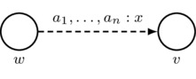 $\text{must satisfy } \left\{ \begin{array}{l} n\in\mathbb{Z}^+ \\ a_1,\dots,a_n\in\sA \\ x\in[0,1] \end{array} \right.$ Intuitively, this arrow indicates that for each agent $a_i$ appearing in the nonempty finite list $a_1,\dots,a_n$ of agents, we have $(v,w)_{a_i}=x$, which says that agent $a_i$ prioritizes the destination world *v* over the source world *w* with relative priority *x*. Note that conditional plausibility models can be distinguished from plausibility models by the addition of the colon symbol (“:”) and the real number $x\in[0,1]$ in the arrow label.
- *Labeling Totality and Uniqueness*: for each agent *a* and any two worlds *w* and *v* (including the possibility that $w=v$), there is a unique arrow from *w* to *v* containing *a* in its label, and there is a unique arrow from *v* to *w* containing *a* in its label. Note that not all arrows need be drawn, so long as implicit (i.e., undrawn) arrows can be uniquely inferred from the arrows that are drawn using the rules for drawing implicit arrows. These rules are presented as the next three bulleted items; there is one rule for each of the three axioms of priority spaces.
- *First Axiom*: arrows must respect the first axiom of priority spaces; that is, $(w,w)_a=1$. In a picture: 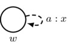 must satisfy $x=1$ Also, for convenience, we adopt the following rule for simplifying drawings: for each agent *a*, there is an implicit reflexive arrow labeled by *a* and looping from each world *w* back to *w* itself such that the first axiom is satisfied. 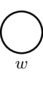 indicates 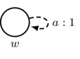
- *Second Axiom*: arrows must respect the second axiom of priority spaces; that is, $$ (w,v)_a=1-(v,w)_a \quad\text{if } w\neq v. $$ In a picture: 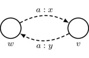 must satisfy $y=1-x$ if $w\neq v$ Also, for convenience, we adopt the following rule for simplifying drawings: for each agent *a*, each non-reflexive arrow that is labeled by *a* and the number *x* and is drawn in one direction gives rise to an implicit arrow that is labeled by *a* and the number $1-x$ and is drawn in the opposite direction. 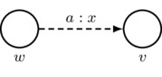 indicates 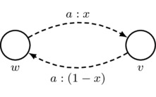 if $w\neq v$
- *Third Axiom*: arrows must respect the third axiom of priority spaces; that is, given $u,v,w\in W$ such that $w\neq v$ and $(w,u)_a\cdot(u,v)_a+(v,u)_a\cdot(u,w)_a\neq 0$, we have $$\begin{align*} (w,v)_a &= \frac {(w,u)_a\cdot(u,v)_a} {(w,u)_a\cdot(u,v)_a+(v,u)_a\cdot(u,w)_a} \\ &= \frac {(w,u)_a\cdot(u,v)_a} {(w,u)_a\cdot(u,v)_a+(1-(u,v)_a)\cdot(1-(w,u)_a)}, \end{align*}$$ where the second equality follows by the first axiom of priority spaces. In a picture: if $w\neq v$ and $x\cdot y+(1-y)\cdot (1-x)\neq 0$, then 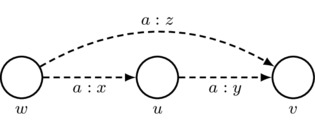 $$ \mbox{must satisfy } z=\frac{x\cdot y}{x\cdot y+(1-y)\cdot(1-x)} $$ Also, for convenience, we adopt the following rule for simplifying drawings: for each agent *a*, every sequence of two *a*-labeled arrows that has different starting and ending worlds gives rise to an implicit third *a*-labeled arrow whose number is such that the third axiom of priority spaces is satisfied. Thus, if $w\neq v$ and $x\cdot y+(1-y)\cdot (1-x)\neq 0$, then 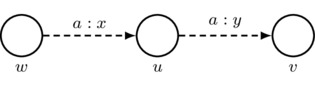 indicates 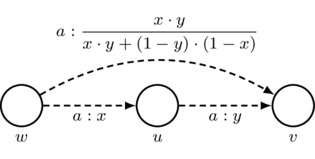
- *Informational Equivalence*: we write $w\sim_a v$ (equivalently that $w\in\cc_a(v)$ or that $v\in\cc_a(w)$) to mean that, if we ignore all arrowheads, then there is a sequence of zero or more dashed lines that create a path between *w* and *v*. So, for example, the picture 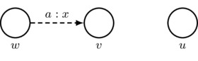 indicates that $w\sim_a w$, $w\sim_a v$, $v\sim_a v$, $u\sim_a u$, $w\nsim_a u$, and $v\nsim_a u$ (along with each of the expressions $x\sim_a y$ and $x'\nsim_a y'$ appearing in this list with *x* and *y* exchanged).

The above items fully specify the rules and simplifications we may use to draw conditional probability models. We use these models to interpret the language \\eqref{CPL} of Conditional Probability Logic.

$$\begin{gather*}\taglabel{CPL} F \ccoloneqq p \mid F\land F \mid \lnot F \mid [a:x]F \mid K_aF \\ \small p\in\sP,\; a\in\sA,\; x\in[0,1] \end{gather*}$$

The satisfaction relation $\models$ between pointed conditional probability models and formulas of \\eqref{CPL} is defined as follows.

- $\sem{F}\coloneqq\{w\in W\mid M,w\models F\}$.
- $M,w\models p$ holds if and only if $w\in V(p)$.
- $M,w\models F\land G$ holds if and only if both $M,w\models F$ and $M,w\models G$.
- $M,w\models\lnot F$ holds if and only if $M,w\not\models F$.
- $M,w\models[a:x]F$ holds if and only if $\mu_a(\sem{F}\mid S\cap\cc_a(w))\geq x$ for all $S\subseteq W$ such that $w\in S$.
- $M,w\models K_aF$ holds if and only if $M,v\models F$ for each $v\in\cc_a(w)$.

The formula $[a:x]F$ says, “agent *a* safely believes *F* with degree at least *x*”. This means that, conditional on any informationally consistent and truthful event, agent *a* assigns a probability no less than *x* to the statement that *a* is true. Note that this notion of “safe degree of belief” is different than the positive-integer notion $B^n_aF$ of degree-*n* belief introduced in the main article. Further, we observe that a variant of our notation $[a:x]F$ is to instead write $\Box_a^x F$.

For convenience, we let $$ \Box_a F \quad\text{abbreviate}\quad [a:1]F, $$ so that the defeasible knowledge (or “safe belief”) formula $\Box_aF$ denotes degree-$1$ safe belief. With this abbreviation in hand, the language $(K\Box)$ can be interpreted over conditional probability models. This leads to the following result.

**Probability-Plausibility Theorem (Baltag and Smets 2008a).**

- Every conditional probability model $M=(W,\mu,\sim,V)$ gives rise to a plausibility model $M^-=(W,\geq,V)$ having the same worlds and valuation and satisfying the same $(K\Box$)-formulas: for each $w\in W$ and $F\in(K\Box)$, we have $$ M^-,w\models F \quad\text{iff}\quad M,w\models F . $$ To obtain $M^-$, set $w\leq_a v$ if and only if $(w,v)_a\neq 0$.
- Every plausibility model $M=(W,\geq,V)$ gives rise to a conditional plausibility model $M^+=(W,\mu,\sim,V)$ having the same worlds and valuation and satisfying the same $(K\Box)$-formulas: for each $w\in W$ and $F\in(K\Box)$, we have $$ M^+,w\models F \quad\text{iff}\quad M,w\models F . $$ To obtain $M^+$, use the Priority Space Theorem to define $\mu_a$ according to the following: $$ (w,v)_a \coloneqq \left\{ \begin{array}{cl} 1 & \text{if } w\lt_a v \text{ or } w=v, \\ 0 & \text{if } w\gt_a v, \\ \frac 12 & \text{ otherwise.} \end{array} \right. $$

A consequence of the Probability-Plausibility Theorem is that the given model and the constructed model satisfy the *same knowledge and belief formulas*. This provides a natural connection between the quantitative static belief change setting of conditional probability models and the qualitative statice is statice correct? belief change setting of plausibility models. It also yields the following result.

**$\KBox$ Soundness and Completeness (Baltag and Smets 2008a).** The theory $\KBox$ is sound and complete with respect to the collection $\sC_*$ of pointed conditional probability models. That is, for each $(K\Box)$-formula *F*, we have $\KBox\vdash F$ if and only if $\sC_*\models F$.

It has not yet been shown whether there is a complete axiomatization of the validities of the full language \\eqref{CPL}. It may also be of interest to determine whether there is such an axiomatization for the restricted language obtained by requiring all degrees of belief to be rational numbers in the unit interval $[0,1]$.

Baltag and Smets (2008a) also developed a probabilistic version of action models. These have a structure much like that of conditional probability models.

**Conditional probability action model.** Given a set of formulas $\Lang$ and a finite nonempty set $\sA$ of agents, a *conditional probability action model* is a structure $$ A=(E,\mu,\pre) $$ consisting of a nonempty finite set *E* of the possible communicative *events* that might occur, a function $\mu$ that assigns to each agent *a* a Popper function $\mu_a$ on *E*, and a function $\pre$ that assigns to each event *e* in *E* a formula $\pre(e)\in\Lang$ called the *precondition* of *e*. A *pointed conditional probability action model*, sometimes also called an *action*, is a pair $(A,e)$ consisting of a plausibility action model *A* and an event *e* in *A* that is called the *point*. Conditional probability action models are drawn like conditional probability models except that events are pictured as rectangles instead of as circles. The point of a conditional probability action model is indicated by a double rectangle.

We define language \\eqref{CPAL} of Conditional Probability Action Logic along with the set $\CPAM_*$ of pointed conditional probability action models having preconditions in the language \\eqref{CPAL} according to the following recursive grammar:

$$\begin{gather*}\taglabel{CPAL} F \ccoloneqq p \mid F\land F \mid \lnot F \mid [a:x]F \mid K_aF \mid [A,e]F \\ \small p\in\sP,\; a\in\sA,\; x\in[0,1],\; (A,e)\in\CPAM_* \end{gather*}$$

The satisfaction relation $\models$ between pointed conditional probability models and formulas of \\eqref{CPAL} is an extension of the relation between $\models$ between pointed conditional probability models and formulas of \\eqref{CPL} obtained by adding the following:

- $M,w\models[A,e]G$ holds if and only if $M,w\not\models\pre(e)$ or $M[A],(w,e)\models G$, where the model $$ M[A] = (W[A],\mu[A],V[A]) $$ is the result of the *probabilistic product update* operation $M\mapsto M[A]$ defined by:
- $M[A]\coloneqq\{(v,g)\in W\times E\mid M,v\models\pre(g)\}$ — pair worlds with events whose preconditions they satisfy;
- for each agent $a\in\sA$, use the Priority Space Theorem to define $\mu[A]_a$ according to the following: $$ ((v_1,g_1),(v_2,g_2))_a \coloneqq \lim_{x\to(v_1,v_2)_a} \frac{x\cdot(g_1,g_2)_a} {x\cdot(g_1,g_2)_a+(1-x)\cdot(1-(g_1,g_2)_a)}, $$ where the limit is taken over all *x*’s such that the denominator is nonzero; and
- $(v,g)\in V[A](p)$ if and only if $M,v\models p$ — make the truth of *p* at $(v,g)$ like that at *v*.

The definition of the Popper function $\mu[A]_a$ resulting after the probabilistic product update by *A* may be understood by way of a three-part case analysis.

- In case $(g_1,g_2)_a=0$, we have $((v_1,g_1),(v_2,g_2))_a=0$.
- In case $(g_1,g_2)_a=1$ and $g_1\neq g_2$, we have $((v_1,g_1),(v_2,g_2))_a=1$.
- In all other cases, we have $$ ((v_1,g_1),(v_2,g_2))_a = \frac {(v_1,v_2)_a\cdot(g_1,g_2)_a} {(v_1,v_2)_a\cdot(g_1,g_2)_a + (1-(v_1,v_2)_a)\cdot(1-(g_1,g_2)_a)} . $$

The first two cases tell us the following: if $g_1$ and $g_2$ are distinct events and the agent believes conditional on one of $g_1$ or $g_2$ occurring that it is event $g_i$ that occurred for some $i\in\{1,2\}$, then she will also believe conditional on one of $(v_1,g_1)$ or $(v_2,g_2)$ being the actual world that it is world $(v_i,g_i)$ that is in fact actual. This is just the *action-priority update* from the language (APUL). This rule tells us that the incoming information from the conditional probability action model overrides information from the given conditional probability model whenever these two information sources are contradictory. This prioritization agrees with the basic assumption in Belief Revision theory that “new” incoming information (from the conditional probability action model) is to be prioritized over “old” information (from the conditional probability model) in case of contradiction. The third case above tells us that, so long as the “new” information does not contradict the ”old” information, these two sources of information are to be considered as probabilistically independent, so the resulting relative priority of the newly created world $(v_1,g_1)$ over the newly created world $(v_2,g_2)$ is given by a product of the given relative priorities $(v_1,v_2)_a$ and $(g_1,g_2)_a$. The denominator on the right side of the equality of the third case ensures that this product is normalized over the subspace where the initial worlds to be considered are just $v_1$ and $v_2$ and the initial events to be considered are just $g_1$ and $g_2$.

It is an open question as to whether there is a complete axiomatization of the validities of \\eqref{CPAL}.

We refer the reader to Baltag and Smets (2008a) for further details, including the definition of a number of interesting conditional probability action models and the study of the game-theoretic notion of “common belief of rationality”.

### 2. Probabilistic Dynamic Epistemic Logic

We now look at another approach to reasoning about probabilistic Dynamic Epistemic Logic due to van Benthem, Gerbrandy, and Kooi (2009b). This account begins with a different probabilistic semantics based on a different kind of model: the epistemic probability model.

**Epistemic probability model.** Given a nonempty set $\sP$ of propositional letters and a finite nonempty set $\sA$ of agents, an *epistemic probability model* is a structure $$ M=(W,\sim,P,V) $$ consisting of a finite nonempty set *W* of *worlds* identifying the possible states of affairs that might obtain, a function $\sim$ that assigns to each agent *a* an equivalence relation $\sim_a$ on *W*, a function *P* that assigns to each agent $a\in\sA$ and world $w\in W$ a probability assignment $P_a(w):W\to[0,1]$ to each world in *W*, and a *propositional valuation* $V:\sP\to \wp(W)$ mapping each propositional letter to the set of worlds at which that letter is true. A *pointed epistemic probability model* is a pair $(M,w)$ consisting of an epistemic probability model *M* and a world *w* (called the *point*) that designates the state of affairs that we (the formal modelers) currently assume to be actual.

The relation $\sim_a$ characterizes agent *a*’s *knowledge*: if the actual wold is *w*, then “agent *a* knows *F*” is said to hold just in case *F* is true at all worlds $v\sim_a w$. This leads to the familiar $\mathsf{S5}$ notion of knowledge. The probability function describes agent *a*’s subjective probabilistic belief as to which is the actual state of affairs: $P_a(w)(v)$ is the is the (subjective) probability agent *a* assigns to the event “the actual world is *v*” whenever the actual world is in fact *w*.

To reason about probability, authors such as Fagin, Halpern, and Megiddo (1990), Halpern (2003), Heifitz and Mongin (2001), and others have defined various formal languages that express the summed probability of a number of formulas is comparable in some way to (e.g., no greater than) a given number (usually rational, though real numbers may be allowed as well). Van Benthem, Gerbrandy, and Kooi (2009b) consider a simplified variant: the language \\eqref{EPL} of *Epistemic Probabilistic Logic*. This language is defined according to the following grammar:

$$\begin{gather*}\taglabel{EPL} F \ccoloneqq p \mid F\land F \mid \lnot F \mid K_aF \mid P_a(F)=k \\ \small p\in\sP,\; a\in\sA,\; k\in\mathbb{Q} \end{gather*}$$

The formula $K_aF$ is read, “agent *a* knows *F*”. The formula $P_a(F)=k$ is read, “agent *a* assigns probability *k* to *F*”. The satisfaction relation $\models$ between pointed epistemic probability models and \\eqref{EPL}-formulas is defined as follows.

- $\sem{F}\coloneqq\{w\in W\mid M,w\models F\}$.
- $M,w\models p$ holds if and only if $w\in V(p)$.
- $M,w\models F\land G$ holds if and only if both $M,w\models F$ and $M,w\models G$.
- $M,w\models\lnot F$ holds if and only if $M,w\not\models F$.
- $M,w\models K_aF$ holds if and only if $M,v\models F$ for each $v\sim_a w$.
- $M,w\models P_a(F)=k$ holds if and only if $k=\sum_{v\in\sem{F}} P_a(w)(v)$.

We note that epistemic probability models do not impose restrictions on the assignments of probability functions to states. However, in many applications, certain restrictions make sense, and one may wish to study the collection of \\eqref{EPL}-validities that hold with respect to the given restricted class of epistemic probability models. As an example, many epistemic applications might wish to impose the property that

$$ w\sim_a v \text{ implies } P_a(w)(v)=P_a(v)(w). $$

The class of pointed epistemic probability models satisfying this property validates the \\eqref{EPL}-formula $$ (P_a(F)=k)\to K_a(P_a(F)=k), $$ which says that the agent knows the subjective probabilities that she assigns.

In examining DEL-style dynamics for epistemic probability models, van Benthem et al. (2009a) consider three sources of probabilistic information:

- *Prior probabilities*: these represent the agents’ beliefs before receiving new information. Prior probabilities are just the agents’ probability functions $P_a$ coming from the epistemic probability model that occurs before the informational update.
- *Occurrence probabilities*: these represent objective frequencies about the process that produces the new information. Occurrence probabilities take the form of an assignment from information conveyed by the update (in the form of one of a finite number of logically inconsistent \\eqref{EPL}-formulas) to probability functions over the finite set of possible events that might have brought about the update.
- *Observation probabilities*: these represent the agents’ uncertainty as to the actual event that brought about the update. Observation probabilities take the form of an assignment from a finite set of events to probability functions over the set of events, indicating the agents’ intrinsic uncertainty, independent of the particular formula-specified information the update conveys, as to which event is the actual one.

The action model-like structures defined by van Benthem, Gerbrandy, and Kooi (2009b) that realize informational updates with these three sources of probability are called *probabilistic update models*.

**Probabilistic update model.** Given a finite nonempty set $\sA$ of agents, a *probabilistic update model* is a structure $$ A=(E,\sim,\Phi,\pre,P) $$ consisting of

- a nonempty finite set *E* of the possible communicative *events* that might occur,
- a function $\sim$ that assigns to each agent $a\in\sA$ an equivalence relation $\sim_a$ on *W*,
- a finite nonempty set *Φ* of *precondition* formulas (in some language) that specify the possible information the update may convey,
- a function $\pre$ that assigns to each formula *F* a probability function $\pre(F,-):E\to[0,1]$ over *E* (for the occurrence probability), and
- a function *P* that assigns to each agent $a\in\sA$ event $e\in E$ a probability function $P_a(w):W\to[0,1]$ over *W* (for the observation probability).

A *pointed probabilistic update model*, sometimes also called an *update*, is a pair $(A,e)$ consisting of a probabilistic action model *A* and an event *e* in *A* that is called the *point*.

The language of *Epistemic Probabilistic Logic with Updates*, which we herein dub \\eqref{EPL+U}, along with the set $\EUM_*$ of pointed epistemic update models with preconditions in the language \\eqref{EPL+U} according to the following recursive grammar:

$$\begin{gather*}\taglabel{EPL+U} F \ccoloneqq p \mid F\land F \mid \lnot F \mid K_aF \mid P_a(F)=k \mid [A,e]F\\ \small p\in\sP,\; a\in\sA,\; k\in\mathbb{Q},\; (A,e)\in\EUM_* \end{gather*}$$

The binary truth relation $\models$ between pointed epistemic probability models and \\eqref{EPL+U}-formulas is obtained by extending the relation $\models$ for \\eqref{EPL}-formulas by adding the following clause:

- $M,w\models[A,e]F$ holds if and only if for all $G\in\Phi$, we have $M,w\not\models G$ or $M[A]_b,(w,e)\models F$, where the model $$ M[A]_b = (W[A]_b,{\sim}[A]_b,P[A]_b,V[A]_b) $$ is the result of the van Benthem, Gerbrandy, and Kooi (2009b) probabilistic product update operation $M\mapsto M[A]_b$ defined by:
- For each $(v,g)\in W\times E$, we define the following quantity, which is just the occurrence probability of event *g* at world *v*, by setting $$ \pre(v,g) \coloneqq \frac{\sum_{G\in\Phi}\{\pre(G,g)\mid v\in\sem{G}\}} {|\{G\in\Phi\mid v\in\sem{G}\}|} $$ if the denominator (consisting of the number of preconditions satisfied by *v*) is nonzero and otherwise, if the denominator is zero, define $\pre(v,g)\coloneqq0$;
- $W[A]_b\coloneqq\{(v,g)\in W\times E\mid \pre(v,g)>0\}$ — pair worlds with events that have positive occurrence probability;
- $(w_1,e_1)({\sim}[A]_b)_a(w_2,e_2)$ if and only if $w_1\sim_a w_2$ in *M* and $e_1\sim_a e_2$ in *A* — epistemic uncertainty is defined component-wise;
- $P[A]_B((w_1,e_1))((w_2,e_2))$ is defined to be $$ \frac{P_a(w_1)(w_2)\cdot\pre(w_2,e_2)\cdot P_a(e_1)(e_2)} {\sum_{(v,g)\in W\times E} P_a(w_1)(v)\cdot \pre(v,g)\cdot P_a(e_1)(g)} $$ if the denominator is nonzero and defined to be 0 otherwise; and
- $(v,g)\in V[A]_b(p)$ if and only if $v\in V(p)$ — make the valuation of *p* at $(v,g)$ as it was at *v*.

In van Benthem, Gerbrandy, and Kooi (2009b), it is assumed that preconditions are always mutually inconsistent; that is, no two distinct precondition formulas occurring in *Φ* are true at the same world. This assumption simplifies the definition above: if there is a unique precondition $G\in\Phi$ that is true at a world *v*, then $\pre(v,g)$ reduces to the value $\pre(G,g)$; otherwise, if there is no such unique precondition, then $\pre(v,g)$ is 0.

Van Benthem, Gerbrandy, and Kooi (2009b) show by way of a Reduction Theorem that the validities of a generalization of \\eqref{EPL+U} obtained by considering linear inequalities $$ a_1\cdot P_a(F_1)+\cdots+a_n\cdot P_a(F_n)\geq k $$ are axiomatizable. We refer the reader to van Benthem, Gerbrandy, and Kooi (2009b) for details. Also, for more general information about the consequences of expressing equalities with and without linear combinations, we point the reader to Section 3.2 of the *Stanford Encyclopedia of Philosophy* entry on Logic and Probability.

← beginning of main article
