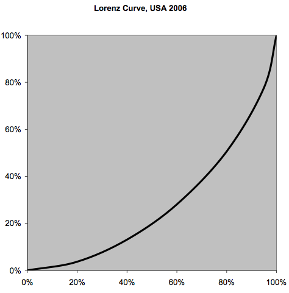

# Normative Economics and Economic Justice
**First published Fri May 28, 2004; substantive revision Wed May 6, 2026**

*Fleurbaey, Marc*

Distributive justice is often considered not to belong to the scope of economics, but there is actually an important literature in economics that addresses normative issues in social and economic justice. A variety of economic theories and approaches provide many insights in these matters. Presented below are the theory of inequality and poverty measurement, welfare economics, the theory of social choice, the theory of bargaining and of cooperative games, and the theory of fair allocation. There has been a good deal of cross-fertilization between these different branches of normative economics and philosophical theories of justice, and many examples of such mutual influences are exhibited in this article.

## 1. Economics and Ethics

The role of ethics in economic theorizing is still a debated issue. In spite of the reluctance of many economists to view normative issues as part and parcel of their discipline, normative economics now represents an impressive body of literature. One may, however, wonder if normative economics cannot also be considered a part of political philosophy.

### 1.1 Positive vs. Normative Economics

In the first half of the twentieth century, most leading economists (Pigou, Hicks, Kaldor, Samuelson, Arrow etc.) devoted a significant part of their research effort to normative issues, notably the definition of criteria for the evaluation of public policies. The situation appeared very different at the turn of the century. “Economists do not devote a great deal of time to investigating the values on which their analyses are based. Welfare economics is not a subject which every present-day student of economics is expected to study”, writes Atkinson (2001, p. 195), who regrets “the strange disappearance of welfare economics”. Normative economics itself may be partly guilty for this state of affairs, in view of its repeated failure to provide conclusive results and its long-lasting focus on impossibility theorems (see § 4.1). But there has also been a persistent ambiguity about the status of normative propositions in economics. The subject matter of economics and its close relation to policy advice make it virtually impossible to avoid mingling with value judgments. Nonetheless, the desire to separate positive statements from normative statements has often been transformed into the illusion that economics could be a science only by shunning the latter. Robbins (1932)[^robbins-1932] has been influential in this positivist move, in spite of a late clarification (Robbins 1981)[^robbins-1981] that his intention was not to dismiss normative issues, but only to clarify the normative status of (useful and necessary) interpersonal comparisons of welfare. It is worth emphasizing that many results in normative economics are mathematical theorems with a primary analytical function. Endowing them with normative content may be confusing, because they are most useful in clarifying ethical values and do not imply by themselves that these values must be endorsed. “It is a legitimate exercise of economic analysis to examine the consequences of various value judgments, whether or not they are shared by the theorist.” (Samuelson 1947, p. 220)[^samuelson-1947] The role of ethical judgments in economics has received recent and valuable scrutiny in Sen (1987)[^sen-1987], Hausman and McPherson (2006) and Mongin (2001b)[^mongin-2001b].

There has recently been a revival of interest in normative principles for social evaluation among economists, in part linked to important work on inequality and redistribution by Piketty, Saez, Stantcheva, Chetty, Zucman and others (in particular, see references to normative principles in Piketty and Saez 2013, Saez and Stantcheva 2016), on social justice opinions by Almas, Cappelen, Tungodden, Grimalda and others (e.g. Almas et al. 2023, 2025, Bonnet et al. 2024)[^bonnet-2024], and on inequality in inflation and living standards (e.g., Baqae and Fahri 2019, Jaravel 2021)[^jaravel-2021]. There has also been a growing interest in looking for alternative indicators of social wellbeing, partly encouraged by political initiatives such as the Stiglitz-Sen-Fitoussi Commission and, recently, the High-Level Expert Group of the United Nations on Beyond GDP (see Sen et al. 2009, Fleurbaey and Blanchet 2013, Jones and Klenow 2016)[^fleurbaey-2013][^fleurbaey-2016][^jones-2016][^sen-2009]. Efforts to make the official guidelines for cost-benefit analysis more in line with normative economics have also been notable, in particular with the 2023 revision of Circulars A4 and A94 in the USA, and have mobilized experts and researchers (see § 3.1). Scholarly associations have been formed to give momentum to various subfields of normative economics and related empirical studies: a Society for Social Choice and Welfare, a Society for the Study of Economic Inequality, a Society for Benefit-Cost Analysis, an Association for Public Economic Theory, a Society for Economic Design, a Human Development and Capability Association, all with a dedicated academic journal. One should also mention the Philosophy, Politics and Economics Society, the Society for the Advancement of Economic Theory, the Public Choice Society, and the International Association for Research in Income and Wealth.

### 1.2 Normative Economics and Political Philosophy

There have been many mutual influences between normative economics and political philosophy. In particular, Rawls’ difference principle (Rawls 1971)[^rawls-1971] has been instrumental in making economic analysis of redistributive policies pay some attention to the maximin criterion, which puts absolute priority on the worst-off, and not only to sum-utilitarianism. (It has taken more time for economists to realize that Rawls’ difference principle applies to primary goods, not utilities.) Conversely, many concepts used by political philosophers come from various branches of normative economics (see below).

There are, however, differences in focus and in methodology. Political philosophy tends to focus on the general issue of social justice, whereas normative economics also covers microeconomic issues of resource allocation and the evaluation of public policies in an unjust society (although there is now philosophical work on non-ideal theory). Political philosophy focuses on arguments and basic principles, whereas normative economics is more concerned with the effective ranking of social states than the arguments underlying a given ranking. The difference is thin in this respect, since the axiomatic analysis in normative economics may be interpreted as performing not only a logical decomposition of a given ranking or principle, but also a clarification of the underlying basic principles or arguments. But consider for instance the “leveling-down objection” (Parfit 1995)[^parfit-1995], which states that egalitarianism is wrong because it considers that there is *something* good in achieving equality by leveling down (even when the egalitarian ranking says that, *all things considered*, leveling down is bad). This kind of argument has to do with the reasons underlying a social judgment, not with the content of the all things considered judgment itself. It is hard to imagine if and how the leveling-down objection could be incorporated in the models of normative economics. A final difference between normative economics and political philosophy, indeed, lies in conceptual tools. Normative economics uses the formal apparatus of economics, which gives powerful means to derive non-intuitive conclusions from simple arguments, although it also deprives the analyst of the possibility of exploring issues that are hard to formalize.

There are now several general surveys of normative economics, some of which do also cover the intersection with political philosophy: Arrow, Sen and Suzumura (1997, 2002, 2011), Johansson (1991)[^johansson-1991], Fleurbaey (1996)[^fleurbaey-1996], Hausman and McPherson (2006, rev. and augmented in Hausman et al. 2016)[^hausman-2016], Kolm (1996)[^kolm-1996], Moulin (1988, 1995, 2003)[^moulin-1988][^moulin-1995][^moulin-2003][^moulin-1988-2], Roemer (1996)[^roemer-1996], Young (1994)[^young-1994], Caplin and Schotter (2008), Thomson (2011)[^thomson-2011].

## 2. Inequality and Poverty Measurement

Focusing traditionally on income inequality and poverty, this field has been first built on the assumption that there is a given unidimensional measure of individual advantage. The gist of the analysis is then about the distribution of this particular notion of advantage.

More recently, partly due to the emergence of data about living conditions, there has been growing interest in the measurement of inequality and poverty when individual situations are described by a multidimensional list of attributes or deprivations. This has generated the field of “multidimensional inequality and poverty measurement”.

So far most of this literature has remained disconnected from the welfare economics literature in which interpersonal comparisons of well-being in relation to individual preferences is a key issue. The typical multidimensional indices do not refer to well-being or preferences. But the connection is being made and the welfare economics literature will eventually blend with the inequality and poverty measurement literature.

Excellent surveys of the unidimensional part of the theory include: Chakravarty (1990, 2009)[^chakravarty-1990][^chakravarty-2009], Cowell (2000, 2011)[^cowell-2000][^cowell-2011], Dutta (2002)[^dutta-2002], Lambert (1989)[^lambert-1989], Sen and Foster (1997), Silber (1999)[^silber-1999]. The multidimensional approach is surveyed or discussed in Weymark (2006)[^weymark-2006], Chakravarty (2009)[^chakravarty-2009], Decancq and Lugo (2013), Aaberge and Brandolini (2015), Alkire et al. (2015), Duclos and Tiberti (2016). The link between inequality and poverty measurement and welfare economics is discussed in Decancq et al. (2015) and in several chapters of Adler and Fleurbaey (2016)[^fleurbaey-2016]. For a comprehensive handbook on economic inequality, see Atkinson and Bourguignon (2000, 2015).

### 2.1 Indices of Inequality and Poverty

The study of inequality and poverty indices started from a statistical, pragmatic perspective, with such indices as the Gini index of inequality or the poverty head count. Recent research has provided two valuable insights. First, it is possible to relate inequality indices to social welfare functions, so as to give inequality indices a more transparent ethical content. The idea is that an inequality index should not simply measure dispersion in a descriptive way, but would gain in relevance if it measured the harm to social welfare done by inequality. There is a simple method to derive an inequality index from a social welfare function, due to Kolm (1969)[^kolm-1969] and popularized by Atkinson (1970)[^atkinson-1970] and Sen (1973)[^sen-1973]. Consider a social welfare function which is defined on distributions of income and is symmetrical (i.e., permuting the income of two individuals leaves social welfare unchanged). For any given unequal distribution of income, one may compute the egalitarian distribution of income which would yield the same social welfare as the unequal distribution. This is called the “equally-distributed equivalent” (or “equal-equivalent”) distribution. If the social welfare function is averse to inequality, the total amount of income in the equal-equivalent distribution is less than in the unequal distribution. In other words, the social welfare function condones some sacrifice of total income in order to reach equality. This drop in income, measured in proportion of the initial total income, may serve as a valuable index of inequality. This index may also be used in a picturesque decomposition of social welfare. Indeed, an ordinally equivalent measure of social welfare is then total income (or average income – it does not matter when the population is fixed) times one minus the inequality index.

This method of construction of an index of inequality, often referred to as the *ethical approach* to inequality measurement, is most useful when the argument of the social welfare function, and the object of the measurement of inequality, is the distribution of individual well-being (which may or may not be measured by income). Then the social welfare function is indeed symmetrical (by requirement of impartiality) and its aversion to inequality reflects its underlying ethical principles. In other contexts, the method is more problematic. Consider the case when social welfare depends on individual well-being, and individual well-being depends on income with some individual variability due to differential needs. Then income equality may no longer be a valuable goal, because the needy individuals may need more income than others. Using this method to construct an index of inequality of *well-being* is fine, but using it to construct an index of inequality of *incomes* would be strange, although it would immediately reveal that income inequality is not always bad (when it compensates for unequal needs). Now consider the case when social welfare is the utilitarian sum of individual utilities, and all individuals have the same strictly concave utility function (strict concavity means that it displays a decreasing marginal utility). Then using this method to construct an index of income inequality is amenable to a different interpretation. The index then does not reflect a principled aversion to inequality in the social welfare function, since the social welfare function has no aversion to inequality of utilities. It only reflects the consequence of an empirical fact, the degree of concavity of individual utility functions. To call this the ethical approach, in this context, seems a misnomer.

In the field of multidimensional inequality or poverty measurement, a key divide has separated the measures that evaluate the distribution in every dimension (such as income, health, asset deprivation...) before they aggregate over the dimensions, from the measures that first evaluate individual situations, all dimensions included, before aggregating over individuals. The latter has been praised (Decancq and Lugo 2013) for being closer to the standard individualistic approach in welfare economics, and for making it possible to have measures that are sensitive to the correlation between disadvantages (e.g., the positive correlation between income and health), and therefore more accurately record the multidimensional suffering of the worst off. An interesting feature of such measures is that a positive correlation among attributes of advantage or disadvantage worsens inequalities only if the elasticity of substitution between attributes, in the index of individual multidimensional advantage, is greater than the inequality aversion in the social index. To illustrate, consider two canonical distributions, with two individuals and two attributes:

(Perfect correlation) Ann: (1,1) and Bob: (2,2)

(Anti-correlation) Ann: (1,2) and Bob: (2,1)

If the attributes are deemed perfectly substitutable (meaning that only the sum, potentially weighted, of the attributes matters for the assessment of individual advantage), and the inequality aversion is zero (meaning that only the sum of individual indexes of advantage matters), the two distributions are considered equally good. But they also appear equally good if there is no possible substitution (only the value of the worst attribute matters) and inequality aversion is infinite (only the worst-off individual matters). In contrast, the first distribution appears worse if the attributes are substitutable and inequality aversion is strong (the first distribution is then unequal, unlike the second one); whereas it appears better if there is no possible substitution and inequality aversion is weak (only one individual has a bad attribute in the first distribution, whereas both have one in the second).

The second valuable contribution of recent research in this field is the development of an alternative ethical approach through the axiomatic study of the properties of indices of inequality and social welfare. The main ethical axioms deal with transfers. The Pigou-Dalton principle of transfers says that inequality decreases (or social welfare increases) when an even transfer is made from a richer to a poorer individual without reversing their pairwise ranking (although this may alter their ranking relative to other individuals). Since this condition is about even transfers, it is quite weak and other axioms have been proposed in order to strengthen the priority of the worst-off. The principle of diminishing transfers (Kolm 1976)[^kolm-1976] says that a Pigou-Dalton transfer has a greater impact (on inequality or social welfare) the lower it occurs in the distribution. The principle of proportional transfers (Fleurbaey and Michel 2001)[^fleurbaey-2001] says that an inefficient transfer in which what the donor gives and what the beneficiary receives is proportional to their initial positions increases social welfare (or reduces inequality). Similar transfer axioms have been adapted to the measurement of poverty. For instance, Sen (1976)[^sen-1976] proposed the condition saying that poverty increases when an even transfer is made from someone who is below the poverty line to a richer individual (below or above the line). The other axioms with which the axiomatic analysis has been made usually have a less obvious ethical appeal, and relate to decomposability of indices, scale invariance and the like. Characterization results have been obtained, which identify classes of indices satisfying particular lists of axioms (see, in particular, Shorrocks 1984)[^shorrocks-1984]. The ethical approach to measuring inequality (i.e., based on the equally distributed equivalent of a social welfare function) and the axiomatic approach to social welfare may be combined, when one takes as an axiom the condition that the index be derived from a social welfare function with particular features.

### 2.2 The Dominance Approach

The multiplicity of social indices, even when a restriction to special sub-classes may be justified by axiomatic characterization, raises a serious problem for applications. How can one make sure that a distribution is more or less unequal, or has more or less poverty, than another without checking an infinite number of indices? Although this may look like a purely practical issue, it has given rise to a broad range of deep results, relating the statistical concept of stochastic dominance to general properties of social welfare functions and to the satisfaction of transfer axioms by inequality and poverty indices. This approach, in particular, justifies the widespread use of Lorenz curves in the empirical studies of inequality. The Lorenz curve depicts the percentage of the total amount of whatever is measured, income, wealth or well-being, possessed by any given percentage of the poorest among the population. For instance, according to the Census Bureau, in 2006 the poorest 20%’s share of total income was 3.7%, the poorest 40%’s share was 13.1%, the poorest 60%’s share was 28.1%, the poorest 80%’s share was 50.6%, while the top 5%’s share was 22.2%. This indicates that the Lorenz curve is approximately as in the following figure.

Considerable progress has been made in the development of dominance techniques of the Lorenz type, with extensions to multidimensional inequality and to poverty measurement (Aaberge and Brandolini 2015)[^aaberge-2015].

### 2.3 Equality, Priority, Sufficiency

Philosophical interest in the measurement of inequality has been significant (e.g., Temkin 1993, which has inspired some economic research, see Cowell and Ebert 2004, Cowell 2011)[^cowell-2011][^cowell-2004][^temkin-1993]. Most of this philosophical literature, however, tends to focus on defining the right foundations for an aversion to inequality. Parfit (1995)[^parfit-1995] proposes to give priority to the worse-off not because of their relative position compared to the better-off, but because and to the extent that they are badly off. This is usually interpreted as defining social welfare by an additively separable social welfare function, with diminishing marginal social utility (a social welfare function is additively separable when it is the sum of separate terms, each of which depends only on one individual’s well-being). Interestingly, if egalitarianism is defined in opposition to this “priority view” by the feature that it relies on judgments of relative positions, this means that egalitarian values cannot be correctly represented by a separable social welfare function. This seems to raise the ethical stakes concerning properties of decomposability of indices or separability of social welfare functions, which are usually considered in economics merely as convenient conditions simplifying the functional forms (although separability may also be justified by the subsidiarity principle, according to which unconcerned individuals need not have a say in a decision). The content and importance of the distinction between egalitarianism and prioritarianism remains a matter of debate (see, among many others, Tungodden 2003, and the contributions in Holtug and Lippert-Rasmussen 2007)[^holtug-2007][^tungodden-2003]. It is also interesting to notice that philosophers are often at ease to work with the notion of social welfare (or social good, or inequality) as a numerical quantity with cardinal meaning, whereas economists typically restrict their interpretation of social welfare or inequality to a purely ordinal ranking of social states. Beside egalitarian and prioritarian positions one must also mention the “sufficiency view”, defended e.g. by Frankfurt (1987)[^frankfurt-1987] who argues that priority should be given only to those below a certain threshold. One may consider that this view supports the idea that poverty indices might summarize everything that is relevant about social welfare. The literature on the minimally (Hassoun 2024)[^hassoun-2024] and maximally (Robeyns 2024)[^robeyns-2024] decent life makes notable strides toward defining relevant ranges of living standards which could be used in economic studies of poverty and wealth.

### 2.4. Inequality of opportunities

The development of luck egalitarianism in philosophy (Arneson 1989, Cohen 1989) has ushered in new measurement approaches in empirical studies of inequality, primarily inspired by Roemer (1998)[^roemer-1998] but also by Bossert (1995)[^bossert-1995], Fleurbaey (1995)[^fleurbaey-1995], Bossert and Fleurbaey (1996)[^fleurbaey-1996]. These measures have distinguished individual “circumstance” characteristics that generate unfair inequalities (such as social or racial background) from other characteristics that can be associated with fair inequalities (e.g., effort). Various measurement approaches have involved: 1) computing inequalities of the average outcomes obtained by subpopulation sharing the same circumstances (see, e.g., Aaberge et al. 2011, Björklund et al. 2012, Filauro et al. 2023)[^aaberge-2011][^björklund-2012][^filauro-2023]; 2) computing the distance to a fair distribution in which outcome inequalities would reflect effort only (see, e.g., Devooght 20008, Almas et al. 2011). Machine-learning techniques have been mobilized to deal with sampling noise that may artificially inflate observed inequalities between subpopulations, and to identify the most influential circumstance characteristics (Brunori et al. 2023)[^brunori-2023]. A public repository of data on inequality of opportunities and social mobility has been created (see Other internet resources).

## 3. Welfare Economics

Welfare economics is the traditional generic label of normative economics, but, in spite of substantial variations between authors, it now tends to be associated with a particular subcontinent of this domain, maybe as a result of the development of “non-welfarist” approaches and of approaches with a broader scope, such as the theory of social choice.

Surveys on welfare economics in its restricted definition can be found in Graff (1957)[^graff-1957], Boadway and Bruce (1984), Chipman and Moore (1978), Samuelson (1981)[^samuelson-1981]. Many topics of welfare economics are addressed in the more recent handbooks by Arrow, Sen and Suzumura (2002, 2011), Atkinson and Bourguignon (2000, 2015) and Adler and Fleurbaey (2016)[^fleurbaey-2016]. Accessible introductions are given by (book-length) Adler (2019) and (article-length) Fleurbaey (2019)[^fleurbaey-2019].

### 3.1 Old and New Welfare Economics

The proponents of a “new” welfare economics (Hicks, Kaldor, Scitovsky) have distanced themselves from their predecessors (Marshall, Pigou, Lerner) by abandoning the idea of making social welfare judgments on the basis of interpersonal comparisons of utility. Their problem was then that in absence of any kind of interpersonal comparisons, the only principle on which to ground their judgments was the Pareto principle, according to which a situation is a global improvement if it is an improvement for every member of the concerned population (there are variants of this principle depending on how individual improvement is defined, in terms of preferences or some notion of well-being, and depending on whether it is a strict improvement for all members or some of them stay put). Since most changes due to public policy hurt some subgroups for the benefit of others, the Pareto principle remains generally silent. The need for a less restrictive criterion of evaluation has led Kaldor (1939)[^kaldor-1939] and Hicks (1939)[^hicks-1939] to propose an extension of the Pareto principle through compensation tests. According to Kaldor’s criterion, a situation is a global improvement if ex post the gainers could compensate the losers. For Hicks’ criterion, the condition is that ex ante the losers could not compensate the gainers (a change from situation A to situation B is approved by Hicks’ criterion if the change from B to A is not approved by Kaldor’s criterion). These criteria are much less partial than the Pareto principle, but they remain partial (that is, they fail to rank many pairs of alternatives). This is not, however, their main drawback. They have been criticized for two basic flaws. First, for plausible definitions of how the compensation transfers could be computed, these criteria may lead to inconsistent social judgments: the same criterion may simultaneously declare that a situation A is better than another situation B, and conversely. Scitovsky (1941)[^scitovsky-1941] has proposed to combine the two criteria, but this does not prevent the occurrence of intransitive social judgments. Second, the compensation tests have a dubious ethical value. If the compensatory transfers are performed in Kaldor’s criterion, then the Pareto criterion alone suffices since after compensation everybody gains. If the compensatory transfers are not performed, the losers remain losers and the mere possibility of compensation is a meager consolation to them. Such criteria are then typically biased in favor of the rich whose willingness to pay is generally high (i.e., they are willing to give a lot in order to obtain whatever they want, and therefore they can easily compensate the losers; when they do not actually pay the compensation, they can have the cake and eat it too).

Cost-benefit analysis has more recently developed criteria which are very similar and rely on the summation of willingness to pay across the population. In spite of repeated criticism by specialists (Arrow 1951, Boadway and Bruce 1984, Sen 1979, Blackorby and Donaldson 1990)[^arrow-1951][^blackorby-1990][^boadway-1984][^sen-1979], practitioners of cost-benefit analysis and some branches of economic theory (industrial organization, international economics) still commonly rely on such criteria. More sophisticated variants of cost-benefit analysis (Layard and Glaister 1994, Drèze and Stern 1987)[^drèze-1987][^layard-1994] avoid these problems by relying on weighted sums of willingness to pay or even on consistent social welfare functions. Adler (2012)[^adler-2012] offers a comprehensive study of the foundations of the social welfare function approach to cost-benefit analysis. Applications of the social welfare function approach are developed (e.g., Acland and Greenberg 2025, Ferranna et al. 2025)[^acland-2025] and this is likely to improve the incorporation of distributional impacts in policy evaluation. This strand of research and applications can be contrasted with an earlier view by many specialists of public economics (e.g. Stiglitz 1987, Coate 2000)[^coate-2000][^stiglitz-1987] that the Pareto criterion was the core ethical principle on which economists should buttress their social evaluations, and that they should focus on denouncing all sources of inefficiency in social organizations and public policies.

A subfield of welfare economics focused on the possibility of making social welfare judgments on the basis of national income. An increase in national income may reflect an increase in social welfare under some stringent assumptions, most conspicuously the assumption that the distribution of incomes is socially optimal. Although very restrictive, this kind of result has a lasting influence, in theory (international economics) and in practice (the salience of GDP growth in policy discussions). There exists a school of social indicators (see the *Social Indicators Research* journal) which fights this influence and the number of alternative indicators (of happiness, genuine progress, social health, economic well-being, etc.) has soared in the last decades (see e.g. Miringoff and Miringoff 1999, Frey and Stutzer 2002, Kahneman et al. 2004 and Gadrey and Jany-Catrice 2006)[^frey-2002][^gadrey-2006][^kahneman-2006][^kahneman-2004][^miringoff-1999].

Bergson (1938)[^bergson-1938] and Samuelson (1947, 1981)[^samuelson-1947][^samuelson-1981] occupy a special position, which may be described as a third way between old and new welfare economics. From the former, they retain the goal of making complete and consistent social welfare judgments with the help of well-defined social welfare functions. The formula *W*(*U*₁(*x*),…,*Uₙ*(*x*)) is often named a “Bergson-Samuelson social welfare function” (*x* is the social state; *Uᵢ*(*x*), for *i*=1,…,*n*, is individual *i*’s utility in this state). With the latter, however, they share the idea that only ordinal non-comparable information should be retained about individual preferences. This may seem contradictory with the formula of the Bergson-Samuelson social welfare function, in which individual utility functions appear, and there has been a controversy about the possibility of constructing a Bergson-Samuelson social welfare function on the sole basis of individual ordinal non-comparable preferences (see in particular Arrow 1951, Kemp and Ng 1976, Samuelson 1977, 1987, Sen 1986 and a discussion in Fleurbaey and Mongin 2005)[^arrow-1951][^fleurbaey-2005][^fleurbaey-2005-2][^kemp-1976][^samuelson-1977][^samuelson-1987][^sen-1986]. Samuelson and his defenders are commonly considered to have lost the contest, but it may also be argued that their opponents have misunderstood them. Indeed, individual utility functions in the *W*(*U*₁(*x*),…,*Uₙ*(*x*)) formula are, according to Bergson and Samuelson, to be constructed out of individual preference orderings, on the basis of fairness principles. The logical possibility of such a construction has been repeatedly proven by Samuelson (1977)[^samuelson-1977], Pazner (1979)[^pazner-1979], Mayston (1974, 1982)[^mayston-1974][^mayston-1982]. The fact that such a construction does not require any other information than ordinal non-comparable preferences is indisputable. Bergson and Samuelson acknowledged the need for interpersonal comparisons, but considered that these could be done, in an ethically relevant way, on the sole basis of non-comparable preference orderings. They failed, however, to be more specific about the fairness principles on which the construction could be justified. The theory of fair allocation (see § 6) may fill the gap.

### 3.2 Harsanyi’s Theorems

Harsanyi may be viewed as the last representative of the old welfare economics, to which he made a major contribution in the form of two arguments. The first one is often called the “impartial observer argument”. An impartial observer should decide for society as if she had an equal chance of becoming anyone in the considered population. This is a risky situation in which the standard decision criterion is expected utility. The computation of expected utility, in this equal probability case, yields an arithmetic mean of the utilities that the observer would have if she became anyone in the population. Harsanyi (1953)[^harsanyi-1953] considers this to be an argument in favor of utilitarianism. The obvious weakness of the argument, however, is that not all versions of utilitarianism would measure individual utility in a way that may be entered in the computation of the expected utility of the impartial observer. In other words, ask a utilitarian to compute social welfare, and ask an impartial observer to compute her expected utility. There is little reason to believe that they will come up with similar conclusions, even though both compute a sum or a mean. For instance, a very risk-averse impartial observer may come arbitrarily close to the maximin criterion. One may also question the application of expected utility theory to the impartial observer. Formal analysis of variations around the independence axiom of von-Neumann-Morgenstern utility applied to outcome lotteries or identity lotteries has been made by Grant et al. (2010, 2012), and a middle-way between Harsanyi and Rawls was proposed by Gajdos and Kandil (2008).

This argument has triggered controversies, in particular with Rawls (1974)[^rawls-1974], about the soundness of the maximin criterion in the original position, and with Sen (1977b)[^sen-1977b]. See Harsanyi (1976)[^harsanyi-1976] and recent analyses in Weymark (1991)[^weymark-1991], Mongin (2001a)[^mongin-2001a]. There is a related, but different controversy about the consequences of the veil of ignorance in Dworkin’s hypothetical insurance scheme (Dworkin 2000)[^dworkin-2000]. Roemer (1985)[^roemer-1985] argues that if individuals maximize their expected utility on the insurance market, they insure against states in which they have low marginal utility. If low marginal utility happens to be the consequence of some handicaps, then the hypothetical market will tax the disabled for the benefit of the others, a paradoxical but typical consequence of utilitarian policies. It is indeed well known that insurance markets have strange consequences when utilities are state-dependent (that is, when the utility of income is affected by random events). For a recent revival of this controversy, see Dworkin (2002)[^dworkin-2002], Fleurbaey (2008)[^fleurbaey-2008] and Roemer (2002a)[^roemer-2002a].

Harsanyi’s second argument, the “aggregation theorem”, is about a social planner who, facing risky prospects, maximizes expected social welfare and wants to respect individual preferences about prospects. Harsanyi (1955)[^harsanyi-1955] shows that these two conditions imply that social welfare must be a weighted sum of individual utilities, and concludes that this is another argument in favor of utilitarianism. Recent evaluation of this argument and its consequences may be found in Broome (1991)[^broome-1991], Weymark (1991)[^weymark-1991], Fleurbaey and Mongin (2016)[^mongin-2016]. In particular, Broome uses the structure of this argument to conclude that social good must be computed as the sum of individual goods, although this does not preclude incorporating a good deal of inequality aversion in the measurement of individual good. Diamond (1967)[^diamond-1967] has raised a famous objection against the idea that expected utility is a good criterion for the social planner. This criterion implies that if the social planner is indifferent between the distributions of utilities, for two individuals, (1,0) and (0,1), then he must also be indifferent between these two distributions and an equal probability of getting either distribution. This is paradoxical, this lottery being ex ante better since it gives equal prospects to individuals. Broome (1991)[^broome-1991] raises another puzzle. An even better lottery would yield either (0,0) or (1,1) with equal probability. It is better because ex ante it gives individuals the same prospects as the previous lottery, and it is more egalitarian ex post. The problem is that it seems quite hard to construct a social criterion which ranks these four alternatives as suggested here. Defining social welfare under uncertainty is still a matter of bafflement. See Deschamps and Gevers (1977), Ben Porath, Gilboa and Schmeidler (1997), Fleurbaey (2010)[^fleurbaey-2010], Fleurbaey and Zuber (2017, 2022). Things are even more difficult when probabilities are subjective and individual beliefs may differ. Harsanyi’s aggregation theorem then transforms into an impossibility theorem. On this, see in particular Hylland and Zeckhauser (1979), Mongin (1995)[^mongin-1995], Bradley (2005)[^bradley-2005], Mongin and Pivato (2016, 2020), Dietrich (2021)[^dietrich-2021].

## 4. Social Choice

The theory of social choice in its modern incarnation originated in Arrow’s pioneering work. Arrow himself described it as a ‘subversive’ attempt to ‘operationalize’ the Bergson-Samuelson approach (Arrow 1983, 26)[^arrow-1983], but it could equally be viewed as extending the tradition of earlier work on voting and committee decisions, going back to Condorcet and Black. It has developed into an immense literature, with many ramifications to a variety of subfields and topics. The social choice framework is, potentially, so general that one may think of using it to unify normative economics. In a restrictive definition, however, social choice is considered to deal with the problem of synthesizing heterogeneous individual preferences into a consistent ranking. Sometimes an even more restrictive notion of “Arrovian social choice” is used to name works which faithfully adopt Arrow’s particular axioms.

There are many surveys of social choice theory, in broad and restrictive senses: Arrow, Sen and Suzumura (1997, in particular chap. 3, 4, 7, 11, 15; 2002, in particular chap. 1, 2, 3, 4, 7, 10; 2011, in particular chap. 13, 14, 17–20), Sen (1970, 1977a, 1986, 1999, 2009)[^sen-1986][^sen-1977a][^sen-1999][^sen-2009], Anand, Puppe and Pattanaik (2009). See also the entry on social choice theory.

### 4.1 Arrow’s Theorem

In an attempt to construct a consistent social ranking of a set of alternatives on the basis of individual preferences over this set, Arrow (1951)[^arrow-1951] obtained: 1) an impossibility theorem; 2) a generalization of the framework of welfare economics, covering all collective decisions from political democracy and committee decisions to market allocation; 3) an axiomatic method which set a standard of rigor for any future endeavor.

The impossibility theorem roughly says that there is no general way to rank a given set of (more than two) alternatives on the basis of (at least two) individual preferences, if one wants to respect three conditions: (Weak Pareto) unanimous preferences are always respected (if everyone prefers A to B, then A is better than B); (Independence of Irrelevant Alternatives) any subset of two alternatives must be ranked on the sole basis of individual preferences over this subset; (No-Dictatorship) no individual is a dictator in the sense that his strict preferences are always obeyed by the ranking, no matter what they and the other individuals’ preferences are. The impossibility holds when one wants to cover a great variety of possible profiles of individual preferences. When there is sufficient homogeneity among preferences, for instance when alternatives differ only in one dimension and individual preferences are based on the distance of alternatives to their preferred alternative along this dimension (think, for instance, of political options on the left-right spectrum), then consistent methods exist (the majority rule, in this example; Black 1958)[^black-1958].

Arrow’s result clearly extends the scope of analysis beyond the traditional focus of welfare economics, and nicely illuminates the difficulties of democratic voting procedures such as the Condorcet paradox (consisting of the fact that majority rule may be intransitive). The analysis of voting procedures spans a large literature. For recent surveys, see e.g. Saari (2001)[^saari-2001] and Brams and Fishburn (2002), as well as the entry on Arrow’s Theorem. This analysis reveals a deep tension between rules based on the majority principle and rules which protect minorities by taking account of preferences in a more extended way (see Pattanaik 2002)[^pattanaik-2002].

Specialists of welfare economics once claimed that Arrow’s result had no bearing on economic allocation (e.g. Samuelson 1967)[^samuelson-1967], and there is some ambiguity in Arrow (1951)[^arrow-1951] about whether, in an economic context, the best application of the theorem is about individual self-centered *tastes* over personal consumptions, in which case it is indeed relevant to welfare economics, or about individual ethical *values* about general allocations. It is now generally considered that the formal framework of social choice can sensibly be applied to the Bergson-Samuelson problem of ranking allocations on the basis of individual tastes. Applications of Arrow’s theorem to various economic contexts have been made (see the surveys by Le Breton 1997, Le Breton and Weymark 2011)[^le-1997].

### 4.2 The Informational Basis

Sen (1970a)[^sen-1970a] proposes a further generalization of the social choice framework, by permitting consideration of information about individual utility functions, not only preferences. This enlargement is motivated by the impossibility theorem, but also by the ethical relevance of various kinds of data. Distributional issues obviously require interpersonal comparisons of well-being. For instance, an egalitarian evaluation of allocations needs a determination of who the worst-off are. It is tempting to think of such comparisons in terms of utilities. This has triggered an important body of literature which has greatly clarified the meaning of various kinds of interpersonal utility comparisons (of levels, differences, etc.) and the relation between them and various social criteria (egalitarianism, utilitarianism, etc.). This literature (esp. d’Aspremont and Gevers 1977)[^aspremont-1977] has also provided an important formal analysis of the concept of welfarism, showing that it contains two subcomponents. The first one is the Paretian condition that an alternative is equivalent to another when all individuals are indifferent between them. This excludes using non-welfarist information about alternatives, but does not exclude using non-welfarist information about individuals (one individual may be favored because of a physical handicap). The second one is an independence condition formulated in terms of utilities. It may be called Independence of Irrelevant Utilities (Hammond 1987)[^hammond-1987], and says that the social ranking of any pair of alternatives must depend only on utility levels at these two alternatives, so that a change in the profile of utility functions which would leave the utility levels unchanged at the two alternatives should not alter how they are ranked. This excludes using non-welfarist information about individuals, but does not exclude using non-welfarist information about alternatives (one may be preferred because it has more freedom). The combination of the two conditions excludes all non-welfare information. Excellent surveys are given in d’Aspremont (1985)[^aspremont-1985], d’Aspremont and Gevers (2002), Bossert and Weymark (2004), Mongin and d’Aspremont (1998). In spite of the important clarification made by this literature, the introduction of utility functions essentially amounts to going back to old welfare economics, after new welfare economics and authors such as Bergson, Samuelson and Arrow failed to provide appealing solutions with data on consumer tastes only.

A related issue is how the evaluation of individual well-being must be made, or, equivalently, how interpersonal comparisons must be performed. There is now a growing interest in exploring concrete ways of measuring individual well-being, as illustrated by happiness studies (section 7.5 below) and the handbook published by Adler and Fleurbaey (2016)[^fleurbaey-2016]. Welfare economics traditionally relied on “utility”, and the extended informational basis of social choice is mostly formulated with utilities (although the use of extended preference orderings is often shown to be formally equivalent: for instance, saying that Jones is better-off than Smith is equivalent to saying that it is better to be Jones than to be Smith, in some social state). But utility functions may be given a variety of substantial interpretations, so that the same formalism may be used to discuss interpersonal comparisons of resources, opportunities, capabilities and the like. In other words, one may separate two issues: 1) whether one needs more information than individual preference orderings in order to perform interpersonal comparisons; 2) what kind of additional information is ethically relevant (subjective utility or objective notions of opportunities, etc.). The latter issue is directly related to philosophical discussions about how well-being should be conceived and to the “equality of what” debate. This debate, which originates with Sen (1980)[^sen-1980], focuses on seeking the appropriate metric of advantage that should be used by theories of justice that are egalitarian or that give priority to the worst-off.

The former issue is still debated. Extending the informational basis by introducing numerical indices of well-being (or equivalent extended orderings) is not the only conceivable extension. Arrow’s impossibility is obtained with the condition of Independence of Irrelevant Alternatives, which may be logically analyzed, when the theorem is reformulated with utility functions as primitive data, as the combination of Independence of Irrelevant Utilities (defined above) with a condition of ordinal non-comparability, saying that the ranking of two alternatives must depend only on individuals’ ordinal non-comparable preferences. Arrow’s impossibility may be avoided by relaxing the ordinal non-comparability condition, and this is the above-described extension of the informational basis by relying on utility functions. But Arrow’s impossibility may also be avoided by relaxing Independence of Irrelevant Utilities only. In particular, it makes sense to rank alternatives on the basis of how these alternatives are considered by individuals in comparison to other alternatives. For instance, whether to make a transfer of consumption goods from Jones to Smith, it is not enough to know that Jones is against it and Smith is in favor of it (this is the only information usable under Arrow’s condition). It is also relevant to know if both consider that Jones has a better bundle, or not, which involves considering other alternatives in which bundles are permuted, for instance. In this vein, Hansson (1973)[^hansson-1973] and Pazner (1979)[^pazner-1979] have proposed to weaken Arrow’s axiom so as to make the ranking of two alternatives depend on the indifference curves of individuals at these two alternatives. In particular, Pazner relates this approach to Samuelson’s (Samuelson 1977)[^samuelson-1977] and concludes that the Bergson-Samuelson social welfare function can indeed be constructed consistently in this way. Interpersonal comparisons may be sensibly made on the sole basis of indifference curves and therefore on the sole basis of ordinal non-comparable preferences. This requires broadening the concept of interpersonal comparisons in order to cover all kinds of comparisons, not just utility comparisons (see Fleurbaey and Hammond 2004)[^fleurbaey-2004].

The concept of informational basis itself need not be limited to issues of interpersonal comparisons. Many conditions of equity, efficiency, separability, responsibility, etc. bear on the kind and quantity of information that is deemed relevant for the ranking of alternatives. The theory of social choice gives a convenient framework for a rigorous analysis of this issue.

### 4.3 Around Utilitarianism

The theory of social choice with utility functions has greatly systematized our understanding of social welfare functions. For instance, it has shown how to construct a continuum of intermediate social welfare functions between sum-utilitarianism and the maximin criterion (or its lexicographic refinement, the leximin criterion, which ranks distributions of well-being by examining first the worst-off position, then the position which is just above the worst-off, and so on; for instance, the maximin is indifferent between the three distributions (1,2,5), (1,3,5) and (1,3,6), whereas the leximin ranks them in increasing order). Three other developments around utilitarian social welfare functions are worth mentioning.

The first development is related to the application of theories of luck egalitarianism and equality of opportunity, and involves the construction of mixed social welfare functions which combine utilitarianism and maximin. Suppose that there is a double partition of the population, such that one would like the social welfare function to display infinite inequality aversion within subgroups of the first partition, and zero inequality aversion within subgroups of the second partition. For instance, subgroups of the first partition consist of equally deserving individuals, for which one would like to obtain equality of outcomes, whereas subgroups of the second partition consist of individuals who have equal opportunities, so that inequalities among them do not matter. Van de gaer (1993) proposes to apply average utilitarianism within each subgroup of the second partition, and to apply the maximin criterion to the vector of average utilities obtained in this way. In other words, the average utilities measure the value of the opportunity sets offered to individuals, and one applies the maximin criterion to such values, in order to equalize the value of opportunity sets. Roemer (1998)[^roemer-1998] proposes to apply the maximin criterion within each subgroup of the first partition, and then to apply average utilitarianism to the vector of minimum utilities obtained in this way. In other words, one tries to equalize outcomes for equally deserving individuals first, and then applies a utilitarian calculus. These may not be the only possible combinations of utilitarianism and maximin, but they are given an axiomatic justification which suggests that they are indeed salient, in Ooghe, Schokkaert and Van de gaer (2007) and Fleurbaey (2008)[^fleurbaey-2008]. For a survey on the applications of Roemer’s criterion, see Roemer (2002b)[^roemer-2002b] and, more recently, Ferreira and Peragine (2016), Roemer and Trannoy (2016), Ramos and Van de gaer (2016).

A second interesting development deals with intergenerational ethics. With an infinite horizon, it is essentially impossible to combine the Pareto criterion and anonymity (permuting the utilities of some generations does not change social welfare) in a fully satisfactory way, even when utilities are perfectly comparable. This is a similar but more basic impossibility than Arrow’s theorem. The intuition of the problem can be given with the following simple example. Consider the following sequence of utilities: (1,2,1,2,…). Permute the utility of every odd period with the next one. One then obtains (2,1,2,1,…). Then permute the utility of every even period with the next one. This yields (2,2,1,2,…). This third sequence Pareto-dominates the first one, even though it was obtained only through simple permutations. This impossibility is now better understood, and various results point to the “catching up” criterion as the most reasonable extension of sum-utilitarianism to the infinite horizon setting. This criterion, which does not rank all alternatives, applies when the finite-horizon sums of utilities, for two infinite sequences of utilities, are ranked in the same way for all finite horizons above some finite time. Interestingly, this topic has seen parallel and sometimes independent contributions by economists and philosophers (see e.g. Lauwers and Liedekerke 1997, Lauwers and Vallentyne 2003, Roemer and Suzumura 2007, and a survey in Pivato and Fleurbaey 2024)[^lauwers-2003][^lauwers-1997][^pivato-2024][^roemer-2007].

A third development worth mentioning has to do with population ethics. Sum-utilitarianism appears to be overly populationist, since it implies the “repugnant conclusion” (Parfit 1984)[^parfit-1984] that we should aim for an unhappy but sufficiently large population in preference to a small and happy one. Conversely, average utilitarianism is “Malthusian”, preferring a happier population, no matter how small, to a less happy one, no matter how large. Here again there is an interesting tension, namely, between accepting all individuals whose utility is greater than zero, accepting equalization of utilities, and avoiding the “repugnant conclusion”. This tension is shown in this way. Start with a given affluent population of any size. Add any number of individuals with positive but almost zero utilities. This does not reduce social welfare. Then equalize utilities, which again does not reduce social welfare. One then obtains, compared to the initial population, a larger population with lower utilities. One sees that these lower utilities may be arbitrarily low, if the added individuals are sufficiently numerous and have sufficiently low initial utilities, thus yielding the repugnant conclusion (see Arrhenius 2000)[^arrhenius-2000]. Average utilitarianism disvalues additional individuals whose utility is below the average, which is very restrictive for affluent populations. A less restrictive approach is that of critical-level utilitarianism, which disvalues only individuals whose utility level is below some fixed, low but positive threshold. For an extensive overview and a defense of critical-level utilitarianism, see Blackorby, Bossert and Donaldson (1997, 2005), as well as Broome (2004)[^broome-2004]. For an original proposal relying on a different social welfare function (inspired by the Gini function), see Asheim and Zuber (2014).

## 5. Bargaining and Cooperative Games

At the time when Arrow declared social choice to be impossible, Nash (1950)[^nash-1950] published a possibility theorem for the bargaining problem, which is the problem of finding an option acceptable to two parties, among a subset of alternatives. Interestingly, Nash relied on the axiomatic analysis just like Arrow, so that both can be given credit for the introduction of this method in normative economics. In the same decade, a similar contribution was made by Shapley (1953)[^shapley-1953] to the theory of cooperative games. The development of such approaches has been impressive since then, but some questioning has emerged regarding the ethical relevance of this theory to issues of distributive justice.

### 5.1 Nash’s and Other Solutions

Nash (1950)[^nash-1950] adopted a welfarist framework, in which alternatives are described only by the utility levels they give to the two parties. His solution consists in choosing the alternative which, in the feasible set, maximizes the product of individual utility gains from the disagreement point (this point is the fallback option when the parties fail to reach an agreement). This solution is therefore related to a particular social welfare function which is somehow intermediate between sum-utilitarianism and the maximin criterion. Contrary to these, however, it is invariant to independent changes in utility zeros and scales, which means that it can be applied with utility functions which are defined only up to an affine transformation (i.e., no difference is made between utility function *Uᵢ* and utility function *aᵢ Uᵢ* + *bᵢ*), such as Von Neumann-Morgenstern utility functions. Nash uses this invariance property in his axiomatic characterization of the solution. He also uses another property, which holds for any solution maximizing a social welfare function, namely, that removing non-selected options does not alter the choice.

This particular property is criticized in Kalai and Smorodinsky (1975), because it makes the solution ignore the relative size of the sacrifices made by the parties in order to reach a compromise. They propose another solution, which consists of equalizing the parties’ sacrifice relative to the maximum gain they could expect in the available set of options. This solution, contrary to Nash’s, guarantees that an enlargement of the set of options that is favorable to one party never hurts this party in the ultimate selection. It is very similar to Gauthier’s (1986)[^gauthier-1986] “minimax relative concession” solution. Many other solutions to the bargaining problem have been proposed, but these two are by far the most prominent.

The relevance of bargaining theory to the theory of distributive justice has been questioned. First, if the disagreement point is defined, as it probably should, in relation to the relative strength of parties in a “state of nature”, then the scope for redistributive solidarity is very limited. One obtains a theory of “justice as mutual advantage” (Barry 1989, 1995)[^barry-1989][^barry-1995] which is not satisfactory at the bar of any minimal conception of impartiality or equality. Second, the welfarist formal framework of the theory of bargaining is poor in information (Roemer 1986b, 1996)[^roemer-1986b][^roemer-1996]. Describing alternatives only in terms of utility levels makes it impossible to take account of basic physical features of allocations. For instance, it is impossible to find out, from utility data alone, which of the alternatives is a competitive equilibrium with equal shares. As another illustration, Nash’s and Kalai and Smorodinsky’s solutions both recommend allocating an indivisible prize by a fifty-fifty lottery, whether the prize is symmetric (a one-dollar bill for either party) or asymmetric (a one-dollar bill if party 1 wins, ten dollars if party 2 wins).

Extensive surveys of bargaining theory can be found in Peters (1992)[^peters-1992], Thomson (1999)[^thomson-1999].

### 5.2 Axiomatic Bargaining and Cooperative Games

The basic theory of bargaining focuses on the two-party case, but it can readily be extended to the case when a greater number of parties are at the table. However, when there are more than two parties, it becomes relevant to consider the possibility for subgroups (coalitions) to reach separate agreements. Such considerations lead to the broader theory of cooperative games.

This broader theory is, however, more developed for the relatively easy case when coalition gains are like money prizes which can be allocated arbitrarily among coalition members (the “transferable utility case”). In this case, for the two-party bargaining problem the Nash and Kalai-Smorodinsky solutions coincide and give equal gains to the two parties. The Shapley value is a solution which generalizes this to any number of parties and gives a party the average value of the marginal contribution that this party brings to all coalitions which it can join. In other words, it rewards the parties in proportion to the increase in coalition gain that they bring about by gathering with others.

Another important concept is ‘the core’. This notion generalizes the idea that no rational party would accept an agreement that is less favorable than the disagreement point. An allocation of the total population prize is in the core if the total amount received by any coalition is at least as great as the prize this coalition could obtain on its own. Otherwise, obviously, the coalition has an incentive to “block” the agreement. Interestingly, the Shapley value is not always in the core, except for “convex games”, that is, games such that the marginal contribution of a party to a coalition increases when the coalition is bigger.

The basics of this theory are very well presented in Moulin (1988)[^moulin-1988][^moulin-1988-2] and Myerson (1991)[^myerson-1991]. Cooperative games are distinguished from non-cooperative games by the fact that the players can commit to an agreement, whereas in a non-cooperative game every player always seeks his interest and never commits to a particular strategy. The central concept of the theory of non-cooperative games is the Nash equilibrium (every player chooses his best strategy, taking others’ strategies as given), which has nothing to do with Nash’s bargaining solution. It has been shown, however, that Nash’s bargaining solution can be obtained as the Nash equilibrium of a non-cooperative bargaining game, in which players make offers alternatively, and accept or reject the other’s offer.

## 6. Fair allocation

The theory of fair allocation studies the allocation of resources in economic models. The seminal contribution is Kolm (1972)[^kolm-1972], where the criterion of equity as no-envy is extensively analyzed with the conceptual tools of general equilibrium theory. Later the theory borrowed the axiomatic method from bargaining theory, and it now covers a great variety of economic models and encompasses a variety of fairness concepts.

There are several surveys of this theory: Thomson and Varian (1985), Moulin and Thomson (1997), Maniquet (1999)[^maniquet-1999], Thomson (2011)[^thomson-2011].

### 6.1 Equity as No-Envy

An allocation is envy-free if no individual would prefer having the bundle of another. An egalitarian distribution in which everyone has the same bundle is trivially envy-free, but is generally Pareto-inefficient, which means that there exist other feasible allocations that are better for some individuals and worse for none. A competitive equilibrium with equal shares (i.e., equal budgets) is the central example of a Pareto-efficient and envy-free allocation. It is envy-free since all agents have the same budget options, so that everyone could buy everyone’s bundle. It is Pareto-efficient because, by an important theorem of welfare economics, any perfectly competitive equilibrium is Pareto-efficient (in absence of asymmetric information, externalities, public goods). A non-technical presentation of this theorem can be found in Hausman and McPherson (2006, 5.2).

This concept of equity does not need any other information than individual ordinal preferences. It is not welfarist, in the sense that from utility data alone it is impossible to distinguish an envy-free allocation from an allocation with envy. Moreover, an envy-free allocation may be Pareto-indifferent (everyone is indifferent) to another allocation that has envy. On the other hand, this concept is strongly egalitarian, and it is quite natural to view it as capturing the idea of equality of resources (Dworkin 2000)[^dworkin-2000]. When resources are multi-dimensional, for instance when there are several consumption goods, and when individual preferences are heterogeneous, it is not obvious how to define equality of resources, but the no-envy criterion seems the best concept for this purpose. It guarantees that no individual will consider that another has a better bundle than his. It has been shown by Varian (1976)[^varian-1976] that, if preferences are sufficiently diverse and numerous (a continuum), then the competitive equilibrium with equal shares is the only Pareto-efficient and envy-free allocation.

This concept can also be related to the idea of equality of opportunities (Kolm 1996)[^kolm-1996]. An allocation is envy-free if and only if the bundles granted to everyone could have been chosen by each individual in the same opportunity set, such as, for instance, the set containing all the bundles of the allocation under consideration. Along this vein, the concept of no-envy can also be shown to have a close connection with incentive considerations. A no-envy test is used in the theory of optimal taxation in order to make sure that no one would have an interest in lying about one’s preferences (Boadway and Keen 2000)[^boadway-2000]. Consider the condition that, when an allocation is selected and some individuals’ preferences change so that their bundle goes up in their own preference ranking, then the selected allocation is still acceptable. A particular version of this condition plays a central role in the theory of incentives, under the name of Maskin monotonicity (see e.g. Jackson 2001)[^jackson-2001], but it can also be given an ethical meaning, in terms of neutrality with respect to changes in preferences. Notice that envy-free allocations satisfy this condition, since after such a change of preferences every individual’s bundle goes up in his ranking, thereby precluding any appearance of envy. Conversely, it turns out that this condition implies that the selected allocation must be envy-free, under the additional assumption that, in any selected allocation, individuals with identical preferences must have equivalent bundles. If one also requires the selection to be Pareto-efficient, then one obtains a characterization of the competitive equilibrium with equal shares (Gevers 1986)[^gevers-1986].

### 6.2 Extensions

Kolm’s (1972)[^kolm-1972] seminal monograph focused on the simple problem of distributing a bundle of non-produced commodities, and on equity as no-envy. Other economic problems, and other fairness concepts, have been studied later. Here is a non-exhaustive list of other economic problems that have been analyzed: sharing labor and consumption in the production of a consumption good; producing a public good and allocating the contribution burden among individuals; distributing indivisible commodities, with or without the possibility of making monetary compensations; matching pairs of individuals (men-women, employers-workers…); distributing compensations for differential needs; rationing on the basis of claims; distributing a divisible commodity when preferences are satiable. In the main stream of this theory, the problem is to select a good subset of allocations under perfect knowledge of the characteristics of the population and of the feasible set. There is also a branch which studies cost and surplus sharing, when the only information available are the quantities demanded or contributed by the population, and the cost or surplus may be distributed as a function of these quantities only (see Moulin 2002)[^moulin-2002]. The relevance of this literature for political philosophers should not be underestimated. Even models which seem to be devoted to narrow microeconomic allocation problems may turn out to be quite relevant, and some models are addressing issues already salient in political philosophy. This is the case in particular for the model of production of a private good when individuals have unequal skills, which is a rough description of a market economy, and for the model of differential needs. Both models are especially relevant for analyzing the issue of responsibility, talent and handicap, which is now prominent in egalitarian theories of justice. A survey on these two models is made in Fleurbaey and Maniquet (2011a), and a monograph connecting the various relevant fields of economic analysis to theories of responsibility-sensitive egalitarianism is in Fleurbaey (2008)[^fleurbaey-2008].

Among the other concepts of fairness which have been introduced, two families are important. The first family contains principles of solidarity, which require individuals to be affected in the same way (they all gain or all lose) by some external shock (change in resources, technology, population size, population characteristics). For instance, if resources or technology improve, then it is natural to hope that everyone will benefit. The second family contains welfare bounds, which provide guarantees to everyone against extreme inequality. For instance, in the division of non-produced commodities, it is very natural to require that nobody should be worse-off than at the equal-split allocation (i.e. the allocation in which everyone gets the per capita amount of resources).

Let us briefly describe some of the insights that are gained through this theory and seem relevant to political philosophy. A very important one is that there is a conflict between no-envy and solidarity (Moulin and Thomson 1988, 1997)[^moulin-1988][^moulin-1988-2][^moulin-1997]. This conflict is well illustrated by the fact that in a market economy, typically any change in technology benefits some agents and hurts others, even when the change is a pure progress which could benefit all. Solidarity principles are not obeyed by allocation rules which pass the no-envy test, and these principles point toward a different kind of distribution, named “egalitarian-equivalence” by Pazner and Schmeidler (1978). An allocation is egalitarian-equivalent when everyone is indifferent between his bundle in this allocation and the bundle he would have in an egalitarian economy defined in some simple way. For instance, the egalitarian economy may be such that everyone has the same bundle. In this case, an egalitarian-equivalent allocation is such that everyone is indifferent between his bundle and one particular bundle. In more sophisticated versions, the egalitarian economy is such that everyone has the same budget set, in some particular family of budget sets. Egalitarian-equivalence is a serious alternative to no-envy for the definition of equality of resources, and its superiority in terms of solidarity is quite significant, in relation to the next point.

The second insight, indeed, is that no-envy itself is a combination of conflicting principles (Fleurbaey and Maniquet 2011a, Fleurbaey 2008)[^fleurbaey-2008][^fleurbaey-2011a]. This conflict is made apparent in models with talents and handicaps. For instance, Pazner and Schmeidler (1974) found out that there may not exist envy-free and Pareto-efficient allocations in the context of production with unequal skills (when there are high-skilled individuals who are strongly averse to labor). This results from an incompatibility between a compensation principle saying that individuals with identical preferences should have equivalent bundles (suppressing inequalities due to skills), and a reward principle saying that individuals with the same skills should not envy each other (no preferential treatment on the basis of different preferences). Both principles are a logical implication of the no-envy test. This is obvious for the latter. For the former, notice that no-envy among individuals with the same preferences means that they must have bundles on the same indifference curve. Interestingly, the compensation principle is a logical consequence of solidarity principles and is therefore perfectly compatible with them. It is very well satisfied by egalitarian-equivalent allocation rules. In contrast, it is violated by Dworkin’s hypothetical insurance which applies the no-envy test behind a veil of ignorance (see Dworkin 2000, Fleurbaey 2008, and § 3.2)[^dworkin-2000][^fleurbaey-2008]. A recent philosophical analysis of the no-envy approach has been developed in Olson (2020)[^olson-2020]. The relation between envy and theories of justice is also scrutinized in the entry on envy.

The theory of fair allocations contains many positive results about the existence of fair allocations, for various fairness concepts, and this stands in contrast to Arrow’s impossibility theorem in the theory of social choice. The difference between the two theories has often been interpreted as due to the fact that they perform different exercises (Sen 1986, Moulin and Thomson 1997)[^moulin-1997][^sen-1986][^sen-1997]. The theory of social choice, it is said, seeks a ranking of all options, while the theory of fair allocation focuses on the selection of a subset of allocations. This explanation is not convincing, since selecting a subset of fair allocations is formally equivalent to defining a full-blown albeit coarse ranking, with “good” and “bad” allocations. A more convincing explanation lies in the fact that the information used in fairness criteria is richer than allowed by Arrow’s Independence of Irrelevant Alternatives (Fleurbaey, Suzumura and Tadenuma 2002). For instance, in order to check that an allocation is envy-free while another displays envy, it is not enough to know how individuals rank these two allocations in their preferences. One must know individual preferences over other alternatives involving permutations of bundles (an envious individual would prefer an allocation in which his bundle is permuted with one he envies). In this vein, one discovers that it is possible to extend the theory of fair allocation so as to construct fine-grained rankings of all allocations. This is very useful for the discussion of public policies in “second-best” settings, that is, in settings where incentive constraints make it impossible to reach Pareto-efficiency. With this extension, the theory of fair allocation can be connected to the theory of optimal taxation (Maniquet 2007)[^maniquet-2007], and becomes even more relevant to the political philosophy of redistributive institutions (Fleurbaey 2007)[^fleurbaey-2007]. It turns out that the egalitarian-equivalence approach is very convenient for the definition of fine-grained orderings of allocations, which provides an additional argument in its favor. A detailed study of fair social orderings is made in Fleurbaey and Maniquet (2011b).

## 7. Related topics

### 7.1 Freedom and Rights

Sen (1970b)[^sen-1970b] and Gibbard (1974)[^gibbard-1974] propose, within the framework of social choice, paradoxes showing that it may not be easy to rank alternatives when some individuals have a special right to rank some alternatives that differ only in matters belonging to their private sphere, and when their preferences are sensitive to what happens in other individuals’ private spheres. For instance, as an illustration of Gibbard’s paradox, individuals have the right to choose the color of their shirt, but, in terms of social ranking, should A and B wear the same color or different colors, when A wants to imitate B and B wants to have a different color? There is a huge literature on this topic, and after Gaertner, Pattanaik and Suzumura (1992), who argue that no matter what choice A and B make, their rights to choose their own shirt is respected, a good part of it examines how to describe rights properly. The framework of game forms is an interesting alternative to the social choice model. Recent surveys can be found in Arrow, Sen and Suzumura (1997, vol. 2).

A related but different literature has focused on measuring the freedom contained in a given menu from which a person may choose. Inspired by Sen’s (1985)[^sen-1985] remarks on how to value capabilities (see section 7.2 below), this literature has offered characterizations of various measures, starting from simple counting methods (Pattanaik and Xu 1990)[^pattanaik-1990] and later on including additional considerations such as quality and diversity (e.g., Arlegi & Nieto 2001, Barbera et al. 2004)[^arlegi-2001][^barbera-2004]. Surveys of this literature can be found in Dowding and van Hees (2009) and Foster (2011)[^foster-2011].

Apart from this formal analysis of rights and measures of freedom, economic theory is not very well connected to libertarian philosophy, since economic models show that, apart from the very specific context of perfect competition with complete markets, perfect information, no externalities and no public goods, the laissez-faire allocation is typically inefficient and arbitrarily unequal. Therefore libertarian philosophers do not find much help or inspiration in economic theory, and there is little cross-fertilization in this area.

### 7.2 Capabilities

The capability approach, developed in Sen (1985, 1992)[^sen-1985][^sen-1992], is a particular response to the “equality of what” debate, and is presented by Sen as the best way to think about the relevant interpersonal comparisons to be made for evaluations of social situations at the bar of distributive justice. It is often presented as intermediate between resourcist and welfarist approaches, but it is perhaps accurate to present it as more general. A “functioning” is any doing or being in the life of an individual. A “capability set” is the set of functioning vectors that an individual has access to. This approach has attracted a lot of interest in particular because it makes it possible to take into account all the relevant dimensions of life, in contrast with the resourcist and welfarist approaches which can be criticized as too narrow.

Being so general, the approach needs to be specified in order to inspire original applications. The body of empirical literature that takes inspiration from the capability approach is now numerically impressive. As noted in Robeyns (2006)[^robeyns-2006] and Schokkaert (2007b), in many cases the empirical studies are essentially similar, except for terminology, to the sociological studies of living conditions. But there are more original applications, e.g., when an evaluation of development programs that takes account of capabilities is contrasted with cost-benefit analysis (Alkire 2002)[^alkire-2002] or when a list of basic capabilities is enshrined in a theory of what a just society should provide to all citizens (Nussbaum 2000)[^nussbaum-2000]. More generally, all studies which seek to incorporate multiple dimensions of quality of life into the evaluation of individual and social situations can be considered, broadly speaking, as pertaining to this approach.

Two central questions pervade the empirical applications. The first concerns the distinction between capabilities and functionings. The latter are easier to observe because individual achievements are more accessible to the statistician than pure potentialities. There is also the normative issue of whether the evaluation of individual situations should be based on capabilities only, viewed as opportunity sets, or should take account of achieved functionings as well. The second central question is the index problem, which has also been raised about Rawls’ theory of primary goods. There are many dimensions of functionings and capabilities and not all of them are equally valuable. The definition of a proper system of weights has appeared problematic in connection to the difficulties of social choice theory.

Surveys on this approach and its applications can be found in Alkire (2016)[^alkire-2016], Basu and Lopez-Calva (2011), Kuklys (2005)[^kuklys-2005], Robeyns (2006)[^robeyns-2006], Robeyns and Van der Veen (2007), Schokkaert (2009)[^schokkaert-2009].

### 7.3 Marxism

Roemer (1982, 1986c)[^roemer-1982][^roemer-1986c] proposes a renewed economic analysis of Marxian concepts, in particular exploitation. He shows that, even if the theory of labor value is flawed as a causal theory of prices, it may be consistently used in order to measure exploitation and analyze the correlation between exploitation and the class status of individuals. However, he considers that this concept of exploitation is ethically not very appealing, since it roughly amounts to requiring individual consumption to be proportional to labor, and he suggests a different definition of exploitation, in terms of undue advantage due to unequal distribution of some assets. This leads him eventually to merge this line of analysis with the general stream of egalitarian theories of justice. The idea that consumption should be proportional to labor has also received some attention in the theory of fair allocation (Moulin 1990, Roemer & Silvestre 1993)[^moulin-1990][^roemer-1993]. See Roemer (1986a)[^roemer-1986a] for a collection of philosophical and economic essays on Marxism. There has been a recent wave of analysis of the concept of exploitation in economics, in particular under the impulsion of Veneziani and Yoshihara (2015, 2017). See also Veneziani (2013)[^veneziani-2013], Fleurbaey (2014)[^fleurbaey-2014] and Skillman (2014)[^skillman-2014]. For the references in philosophy, see the entry on exploitation.

### 7.4 Opinions

In normative economics, theorists have often been wary of relying on concepts which are disconnected from the lay person’s intuition. Questionnaire surveys, usually performed among students, have indeed given some disturbing results. Welfarist approaches have been questioned by the results of Yaari and Bar Hillel (1984), the Pigou-Dalton principle has been critically scrutinized by Amiel and Cowell (1992), the principles of compensation and reward have obtained mixed support in Schokkaert and Devooght (1998), etc. It is of course debatable how much theorists can learn from such results (Bossert 1998)[^bossert-1998].

Surveys of this questionnaire approach are available in Schokkaert and Overlaet (1989), Amiel and Cowell (1999), Schokkaert (1999)[^schokkaert-1999], Gaertner and Schokkaert (2011). Philosophers have also performed similar inquiries (Miller 1992)[^miller-1992]. As noted earlier, new momentum to the field of opinion surveys about social justice has been observed (e.g., Almas et al. 2020, 2025, Bonnet et al. 2024)[^bonnet-2024], and methodological insights for surveys can be found in Stantcheva (2023)[^stantcheva-2023].

### 7.5 Altruism and Reciprocity

It is standard in normative economics, as in political philosophy, to evaluate individual well-being on the basis of self-centered preferences, utility or advantage. Feelings of altruism, jealousy, etc. are ignored in order not to make the allocation of resources depend on the contingent distribution of benevolent and malevolent feelings among the population (see e.g. Goodin 1986, Harsanyi 1977)[^goodin-1986][^harsanyi-1977]. It may be worth mentioning here that the no-envy criterion discussed above has nothing to do with interpersonal feelings, since it is defined only with self-centered preferences. When an individual “envies” another in this particular sense, he simply prefers the other’s consumption to his own, but no feeling is involved (he might even not be aware of the existence of the other individual).

But positive economics is quite relevantly interested in studying the impact of individual feelings on behavior. Homo œconomicus may be rational without being narrowly focused on his own consumption. The analysis of labor relations, strategic interactions, transfers within the family, generous gifts require a more complex picture of human relations (Fehr and Fischbacher 2002)[^fehr-2002]. Reciprocity, in particular, seems to be a powerful source of motivation, leading individuals to incur substantial costs in order to reward nice partners and punish faulty partners (Fehr and Gachter 2000)[^fehr-2000]. For an extensive survey of this branch of the economic literature, see Gérard-Varet, Kolm and Mercier-Ythier (2004). The literature of other-regarding preferences (often called “social preferences” in the literature, not to be confused with social orderings or social preferences studied in social choice theory) has now explored both efficiency (Dufwenberg et al. 2011)[^dufwenberg-2011] and equity (Treibich 2019)[^treibich-2019] issues.

### 7.6 Happiness studies

The literature on happiness has surged in the last decade. The findings are well summarized in many surveys (see in particular Diener (1994, 2000)[^diener-1994][^diener-2000], Diener et al. (1999), Frey and Stutzer (2002), Graham (2009)[^graham-2009], Kahneman et al. (1999), Kahneman and Krueger (2006), Layard (2005)[^layard-2005], Oswald (1997)[^oswald-1997], Van Praag and Ferrer-i-Carbonell 2008), and reveal the main factors of happiness: personal temperament, health, social connections (in particular being married and employed). The impact of material wealth is debated, some arguing that it is more a matter of relative position than of absolute comfort, at least above a minimal level of affluence (Easterlin 1995, Clark et al. 2008)[^clark-2008][^easterlin-1995], others arguing that there is a positive (but logarithmic: doubling income induces a constant increment on happiness) impact over the whole range of observed living standards (Deaton 2008, Sacks et al. 2010)[^deaton-2008][^sacks-2010] .

A hotly debated question is what to make of this approach in welfare economics. There is a wide variety of positions, from those who propose to measure and maximize national happiness (Diener 2000, Kahneman et al. 2004, Layard 2005)[^diener-2000][^kahneman-2004][^layard-2005] to those who firmly oppose this idea on various grounds (Burchardt 2006, Nussbaum 2008, among others)[^burchardt-2006][^nussbaum-2008]. There seems to be a consensus on the idea that happiness studies suggest a welcome shift of focus, in social evaluation, from purely materialistic performances to a broader set of values. Above all, one can consider that the traditional suspicion among economists about the possibility to measure subjective well-being is being assuaged by the recent progress.

However, the fact that subjective well-being can be measured does not imply that it ought to be taken as the metric of social evaluation. Surprisingly, the literature on happiness refers very little to the lively philosophical debates of the previous decades about welfarism, and in particular the criticisms raised by Rawls (1982)[^rawls-1982] and Sen (1985)[^sen-1985] against utilitarianism. (Two exceptions are Burchardt (2006)[^burchardt-2006] and Schokkaert (2007)[^schokkaert-2007]. Layard (2005)[^layard-2005] also mentions and quickly rebuts some of the arguments against welfarism.) Nonetheless, one of the key elements of that earlier debate, namely, the fact that subjective adaptation is likely to hide objective inequalities, shows up in the data, challenging happiness specialists. Subjective well-being seems relatively immune in the long run to many aspects of objective circumstances, individuals displaying a remarkable ability to adapt. The Easterlin paradox is named after this discrepancy between cross-section data showing a strong income gradient and longitudinal data showing little effect of long-run growth (see Clark et al. 2008, Stevenson et al. 2008, Easterlin 2017)[^clark-2008][^easterlin-2017][^stevenson-2008]. The adaptation phenomenon is documented by Senik and Prati (2025) using present and retrospective satisfaction data, which display a constant feeling of improvement expressed by respondents who nevertheless report a constant score of present satisfaction. Other work on the imperfect comparability of subjective well-being data can be found in Bond and Lang (2011), Benjamin et al. (2023a,b, 2025). These issues and the possible uses of subjective well-being data for welfare analysis are discussed in detail in several chapters of Adler and Fleurbaey (2016)[^fleurbaey-2016], in particular the chapters by Fujiwara and Dolan, Bykvist, Haybron, Lucas, Graham, Clark, Decancq and Neumann.

### 7.7 Animals

Normative economics, even more so than political and moral philosophy, has traditionally been anthropocentric, but growing interest in animal rights and animal interests is emerging, following the lead of influential philosophers (see the entry on the moral status of animals) and, e.g., Sunstein and Nussbaum 2004). Interestingly, specialized studies in animal welfare, in biology, adopt similar methods as welfare economics to estimate animal preferences and conceptualize various approaches to their needs and their well-being (e.g., Appleby et al. 2018)[^appleby-2018]. Many arguments being developed against the current farming practices are still based on anthropocentric considerations such as climate change and ecosystem services. But the idea of carving a place in the social welfare function for animals, alongside their fellow humans, is gaining ground (Johansson-Stenman 2018, Carlier and Treich 2020, Espinosa and Treich 2021, 2025; for the opposite view, see Eichner and Pethig 2006)[^carlier-2020][^eichner-2006][^espinosa-2021][^johansson-stenman-2018][^treich-2025]. Budolfson and Spears (2020) propose a way to compute an inclusive utilitarian social welfare function based on a distinction between well-being potential and relative realized well-being.

## References（引用注释）

> 原文参考文献已转为脚注引用：文内“作者-年份”引用组后附 [^key] 标记，完整条目见本文末脚注定义。

## Academic Tools

> |   | [How to cite this entry](https://plato.stanford.edu/cgi-bin/encyclopedia/archinfo.cgi?entry=economic-justice). |
> | --- | --- |
> |   | [Preview the PDF version of this entry](https://leibniz.stanford.edu/friends/preview/economic-justice/) at the [Friends of the SEP Society](https://leibniz.stanford.edu/friends/). |
> |   | [Look up topics and thinkers related to this entry](https://www.inphoproject.org/entity?sep=economic-justice&redirect=True) at the Internet Philosophy Ontology Project (InPhO). |
> |   | [Enhanced bibliography for this entry](https://philpapers.org/sep/economic-justice/) at [PhilPapers](https://philpapers.org/), with links to its database. |

## Other Internet Resources

- [Bibliography of social choice](https://web.archive.org/web/20170913111847/http://faculty.maxwell.syr.edu/jskelly/biblioho.htm), by Jerry Kelly, University of Syracuse, as archived in 2017.
- [Research at Equality Studies Center](https://www.ucd.ie/esc/), University College, Dublin.
- [Hoover Chair of Economic and Social Ethics](https://www.uclouvain.be/fr/hoover), University of Louvain la Neuve.
- [Society for Social Choice and Welfare](https://scwsociety.org/).
- [The Philosophy, Politics and Economics Society](https://ppesociety.org/).
- [Society for the Study of Economic Inequality](https://www.ecineq.org/).
- [Society for Benefit-Cost Analysis](https://www.benefitcostanalysis.org/).
- [Human Development and Capability Association](https://hd-ca.org/).
- [Global Estimates of Opportunity and Mobility](https://geom.ecineq.org/).
- [World Inequality Database](https://wid.world/).

## Related Entries

economics: philosophy of | egalitarianism | envy | equality | equality: of opportunity | exploitation | game theory | impartiality | justice: distributive | justice: intergenerational | libertarianism | social choice theory

### Acknowledgments

Thanks to Christian List and Thomas Pogge for their helpful comments.

[^aaberge-2015]: Aaberge, R., and A. Brandolini, 2015, “Multidimensional Poverty and Inequality”, in Atkinson and Bourguignon (eds.) 2015, 141–216.

[^aaberge-2011]: Aaberge, R., M. Mogstad, and V. Peragine, 2011, “Measuring Long-Term Inequality of Opportunity”, *Journal of Public Economics*, 95(3–4): 193–204.

[^acland-2025]: Acland, D., and D. Greenberg, 2025, “Practical Issues in Conducting Distributional Weighting in Benefit‐Cost Analysis”, *Journal of Policy Analysis and Management*, 44(2): 632–662.

[^adler-2012]: Adler, M.D., 2012, *Well-being and Fair Distribution: Beyond Cost-Benefit Analysis*, New York: Oxford University Press.

[^adler-nd]: –––, *Measuring Social Welfare, An Introduction*, New York: Oxford University Press.

[^adler-2016]: Adler, M.D., and M. Fleurbaey (eds.), 2016, *Oxford Handbook of Well-being and Public Policy*, New York: Oxford University Press.

[^alkire-2002]: Alkire, S., 2002, *Valuing Freedoms: Sen’s Capability Approach and Poverty Reduction*, New York: Oxford University Press.

[^alkire-2016]: –––, 2016, “The Capability Approach”, in M.D. Adler and M. Fleurbaey (eds.), *Oxford Handbook of Well-being and Public Policy*, New York: Oxford University Press.

[^alkire-2015]: Alkire, S., J.E. Foster, S. Seth, M.E. Santos, J.M. Roche, and P. Ballon 2015, *Multidimensional Poverty Measurement and Analysis*, New York: Oxford University Press.

[^almås-2011]: Almås, I., A. W. Cappelen, J. T. Lind, E. Ø. Sørensen, and B. Tungodden, 2011, “Measuring Unfair (In)equality”, *Journal of Public Economics*, 95(7–8): 488–499.

[^almås-2020]: Almås, I., A. W. Cappelen, and B. Tungodden, 2020, “Cutthroat Capitalism versus Cuddly Socialism: Are Americans More Meritocratic and Efficiency-Seeking than Scandinavians?”, *Journal of Political Economy*, 128(5): 1753–1788.

[^almås-2025]: Almås, I., A. W. Cappelen, E. Ø. Sørensen, & B. Tungodden, 2025, “Fairness Across the World”, *NHH Dept. of Economics Discussion Paper*, (06).

[^amiel-1992]: Amiel, Y., and F. A. Cowell, 1992, “Measurement of Income Inequality: Experimental Tests by Questionnaire”, *Journal of Public Economics*, 47: 3–26.

[^amiel-1999]: –––, 1999, *Thinking about Inequality: Personal Judgment and Income Distributions*, Cambridge: Cambridge University Press.

[^anand-2009]: Anand, P., C. Puppe, and P. Pattanaik, 2009, *Handbook of Rational and Social Choice*, Oxford: Oxford University Press.

[^appleby-2018]: Appleby, M.C., I.A.S. Olsson, F. Galindo, 2018, *Animal Welfare*, 3rd edition, Wallingford: CABI.

[^arlegi-2001]: Arlegi, R., and J. Nieto, 2001, “Ranking Opportunity Sets: An Approach Based on the Preference for Flexibility”, *Social Choice and Welfare*, 18: 23–36.

[^arrhenius-2000]: Arrhenius, G., 2000, “An Impossibility Theorem for Welfarist Axiologies”, *Economics and Philosophy*, 16: 247–266.

[^arrow-1951]: Arrow, K.J., 1951, *Social Choice and Individual Values*, New York: Wiley; 2nd edition, 1963.

[^arrow-1983]: –––, 1983, “Contributions to Welfare Economics”, in E.C. Brown and R.M. Solow (eds.), *Paul Samuelson and Modern Economic Theory*, New York: McGraw-Hill.

[^arrow-1997]: Arrow, K.J., A.K. Sen, K. Suzumura (eds.), 1997, *Social Choice Re-examined*, 2 volumes, International Economic Association, New York: St Martin’s Press and London: Macmillan.

[^arrow-2002]: ––– (eds.), 2002, *Handbook of Social Choice and Welfare* (Volume 1), Amsterdam: Elsevier-North-Holland.

[^arrow-2011]: ––– (eds.), 2011, *Handbook of Social Choice and Welfare* (Volume 2), Amsterdam: Elsevier-North-Holland.

[^asheim-2014]: Asheim, G.B., and S. Zuber, 2014, “Escaping the Repugnant Conclusion: Rank-Discounted Utilitarianism with Variable Population”, *Theoretical Economics*, 9: 629–650.

[^aspremont-1985]: d’Aspremont, C., 1985, “Axioms for Social Welfare Orderings”, in Hurwicz, Schmeidler, and Sonnenschein (eds.) 1985, 19–75.

[^aspremont-1977]: d’Aspremont, C., and L. Gevers, 1977, “Equity and the Informational Basis of Collective Choice”, *Review of Economic Studies*, 44: 199–210.

[^aspremont-2002]: –––, 2002, “Social Welfare Functionals and Interpersonal Comparability”, in Arrow, Sen, and Suzumura (eds.) 2002, 459–541.

[^atkinson-1970]: Atkinson, A.B., 1970, “On the Measurement of Inequality”, *Journal of Economic Theory*, 2: 244–263.

[^atkinson-2001]: –––, 2001, “The Strange Disappearance of Welfare Economics”, *Kyklos*, 54: 193–206.

[^atkinson-2000]: Atkinson, A.B., and F. Bourguignon (eds.), 2000, *Handbook of Income Distribution* (Volume 1), Amsterdam: Elsevier-North-Holland.

[^atkinson-2015]: Atkinson, A.B., and F. Bourguignon (eds.), 2015, *Handbook of Income Distribution* (Volume 2), Amsterdam: Elsevier-North-Holland.

[^auerbach-1987]: Auerbach, A.J., and M. Feldstein (eds.), 1987, *Handbook of Public Economics* (Volume 2), Amsterdam: North-Holland.

[^baqaee-2019]: Baqaee, D. R., and E. Farhi, 2019, “The Macroeconomic Impact of Microeconomic Shocks: Beyond Hulten’s Theorem”, *Econometrica*, 87(4): 1155–1203.

[^barbera-2004]: Barbera, S., W. Bossert, and P.K. Pattanaik, 2004, “Ranking Sets of Objects”, in P. Hammond and C. Seidl (eds.), *Handbook of Utility Theory* (Volume 2), Dordrecht: Kluwer, 893–977.

[^barry-1989]: Barry B., 1989, *Theories of justice*, Oxford: Clarendon Press.

[^barry-1995]: –––, 1995, *Justice as Impartiality*, Oxford: Clarendon Press.

[^basu-2011]: Basu, K., and L. Lopez-Calva, 2011, “Functionings and Capabilities”, in Arrow, Sen, and Suzumura (eds.) 2011, 153–187.

[^benjamin-2023a]: Benjamin, D. J., K. Cooper, D. Heffetz, M. S. Kimball, & J. Zhou, 2023a, *Adjusting for Scale-use Heterogeneity in Self-reported Well-being* (No. w31728). National Bureau of Economic Research.

[^benjamin-2023b]: Benjamin, D. J., J. Debnam Guzman, M. Fleurbaey, O. Heffetz, & M. Kimball, 2023b, “What Do Happiness Data Mean? Theory and Survey Evidence”, *Journal of the European Economic Association*, 21(6): 2377–2412.

[^benjamin-2024]: Benjamin, D. J., K. Cooper, O. Heffetz, and M. Kimball, 2024, “From Happiness Data to Economic Conclusions”, *Annual Review of Economics*, 16(1): 359–391.

[^ben-1997]: Ben, Porath E., I. Gilboa, and D. Schmeidler, 1997, “On the Measurement of Inequality under Uncertainty”, *Journal of Economic Theory*, 75: 194–204.

[^bergson-1938]: Bergson, A., 1938, “A Reformulation of Certain Aspects of Welfare Economics”, *Quarterly Journal of Economics*, 52: 310–334.

[^björklund-2012]: Björklund, A., M. Jäntti, and J. E. Roemer, 2012, “Equality of Opportunity and the Distribution of Long-Run Income in Sweden”, *Social Choice and Welfare*, 39(2): 675–696.

[^black-1958]: Black, D., 1958, *The Theory of Committees and Elections*, Cambridge: Cambridge University Press.

[^blackorby-1997]: Blackorby, C., W. Bossert, and D. Donaldson, 1997, “Critical-Level Utilitarianism and the Population-Ethics Dilemma”, *Economics and Philosophy*, 13: 197–230.

[^blackorby-2005]: –––, 2005, *Population Ethics*, Cambridge: Cambridge University Press.

[^blackorby-1990]: Blackorby, C., and D. Donaldson, 1990, “A Review Article: The Case Against the Use of the Sum of Compensating Variations in Cost-Benefit Analysis”, *Canadian Journal of Economics*, 23: 471–494.

[^boadway-1984]: Boadway, R., and N. Bruce, 1984, *Welfare Economics*, Oxford: Basil Blackwell.

[^boadway-2000]: Boadway, R., and M. Keen, 2000, “Redistribution”, in Atkinson and Bourguignon (eds.) 2000, 677–789.

[^bond-2019]: Bond, T. N., and K. Lang, 2019, “The Sad Truth about Happiness Scales”, *Journal of Political Economy*, 127(4): 1629–1640.

[^bonnet-2024]: Bonnet, J., E. Ciani, G. Grimalda, F. Murtin, and D. Pipke, 2024, *What Explains Preferences for Redistribution?: Evidence from an International Survey* (No. 32). OECD Publishing.

[^bossert-1995]: Bossert, W.,1995, “Redistribution Mechanisms Based on Individual Characteristics”, *Mathematical Social Sciences*, 29(1): 1–17.

[^bossert-1996]: Bossert, W., and M. Fleurbaey, 1996, “Redistribution and Compensation”, *Social Choice and Welfare*, 13(3): 343–355.

[^bossert-1998]: Bossert, W., 1998, “Comments on the Empirical Acceptance of Compensation Axioms”, in Laslier et al. (eds.) 1998, 282–284.

[^bossert-2004]: Bossert, W., and J.A. Weymark, 2004, “Utility in Social Choice”, in S. Barberà, P. Hammond, and C. Seidl (eds.), *Handbook of Utility Theory* (Volume 2), Dordrecht: Kluwer, 1099–1177.

[^bradley-2005]: Bradley, R., 2005, “Bayesian Utilitarianism and Probability Homogeneity”, *Social Choice and Welfare*, 24: 221–251.

[^brams-2002]: Brams, S.J., and P.C. Fishburn, 2002, “Voting Procedures”, in Arrow, Sen, Suzumura (eds.) 2002, 173–236.

[^broome-1991]: Broome, J., 1991, *Weighing Goods. Equality, Uncertainty, and Time*, Oxford: Basil Blackwell.

[^broome-2004]: –––, 2004, *Weighing Lives*, Oxford: Oxford University Press.

[^brunori-2023]: Brunori, P., P. Hufe, and D. Mahler, 2023, “The Roots of Inequality: Estimating Inequality of Opportunity from Regression Trees and Forests”, *The Scandinavian Journal of Economics*, 125(4): 900–932.

[^budolfson-2020]: Budolfson, M., and D. Spears, 2020, “Public Policy, Consequentialism, the Environment, and Nonhuman Animals,” in D.W. Portmore, *Oxford Handbook of Consequentialism*, Oxford: Oxford University Press, 591–615.

[^burchardt-2006]: Burchardt, T., 2006, “Happiness and Social Policy: Barking up the Right Tree in the Wrong Neck of the Woods”, *Social Policy Review*, 18: 145–164.

[^caplin-2008]: Caplin, A., and A. Schotter (eds.), 2008, *The Foundations of Positive and Normative Economics: a Handbook*. Oxford University Press.

[^carlier-2020]: Carlier, A., and N. Treich, 2020, “Directly Valuing Animal Welfare in (Environmental) Economics”, *International Review of Environmental and Resource Economics*, 14: 113–152.

[^chakravarty-1990]: Chakravarty, S.R., 1990, *Ethical Social Index Numbers*, Berlin: Springer-Verlag.

[^chakravarty-2009]: –––, 2009, *Inequality, Polarization, and Poverty*, Berlin: Springer-Verlag.

[^chipman-1978]: Chipman, J.S., and J.C. Moore, 1978, “The New Welfare Economics, 1939–1974”, *International Economic Review*, 19: 547–584.

[^clark-2008]: Clark, A.E., P. Frijters, and M.A. Shields, 2008, “Relative Income, Happiness, and Utility: An Explanation for the Easterlin Paradox and other Puzzles”, *Journal of Economic Literature*, 46: 95–144.

[^coate-2000]: Coate, S., 2000, “An Efficiency Approach to the Evaluation of Policy Changes”, *The Economic Journal*, 110(463): 437–455.

[^cowell-2000]: Cowell, F.A., 2000, “Measurement of Inequality”, in Atkinson and Bourguignon (eds.) 2000, 87–166.

[^cowell-2011]: Cowell, F., 2011, *Measuring Inequality*. Oxford University Press.

[^cowell-2004]: Cowell, F., and U. Ebert, 2004, “Complaints and Inequality”, *Social Choice and Welfare*, 23(1): 71–89.

[^deaton-2008]: Deaton, A., 2008, “Income, Health, and Well-Being Around the World: Evidence from the Gallup World Poll”, *Journal of Economic Perspectives*, 22: 53–72.

[^decancq-2015]: Decancq, K., M. Fleurbaey, and E. Schokkaert, 2015, “Inequality, Income, and Well-Being”, in Atkinson and Bourguignon (eds.) 2015, 67–140.

[^decancq-2008]: Decancq, K., and M.A. Lugo, 2008, “Weights in Multidimensional Indices of Well-Being: An Overview”, *Econometric Reviews*, 32: 7–34.

[^deschamps-1977]: Deschamps, R., and L. Gevers, 1977, “Separability, Risk-Bearing, and Social Welfare Judgments”, *European Econonic Review*, 10: 77–84.

[^devooght-2008]: Devooght, K., 2008, “To Each the Same and To Each his Own: A Proposal to Measure Responsibility‐Sensitive Income Inequality”, *Economica*, 75(298): 280–295.

[^diamond-1967]: Diamond, P.A., 1967, “Cardinal Welfare, Individualistic Ethics, and Interpersonal Comparisons of Utility: A Comment”, *Journal of Political Economy*, 75: 765–766.

[^diener-1994]: Diener, E., 1994, “Assessing Subjective Well-Being: Progress and Opportunities”, *Social Indicators Research*, 31: 103–157.

[^diener-2000]: –––, 2000, “Subjective Well-Being: The Science of Happiness and a Proposal for a National Index”, *American Psychologist*, 55: 34–43.

[^diener-1999]: Diener, E., E.M. Suh, R.E. Lucas, and H.L. Smith, 1999, “Subjective Well-Being: Three Decades of Progress”, *Psychological Bulletin*, 125: 276–302.

[^dietrich-2021]: Dietrich F., 2021, “Fully Bayesian Aggregation”, *Journal of Economic Theory*, 194 (June). doi:10.1016/j.jet.2021.105255

[^dowding-2009]: Dowding K., and M. van Hees, 2009, “Freedom of Choice”, in P. Anand, P.K. Pattanaik, C. Puppe (eds.), *Handbook of Rational and Social Choice*, Oxford: Oxford University Press, 374–392.

[^drèze-1987]: Drèze, J., and N.H. Stern, 1987, “The Theory of Cost-Benefit Analysis”, in Auerbach and Feldstein (eds.) 1987, Chapter 14.

[^duclos-2016]: Duclos, J.Y., and L. Tiberti, 2016, “Multidimensional Poverty Indices: A Critical Assessment”, in M. Adler, M. Fleurbaey (eds.), *Oxford Handbook of Well-Being and Public Policy*, New York: Oxford University Press.

[^dufwenberg-2011]: Dufwenberg, M., P. Heidhues, G. Kirchsteiger, F. Riedel, & J. Sobel, 2011, “Other-Regarding Preferences in General Equilibrium”, *The Review of Economic Studies*, 78(2): 613–639.

[^dutta-2002]: Dutta, B., 2002, “Inequality, Poverty and Welfare”, in Arrow, Sen, Suzumura (eds.) 2002, 597–633.

[^dworkin-2000]: Dworkin, R., 2000, *Sovereign Virtue. The Theory and Practice of Equality*, Cambridge, Mass.: Harvard University Press.

[^dworkin-2002]: –––, 2002, “Sovereign Virtue Revisited”, *Ethics*, 113: 106–143.

[^easterlin-1995]: Easterlin, R.A., 1995, “Will Raising the Incomes of All Increase the Happiness of All?”, *Journal of Economic Behaviour and Organization*, 27: 35–48.

[^easterlin-2017]: –––, 2017, “Paradox Lost?”, *Review of Behavioral Economics*, 4(4): 311–339.

[^eichner-2006]: Eichner, T., and R. Pethig, 2006, “Efficient Nonanthropocentric Nature Protection”, *Social Choice and Welfare*, 26: 47–74.

[^espinosa-2021]: Espinosa, R., and N. Treich, 2021, “Animal Welfare: Antispeciesism, Veganism and a Life Worth Living”, *Social Choice and Welfare*, 56: 531–548.

[^fehr-2002]: Fehr, E., and U. Fischbacher, 2002, “Why Social Preferences Matter: The Impact of Non-Selfish Motives on Competition, Cooperation and Incentives”, *Economic Journal*, 112: 1–33.

[^fehr-2000]: Fehr, E., and S. Gachter, 2000, “Fairness and Retaliation: The Economics of Reciprocity”, *Journal of Economic Perspectives*, 14: 159–181.

[^ferranna-2024]: Ferranna, M., J.K. Hammitt, and L.A. Robinson, 2024, From Benefit–Cost Analysis to Social Welfare: A Pragmatic Approach. *Journal of Benefit-Cost Analysis*, 15(S1), 84–109.

[^ferreira-2016]: Ferreira, F., and V. Peragine, 2016, “Individual Responsibility and Equality of Opportunity”, in M.D. Adler and M. Fleurbaey (eds.), *Oxford Handbook of Well-being and Public Policy*, New York: Oxford University Press, 746–784.

[^feiwel-1987]: Feiwel, G.E. (ed.), 1987, *Arrow and the Foundations of the Theory of Economic Policy*, New York: New York University Press.

[^filauro-2023]: Filauro, S., F. Palmisano, and V. Peragine, 2023, *The Evolution of Inequality of Opportunity in Europe*, European Union.

[^fleurbaey-1995]: Fleurbaey, M., 1995, “Three Solutions for the Compensation Problem” *Journal of Economic Theory*, 65(2): 505–521.

[^fleurbaey-1996]: –––, 1996, *Théories économiques de la justice*, Paris: Economica.

[^fleurbaey-2007]: –––, 2007, “Social Choice and Just Institutions: New Perspectives”, *Economics and Philosophy*, 23: 15–43.

[^fleurbaey-2008]: –––, 2008, *Fairness, Responsibility, and Welfare*, Oxford: Oxford University Press.

[^fleurbaey-2010]: –––, 2010, “Assessing Risky Social Situations”, *Journal of Political Economy*, 118: 649–680.

[^fleurbaey-2014]: –––, 2014, “The Facets of Exploitation”, *Journal of Theoretical Politics*, 26: 653–676.

[^fleurbaey-2019]: –––, 2019, “Economic Theories of Justice”, *Annual Review of Economics*, 11: 665–684.

[^fleurbaey-2013]: Fleurbaey, M., and D. Blanchet, 2013, *Beyond GDP. Measuring Welfare and Assessing Sustainability*, Cambridge University Press.

[^fleurbaey-2004]: Fleurbaey, M., and P. Hammond, 2004, “Interpersonally Comparable Utility”, in S. Barberà, P. Hammond, C. Seidl (eds.), *Handbook of Utility Theory* (Volume 2), Dordrecht: Kluwer, 1179–1285.

[^fleurbaey-2001]: Fleurbaey, M., and P. Michel, 2001, “Intergenerational Transfers and Inequality Aversion”, *Mathematical Social Sciences*, 42: 1–11.

[^fleurbaey-2011a]: Fleurbaey, M., and F. Maniquet, 2011a, “Compensation and Responsibility”, in Arrow, Sen, Suzumura (eds.) 2011, 507–604.

[^fleurbaey-2011b]: –––, 2011b, *A Theory of Fairness and Social Welfare*, Cambridge: Cambridge University Press.

[^fleurbaey-2005]: Fleurbaey, M., and P. Mongin, 2005, “The News of the Death of Welfare Economics is Greatly Exaggerated”, *Social Choice and Welfare*, 25: 381–418.

[^fleurbaey-2016]: Fleurbaey, M., and P. Mongin, 2016, “The Utilitarian Relevance of the Aggregation Theorem”, *American Economic Journal: Microeconomics*, 8(3): 289–306.

[^fleurbaey-2005-2]: Fleurbaey, M., K. Suzumura, and K. Tadenuma, 2005, “The Informational Basis of the Theory of Fairness”, *Social Choice and Welfare*, 24: 311–342.

[^fleurbaey-2017]: Fleurbaey, M., and S. Zuber, 2017, “Fair Management of Social Risk”, *Journal of Economic Theory*, 169: 666–706.

[^fleurbaey-2022]: Fleurbaey, M., and S. Zuber, 2022, “A New Puzzle in the Social Evaluation of Risk”, *Economics and Philosophy*, 38(3): 450–465.

[^foster-2011]: Foster, J.E., 2011, “Freedom, Opportunity, and Well-being”, in Arrow, Sen, Suzumura (eds.) 2011, 687–728.

[^frankfurt-1987]: Frankfurt, H.G., 1987, “Equality as a Moral Ideal”, *Ethics*, 98: 21–43.

[^frey-2002]: Frey, B., and A. Stutzer, 2002, *Happiness and Economics: How the Economy and Institutions Affect Human Well-Being*, Princeton: Princeton University Press.

[^gadrey-2006]: Gadrey, J., and F. Jany-Catrice, 2006, *The New Indicators of Well-Being and Development*, London: Macmillan.

[^gaertner-1992]: Gaertner, W., P.K. Pattanaik, and K. Suzumura, 1992, “Individual Rights Revisited”, *Economica*, 59: 161–177.

[^gaertner-2011]: Gaertner, W., and E. Schokkaert, 2011, *Empirical Social Choice: Questionnaire-Experimental Studies on Distributive Justice*, Cambridge: Cambridge University Press.

[^gajdos-2008]: Gajdos, T., and F. Kandil, 2008, “The Ignorant Observer”, *Social Choice and Welfare*, 31(2): 193–232.

[^gauthier-1986]: Gauthier, D., 1986, *Morals by Agreement*, Oxford: Clarendon Press.

[^gérard-varet-2006]: Gérard-Varet, L.A., S. Kolm, and J. Mercier-Ythier, 2006, *Handbook of Altruism, Gift-Giving and Reciprocity*, Amsterdam: Elsevier-North-Holland.

[^gevers-1986]: Gevers, L., 1986, “Walrasian Social Choice: Some Simple Axiomatic Approaches”, in W. Heller, et al. (eds.), *Social Choice and Public Decision Making. Essays in Honor of K.J. Arrow* (Volume 1), Cambridge: Cambridge University Press, 97–114.

[^gibbard-1974]: Gibbard, A., 1974, “A Pareto-Consistent Libertarian Claim”, *Journal of Economic Theory*, 7: 388–410.

[^goodin-1986]: Goodin, R.E., 1986, “Laundering Preferences”, in J. Elster, and A. Hylland (eds.), *Foundations of Social Choice Theory*, Cambridge: Cambridge University Press, 75–102.

[^graff-1957]: Graff, J. van de, 1957, *Theoretical Welfare Economics*, Cambridge: Cambridge University Press.

[^graham-2009]: Graham, C., 2009, *Happiness Around the World*, Oxford: Oxford University Press.

[^grant-2010]: Grant, S., A. Kajii, B. Polak, and Z. Safra, 2010, “Generalized Utilitarianism and Harsanyi’s Impartial Observer Theorem”, *Econometrica*, 78(6): 1939–1971.

[^grant-2012]: Grant, S., A. Kajii, B. Polak, and Z. Safra, 2012, “Equally-Distributed Equivalent Utility, Ex Post Egalitarianism and Utilitarianism”, *Journal of Economic Theory*, 147(4): 1545–1571.

[^hammond-1987]: Hammond, P.J., 1987, “Social Choice: The Science of the Impossible?”, in Feiwel (ed.), *Arrow and the Foundations of the Theory of Economic Policy*, Dordrecht: Springer, 116–131.

[^hansson-1973]: Hansson, B., 1973, “The Independence Condition in the Theory of Social Choice”, *Theory and Decision*, 4: 25–49.

[^harsanyi-1953]: Harsanyi, J.C., 1953, “Cardinal Utility in Welfare Economics and in the Theory of Risk-Taking”, *Journal of Political Economy*, 61: 434–435.

[^harsanyi-1955]: –––, 1955, “Cardinal Welfare, Individualistic Ethics, and Interpersonal Comparisons of Utility”, *Journal of Political Economy*, 63: 309–321.

[^harsanyi-1976]: –––, 1976, *Essays on Ethics, Social Behavior, and Scientific Explanation*, Dordrecht: Reidel.

[^harsanyi-1977]: –––, 1977, “Morality and the Theory of Rational Behavior”, *Social Research*. 44(4): 623–656.

[^hassoun-2024]: Hassoun, N., 2024, *A Minimally Good Life: What We Owe to Others and What We Can Justifiably Demand*, Oxford University Press.

[^hausman-2006]: Hausman, D., and M. McPherson, 2006, *Economic Analysis and Moral Philosophy*, 2nd edition (revised and augmented), Cambridge: Cambridge University Press.

[^hausman-2016]: Hausman, D., M. McPherson, and D. Satz, 2016, *Economic Analysis, Moral Philosophy, and Public Policy*, Cambridge: Cambridge University Press.

[^hicks-1939]: Hicks, J.R., 1939, “The Foundations of Welfare Economics”, *Economic Journal*, 49: 696–712.

[^holtug-2007]: Holtug, N., and K. Lippert-Rasmussen (eds.), 2007, *Egalitarianism. New Essays on the Nature and Value of Equality* , Oxford: Oxford University Press.

[^hurwicz-1985]: Hurwicz, L., D. Schmeidler, and H. Sonnenschein (eds.), 1985, *Social Goals and Social Organization. Essays in Memory of Elisha Pazner*, Cambridge: Cambridge University Press.

[^hylland-1979]: Hylland, A., and R. Zeckhauser 1979, “The Impossibility of Bayesian Group Decision Making with Separate Aggregation of Beliefs and Values”, *Econometrica*, 47: 1321–1336.

[^jackson-2001]: Jackson, M., 2001, “A Crash Course in Implementation Theory”, *Social Choice and Welfare*, 18: 655–708.

[^jaravel-2021]: Jaravel, X., 2021, “Inflation Inequality: Measurement, Causes, and Policy Implications”, *Annual Review of Economics*, 13: 599–629.

[^johansson-1991]: Johansson, P. O., 1991, *An Introduction to Modern Welfare Economics*, Cambridge University Press.

[^johansson-stenman-2018]: Johansson-Stenman, O., 2018, “Animal Welfare and Social Decisions: Is It Time to Take Bentham Seriously?” *Ecological Economics*, 145: 90–103.

[^jones-2016]: Jones, C. I., and P.J. Klenow, 2016, “Beyond GDP? Welfare Across Countries and Time”, *American Economic Review*, 106(9): 2426–2457.

[^kahneman-1999]: Kahneman, D., E. Diener, and N. Schwarz (eds.), 1999, *Well-Being: The Foundations of Hedonic Psychology*, New York: Russell Sage Foundation.

[^kahneman-2006]: Kahneman, D., and A. Krueger, 2006, “Developments in the Measurement of Subjective Well-Being”, *Journal of Economic Perspectives*, 20: 3–24.

[^kahneman-2004]: Kahneman, D., A. Krueger, D. Schkade, N. Schwarz, and A. Stone, 2004, “Toward National Well-Being Accounts”, *American Economic Review*, 94(2): 429–434.

[^kalai-1975]: Kalai, E., and M. Smorodinsky, 1975, “Other Solutions to Nash’s Bargaining Problem”, *Econometrica*, 43: 513–518.

[^kaldor-1939]: Kaldor, N., 1939, “Welfare Propositions and Interpersonal Comparisons of Utility”, *Economic Journal*, 49: 549–552.

[^kemp-1976]: Kemp, M.C., Y.K. Ng, 1976, “On the Existence of Social Welfare Functions, Social Orderings and Social Decision Functions”, *Economica*, 43: 59–66.

[^kolm-1969]: Kolm, S.C., 1969, “The Optimal Production of Social Justice”, in J. Margolis and H. Guitton (eds.), *Public Economics*, London: Macmillan, 145–200.

[^kolm-1972]: –––, 1972, Justice et équité, Paris: Ed. du CNRS; translated as *Justice and Equity*, Cambridge, MA: MIT Press, 2000.

[^kolm-1976]: –––, 1976, “Unequal Inequalities I, II”, *Journal of Economic Theory*, 12: 416–442 and 13: 82–111.

[^kolm-1996]: –––, 1996, *Modern Theories of Justice*, Cambridge, MA: MIT Press.

[^kuklys-2005]: Kuklys, W., 2005, *Amartya Sen’s Capability Approach: Theoretical Insights and Empirical Applications*, Berlin: Springer.

[^laffont-1979]: Laffont, J.J. (ed.), 1979, *Aggregation and Revelation of Preferences*, Amsterdam: North-Holland.

[^lambert-1989]: Lambert, P., 1989, *The Distribution and Redistribution of Income: A Mathematical Analysis*, Oxford: Basil Blackwell.

[^laslier-1998]: Laslier, J.F., M. Fleurbaey, N. Gravel, and A. Trannoy (eds.), 1998, *Freedom in Economics*, London: Routledge.

[^lauwers-2003]: Lauwers, L., and P. Vallentyne, 2003, “Infinite Utilitarianism: More is always Better”, *Economics and Philosophy*, 20(2): 307–330.

[^lauwers-1997]: Lauwers, L., and L. Van Liedekerke, 1997, “Sacrificing the Patrol: Utilitarianism, Future Generations and Infinity”, *Economics and Philosophy*, 13: 159–174.

[^layard-2005]: Layard, R., 2005, *Happiness. Lessons from a New Science*, London: Allen Lane.

[^layard-1994]: Layard, R., and S. Glaister (eds.), 1994, *Cost-Benefit Analysis*, Cambridge: Cambridge University Press.

[^le-1997]: Le Breton M., 1997, “Arrovian Social Choice on Economic Domains”, in Arrow, Sen, Suzumura (eds.) 1997 (Volume 1), 72–96.

[^le-2011]: Le Breton M., and J. Weymark, 2011, “Arrovian Social Choice Theory on Economic Domains”, in Arrow, Sen, Suzumura (eds.) 2011, 191–299.

[^maniquet-1999]: Maniquet, F., 1999, “L’équité en environnement économique”, *Revue Economique*, 50: 787–810.

[^maniquet-2007]: –––, 2007, “Social Orderings and the Evaluation of Public Policy”, *Revue d’Economie Politique*, 117: 37–60.

[^mayston-1974]: Mayston, D.J., 1974, *The Idea of Social Choice*, London: Macmillan.

[^mayston-1982]: –––, 1982, “The Generation of a Social Welfare Function under Ordinal Preferences”, *Mathematical Social Sciences*, 3: 109–129.

[^miller-1992]: Miller, D., 1992, “Distributive Justice: What the People Think”, *Ethics*, 102: 555–593.

[^miringoff-1999]: Miringoff, M., and M.L. Miringoff, 1999, *The Social Health of the Nation. How America is Really Doing?*, Oxford: Oxford University Press.

[^mongin-1995]: Mongin, P., 1995, “Consistent Bayesian Aggregation”, *Journal of Economic Theory*, 66: 313–351.

[^mongin-2001a]: –––, 2001a, “The Impartial Observer Theorem of Social Ethics”, *Economics and Philosophy*, 17: 147–180.

[^mongin-2001b]: –––, 2001b, “Value Judgments and Value Neutrality in Economics. A Perspective from Today”, Cahier 2001–18, Laboratoire d’économétrie, Ecole Polytechnique.

[^mongin-1998]: Mongin, P., and C. d’Aspremont, 1998, “Utility Theory and Ethics”, in S. Barberà, P. Hammond, C. Seidl (eds.), *Handbook of Utility Theory* (Volume 1), Dordrecht: Kluwer, 371–481.

[^mongin-2016]: Mongin, P., and M. Pivato, 2016, “Social Evaluation under Risk and Uncertainty”, in M. Adler and M. Fleurbaey (eds.), *Oxford Handbook of Well-Being and Public Policy*, New York: Oxford University Press, 711–745.

[^mongin-2020]: –––, 2020, “Social Preference under Twofold Uncertainty”, *Economic Theory*, 70: 633–663.

[^moulin-1988]: Moulin, H., 1988, *Axioms of Cooperative Decision-Making*, Cambridge: Cambridge University Press.

[^moulin-1990]: –––, 1990, “Joint Ownership of a Convex Technology: Comparison of three solutions”, *Review of Economic Studies*, 57: 439–452.

[^moulin-1995]: –––, 1995, *Cooperative Microeconomics: A Game-Theoretic Introduction*, Princeton: Princeton University Press.

[^moulin-2002]: –––, 2002, “Axiomatic Cost and Surplus Sharing”, in Arrow, Sen, Suzumura (eds.) 2002, 289–357.

[^moulin-2003]: –––, 2003, *Fair Division and Collective Welfare*, Cambridge, Mass.: MIT Press.

[^moulin-1988-2]: Moulin, H., and W. Thomson, 1988, “Can Everyone Benefit from Growth?”, *Journal of Mathematical Economics*, 17: 339–345.

[^moulin-1997]: –––, 1997, “Axiomatic Analysis of Resource Allocation Problems”, in Arrow, Sen, Suzumura (eds.) 1997 (Volume 1), 101–120.

[^myerson-1991]: Myerson, R.B., 1991, *Game Theory. Analysis of Conflict*, Cambridge, Mass.: Harvard University Press.

[^nash-1950]: Nash, J., 1950, “The Bargaining Problem”, *Econometrica*, 18: 155–162.

[^nussbaum-2000]: Nussbaum, M.C., 2000, *Women and Human Development: The Capabilities Approach*, Cambridge: Cambridge University Press.

[^nussbaum-2008]: –––, 2008, “Who is the Happy Warrior? Philosophy Poses Questions to Psychology”, *Journal of Legal Studies*, 37(52): 81–113.

[^olson-2020]: Olson, K., 2020, *The Solidarity Solution: Principles for a Fair Income Distribution*, New York: Oxford University Press.

[^ooghe-2007]: Ooghe, E., E. Schokkaert, and D. Van de gaer, 2007, “Equality of Opportunity versus Equality of Opportunity Sets”, *Social Choice and Welfare*, 28: 209–230.

[^oswald-1997]: Oswald, A.J., 1997, “Happiness and Economic Performance”, *Economic Journal*, 107: 1815–1831.

[^parfit-1984]: Parfit, D., 1984, *Reasons and Persons*, Oxford: Clarendon Press.

[^parfit-1995]: –––, 1995, “Equality or Priority”, The Lindley Lecture of 1991, University of Kansas Press; reprinted in M. Clayton and A. Williams (eds.), *The Ideal of Equality*, New York: St Martin’s Press and London: Macmillan, 81–125.

[^pazner-1979]: Pazner, E., 1979, “Equity, Nonfeasible Alternatives and Social Choice: A Reconsideration of the Concept of Social Welfare”, in Laffont (ed.), *Aggregation and Revelation of Preferences*, Amsterdam: North-Holland.

[^pazner-1974]: Pazner, E., and D. Schmeidler, 1974, “A Difficulty in the Concept of Fairness”, *Review of Economic Studies*, 41: 441–443.

[^pazner-1978]: –––, 1978, “Egalitarian equivalent allocations: A New Concept of Economic Equity”, *Quarterly Journal of Economics*, 92: 671–687.

[^pattanaik-2002]: Pattanaik, P.K., 2002, “Positional Rules of Collective Decision-Making”, in Arrow, Sen, and Suzumura (eds.) 2002, 361–394.

[^pattanaik-1990]: Pattanaik, P.K., and Y. Xu, 1990, “On Ranking Opportunity Sets in terms of Freedom of Choice”, *Recherches Economiques de Louvain*, 56: 383–390.

[^peters-1992]: Peters, H.J.M., 1992, *Axiomatic Bargaining Game Theory*, Dordrecht: Kluwer.

[^pivato-2024]: Pivato, M., and M. Fleurbaey, 2024, “Intergenerational Equity and Infinite-Population Ethics: A survey”, *Journal of Mathematical Economics*, 113: 103021.

[^ramos-2016]: Ramos X., and D. Van de gaer, 2016, “Approaches to Inequality of Opportunity: Principles, Measures and Evidence”, *Journal of Economic Surveys*, 30: 855–883.

[^rawls-1971]: Rawls, J., 1971, *A Theory of Justice*, Cambridge, MA: Harvard University Press.

[^rawls-1974]: –––, 1974, “Some Reasons for the Maximin Criterion”, *American Economic Review*, 64: 141–146.

[^rawls-1982]: –––, 1982, “Social Unity and Primary Goods,” in A.K. Sen, B. Williams (eds), *Utilitarianism and Beyond*, Cambridge: Cambridge University Press, pp. 159–185.

[^robbins-1932]: Robbins, L., 1932, *An Essay on the Nature and Significance of Economic Science*, London: Macmillan.

[^robbins-1981]: –––, 1981, “Economics and Political Economy”, *AEA Papers and Proceedings*, (May): 1–10.

[^robeyns-2006]: Robeyns, I., 2006, “The Capability Approach in Practice”, *Journal of Political Philosophy*, 14: 351–376.

[^robeyns-2024]: –––, 2024, *Limitarianism: The Case Against Extreme Wealth*. Random House.

[^robeyns-2007]: Robeyns, I., and R.J. van der Veen, 2007, *Sustainable Quality of Life: Conceptual Analysis for a Policy-Relevant Empirical Specification*, Bilthoven and Amsterdam: Netherlands Environmental Assessment Agency and University of Amsterdam.

[^roemer-1982]: Roemer, J.E., 1982, *A General Theory of Exploitation and Class*, Cambridge, MA: Harvard University Press.

[^roemer-1985]: –––, 1985, “Equality of Talent”, *Economics and Philosophy*, 1: 151–187.

[^roemer-1986a]: ––– (ed.), 1986a, *Analytical Marxism*, Cambridge: Cambridge University Press.

[^roemer-1986b]: –––, 1986b, “The Mismarriage of Bargaining Theory and Distributive Justice”, *Ethics*, 97: 88–110.

[^roemer-1986c]: –––, 1986c, *Value, Exploitation and Class*, Chur: Harwood.

[^roemer-1996]: –––, 1996, *Theories of Distributive Justice*, Cambridge, Mass.: Harvard University Press.

[^roemer-1998]: –––, 1998, *Equality of Opportunity*, Cambridge, MA: Harvard University Press.

[^roemer-2002a]: –––, 2002a, “Egalitarianism Against the Veil of Ignorance”, *Journal of Philosophy*, 99: 167–184.

[^roemer-2002b]: –––, 2002b, “Equality of Opportunity: A Progress Report”, *Social Choice and Welfare*, 19: 455–471.

[^roemer-1993]: Roemer, J.E., and J. Silvestre, 1993, “The Proportional Solution for Economies with Both Private and Public Ownership”, *Journal of Economic Theory*, 59: 426–444.

[^roemer-2007]: Roemer, J.E., and K. Suzumura (eds.), 2007, *Intergenerational Equity and Sustainability*, London: Macmillan.

[^roemer-2016]: Roemer, J.E., and A. Trannoy, 2016, “Equality of Opportunity: Theory and Measurement”, *Journal of Economic Literature*, 54(4): 1288–1332.

[^saari-2001]: Saari, D.G., 2001, *Decisions and Elections: Explaining the Unexpected*, Cambridge: Cambridge University Press.

[^sacks-2010]: Sacks, D.W., B. Stevenson, and J. Wolfers, 2010, “Subjective Well-Being, Income, Economic Development and Growth”, *NBER Working Paper*, 16441.

[^samuelson-1947]: Samuelson, P.A., 1947, *Foundations of Economic Analysis*, Cambridge, MA: Harvard University Press.

[^samuelson-1967]: –––, 1967, “Arrow’s Mathematical Politics”, in S. Hook (ed.), *Human Values and Economic Policy*, New York: New York University Press, 41–52.

[^samuelson-1977]: –––, 1977, “Reaffirming the Existence of ‘Reasonable’ Bergson-Samuelson Social Welfare Functions”, *Economica*, 44: 81–88.

[^samuelson-1981]: –––, 1981, “Bergsonian Welfare Economics”, in S. Rosefielde (ed.), *Economic Welfare and the Economics of Soviet Socialism: Essays in Honor of Abram Bergson*, Cambridge: Cambridge University Press, 223–266.

[^samuelson-1987]: –––, 1987, “Sparks from Arrow’s Anvil”, in Feiwel (ed.) 1987, 154–178.

[^schokkaert-1999]: Schokkaert, E., 1999, “Mr Tout-le-monde est post-welfariste”, *Revue Economique*, 50: 811–831.

[^schokkaert-2007]: –––, 2007, “Capabilities and Satisfaction with Life”, *Journal of Human Development*, 8: 415–430.

[^schokkaert-2009]: –––, 2009, “The Capabilities Approach”, in P. Anand and C. Puppe (eds.), *Handbook of Rational and Social Choice* (Volume 3), Oxford: Oxford University Press, 542–565.

[^schokkaert-1998]: Schokkaert, E., and K. Devooght, 1998, “The Empirical Acceptance of Compensation Axioms”, in Laslier et al. (eds.) 1998, 257–281.

[^schokkaert-1989]: Schokkaert, E., and B. Overlaet, 1989, “Moral Intuitions and Economic Models of Distributive Justice”, *Social Choice and Welfare*, 6: 19–31.

[^scitovsky-1941]: Scitovsky, T., 1941, “A Note on Welfare Propositions in Economics”, *Review of Economic Studies*, 9: 77–88.

[^sen-1970a]: Sen, A.K., 1970a, *Collective Choice and Social Welfare*, San Francisco: Holden Day; new and expanded edition, Cambridge, MA: Harvard University Press, 2018.

[^sen-1970b]: –––, 1970b, “The Impossibility of a Paretian Liberal”, *Journal of Political Economy*, 78: 152–157.

[^sen-1973]: –––, 1973, *On Economic Inequality*, Oxford: Clarendon Press.

[^sen-1976]: –––, 1976, “Poverty: An Ordinal Approach to Measurement”, *Econometrica*, 44: 219–231.

[^sen-1980]: –––, 1980, “Equality of What?”, in S.M. McMurrin (ed.), *Tanner Lectures on Human Values*, Cambridge: Cambridge University Press.

[^sen-1985]: –––, 1985, *Commodities and Capabilities*, Amsterdam: North-Holland.

[^sen-1986]: –––, 1986, “Social Choice Theory”, in K.J. Arrow and M.D. Intrilligator (eds.), *Handbook of Mathematical Economics* (Volume 3), Amsterdam: North Holland, 1073–1181.

[^sen-1987]: –––, 1987, *On Ethics and Economics*, Oxford: Basil Blackwell.

[^sen-1977a]: –––, 1977a, “Social Choice Theory: A Re-examination”, *Econometrica*, 45: 53–90.

[^sen-1977b]: –––, 1977b, “Nonlinear Social Welfare Functions: A Rejoinder to Professor Harsanyi”, in R. Butts and J. Hintikka (eds.), *Foundational Problems in the Special Sciences*, Dordrecht: Reidel, 293–296.

[^sen-1979]: –––, 1979, “The Welfare Basis of Real Income Comparisons. A Survey”, *Journal of Economic Literature*, 17: 1–45.

[^sen-1992]: –––, 1992, *Inequality Re-examined*, Oxford: Clarendon Press.

[^sen-1999]: –––, 1999, “The Possibility of Social Choice”, *American Economic Review*, 89: 349–378.

[^sen-2009]: –––, 2009, *The Idea of Justice*, Cambridge, MA: Belknap/Harvard University Press.

[^sen-1997]: Sen, A.K., and J. Foster, 1997, *On Economic Inequality*, expanded edition, Oxford: Clarendon Press.

[^senik-2025]: Senik, C., and A. Prati, 2025, Is it Possible to Raise National Happiness?. *Available at SSRN 5339511*.

[^shapley-1953]: Shapley, L.S., 1953, “A value for N-person Games”, in H.W. Kuhn and A.W. Tucker (eds.), *Contributions to the Theory of Games* (Volume 2), Princeton: Princeton University Press, 307–317.

[^shorrocks-1984]: Shorrocks, A. F., 1984, “Inequality Decomposition by Population Subgroups”, *Econometrica*, 52(6): 1369–1385.

[^silber-1999]: Silber, J. (ed.), 1999, *Handbook of Income Inequality Measurement*, Dordrecht: Kluwer.

[^skillman-2014]: Skillman, G., 2014, “Capitalist Exploitation Without Capitalist Production: The Consequences of Imperfect Contracting”, *Journal of Theoretical Politics*, 26: 629–652.

[^stantcheva-2023]: Stantcheva, S., 2023, “How to Run Surveys: A Guide to Creating Your Own Identifying Variation and Revealing the Invisible”, *Annual Review of Economics*, 15(1): 205–234.

[^stevenson-2008]: Stevenson, B., and J. Wolfers, 2008, *Economic Growth and Subjective Well-Being: Reassessing the Easterlin Paradox* (No. w14282). National Bureau of Economic Research.

[^stiglitz-1987]: Stiglitz, J.E., 1987, “The Theory of Pareto-Efficient and Optimal Redistributive Taxation”, in Auerbach, Feldstein (eds.), Chapter 15.

[^stiglitz-2009]: Stiglitz, J. E., A. Sen, and J. P. Fitoussi, 2009, *Report by the Commission on the Measurement of Economic Performance and Social Progress*.

[^sunstein-2004]: Sunstein, C.R., and M.C. Nussbaum, 2004, *Animal Rights. Current Debates and New Directions*, New York: Oxford University Press.

[^temkin-1993]: Temkin, L.S., 1993, *Inequality*, Oxford: Oxford University Press.

[^thomson-1999]: Thomson, W., 1999, *Bargaining Theory: The Axiomatic Approach*, New York: Academic Press.

[^thomson-2011]: Thomson, W., 2011, “Fair Allocation Rules”, in Arrow, Sen, and Suzumura (eds.) 2011, 393–506.

[^thomson-1985]: Thomson, W., and H. Varian, 1985, “Theories of Justice Based on Symmetry”, in Hurwicz, Schmeidler, and Sonnenschein (eds.) 1985, 107–130.

[^treibich-2019]: Treibich, R., 2019, “Welfare Egalitarianism with Other-Regarding Preferences”, *Social Choice and Welfare*, 52(1): 1–28.

[^treich-2025]: Treich, N., 2025, *Animal Economics*, Cambridge University Press.

[^tungodden-2003]: Tungodden, B., 2003, “The Value of Equality”, *Economics and Philosophy*, 19: 1–44.

[^van-1993]: Van de gaer, D., 1993, *Equality of Opportunity and Investment in Human Capital*, Ph.D thesis, K.U. Leuven.

[^van-2007]: Van Praag, B.M.S., and A. Ferrer-i-Carbonell, 2007, *Happiness Quantified: A Satisfaction Calculus Approach*, 2nd edition, Oxford: Oxford University Press.

[^varian-1976]: Varian, H., 1976, “Two Problems in the Theory of Fairness”, *Journal of Public Economics*, 5: 249–260.

[^veneziani-2013]: Veneziani, R., 2013, “Exploitation, Inequality, and Power”, *Journal of Theoretical Politics*, 25: 526–545.

[^veneziani-2015]: Veneziani, R., and N. Yoshihara, 2015, “Exploitation in Economies with Heterogeneous Preferences, Skills and Assets: An Axiomatic Approach”, *Journal of Theoretical Politics*, 27: 8–33.

[^veneziani-2017]: –––, 2017, “One Million Miles to Go: Taking the Axiomatic Road to Defining Exploitation”, *Cambridge Journal of Economics*, 41(6): 1607–1626.

[^weymark-1991]: Weymark, J.A., 1991, “A Reconsideration of the Harsanyi-Sen Debate on Utilitarianism”, in J. Elster and J.E. Roemer (eds.), *Interpersonal Comparisons of Well-Being*, Cambridge: Cambridge University Press, 255–320.

[^weymark-2006]: –––, 2006, “The Normative Approach to the Measurement of Multidimensional Inequality”, in F. Farina and E. Savaglio (eds.), *Inequality and Economic Integration*, London: Routledge.

[^yaari-1984]: Yaari, M., and M. Bar-Hillel, 1984, “On Dividing Justly”, *Social Choice and Welfare*, 1: 1–24.

[^young-1994]: Young, H.P., 1994, *Equity in Theory and Practice*, Princeton: Princeton University Press.
