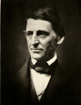

# Ralph Waldo Emerson

*Goodman, Russell*

*Photo from Amos Bronson Alcott 1882.*
**First published Thu Jan 3, 2002; substantive revision Fri Oct 21, 2022**

An American essayist, poet, and popular philosopher, Ralph Waldo Emerson (1803–82) began his career as a Unitarian minister in Boston, but achieved worldwide fame as a lecturer and the author of such essays as “Self-Reliance,” “History,” “The Over-Soul,” and “Fate.” Drawing on English and German Romanticism, Neoplatonism, Kantianism, and Hinduism, Emerson developed a metaphysics of process, an epistemology of moods, and an “existentialist” ethics of self-improvement. He influenced generations of Americans, from his friend Henry David Thoreau to John Dewey, and in Europe, Friedrich Nietzsche, who takes up such Emersonian themes as power, fate, the uses of poetry and history, and the critique of Christianity.

## 1. Chronology of Emerson’s Life

**1803**

Born in Boston to William and Ruth Haskins Emerson.

**1811**

Father dies, probably of tuberculosis.

**1812**

Enters Boston Public Latin School

**1817**

Begins study at Harvard College: Greek, Latin, History, Rhetoric.

**1820**

Starts first journal, entitled “The Wide World.”

**1821**

Graduates from Harvard and begins teaching at his brother William’s school for young ladies in Boston.

**1825**

Enters Harvard Divinity School.

**1829**

Marries Ellen Tucker and is ordained minister at Boston’s Second Church.

**1831**

Ellen Tucker Emerson dies, at age 19.

**1832**

Resigns position as minister and sails for Europe.

**1833**

Meets Wordsworth, Coleridge, J. S. Mill, and Thomas Carlyle. Returns to Boston in November, where he begins a career as a lecturer.

**1834**

Receives first half of a substantial inheritance from Ellen’s estate (second half comes in 1837).

**1835**

Marries Lidian Jackson.

**1836**

Publishes first book, *Nature*.

**1838**

Delivers the “Divinity School Address.” Protests relocation of the Cherokees in letter to President Van Buren.

**1841**

*Essays* published (contains “Self-Reliance,” “The Over-Soul,” “Circles,” “History”).

**1842**

Son Waldo dies of scarlet fever at the age of 5.

**1844**

*Essays, Second Series* published (contains “The Poet,” “Experience,” “Nominalist and Realist”).

**1847–8**

Lectures in England.

**1850**

Publishes *Representative Men* (essays on Plato, Swedenborg, Montaigne, Goethe, Napoleon).

**1851–60**

Speaks against Fugitive Slave Law and in support of anti-slavery candidates in Concord, Boston, New York, Philadelphia.

**1856**

Publishes *English Traits*.

**1860**

Publishes *The Conduct of Life* (contains “Culture” and “Fate”).

**1867**

Lectures in nine western states.

**1870**

Publishes *Society and Solitude.* Presents sixteen lectures in Harvard’s Philosophy Department.

**1872–3**

After a period of failing health, travels to Europe, Egypt.

**1875**

Journal entries cease.

**1882**

Dies in Concord.

## 2. Major Themes in Emerson’s Philosophy

### 2.1 Education

In “The American Scholar,” delivered as the Phi Beta Kappa Address in 1837, Emerson maintains that the scholar is educated by nature, books, and action. Nature is the first in time (since it is always there) and the first in importance of the three. Nature’s variety conceals underlying laws that are at the same time laws of the human mind: “the ancient precept, ‘Know thyself,’ and the modern precept, ‘Study nature,’ become at last one maxim” (CW1: 55). Books, the second component of the scholar’s education, offer us the influence of the past. Yet much of what passes for education is mere idolization of books — transferring the “sacredness which applies to the act of creation…to the record.” The proper relation to books is not that of the “bookworm” or “bibliomaniac,” but that of the “creative” reader (CW1: 58) who uses books as a stimulus to attain “his own sight of principles.” Used well, books “inspire…the active soul” (CW1: 56). Great books are mere records of such inspiration, and their value derives only, Emerson holds, from their role in inspiring or recording such states of the soul. The “end” Emerson finds in nature is not a vast collection of books, but, as he puts it in “The Poet,” “the production of new individuals,…or the passage of the soul into higher forms” (CW3:14).

The third component of the scholar’s education is action. Without it, thought “can never ripen into truth” (CW1: 59). Action is the process whereby what is not fully formed passes into expressive consciousness. Life is the scholar’s “dictionary” (CW1: 60), the source for what she has to say: “Only so much do I know as I have lived” (CW1:59). The true scholar speaks from experience, not in imitation of others; her words, as Emerson puts it, are “are loaded with life…” (CW1: 59). The scholar’s education in original experience and self-expression is appropriate, according to Emerson, not only for a small class of people, but for everyone. Its goal is the creation of a democratic nation. Only when we learn to “walk on our own feet” and to “speak our own minds,” he holds, will a nation “for the first time exist” (CW1: 70).

Emerson returned to the topic of education late in his career in “Education,” an address he gave in various versions at graduation exercises in the 1860s. Self-reliance appears in the essay in his discussion of respect. The “secret of Education,” he states, “lies in respecting the pupil.” It is not for the teacher to choose what the pupil will know and do, but for the pupil to discover “his own secret.” The teacher must therefore “wait and see the new product of Nature” (E: 143), guiding and disciplining when appropriate-not with the aim of encouraging repetition or imitation, but with that of finding the new power that is each child’s gift to the world. The aim of education is to “keep” the child’s “nature and arm it with knowledge in the very direction in which it points” (E: 144). This aim is sacrificed in mass education, Emerson warns. Instead of educating “masses,” we must educate “reverently, one by one,” with the attitude that “the whole world is needed for the tuition of each pupil” (E: 154).

### 2.2 Process

Emerson is in many ways a process philosopher, for whom the universe is fundamentally in flux and “permanence is but a word of degrees” (CW 2: 179). Even as he talks of “Being,” Emerson represents it not as a stable “wall” but as a series of “interminable oceans” (CW3: 42). This metaphysical position has epistemological correlates: that there is no final explanation of any fact, and that each law will be incorporated in “some more general law presently to disclose itself” (CW2: 181). Process is the basis for the succession of moods Emerson describes in “Experience,” (CW3: 30), and for the emphasis on the present throughout his philosophy.

Some of Emerson’s most striking ideas about morality and truth follow from his process metaphysics: that no virtues are final or eternal, all being “initial,” (CW2: 187); that truth is a matter of glimpses, not steady views. We have a choice, Emerson writes in “Intellect,” “between truth and repose,” but we cannot have both (CW2: 202). Fresh truth, like the thoughts of genius, comes always as a surprise, as what Emerson calls “the newness” (CW3: 40). He therefore looks for a “certain brief experience, which surprise[s] me in the highway or in the market, in some place, at some time…” (CW1: 213). This is an experience that cannot be repeated by simply returning to a place or to an object such as a painting. A great disappointment of life, Emerson finds, is that one can only “see” certain pictures once, and that the stories and people who fill a day or an hour with pleasure and insight are not able to repeat the performance.

Emerson’s basic view of religion also coheres with his emphasis on process, for he holds that one finds God only in the present: “God is, not was” (CW1:89). In contrast, what Emerson calls “historical Christianity” (CW1: 82) proceeds “as if God were dead” (CW1: 84). Even history, which seems obviously about the past, has its true use, Emerson holds, as the servant of the present: “The student is to read history actively and not passively; to esteem his own life the text, and books the commentary” (CW2: 5).

### 2.3 Morality

Emerson’s views about morality are intertwined with his metaphysics of process, and with his perfectionism, his idea that life has the goal of passing into “higher forms” (CW3:14). The goal remains, but the forms of human life, including the virtues, are all “initial” (CW2: 187). The word “initial” suggests the verb “initiate,” and one interpretation of Emerson’s claim that “all virtues are initial” is that virtues initiate historically developing forms of life, such as those of the Roman nobility or the Confucian *junxi*. Emerson does have a sense of morality as developing historically, but in the context in “Circles” where his statement appears he presses a more radical and skeptical position: that our virtues often must be abandoned rather than developed. “The terror of reform,” he writes, “is the discovery that we must cast away our virtues, or what we have always esteemed such, into the same pit that has consumed our grosser vices” (CW2: 187). The qualifying phrase “or what we have always esteemed such” means that Emerson does not embrace an easy relativism, according to which what is taken to be a virtue at any time must actually be a virtue. Yet he does cast a pall of suspicion over all established modes of thinking and acting. The proper standpoint from which to survey the virtues is the ‘new moment‘ — what he elsewhere calls truth rather than repose (CW2:202) — in which what once seemed important may appear “trivial” or “vain” (CW2:189). From this perspective (or more properly the developing set of such perspectives) the virtues do not disappear, but they may be fundamentally altered and rearranged.

Although Emerson is thus in no position to set forth a system of morality, he nevertheless delineates throughout his work a set of virtues and heroes, and a corresponding set of vices and villains. In “Circles” the vices are “forms of old age,” and the hero the “receptive, aspiring” youth (CW2:189). In the “Divinity School Address,” the villain is the “spectral” preacher whose sermons offer no hint that he has ever lived. “Self Reliance” condemns virtues that are really “penances” (CW2: 31), and the philanthropy of abolitionists who display an idealized “love” for those far away, but are full of hatred for those close by (CW2: 30).

Conformity is the chief Emersonian vice, the opposite or “aversion” of the virtue of “self-reliance.” We conform when we pay unearned respect to clothing and other symbols of status, when we show “the foolish face of praise” or the “forced smile which we put on in company where we do not feel at ease in answer to conversation which does not interest us” (CW2: 32). Emerson criticizes our conformity even to our own past actions-when they no longer fit the needs or aspirations of the present. This is the context in which he states that “a foolish consistency is the hobgoblin of little minds, adored by little statesmen, philosophers and divines” (CW2: 33). There is wise and there is foolish consistency, and it is foolish to be consistent if that interferes with the “main enterprise of the world for splendor, for extent,…the upbuilding of a man” (CW1: 65).

If Emerson criticizes much of human life, he nevertheless devotes most of his attention to the virtues. Chief among these is what he calls “self-reliance.” The phrase connotes originality and spontaneity, and is memorably represented in the image of a group of nonchalant boys, “sure of a dinner…who would disdain as much as a lord to do or say aught to conciliate one…” The boys sit in judgment on the world and the people in it, offering a free, “irresponsible” condemnation of those they see as “silly” or “troublesome,” and praise for those they find “interesting” or “eloquent.” (CW2: 29). The figure of the boys illustrates Emerson’s characteristic combination of the romantic (in the glorification of children) and the classical (in the idea of a hierarchy in which the boys occupy the place of lords or nobles).

Although he develops a series of analyses and images of self-reliance, Emerson nevertheless destabilizes his own use of the concept. “To talk of reliance,” he writes, “is a poor external way of speaking. Speak rather of that which relies, because it works and is” (CW 2:40). ‘Self-reliance’ can be taken to mean that there is a self already formed on which we may rely. The “self” on which we are to “rely” is, in contrast, the original self that we are in the process of creating. Such a self, to use a phrase from Nietzsche’s Ecce Homo, “becomes what it is.”

For Emerson, the best human relationships require the confident and independent nature of the self-reliant. Emerson’s ideal society is a confrontation of powerful, independent “gods, talking from peak to peak all round Olympus.” There will be a proper distance between these gods, who, Emerson advises, “should meet each morning, as from foreign countries, and spending the day together should depart, as into foreign countries” (CW 3:81). Even “lovers,” he advises, “should guard their strangeness” (CW3: 82). Emerson portrays himself as preserving such distance in the cool confession with which he closes “Nominalist and Realist,” the last of the *Essays, Second Series*:

> I talked yesterday with a pair of philosophers: I endeavored to show my good men that I liked everything by turns and nothing long…. Could they but once understand, that I loved to know that they existed, and heartily wished them Godspeed, yet, out of my poverty of life and thought, had no word or welcome for them when they came to see me, and could well consent to their living in Oregon, for any claim I felt on them, it would be a great satisfaction (CW 3:145).

The self-reliant person will “publish” her results, but she must first learn to detect that spark of originality or genius that is her particular gift to the world. It is not a gift that is available on demand, however, and a major task of life is to meld genius with its expression. “The man,” Emerson states “is only half himself, the other half is his expression” (CW 3:4). There are young people of genius, Emerson laments in “Experience,” who promise “a new world” but never deliver: they fail to find the focus for their genius “within the actual horizon of human life” (CW 3:31). Although Emerson emphasizes our independence and even distance from one another, then, the payoff for self-reliance is public and social. The scholar finds that the most private and secret of his thoughts turn out to be “the most acceptable, most public, and universally true” (CW1: 63). And the great “representative men” Emerson identifies are marked by their influence on the world. Their names-Plato, Moses, Jesus, Luther, Copernicus, even Napoleon-are “ploughed into the history of this world” (CW1: 80).

Although self-reliance is central, it is not the only Emersonian virtue. Emerson also praises a kind of trust, and the practice of a “wise skepticism.” There are times, he holds, when we must let go and trust to the nature of the universe: “As the traveler who has lost his way, throws his reins on his horse’s neck, and trusts to the instinct of the animal to find his road, so must we do with the divine animal who carries us through this world” (CW3:16). But the world of flux and conflicting evidence also requires a kind of epistemological and practical flexibility that Emerson calls “wise skepticism” (CW4: 89). His representative skeptic of this sort is Michel de Montaigne, who as portrayed in *Representative Men* is no unbeliever, but a man with a strong sense of self, rooted in the earth and common life, whose quest is for knowledge. He wants “a near view of the best game and the chief players; what is best in the planet; art and nature, places and events; but mainly men” (CW4: 91). Yet he knows that life is perilous and uncertain, “a storm of many elements,” the navigation through which requires a flexible ship, “fit to the form of man.” (CW4: 91).

### 2.4 Christianity

The son of a Unitarian minister, Emerson attended Harvard Divinity School and was employed as a minister for almost three years. Yet he offers a deeply felt and deeply reaching critique of Christianity in the “Divinity School Address,” flowing from a line of argument he establishes in “The American Scholar.” If the one thing in the world of value is the active soul, then religious institutions, no less than educational institutions, must be judged by that standard. Emerson finds that contemporary Christianity deadens rather than activates the spirit. It is an “Eastern monarchy of a Christianity” in which Jesus, originally the “friend of man,” is made the enemy and oppressor of man. A Christianity true to the life and teachings of Jesus should inspire “the religious sentiment” — a joyous seeing that is more likely to be found in “the pastures,” or “a boat in the pond” than in a church. Although Emerson thinks it is a calamity for a nation to suffer the “loss of worship” (CW1: 89) he finds it strange that, given the “famine of our churches” (CW1: 85) anyone should attend them. He therefore calls on the Divinity School graduates to breathe new life into the old forms of their religion, to be friends and exemplars to their parishioners, and to remember “that all men have sublime thoughts; that all men value the few real hours of life; they love to be heard; they love to be caught up into the vision of principles” (CW1: 90).

### 2.5 Power

Power is a theme in Emerson’s early writing, but it becomes especially prominent in such middle- and late-career essays as “Experience,” “Montaigne, or the Skeptic” “Napoleon,” and “Power.” Power is related to action in “The American Scholar,” where Emerson holds that a “true scholar grudges every opportunity of action past by, as a loss of power” (CW1: 59). It is also a subject of “Self-Reliance,” where Emerson writes of each person that “the power which resides in him is new in nature” (CW2: 28). In “Experience” Emerson speaks of a life which “is not intellectual or critical, but sturdy” (CW3: 294); and in “Power” he celebrates the “bruisers” (CW6: 34) of the world who express themselves rudely and get their way. The power in which Emerson is interested, however, is more artistic and intellectual than political or military. In a characteristic passage from “Power,” he states:

> In history the great moment, is, when the savage is just ceasing to be a savage, with all his hairy Pelasgic strength directed on his opening sense of beauty:-and you have Pericles and Phidias,-not yet passed over into the Corinthian civility. Everything good in nature and the world is in that moment of transition, when the swarthy juices still flow plentifully from nature, but their astringency or acridity is got out by ethics and humanity. (CW6: 37–8)

Power is all around us, but it cannot always be controlled. It is like “a bird which alights nowhere,” hopping “perpetually from bough to bough” (CW3: 34). Moreover, we often cannot tell at the time when we exercise our power that we are doing so: happily we sometimes find that much is accomplished in “times when we thought ourselves indolent” (CW3: 28).

### 2.6 Unity and Moods

At some point in many of his essays and addresses, Emerson enunciates, or at least refers to, a great vision of unity. He speaks in “The American Scholar” of an “original unit” or “fountain of power” (CW1: 53), of which each of us is a part. He writes in “The Divinity School Address” that each of us is “an inlet into the deeps of Reason.” And in “Self-Reliance,” the essay that more than any other celebrates individuality, he writes of “the resolution of all into the ever-blessed ONE” (CW2: 40). “The Oversoul” is Emerson’s most sustained discussion of “the ONE,” but he does not, even there, shy away from the seeming conflict between the reality of process and the reality of an ultimate metaphysical unity. How can the vision of succession and the vision of unity be reconciled?

Emerson never comes to a clear or final answer. One solution he both suggests and rejects is an unambiguous idealism, according to which a nontemporal “One” or “Oversoul” is the only reality, and all else is illusion. He suggests this, for example, in the many places where he speaks of waking up out of our dreams or nightmares. But he then portrays that to which we awake not simply as an unchanging “ONE,” but as a process or succession: a “growth” or “movement of the soul” (CW2: 189); or a “new yet unapproachable America” (CW3: 259).

Emerson undercuts his visions of unity (as of everything else) through what Stanley Cavell calls his “epistemology of moods.” According to this epistemology, most fully developed in “Experience” but present in all of Emerson’s writing, we never apprehend anything “straight” or in-itself, but only under an aspect or mood. Emerson writes that life is “a train of moods like a string of beads,” through which we see only what lies in each bead’s focus (CW3: 30). The beads include our temperaments, our changing moods, and the “Lords of Life” which govern all human experience. The Lords include “Succession,” “Surface,” “Dream,” “Reality,” and “Surprise.” Are the great visions of unity, then, simply aspects under which we view the world?

Emerson’s most direct attempt to reconcile succession and unity, or the one and the many, occurs in the last essay in the *Essays, Second Series*, entitled “Nominalist and Realist.” There he speaks of the universe as an “old Two-face…of which any proposition may be affirmed or denied” (CW3: 144). As in “Experience,” Emerson leaves us with the whirling succession of moods. “I am always insincere,” he skeptically concludes, “as always knowing there are other moods” (CW3: 145). But Emerson enacts as well as describes the succession of moods, and he ends “Nominalist and Realist” with the “feeling that all is yet unsaid,” and with at least the idea of some universal truth (CW3: 363).

## 3. Emerson on Slavery and Race

Massachusetts ended slavery in 1783, when Chief Justice William Cushing instructed the jury in the case of Quock Walker, a former slave, that “the idea of slavery” was “inconsistent” with the Massachusetts Constitution’ guarantee that “all men are born free and equal” (Gougeon, 71). Emerson first encountered slavery when he went south for his health in the winter of 1827, when he was 23. He recorded the following scene in his journal from his time in Tallahasse, Florida:

> A fortnight since I attended a meeting of the Bible Society. The Treasurer of this institution is Marshal of the district & by a somewhat unfortunate arrangement had appointed a special meeting of the Society & a Slave Auction at the same time & place, one being in the Government house & the other in the adjoining yard. One ear therefore heard the glad tidings of great joy whilst the other was regaled with “Going gentlemen, Going!” And almost without changing our position we might aid in sending the scriptures into Africa or bid for “four children without the mother who had been kidnapped therefrom” (JMN3: 117).

Emerson never questioned the iniquity of slavery, though it was not a main item on his intellectual agenda until the eighteen forties. He refers to abolition in the “Prospects” chapter of *Nature* when he speaks of the “gleams of a better light” in the darkness of history and gives as examples “the abolition of the Slave-trade,” “the history of Jesus Christ,” and “the wisdom of children” (CW1:43). He condemns slavery in some of his greatest essays, “Self-Reliance” (1841), so that even if we didn’t have the anti-slavery addresses of the 1840s and 1850s, we would still have evidence both of the existence of slavery and of Emerson’s opposition to it. He praises “the bountiful cause of Abolition,” although he laments that the cause had been taken over by “angry bigots.” Later in the essay he treats abolition as one of the great causes and movements of world history, along with Christianity, the Reformation, and Methodism. In a well-known statement he writes that an “institution is the shadow of one man,” giving as examples “the Reformation, of Luther; Quakerism, of Fox; Methodism, of Wesley; Abolition of Clarkson” (CW2: 35). The unfamiliar name in this list is that of Thomas Clarkson (1760–1846), a Cambridge-educated clergyman who helped found the British Committee for the Abolition of the Slave Trade. Clarkson travelled on horseback throughout Britain, interviewing sailors who worked on slaving ships, and exhibiting such tools as manacles, thumbscews, branding irons, and other tools of the trade. His *History of the Rise, Progress, and Accomplishment of the Abolition of the African Slave Trade by the British Parliament* (1808) would be a major source for Emerson’s anti-slavery addresses.

Slavery also appears in “Politics,” from the *Essays, Second Series* of 1844, when Emerson surveys the two main American parties. One, standing for free trade, wide suffrage, and the access of the young and poor to wealth and power, has the “best cause” but the least attractive leaders; while the other has the most cultivated and able leaders, but is “merely defensive of property.” This conservative party, moreover, “vindicates no right, it aspires to no real good, it brands no crime, it proposes no generous policy, it does not build nor write, nor cherish the arts, nor foster religion, nor establish schools, nor encourage science, nor emancipate the slave, nor befriend the poor, or the Indian, or the immigrant” (CW3: 124). Emerson stands here for emancipation, not simply for the ending of the slave trade.

1844 was also the year of Emerson’s breakout anti-slavery address, which he gave at the annual celebration of the abolition of slavery in the British West Indies. In the background was the American war with Mexico, the annexation of Texas, and the likelihood that it would be entering the Union as a slave state. Although Concord was a hotbed of abolitionism compared to Boston, there were many conservatives in the town. No church allowed Emerson to speak on the subject, and when the courthouse was secured for the talk, the sexton refused to ring the church bell to announce it, a task the young Henry David Thoreau took upon himself to perform (Gougeon, 75). In his address, Emerson develops a critique of the language we use to speak about, or to avoid speaking about, black slavery:

> Language must be raked, the secrets of slaughter-houses and infamous holes that cannot front the day, must be ransacked, to tell what negro-slavery has been. These men, our benefactors, as they are producers of corn and wine, of coffee, of tobacco, of cotton, of sugar, of rum, and brandy, gentle and joyous themselves, and producers of comfort and luxury for the civilized world.… I am heart-sick when I read how they came there, and how they are kept there. Their case was left out of the mind and out of the heart of their brothers (*Emerson’s Antislavery Writings*, 9).

Emerson’s long address is both clear-eyed about the evils of slavery and hopeful about the possibilities of the Africans. Speaking with the black abolitionist Frederick Douglass beside him on the dais, Emerson states: “The black man carries in his bosom an indispensable element of a new and coming civilization.” He praises “such men as” Toussaint [L]Ouverture, leader of the Haitian slave rebellion, and announces: “here is the anti-slave: here is man; and if you have man, black or white is an insignificance.” (Wirzrbicki, 95; *Emerson’s Antislavery Writings,* 31).

The Fugitive Slave Law of 1850 effectively nationalized slavery, requiring officials and citizens of the free states to assist in returning escaped slaves to their owners. Emerson’s 1851 “Address to the Citizens of Concord” calls both for the abrogation of the law and for disobeying it while it is still current. In 1854, the escaped slave Anthony Burns was shipped back to Virginia by order of the Chief Justice of the Massachusetts Supreme Court, an order carried out by U. S. Marines, in accordance with the new law. This example of “Slavery in Massachusetts” (as Henry Thoreau put it in a well-known address) is in the background of Emerson’s 1855 “Lecture on Slavery,” where he calls the recognition of slavery by the original 1787 Constitution a “crime.” Emerson gave these and other antislavery addresses multiple times in various places from the late 1840s till the beginning of the Civil War. On the eve of the war Emerson supported John Brown, the violent abolitionist who was executed in 1859 by the U. S. government after he attacked the U. S. armory in Harper’s Ferry, West Virginia. In the middle of the War, Emerson raised funds for black regiments of Union soldiers (Wirzbicki, 251–2) and read his “Boston Hymn” to an audience of 3000 celebrating President Abraham Lincoln’s Emancipation Proclamation of 1863. “Pay ransom to the owner,” Emerson wrote, “and fill the bag to the brim. Who is the owner? The slave is owner. And ever was. Pay him” (CW9: 383).

Emerson’s magisterial essay “Fate,” published in *The Conduct of Life* (1860) is distinguished not only by its attempt to reconcile freedom and necessity, but by disturbing pronouncements about fate and race, for example:

> The population of the world is a conditional population, not the best, but the best that could live now; and the scale of tribes, and the steadiness with which victory adheres to one tribe, and defeat to another, is as uniform as the superposition of strata. We know in history what weight belongs to race. We see the English, French, and Germans planting themselves on every shore and market of America and Australia, and monopolizing the commerce of these countries. We like the nervous and victorious habit of our own branch of the family. We follow the step of the Jew, of the Indian, of the Negro. We see how much will has been expended to extinguish the Jew, in vain.… The German and Irish millions, like the Negro, have a great deal of guano in their destiny. They are ferried over the Atlantic, and carted over America, to ditch and to drudge, to make corn cheap, and then to lie down prematurely to make a spot of green grass on the prairie (CW6: 8–9).

The references to race here show the influence of a new “scientific” interest in both England and America in the role that race—often conflated with culture or nation—plays in human evolution. In America, this interest was entangled with the institution of slavery, the encounters with Native American tribes, and with the notion of “Anglo-Saxon liberties” that came to prominence during the American Revolution, and developed into the idea that there was an Anglo-Saxon race (see Horsman).

Emerson would not be Emerson, however, if he did not conduct a critique of his terms, and “race” is a case in point. He takes it up in a non-American context, however: in the essay “Race” from *English Traits* (1856). Emerson’s critique of his title begins in the essay’s first paragraph when he writes that “each variety shades down imperceptibly into the next, and you cannot draw the line where a race begins or ends.” Civilization “eats away the old traits,” he continues, and religions construct new forms of character that cut against old racial divisions. More deeply still, he identifies considerations that “threaten to undermine” the concept of race. The “fixity … of races as we see them,” he writes, “is a weak argument for the eternity of these frail boundaries, since all our historical period is a point” in the long duration of nature (CW 5:24). The patterns we see today aren’t pure anyway:

> though we flatter the self-love of men and nations by the legend of pure races, all our experience is of the gradation and resolution of races, and strange resemblances meet us every where, It need not puzzle us that Malay and Papuan, Celt and Roman, Saxon and Tartar should mix, when we see the rudiments of tiger and baboon in our human form, and know that the barriers of races are not so firm, but that some spray sprinkles us from the antidiluvian seas.

As in *Nature* and his great early works, Emerson asserts our intimate relations with the natural world, from the oceans to the animals. Why, one might think, should one of the higher but still initial forms be singled out for separation, abasement, and slavery? Emerson works out his views in “Race” without referring to American slavery, however, in a book about England where he sees a healthy mixture, not a pure race. England’s history, he writes, is not so much “one of certain tribes of Saxons, Jutes, or Frisians, coming from one place, and genetically identical, as it is an anthology of temperaments out of them all.… The English derive their pedigree from such a range of nationalities.… The Scandinavians in her race still hear in every age the murmurs of their mother, the ocean; the Briton in the blood hugs the homestead still” (CW5: 28). Still, it is striking that Emerson never mentions slavery in either “Fate” or “Race,” both of which were written during his intense period of public opposition to American slavery.

## 4. Some Questions about Emerson

### 4.1 Consistency

Emerson routinely invites charges of inconsistency. He says the world is fundamentally a process and fundamentally a unity; that it resists the imposition of our will and that it flows with the power of our imagination; that travel is good for us, since it adds to our experience, and that it does us no good, since we wake up in the new place only to find the same “ sad self” we thought we had left behind (CW2: 46).

Emerson’s “epistemology of moods” is an attempt to construct a framework for encompassing what might otherwise seem contradictory outlooks, viewpoints, or doctrines. Emerson really means to “accept,” as he puts it, “the clangor and jangle of contrary tendencies” (CW3: 36). He means to be irresponsible to all that holds him back from his self-development. That is why, at the end of “Circles,” he writes that he is “only an experimenter…with no Past at my back” (CW2: 188). In the world of flux that he depicts in that essay, there is nothing stable to be responsible to: “every moment is new; the past is always swallowed and forgotten, the coming only is sacred” (CW2: 189).

Despite this claim, there is considerable consistency in Emerson’s essays and among his ideas. To take just one example, the idea of the “active soul” – mentioned as the “one thing in the world, of value” in ‘The American Scholar’ – is a presupposition of Emerson’s attack on “the famine of the churches” (for not feeding or activating the souls of those who attend them); it is an element in his understanding of a poem as “a thought so passionate and alive, that, like the spirit of a plant or an animal, it has an architecture of its own …” (CW3: 6); and, of course, it is at the center of Emerson’s idea of self-reliance. There are in fact multiple paths of coherence through Emerson’s philosophy, guided by ideas discussed previously: process, education, self-reliance, and the present.

### 4.2 Early and Late Emerson

It is hard for an attentive reader not to feel that there are important differences between early and late Emerson: for example, between the buoyant *Nature* (1836) and the weary ending of “Experience” (1844); between the expansive author of “Self-Reliance” (1841) and the burdened writer of “Fate” (1860). Emerson himself seems to advert to such differences when he writes in “Fate”: “Once we thought, positive power was all. Now we learn that negative power, or circumstance, is half” (CW6: 8). Is “Fate” the record of a lesson Emerson had not absorbed in his early writing, concerning the multiple ways in which circumstances over which we have no control — plagues, hurricanes, temperament, sexuality, old age — constrain self-reliance or self-development?

“Experience” is a key transitional essay. “Where do we find ourselves?” is the question with which it begins. The answer is not a happy one, for Emerson finds that we occupy a place of dislocation and obscurity, where “sleep lingers all our lifetime about our eyes, as night hovers all day in the boughs of the fir-tree” (CW3: 27). An event hovering over the essay, but not disclosed until its third paragraph, is the death of his five-year old son Waldo. Emerson finds in this episode and his reaction to it an example of an “unhandsome” general character of existence-it is forever slipping away from us, like his little boy.

“Experience” presents many moods. It has its moments of illumination, and its considered judgment that there is an “Ideal journeying always with us, the heaven without rent or seam” (CW3: 41). It offers wise counsel about “skating over the surfaces of life” and confining our existence to the “mid-world.” But even its upbeat ending takes place in a setting of substantial “defeat.” “Up again, old heart!” a somewhat battered voice states in the last sentence of the essay. Yet the essay ends with an assertion that in its great hope and underlying confidence chimes with some of the more expansive passages in Emerson’s writing. The “true romance which the world exists to realize,” he states, “will be the transformation of genius into practical power” (CW3: 49).

Despite important differences in tone and emphasis, Emerson’s assessment of our condition remains much the same throughout his writing. There are no more dire indictments of ordinary human life than in the early work, “The American Scholar,” where Emerson states that “Men in history, men in the world of to-day, are bugs, are spawn, and are called ‘the mass’ and ‘the herd.’ In a century, in a millennium, one or two men; that is to say, one or two approximations to the right state of every man” (CW1: 65). Conversely, there is no more idealistic statement in his early work than the statement in “Fate” that “[t]hought dissolves the material universe, by carrying the mind up into a sphere where all is plastic” (CW6: 15). All in all, the earlier work expresses a sunnier hope for human possibilities, the sense that Emerson and his contemporaries were poised for a great step forward and upward; and the later work, still hopeful and assured, operates under a weight or burden, a stronger sense of the dumb resistance of the world.

### 4.3 Sources and Influence

Emerson read widely, and gave credit in his essays to the scores of writers from whom he learned. He kept lists of literary, philosophical, and religious thinkers in his journals and worked at categorizing them.

Among the most important writers for the shape of Emerson’s philosophy are Plato and the Neoplatonist line extending through Plotinus, Proclus, Iamblichus, and the Cambridge Platonists. Equally important are writers in the Kantian and Romantic traditions (which Emerson probably learned most about from Coleridge’s *Biographia Literaria*). Emerson read avidly in Indian, especially Hindu, philosophy, and in Confucianism. There are also multiple empiricist, or experience-based influences, flowing from Berkeley, Wordsworth and other English Romantics, Newton’s physics, and the new sciences of geology and comparative anatomy. Other writers whom Emerson often mentions are Anaxagoras, St. Augustine, Francis Bacon, Jacob Behmen, Cicero, Goethe, Heraclitus, Lucretius, Mencius, Pythagoras, Schiller, Thoreau, August and Friedrich Schlegel, Shakespeare, Socrates, Madame de Staël and Emanuel Swedenborg.

Emerson’s works were well known throughout the United States and Europe in his day. Nietzsche read German translations of Emerson’s essays, copied passages from “History” and “Self-Reliance” in his journals, and wrote of the *Essays*: that he had never “felt so much at home in a book.” Emerson’s ideas about “strong, overflowing” heroes, friendship as a battle, education, and relinquishing control in order to gain it, can be traced in Nietzsche’s writings. Other Emersonian ideas-about transition, the ideal in the commonplace, and the power of human will permeate the writings of such classical American pragmatists as William James and John Dewey.

Stanley Cavell’s engagement with Emerson is the most original and prolonged by any philosopher, and Emerson is a primary source for his writing on “moral perfectionism.” In his earliest essays on Emerson, such as “Thinking of Emerson” and “Emerson, Coleridge, Kant,” Cavell considers Emerson’s place in the Kantian tradition, and he explores the affinity between Emerson’s call in “The American Scholar” for a return to “the common and the low” and Wittgenstein’s quest for a return to ordinary language. In “Being Odd, Getting Even” and “Aversive Thinking,” Cavell considers Emerson’s anticipations of existentialism, and in these and other works he explores Emerson’s affinities with Nietzsche and Heidegger.

In *Conditions Handsome and Unhandsome* and *Cities of Words*, Cavell develops what he calls “Emersonian moral perfectionism,” of which he finds an exemplary expression in Emerson’s “History”: “So all that is said of the wise man by Stoic, or oriental or modern essayist, describes to each reader his own idea, describes his unattained but attainable self.” Emersonian perfectionism is oriented towards a wiser or better self that is never final, always initial, always on the way.

Cavell does not have a neat and tidy definition of perfectionism, and his list of perfectionist works ranges from Plato’s *Republic* to Wittgenstein’s *Philosophical Investigations*, but he identifies “two dominating themes of perfectionism” in Emerson’s writing: (1) “that the human self … is always becoming, as on a journey, always partially in a further state. This journey is described as education or cultivation”; (2) “that the other to whom I can use the words I discover in which to express myself is the Friend—a figure that may occur as the goal of the journey but also as its instigation and accompaniment” (*Cities of Words*, 26–7). The friend can be a person but it may also be a text. In the sentence from “History” cited above, the writing of the “Stoic, or oriental or modern essayist” about “the wise man” functions as a friend and guide, describing to each reader not just any idea, but “his own idea.” This is the text as instigator and companion.

Cavell’s engagement with perfectionism springs from a response to his colleague John Rawls, who in *A Theory of Justice* condemns Nietzsche (and implicitly Emerson) for his statement that “mankind must work continually to produce individual great human beings.” “Perfectionism,” Rawls states, “is denied as a political principle.” Cavell replies that Emerson’s (and Nietzsche’s) focus on the great man has nothing to do with a transfer of economic resources or political power, or with the idea that “there is a separate class of great men …for whose good, and conception of good, the rest of society is to live” (CHU, 49). The great man or woman, Cavell holds, is required for rather than opposed to democracy: “essential to the criticism of democracy from within” (CHU, 3).

## References（引用注释）

> 原文参考文献已转为脚注引用：文内“作者-年份”引用组后附 [^key] 标记，完整条目见本文末脚注定义。

### Works by Emerson

### Selected Writings on Emerson

## Academic Tools

> |   | [How to cite this entry](https://plato.stanford.edu/cgi-bin/encyclopedia/archinfo.cgi?entry=emerson). |
> | --- | --- |
> |   | [Preview the PDF version of this entry](https://leibniz.stanford.edu/friends/preview/emerson/) at the [Friends of the SEP Society](https://leibniz.stanford.edu/friends/). |
> |   | [Look up topics and thinkers related to this entry](https://www.inphoproject.org/entity?sep=emerson&redirect=True) at the Internet Philosophy Ontology Project (InPhO). |
> |   | [Enhanced bibliography for this entry](https://philpapers.org/sep/emerson/) at [PhilPapers](https://philpapers.org/), with links to its database. |

## Other Internet Resources

- [Emerson Texts](http://www.emersoncentral.com/).

## Related Entries

Anaxagoras | Augustine of Hippo | Bacon, Francis | Cambridge Platonists | Cicero | Dewey, John | Heraclitus | Iamblichus | James, William | Lucretius | Mencius | Nietzsche, Friedrich | Plotinus | Pythagoras | Schiller, Friedrich | Schlegel, Friedrich | Socrates | transcendentalism

[^collected-1971]: [**CW**] *The Collected Works of Ralph Waldo Emerson*, ed. Robert Spiller et al, Cambridge, MA: Harvard University Press, 1971–

[^education-1883]: [**E**] “Education,” in *Lectures and Biographical Sketches*, in *The Complete Works of Ralph Waldo Emerson*, ed. Edward Waldo Emerson, Boston: Houghton Mifflin, 1883, pp. 125–59

[^complete-1903]: *The Complete Works of Ralph Waldo Emerson*, ed. Edward Waldo Emerson, Boston: Houghton Mifflin, 12 volumes, 1903–4

[^annotated-2012]: *The Annotated Emerson*, ed. David Mikics, Cambridge, MA: Harvard University Press, 2012.

[^journals-1910]: *The Journals of Ralph Waldo Emerson*, ed. Edward Waldo Emerson and Waldo Emerson Forbes. 10 vols., Boston and New York: Houghton Mifflin, 1910–14.

[^journals-1960]: *The Journals and Miscellaneous Notebooks of Ralph Waldo Emerson*, ed. William Gillman, et al., Cambridge: Belknap Press, Harvard University Press, 1960–

[^early-1961]: *The Early Lectures of Ralph Waldo Emerson*, 3 vols, Stephen E. Whicher, Robert E. Spiller, and Wallace E. Williams, eds., Cambridge, MA: Harvard University Press, 1961–72.

[^letters-1964]: *The Letters of Ralph Waldo Emerson*, ed. Ralph L. Rusk and Eleanor M. Tilton. 10 vols. New York: Columbia University Press, 1964–95.

[^thomas-1964]: (with Thomas Carlyle), *The Correspondence of Emerson and Carlyle*, ed. Joseph Slater, New York: Columbia University Press, 1964.

[^emerson’s-1995]: *Emerson’s Antislavery Writings*, eds. Len Gougeon and Joel Myerson, New Haven and London: Yale University Press, 1995.

[^later-2003]: *The Later Lectures of Ralph Waldo Emerson*, eds. Ronald Bosco and Joel Myerson, Athens, GA: University of Georgia Press, 2003.

[^emerson-2008]: *Emerson: Political Writings (Cambridge Texts in the History of Political Thought)*, ed. Kenneth Sacks, Cambridge: Cambridge University Press, 2008.

[^see-nd]: (See Chronology for original dates of publication.)

[^alcott-1882]: Alcott, Amos Bronson, 1882, *Ralph Waldo Emerson: An Estimate of His Character and Genius: In Prose and in Verse*, Boston: A. Williams and Co., 1882)

[^allen-1981]: Allen, Gay Wilson, 1981, *Waldo Emerson*, New York: Viking Press.

[^arsić-2010]: Arsić, Branka, 2010. *On Leaving: A Reading in Emerson*, Cambridge, MA: Harvard University Press.

[^arsić-2010-2]: Arsić, Branka, and Carey Wolfe (eds.), 2010. *The Other Emerson*, Minneapolis, MN: University of Minnesota Press.

[^bishop-1964]: Bishop, Jonathan, 1964, *Emerson on the Soul*, Cambridge, MA: Harvard University Press.

[^buell-2003]: Buell, Lawrence, 2003, *Emerson*, Cambridge, MA: Harvard University Press.

[^cameron-2007]: Cameron, Sharon, 2007, *Impersonality*, Chicago: University of Chicago Press.

[^carpenter-1930]: Carpenter, Frederick Ives, 1930, *Emerson and Asia*, Cambridge, MA: Harvard University Press.

[^cavell-1981]: Cavell, Stanley, 1981, “Thinking of Emerson” and “An Emerson Mood,” in *The Senses of Walden, An Expanded Edition*, San Francisco: North Point Press.

[^cavell-1988]: –––, 1988, *In Quest of the Ordinary: Lines of Skepticism and Romanticism*, Chicago: University of Chicago Press.

[^cavell-1990]: –––, 1990, *Conditions Handsome and Unhandsome: The Constitution of Emersonian Perfectionism*, Chicago: University of Chicago Press. (Abbreviated **CHU** in the text.).

[^cavell-2004]: –––, 2004, *Emerson’s Transcendental Etudes*, Stanford: Stanford University Press.

[^cavell-2004-2]: –––, 2004, *Cities of Words: Pedagogical Letters on a Register of the Moral Life*, Cambridge, MA and London: The Belknap Press of Harvard University Press.

[^conant-1997]: Conant, James, 1997, “Emerson as Educator,” *ESQ: A Journal of the American Renaissance*, 43: 181–206.

[^conant-2001]: –––, 2001, “Nietzsche as Educator,” *Nietzsche’s Post-Moralism: Essays on Nietzsche’s Prelude to Philosophy’s Future*, Richard Schacht (ed.), Cambridge: Cambridge University Press, 181–257.

[^constantinesco-2012]: Constantinesco, Thomas, 2012, *Ralph Waldo Emerson: L’Amérique à l’essai*, Paris: Editions Rue d’Ulm.

[^ellison-1984]: Ellison, Julie, 1984, *Emerson’s Romantic Style*, Princeton: Princeton University Press.

[^firkins-1915]: Firkins, Oscar W., 1915, *Ralph Waldo Emerson*, Boston: Houghton Mifflin.

[^follett-2015]: Follett, Danielle, 2015, “The Tension Between Immanence and Dualism in Coleridge and Emerson,” in *Romanticism and Philosophy: Thinking with Literature*, Sophie Laniel-Musitelli and Thomas Constantinesco (eds.), London: Routledge, 209–221.

[^friedl-2018]: Friedl, Herwig, 2018, *Thinking in Search of a Language: Essays on American Intellect and Intuition*, New York and London: Bloomsbury Academic.

[^goodman-1990a]: Goodman, Russell B., 1990a, *American Philosophy and the Romantic Tradition*, Cambridge: Cambridge University Press, Chapter 2.

[^goodman-1990b]: –––, 1990b, “East-West Philosophy in Nineteenth Century America: Emerson and Hinduism,” *Journal of the History of Ideas*, 51(4): 625–45.

[^goodman-1997]: –––, 1997, “Moral Perfectionism and Democracy in Emerson and Nietzsche,” *ESQ: A Journal of the American Renaissance*, 43: 159–80.

[^goodman-2004]: –––, 2004, “The Colors of the Spirit: Emerson and Thoreau on Nature and the Self,” *Nature in American Philosophy*, Jean De Groot (ed.), Washington, DC: Catholic University of America Press, 1–18.

[^goodman-2008]: –––, 2008, “Emerson, Romanticism, and Classical American Pragmatism,” *The Oxford Handbook of American Philosophy*, Cheryl Misak (ed.), Oxford: Oxford University Press, 19–37.

[^goodman-2015]: –––, 2015, *American Philosophy Before Pragmatism*, Oxford: Oxford University Press, 147–99, 234–54.

[^goodman-2021]: –––, 2021, “Transcendentalist Legacies in American Philosophy,” *Handbook of American Romanticism,* Philipp Löffler, Clemens Spahr, Jan Stievermann (ed.), Berlin and Boston: Walter de Gruyter, 517–536.

[^holmes-1885]: Holmes, Oliver Wendell, 1885, *Ralph Waldo Emerson*, Boston: Houghton Mifflin.

[^horsman-1981]: Horsman, Reginald, 1981, *Race and Manifest Destiny: The Origins of American Racial Anglo-Saxonism,* Cambridge, and London: Harvard University Press.

[^lysaker-2008]: Lysaker, John, 2008, *Emerson and Self-Culture*, Indianapolis: Indiana University Press.

[^matthiessen-1941]: Matthiessen, F. O., 1941, *American Renaissance: Art and Expression in the Age of Emerson and Whitman*, New York: Oxford University Press.

[^packer-1982]: Packer, B. L., 1982, *Emerson’s Fall*, New York: Continuum.

[^packer-2007]: –––, 2007, *The Transcendentalists*, Athens: University of Georgia Press.

[^poirier-1987]: Poirier, Richard, 1987, *The Renewal of Literature: Emersonian Reflections*, New York: Random House.

[^poirier-1992]: –––, 1992, *Poetry and Pragmatism*, Cambridge, MA.: Harvard University Press.

[^porte-1999]: Porte, Joel, and Morris, Saundra (eds.), 1999, *The Cambridge Companion to Ralph Waldo Emerson*, Cambridge: Cambridge University Press.

[^richardson-1995]: Richardson, Robert D. Jr., 1995, *Emerson: The Mind on Fire*, Berkeley and Los Angeles: University of California Press.

[^sacks-2003]: Sacks, Kenneth, 2003, *Understanding Emerson: “The American Scholar” and His Struggle for Self-Reliance*, Princeton: Princeton University Press.

[^urbas-2016]: Urbas, Joseph, 2016, *Emerson’s Metaphysics: A Song of Laws and Causes*, Lanham, MD and London: Lexington Books.

[^urbas-2021]: –––, 2021, *The Philosophy of Ralph Waldo Emerson*, New York and London: Routledge.

[^versluis-1993]: Versluis, Arthur, 1993, *American Transcendentalism and Asian Religions*, New York: Oxford University Press.

[^whicher-1953]: Whicher, Stephen, 1953, *Freedom and Fate: An Inner Life of Ralph Waldo Emerson*, Philadelphia: University of Pennsylvania Press.

[^wirzbicki-2021]: Wirzbicki, Peter, 2021, *Fighting for the Higher Law: Black and White Transcendentalists Against Slavery*, Philadelphia: University of Pennsylvania Press.

[^zavatta-2019]: Zavatta, Benedetta, 2019, *Individuality and Beyond: Nietzsche Reads Emerson, trans. Alexander Reynolds*, New York: Oxford University Press.
