# The Ergodic Hierarchy
**First published Wed Apr 13, 2011; substantive revision Wed Oct 8, 2025**

*Frigg, Roman, Berkovitz, Joseph, Kronz, Fred*

The Ergodic Hierarchy (EH) is a central part of ergodic theory. It is a hierarchy of properties that dynamical systems can possess. Its five levels are ergodicity, weak mixing, strong mixing, Kolmogorov, and Bernoulli. Although EH is a mathematical theory, its concepts have been widely used in the foundations of statistical physics, accounts of randomness, and discussions about the nature of chaos, as well as in other sciences such economics. We introduce EH and discuss its applications.

## 1. Dynamical Systems

The object of study in ergodic theory is a dynamical system. We first introduce some basic concepts with a simple example, from which we abstract the general definition of a dynamical system. For a brief history of the modern notion of a dynamical system and the associated concepts of EH see the Appendix, Section A.

A lead ball is hanging from the ceiling on a spring. We pull it down a bit and let it go. The ball begins to oscillate. The mechanical state of the ball is completely determined by a specification of the position $x$ and the momentum $p$ of its center of mass; that is, if we know $x$ and $p$, then we know all that there is to know about the mechanical state of the ball. If we now conjoin $x$ and $p$ in a vector space we obtain the so-called *phase space* $X$ of the system (sometimes also referred to as ‘state space’).[^note-1] This is illustrated in Figure 1 for the two-dimensional phase space of the state of the ball moving up and down (i.e., the phase space has one dimension for the ball’s position and one for its momentum).

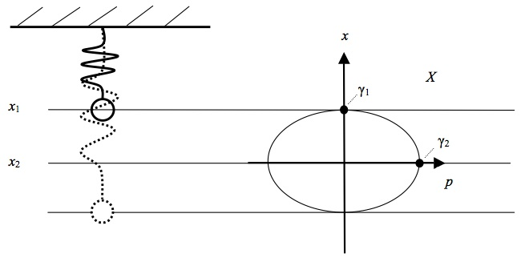

*Figure 1:* The motion of a ball on a spring.

Each point of $X$ represents a state of the ball (because it gives the ball’s position and momentum). Accordingly, the time evolution of the ball’s state is represented by a line in $X$, a so-called *phase space trajectory* (from now on ‘trajectory’), showing where in phase space the system was at each instant of time. For instance, let us assume that at time $t = 0$ the ball is located at point $x_1$ and then moves to $x_2$ where it arrives at time $t = 5$. This motion is represented in $X$ by the line segment connecting points $\gamma_1$ and $\gamma_2$. In other words, the motion of the ball is represented in $X$ by the motion of a point representing the ball’s (instantaneous) state, and all the states that the ball is in over the course of a certain period of time jointly form a trajectory. The motion of this point has a name: it is the *phase flow* $\phi_t$. The phase flow tells us where the ball is at some later time $t$ if we specify where it is at $t = 0$; or, metaphorically speaking, $\phi_t$ drags the ball’s state around in $X$ so that the movement of the state represents the motion of the real ball. In other words, $\phi_t$ is a mathematical representation of the system’s time evolution. The state of the ball at time $t = 0$ is commonly referred to as the *initial condition*. $\phi_t$ then tells us, for every point in phase space, how this point evolves if it is chosen as an initial condition. In our concrete example, point $\gamma_1$ is the initial condition and we have $\gamma_2 = \phi_{t=5}(\gamma_1)$. More generally, let us call the ball’s initial condition $\gamma_0$ and let $\gamma(t)$ be its state at some later time $t$. Then we have $\gamma(t) = \phi_t (\gamma_0)$. This is illustrated in figure 2a.

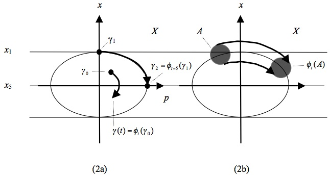

*Figure 2:* Evolution in Phase space.

Since $\phi_t$ tells us for every point in $X$ how it evolves in time, it also tells us how sets of points move around. For instance, choose an arbitrary set $A$ in $X$; then $\phi_t (A)$ is the *image of A* after $t$ time units under the dynamics of the system. This is illustrated in Figure 2b. Considering sets of points rather than single points is important when we think about physical applications of this mathematical formalism. We can never determine the exact initial condition of a system. No matter how precisely we measure $\gamma_0$, there will always be some measurement error. So what we really want to know in practical applications is not how a precise mathematical point evolves, but rather how a set of points around the initial condition $\gamma_0$ evolves. In our example with the ball the evolution is ‘tame’, in that the set keeps its original shape. As we will see below, this is not always the case.

An important feature of $X$ is that it is endowed with a so-called *measure* $\mu$. We are familiar with measures in many contexts: from a mathematical point of view, the length that we attribute to a part of a line, the surface we attribute to a part of a plane, and the volume we attribute to a segment of space are measures. A measure is simply a device to attribute a ‘size’ to a part of a space. Although $X$ is an abstract mathematical space, the leading idea of a measure remains the same: it is a tool to quantify the size of a set. So we say that the set $A$ has measure $\mu(A)$ in much the same way as we say that a certain collection of points of ordinary space (for instance the ones that lie on the inside of a bottle) have a certain volume (for instance one litre).

From a more formal point of view, a measure assigns numbers to certain subsets of a set $X$ (see Appendix B for a formal definition). This can be done in different ways and hence there are different measures. Consider the example of a plane. There is a measure that simply assigns to each appropriate region of a plane the area of that region. But now imagine that we pour a bucket of sugar on the plane. The sugar is not evenly distributed; there are little heaps in some places while there is almost no sugar in other places. A measure different from the area measure is one that assigns to a region a number that is equal to the amount of sugar on that region. One of these measures is particularly important, namely the so-called *Lebesgue measure*. This measure has an intuitive interpretation: it is just a precise formalisation of the measure we commonly use in geometry. The interval [0, 2] has Lebesgue measure 2 and the interval [3, 4] has Lebegues measure 1. In two dimensions, a square whose sides have Lebesgue measure 2 has Lebesgue measure 4; etc. Although this sounds simple, the mathematical theory of measures is rather involved. We state the basics of measure theory in the Appendix, Section B, and avoid appeal to technical issues in measure theory in what follows.

The essential elements in the discussion so far were the phase space $X$, the time evolution $\phi_t$, and the measure $\mu$. And these are also the ingredients for the definition of an abstract dynamical system. An abstract dynamical system is a triple $[X, \mu , T_t]$, where $\{T_t \mid t \text{ is an instant of time}\}$ is a family of automorphisms, i.e., a family of transformations of $X$ onto itself with the property that $T_{t_1 +t_2} = T_{t_1}(T_{t_2})$ for all $x \in X$ (Arnold and Avez 1968, 1)[^arnold-1968]; we say more about time below.[^note-2] In the above example $X$ is the phase space of the ball’s motion, $\mu$ is the Lebesgue measure, and $T_t$ is $\phi_t$.

So far we have described $T_t$ as giving the time evolution of a system. Now let us look at this from a more mathematical point of view: the effect of $T_t$ is that it assigns to every point in $X$ another point in $X$ after $t$ time units have elapsed. In the above example $\gamma_1$ is mapped onto $\gamma_2$ under $\phi_t$ after $t = 5$ seconds. Hence, from a mathematical point of view the time evolution of a system consists in a mapping of $X$ onto itself, which is why the above definition takes $T_t$ to be a family of mappings of $X$ onto itself. Such a mapping is a prescription that tells you for every point $x$ in $X$ on which other point in $X$ it is mapped (from now on we use $x$ to denote any point in $X$, and it no longer stands, as in the above example, for the position of the ball).

The systems studied in ergodic theory are forward deterministic. This means that if two identical copies of that system are in the same state at *one instant of time*, then they must be in the same state at *all* future instants of time. Intuitively speaking, this means that for any given time there is only one way in which the system can evolve forward. For a discussion of determinism see Earman (1986)[^earman-1986].

It should be pointed out that no particular interpretation is intended in an abstract dynamical system. We have motivated the definition with an example from mechanics, but dynamical systems are not tied to that context. They are mathematical objects in their own right, and as such they can be studied independently of particular applications. This makes them a versatile tool in many different domains. In fact, dynamical systems are used, among others, in fields as diverse as physics, biology, geology and economics.

There are many different kinds of dynamical systems. The three most important distinctions are the following.

*Discrete versus continuous time.* We may consider discrete instants of time or a continuum of instants of time. For ease of presentation, we shall say in the first case that time is discrete and in the second case that time is continuous. This is just a convenient terminology that has no implications for whether time is fundamentally discrete or continuous. In the above example with the ball time was continuous. But often it is convenient to regard time as discrete. If time is continuous, then $t$ is a real number and the family of automorphisms is $\{T_t \mid t \in \mathbb{R} \}$, where $\mathbb{R}$ is the set of real numbers. If time is discrete, then $t$ is in the set $\mathbb{Z} = \{\ldots -2, -1, 0, 1, 2, \ldots \}$, and the family of automorphisms is $\{T_t \mid t \in \mathbb{Z}\}$. In order to indicate that we are dealing with a discrete family rather than a continuous one we sometimes replace ‘$T_t$’ with ‘$T_n$’; this is just a notational convention of no conceptual importance.[^note-3] In such systems the progression from one instant of time to the next is also referred to as a ‘step’. In population biology, for instance, we often want to know how a population grows over a typical breeding time (e.g. one year). In mathematical models of such a population the points in $X$ represent the size of a population (rather than the position and the momentum of a ball, as in the above example), and the transformation $T_n$ represents the growth of the population after $n$ time units.

Discrete families of automorphisms have the interesting property that they are generated by one mapping. As we have seen above, all automorphisms satisfy $T_{t_1 +t_2} = T_{t_1}(T_{t_2})$. From this it follows that $T_n (x) = T^{n}_1 (x)$, that is $T_n$ is the $n$-th iterate of $T_1$. In this sense $T_1$ generates $\{T_t \mid t \in \mathbb{Z}\}$; or, in other words, $\{T_t \mid t \in \mathbb{Z}\}$ can be ‘reduced’ to $T_1$. For this reason one often drops the subscript ‘1’, simply calls the map ‘$T$’, and writes the dynamical system as the triple $[X, \mu , T]$, where it is understood that $T = T_1$.

For ease of presentation we use discrete transformations from now on. The definitions and theorems we formulate below carry over to continuous transformations without further ado, and where this is not the case we explicitly say so and treat the two cases separately.

*Measure preserving versus non-measure preserving transformations*. Roughly speaking, a transformation is measure preserving if the size of a set (like set $A$ in the above example) does not change over the course of time: a set can change its form but it cannot shrink or grow (with respect to the measure). Formally, $T$ is a *measure-preserving transformation* on $X$ if and only if (iff) for all sets $A$ in $X: \mu(A) = \mu(T^{-1}(A))$, where $T^{-1}(A)$ is the set of points that gets mapped onto $A$ under $T$; that is $T^{-1}(A) = \{ x \in X \mid T(x) \in A \}$.[^note-4] From now on we also assume that the transformations we consider are measure preserving.[^note-5]

In sum, from now on, unless stated otherwise, we consider discrete measure preserving transformations.

In order to introduce the concept of ergodicity we have to introduce the phase and the time mean of a function $f$ on $X$. Mathematically speaking, a function assigns each point in $X$ a number. If the numbers are always real the function is a real-valued function; and if the numbers may be complex, then it is a complex-valued function. Intuitively we can think of these numbers as representing the physical quantities of interest. Recalling the example of the bouncing ball, $f$ could for instance assign each point in the phase space $X$ the kinetic energy the system has at that point; in this case we would have $f = p^2 / 2m$, where $m$ is the mass of the ball. For every function we can take two kinds of averages. The first is the infinite time average $f^*$. The general idea of a time average is familiar from everyday contexts. You play the lottery on three consecutive Saturdays. On the first you win \$10; on the second you win nothing; and on the third you win \$50. Your average gain is (\$10 + \$0 + \$50)/3 = \$20. Technically speaking this is a time average. This simple idea can easily be put to use in a dynamical system: follow the system’s evolution over time (and remember that we are now talking about an average for discrete points of time), take the value of the relevant function at each step, add the values, and then divide by the number of steps. This yields

$$ \frac{1}{k} \sum_{i=0}^{k-1} f(T_i(x_0)), $$

where

$$ \sum_{i=0}^{k-1} f(T_i(x_0)), $$

is just an abbreviation for

$f(x_0) + f(T_1(x_0)) + ...+ f(T_{k-1}(x_0)).$

This is the finite time average for $f$ after $k$ steps. If the system’s state continues to evolve infinitely and we keep tracking the system forever, then we get the infinite time average:

$$ f^* = \lim_{k \rightarrow \infty} \frac{1}{k} \sum_{i=0}^{k-1} f(T_i(x_0)), $$

where the symbol ‘lim’ (from latin ‘limes’, meaning border or limit) indicates that we let time tend towards infinity (in mathematical symbols: $\infty)$. One point deserves special attention, since it will become crucial later on: the presence of $x_0$ in the above expression. Time averages depend on where the system starts; i.e., they depend on the initial condition. If the process starts in a different state, the time average may well be different.

Next we have the space average $\bar{f}$. Let us again start with a colloquial example: the average height of the students in a particular school. This is easily calculated: just take each student’s height, add up all the numbers, and divide the result by the number of students. Technically speaking this is a *space average*. In the example the students in the school correspond to the points in $X$; and the fact that we count each student once (we don’t, for instance, take John’s height into account twice and omit Jim’s) corresponds to the choice of a measure that gives equal ‘weight’ to each point in $X$. The transformation $T$ has no pendant in our example, and this is deliberate: space averages have nothing to do with the dynamics of the system (that’s what sets them off from time averages). The general mathematical definition of the space average is as follows:

$$ \bar{f} = \int_x f(x)d\mu , $$

where $\int_X$ is the integral over the phase space $X$.[^note-6] If the space consists of discrete elements, like the students of the school (they are ‘discrete’ in that you can count them), then the integral becomes equivalent to a sum like the one we have when we determine the average height of a population. If the $X$ is continuous (as the phase space above) things are a bit more involved.

## 2. Ergodicity

With these concepts in place, we can now define ergodicity.[^note-7] A dynamical system $[X, \mu , T]$ is *ergodic* iff

$$ f^* = \bar{f} $$

for all complex-valued Lebesgue integrable functions $f$ almost everywhere, meaning for almost all initial conditions. The qualification ‘almost everywhere’ is non-trivial and is the source of a famous problem in the foundations of statistical mechanics, the so-called ‘measure zero problem’ (to which we turn in Section 3). So it is worth unpacking carefully what this condition involves. Not all sets have a finite size. In fact, there are sets of measure zero. This may sound abstract but is very natural. Take a ruler and measure the length of certain objects. You will find, for instance, that your pencil is 17cm long—in the language of mathematics this means that the one-dimensional Lebegue measure of the pencil is 17. Now measure a geometrical point and answer the question: how long is the point? The answer is that such a point has no extension and so its length is zero. In mathematical parlance: a set consisting of a geometrical point is a measure zero set. The same goes for a set of two geometrical points: also two geometrical points together have no extension and hence have measure zero. Another example is the following: you have device to measure the surface of objects in a plane. You find out that an A4 sheet has a surface of 623.7 square centimetres. Then you are asked what the surface of a line is. The answer is: zero. Lines don’t have surfaces. So with respect to the two-dimensional Lebesgue measure, lines are measure zero sets.

In the context of ergodic theory, ‘almost everywhere’ means, by definition, ‘everywhere in $X$ except, perhaps, in a set of measure zero’. That is, whenever a claim is qualified as ‘almost everywhere’ it means that it could be false for some points in $X$, but these points taken together have measure zero. Now we are in a position to explain what the phrase means in the definition of ergodicity. As we have seen above, the time average (but not the space average!) depends on the initial condition. If we say that $f^* = \bar{f}$ almost everywhere we mean that all those initial conditions for which it turns out to be the case that $f^* \ne \bar{f}$ taken together form a set of measure zero—they are like a line in the plane.

Armed with this understanding of the definition of ergodicity, we can now discuss some important properties of ergodic systems. Consider a subset $A$ of $X$. For instance, thinking again about the example of the oscillating ball, take the left half of the phase space. Then define the so-called characteristic function of $A, f_A$, as follows: $f_A (x) = 1$ for all $x$ in $A$ and $f_A (x) = 0$ for all $x$ not in $A$. Plugging this function into the definition of ergodicity yields: $f^{*}_A = \mu(A)$. This means that the proportion of time that the system’s state spends in set $A$ is proportional to the measure of that set. To make this even more intuitive, assume that the measure is normalised: $\mu(X) = 1$ (this is a very common and unproblematic assumption). If we then choose $A$ so that $\mu(A) = 1$ ⁄ 2, then we know that the system spends half of the time in $A$; if $\mu(A) = 1$ ⁄ 4, it spends a quarter of the time in $A$; etc. As we will see below, this property of ergodic systems plays a crucial role in certain approaches to statistical mechanics.

Since we are free to choose $A$ as we wish, we immediately get another important result: a system can be ergodic only if its trajectory may access all parts of $X$ of positive measure, i.e., if the trajectory passes arbitrarily close to any point in $X$ infinitely many times as time tends towards infinity. And this implies that the phase space of ergodic systems is called *metrically indecomposable* (or also ‘irreducible’ or ‘inseparable’): every set invariant under $T$ (i.e., every set that is mapped onto itself under $T)$ has either measure 0 or 1. As a consequence, $X$ cannot be divided into two or more subspaces (of non-zero measure) that are invariant under $T$. Conversely, a non-ergodic system is metrically decomposable. Hence, metric indecomposability and ergodicity are equivalent. A metrically decomposable system is schematically illustrated in Figure 3.

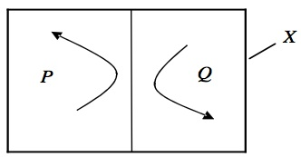

*Figure 3:* Reducible system: no point in region $P$ evolves into region $Q$ and vice versa.

Finally, we would like to state a theorem that will become important in Section 4. One can prove that a system is ergodic iff

$$\tag{E} \lim_{n \rightarrow \infty} \frac{1}{n} \sum_{k=0}^{n-1} \mu(T_k B \cap A) = \mu(B)\mu(A) $$

holds for all subsets $A$ and $B$ of $X$. Although this condition does not have an immediate intuitive interpretation, we will see below that it is crucial for the understanding of the kind of randomness we find in ergodic systems.

## 3. The Ergodic Hierarchy

It turns out that ergodicity is only the bottom level of an entire hierarchy of dynamical properties. This hierarchy is called the *ergodic hierarchy* (EH), and the study of this hierarchy is the core task of a mathematical discipline called *ergodic theory*. This choice of terminology is somewhat misleading, since ergodicity is only the bottom level of this hierarchy and so EH contains much more than ergodicity and the scope of ergodic theory stretches far beyond ergodicty. Ergodic theory (thus understood) is part of *dynamical systems theory*, which studies a wider class of dynamical systems than ergodic theory.

EH is a nested classification of dynamical properties. The hierarchy is typically represented as consisting of the following five levels:

Bernoulli $\subset$ Kolmogorov $\subset$ Strong Mixing $\subset$ Weak Mixing $\subset$ Ergodic

The diagram is intended to indicate that all Bernoulli systems are Kolmogorov systems, all Kolmogorov systems are strong mixing systems, and so on. Hence all systems in EH are ergodic. However, the converse relations do not hold: not all ergodic systems are weak mixing, and so on. In what follows a system that is ergodic but not weak mixing is referred to as *merely ergodic* and similarly for the next three levels.[^note-8]

| 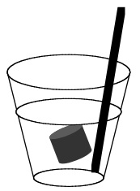 | 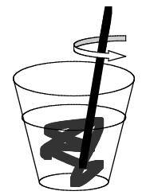 |
| --- | --- |
| (4a) | (4b) |

*Figure 4:* Mixing

Mixing can be intuitively explained by the following example, first used by Gibbs in introducing the concept of mixing. Begin with a glass of water, then add a shot of scotch; this is illustrated in Fig. 4a. The volume $C$ of the cocktail (scotch + water) is $\mu(C)$ and the volume of scotch that was added to the water is $\mu(S)$, so that in $C$the concentration of scotch is $\mu(S)/\mu(C)$.

Now stir. Mathematically, stirring is represented by the time evolution $T$, meaning that $T(S)$ is the region occupied by the scotch after one unit of mixing time. Intuitively we say that the cocktail is thoroughly mixed, if the concentration of scotch equals $\mu(S) / \mu(C)$ not only with respect to the *whole* volume of fluid, but with respect to *any* region $V$ in that volume. Hence, the drink is thoroughly mixed at time $n$ if

$$ \frac{\mu(T_n S \cap V)}{\mu(V)} = \frac{\mu(S)}{\mu(C)} $$

for any volume $V$ (of non-zero measure). Now assume that the volume of the cocktail is one unit: $\mu(C) = 1$ (which we can do without loss of generality since there is always a unit system in which the volume of the glass is one). Then the cocktail is thoroughly mixed iff

$$ \frac{\mu(T_n S \cap V)}{\mu(V)} = \mu(S) $$

for any region $V$ (of non-zero measure). But how large must $n$ be before the stirring ends with the cocktail well mixed? We now don’t require that the drink must be thoroughly mixed at any finite time, but only that it approaches a state of being thoroughly mixed as time tends towards infinity:

$$ \lim_{n \rightarrow \infty} \frac{\mu(T_n S \cap V)}{\mu(V)} = \mu(S) $$

for any region $V$ (of non-zero measure). If we now associate the glass with the phase space $X$ and replace the scotch $S$ and the volume $V$ with two arbitrary subsets $A$ and $B$ of $X$, then we get the general definition of what is called *strong mixing* (often also referred to just as ‘mixing’): a system is strong mixing iff

$$\tag{S-M} \lim_{n \rightarrow \infty} \mu(T_n B \cap A) = \mu(B) \mu(A) $$

for all subsets $A$ and $B$ of $X.$ This requirement for mixing can be relaxed a bit by allowing for fluctuations.[^note-9] That is, instead of requiring that the cocktail reach a uniform state of being mixed, we now only require that it be mixed on average. In other words, we allow that bubbles of either scotch or water may crop up every now and then, but they do so in a way that these fluctuations average out as time tends towards infinity. This translates into mathematics in a straightforward way. The deviation from the ideally mixed state at some time $n$ is $\mu(T_n B \cap A) - \mu(B)\mu(A)$. The requirement that the average of these deviations vanishes inspires the notion of weak mixing. A system is *weak mixing* iff

$$\tag{W-M} \lim_{n \rightarrow \infty} \frac{1}{n} \sum_{k=0}^{n-1} \lvert \mu(T_n B \cap A) - \mu(B) \mu(A) \rvert = 0 $$

for all subsets $A$ and $B$ of $X$. The vertical strokes denote the so-called absolute value; for instance: $\lvert 5 \rvert = \lvert -5 \rvert = 5$. One can prove that there is a strict implication relation between the three dynamical properties we have introduced so far: strong mixing implies weak mixing, but not vice versa; and weak mixing implies ergodicity, but not vice versa. Hence, strong mixing is stronger condition than weak mixing, and weak mixing is stronger condition than ergodicity.

The next higher level in EH are K-systems. Unlike in the cases of ergodic and mixing systems, there is unfortunately no intuitive way of explaining the standard definition of such systems, and the definition is such that one cannot read off from it the characteristics of K-systems (we state this definition in the Appendix, Section C). The least unintuitive way to present K-systems is via a theorem due to Cornfeld *et al* (1982, 283), who prove that a dynamical system is a K-system iff it is *K-mixing*. A system is K-mixing iff for any subsets $A_0, A_1 , \ldots ,A_r$ of $X$ (where $r$ is a natural number of your choice) the following condition holds:

$$\tag{K-M} \lim_{n \rightarrow \infty} \sup_{B \in \sigma(n,r)} \lvert \mu(T_n B \cap A) - \mu(B) \mu(A) \rvert = 0 $$

where $\sigma(n, r)$ is the minimal *σ*-algebra generated by the set

$$ \{T_k A_j \mid k \ge n; j = 1, \ldots ,r\}. $$

It is far from obvious what this so-called sigma algebra is and hence the content of this condition is not immediately transparent. We will come back to this issue in Section 5 where we provide an intuitive reading of this condition. What matters for the time being is its similarity to the mixing condition. Strong mixing is, trivially, equivalent to

$$ \lim_{n \rightarrow \infty} \mu(T_n B\cap A) - \mu(B)\mu(A) = 0 $$

So we see that K-mixing adds something to strong mixing.

In passing we would like to mention another important property of K-systems: one can prove that K-systems have positive *Kolmogorov-Sinai entropy* (KS-entropy); for details see the Appendix, Section C. The KS-entropy itself does not have an intuitive interpretation, but it relates to three other concepts of dynamical systems theory in an interesting way, and these do have intuitive interpretations. First, *Lyapunov exponents* are a measure for how fast two originally nearby trajectories diverge on average, and they are often used in chaos theory to characterise the chaotic nature of the dynamics of a system. Under certain circumstances (essentially, the system has to be differentiable and ergodic) one can prove that a dynamical system has a positive KS-entropy if and only if it has positive Lyapounov exponents (Lichtenberg and Liebermann 1992, 304)[^lichtenberg-1992]. This result is known as *Pessin’s theorem*. Second, the *algorithmic complexity* of a sequence is the length of the shortest computer programme needed to reproduce the sequence. Some sequences are simple; e.g. a string of a million ‘1’ is simple: the programme needed to reproduce it basically is ‘write ‘1’ a million times’, which is very short. Others are complex: there is no pattern in the sequence 5%8£yu@\*mS!}<74^F that one could exploit, and so a programme reproducing that sequence essentially reads ‘write 5%8£yu@\*mS!}<74^F’, which is similar in length to the sequence itself. In the discrete case a trajectory can be represented as a sequence of symbols which corresponds to the states of the system along this trajectory. It is then the case that if a system is a K-system, then its KS-entropy equals the algorithmic complexity of almost all its trajectories (Brudno 1978)[^brudno-1978]. This is now known as *Brudno’s theorem* (Alekseev and Yakobson 1981)[^alekseev-1981]. For a contemporary discussion see Towsner (2020)[^towsner-2020]. Third, the *Shannon entropy* is a common measure for the uncertainty of a future outcome: the higher the entropy the more uncertain we are about what is going to happen. One can prove that, given certain plausible assumptions, the KS-entropy is equivalent to a generalised version of the Shannon entropy, and can hence be regarded as a measure for the uncertainty of future events given past events (Frigg 2004)[^frigg-2004].

Bernoulli systems mark the highest level in EH. To define Bernoulli systems we first have to introduce the notion of a partition of $X$ (sometimes also called the ‘coarse graining of $X$’). A *partition of X* is a division of $X$ into different parts (the so-called ‘atoms of the partition’) so that these parts don’t overlap and jointly cover $X$ (i.e., they are mutually exclusive and jointly exhaustive). For instance, in Figure 1 there is a partition of the phase space that has two atoms (the left and the right part). More formally, $\alpha = \{\alpha_1,\ldots , \alpha_m\}$ is a partition of $X$ (and the $\alpha_i$ its atoms) iff (i) the intersection of any two atoms of the partition is the empty set, and (ii) the union of all atoms is $X$ (up to measure zero). Furthermore, it is important to notice that a partition remains a partition under the dynamics of the system. That is, if *α* is a partition, then $T_n\alpha = \{T_n\alpha_1 ,\ldots ,T_n\alpha_m\}$ is also a partition for all $n$.

There are, of course, many different ways of partitioning a phase space. In what follows we are going to study how different partitions relate to each other. An important concept in this connection is independence. Let *α* and *β* be two partitions of $X$. By definition, these partitions are *independent* iff $\mu(\alpha_i \cap \beta_j) = \mu(\alpha_i)\mu(\beta_j)$ for all atoms $\alpha_i$ of *α* and all atoms $\beta_j$ of *β*. We will explain the intuitive meaning of this definition (and justify calling it ‘independence’) in Section 4; for the time being we just use it as a formal definition.

With these notions in hand we can now define a *Bernoulli transformation:* a transformation $T$ is a Bernoulli transformation iff there exists a partition *α* of $X$ so that the images of *α* under $T$ at different instants of time are independent; that is, the partitions $\ldots ,T_{-1}\alpha , T_0 \alpha , T_1 \alpha ,\ldots$ are all independent.[^note-10] In other words, $T$ is a Bernoulli transformation iff

$$\tag{B} \mu(\delta_i \cap \beta_j) = \mu(\delta_i)\mu(\beta_j) $$

for all atoms $\delta_i$ of $T_k\alpha$ and all atoms $\beta_j$ of $T_l\alpha$ for all $k \ne l$. We then refer to *α* as the *Bernoulli partition*, and we call a dynamical system $[X, \mu , T]$ a *Bernoulli system* if $T$ is a Bernoulli automorphism, i.e., a Bernoulli transformation mapping $X$ onto itself.

Let us illustrate this with a well-known example, the *baker’s transformation* (so named because of its similarity to the kneading of dough). This transformation maps the unit square onto itself. Using standard Cartesian coordinates the transformation can be written as follows:

$$\begin{align} T(x, y) &= (2x, \frac{y}{2}) \text{ for } 0 \le x \lt \frac{1}{2}, \text{ and} \\ T(x, y) &= (2x-1, \frac{y}{2} + \frac{1}{2}) \text{ for } \frac{1}{2} \le x \le 1 \end{align}$$

In words, for all points $(x, y)$ in the unit square that have an $x$-coordinate smaller than $1/2$, the transformation $T$ doubles the value of $x$ and halves the value of $y$. For all the points $(x, y)$ that have an $x$-coordinate greater or equal to $1/2$, $T$ transforms $x$ in to $2x-1$ and $y$ into $y/2 + 1/2$. This is illustrated in Fig. 5a.

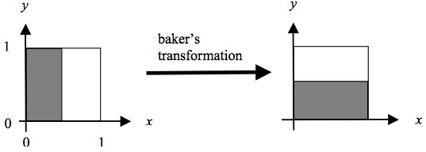

*Figure 5a:* The Baker’s transformation

Now regard the two areas shown in the left-hand part of the above figure as the two atoms of a partition $\alpha = \{\alpha_1 ,\alpha_2\}$. It is then easy to see that *α* and T*α* are independent: $\mu(\alpha_1 \cap T\alpha_2) = \mu(\alpha_1)\mu(T\alpha_2)$, and similarly for all other atoms of *α* and $T\alpha$. This is illustrated in Figure 5b.

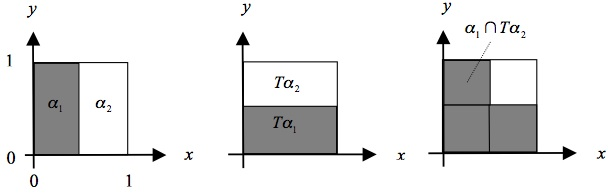

*Figure 5b:* The independence of *α* and $T\alpha$.

One can prove that independence holds for all other iterates of *α* as well. So the baker’s transformation together with the partition *α* is a Bernoulli transformation.

In the literature Bernoulli systems are often introduced using so-called *shift maps* (or *Bernoulli shifts*). We here briefly indicate how shift maps are related to Bernoulli systems with the example of the baker’s transformation; for a more general discussion see the Appendix, Section D. Choose a point in the unit square and write its $x$ and $y$ coordinates as binary numbers: $x = 0.a_1 a_2 a_3\ldots$ and $y = 0.b_1 b_2 b_3\ldots$, where all the $a_i$ and $b_i$ are either 0 or 1. Now put both strings together back to back with a dot in the middle to form one infinite string: $S= \ldots b_3 b_2 b_1 .a_1 a_2 a_3\ldots$, which may represent the state of the system just as a ‘standard’ two-dimensional vector does. Some straightforward algebra then shows that

$$ T(0.a_1 a_2 a_3\ldots , 0.b_1 b_2 b_3\ldots) = (0.a_2 a_3 a_4\ldots , 0.a_1 b_1 b_2 b_3 b_4\ldots). $$

From this we see that in our ‘one string’ representation of the point the operation of $T$ amounts to shifting the dot one position to the right: $TS= \ldots b_3 b_2 b_1 a_1 .a_2 a_3\ldots$ Hence, the baker’s transformation is equivalent to a shift on an infinite string of zeros and ones.[^note-11]

There are two further notions that are crucial to the theory of Bernoulli systems, the property of being *weak Bernoulli* and *very weak Bernoulli*. These properties play a crucial role in showing that certain transformations are in fact Bernoulli. The baker’s transformation is one of the few examples that have a geometrically simple Bernoulli partition, and so one often cannot prove directly that a system is a Bernoulli system. One then shows that a certain geometrically simple partition is weak Bernoulli and uses a theorem due to Ornstein to the effect that if a system is weak Bernoulli then there exists a Bernoulli partition for that system. The mathematics of these notions and the associated proofs of equivalence are intricate and a presentation of them is beyond the scope of this entry. The interested reader is referred to Ornstein (1974)[^ornstein-1974] or Shields (1973)[^shields-1973].

## 4. The Ergodic Hierarchy and Statistical Mechanics

The concepts of EH, and in particular ergodicity itself, play important roles in the foundation of statistical mechanics (SM). In this section we review what these roles are.

A discussion of SM faces an immediate problem. Foundational debates in many other fields of physics can take as their point of departure a generally accepted formalism. Things are different in SM. Unlike, say, relativity theory, SM has not yet found a generally accepted theoretical framework, let alone a canonical formulation.[^note-12] What we find in SM is plethora of different approaches and schools, each with its own programme and mathematical apparatus.[^note-13] However, all these schools use (slight variants) of either of two theoretical frameworks, one of which can be associated with Boltzmann (1877)[^boltzmann-1877] and the other with Gibbs (1902)[^gibbs-1902], and can thereby be classify either as ‘Boltzmannian’ or ‘Gibbsian’. For this reason we divide our presentation of SM into a two parts, one for each of these families of approaches. For further discussions of SM see the entry [Philosophy of Statistical Mechanics](https://plato.stanford.edu/entries/statphys-statmech/).

### 4.1 Boltzmannian SM

We first introduce the main elements of the Boltzmannian framework and then turn to the use of ergodicity in it. Every system can posses various macrostates $M_1 ,\ldots ,M_k$. These macrostates are characterised by the values of macroscopic variables, in the case of a gas pressure, temperature, and volume.[^note-14] One state is the system’s in initial state, and another is its equilibrium state. We label the states $M_p$ and $M_{eq}$ respectively. We write ‘‘$M_p$’’ for the initial state because this state is associated with the so-called “past hypothesis”, which we discuss below.

It is one of the fundamental posits of the Boltzmann approach that macrostates supervene on microstates, meaning that a change in a system’s macrostate must be accompanied by a change in its microstate (for a discussion of supervenience see McLaughlin and Bennett 2005, and references therein). For instance, it is not possible to change the pressure of a system and at the same time keep its micro-state constant. Hence, to every given microstate $x$ there corresponds *exactly one* macrostate. Let us refer to this macrostate as $M(x)$. This determination relation is not one-to-one; in fact many different $x$ can correspond to the same macrostate. We now group together all microstates $x$ that correspond to the same macro-state, which yields a partitioning of the phase space in non-overlapping regions, each corresponding to a macro-state. For this reason we also use the same letters, $M_1 ,\ldots ,M_k$, to refer to macro-states and the corresponding regions in phase space. This is illustrated in Figure 6a.

| 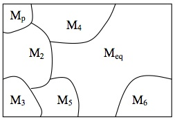 | 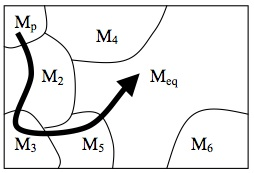 |
| --- | --- |
| (6a) | (6b) |

*Figure 6:* The macrostate structure of $X$.

We are now in a position to introduce the Boltzmann entropy. To this end recall that we have a measure $\mu $ on the phase space that assigns to every set a particular volume, hence *a fortiori* also to macrostates. With this in mind, the Boltzmann entropy of a macro-state $M_j$ can be defined as $S_B = k_B\log [\mu(M_j)]$, where $k_B$ is the Boltzmann constant. The important feature of the logarithm is that it is a *monotonic function*: the larger $M_j$, the larger its logarithm. From this it follows that the largest macro-state also has the highest entropy!

One can show that, at least in the case of dilute gases, the Boltzmann entropy coincides with the thermodynamic entropy (in the sense that both have the same functional dependence on the basic state variables), and so it is plausible to say that the equilibrium state is the macro-state for which the Boltzmann entropy is maximal (since thermodynamics posits that entropy be maximal for equilibrium states). By assumption the system starts off in a low entropy state, the initial state $M_p$ (the gas being squeezed into the left half of the box). The problem of explaining the approach to equilibrium then amounts to answering the question: why does a system originally in $M_p$ eventually move into $M_{eq}$ and then stay there? (See Figure 6b.)

In the 1870s Boltzmann offered an important answer to this question.[^note-15] At the heart of his answer lies the idea to assign probabilities to macrostates according to their size. So Boltzmann adopted the following postulate: $p(M_j) = c\mu(M_j)$ for all $j = 1,\ldots ,k$, where $c$ is a normalisation constant assuring that the probabilities add up to one. Granted this postulate, it follows immediately that the most likely state is the equilibrium state (since the equilibrium state occupies the largest chunk of the phase space). From this point of view it seems natural to understand the approach to equilibrium as the evolution from an unlikely macrostate to a more likely macrostate and finally to the most likely macro-state. This, Boltzmann argued, was a statistical justification of the Second Law of thermodynamics.

But Boltzmann knew that simply postulating $p(M_j) = c\mu(M_j)$ would not solve the problem unless the postulate could be justified in terms of the dynamics of the system. This is where ergodicity enters the scene. As we have seen above, ergodic systems have the property of spending a fraction of time in each part of the phase space that is proportional to its size (with respect to $\mu)$. As we have also seen, the equilibrium state is the largest macrostate. In fact, the equilibrium state is *much* larger than the other states. So if we assume that the system is ergodic, then it is in equilibrium most of the time! It is then natural to interpret $p(M_j)$ as a time average: $p(M_j)$ is the fraction of time that the system spends in state $M_j$ over the course of time. We now have the main elements of Boltzmann’s framework in front of us: (a) partition the phase space of the system in macrostates and show that the equilibrium state is by far the largest state; (b) adopt a time average interpretation of probability; and (c) assume that the system in question is ergodic. It then follows that the system is most likely to be found in equilibrium, which justifies (a probabilistic version of) the second law of thermodynamics.

Three objections have been levelled against this line of thought. First, it has been pointed out that assuming ergodicity is too strong in two ways. The first wasy is that it turns out to be extremely difficult to prove that the systems of interest really are ergodic. One of the simplest models of a monoatomic gas is the hard-ball model. The so-called Boltzmann-Sinai Ergodic Hypothesis says that this model is ergodic. A general proof of this hypothesis became available only a bit over a decade ago, when Simanyi (2010 [Other Internet Resources]) was able to prove it.

The second way in which ergodicity seems to be too strong is that even if eventually we can come by proofs of ergodicity for the relevant systems, the assumption is too strong because there are systems that are known not to be ergodic and yet they behave in accordance with the Second Law. Bricmont (2001)[^bricmont-2001] investigates the Kac Ring Model and a system of $n$ uncoupled anharmonic oscillators of identical mass, and points out that both systems exhibit thermodynamic behaviour and yet they fail to be ergodic. Hence, ergodicity is not necessary for thermodynamic behaviour. Earman and Redei (1996, p. 70) and van Lith (2001, p. 585) argue that if ergodicity is not necessary for thermodynamic behaviour, then ergodicity cannot provide a satisfactory explanation for this behaviour. Either there must be properties other than ergodicity that explain thermodynamic behaviour in cases in which the system is not ergodic, or there must be an altogether different explanation for the approach to equilibrium even for systems which are ergodic.

In response to this objection, Vranas (1998)[^vranas-1998] and Frigg and Werndl (2011) argue that most systems that fail to be ergodic are ‘almost ergodic’ in a specifiable way, and this is good enough. We discuss Vranas’ approach below when discussing Gibbsian SM since that is the context in which he has put forward his suggestion. Werndl and Frigg (2015a, 2015b) offer an alternative definition of Boltzmannian equilibrium and exploit the ergodic decomposition theorem to show that even if a system is not ergodic it will spend most of the time in equilibrium, as envisaged by Boltzmann (roughly the ergodic decomposition theorem says that the phase space of every measure preserving system can be partitioned into parts so that the dynamics is ergodic on each part; for details see Petersen 1983)[^petersen-1983]. Frigg (2009)[^frigg-2009] suggested exploiting the fact that almost all Hamiltonian systems are non-integrable, and that these systems have so-called Arnold webs, i.e., large regions of phase space on which the motion of the system is ergodic. Lavis (2005)[^lavis-2005] re-examined the Kac ring model and pointed out that even though the system is not ergodic, it has an ergodic decomposition, which is sufficient to guarantee the approach to equilibrium. He also challenged the assumption, implicit in the above criticism, that providing an explanation for the approach to equilibrium amounts to identifying one (and only one!) property that all systems have in common. In fact, it may be the case that different properties are responsible for the approach to equilibrium in different systems, and there is no reason to rule out such explanations. In sum, the tenor of all these responses is that even though ergodicity *simpliciter* may not have the resources to explain the approach to equilibrium, somewhat qualified properties do.

The second objection is that even if ergodicity obtains, this is not sufficient to give us what we need. As we have seen above, ergodicity comes with the qualification ‘almost everywhere’. This qualification is usually understood as suggesting that sets of measure zero can be ignored without detriment. The idea is that points falling in a set of measure zero are ‘sparse’ and can therefore be neglected. The question of whether or not this move is legitimate is known as the ‘measure zero problem’.

Simply neglecting sets of measure zero seems to be problematic for various reasons. First, sets of measure zero can be rather ‘big’; for instance, the rational numbers have measure zero within the real numbers. Moreover, a set of measure zero need not be (or even appear) negligible if sets are compared with respect to properties other than their measures. For instance, we can judge the ‘size’ of a set by its cardinality or Baire category rather than by its measure, which leads us to different conclusions about the set’s size (Sklar 1993, pp. 182–88)[^sklar-1993]. It is also a mistake to assume that an event with measure zero cannot occur. In fact, having measure zero and being impossible are distinct notions. Whether or not the system at some point was in one of the special initial conditions for which the space and time mean fail to be equal is a factual question that cannot be settled by appeal to measures.

In response two things can said. First, discounting sets of measure zero is standard practice in physics and the problem is not specific to ergodic theory. So unless there is a good reason to suspect that specific measure zero states are in fact important, one might argue that the onus of proof is on those who think that discounting them in this case is illegitimate. Second, the fact that SM works in so many cases suggests that they indeed are scarce.

The third objection is rarely explicitly articulated, but it is clearly in the background of contemporary Boltzmannian approaches to SM such as Albert’s (2000)[^albert-2000], which reject Boltzmann’s starting point, namely the postulate $p(M_j) = c\mu(M_j)$. Albert introduces an alternative postulate, essentially providing transition probabilities between two macrostates conditional on the so-called Past Hypothesis, the posit that the universe came into existence in a low entropy state (the Big Bang). Albert then argues that in such an account, ergidicity becomes an idle wheel, and hence he rejects it as completely irrelevant to the foundations of SM. This, however, may well be too hasty. Although it is true that ergodicity simpliciter cannot justify Albert’s probability postulate, another dynamical assumption is needed in order for this postulate to be true (Frigg 2010)[^frigg-2010].

### 4.2 Gibbsian SM

At the basis of Gibbs’ approach stands a conceptual shift. The object of study in the Boltzmannian framework is an individual system, consisting of a large but finite number of micro constituents. By contrast, within the Gibbs framework the object of study is a so-called *ensemble*: an imaginary collection of infinitely many copies of the same system (they are the same in that they have the same phase space, dynamics and measure), but who happen to be in different states. An ensemble of gases, for instance, consists of infinitely many copies of the same gas bit in different states: one is concentrated in the left corner of the box, one is evenly distributed, etc. It is important to emphasise that ensembles are fictions, or ‘mental copies of the one system under consideration’ (Schrödinger 1952, 3); or alternatively they can be thought of as collections of possible states of the entire system. Hence, it is important not to confuse ensembles with collections of micro-objects such as the molecules of a gas!

The instantaneous state of one system of the ensemble is specified by one point in its phase space. The state of the ensemble *as a whole* is therefore specified by a density function *ϱ* on the system’s phase space. From a technical point of view, *ϱ* is a function just like $f$ that we encountered in Section 1. We furthermore assume that *ϱ* is a probability density, reflecting the probability density of finding the state of a system chosen at random from the entire ensemble in region $R$, so that the probability of the state being in $R$ is $p(R) = \int_R \varrho d\mu$. To make this more intuitive consider the following analogy. You play a special kind of darts: you fix a plank to the wall, which serves as your dart board. For some reason you know that the probability of your dart landing at a particular place on the board is given by the curve shown in Figure 7. You are then asked what the probability is that your next dart lands in the left half of the board. The answer is 1 ⁄ 2 since one half of the surface underneath the curve is on the left side. The dart board then plays the role of the system’s state space, a region of the board (here the left half) plays the role of $R$, and throwing a dart plays the role of picking a system from the ensemble.

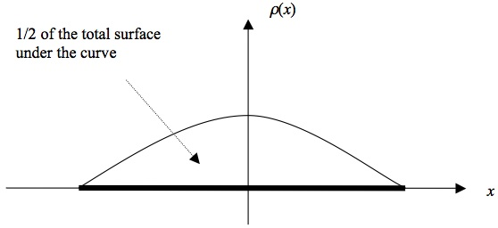

*Figure 7:* Dart board

The importance of this is that it allows us to calculate expectation values. Assume that the game is such that you get one Pound if the dart hits the left half and three Pounds if it lands on the right half. What is your expected gain? The answer is 1 ⁄ $2 \times 1$ Pound $+ 1$ ⁄ $2 \times 3$ Pounds $= 2$ Pounds. This is the expectation value. The same idea is at work in SM. Physical magnitudes like, for instance, pressure are associated with functions $f$ on the phase pace. We then calculate the expectation value of these magnitudes, which, in general is given by $\langle f \rangle = \int fd\mu$. In the context of Gibbsian SM these expectation values are also referred to as *phase averages* or *ensemble averages*. They are of central importance because in many contexts they serve as predictions for what is observed in experiments.

By definition, a probability density *ϱ* is stationary if it does not change over time. Given that observable quantities are associated with phase averages and that equilibrium is defined in terms of the constancy of the macroscopic parameters characterising the system, it is natural to regard the stationarity of the distribution as a necessary condition for equilibrium because stationary distributions yield constant averages. For this reason Gibbs refers to stationarity as the ‘condition of statistical equilibrium’.

Among all stationary distributions those satisfying a further requirement, the *Gibbsian maximum entropy principle*, play a special role. The *Gibbs entropy* (sometimes called ‘ensemble entropy’) is defined as

$$ S_G (\varrho) = -k_B\int \varrho\log(\varrho)d\mu . $$

The Gibbsian maximum entropy principle then requires that $S_G (\varrho)$ be maximal, given the constraints that are imposed on the system.[^note-16]

The last clause is essential because different constraints single out different distributions. A common choice is to keep both the energy and the particle number in the system fixed. One can prove that under these circumstances $S_G (\varrho)$ is maximal for the so-called *microcanonical distribution* (or *microcanonical ensemble*). If we choose to hold the number of particles constant while allowing for energy fluctuations around a given mean value we obtain the so-called *canonical distribution*; if we also allow the particle number to fluctuate around a given mean value we find the so-called *grand-canonical distribution*.[^note-17]

This formalism is enormously successful in that correct predictions can be derived for a vast class of systems. But the success of this formalism is rather puzzling. The first and most obvious question concerns the relation of systems and ensembles. The probability distribution in the Gibbs approach is defined over an ensemble, the formalism provides ensemble averages, and equilibrium is regarded as a property of an ensemble. But what we are really interested in is the behaviour of a single system! What could the properties of an ensemble—a fictional entity consisting of infinitely many mental copies of the real system—tell us about the one real system on the laboratory table? And more specifically, why do averages over an ensemble coincide with the values found in measurements performed on an actual physical system in equilibrium? There is no obvious reason why this should be so, and it turns out that ergodicity plays a central role in answering these questions.

Common textbook wisdom justifies the use of phase averages as follows. As we have seen, the Gibbs formalism associates physical quantities with functions on the system’s phase space. Making an experiment measuring one of these quantities takes time and it is assumed that what measurement devices register is not the instantaneous value of the function in question, but rather its time average over the duration of the measurement. Hence, time averages are what is empirically accessible. Then, so the argument continues, although measurements take an amount of time that is short by human standards, it is long compared to microscopic time scales on which typical molecular processes take place. For this reason it is assumed that the measured *finite* time average is approximately equal to the *infinite* time average of the measured function. If we now assume that the system is ergodic, then time averages equal phase averages. The latter can easily be obtained from the formalism. Hence we have found the sought-after connection: the Gibbs formalism provides phase averages which, due to ergodicity, are equal to infinite time averages, and these are, to a good approximation, equal to the finite time averages obtained from measurements.

This argument is problematic for at least two reasons. First, from the fact that measurements take some time it does not follow that what is actually measured are time averages. For instance, it could be the case that the value provided to us by the measurement device is simply the value assumed by at the last moment of the measurement, irrespective of what the previous values of were (e.g. it’s simply the last pointer reading registered). So we would need an argument for the conclusion that measurements indeed produce time averages. Second, even if we take for granted that measurements do produce *finite* time averages, equating these averages with infinite time averages is problematic. Even if the duration of the measurement is long by experimental standards (which need not be the case), finite and infinite averages may assume very different values. That is not to say that they necessarily have to be different; they *could* coincide. But whether or not they do is an empirical question, which depends on the specifics of the system under investigation. So care is needed when replacing finite with infinite time averages, and one cannot identify them without further argument.

Malament and Zabell (1980) respond to this challenge by suggesting a way of explaining the success of equilibrium theory that still invokes ergodicity, but avoids appeal to time averages. This solves the above mentioned problems, but suffers from the difficulty that many systems that are successfully dealt with by the formalism of SM are not ergodic. To circumvent this difficulty Vranas (1998)[^vranas-1998] suggested replacing ergodicity with what he calls *ε*-ergodicity. Intuitively a system is *ε*-ergodic if it is ergodic not on the entire phase space, but on a very large part of it, with those parts on which it is not ergodic having measure *ε*, where *ε* is very small. The leading idea behind his approach is to challenge the commonly held belief that even if a system is just a ‘little bit’ non-ergodic, then it behaves in a completely ‘un-ergodic’ way. Vranas points out that there is a middle ground and then argues that this middle ground actually provides us with everything we need. This is a promising proposal, but it faces three challenges. First, it needs to be shown that all relevant systems really are *ε*-ergodicity. Second, the argument so far has only been developed for the microcanonical ensemble, but one would like to know whether, and if so how, it works for the canonical and the grandcanonical ensembles. Third, it is still based on the assumption that equilibrium is characterised by a stationary distribution, which, as we will see below, is an obstacle when it comes to formulating a workable Gibbsian non-equilibrium theory.

The second response begins with Khinchin’s work. Khinchin (1949)[^khinchin-1949] pointed out that the problems of the ergodic programme are due to the fact that it focuses on too general a class of systems. Rather than studying dynamical systems at a general level, we should focus on those cases that are relevant in statistical mechanics. This involves two restrictions. First, we only have to consider systems with a large number of degrees of freedom; second, we only need to take into account a special class of phase functions, the so-called ‘sum functions’. These functions are a sum of one-particle functions, i.e., functions that take into account only the position and momentum of one particle. Under these assumption Khinchin proved that as $n$ becomes larger, the measure of those regions on the energy hypersurface[^note-18] where the time and the space means differ by more than a small amount tends towards zero. Roughly speaking, this result says that for large $n$ the system behaves, for all practical purposes, as if it was ergodic.

The problem with this result is that it is valid only for sum functions, and in particular only if the energy function of the system is itself a sum function, which is not the case when particles interact. So the question is how this result can be generalised to more realistic cases. This problem stands at the starting point of a research programme now known as the *thermodynamic limit*, championed, among others, by Lanford, Mazur, Ruelle, and van der Linden (see van Lith (2001) for a survey). Its leading question is whether one can still prove ‘Khinchin-like’ results in the case of energy function *with* interaction terms.[^note-19] Results of this kind can be proven in the limit for $n \rightarrow \infty$, if also the volume $V$ of the system tends towards infinity in such a way that the number-density $n/V$ remains constant.

So far we have only dealt with equilibrium, and things get worse once we turn to non-equilibrium. The main problem is that it is a consequence of the formalism that the Gibbs entropy is a constant! This precludes a characterisation of the approach to equilibrium in terms of increasing Gibbs entropy, which is what one would expect if we were to treat the Gibbs entropy as the SM counterpart of the thermodynamic entropy. The standard way around this problem is to coarse-grain the phase space, and then define the so-called coarse grained Gibbs entropy. Put simply, course-graining the phase space amounts to putting a grid on the phase space and declare that all points within one cell of the grid are indistinguishable. This procedure turns a continuous phase space into a discrete collection of cells, and the state of the system is then specified by saying in which cell the system’s state is. If we define the Gibbs entropy on this grid, it turns out (for purely mathematical reasons) that the entropy is no longer a constant and can actually increase or decrease. If one then assumes that the system is mixing, it follows from the so-called convergence theorem of ergodic theory that the coarse-grained Gibbs entropy approaches a maximum. However, this solution is fraught with controversy, the two main bones of contention being the justification of coarse-graining and the assumption that the system is mixing.

In sum, ergodicity plays a central role in many attempts to justify the posits of SM. And even where a simplistic use of ergodicity is eventually unsuccessful, somewhat modified notions prove fruitful in an analysis of the problem and in the search for better solutions.

## 5. The Ergodic Hierarchy and Randomness

EH is often presented as a hierarchy of increasing degrees of randomness in deterministic systems: the higher up in this hierarchy a system is placed the more random its behaviour.[^note-20] However, the definitions of different levels of EH do not make explicit appeal to randomness; nor does the usual way of presenting EH involve a specification of the notion of randomness that is supposed to underlie the hierarchy. So there is a question about what notion of randomness underlies EH and in what sense exactly EH is a hierarchy of random behaviour.

Berkovitz, Frigg and Kronz (2006) discuss this problem and argue that EH is best understood as a hierarchy of random behaviour if randomness is explicated in terms of unpredictability, where unpredictability is accounted for in terms of probabilistic relevance. Different patterns of probabilistic relevance, in turn, are spelled out in terms of different types of decay of correlation between a system’s states at different times. Let us introduce these elements one at a time.

Properties of systems can be associated with different parts of the phase space. In the ball example, for instance, the property *having positive momentum* is associated with the right half of the phase space; that is, it is associated with the set $\{x \in X \mid p \gt 0\}$. Generalising this idea we say that to every subset $A$ of a system’s phase space there corresponds a property $P_A$ so that the system possesses that property at time $t$ iff the system’s state $x$ is in $A$ at $t$. The subset $A$ may be arbitrary and the property corresponding to $A$ may not be intuitive, unlike, for example, the property of *having positive momentum.* But nothing in the analysis to follow hangs on a property being ‘intuitive’. We then define the *event* $A^t$ as the obtaining of $P_A$ at time $t$.

At every time $t$ there is a matter of fact whether $P_A$ obtains, which is determined by the dynamics of the system. However, we may not know whether or not this is the case. We therefore introduce epistemic probabilities expressing our uncertainty about whether $P_A$ obtains: $p(A^t)$ reflects an agent’s degree of belief in $P_A$’s obtaining at time $t$. In the same way we can introduce conditional probabilities: $p(A^t \mid B^{t_1})$ is our degree of belief in the system having $P_A$ at $t$ given that it had $P_B$ at an earlier time $t_1$, where $B$ is also a subset of the system’s phase space. By the usual rule of conditional probability we have $p(A^t \mid B^{t_1}) = p(A^t \amp B^{t_1}) / (p(B^{t_1})$. This can of course be generalised to more than one event: $p(A^t \mid B_{1}^{t_1} \amp \ldots \amp B_{r}^{t_r})$ is our degree of belief in the system having $P_A$ at $t$ given that it had $P_{B_1}$ at $t_1, P_{B_2}$ at $t_2,\ldots$, and $P_{B_{ r}}$ at $t_r$, where $B_1 ,\ldots ,B_r$ are subsets of the system’s phase space (and $r$ a natural number), and $t_1 ,\ldots ,t_r$ are successive instants of time (i.e., $t \gt t_1 \gt \ldots \gt t_r)$.

Intuitively, an event in the past is relevant if taking the past event into account makes a difference to our predictions, or more specifically if it lowers or raises the probability for a future event. In other words, $p(A^t \mid B_{1}^{t_1}) - p(A^t)$ is a measure of the relevance of $B^{t_1}$ to predicting $A^t : B^{t_1}$ is positively relevant if the $p(A^t \mid B_{1}^{t_1}) - p(A^t) \gt 0$, negatively relevant if $p(A^t \mid B_{1}^{t_1}) - p(A^t) \lt 0$, and irrelevant if $p(A^t \mid B_{1}^{t_1}) - p(A^t) = 0$. For technical reasons it turns out to be easier to work with a slightly different but equivalent notion of relevance, which is obtained from the above by multiplying both sides of the equation by $p(B^{t_1})$. Therefore we adopt the following definition. The *relevance* of $B^{t_1}$ for $A^t$ is

$$\tag{R} R(B^{t_1}, A^t) = p(A^t \amp B^{t_1}) - p(A^t)p(B^{t_1}). $$

The generalisation of this definition to cases with more than one set $B$ (as above) is straightforward.

Relevance serves to explicate unpredictability. Intuitively, the less relevant past events are for $A^t$, the less predictable the system is. This basic idea can then be refined in various ways. First, the type of unpredictability we obtain depends on the type of events to which (R) is applied. For instance, the degree of the unpredictability of $A^t$ increases if its probability is independent not only of $B^{t_1}$ or other ‘isolated’ past events, but rather the entire past. Second, the unpredictability of an event $A^t$ increases if the probabilistic dependence of that event on past events $B^{t_1}$ decreases rapidly with the increase of the temporal distance between the events. Third, the probability of $A^t$ may be independent of past events *simpliciter*, or it may be independent of such events only on average. These ideas underlie the analysis of EH as a hierarchy of unpredictability.

Before we can provide such an analysis, two further steps are needed. First, if the probabilities are to be useful to understanding randomness in a *dynamical system*, the probability assignment has to reflect the properties of the system. So we have to connect the above probabilities to features of the system. The natural choice is the system’s measure $\mu$.[^note-21] So we postulate that the probability of an event $A^t$ is equal to the measure of the set $A: p(A^{t}) = \mu(A)$ for all $t$. This can be generalised to joint probabilities as follows:

$$\tag{P} p(A^{t} \amp B^{t_1}) = \mu(A \cap T_{t_1 \rightarrow t}B), $$

for all instants of time $t \gt t_1$ and all subsets $A$ and $B$ of the system’s phase space. $T_{t_1 \rightarrow t}B$ is the image of the set $B$ under the dynamics of the system from $t_1$ to $t$. We refer to this postulate as the *Probability Postulate* (P), which is illustrated in Figure 8. Again, this condition is naturally generalised to cases of joint probabilities of $A^t$ with multiple events $B^{t_i}$. Granted (P) and its generalization, (R) reflects the dynamical properties of systems.

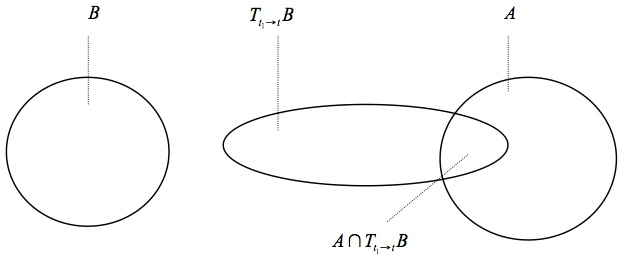

*Figure 8:* Condition (P).

Before briefly introducing the next element of the analysis let us mention that there is a question about whether the association of probabilities with the measure of the system is reasonable. Prima facie, a measure on a phase space can have a purely geometrical interpretation and need not necessarily have anything to do with the quantification of uncertainty. For instance, we can use a measure to determine the length of a table, but this measure need not have anything to do with uncertainty. Whether or not such an association is legitimate depends on the cases at hand and the interpretation of the measure. However, for systems of interest in statistical physics it is natural and indeed standard to assume that the probability of the system’s state to be in a particular subset of the phase space $X$ is proportional to the measure of $A$.

The last element to be introduced is the notion of the correlation between two subsets $A$ and $B$ of the system’s phase space, which is defined as follows:

$$\tag{C} C(A, B) = \mu(A \cap B) - \mu(A)\mu(B). $$

If the value of $C(A, B)$ is positive (negative), there is positive (negative) correlation between $A$ and $B$; if it is zero, then $A$ and $B$ are uncorrelated. It then follows immediately from the above that

$$\tag{RC} R(B^{t_1}, A^t) = C(T_{t_1\rightarrow t}B, A). $$

(RC) constitutes the basis for the interpretation of EH as a hierarchy of objective randomness. Granted this equation, the subjective probabilistic relevance of the event $B^{t_1}$ for the event $A^t$ reflects objective dynamical properties of the system since for different transformations $T\ R(B^{t_1}, A^t)$ will indicate different kinds of probabilistic relevance of $B^{t_1}$ for $A^t$.

To put (RC) to use, it is important to notice that the equations defining the various levels of EH above can be written in terms of correlations. Taking into account that we are dealing with discrete systems (and hence we have $T_{t_1\rightarrow t}B = T_k B$ where $k$ is the number of time steps it takes to get from $t_1$ and $t)$, these equations read:

Ergodicity $$ \lim_{n\rightarrow \infty} \frac{1}{n} \sum_{k=0}^{n-1} C(T_k B, A)=0, \text{ for all } A,B \subseteq X $$

Weak Mixing $$ \lim_{n\rightarrow \infty} \frac{1}{n} \sum_{k=0}^{n-1} \lvert C(T_k B, A)\rvert =0, \text{ for all } A,B \subseteq X $$

Strong Mixing $$ \lim_{n\rightarrow \infty} C(T_n B, A) = 0, \text{ for all } A,B \subseteq X $$

K-Mixing $$ \lim_{n\rightarrow \infty} \sup_{B \in \sigma(n,r)} \lvert C(B,A)\rvert =0, \text{ for all } A, A_1,\ldots , A_r \subseteq X $$

Bernoulli $$ C(T_n B, A) = 0, \text{ for all } B,A \text{ of the Bernoulli partition.} $$

Applying (RC) to these expressions, we can explicate the nature of the unpredictability that each of the different levels of EH involves.

Let us start at the top of EH. In Bernoulli systems the probabilities of the present state are totally independent of whatever happened in the past, even if the past is only one time step back. So knowing the past of the system does not improve our predictive abilities in the least; the past is simply irrelevant to predicting the future. This fact is often summarised in the slogan that Bernoulli systems are as random as a coin toss. We should emphasise, however, that this is true only for events in the Bernoulli partition; the characterisation of a Bernoulli system is silent about what random properties partitions other than the Bernoulli partition have.

K-mixing is more difficult to analyse. We now have to tackle the question of how to understand $\sigma(n, r)$, the minimal *σ*-algebra generated by the set

$$ \{T_k A_j \mid k \ge n ; j = 1, \ldots ,r\} $$

that we sidestepped earlier on. What matters for our analysis is that the following types of sets are members of

$$\sigma(n, r): T_k A_{j_0} \cap T_{k +1}A_{j_1} \cap T_{k +2}A_{j_2} \cap \ldots,$$

where the indices $j_i$ range over $1, \ldots ,r$. Since we are free to choose the sets A$_0$, A$_1,\ldots$, A$_r$ as we please, we can always chose them so that they are the past history of the system: the system was in $A_{j_0}$ $k$ time steps back, in $A_{j_1}$ $ k+1$ time steps back, etc. Call this the (coarse-grained) *remote past* of the system—‘remote’ because we only consider states that are more than $k$ time steps back. The K-mixing condition then says that the system’s *entire* remote past history becomes irrelevant to predicting what happens in the future as time tends towards infinity. Typically, Bernoulli systems are compared with K-systems by focussing on the events in the Bernoulli partition. With respect to that partition K is weaker than Bernoulli. The difference is both in the limit and the remote history. In a Bernoulli system the future is independent of the *entire* past (not only the remote past), and this is true without taking a limit (in the case of K-mixing independence only obtains in the limit). However, this only holds for the Bernoulli partition; it may or may not hold for other partitions—the definition of a Bernoulli system says nothing about that case.[^note-22]

The interpretation of strong mixing is now straightforward. It says that for any two sets $A$ and $B$, having been in $B$ $k$ time steps back becomes irrelevant to the probability of being in $A$ sometime in the future if time tends towards infinity (i.e. when n tends to infinity). In other words, past events $B$ become increasingly irrelevant for the probability of $A$ as the temporal distance between $A$ and $B$ becomes larger. This condition is weaker than K-mixing because it only states that the future is independent of isolated events in the remote past, while K-mixing implies independence of the *entire* remote past history.

In weakly mixing systems the past may be relevant to predicting the future, even in the remote past. The weak mixing condition only says that this influence must be weak enough for it to be the case that the absolute value of the correlations between a future event and past events vanishes on average; but this does not mean that all individual correlations vanish. So in weakly mixing systems events in the past can remain relevant to the future.

Ergodicity, finally, implies no decay of correlation at all. The ergodicity condition only says that the average of the correlations (and this time without an absolute value) of all past events with a future event is zero. But this is compatible with there being strong correlations between every instant in the past and the future, provided that positive and negative correlations average out. So in ergodic systems the past does not become irrelevant. For this reason, ergodic system are not random at all (in the sense of random introduced above).

## 6. The ‘No-Application’ Charge

How relevant are these insights to understanding the behaviour of actual systems? A frequently heard objection (which we have already encountered in Section 4) is that EH and more generally ergodic theory are irrelevant since most systems (including those that we are ultimately interested in) are not ergodic at all.[^note-23]

This charge is less acute than it appears at first glance. First, it is important to emphasise that it is not the sheer number of applications that make a physical concept important, but whether there are some important systems that are ergodic. And there are examples of such systems. For example, so-called ‘hard-ball systems’ (and some more sophisticated variants of them) are effective idealizations of the dynamics of gas molecules, and these systems seem to be ergodic;for details, see Berkovitz, Frigg and Kronz 2006, Section 3.2, Vranas (1998)[^vranas-1998] and Frigg and Werndl (2011).

Furthermore, EH can be used to characterize randomness and chaos in both ergodic and non-ergodic systems. Even if a system *as a whole* is not ergodic (i.e., if it fails to be ergodic with respect to the *entire* phase space $X)$, there can be (and usually there are) subsets of $X$ on which the system is ergodic. This is what Lichtenberg and Liebermann (1992, p. 295) have in mind when they observe that ‘[i]n a sense, ergodicity is universal, and the central question is to define the subspace over which it exists’. In fact, non-ergodic systems may have subsets that are not only ergodic, but even Bernoulli! It then becomes interesting to ask what these subsets are, what their measures are, and what topological features they have. These are questions studied in parts of dynamical systems theory, most notably KAM theory. Hence, KAM theory does not demonstrate that ergodic theory is not useful in analyzing the dynamical behavior of real physical systems. Indeed, KAM systems have regions in which the system manifest either merely ergodic or Bernoulli behaviour, and accordingly EH is useful for charactering the dynamical properties of such systems (Berkovitz, Frigg and Kronz 2006, Section 4)[^berkovitz-2006]. Further, as we have mentioned in Section 4.1, almost all Hamiltonian systems are non-integrable, and accordingly they have large regions of the phase space in which their motion is ergodic-like. So EH is a useful tool in studying the dynamical properties of systems even if the system fails to be ergodic *tout court*.

Another objection is that EH is irrelevant in practice because most levels of EH (in fact, all except Bernoulli) are defined in terms of *infinite* time limits and hence remain silent about what happens in *finite* time. But all we ever observe are finite times and so EH is irrelevant to physics as practiced by actual scientists.

This charge can be dispelled by a closer look at the definition of a limit, which shows that *infinite* limits in fact have important implications for the dynamical behaviour of the system in finite times. The definition of a limit is as follows (where $f$ is an arbitrary function of time): lim$_{t\rightarrow \infty} f(t) = c$ iff for every $\varepsilon \gt 0$ there exists an $t’ \gt 0$ so that for all $t \gt t’$ we have $\lvert f(t) - c\rvert \lt \varepsilon$. In words, for every number *ε*, no matter how small, there is a *finite* time $t’$ after which the values of $f$ differ from $c$ by less than *ε*. That is, once we are past $t’$ the values of $f$ never move more than *ε* away from $c$. With this in mind strong mixing, for instance, says that for a given threshold *ε* there exists a *finite* time $t_n (n$ units of time after the current time) after which $C(T_n B, A)$ is always smaller than *ε*. We are free to choose *ε* to be an empirically relevant margin, and so we know that if a system is mixing, we should expect the correlations between the states of the system after *t$_n$* and its current state to be below *ε*. The upshot is that in strong mixing systems, being in a state $B$ at some past time becomes increasingly irrelevant for its probability of being in the state $A$ now, as the temporal distance between $A$ and $B$ becomes larger. Thus, the fact that system is strong mixing clearly has implications for its dynamical behaviour in finite times. Furthermore, often (although not always) convergence proofs provide effective bounds on rates of convergence and these bounds can be used to inform expectations about behaviour at a given time.

Since different levels of EH correspond to different degrees of randomness, each explicated in terms of a different type of asymptotic decay of correlations between states of systems at different times, one might suspect that a similar pattern can be found in the rates of decay. That is, one might be tempted to think that EH can equally be characterized as a hierarchy of increasing rates of decay of correlations: a K-system, for instance, which exhibits exponential divergence of trajectories, would be characterized by an exponential rate of decay of correlations, while a SM-system would exhibit a polynomial rate of decay.

This, unfortunately, does not work. Natural as it may seem, EH cannot be interpreted as a hierarchy of increasing rates of decay of correlations. It is a mathematical fact that there is no particular rate of decay associated with each level of EH. For instance, one can construct K-systems in which the decay is as slow as one wishes it to be. So the rate of decay is a feature of particular systems rather than of a level of EH.

## 7. The Ergodic Hierarchy and Chaos

The question of how to characterise *chaos* has been controversially discussed ever since the inception of chaos theory; for a survey see Smith (1998, Ch. 10). An important family of approaches defines chaos using EH. Belot and Earman (1997, 155) state that being strong mixing is a necessary condition and being a K-system is a sufficient condition for a system to be chaotic. The view that being a K-system is the mark of chaos and that any lower degree of randomness is not chaotic is frequently motivated by two ideas. The first is the idea that chaotic behaviour involves dynamical instability in the form of exponential divergence of nearby trajectories. Thus, since a system involves an exponential divergence of nearby trajectories only if it is a K-system, it is concluded that being a K-system is the crucial condition. It is noteworthy, however, that SM is compatible with there being polynomial divergence of nearby trajectories and that such divergence sometimes exceeds exponential divergence in the short run. Thus, if chaos is to be closely associated with the rate of divergence of nearby trajectories, also SM systems seem to be candidates to exhibit chaotic behaviour.

The second common motivation for the view that being a K-system is the mark of chaos is the idea that the shift from zero to positive KS-entropy marks the transition from a ‘regular’ to ‘chaotic’ behaviour. This may suggest that having positive KS-entropy is both necessary and sufficient condition for chaotic behaviour. Thus, since K-systems have positive KS-entropy while SM systems don’t, it is concluded that K-systems are chaotic whereas SM-systems are not. Why is KS-entropy a mark of chaos? There are three motivations, corresponding to three different interpretations of KS-entropy. First, KS-entropy could be interpreted as entailing dynamical instability in the sense of having nearby divergence of nearby trajectories (see Lichtenberg & Liebermann, 1992, p. 304)[^lichtenberg-1992]. Second, KS-entropy could be connected to algorithmic complexity (Brudno 1978)[^brudno-1978]. Yet, while such a complexity is sometimes mentioned as an indication of chaos, it is more difficult to connect it to physical intuitions about chaos. Third, KS-entropy could be interpreted as a generalized version of Shannon’s information theoretic entropy (see Frigg 2004)[^frigg-2004]. According to this approach, positive KS-entropy entails a certain degree of unpredictability, which is sufficiently high to deserve the title chaotic.[^note-24]

Werndl (2009b)[^werndl-2009b] argues that a careful review of all systems that one commonly regards as chaotic shows that strong mixing is the crucial criterion: a system is chaotic just in case it is strong mixing. As she is careful to point out, this claim needs to be qualified: systems are rarely mixing on the entire phase space, but neither are they chaotic on the entire phase space. The crucial move is to restrict attention to those regions of phase space where the system is chaotic, and it then turns out that in these same regions the systems are also strong mixing. Hence Werndl concludes that strong mixing is the hallmark of chaos. And surprisingly this is true also of dissipative systems (i.e., systems that are not measure preserving). These systems have attractors, and they are chaotic on their attractors rather than on the entire phase space. The crucial point then is that one can define an invariant (preserved) measure *on the attractor* and show that the system is strongly mixing with respect to that measure. So strong mixing can define chaos in both conservative and dissipative systems.

The search for necessary and sufficient conditions for chaos presupposes that there is a clear-cut divide between chaotic and non-chaotic systems. EH may challenge this view, as every attempt to draw a line somewhere to demarcate the chaotic from non-chaotic systems is bound to be somewhat arbitrary. Ergodic systems are pretty regular, mixing systems are less regular and the higher positions in the hierarchy exhibit still more haphazard behaviour. But is there one particular point where the transition from ‘non-chaos’ to chaos takes place? Based on the argument that EH is a hierarchy of increasing degrees of randomness and degrees of randomness correspond to different degrees of unpredictability (see Section 5), Berkovitz, Frigg and Kronz (2006, Section 5.3) suggest that chaos may well be viewed as a matter of degree rather than an all-or-nothing affair. Bernoulli systems are very chaotic, K-systems are slightly less chaotic, SM-systems are still less chaotic, and ergodic systems are non-chaotic. This suggestion connects well with the idea that chaos is closely related to unpredictability.

The ergodic hierarchy has also been used to understand quantum chaos. Castagnino and Lombardi (2007) analyze the problem of quantum chaos as a particular case of the classical limit of quantum mechanics and identify mixing in the classical limit as the condition that a quantum system must satisfy to be nonintegrable. Gomez and Castagnino (2014, 2015) generalize the entire ergodic hierarchy to the quantum context and argue that EH thus generalized is a helpful tool to understand quantum chaos; Fortin and Lombardi (2018) use EH to understand decoherence; and Gomez (2018)[^gomez-2018] discusses the KS entropy in quantum mixing systems.

Mixing, finally, has also been invoked in understanding the effects of structural model error. Frigg, Bradley, Du and Smith (2014) argue that the distinction between parameter error and structural model error is crucial, and that the latter has significant and hitherto unappreciated impact on the predictive ability of a model. Wilson-Mayo (2015) points out that to put this observation on a solid foundation we need a notion of structural chaos. He proposes such a notion by appealing to topological mixing.

## 8. Conclusion

EH is often regarded as relevant for explicating the nature of randomness in deterministic dynamical systems. It is not clear, however, what notion of randomness this claim invokes. The formal definitions of EH do not make explicit appeal to randomness and the usual ways of presenting EH do not involve any specification of the notion of randomness that is supposed to underlie EH. As suggested in Section 5, EH can be interpreted as a hierarchy of randomness if degrees of randomness are explicated in terms of degrees of unpredictability, which in turn are explicated in terms of (coherent) conditional degrees of beliefs. In order for these degrees of belief to be indicative of the system’s dynamical properties, they have to be updated according to a system’s dynamical law. The idea is then that the different levels of EH, except for merely ergodic systems, correspond to different kinds of unpredictability, which correspond to different patterns of decay of correlations between systems’ past states and their present states. Merely ergodic systems seem to display no randomness, as the correlations between their past and present states need not decay at all.

Ergodic theory plays an important role in statistical physics, and EH, or some modification of it, constitutes an important measure of randomness in both Hamiltonian and dissipative systems. It is sometimes argued that EH is by and large irrelevant for physics because real physical systems are not ergodic. But, this charge is unwarranted, and a closer look at non-ergodic systems reveals a rather different picture, because EH can be fruitfully be used in the foundations of statistical mechanics, analyses of randomness, and chaos theory. More recently it has also played a role in understanding laws of nature (Filomeno 2019, List and Pivato 2019)[^filomeno-2019].

## References（引用注释）

> 原文参考文献已转为脚注引用：文内“作者-年份”引用组后附 [^key] 标记，完整条目见本文末脚注定义。

## Academic Tools

> |   | [How to cite this entry](https://plato.stanford.edu/cgi-bin/encyclopedia/archinfo.cgi?entry=ergodic-hierarchy). |
> | --- | --- |
> |   | [Preview the PDF version of this entry](https://leibniz.stanford.edu/friends/preview/ergodic-hierarchy/) at the [Friends of the SEP Society](https://leibniz.stanford.edu/friends/). |
> |   | [Look up topics and thinkers related to this entry](https://www.inphoproject.org/entity?sep=ergodic-hierarchy&redirect=True) at the Internet Philosophy Ontology Project (InPhO). |
> |   | [Enhanced bibliography for this entry](https://philpapers.org/sep/ergodic-hierarchy/) at [PhilPapers](https://philpapers.org/), with links to its database. |

## Other Internet Resources

- Simanyi, N., 2010, “[The Boltzmann-Sinai Ergodic Hypothesis in Full Generality](https://arxiv.org/abs/1007.1206)”, manuscript at arxiv.org 1007.1206.
- Maroney, O., 2008, “[The Physical Basis of the Gibbs-von Neumann entropy](https://arxiv.org/abs/quant-ph/0701127),” manuscript at arXiv.org.
- [Ergodic Theory](http://mathworld.wolfram.com/ErgodicTheory.html), from Wolfram MathWorld

## Related Entries

statistical physics: Boltzmann’s work in | supervenience

## Notes（原文脚注）

[^note-1]: The use of the term ‘space’ in physics might cause confusion. On the one hand the term is used in its ordinary meaning to refer to the three-dimensional space of our everyday experience. On the other hand, an entire class of mathematical structures are referred to as ‘spaces’ even though they have nothing in common with the space of everyday experience (except some abstract algebraic properties, which is why these structures earned the title ‘spaces’ in the first place). Phase spaces are abstract mathematical spaces.

[^note-2]: Sometimes a fourth component is mentioned in the definition: a sigma algebra *σ*. Although in certain circumstances it is convenient to add *σ*, it is not strictly necessary since the main purpose of *σ* is to provide a basis to define the measure $\mu$, and so *σ* is always present in the background when there is a measure $\mu$ and it is not necessary to mention it explicitly. For a discussion of sigma algebras and measures see Appendix B.

[^note-3]: By using $\mathbb{R}$ and $\mathbb{Z}$ we assume that time extends to the past as well as to the future, and we also assume that the time evolution is reversible. This need not be the case and these assumptions can be relaxed in different ways. Nothing in what follows depends on this.

[^note-4]: Strictly speaking $A$ has to be measurable. In what follows we always assume that the sets we consider are measurable. This is a technical assumption that has no bearing on the issues that follow since the relevant sets are always measurable.

[^note-5]: First appearances notwithstanding, this is not a substantial restriction. Systems in statistical mechanics are all measure preserving. Some systems in chaos theory are not measure preserving, but these systems, if they are chaotic on a certain part of the phase space (which can be an attractor, for instance), then there is an invariant measure on this part and EH is applicable with respect to that measure. For a discussion of this point see Werndl (2009b)[^werndl-2009b].

[^note-6]: The basic idea of an integral is the following: slice up the space into $m$ small cells $c_1,\ldots ,c_m$ (e.g. by putting a grid on it), then choose a point in each cell and take the value of $f$ for that point. Then multiply that value with the size of the cell (its measure) and add them all up: $f(x_1)\mu(c_1) + \ldots + f(x_m)\mu(c_m)$, where $x_1$ is a point in $c_1$ etc. Now we start making the cells smaller (and as result we need more of them to cover $X)$ until they become infinitely small (in technical terms, we take the limit). That is the integral. Put simply, the integral is just $f(x_1)\mu(c_1) + \ldots + f(x_m)\mu(c_m)$ for infinitely small cells.

[^note-7]: The concept of ergodicity has a long and complex history. For a sketch of this history see Sklar (1993, Ch. 2) and the Appendix, Section A.

[^note-8]: Sometimes EH is presented as having another level, namely C-systems (also referred to as Anosov systems or completely hyperbolic systems). Although interesting in their own right, C-systems are beyond the scope of this review. They do not have a unique place in EH and their relation to other levels of EH depends on details, which we cannot discuss here. Paradigm examples of C-systems are located between K- and B-systems; that is, they are K-systems but not necessarily B-systems. The cat map, for instance, is a C-system that is also a K-system (Lichtenberg & Liebermann, 1992, p. 307)[^lichtenberg-1992]. But there are K-systems such as the so-called stadium billiard that are not C-systems (Ott, 1993, p. 262)[^ott-1993]. Some C-systems preserve a smooth measure (where ‘smooth’ in this context means absolutely continuous with respect to the Lebesgue measure), in which case they are Bernoulli systems. But not all C-systems have smooth measures. It is always possible to find other measures such as SRB (Sinai, Ruelle, Bowen) measures. However, matters are more complicated in such cases, as such C-systems need not be mixing and a fortiori they need not be K- or B-systems (Ornstein & Weiss, 1991, pp. 75–82).

[^note-9]: The mechanism described here is also known as *stretching and folding*. It is typical of mixing in fluids. As Christov, Lueptow and Ottino (2011) point out, the mechanism for mixing in granular media is *cutting and shuffling*.

[^note-10]: To be precise, a second condition has to be satisfied: *α* must be $T$-generating (Mañé 1983, 87)[^mañé-1983]. However, what matters for our considerations is the independence condition.

[^note-11]: A formal proof can be found in Cornfeld *et al.* (1982, 9–10).

[^note-12]: A similar situation exists for quantum field theory, which has a number of inequivalent formulations including (to name just a few) the canonical, algebraic, axiomatic, and path integral frameworks.

[^note-13]: For detailed discussions of SM see Frigg (2008)[^frigg-2008], Hemmo and Shenker (2012), Shenker (2017)[^shenker-2017], Sklar (1993)[^sklar-1993] and Uffink (2007)[^uffink-2007]; for an introduction see Frigg and Werndl (2023); for a discussion from a mathematical point of view see Chibbaro, Rondoni and Vulpiani (2014). Those interested in the long and intricate history of SM are referred to Brush (1976)[^brush-1976] and von Plato (1994); and to Darrigol (2018)[^darrigol-2018] for the development of Boltzmann’s ideas.

[^note-14]: It is a common assumption in the literature on Boltzmannian SM that there is a finite number of macrostates that system can possess. We should point out, however, that this assumption is based on an idealisation if the relevant macro variables are continuous. In fact, we obtain a finite number of macrostates only if we coarse-grain the values of the continuous variables.

[^note-15]: Darrigol (2018)[^darrigol-2018] and Uffink (2004, 2007)[^uffink-2007] provide discussions of the tangled development of Boltzmann’s constantly changing views. Frigg (2009a) and Myrvolt (2016) discuss probabilities in Boltzmann’s account.

[^note-16]: For discussion of the physical basis of this entropy see Maroney (2008 [Other Internet Resources]).

[^note-17]: For details see, for instance, Tolman (1938 Chs. 3 and 4). For a discussion of Brownian motion in this framework see Luczak (2016)[^luczak-2016].

[^note-18]: An energy hypersurface is a hypersurface in the system’s phase space on which the energy is constant. For further discussion of Khinchin’s results see Badino (2006)[^badino-2006] and Batterman (1998)[^batterman-1998].

[^note-19]: To be more precise: what we are after is a proof for cases where there are nontrivial interaction terms, meaning those for which there does not exist a canonical transformation that effectively eliminates such terms.

[^note-20]: See for instance Lichtenberg & Liebermann (1992), Ott (1993)[^ott-1993], and Tabor (1989)[^tabor-1989].

[^note-21]: Provided that $\mu$ is normalised, which is the case in most systems studied in ergodic theory. Due to their connection to $\mu$ some maybe inclined not to interpret the $p(A^t)$ as epistemic probabilities; in fact, in the literature on ergodic theory $\mu$ is often interpreted as a time average and so one could insist that $p(A^t)$ be a time average as well. While this could be done, it is not conducive to our analysis. Our goal is to to explicate randomness in terms of degrees of unpredictability and to this end one needs to assume that $p(A^t)$ are epistemic probabilities. However, contra some radical Bayesians, we posit that the values of these probabilities be constrained by objective facts about the system (here the measure $\mu)$. But this does not make these probabilities objective. For discussion of various interpretations of probability in deterministic theories see Frigg (2016)[^frigg-2016], Frigg and Hoefer (2013), Hemmo and Shenker (2014), Hoefer (2011)[^hoefer-2011], List and Pivato (2019), Lavis (2011)[^lavis-2011], Maudlin (2011)[^maudlin-2011], Myrvold (2011)[^myrvold-2011], Strevens (2011)[^strevens-2011], and Wüthrich (2011)[^wüthrich-2011]. Werndl (2009c)[^werndl-2009c] discusses the question whether deterministic and indeterministic descriptions of systems are observationally equivalent (in the sense that they give the same predictions); see Belanger (2013)[^belanger-2013] for a discussion of her claims. For a discussion of the relation between randomness and probabilities see Eagle (2016)[^eagle-2016].

[^note-22]: We would also like to mention that the analysis of randomness in Bernoulli and K-systems is based on *implications* of the definitions of these systems, but they do not exhaust these definitions (or provide verbal restatements of them) because there are parts of the definition that have not been used (in the case of Bernoulli systems the condition that there be a generating partition, and in the case of K-systems sets in $\sigma(n,r)$ that are different from $T_k A_{j_0} \cap T_{k +1}A_{j_1} \cap T_{k +2}A_{j_2} \cap \ldots)$. By contrast, the analyses of SM, WM, and E in the following paragraphs exhaust the respective definitions. In the case of Bernoulli this has the consequence that the characterisation given here also applies to some systems that are not ergodic. For a discussion of such cases see Werndl (2009a, section 4.2.2).

[^note-23]: This bit of conventional wisdom is backed-up by a theorem by Markus and Mayer (1974), which is based on KAM theory and basically says that generic Hamiltonian dynamical systems are not ergodic. For a discussion of this theorem see Frigg and Werndl (2011).

[^note-24]: We would like to point out that an analysis of chaos in terms of positive KS-entropy needs further qualifications. A system whose dynamics is, intuitively speaking, chaotic only on a part of the phase space can still have positive KS-entropy. A case in point is a system with $X = [-1, 1$] where the dynamics on [$-1,0)$ is the identity function and the tent map on $[0, 1]$. This system has positive KS-entropy, but the dynamics of the *entire* systems is not chaotic (only the part on $[0, 1]$ is). This problem can be circumvented by adding extra conditions, for instance that the system is ergodic (which the above system clearly is not).

### Notes to Appendix

[^note-25]: 25\. Not all subsets of phase space points are measurable—see (Royden 1968, pp. 52–65) for an explanation.

[^alekseev-1981]: Alekseev, V. M., and Yakobson, M. V., 1981, “Symbolic dynamics and hyperbolic dynamical systems,” *Physics Reports*, 75: 287–325.

[^argyris-1994]: Argyris, J., Faust, G. and Haase, M., 1994, *An Exploration of Chaos*, Amsterdam: Elsevier.

[^albert-2000]: Albert, D., 2000, *Time and Chance*, Cambridge, MA and London: Harvard University Press.

[^arnold-1968]: Arnold, V. I. and Avez, A., 1968, *Ergodic Problems of Classical Mechanics*, New York: Wiley.

[^badino-2006]: Badino, M., 2006, “The foundational role of ergodic theory,” *Foundations of Science*, 11: 323–347.

[^batterman-1998]: Batterman, R. W., 1998, “Why equilibrium statistical mechanics works: universality and the renormalization group,” *Philosophy of Science*, 65: 183–208.

[^belanger-2013]: Belanger, C., 2013, “On two mathematical definitions of observational equivalence: Manifest isomorphism and ε-congruence reconsidered,” *Studies in History and Philosophy of Modern Physics*, 44(2): 69–76.

[^belot-1997]: Belot, G., and Earman, J., 1997, “Chaos out of order: Quantum mechanics, the correspondence principle and chaos,” *Studies in the History and Philosophy of Modern Physics*, 28: 147–182.

[^berkovitz-2006]: Berkovitz, J., Frigg, R. and Kronz, F., 2006, “The Ergodic Hierarchy, Randomness and Hamiltonian Chaos,” *Studies in History and Philosophy of Modern Physics*, 37: 661–691.

[^birkhoff-1931]: Birkhoff, G. D., 1931, “Proof of a Recurrence Theorem for Strongly Transitive Systems,” and “Proof of the Ergodic Theorem,” *Proceedings of the National Academy of Sciences*, 17: 650–660.

[^birkhoff-1932]: Birkhoff, G. D. and Koopman, B. O., 1932, “Recent Contributions to the Ergodic Theory,” *Proceedings of the National Academy of Sciences*, 18: 279–282.

[^boltzmann-1868]: Boltzmann, L., 1868, “Studien über das Gleichgewicht der lebendigen Kraft zwischen bewegten materiellen Punkten,” *Wiener Berichte*, 58: 517–560,

[^boltzmann-1871]: –––, 1871, “Über das Wärmegleichgewicht zwischen mehratomigen Gasmolekülen,” *Wiener Berichte*, 63: 397–418.

[^boltzmann-1877]: –––, 1877, “Über die Beziehung zwischen dem zweiten Hauptsatze der mechanischen Wärmetheorie und der Wahrscheinlichkeitsrechnung resp. den Sätzen über das Wärmegleichgewicht,” *Wiener Berichte* 76, 373–435; reprinted in F. Hasenöhrl (ed.), *Wissenschaftliche Abhandlungen*, Leipzig: J. A. Barth 1909, Volume 2, pp. 164–223.

[^bricmont-2001]: Bricmont, J., 2001, “Bayes, Boltzmann, and Bohm: Probabilities in Physics,” in J. Bricmont et al., *Lecture Notes in Physics* (Volume 574), Berlin: Springer-Verlag, 2001, pp. 3–21.

[^brudno-1978]: Brudno, A. A., 1978, “The complexity of the trajectory of a dynamical system,” *Russian Mathematical Surveys*, 33: 197–198.

[^brush-1976]: Brush, S. G., 1976, *The Kind of Motion We Call Heat*, Amsterdam: North Holland Publishing.

[^castagnino-2007]: Castagnino, M. and Lombardi, O., 2007, “Non-integrability and mixing in quantum systems: on the way to quantum chaos,” *Studies in History and Philosophy of Modern Physics*, 38: 482–513.

[^chibbaro-2014]: Chibbaro, S., Rondoni, L., and Vulpiani, A., 2014, “On the foundations of statistical mechanics: ergodicity, many degrees of freedom and inference,” *Communications in Theoretical Physics*, 62(4): 469–75.

[^christov-2011]: Christov, I. C., Lueptow, R. M., and Ottino, J. M., 2011, “Stretching and folding versus cutting and shuffling: An illustrated perspective on mixing and deformations of continua,” *American Journal of Physics*, 79: 259–367.

[^cohen-1966]: Cohen, I. B., 1966, “Newton’s Second Law and the Concept of Force in the Principia,” *Texas Quarterly*, 10(3): 127–157.

[^cornfeld-1982]: Cornfeld, I. P., Fomin, S. V., and Sinai, Y. G., 1982, *Ergodic Theory*, Berlin and New York: Springer.

[^darrigol-2018]: Darrigol, O., 2018, *Atoms, Mechanics, and Probability: Ludwig Boltzmann’s Statistico-Mechanical Writings – An Exegesis*, Oxford: Oxford University Press.

[^degas-1955]: Degas, R., 1955, *A History of Mechanics*, Neuchatel: Editions du Griffon; reprinted New York: Dover, 1988.

[^descartes-1644]: Descartes, R., 1644, *Principles of Philosophy*, edited by V. R. Miller and R. P. Miller, Dordrecht: D. Reidel Publishing Co., 1983.

[^dijksterhuis-1961]: Dijksterhuis, E. J., 1961, *The Mechanization of the World Picture*, Oxford: Oxford University Press; Princeton: Princeton University Press, 1986.

[^eagle-2016]: Eagle, A., 2016, “Probability and randomness,” in A. Hájek and C. Hitchcock (eds.), *Oxford Handbook of Probability and Philosophy*, Oxford: Oxford University Press, pp. 440–459.

[^earman-1986]: Earman, J., 1986, *A Primer on Determinism*, Dordrecht: D. Reidel Publishing Company.

[^earman-1996]: ––– and Redei, M., 1996, “Why ergodic theory does not explain the success of equilibrium statistical mechanics,” *British Journal for the Philosophy of Science*, 47: 63–78.

[^filomeno-2019]: Filomeno, A., 2019, “Stable regularities without governing laws?,” *Studies in History and Philosophy of Modern Physics*, 66: 186–197.

[^fortin-2018]: Fortin, S. and Lombardi, O., 2018, “Understanding decoherence as an irreversible process,” *International Journal of Quantum Foundations*, 4: 247–267.

[^frigg-2004]: Frigg, R., 2004, “In What Sense Is the Kolmogorov-Sinai Entropy a Measure for Chaotic Behaviour?—Bridging the Gap Between Dynamical Systems Theory and Communication Theory,” *British Journal for the Philosophy of Science*, 55: 411–434.

[^frigg-2008]: –––, 2008, “A Field Guide to Recent Work on the Foundations of Statistical Mechanics,” in Dean Rickles (ed.), *The Ashgate Companion to Contemporary Philosophy of Physics*, London: Ashgate, pp. 99–196.

[^frigg-2009]: –––, 2009, “Typicality and the Approach to Equilibrium in Boltzmannian Statistical Mechanics,” *Philosophy of Science* (Supplement), 76: 997–1008.

[^frigg-2010]: –––, 2010, “Probability in Boltzmannian Statistical Mechanics,” in Gerhard Ernst and Andreas Hüttemann (eds.), *Time, Chance and Reduction. Philosophical Aspects of Statistical Mechanics*, Cambridge: Cambridge University Press, pp. 92–118.

[^frigg-2016]: –––, 2016, “Chance and Determinism,” in Alan Hájek and Christopher Hitchcock (eds.), *The Oxford Handbook of Probability and Philosophy*, Oxford: Oxford University Press, pp. 460–474.

[^frigg-2014]: Frigg, R., Bradley, S., Du, H., and Smith, L. A., 2014, “The adventures of Laplace’s demon and his apprentices,” *Philosophy of Science*, 81(1): 31–59.

[^frigg-2013]: Frigg, R. and Hoefer, C., 2013, “The Best Humean System for Statistical Mechanics,” *Erkenntnis*, 80: 551–574.

[^frigg-2011]: Frigg, R. and Werndl, C., 2011, “Explaining the Approach to Equilibrium in Terms of Epsilon-Ergodicity,” in *Philosophy of Science*, 78: 628–652.

[^frigg-2023]: –––, 2023, *Foundations of Statistical Mechanics*, Cambridge: Cambridge University Press.

[^garber-1992]: Garber, D., 1992, “Descartes’ Physics,” in *The Cambridge Companion to Descartes*, John Cottingham (ed.), Cambridge: Cambridge University Press, pp.286–334.

[^gibbs-1902]: Gibbs, J. W., 1902, *Elementary Principles in Statistical Mechanics*, Woodbridge: Ox Bow Press, 1981.

[^gomez-2018]: Gomez, I. S., 2018, “KS-entropy and logarithmic time scale in quantum mixing systems,” *Chaos, Solitons & Fractals*, 106: 317–322.

[^gomez-2015]: –––, 2015, “A quantum version of spectral decomposition theorem of dynamical systems, quantum chaos hierarchy: ergodic, mixing and exact,” *Chaos, Solitons & Fractals*, 70: 99–116.

[^gomez-2014]: Gomez, I. and Castagnino, M., 2014, “Towards a definition of the quantum ergodic hierarchy: Kolmogorov and Bernoulli systems,” *Physica A*, 393: 112–31.

[^hemmo-2012]: Hemmo, M. and Shenker, O., 2012, *The road to Maxwell’s demon: conceptual foundations of statistical mechanics*, Cambridge: Cambridge University Press.

[^hemmo-2014]: –––, 2014, “Probability and typicality in deterministic physics,” *Erkenntnis*, 80: 575–586.

[^hoefer-2011]: Hoefer, C., 2011, “Physics and the Humean approach to probability,” in C. Beisbart and S. Hartmann (eds.), *Probability in Physics*, Oxford: Oxford University Press, pp. 321–37.

[^hume-1739]: Hume, D., 1739, *A Treatise of Human Nature*, L. A. Selby-Bigge (ed.), with notes by P. H. Nidditch, Oxford: Oxford University Press, 1978.

[^khinchin-1949]: Khinchin, A. I., 1949, *Mathematical Foundations of Statistical Mechanics*, Mineola, NY: Dover Publications, 1960.

[^koopman-1931]: Koopman, B., 1931, “Hamiltonian Systems and Hilbert Space,” *Proceedings of the National Academy of Sciences*, 17: 315–318.

[^lanczos-1970]: Lanczos, C., 1970, *The Variational Principles of Mechanics*, Toronto: University of Toronto Press; New York: Dover Publications, 1986.

[^lavis-2005]: Lavis, D., 2005, “Boltzmann and Gibbs: An Attempted reconciliation,” *Studies in History and Philosophy of Modern Physics*, 36: 245–73.

[^lavis-2011]: –––, 2011, “An objectivist account of probabilities in statistical mechanics,” in C. Beisbart and S. Hartmann (eds.), *Probability in Physics*, Oxford: Oxford University Press, pp. 51–81.

[^lichtenberg-1992]: Lichtenberg, A. J., and Liebermann, M. A., 1992, *Regular and chaotic dynamics*, 2nd edition, Berlin and New York: Springer.

[^lichtenberg-2019]: –––, 2019, “Dynamic and stochastic systems as a framework for metaphysics and the philosophy of science,” *Synthese*, first online 03 September 2019. doi:10.1007/s11229-019-02231-8

[^luczak-2016]: Luczak, J., 2016, “On how to approach the approach to equilibrium,” *Philosophy of Science*, 83: 393–411.

[^malament-1980]: Malament, D. and Zabell, S., 1980, “Why Gibbs Phase Averages work– the Role of Ergodic Theory,” *Philosophy of Science*, 47: 339–349.

[^mañé-1983]: Mañé, R., 1983, *Ergodic Theory and Differentiable Dynamics*, Berlin and New York: Springer.

[^markus-1974]: Markus, L., and Meyer, K. R., 1974, “Generic Hamiltonian Dynamical Systems are Neither Integrable nor Ergodic,” *Memoirs of the American Mathematical Society*, Providence, Rhode Island.

[^maudlin-2011]: Maudlin, T., 2011, “Three roads to objective probability,” in C. Beisbart and S. Hartmann (eds.), *Probability in physics*, Oxford: Oxford University Press, pp. 293–319.

[^mayo-wilson-2015]: Mayo-Wilson, C., 2015, “Structural Chaos,” *Philosophy of Science*, 82(5): 1236–1247.

[^moore-2015]: Moore, C., 2015, “Ergodic theorem, ergodic theory, and statistical mechanics,” *PNAS*, 112(7): 1907–11.

[^myrvold-2011]: Myrvold, W. C., 2011, “Deterministic laws and epistemic chances,” in Y. Ben-Menahem and M. Hemmo (eds.), *Probability in Physics*, Berlin: Springer, pp. 73–85.

[^myrvold-2016]: –––, 2016, “Probabilities in statistical mechanics,” in C. Hitchcock and A. Hájek (eds.), *The Oxford Handbook of Probability and Philosophy*, Oxford: Oxford University Press, pp. 573–600.

[^newton-1687]: Newton, I., 1687, *Mathematical Principles of Natural Philosophy*, edited by A. Motte and revised by F. Cajori, Berkeley: University of California Press, 1934.

[^ornstein-1974]: Ornstein, D. S., 1974, *Ergodic theory, randomness, and dynamical systems*, New Haven: Yale University Press.

[^ott-1993]: Ott, E., 1993, *Chaos in dynamical systems*, Cambridge: Cambridge University Press.

[^petersen-1983]: Petersen, K., 1983, *Ergodic theory*, Cambridge: Cambridge University Press.

[^shenker-2017]: Shenker, O., 2017, “Foundation of statistical mechanics: the auxiliary hypotheses,” *Philosophy Compass*, 12(12): e12464.

[^shields-1973]: Shields, P., 1973, *The theory of Bernoulli shifts*, Chicago: Chicago University Press.

[^sklar-1993]: Sklar, L., 1993, *Physics and Chance: Philosophical Issues in the Foundation of Statistical Mechanics*, Cambridge: Cambridge University Press.

[^smith-1998]: Smith, P., 1998, *Explaining Chaos*, Cambridge: Cambridge University Press.

[^strevens-2011]: Strevens, M., 2011, “Probability out of Determinism,” in C. Beisbart and S. Hartmann (eds.), *Probability in Physics*, Oxford: Oxford University Press, pp. 339–64.

[^stroud-1977]: Stroud, B., 1977, *Hume*, London: Routledge and Kegan Paul.

[^tabor-1989]: Tabor, M., 1989, *Chaos and integrability in nonlinear dynamics: An Introduction*, New York: Wiley.

[^tolman-1938]: Tolman, R. C., 1938, *The Principles of Statistical Mechanics*, Mineola, NY: Dover, 1979.

[^torertti-1999]: Torertti, R., 1999, *The Philosophy of Physics*, Cambridge: Cambridge University Press.

[^towsner-2020]: Towsner, H., 2020, “Algorithmic randomness in ergodic theory”, in J. N. Y. Franklin and C. P. Porter (eds.), *Algorithmic Randomness*, Cambridge: Cambridge University Press, pp. 40–57.

[^uffink-2007]: Uffink, J., 2007, “Compendium of the foundations of classical statistical physics,” in J. Butterfield and J. Earman (eds.), *Philosophy of Physics*, Amsterdam: North Holland, pp. 923–1047.

[^van-2001]: Van Lith, J., 2001, “Ergodic theory, interpretations of probability and the foundations of statistical mechanics,” *Studies in History and Philosophy of Modern Physics*, 32: 581–94.

[^von-1932]: Von Neumann, J., 1932, “Proof of the Quasi-Ergodic Hypothesis,” *Proceedings of the National Academy of Sciences*, 18: 70–82.

[^von-1992]: Von Plato, J., 1992, “Boltzmann’s Ergodic Hypothesis,” *Archive for the History of exact Sciences*, 44: 71–89

[^von-1994]: –––, 1994, *Creating Modern Probability*, Cambridge: Cambridge University Press.

[^vranas-1998]: Vranas, P., 1998, “Epsilon-ergodicity and the success of equilibrium statistical mechanics,” *Philosophy of Science*, 68: 688–708.

[^werndl-2009a]: Werndl, C., 2009a, “Justifying Definitions in Mathematics–Going Beyond Lakatos,” *Philosophia Mathematica*, 17: 313–340.

[^werndl-2009b]: –––, 2009b, “What Are the New Implications of Chaos for Unpredictability?,” *British Journal for the Philosophy of Science*, 60(1): 195–220.

[^werndl-2009c]: –––, 2009c, “Are deterministic descriptions and indeterministic descriptions observationally equivalent?,” *Studies in History and Philosophy of Modern Physics*, 40: 232–42.

[^werndl-2015a]: Werndl, C. and Frigg, R., 2015a, “Reconceptualising Equilibrium in Boltzmannian Statistical Mechanics and Characterising its Existence,” *Studies in History and Philosophy of Modern Physics*, 49: 19–31.

[^werndl-2015b]: –––, 2015b, “Rethinking Boltzmannian Equilibrium,” forthcoming in *Philosophy of Science*.

[^wüthrich-2011]: Wüthrich, C., 2011, “Can the world be shown to be indeterministic after all?,” in C. Beisbart and S. Hartmann (eds.), *Probability in Physics*, Oxford: Oxford University Press, pp. 365–89.
