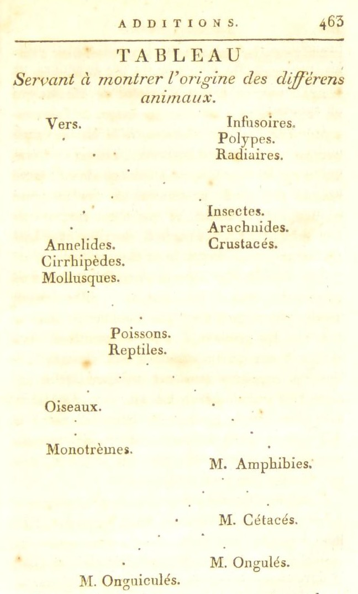
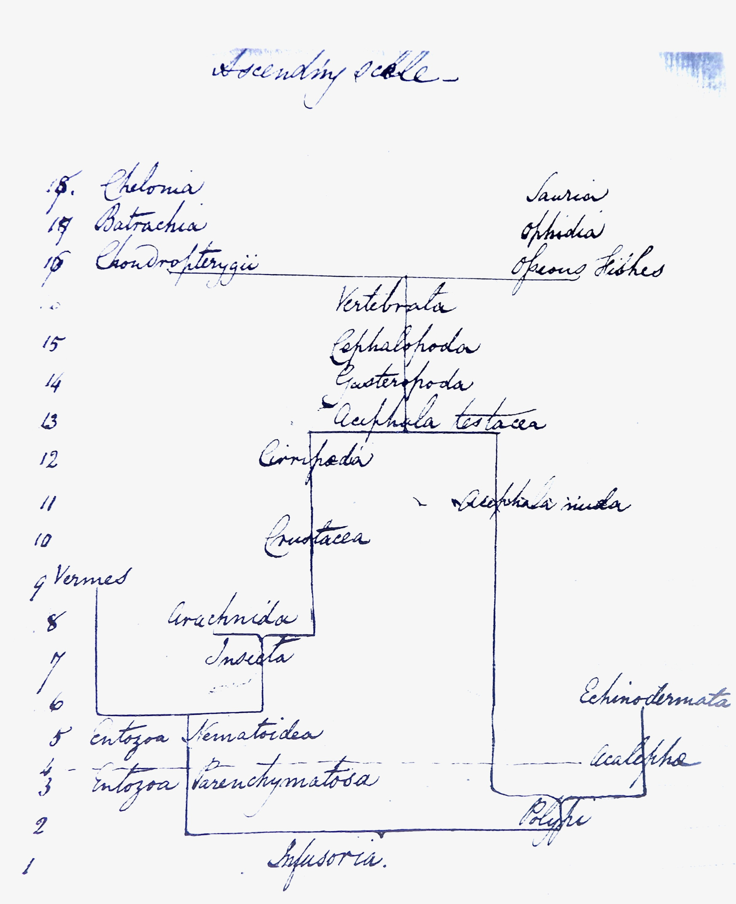
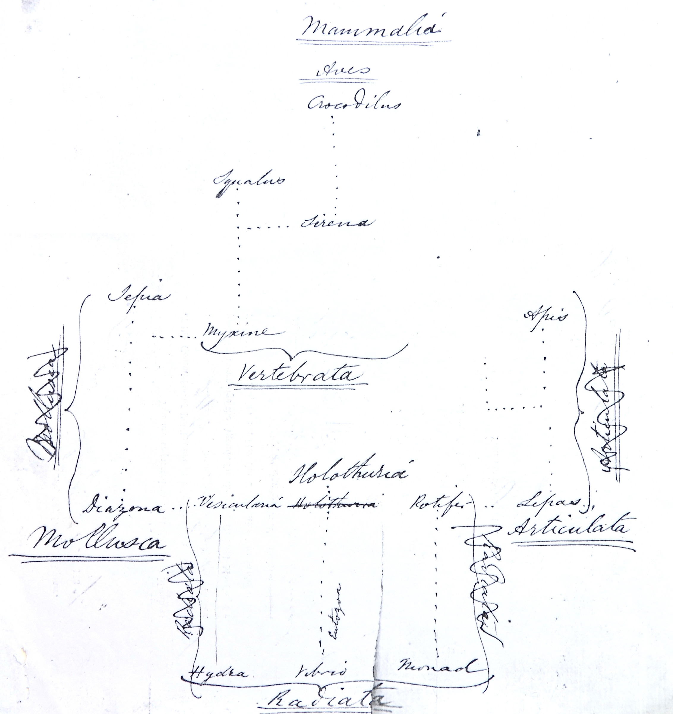
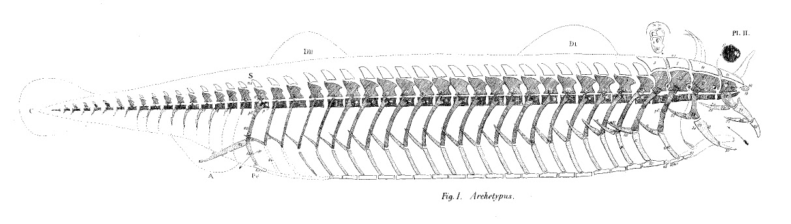

# Evolutionary Thought Before Darwin
**First published Mon Jun 17, 2019; substantive revision Thu Nov 30, 2023**

*Sloan, Phillip*

“Evolution” in contemporary discussions denotes the theory of the change of organic species over time. Prior to the second half of the nineteenth century, the term was used primarily, if not exclusively, in an embryological sense to designate the development of the individual embryo. These same ambiguities of usage also surround the German term *Entwicklungsgeschichte*, which originally was used in an embryological context. In 1852 the English philosopher Herbert Spencer (1820–1903) used the term to denote both cosmic and biological changes from “homogeneity” to “heterogeneity”, and spoke there of a “theory of evolution”. In the 1860s the term was used in some contexts to designate species change (Bowler 1975)[^bowler-1975]. Darwin himself did not use this specific term for his theory until the *Descent of Man* (1871). Since this article will survey the broad history of these theories prior to the *Origin of Species*, the term “transformism”, a term that came into common use in French biological sources around 1835, will generally be used in this article to designate the theory of species change prior to the shift in meaning in the 1860s. Since Darwin’s work, the designator “evolution” has been typically, if not exclusively, linked with the theory of natural selection as the primary cause by which such species change has occurred over historical time.

This entry gives a broad historical review of the topic up to the “Darwinian Revolution”. The Darwinian period will be treated in the separate entry Darwin: From the *Origin of Species* to the *Descent of Man*. The issues will be examined under the following headings:

## 1. Species Permanence and Change in Antiquity

### 1.1 Classical Discussions

In many respects, the general idea of species change in Western thought is an ancient concept. The reflections of Empedocles (ca. 495–35 BCE) and the views of the Greek Atomists among the Presocratic nature philosophers formed a Classical heritage on which later speculations could be developed (Kirby 2013)[^kirby-2013]. These Presocratic speculations combined naturalistic accounts of origins with reflections on the workings of chance-like processes to create existing forms of life (see the entry ancient atomism). Particularly as the Presocratic Atomist speculations were restated by the Roman poet Titus Lucretius (ca. 99–50 BCE) in book five of his *On the Nature of Things* (Lucretius [RN]), a source was available in Antiquity and recovered in the Latin West in 1417. This set out a speculative account of the gradual origin of living beings from an initial atomic chaos. Through an undirected process, the best adapted forms are sorted out and those not suited to their conditions are eliminated

The speculative accounts of the early atomists were, however, opposed on several levels by the subsequent mainstream Platonic, Neo-Platonic, Aristotelian, and Stoic philosophical traditions. The writings of Plato (427–327 BCE), particularly his long creation myth, *Timaeus*— the only Platonic dialogue available continuously in the Latin Western tradition— provided an influential non-Biblical source for arguments against the Atomist tradition. This dialogue serves as the *locus classicus* for the notion of an externally-imposed origin of living beings through the action of an intelligent Craftsman (*demiurgos*) who orders mathematically- conceived matter into a rational cosmos that includes living beings fashioned in accord with eternal archetypes or forms. Plato’s account initiated the long tradition of reflection that was continued in Neo-Platonism and in Greek and Roman Stoicism to form the foundation of the argument that organic beings could not be explained by chance-like processes either in their origins or in their complex design. Particularly as developed in the influential writings of the Greek physician Claudius Galenus (129–200 CE), a long heritage in the life sciences relied upon anatomy as evidence of rational design. These interpretations of “teleological design” interacted in complex ways with Jewish, Christian, and Islamic Biblical concepts of creation (Sedley 2007)[^sedley-2007]. One common meaning of “teleology” frequently encountered in discussions of evolution since Darwin—that of externally imposed design by an intelligent agency (demiurge, nature, God) on pre-existing matter—originates in these ancient discussions and is not accurately identified with the Biblical concept of *creatio ex nihilo* (Carroll 2015)[^carroll-2015].

In Aristotle’s (384–322 BCE) seminal biological writings, the external teleology of a designer-creator was replaced by an internal teleological purposiveness associated with the immanent action of an internal cause— in living beings their informing soul (*psuche*)— which functioned as the formal, final and efficient cause of life (Aristotle, *De Anima* II: 415b, 10– 30 [1984]). Aristotle also did not endorse the concept of an historical origin of the world, affirming instead the eternity of the world order (*Physics*, I: 192a, 25–34), which became the main interpretation of Aristotle’s views by a later tradition (Dales and Argerami 1991)[^dales-1991].

Another issue that Aristotle treated extensively with relevance to the conception of species—embryogenesis—also had important implications for later discussions. In the traditions indebted in some way to Aristotle’s natural philosophy, sexual generation and the subsequent embryological development of the individual from primordial matter, is a sequential process that occurs in time under the teleological action of the soul (*psuche*). In Aristotle’s own account, this soul-as-form is typically derived from the male parent, but it could also be derived even from the sun, as employed in his explanation of the origin of spontaneously-generated forms (Aristotle, *De generatione animalium*, III: 762a, 20–35).

This theory of the passing on of soul-as-substantial form in generation also formed the basis of one meaning of “species” (*eidos*) in Aristotle’s biological works. “Species” in this sense denotes the individualized en-mattered form-as-soul that is perpetuated in generation eternally. Although connected by a complex theory of mental abstraction to the universal in thought and language, a biological species is not a universal, but an eternal serial sequence of one individual generating another individual (*De Anima*, II: 415b, 1–10). The importance of this meaning of *eidos* as distinct from the concept of a universal in thought and language bears on several issues explored in Sections 3.3 and 3.4 below.

### 1.2 Medieval Revisions

The implications of Aristotle’s complex thought for subsequent discussions of species, generated by the recovery of his writings in the Latin West in the twelfth and thirteenth centuries, were varied. On one hand, Aristotle’s apparent metaphysical requirement that the soul-as-form (*eidos*) be permanent and enduring through the process of the generation of “like by like” seemed for much of the tradition to amount to a denial of the possibility that natural species could change over time in their essential properties, even though local adaptation in “accidental” properties was fully possible. Since individual beings were considered to be dynamic composites of a material substrate and an immaterial and eternal form, the accidental differentiation of the substantial form in individuals did not affect the metaphysical endurance of the species. It also made species extinction metaphysically impossible. In living beings, the soul-as-form is serially passed on through time in the act of generation to create an eternal continuity of the form. This supplied a metaphysical foundation for the notion of species permanence without reliance on an external creative agency.

In the background of the discussion of the high middle ages was also the theory of divine creation endorsed in inherited Jewish, Christian and Islamic thought. This required a distinction between the first origin of species in historical time, and the normal generation of the individual. If the origin of species was attributed to divine action, the temporal emergence of these species was not necessarily instantaneous. Such a doctrine was the basis of Augustine of Hippo’s (354–430) theory of the original creation of primordial seeds (*rationes seminales*) of each species at an original moment in time, but with the emergence of species in historical time a possibility (Augustine, VI.13.23–25, [GL, 175–76]). This theory of a temporalized creation, put forth explicitly in detail in his treatise *The Literal Interpretation of Genesis*, allowed Augustine to argue that species emerged sequentially in historical time rather than all at once.

The great textual recoveries in the Latin West of Greek science, medicine and philosophy of the twelfth through the fifteenth centuries, generally accompanied by Islamic commentaries, introduced these texts into a theological context that had been strongly defined by Augustinianism and neo-Platonism. The interplay between this pre-existent tradition with new philosophical views defined a complex period of intellectual ferment that defined much of the subsequent intellectual and scientific history of the West (Gaukroger 2006: chp. 2)[^gaukroger-2006]. The sustained efforts of major synthesizers, such as Thomas Aquinas (1225–1274), to bring the massive body of newly-recovered Aristotelian works into dialogue with Christian Neo-Platonism and Augustinianism, demanded new insights into the conception of the soul-body relation, the autonomy of the natural order and the role of secondary causes in the creation of the world.

Concerning the issue of species-permanence and origin, Aquinas treated this in dialogue with Augustine’s theory of serial creation. As he comments in his major synthesis, the *Summa Theologiae*: “New species, if they appear, pre-exist in certain active powers” (Pars I, Qu. 73, Rep Obj. 3). This claim suggests a reading of Aristotle that assumed the essential fixity of each definable substantial form, and the eternity of each species since creation. But this conclusion must be read in the context of Aquinas’s complex theory of creation and the discussions of the problem of universals in late Scholastic philosophy (see the entry medieval problem of universals, and Wilkins 2009: Ch. 3)[^wilkins-2009]. This context prevents any simple picture of Scholastic thought concerning the issue of species permanence, and it cannot be claimed that either Aristotle or later Scholastics such as Aquinas are responsible for the strong “essentialist” position often attributed to them in the literature (R. A. Richards 2010: chp. 2)[^richards-2010]. As developed below (2.2), it can be argued that the species concept was “hardened” only in the early modern period with the rise of the mechanical philosophy and its attendant preformationist embryology. The “strong essentialist” position often attributed to Aristotle and Scholasticism (Hull, 1965)[^hull-1965], is demonstrably a product of later historical developments (R.A. Richards 2010; Wilkins 2009; Oderberg 2007: chp. 9; Winsor 2006; Lennox 1985, 1987, 2001)[^lennox-1985][^lennox-1987][^lennox-2001][^oderberg-2007][^richards-2010][^wilkins-2009][^winsor-2006].

## 2. Early Modern Foundations

### 2.1 Cartesian History of Nature

The re-introduction of Greek and Roman atomism in the Renaissance, with the recovery (1417) and printing (1473) of Lucretius’s philosophical poem *On the Nature of Things* (Lucretius, [1968]), introduced to a literate European audience a series of influential cosmological speculations that included a naturalistic account of the origin of species integrated into a non-teleological materialist cosmology that contrasted markedly with the received Scholastic, Aristotelian, and Augustinian-Platonic traditions. Into the eighteenth century, these speculations, and those drawn from other atomist sources (see the entry on natural philosophy in the Renaissance), were often in the background of novel early modern reflections on species origins and their possible transformation in time (Bowler 2003: chp. 2; Oldroyd 1996; Greene 1959)[^bowler-2003][^greene-1959][^oldroyd-1996].

A new starting point in systematic reflections on the origin of the earth and living beings, showing both some similarity and also major differences from atomist speculations, dates specifically from the synthesis of natural philosophy and metaphysics put forth by René Descartes (1596–1650) in his *Principia philosophiae* (1st ed. 1644; 2nd ed. 1647). This treatise expanded and summarized issues he had developed earlier in *Le Monde* (*The World, or Treatise on Light*), a work published only posthumously in 1664, with an improved edition appearing in 1677.

It is important for understanding the subsequent reflections on the “history” of nature to recognize that these Cartesian speculations on the history of the earth and solar system were introduced in the form of a counter-factual hypothesis that explicitly sought to avoid conflict with accepted theological interpretations of origins (Descartes 1647 [1983: 181])[^descartes-1647]. In the hypothetical account offered in the *Principles of Philosophy*, Descartes derived the earth from a cooled star “formerly…like the Sun” (ibid.). By its gradual solidification in a great celestial vortex, the Earth took form. Subsequent drying and cracking formed the ocean basins, the continents and the mountain ranges.

An outstanding lacuna in Descartes’s account, however, was his failure to incorporate the origins of living beings into his naturalistic story of creation by natural law. Although manuscripts display the degree to which Descartes attempted on several occasions to work out some linkage between his general natural philosophy and the embryological formation of living beings, these reflections did not appear in print during his lifetime (Aucante 2006)[^aucante-2006]. The *Principles* simply skips over the issue of a naturalistic account of the origins of life and the origin of individual species. Instead in Part IV, devoted generally to the origin and physical properties of the Earth, he jumps (Proposition 188) from a discussion of magnetism to a brief allusion to projected Parts V and VI of his *Principles* that would deal with animals and humans (Descartes 1647 [1983: 275–276])[^descartes-1647]. But the *Principles* only offers a brief discussion of the various senses and body-soul interaction similar to that put forth in his early unpublished *Treatise on Man* (1st Latin ed. 1662, 2nd French ed. 1664). These speculations were grounded on the concept of a hypothetical statue- machine created directly by divine action, and possessed immediately of all human functions and structures (Descartes 1664 [1972: 1–5])[^descartes-1664].

Descartes’s speculations conveyed to his successors at least two issues relevant to the origin and history of living species. First, by presenting the historical account of the origin of the solar system and the world as a counterfactual hypothesis, a means of understanding the history of nature adapted to the limitations of the human mind, rather than as a literally true account, Descartes developed the grounds for a purely fictionalist reading of historical science that persisted into the nineteenth century (Sloan 2006a)[^sloan-2006a]. Second, the integration of living beings into the new natural philosophy of mechanistic naturalism was left unresolved. If anything, Descartes’s reflections accentuated the problem of providing a naturalistic explanation of the origins of living beings.

Two traditions can be traced in the wake of Descartes’s reflections. Beginning with the *De solido intra solidum naturaliter contento dissertationis prodromus* of 1669 [1916] by the Danish Cartesian Nicholas Steno (1638–86), efforts commenced to draw the historical origins of living beings into the Cartesian cosmology, in this case primarily by granting that fossils were the remains of once existing organisms on an earth that had formed historically. There was, however, no effort made to account for the origins of these beings on Cartesian principles (Steno 1669 [1916], Rudwick 1972, 2005)[^rudwick-1972][^rudwick-2005][^steno-1669].

A second tradition sought to give a “realist” interpretation of the history of the earth by reconciling this with the account of *Genesis*. Such a synthesis was the specific effort of the English clergyman, Thomas Burnet (1635–1715). Burnet sought to reconcile a Cartesian-derived historical account of the origins of the Earth with the creation account of the Mosaic tradition. In Burnet’s account, the Earth began from an original chaos fashioned by divine action into the existing Earth through a series of changes that involved the gradual separation of the continents, the reversal of the poles, and the Mosaic flood. To explain the origin of living beings, Burnet relied on the “spontaneous fruitfulness of the ground” in the primeval Edenic world, similar to the Augustine theory of the created *rationales seminales*, rather than on the direct creation of complete forms through divine action (Burnet 1684: bk 2, chp. 2, para. 4, p. 187 [1965: 141])[^burnet-1684]. By connecting this account to the Biblical story of the first chapter of *Genesis*, Burnet broke with Cartesian counterfactualism, offering for the first time a presumably literal interpretation of a Cartesian-style developmental history of nature that also included the origins of living forms.

### 2.2 Mechanism, Pre-existence Theory and Species Fixity

The various accounts offered in the subsequent “theory of the earth” tradition, as they were amplified by such natural philosophers as John Ray (1627–1705), John Woodward (1665–1728), and William Whiston (1667– 1752), failed to achieve a consensus position on the question of a naturalistic explanation of the origins of organisms (Rudwick 1972, 2005)[^rudwick-1972][^rudwick-2005]. New reflections on the embryological origin of the individual organism in the seventeenth-century provided a particular point of focus, and the reflections on this issue were closely tied to speculations about species origins.

In its seventeenth-century context, the issue of species origins also involved debates over the possibility of the spontaneous generation of forms (Roger 1963 [1997: chp. 2]). The apparent experimental refutations by Francesco Redi (1626–1667) of spontaneous generation theory weakened, but did not destroy the foundations of Burnet’s theory. Evidence for spontaneous generation could always be explained by appeal to Augustine’s theory of the pre- existent “seeds” or “germs”.

The extensive empirical researches on the generation and embryological formation of birds and mammals carried out by William Harvey (1578–1657), and published late in his life in his *Exercitationes de generatione animalium* (*Observations on the Generation of Animals*) in 1651 (Harvey 1651 [1847])[^harvey-1651], proved to be a bombshell in this discussion. Harvey’s careful studies claimed to refute on empirical grounds both the Aristotelian form-matter theory of sexual generation as well as the rival “two-seeds” theory based on the assumption of equivalent male and female semen. This latter theory had been embraced by ancient atomists, by Galenic and Hippocratic medical theorists, and by the majority of Renaissance physicians. The two-seeds theory had also been accepted by early-modern atomists such as Pierre Gassendi (1592–1655) and Nathaniel Highmore (1613–85) (Fisher 2006)[^fisher-2006]. As a consequence, when Descartes’s own speculations on embryonic formation were finally published posthumously in 1677, in which he had also relied on the combination of male and female *semina* organized by laws of nature and the vortex theory, they commonly met with derision (see quote from Garden below). Harvey’s detailed embryological enquiries of 1651 had already seriously undermined the empirical bases of these claims. It is difficult to find any author who endorsed the solution as offered by Descartes.

These empirical difficulties with both the main inherited theories of generation as well as with the new “mechanistic” alternative accounts of embryogenesis of Gassendi, Highmore, and Descartes produced a conceptual crisis within the program of universal mechanism that suggested that universal mechanism could not deal causally with one of the most important issues in the philosophy of nature. Another solution needed to be found.

As a consequence of the failure of “mechanistic” epigenesis, post- Cartesian mechanists resolved this issue with the theory of “preexistence”. Scientific foundations of this can be traced to the work of the microscopist Jan Swammerdam (1637–80) in the late 1660s on the basis of his microscopic observations on developing insects. The philosophical development of this theory was made by the French Oratorian priest Nicholas Malebranche (1638–1715), whose influential *Recherche de la vérité* of 1674 recast many Cartesian principles into a framework of “theistic” universal mechanism (Malebranche 1674; Gaukroger 2010: chp.2)[^gaukroger-2010][^malebranche-1674]. In this work Malebranche offered a novel theory of generation which is most accurately termed a “preexistence” theory. On this view, the new organism is not generated in secular time, but has pre-existed since the original creation of the world. This theory, often supported by appeals to Augustine’s theory of the creation of original seeds (see above Section 1.2), was to become the paradigmatic theory for nearly a century, and was closely associated with some version of the mechanical philosophy. Various expressions of the preexistence theory can be traced into the public teaching and published works of such influential expositors of academic medicine as Hermann Boerhaave (1668–1738) of the University of Leyden. The theory is also endorsed in numerous scientific treatises of the early eighteenth century. The question of both individual and species origin was by this theory removed to divine action at the first creation of the world (Pyle 2006; Roger 1963 [1997: chp. 6])[^pyle-2006].

At least three variants of the theory of pre-existence can be distinguished. Two of these assumed the pre-existence of forms in miniature. The original version assumed the encasement of the miniature form in the ovaries of the female (Ovism). Following the discovery in 1677 of spermatozoa by Antonie van Leeuwenhoek (1632–1723), the theory of the preformation of the embryo in the male spermatazoa (Vermism) was introduced. These two versions of “preformationism” generally became the main options one finds expressed in the professional medical and gynecological literature of the 1670–1740 period (Pinto-Correia, 1997, Stephanson and Wagner, 2015)[^pinto-correia-1997][^stephanson-2015]. A third alternative, but one which had few followers in the seventeenth and early eighteenth century until the 1770s, was the theory of pre-formed “germs”, given its first clear statement by Claude Perrault (1608–80). This Perrault theory, which closely resembled the Augustinian theory of the *rationes seminales* (1.2 above), held that the first primordia of organisms were formed at the original creation as seeds dispersed in the soil, from which they were taken in with food. Under the proper conditions and within the correct organisms, these “germs” became implanted in the ovaries from which they then developed in response to fertilization. In all three accounts, the act of fertilization provided the occasion, and not the cause, of the development of organisms in time.

The theory of pre-existence was seen to solve many problems. First, it explained the intimate interrelation of structure and function that seemed to require the existence of parts of the organism in an integrated system. The heart presumably could not beat without ennervation, and the nerves could not exist without the heart. Consequently, as the argument went, the entire organism must pre-exist. The existence of such integrated systems seemed otherwise difficult to explain by the sequential development of parts, as implied in Aristotelian and other “epigenetic” theories of development. Second, this account was easily harmonized with theological developments in the seventeenth century, particularly on the Continent, where the strong influence of Augustinian theology on Calvinism (Protestant) and Jansenism (Catholic) was most in evidence. As an example, it provided for the transmission of Original Sin. The solution that emerged was a “theistic” mechanism that emphasized God’s omnipotence and the corresponding passivity of nature (Gaukroger 2010; Roger 1993, 1997a, chp. 6])[^gaukroger-2010][^roger-1993][^roger-1997a]. A third advantage of the theory of preexistence, at least in the versions that embraced the “preformed germs” interpretation, was that it allowed for the appearance of life in secular time, which seemed to be suggested by the existence of fossil forms. At the same time no versions of preexistence theory implied any change of species or development of one species from another in time. Finally, some version of a theory of the preformation of the embryo could be reconciled with the best microscopic observations of the late seventeenth and early eighteenth centuries, as these were reported by such experts on this instrument as van Leeuwenhoek, Jan Swammerdam, Marcello Malpighi (1628–1694), and Henry Baker (1690–1774).

These preexistence theories of embryological origin directly affected the question of species transformism. First, they effectively removed the organism from the effects of local circumstance and environmental conditions. Second, they all placed the origin of species, as well as that of at least the primordia of the individual organism, at a moment in the original divine creation. A quotation from a contemporary review article illustrates several aspects of the thesis of preexistence:

> And indeed all the Laws of Motion which are as yet discovered, can give but a very lame account of the forming of a Plant or Animal. We see how wretchedly *Des Cartes* came off when he began to apply them to this subject; they are form’d by Laws yet unknown to Mankind, and it seems most probable that the *Stamina* of all the Plants and Animals that have ever been, or ever shall be in the World, have been formed *ab Origine Mundi* [from the foundation of the world] by the Almighty Creator within the first of each respective kind. (Garden 1691: 476–477)

The immediate consequence of this theory was a new rigidity given to the concept of species that it had not possessed in the Aristotelian and Scholastic traditions. Preexistence theory reinforced a sharp distinction between “essential” and “accidental” properties to a degree not implied by the prior tradition. At the same time, preexistence theory made it difficult to explain obvious empirical phenomena, such as monstrosity, the regeneration of lost parts, the resemblances of offspring to both parents, evidence for geographical variation, racial differences, and the existence of hybrid forms such as the mule. It seemed necessary to attribute these anomalies to divine action at an original creation. These difficulties in the theory resulted in a variety of criticisms that were eventually to lead to the downfall of preexistence theory in its original form, although the theory was to have a long subsequent history through a modification of the “germ” theory (Detlefsen 2006; Roger 1997a, chp. 7; Roe 1981)[^detlefsen-2006][^roe-1981][^roger-1997a].

The dominance of some form of pre-existence theory of generation between roughly 1670 and the 1740s provides some explanation for the lack of efforts among natural philosophers to develop transformist theories of species origins in the same period. A notable exception to this claim was the Epicurean cosmology resembling some aspects of Lucretius’s poem, developed by the French *philosophe* Benoît de Maillet (1656–1738) in his privately circulated manuscript *Telliamed* that was known in French circles for ten years before its publication in 1748 (Maillet, 1748)[^maillet-1748]. In this work de Maillet offered bold speculations on how sea creatures developed into land forms over time. Nonetheless, the period before the middle of the eighteenth century was dominated by a theory of organic generation that effectively precluded the naturalistic development of species. The development of scientific transformism can be seen to be intimately tied to new theories of generation, and also to the development of “active” rather than “passive” conceptions of matter.

### 2.3 Newtonian Revisions

The introduction of Newtonian natural philosophy into this discussion had ambiguous consequences depending on the interpretations given to Newton’s natural philosophy. Newton’s *Philosophiæ naturalis principia mathematica* (*Mathematical Principles of Natural Philosophy*) of 1687, with subsequent revised editions in 1713 and 1729 (Newton 1729 [1999])[^newton-1729], developed a fundamental critique of Cartesianism, and also introduced the concept of attractive forces, able to act over a distance, into physical explanations. Extending the concept of “active powers” to the micro-level in his *Opticks* of 1704 (English), with important revisions in editions of 1706 (Latin), 1717, 1721, and 1730 (Newton 1730 [1952])[^newton-1730], Newton introduced into biological discussions new issues that played out in complex ways in the subsequent decades.

On one reading of Newton, his conception of active forces introduced back into life science a concept of “dynamic” matter that could be used as a warrant for a new vitalistic embryology and even a non-mechanistic conception of nature possessed of intrinsic powers (Schofield 1970: chp. 9)[^schofield-1970]. This option was followed out by many French medical writers who used Newtonian arguments to ground a “vitalistic” medical theory, an interpretation particularly developed at the University of Montpellier in the early decades of the eighteenth century (Wolfe 2014; Gaukroger 2010: chps. 10–11)[^gaukroger-2010][^wolfe-2014].

But in the more “mechanistic” interpretation of Newtonianism, this retained the inert character of matter and endorsed many of the main features of Cartesian biomechanism, but with the addition of mathematical quantification and some use of attractive and repulsive microforces (Schofield 1970: chp. 1)[^schofield-1970]. In this tradition of interpretation, one finds a commitment to mechanistic preformationism and even strong “preexistence” theory. This can be followed in the medical theories of Hermann Boerhaave, Archibald Pitcairne (1652–1713), Richard Mead (1673–1754), and other Newtonian iatromechanists who typically had contact with the great Dutch medical schools (Guerrini 1987)[^guerrini-1987].

Newton had also argued in the long thirty-first Query to the *Opticks* against “World-Building” of the Cartesian form, as discussed above. Newton saw this as claiming that the world “might arise out of a Chaos by the mere Laws of Nature” (Newton 1730 [1952], 378)[^newton-1730], and condemned this as “unphilosophical” (*ibid*., 401). Revival of realistically interpreted historical cosmology in the eighteenth century involved a clear break with these Newtonian strictures. This shift will be developed in the following section.

### 2.4 Revitalizing Nature

The development of new conceptualizations of the relation of organic beings to the history of the world, and the relation of species permanence to this history, was achieved in the eighteenth century. This included the breakdown of universal mechanism, the introduction of dynamic theories of matter, new theories of embryological formation, and a reconceptualization of the relation of time to the material world. It also involved the formulation of progressive and developmental, rather than “degenerating”, conceptions of the history of life. The following discussion will selectively examine aspects of these developments. The reader is referred to major recent historical syntheses for further development of the more general intellectual and scientific context (Zammito 2018; Gaukroger 2010; Reill 2005; Rudwick 2005)[^gaukroger-2010][^reill-2005][^rudwick-2005].

In several respects these developments are connected in some way to the introduction of dynamic conceptions of matter that emerged in the interplay between Newtonianism and Leibnizianism in the early decades of the eighteenth century, particularly in French discussions (Shank 2008)[^shank-2008]. As described in the previous section, Newton’s introduction in the Queries to the *Opticks* of the concept of active microforces that could explain microchemical and electrical phenomena opened up this discussion. The other great natural philosophy developed on the Continent by Gottfried Leibniz (1646–1716) and systematized and expanded into an influential systematic philosophical program by Christian Wolff (1679–1754), elaborated a more complex theory of matter that distinguished between the properties of phenomenal “matter” as conceived by Newton, and those of a more fundamental active and teleologically-directed “substance”, grounded in force (*vis*). In physics this development played out on the Continent in the *vis viva* controversy, which was concerned initially with the conservation of force in collisions. It was then extended to more fundamental metaphysical issues that had a complex effect on the life sciences.

In the life sciences, these issues were manifest in debates over the role of vital powers in the explanation of living properties, as these were developed particularly in French discussions in the complex interactions of Newtonian and Leibnizian-Wolffian natural philosophies. An influential example of this synthesis is Émilie Du Châtelet’s (1706–1749) *Institutions de Physique* (first ed. 1740, second ed. 1742). These hybrid Leibnizian- Newtonian syntheses, bringing together aspects of Newton’s “active” forces with the monad and substance theory of Leibnizianism, were subsequently extended into discussions of embryology by Pierre de Maupertuis (1698–1759), and as will be developed in the next section, by Georges-Louis LeClerc, Comte de Buffon (1707–88) in the 1740s.

It is in the context of these discussions that we encounter the first early modern systematic speculations connecting naturalistic theories of earth history, embryological development, and changes of organic species in response to external changes of conditions of life. These connections develop directly out of critiques of the preexistence theory of generation by Maupertuis and Buffon, who in different but related ways reformulated the “mechanistic” epigenetic embryology previously advocated by Descartes and Atomist theorists. Similar to these discarded theories (see above, Section 2.2), the existence of equivalent male and female “seeds” was postulated, which were then assumed to combine in sexual generation to form the embryo. The new eighteenth-century versions supplemented these seventeenth- century accounts with a novel role for dynamic conceptions of matter and inherent organizing forces. In the case of Buffon, these claims were supported by controversial microscopic observations that presumably refuted the opposing claims made by William Harvey a century earlier (Sloan, 1992a)[^sloan-1992a]. We can conveniently date these developments from the speculations of Pierre de Maupertuis, put forth in two treatises, the better known the *Physical Venus* (*Vénus physique*) published in 1745 (Maupertuis 1745 [1966])[^maupertuis-1745]. To deal with the difficulty of explaining how atomistic seeds derived from the male and female could be formed into the complexity of the embryo, Maupertuis drew upon a version of Newtonian attraction inherent in these seeds which also included elements of Leibnizian monad theory. In his last formulation of 1751 he expanded on this with the claim that the particles themselves were endowed with an internal principle that led them to arrange themselves to form specific parts of the fetus. Maupertuis’ dynamic “epigenesis” incorporated both mechanism and dynamic materialism (Terrall 2002: chp. 7; Hoffheimer 1982)[^hoffheimer-1982][^terrall-2002].

There are at least three ways in which the change in embryological theory instituted by Maupertuis, and subsequently elaborated by Buffon, proved to be relevant to the broader question of the historical transformation of species. First, this new account of the embryological origin of the individual organism meant that it actually is organized in historical time rather than pre-existing and simply unfolding at an opportune moment. Second, it involved a theory of material inheritance that explained the passing on of physical traits from one generation to the next through the transmission of particles of matter. Third, the conservation of the identity of the species is guaranteed only by the accurate transmission of this material inheritance. If this transmission is affected by external circumstances in any way, significant historical change in the lineage of ancestor and descendant is possible. These options, opened up by Maupertuis’s speculations, were subsequently developed within an institutional setting by Buffon.

## 3. Buffon’s Transformation of Enlightenment Natural History

The complex set of issues described in the preceding discussion were all brought together in the work of Buffon. In a remarkable career transition in 1739 in which he moved from his position as a pensioned mathematician in the Paris Royal Academy of Sciences, to the Directorship of the King’s Garden and Natural History Cabinet (*Jardin du Roi*) in Paris, Buffon brought with him to the domain of natural history and to his reflection on issues in biology his deep familiarity with the major theoretical debates dividing Newtonians, Cartesians, and Leibnizians in his era. He was also intimately acquainted, through his friend Maupertuis. with the debates over generation theory and theories of the earth. He fashioned these ingredients into a set of new perspectives that were to define his novel approach to the life sciences over the last half-century of the Bourbon monarchy. In the interpretation of this article, Buffon is the major figure to put together a set of issues that formed the pre-conditions for transformism in biology, although he would never himself move into this theoretical region. Through his immensely popular writings, translated into all major European languages, he exerted an influence on discussions that ranged from St. Petersburg in Russia to Virginia in the American colonies.

Buffon was able to exert such influence through the concrete institutional basis provided by the *Jardin du Roi*, with its attendant large *Cabinet* of specimens collected from all over the world. Under his leadership was created the pre-eminent eighteenth-century center of research into comparative anatomy, chemistry, mineralogy, botany, and biogeographical study (Spary 2000)[^spary-2000]. By providing an institutional setting for these inquiries, the speculations and theoretical reflections of eighteenth-century natural historians could be subjected to organized critique and specialized examination in a context not found elsewhere in the natural-historical sciences of the period. Buffon’s theoretical vision provided a concrete framework against which those immediately associated with the *Jardin* were able to develop further reflections on such issues as the nature and duration of species, the significance of comparative anatomical studies, the historical relationships of forms, the meaning of fossils, and the systematic relations of living beings to one another. Only Buffon’s contemporary, Carolus Linnaeus (1707–1778), Professor of Medicine and Botany at the University of Uppsala in Sweden after 1741, had similar authority in the domain of natural history, and Linnaeus did not have the resources and the institutional authority that characterized the *Jardin* in the last days of the Bourbon monarchy.

This simultaneous emergence of Linnaeus and Buffon in the natural historical sciences of the middle Enlightenment created a major rivalry of traditions of inquiry that would play out on several fronts. In Buffon, one had the model of the grand and eloquent theoretician of nature who developed major themes in Enlightenment natural philosophy and applied these to biological topics. In Linnaeus, one had a pious systematizer of the natural world of his era, whose monumental *System of Nature* (first edition 1735), along with numerous other works, formed the basis for modern biological classification. Their different approaches set the stage for a major theoretical conflict of traditions in natural historical science that would eventually be synthesized in the nineteenth century (Hoquet 2007)[^hoquet-2007].

### 3.1 Buffon and the Methodology of Natural History

Buffon’s development of a broad theoretical inquiry into natural history within the framework of a state-sponsored institutional structure warrants the special attention given here to his contribution in the history of evolutionary theory. These included: (1) his methodological revolution in the epistemology of the natural-historical sciences; (2) his analysis and proposed solution to the problem of animal and plant generation; (3) his reconceptualization of the concept of biological species; (4) his bio- geographical approach to the issues of animal distribution and variation; (5) his renewed theoretical attention to issues of cosmology and the “theory of the earth;” and finally (6), his concluding synthesis of earth and life history in the grand naturalistic account published as his monumental *Les* (originally *Des*) *Époques de la Nature* (*Epochs of Nature*) of 1778–9, which provided a model for similar syntheses of the nineteenth century. Through this combination of several lines of earlier inquiry, Buffon posed a series of theoretical questions that were further explored by important successors associated with the Paris Museum in the nineteenth century and by natural historians of the eighteenth and early nineteenth century more generally.

In his position as a natural philosopher, in dialogue with the works of Newton, Descartes, Leibniz, Clairaut, Du Châtelet, the French *Encyclopedists*, and major English philosophers of his period, Buffon explored foundational methodological and philosophical questions of the Enlightenment in combination with his analysis of empirical questions. One expression of this wider vision was the unusual way in which he sought to validate the inquiry into natural history in relation to a naturalized epistemology that scholars have seen as novel for its time (Hoquet 2005; Sloan 2006b; Roger 1997a, chp. 9, 1997b, chp. 6)[^hoquet-2005][^roger-1997a][^roger-1997b][^sloan-2006b]. In developing a new methodological approach to natural history, Buffon claimed to ground his arguments on a form of empirical certitude—“physical truth” [*verité physique*]—attained through inquiries into the concrete relations of beings in their material relations. This he opposed to the “abstractions” of mathematical physics, extending the Leibnizian-inspired critique of Newtonian methodology as developed in Émilie Du Châtelet’s (1706–1749) *Institutions de Physique*, a work Buffon is known to have read and admired as he made his transition into his career in natural history (Châtelet, 1740)[^châtelet-1740]. Developing this argument in a long “Discourse on Method” that opened the first volume of his *Histoire naturelle, générale et particulière, avec la description du cabinet du roi* (Buffon [HN]) (1749), Buffon argued that a science based on repeated observation of concrete material relations of bodies can achieve a degree of epistemic certitude which surpasses that available from the mathematical analysis of nature (Hoquet 2005; Grene & Depew 2004; Roger 1997a, chp. 6; Sloan 2006b)[^grene-2004][^hoquet-2005][^roger-1997a][^sloan-2006b]. On the basis of this novel epistemological framework, oriented to the search for “physical” truth, Buffon thus directed natural history away from a primarily classificatory project. The latter project, exemplified by the work of his contemporary Linnaeus, Buffon criticized for imposing “abstract” categories on nature. In its place, Buffon sought to analyze living beings in relation to their material conditions of existence. This was to be focused on their reproductive relationships, biogeographical distribution, and in his later work, on their connections to cosmology and historical geology.

These insights formed an epistemological framework for the subsequent development of the *Histoire naturelle.* In these discussions Buffon dealt both with issues in the foundational epistemology and methodology of the natural-historical sciences as well as with the generalities and specifics of organic beings. Although the work was originally intended as a survey of the entire range of animals, plants, and minerals, in its actual realization, it was more limited. The first series of fourteen volumes (Buffon HN) appeared between 1749 and 1767 and dealt with the genesis of the solar system and the earth, the generation of animals, the varieties of the human species, and the natural history of the primary quadrupeds and apes. The main quadruped volumes of the first series, beginning in 1753, were written in collaboration with the comparative anatomist Marie-Louis Daubenton (1716–1800). A series of seven volumes of Supplements (1774–89) offered additional reflections and additions to these articles and expanded on his views on the history of the earth, the quadrupeds, and anthropology. These also reported on experiments on the strength of wood and the cooling of metals that he applied to dating the age of the earth. In the fifth supplementary volume (1778), Buffon presented his grand synthesis of cosmology, earth history, and the history of life, the *Époques de la nature* (English trans., Zalasiewicz et. al, 2018)[^zalasiewicz-2018] (see below, 3.3). An additional five volumes (1783–88) dealt with issues of mineralogy, chemistry, fire, and the main forces of nature, especially electricity and magnetism.

### 3.2 Buffon on the Generation of Organisms

The concrete manifestation of Buffon’s combination of novel methodology and empirical inquiry is first displayed by his treatment of embryological generation in the second volume of his *Natural History* (1749). These principles also underlie his unusual analysis of the meaning of “species” in natural history. In both instances, the notion of epistemic certitude gained from a “constant recurrence” of events plays a fundamental role in his reflections. Following the lead of his friend Maupertuis, Buffon also endorsed the theory of the male and female seeds to explain sexual generation, deriving the origin of the embryo from the mechanical mixture of these ingredients. Amplifying upon Maupertuis’s prior speculations (see above Section 2.4), he explained the organization of the particles of these two seeds into a structured whole through microforces closely identified with Newtonian attractive forces that formed an organizing force-field, an “internal mould”, that assimilated matter in the proper order for embryological development. Viewed in longer historical perspective, Buffon’s theory of the internal mould functioned in a way similar to Aristotle’s notion of an immanent substantial form, and was likely influenced by Aristotle’s discussions in *De generatione animalium* (see above Section 1.1). This “mould” serves as an immanent principle of organization that acts in company with matter to structure the unified organism by gradual development. The internal mould also guaranteed the perpetuation of like by like over time. Unlike Aristotle’s substantial form, however, Buffon’s internal mould is without an internal finality in its action. It is also not a principle of vitalization.

To explain the formation of the fetus, Buffon was conceptually required to attribute some new powers to matter to account for organization. In pursuing this option, he broke with universal mechanism and the assumption of the passivity of matter that was an intrinsic component of the mechanical philosophy and some interpretations of Newtonianism (see above Section 2.3). There are also important similarities of his new “vitalism” to that found in Leibnizian discussions such as was expounded in the *Institutions de Physique* of Émilie Du Châtelet in 1740 (Sloan 2019)[^sloan-2019]. To give a plausible account of embryological formation, vital properties therefore had to be attributed to a specific kind of matter confined to living beings, the *organic molecules*, which had their own inherent dynamic and specifying properties.

The introduction of the concept of “vital” matter by Buffon, even with restrictions on its actions, represents an important development in the history of the life sciences of this period. It broke with the uniformity of matter assumed by the Newtonian, Gassendist, and Cartesian traditions, and in a limited way it positioned Buffon at the opening of the “vitalist” revolution which initiated the first reflections on genuine species transformism, even though Buffon himself never moved into this new conceptual domain (Reill 2005: chp. 1)[^reill-2005].

In his original presentations, Buffon posited that these internal moulds and specifying organic molecules originated by divine creation. As the *Natural History* progressed, however, Buffon increasingly viewed the organic molecules to be formed from an original undifferentiated “brute” matter, and the internal moulds themselves were seen to arise spontaneously, obtaining their specificity of action purely from the differential forces of attraction between different shapes of organic particles (Buffon “De la Nature. Seconde vue”, 1765, [OP, 38–41])[^buffon-1765].

### 3.3 Buffon and the Degeneration of Species

It is in the context of his proposed solution to the issue of organic generation that Buffon then addressed the issue of organic species and their permanence. In the fourth volume of the *Natural History* (1753), devoted to the large domestic quadrupeds, Buffon first raised the option of species transformism, only to reject it. In the article “The Ass”, devoted to the domestic donkey, Buffon drew attention to the close anatomical similarity between the horse and the ass, as revealed by his collaborator Daubenton’s anatomical descriptions. This similarity strongly suggested an underlying unity of plan of all the quadrupeds, a similarity raising the possibility that all quadrupeds might have been derived in historical time from a single stem (*souche*) which “in the succession of time, has produced, by perfection and degeneration, all the other animals” (Buffon 1753, [OP, 355])[^buffon-1753]. In a move that has confused commentators every since, Buffon then rejected this possibility and instead argued that because of the infertility of hybrids, species must have been distinct from the beginning.

The explanation of Buffon’s initial 1753 rejection of transformism, and his subsequent development of proto-evolutionary views as the *Natural History* progressed, has taken many forms (Bowler 2003: chp. 3; Lovejoy 1911 [1959])[^bowler-2003][^lovejoy-1911]. The argument of this article is that both Buffon’s initial rejection of transformism, and his subsequent development toward the acceptance of historical species change reflect a coherent and consistent development of his concept of “physical truth” (see above Section 3.1). Drawing on his emphasis on serial recurrence and material connection as the foundation of physical truth, the species is maintained in time and given its ontological reality by the recurring passing on of the internal mould which shapes the organic molecules into a new organism in time.

This analysis implied for Buffon a significant redefinition of the concept of an organic species, a redefinition that has affected the tradition of natural history and biology since the 1750s. Buffon explicitly rejected the long-accepted meaning of ‘species’ as a universal— or, in modern parlance, a “class” concept, constituted by a set of individuals on the basis of possession of explicit defining properties. This was the meaning implicit in the Linnaean classification of his time. This concept Buffon criticized as an “abstract” meaning of species. By contrast, Buffon defined a species in natural history exclusively as the historical succession of ancestor and descendant linked by material connection through generation. Such a species is,“… neither the number nor the collection of similar individuals which forms the species; it is the constant succession and uninterrupted renewal of these individuals which constitutes it” (Buffon 1753, [OP, 355])[^buffon-1753].

The empirical sign of this essential unity of the species over time is the ability of its members to interbreed and produce fertile offspring, a criterion that takes precedence over similarities of anatomy or habits of life. The horse and ass must be two different species because they cannot interbreed and produce fertile offspring, whatever may be their anatomical resemblances. The dogs, on the other hand, must, in spite of great morphological differences between breeds, constitute one species because of their interfertility.

In setting forth this new meaning of ‘species’ in natural history, and distinguishing it from the alternative meaning of species as a logical universal, Buffon was doing more than distinguishing the “category” from the “taxon” as these terms have come to be understood in contemporary philosophy of biology. In an important sense, Buffon introduced an *opposition* between these two meanings of “species” found in the tradition reaching back to Aristotle (see Section 1.1 above), granting “reality” in biology only to species conceived as material successions of individuals sharing in the same internal mould spread out in time. By contrast, Buffon considered the understanding of species in the sense of a universal class concept to be “abstract” and “artificial”.

This explicit opposition of two meanings of “species” introduced by Buffon, divorcing concepts previously linked together by a complex relation of thought and world within the Aristotelian and Scholastic discussions, has been seen by some commentators as marking the introduction of a fundamental confusion over the conception of species in subsequent discussions in the biological literature. This is at least one of the underlying causes of the so-called “species problem”. In their historical extension, these issues continue to generate contemporary disputes that oppose conceptions of “species as sets” to those of “species as spatio-temporal individuals” (Dupré 1993; Ereshefsky (ed.) 1992; Ghiselin 1997; Hull 1999; R.A. Richards 2010; Sloan 1987, 2013; Stamos 2003; Wheeler & Meier (eds) 2000; Wilkins 2009; R.A. Wilson (ed.) 1999; and the entry on species in this encyclopedia).

The subsequent developments in Buffon’s thought toward what an older tradition of scholarship mistakenly interpreted to be “evolutionism”, involved the gradual broadening of his natural-historical or “physical” species to include wider and wider degrees of material relationship. This expansion of his original species concept Buffon expressed in the language of a “degeneration” of forms in time in response to environmental conditions.

The encounter with a wide body of new data from the colonies and exploratory voyages returned to Paris during the course of the writing of the *Natural History* impressed Buffon with the degree to which species seemed to be affected by external circumstances such that from a single source numerous “degenerations” could arise in some groups. This formed the conceptual basis for his concept of a *race* as distinguished from a Linnaean *Variety*. A “race” in the Buffonian sense was a historical degeneration from a common ancestor that maintained material and historical connection to this common source form. But this lineage could undergo substantial and quasi-permanent hereditary differentiation into different lineages, with the cause of these degenerations explained by slight changes in the organic molecules produced by varying environmental circumstances as a given physical species migrates to new environments. These slight changes in turn affected the internal mould. Developed in greatest detail in his long article, “On the Degeneration of Animals” in volume XIV (1766) of the *Natural History*, Buffon’s theory of the degeneration of species extended so far as to allow the lumping of the quadrupeds of both the Old and New worlds into a limited number of primary “families” (*familles*) and “genera” (*genres*) that from points of origin in the Northern European hemisphere, have degenerated in time in response to migration to new locales. By including human beings in this naturalistic scenario in his later writings, and assuming that human lineages underwent similar degenerative changes as they migrated from their postulated point of origin of human beings in the Caucasus, Buffon’s theory played a major role in the development of Enlightenment racial theory (Sloan 1973, 2014)[^sloan-1973][^sloan-2014].

Buffon subsequently made some steps toward combining the thesis of the historical degeneration of species with his theory of historical cosmology in his late *Des* (subsequently *Les*) *Époques de la Nature* first published in *Suppléments* volume 5 (1788), and subsequently issued separately in 1789. In this treatise he reworked his earlier speculations on the “theory of the earth”, first set out in 1749, adding to this a historical chronology of the age of the earth determined experimentally in the 1770s by quantitative studies on cooling spheres of metal. In this imaginative synthesis, and drawing on an allegorical reading of *Genesis* 1, Buffon combined a history of the Earth with a historical sequence of the emergence of living forms (Buffon 1779 [1988]; Zalasiewicz et al., 2018)[^buffon-1779][^zalasiewicz-2018]. In doing so he expanded the time scale of earth history considerably beyond the accepted “Mosaic” chronology of less than 10,000 years from the beginning of the world to the present, to an estimate of approximately 75,000 years in the published version, and over two million years in his draft manuscript. In this treatise Buffon offered a naturalistic solution to the two inherited Cartesian dilemmas. First, his schema was offered as a realistic account. The Cartesian language of counter-factualism has disappeared. Second, he integrated the history of living forms into this comprehensive history of the world. Further naturalizing his theory of the internal moulds and organic molecules, both were now seen to arise by natural laws from the natural attraction of different shapes of matter and from the changes in matter as the earth cooled from its origin in matter cast off by the sun. Animals first originated by the spontaneous clumping together of these organic molecules on the cooling earth (Buffon 1779 [1988]: Fifth Epoch)[^buffon-1779].

The *Epochs* also offered a schema for a historical sequence of forms that appear sequentially in a series of six major “epochs” to which Buffon gives precise dates of duration. This begins with the origin of the earth from a cooled star, and then describes the beginning of living nature with marine life and plants in the early stages of the earth’s history, terminating with present forms His account even suggested a naturalistic origin of human beings, although this issue is left vague. Humankind appears, without explanation in the text, in a non-paradisal state in the northern latitudes of Eurasia, surrounded by ferocious animals, earthquakes and floods, and in a primitive social condition that required collaboration for survival. Buffon’s liberal use of a form of spontaneous generation that allowed for the origin of even major animal groups from the clumping together of organic molecules as the earth cooled, rendered the actual derivation of forms from previous forms unnecessary. In several respects, the development of genuine transformist theories by Buffon’s successors required a much more restricted use of the possibility of spontaneous generation.

### 3.4 The Reception of Buffon’s Natural History

Beyond the confines of the Paris *Jardin*, the reflections inspired by Buffon for wider discussions of the late Enlightenment natural history were complex. The reception of his *Les Époques de la Nature*, for example, was uneven (Roger “Introduction” in Buffon 1779, [1988, cxxiv])[^buffon-1779]. Although the main body of the *Natural History* was translated three separate times into English (William Kenrick and J. Murdoch [1775–76]; William Smellie [1785], James S. Barr [1792], the *Epochs* was never translated into English until recently (Zalasiewicz et al., 2018)[^zalasiewicz-2018], and it seems to have played an insignificant role in anglophone discussions, in contrast, for example, to the major impact of the works of Linnaeus, which received a wide British exposition and translation. The boldly speculative character of the *Epochs* was also at odds with the new professionalized inquiries into geology and natural history undertaken by a younger generation of naturalists who may have adopted Buffon’s naturalism and extension of geochronology, but not his grand rhetorical style (Rudwick 2005: chp. 3)[^rudwick-2005].

Historical research has shown, however, that the *Epochs* had an influential history in the Germanies (Schmitt, 2019)[^schmitt-2019]. The treatise was quickly (1781) translated into German at St. Petersburg and it seems to have played an important role in the development of German historicism (Reill 1992)[^reill-1992]. Although linkages are in need of further scholarly research, the impact of Buffon’s *Epochs* on the historical transformism sketched out a few years later by Johann Gottfried Herder (1744–1803) in the first volume of his magisterial *Ideen zur Philosophie der Geschichte der Menschheit* (1784– 91) is suggested by several lines of evidence (Zammito 2018: 180–185, 2018b).

Herder departed markedly from Buffon, however, in developing his own historical theory of the cosmos and the development of life, and eventually of human culture, on a framework of teleological progress based on a “vital” theory of matter. For Herder, not only the individual organism, but nature as a whole develops under the causation of an internal organic force that leads it to develop higher and higher stages of life, eventually resulting in the ultimate development of humankind in history.

## 4. Early Nineteenth-Century Transformism

By the early nineteenth century, one can follow several lines of reflection admitting some form of species transformism and a historical development of life. In the Germanies, Herder’s reflections formed a major ingredient in the development of German *Naturphilosophie* and “Romantic” science that was expanded in the writings of Johann Goethe (1749–1832), Friederich Schelling (1775–1854), Gottfried Treviranus (1776–1837) and several others who advocated some version of a historically progressive philosophy of nature with at least the “development” if not actual transformism of species in time (Zammito 2018: chps. 8,9,11; R. J. Richards 2002: chps. 2, 3, 8)[^richards-2002]. In the British Isles in the same period, the reflections in the second volume of his *Zoonomia, or the Laws of Organic Life* (1794–1796) of Erasmus Darwin (1731–1802), grandfather of Charles Darwin, offered a theory of species development based on a concept of dynamic living matter. These multiple lines of late eighteenth-century reflection advocating some form of a general transformism of species and a history of living nature, each of which can be followed out in detail, can be differentiated from the institutional framework of discussion established in France after Buffon at the *Muséum nationale d’histoire naturelle* in Paris, the post-Revolutionary successor to the *Jardin du roi.* These institutional developments supplied a new precision and a concrete material context for the professional discussion of transformist question as it emerged in the nineteenth century. This institutional framework of French discussion will be emphasized in the following while acknowledging the broader context of discussion outside of France.

Buffon’s leadership of the *Jardin* ended with his death in April of 1788 on the edge of the massive social, political and scientific changes that were to overtake France a year later. As the only major French scientific organization to survive the dismantling of all other institutions of privilege by the National Convention in the summer of 1793, the reconstituted and reorganized *Muséum nationale d’histoire naturelle* provided an unusual context for the further development of transformist theories (Blanckaert et al. [eds] 1997). In its new form, the *Muséum* created an institutional context in which several aspects of Buffon’s grand undertaking in natural history could be refined and deepened in the decades following his death (Corsi 1983 [1988: chp. 1])[^corsi-1983]. In the Revolutionary context of the new Republic, the work of Linnaeus and his classificatory approach to natural history, admired by Jean-Jacques Rousseau, but overshadowed before 1789 by the authority of Buffon, was elevated at the *Muséum* to a new level of authority. The two rival leaders of natural history in effect became for the French naturalists what George Cuvier (1769–1832) later described as “two founts” from which they jointly drew their inspiration.

The Revolutionary reorganization of the *Jardin* also created a new kind of specialization of research and disciplinary division within what had previously been conceived of as “natural history”. The reorganization of 1793 established within the *Muséum* twelve separate Chairs of equal status that gave specific individuals control over portions of the collections and the research work done within these divisions that instituted new disciplinary specializations within natural history. “Mammals and Birds” were placed under Etienne Geoffroy Saint-Hilaire (1772–1844). “Reptiles and Fishes” were assigned to Buffon’s understudy Bernard de Lacépède (1756–1825). “Human Anatomy” was given to Antoine Portal (1742–1832). The creation of a new Chair of Comparative Anatomy, with an attendant separate museum established in 1802, provided the position for the young Alsatian zoologist Georges Cuvier (1769–1832). The large conglomerate of forms, known previously only as “Worms” (*Vers*), was placed under the control of Buffon’s one-time understudy Jean Baptiste Pierre Antoine de Monet, Chevalier de Lamarck (1744–1829). Other chairs in botany, paleontology, comparative physiology, and anthropology were established, or would be developed in the nineteenth century. All these new institutional structures subdivided traditional “natural history”, and facilitated professionalized inquiries into specific areas of life science that related to the nature of species, the interpretations of the classificatory systems, and to the history and biogeography of the earth (Corsi 1983 [1988: chp. 1]; Appel 1987)[^appel-1987][^corsi-1983].

### 4.1 Lamarckian Transformism

It is in this context, and through his position as the first holder of the Chair of “Worms” that Jean Baptiste de Lamarck developed during his tenure the first coherent theory of species change over historical time, eventually known by the new term—*transformisme*. Lamarck in many respects warrants the claim to be the first genuine evolutionary thinker situated within a professional scientific institution.

Lamarck’s theory of species transformism emerged gradually in his annual *Muséum* lectures on the “animals without vertebrae” that commenced in 1794. As the new occupant of the Chair dedicated to this vast array of forms, Lamarck undertook in 1794 a massive reorganization of the *Muséum* collections of these animals. To accomplish this, he adapted for their taxonomic organization the method of arrangement of the plant groups he had developed in his earlier work on French botany (Lamarck, 1778), created during his formative years when he worked in the *Jardin* as a botanist. In this early botanical work he had ordered groups serially from most complex flowering plants to most simple fungi. Lamarck then adopted a similar method for his initial arrangement of the invertebrate groups of animals.

But the complexity of the invertebrate groups prevented any simple linear arrangement, and the complex classification of the invertebrates Lamarck worked out provided him with an empirical base from which his transformist theory was subsequently developed (Burkhardt 1977)[^burkhardt-1977]. Expounded though his annual *Muséum* lectures, Lamarck was able to develop these arguments in interaction with the wide array of collections of invertebrate animals at the *Muséum*.

In view of the many interpretations of Lamarck’s views that have emerged since the public presentations of his theory in his 1802 *Récherches sur l’organisation des corps vivants*, and in developed form in his 1809 *Philosophie Zoologique* (*Zoological Philosophy,* [Eng. 1914, 1963]), and in the “Introduction” to his *Histoire naturelle des animaux sans vertèbres* (*HASV*, 1815–1822), the primary features of Lamarck’s reflections need to be carefully detailed. In most fundamental terms, his theory of species change was tied to his *reversal* of the taxonomic ordering of forms originally presented in his early systematic arrangements. In his original classifications, these groups were ordered in a series of “principal masses” (*masses principales*) that began with the most complex invertebrates forms (cephalopods) and terminated in the least organized (polyps—hydra, sponges, anemones). By 1800, Lamarck decided that this ordering was artificial, and that the “natural” arrangement was a complex series running from simpler forms to those more complex. The evolutionary theory he subsequently developed involved the claim that this new order of arrangement was also representative of the *historical sequence* by which forms had been generated one from another over time.

These novel conclusions were first presented in the *Muséum* lectures of 1800, and then were developed in more detail in print in his *Recherches* (1802), with the full exposition in his *Philosophie zoologique* and the *HASV*. Some further significant elaborations of his ideas were then expressed in his many articles for the second edition of Joseph Virey’s *Nouveau dictionnaire d’histoire naturelle* (1817–19) (Lamarck 1817–19 [1991])[^lamarck-1817]. His theoretical conclusions were also concretely displayed in the arrangement of specimens in the main zoology gallery of the *Muséum* over which he had primary control. The following claims formed the core of his mature theory:

1. The origin of living beings is initially through spontaneous generation. This action is confined, however, to the origins of the most structurally-simple forms of life—infusoria and polyps. All subsequent forms necessarily havae developed in some way in time from the elementary beginning in these simplest forms.
2. The causal agency behind this “ascending”, rathr than “degenerating”, history of life over time is supplied by the activity of dynamic material agencies—caloric and electrical fluids. The entry of these active material agencies into inorganic matter produces the spontaneous generation of the elementary plants, the microscopic infusoria, and the simplest polyps. This also provides the causal impetus by which these simple forms can give rise to forms of higher complexity, moving to the radiarians, and so on up the series. Moving beyond the distinction of “inert” and “living” matter of his mentor Buffon, Lamarck’s theories generally can be considered “vitalist” in inspiration, in that they attribute a genuine dynamism to living matter and grant it the ability to create new forms and structures through its inherent powers. Lamarck denied, however, any appeal to special supperadded vital forces, and his reliance on the causal role of dyanmic Newtonian aetherial fluids grounded his theory on a concept of active matter that can be termed a theory of “vital materialism”.
3. The Lamarckian “series” that underlies Lamarckian transformism is not a linear series of species and genera, but a hierarchy of primary organizational plans that emerge from lesser-organized plans. This moves generally from simpler forms to the more complex and results withint the animal kingdom in an axis of fourteen primary groups, terminating in the higher vertebrates, the mammals. This parallels the “natural” order of classification of groups he had developed in his taxonomic system. Position in the series is defined primarily in terms of the structural and functional elaboration of the nervous system. Also involved in this dynamic ordering of groups, but only at the highest levels, are the internal functions of “will” and “effort” in the development of life.
4. The best-known feature of Lamarkism in the subsequent tradition—the theory of transformism via the inheritance of acquire characters—functions as a subordinate, diversifying process through which major animal groups are adapted to local circumstances through the elaboration of different species. Such adaptation is not, however, the primary cuase of transformation from group to group up the series. Consequently, in contrast to Darwin’s later theory, the primary evolution of life is not through local adaptation.
5. Major transformation between lesser groups may, however, occur through the action of the use and disuse of structures. For example, the transformation of primates into humans presumably has occurred by means of this adaptive process accompanied by an internal power of the will.

The complex arrangement and ordering of groups envisioned by Lamarck was a branching image of group development illustrated by the following diagram added to his *Zoological Philosophy*. Possibly responding to the analyses by his younger colleague Georges Cuvier directed at the concept of linear relationships of groups (see below), Lamarck admitted a more complex branching pattern of group relations, with some showing independent lineages and even different points of origin:

*Figure 1:* Lamarck Diagram from “Additions” to the *Philosophie zoologique*, first edition (1809), (page 463). [An extended description of figure 1 is in the supplement.]

This issue was not, however, developed in any theoretical elaboration by Lamarck himself. The complexity of these issues in the subsequent interpretations of Lamarck by his successors is an area of active research (Corsi, 2021, 2012; Jenkins 2019)[^corsi-2012][^corsi-2021][^jenkins-2019].

### 4.2 Paris Museum Debates: Cuvier vs. the Transformists

Within the confines of the Paris *Muséum* *national d’histoire naturelle*, parallel, if not immediately continuous, developments of related issues bearing on species transformism were made by Lamarck’s younger colleague and holder of the chair of Mammals and Birds, the comparative anatomist Etienne Geoffroy St. Hilaire (1772–1844). Less concerned with the issue of species transformism than with the implications of comparative anatomy and comparative embryology for the relations of forms, Geoffroy St. Hilaire explored the anatomical “unity of type”—the remarkable resemblance of anatomical structure between organisms revealed by comparative anatomy. Pursuing this issue in his own *Muséum* lectures and in several papers, Geoffroy St. Hilaire proceeded to work out the implications of the inner anatomical similarities of vertebrates. Based upon two main principles, the “principle of connection” and the “law of balance”, Geoffroy St. Hilaire drew attention to the implications of comparative anatomy for the unity of the animal kingdom.

By 1823, Geoffroy St. Hilaire had extended his theory of the “unity of type” to the claim that even the invertebrates shared a common plan with the vertebrates, and by 1825 he had embraced a limited version of transformism with assertions that the unity of type also revealed the relationships between ancient and contemporary forms (Corsi 2011; Le Guyader 1998 [2004]: chp. 4])[^corsi-2011]. This led him into direct opposition to the claims of his one- time friend and colleague, Georges Cuvier, holder of the *Muséum* Chair of Comparative Anatomy. who had argued in his *Lectures on Comparative Anatomy* (1800–1805) that animal form involved a law-like coordination between form and function for teleological purposes, known as the “law of the correlation of parts.” In his *Règne animale* of 1817, this principle was extended to the claim that comparative anatomy revealed a formal distinction of four distinct and autonomous body plans (*embranchments*)—Radiarians, Mollusca, Articulata, and Vertebrata—that may display some unity of type within these *embranchments*, but which precluded any theory of continuity between these major plans.

This anatomical argument was to constitute the mainstay of Cuvier’s opposition to transformism, and it served as a powerful source of opposition to transformism into the Darwinian era and even beyond. On the basis of these arguments, Cuvier also concluded that comparative anatomy revealed genuine *extinctions* of species in the past. First proposed in his paper on the species of elephants in 1795, and then extended more broadly to vertebrate paleontology generally in such works as his *Investigations on the Fossil Bones of Quadrupeds* (1812), *Investigations on Fossil Bones* (1821–1823), and in his *Discourse on the Revolutions of the Surface of the Earth* (1822), Cuvier claimed that constraints of organization and the systemic relations of anatomical structures meant that species could not simply transform into others as claimed by Lamarck and Geoffroy. As he developed its implications, it was expanded into a theory of specific faunal and floral ages separated by dramatic events—*Révolutions,* later termed by others “catastrophes”—that led to massive extinctions that required replacements of species by some cause that was not specified. The issue of the “origin” of species in the early nineteenth century was a direct consequence of these Cuvierian extinctions.

The opposition between Cuvierian organicism and the Lamarck-Geoffroy advocacies of transformism, centered on the claimed implications of the “unity of type.” This underlay the “great debate” that broke out in French life science in the late 1820s between Geoffroy St. Hilaire and Cuvier and their respective disciples (Corsi 2012; Appel 1987)[^appel-1987][^corsi-2012]. This debate also forms one of the historic encounters between differing conceptions of biology that affected many aspects of nineteenth-century life science. It drew division lines within French, and even British, biology over the relation of organisms to history, and it directly engaged the possibility of species change. It also raised the issue of species origins. This debate also served to focus issues within French life science in a way that significantly affected the later negative French reception of Darwin’s work. This debate eventually was to involve issues of paleontology, comparative anatomy, transformism of species, and the relation of form to function. It also extended to issues of political alliance and ideological commitments of numerous individuals in Restoration France (Corsi 2011, 2012)[^corsi-2011][^corsi-2012].

Cuvier’s arguments, reinforced by the authority he carried in French comparative anatomy and science generally, coupled with his political influence during the Napoleonic and Restoraation periods, resulted in the dominance of his positions within the Paris *Académie des sciences*. Nonetheless, the tradition of Geoffroy St. Hilaire remained a strong current within the *Muséum*. It was continued by such individuals as Antoine Etienne Serres (1786–1868), whose arguments for a historical sequence of forms, backed by embryological evidence, were canonized in morphological circles as the Meckel-Serres law of recapitulation (Corsi 2012; Gould 1977: chp. 3)[^corsi-2012][^gould-1977]. Outside official Academic French science, Geoffroy Saint Hilaire’s theories had broad appeal to those who saw the relevance of developmental embryology for issues of group relationship, an issue that Cuvier, as a moderate preformationist, had ignored. Present interest in the relationship between evolution and developmental biology—commonly termed “evo- devo”— has stimulated new attention to Geoffroy St. Hilaire’s views (Le Guyader 1998 [2004]).

### 4.3 Transformism in Britain 1830–1859

Discussions of transformism in the British Isles in the pre-Darwinian period were influenced particularly by the French reflections and the French debates taking place at the *Muséum.* Following the cessation of the Napoleonic Wars in 1814–15, extensive new contacts developed between French and British scientists, particularly through Edinburgh (Corsi 2021, Jenkins 2011)[^corsi-2011][^corsi-2021]. In addition to French connections, there were also important personal contacts between German and British scientists that also included the introduction of German progressive developmentalism and transcendental anatomy in the early decades of the nineteenth century both through Edinburgh, and also directly into London scientific circles. The recognition of these new introductions of French and German science and intellectual traditions into the British Isles, particularly moving through medical contexts, has supplied a new framework for understanding the reflections on species change in Britain in the period before the advent of Darwin’s work (Rupke 2009; R. J. Richards 2002; Sloan, 2003, 1992b; Desmond 1989)[^desmond-1989][^richards-2002][^rupke-2009][^sloan-1992b][^sloan-2003].

The Edinburgh comparative anatomist, Robert Edmond Grant (1793– 1874), played an important role in introducing the French discussions into the British Isles. He would also serve as Charles Darwin’s first mentor in science when Darwin was a young medical student at the University of Edinburgh (1825–27). Grant was directly engaged with the issues being debated at the time between Geoffroy St. Hilaire, Cuvier and Lamarck, and he advocated a variant of a Lamarckian-Geoffroyean transformism in his writings, themes expounded in his lectures on comparative anatomy at the new University College, London where he became the first professor of comparative anatomy in 1827 (Desmond 1989)[^desmond-1989]. In addition to Grant, several other naturalists in Edinburgh brought French discussions into the British context (Corsi 2021, Jenkins 2011)[^corsi-2011][^corsi-2021].

#### 4.3.1 The Lyellian Critique of Lamarckism

These French-inspired discussions of transformism entering mainly through Edinburgh were subjected to a powerful critique by the Scots lawyer turned geologist, Charles Lyell (1797–1875). In a discussion that occupied seventeen of eighteen chapters (282 pages) of the second volume (1832) of his landmark three-volume *Principles of Geology* (1830–33), Lyell subjected Lamarckian theory to a multi-level critique that was to influence much of the subsequent opposition to transformism in British circles, and posed a wide range of issues that Charles Darwin had to overcome subsequently.

Opening with five chapters that analyzed Lamarck’s assumptions about species instability and summarizing his causal explanations of both the serial ascent of life and the plasticity of form and function under the influence of internal causes, Lyell developed a withering attack on Lamarckism. In this discussion he questioned the empirical evidence for species transformism, both in terms of evidence from natural species, and also the warrant that could be drawn from changes that have been produced in domestic animals and plants by human activity. Moving beyond this, he then questioned the evidence for connections of living forms across biogeographical regions, and the evidence for substantial change in historical migrations between zones of habitation.

A second level of critique concerned the evidence assumed by Lamarck (and Geoffroy) for historical progressionism in the forms of life, with oldest rocks showing simplest forms, and subsequent geological formations (Secondary, Tertiary) showing the appearance of higher and more complex forms eventually resulting in the mammals. This theme of geological progress, embraced not only by transformists, but also by British disciples of Cuvier, was attacked by Lyell with an argument that would later be used by Darwin to different ends—the imperfection of the geological record. In Lyell’s view, the accidents of fossilization undercut any inference from the fossil record concerning an assumption of the historical development of life. Against speculations of Lamarck and others concerning evidence for a progression from simpler forms to those now existing, Lyell replies with reference to plant evidence that,

> Those naturalists, therefore, who infer that the ancient flora of the globe was, at certain periods, less varied than now, merely because they have as yet discovered only a few hundred fossil species of a particular epoch, while they can enumerate more than fifty thousand living ones, are reasoning on a false basis…: (Lyell 1832 [1991], 245; see also p. 20).

In examining these issues, Lyell concludes that empirical evidence only supports a claim of limited transformations of a varietal level that remains within natural species boundaries. In Lyell’s conclusion, there was no empirical support for the transfomism of species.

#### 4.3.2: German Philosophy of Nature and British Developmentalism

In addition to French-inspired developments of transformism that Lyell focused on in his critique of Lamarck, a lesser-studied introduction of German philosophy of nature and German reflections on anatomical resemblance formed a different current of reflection with significant consequences for the mid-nineteenth century discussions of the transformist question in the British Isles. The cessation of the Napoleonic hostilities was accompanied by the introduction into British discussions of German scientific thought along with expositions of the systematic philosophies of Kant, Fichte, Hegel and Schelling (Sloan 2003)[^sloan-2003]. With relevance to species transformism, Schelling-inspired themes in the philosophy of nature were expounded in the Hunterian Lectures in Comparative Anatomy at the Royal College of Surgeons in London, delivered by the British surgeon Joseph Henry Green (1791–1863). Green utilized dimensions of Schelling’s *Naturphilosophie* to develop in his lectures between 1820–27 a dynamic theory of group relations which synthesized the work of Lamarck, Cuvier, and the University of Göttingen medical theorist Johann Blumenbach (1752–1840 (Sloan, 1992b, 2007)[^sloan-1992b][^sloan-2007], relations which he even depicted in tree-like branchings of relationship that went beyond those of Lamarck.

*Figure 2:* Joseph Henry Green’s diagram of the relations of the invertebrate and vertebrate groups in 1827 as represented in the notes of Richard Owen. [An extended description of figure 2 is in the supplement.]

These themes would be continued in the major series of lectures delivered by Green’s protégé at the College of Surgeons, the comparative anatomist, Richard Owen (1804–92), who was named to the prestigious Hunterian Chair in Comparative Anatomy 1837 and remained in that position until 1856 (Rupke 1994, 1993; Sloan 1992b)[^rupke-1993][^rupke-1994][^sloan-1992b]

Owen’s widely-attended London lectures delivered between 1837 and 1856 brought many of the issues of comparative anatomy, classication, fossil evidence, and embryology to bear on the questions of species relationship and change. In these lectures, presented against the backdrop of the massive anatomical collections of the Hunterian Museum in London, Owen developed a reinterpretation of the significance of the Cuvier-Geoffroy dispute and developed its implications for issues surrounding the historical development of the vertebrates as represented in this diagram he made in 1837.

*Figure 3:* Richard Owen’s representation of the relation of the main animal groups in February, 1837. [An extended description of figure 3 is in the supplement.]

As a solution to the Cuvier-Geoffroy issues, Owen subsequently developed in his Hunterian lectures in 1845 the theory of the archetypal vertebrate that connected the anatomical relations of all the vertebrates, a theme he then elaborated in an important set of publications in 1847 and 1849 (Owen, 1847, 1849 [2007])[^owen-1849]. Employing aspects of William Whewell’s philosophy of science to develop these arguments, Owen expounded the theory of the unity of type in relation to the Cuvierian analysis of the relation of form and function. In his argument, the archetype, functioning both as a transcendental ideal form and also as an immanent law working in the material history of life, explained the progression and differentiation of the vertebrates in historical time ((Sloan 2003; R. J. Richards 2002: chp. 14; Rupke 1993)[^richards-2002][^rupke-1993][^sloan-2003].

*Figure 4:* Richard Owen’s depiction of the Archetypal Vertebrate, composed of a series of ideal vertebrae as in his *On the Nature of the Limbs* (1849), “Appendix”. [An extended description of figure 4 is in the supplement.]

By means of this theory, Owen claimed he could coherently explain both the deep resemblance of forms in their internal anatomy—the theme emphasized by Geoffroy St. Hilaire—, and also the close fitting of structure and function to the organism’s “conditions of existence”, the insight emphasized by Cuvier.

To distinguish these two meanings of relationship, Owen introduced into the literature in 1843 a crucial distinction between resemblances of “homology”, meaning the presence of the “same” parts in every variety of form and function—Geoffroyean relationships—and those of “analogy”, denoting solely the similarity of parts in their functional adaptations—Cuvierian relationships. Developing this concept of homology in relation to his theory of the archetype, Owen claimed he could at last give a coherent meaning to the concept of “sameness” in anatomical relationships—the warrant for speaking, for example, of a “femur” in a bird and a mammal as the “same” bone in different forms and functions. Furthermore, as Owen developed this theory in relation to his work on the fossil record, the theory of the archetype, conceived also as an immanent law working in history, led Owen to embrace a concept of branching and diversifying relations of forms in history as divergences from this ideal archetypal form over time (fig. 3 above). Owen thus broke with the linear historical progressionism from simple to complex assumed in several transformist theories.

On the other hand, Owen’s model cannot be considered to represent genuine species transformism—species do not change historically one into another and the archetype exists as a quasi-Newtonian ideal “law” governing development in time rather than designating an actual historical form that materially has given rise to successive forms displaying homologous relationships. Nonetheless, his integration of comparative anatomy, paleontology, and even embryology into this framework, set out a sophisticated model of relationship that was later reinterpreted by Darwin from the viewpoint of his theory of material derivation from common historical ancestors.

#### 4.3.3 Popular Transformism in Britain, 1844–1859

On a more popular level, species transformism was broadly popularized in pre-Darwinian Anglophone discussions by the appearance in 1844 of the grand evolutionary cosmology put forth anonymously by the Scottish publisher Robert Chambers (1802–71) in his immensely popular *Vestiges of the Natural History of Creation* (Chambers 1844[1994])[^chambers-1844], a work which in many respects prepared Victorian society in England, as well as pre-Civil War America, for Darwin’s more restricted theory of 1859 (Secord 2000; MacPherson, 2015)[^macpherson-2015][^secord-2000]. More similar to Buffon’s *Epochs of Nature* than to the writings of Lamarck, Chambers proposed an evolutionary schema that began with the nebular beginnings of the cosmos, the geological history of the earth interpreted as a progression of ages, accompanied by a historical progression of life from simple to complex, the cosmos moved in a teleological direction up to humanity, with a broad evolution of species up the chain of being. In this grand schema he incorporated insights from French zoology and geological progressionism, ignoring the refutations of this by Lyell, with all of this working under the actions of one great unifying natural law that demonstrated a great divine design of nature. This vision was further popularized by its incorporation into Alfred Lord Tennyson’s epic poem *In Memoriam* (1850). In spite of the popularity of Chamber’s work, which went through eleven editions by the end of the nineteenth century and sold more copies than Darwin’s *Origin of Species*, the British scientific community was essentially unanimous in its rejection of Chamber’s speculations, with Lyellian and Cuvierian critiques forming a solid scientific basis for these arguments. In many ways this opposition to the *Vestiges* by leading members of the Victorian scientific establishment formed one primary source of professional resistance to the later Darwinian theory (see entry on Darwin: From the *Origin of Species* to the *Descent of Man*, Section 3).

A more philosophically influential developmental evolutionism was also advocated in pre-Darwinian England by the British railway engineer and public intellectual, Herbert Spencer (1820–1903) (Herbert Spencer). Inspired both by the expositions of Lamarckianism by Charles Lyell in the second volume of his *Principles of Geology* (1830–33), by the writings of Karl Ernst von Baer on embryological development, and also by Richard Owen’s Hunterian Lectures on the osteology of the vertebrate skeleton, which Spencer attended in 1851 (Rupke 1994: 206)[^rupke-1994], Spencer entered the British discussions of transformism in 1852 with his endorsement of the “development hypothesis” (Spencer 1852)[^spencer-1852]. This initiated his broad reflections on the law-governed evolution of society and humanity, developed in detail in such works as *First Principles*, published in 1862 (Haines 1988)[^haines-1988]. Prior to the use of the term by Darwin, Spencer spoke of the “evolution” of life and the cosmos from material beginnings, with species changing as a result of the operation of natural forces. It was also from Spencer that Darwin borrowed the designator “survival of the fittest” as a synonym for his own “natural selection” in the fifth edition of the *Origin of Species* in 1869. Although Spencer’s *First Principles* appeared after the publication of Darwin’s *Origin*, Spencer’s transformism was developed generally independently of Darwin’s work and shows closest affinity with the reflections of Lamarck, Chambers, and the historical developmentalism of Owen.

Spencer, rather than Darwin, has often been seen as the primary theoretician of “social” Darwinism in the late nineteenth and early twentieth centuries (Hofstadter 1944 [1955]; see also the entry on Herbert Spencer)[^hofstadter-1944]. Spencer’s world-wide influence even made his works a vehicle by which Darwinism was first introduced into non-Western discussions (Jin 2019, 2020; Lightman (ed.) 2016; Elshakry 2013; Pusey 1983). This unusual juxtapositioning of Spencer and Darwin is explored in the entry Darwin: From the *Origin of Species* to the *Descent of Man* (Section 3.1).

## 5. Summary and Conclusion

The long historical scenario summarized in the present entry has sought to display the complexity of transformism in biology in the period as it developed independently of the advent of Darwinism. This history reveals several lines of non-Darwinian transformism that were current and under discussion in the natural historical sciences which were converging on larger explanatory theories of the history of life. It also lends plausibility to the claim of historian Peter Bowler that without Darwin, life and earth science would still likely have come to a “science that we could still recognize, although its components would seem to have different implications, thanks to having been assembled in a more natural sequence of discovery” (Bowler, 2013, p. 279)[^bowler-2013]. It was against this complex background that Darwin would develop his own theory on the origin and diversification of forms with emphasis on the principle of natural selection. He would, however, draw in many ways on these pre-existing discussions in French, British and even German sources, and reinterpret these issues against the framework of criticisms that had emerged against transformism. Further exploration of this will be made in the entry Darwin: From the *Origin of Species* to the *Descent of Man*.

## References（引用注释）

> 原文参考文献已转为脚注引用：文内“作者-年份”引用组后附 [^key] 标记，完整条目见本文末脚注定义。

## Academic Tools

> |   | [How to cite this entry](https://plato.stanford.edu/cgi-bin/encyclopedia/archinfo.cgi?entry=evolution-before-darwin). |
> | --- | --- |
> |   | [Preview the PDF version of this entry](https://leibniz.stanford.edu/friends/preview/evolution-before-darwin/) at the [Friends of the SEP Society](https://leibniz.stanford.edu/friends/). |
> |   | [Look up topics and thinkers related to this entry](https://www.inphoproject.org/entity?sep=evolution-before-darwin&redirect=True) at the Internet Philosophy Ontology Project (InPhO). |
> |   | [Enhanced bibliography for this entry](https://philpapers.org/sep/evolution-before-darwin/) at [PhilPapers](https://philpapers.org/), with links to its database. |

## Other Internet Resources

- [Jean-Baptiste Lamarck (1744–1829](http://www.victorianweb.org/science/lamarck1.html), entry by David Clifford at *The Victorian Web* pages.
- The [Biodiversity Heritage Library](https://www.biodiversitylibrary.org/browse/authors/a) has some works available online by, among others,
- [George-Louis LeClerc, Comte de Buffon](https://www.biodiversitylibrary.org/creator/2134#/titles)
- [History of Evolutionary Thought](https://evolution.berkeley.edu/evolibrary/article/history_01), hosted by University of California, Berkeley

## Related Entries

adaptationism | altruism | altruism: biological | Aristotle, General Topics: biology | biology: philosophy of | Châtelet, Émilie du | creationism | Darwinism | Descartes, René | evolution: cultural | evolution: from the *Origin of Species* to the *Descent of Man* | fitness | genetics: ecological | life | Malebranche, Nicolas | natural selection | natural selection: units and levels of | species | Spencer, Herbert | teleology: teleological notions in biology | Whewell, William

### Acknowledgments

The author wishes to acknowledge the valuable comments of colleagues on this and a previous version of this article from David Depew, Robert J. Richards, Pietro Corsi, M. Katherine Tillman and the anonymous reviewers for the Stanford Encyclopedia of Philosophy.

[^appel-1987]: Appel, Toby A., 1987, *The Cuvier-Geoffroy Debate: French Biology in the Decades Before Darwin*, Oxford: Oxford University Press.

[^aquinas-nd]: Aquinas, Thomas, *Summa Theologiae*, in S. Thomae de Aquino, *Opera omnia*, [available online].

[^aristotle-1984]: Aristotle, *The Complete Works of Aristotle: the Revised Oxford Translation*, 2 volumes, Jonathan Barnes (ed.), Princeton, NJ: Princeton University Press, 1984.

[^aucante-2006]: Aucante, Vincent, 2006, “Descartes’s Experimental Method and the Generation of Animals”, in Smith 2006: 65–79. doi:10.1017/CBO9780511498572.004

[^augustine-1982]: Augustine of Hippo, [GL], *De Genesi ad Litteram*, translated by J. H. Taylor as *The Literal Meaning of Genesis* (Ancient Christian Writers, 41), New York: Newman Press, 1982. (Latin text available online)

[^blanckaert-1997]: Blanckaert, Claude, Claudine Cohen, Pietro Corsi, and Jean-Louis Fischer (eds.), 1997, *Le Muséum au Premier siècle de son Histoire*, Paris: Editions du Muséum national d’histoire naturelle.

[^bowler-1975]: Bowler, Peter J., 1975, “The Changing Meaning of ‘Evolution’”, *Journal of the History of Ideas*, 36(1): 95–114. doi:10.2307/2709013

[^bowler-2003]: –––, 2003, *Evolution: the History of an Idea*, third edition, Berkeley, CA: University of California Press.

[^bowler-2013]: –––, 2013, *Darwin Deleted: Imagining a World Without Darwin*, Chicago: University of Chicago Press.

[^buffon-1753]: Buffon, Georges-Louis LeClerc, Le Comte de, 1753, “L’asne”, *Histoire Naturelle*, volume 4. Collected in Buffon [OP].

[^buffon-1765]: –––, 1765, “De la Nature. Seconde Vue”, in *Histoire Naturelle*, volume 13, Paris: L’Imprimerie Royale, pp. i–xx. Collected in Buffon [OP]. [Buffon 1765 available online]

[^buffon-1779]: –––, 1779 [1988], *Les Époques de la Nature*, Paris: De l’imprimerie royale. Critical edition, Jacques Roger (ed.), Paris: Muséum national d’histoire naturelle.

[^buffon-1954]: –––, [OP], *Oeuvres philosophiques*, Jean Piveteau (ed.), Paris: Presses Universitaires de France, 1954.

[^buffon-2007]: –––, [HN], *Histoire naturelle, génèrale et particuliè*re, introduit et annoté par Stéphane Schmitt, avec la collaboration de Cédric Crémière, 14 volumes, Paris: Champion, 2007– 2020.

[^burkhardt-1977]: Burkhardt, Richard W., Jr., 1977, *The Spirit of System: Lamarck and Evolutionary Biology*, Cambridge, MA: Harvard University Press.

[^burnet-1684]: Burnet, Thomas, 1684 [1965], *The Theory of the Earth*, London, reprinted as *The Sacred Theory of the Earth*, London: Centaur Press, 1965. [Burnett 1684 available online]

[^carroll-2015]: Carroll, William E., 2015, “After Darwin, Aquinas: A Universe Created and Evolving”, in *Darwin in the Twenty-First Century: Nature, Humanity, and God*, Phillip R. Sloan, Gerald P. McKenny, and Kathleen Eggleson (eds.), Notre Dame, Indiana: University of Notre Dame Press.

[^chambers-1844]: Chambers, Robert, 1844 [1994], *Vestiges of the Natural History of Creation*, Edinburgh. A facsimile reprint of first edition, James A. Secord (ed.), Chicago: University of Chicago Press, 1994. [Chambers 1844 third edition, 1845, available online]

[^châtelet-1740]: Châtelet, Émilie Du, 1740, *Institutions de Physique* (*Foundations of Physics*), Paris; second edition under the title *Institutions physique*, 1742; [[English translation of Du Châtelet 1740 available online](https://www.kbrading.org/translations).

[^corsi-1983]: Corsi, Pietro, 1983 [1988], *Oltre Il Mito: Lamarck e Le Scienze Naturali Del Suo Tempo*, (Saggi 255), Bologna: Mulino. Translated, with revisions and updates, as *The Age of Lamarck: Evolutionary Theories in France 1790–1830*, Jonathan Mandelbaum (trans.), Berkeley, CA: University of California Press.

[^corsi-2001]: –––, 2001, *Lamarck: Genèse et enjeux du transformisme, 1770–1830*, Paris: CNRS Editions. Revised version of Corsi 1983 [1988].

[^corsi-2011]: –––, 2011, “The Revolutions of Evolution: Geoffroy and Lamarck, 1825–1840,” *Bulletin du Musée d’anthropologies préhistorique de Monaco*, 51: 97–122.

[^corsi-2012]: –––, 2012, “Idola Tribus: Lamarck, Politics and Religion in the Early Nineteenth Century”, in *The Theory of Evolution and its Impact*, Aldo Fasolo (ed.): 11–39, Dordrecht and New York: Springer. doi:10.1007/978-88-470-1974-4_2

[^corsi-2021]: –––, 2021, “Edinburgh Lamarckians? The Authorship of Three Anonymous Papers (1826–1829),” *Journal of the History of Biology*, 54: 345–374, doi.org/10.1007/s10739-021-00646-5.

[^dales-1991]: Dales, Richard C. and Omar Argerami, 1991, *Aristotle’s Teaching on the Eternity of the World in Medieval Latin Texts on the Eternity of the World*, Leiden: Brill. doi:10.1163/9789004246720.008

[^descartes-1664]: Descartes, René, 1664 [1972], *Traité de l’homme*. Translated as *Treatise of Man*, Thomas Steele Hall (trans.) (Harvard Monographs in the History of Science), Cambridge, MA: Harvard University Press.

[^descartes-1647]: –––, 1647 [1983], *Principia Philosophiae*. Translated as *Principles of Philosophy*, second edition, V. R. Miller and R. P. Miller (trans.), Dordrecht: Reidel, 1983.

[^descartes-1677]: –––, 1677, *L’homme, et la formation du foetus*, Paris. [Descartes 1677 available online]

[^desmond-1989]: Desmond, Adrian J., 1989, *The Politics of Evolution: Morphology, Medicine, and Reform in Radical London*, (Science and Its Conceptual Foundations), Chicago: University of Chicago Press.

[^detlefsen-2006]: Detlefsen, Karen, 2006, “Explanation and Demonstration in the Haller- Wolff Debate”, in Smith 2006: 235–261. doi:10.1017/CBO9780511498572.012

[^dupré-1993]: Dupré, John, 1993, *The Disorder of Things*, Cambridge, MA: Harvard University Press.

[^elshakry-2013]: Elshakry, Marwa, 2013, *Reading Darwin in Arabic, 1860–1950*, Chicago: The University of Chicago Press.

[^ereshefsky-1992]: Ereshefsky, Marc (ed.), 1992, *The Units of Evolution: Essays on the Nature of Species*, Cambridge, MA: MIT Press.

[^fisher-2006]: Fisher, Saul, 2006, “The Soul as Vehicle for Genetic Information: Gassendi’s Account of Inheritance”, in Smith 2006: 103–123. doi:10.1017/CBO9780511498572.006

[^garden-1686]: Garden, George, 1686, “A Discourse Concerning the Modern Theory of Generation”, *Philosophical Transactions of the Royal Society of London*, 17(192): 474–483. doi:10.1098/rstl.1686.0085

[^gaukroger-2006]: Gaukroger, Stephen, 2006, *The Emergence of a Scientific Culture: Science and the Shaping of Modernity 1210–1685*, Oxford: Oxford University Press. doi:10.1093/acprof:oso/9780199296446.001.0001

[^gaukroger-2010]: –––, 2010, *The Collapse of Mechanism and the Rise of Sensibility: Science and the Shaping of Modernity, 1680–1760*, Oxford: Oxford University Press. doi:10.1093/acprof:oso/9780199594931.001.0001

[^geoffroy-1829]: Geoffroy Sainte-Hilaire, ´Etienne, 1829, “De la continuité du règne animal, par voie de génération, depuis les premiers âges du monde jusqu’à nos jours Sur les rapports de historiques et actuellement vivants et les espèce antédiluviennes et perdues”. *Le Globe*, 7 (26): 207.

[^ghiselin-1997]: Ghiselin, Michael T., 1997, *Metaphysics and the Origin of Species*, (SUNY Series in Philosophy and Biology), Albany, NY: State University of New York Press.

[^gould-1977]: Gould, Stephen Jay, 1977, *Ontogeny and Phylogeny*, Cambridge, MA: Belknap Press of Harvard University Press.

[^greene-1959]: Greene, John C., 1959, *The Death of Adam: Evolution and Its Impact on Western Thought*, Ames, Iowa: Iowa State University Press.

[^grene-2004]: Grene, Marjorie and David Depew, 2004, *The Philosophy of Biology: An Episodic History*, Cambridge: Cambridge University Press. doi:10.1017/CBO9780511819018

[^guerrini-1987]: Guerrini, Anita, 1987, “Archibald Pitcairne and Newtonian Medicine”,*Medical History*, 31(1): 70–83. doi:10.1017/S0025727300046329

[^haines-1988]: Haines, Valerie A., 1988, “Is Spencer’s Theory an Evolutionary Theory?”, *American Journal of Sociology*, 93(5): 1200–1223. doi:10.1086/228869

[^harvey-1651]: Harvey, William, 1651, *Exercitationes de generatione animalium*, London; translated as *The Generation of Animals* in *The Works of William Harvey, M.D.*, Robert Willis (trans.), London: C. and J. Adlard, 1847. [Harvey 1651 [1847] available online]

[^hoffheimer-1982]: Hoffheimer, Michael H., 1982, “Maupertuis and the Eighteenth-Century Critique of Preexistence”, *Journal of the History of Biology*, 15(1): 119–144. doi:10.1007/BF00132007

[^hofstadter-1944]: Hofstadter, Richard, 1944 [1955], *Social Darwinism in American Thought*, Philadelphia, PA: University of Pennsylvania Press. Revised edition, Boston: Beacon, 1955.

[^hoquet-2005]: Hoquet, Thierry, 2005, *Buffon: Histoire Naturelle et Philosophie*, (Les dix- huitièmes siècles, 92), Paris: Champion.

[^hoquet-2007]: –––, 2007, *Buffon-Linné: Éternels Rivaux de La Biologie?*, (Quai Des Sciences), Paris: Dunod.

[^hull-1965]: Hull, David L., 1965 [1992], “The Effect of Essentialism on Taxonomy – Two Thousand Years of Stasis” (two parts), *The British Journal for the Philosophy of Science*, 15(60): 314–326 and 16(61): 1–18; eprinted in Ereshefsky 1992: 199–225. doi:10.1093/bjps/XV.60.314doi:10.1093/bjps/XVI.61.1

[^hull-1999]: –––, 1999, “On the Plurality of Species: Questioning the Party Line”, in R.A. Wilson 1999: 23–48.

[^jenkins-2019]: Jenkins, Bill, 2019, *Evolution before Darwin: Theories of the Transmutation of Species in Edinburgh, 1804–1834*, Edinburgh: Edinburgh University Press.

[^jin-2019]: Jin, Xiaoxing, 2019, “Translation and Transmutation: The *Origin of Species* in China”, *The British Journal for the History of Science*, 52(1): 117–141. doi:10.1017/S0007087418000808

[^jin-2020]: –––, 2020, “The Evolution of Evolutionism in China, 1870–1930,” *Isis*, 111: 146–66. doi: /10.1086/708367

[^kirby-2013]: Kirby, Jeremy, 2013, “Origins and the Greeks”, in Ruse (ed.) 2013, pp. 32–38.

[^lamarck-1798]: Lamarck, Jean Baptiste Pierre Antoine de Monet de, 1798, *Flore françoise, ou, Description succincte de toutes les plantes qui croissent naturellement en France*, 3 volumes, Paris: l’Imprimerie Royale. doi:10.5962/bhl.title.9461 [Available online Lamarck 1798 vol. 1, Lamarck 1798 vol. 2, Lamarck 1798 vol. 3]

[^lamarck-1809]: –––, 1809, *Philosophie Zoologique*, two volumes, Paris: Dentu. [Available online Lamarck 1809 vol. 1, Lamarck 1809 vol. 2; English trans. by Hugh Elliot, reprint New York: Hafner, 1963]

[^lamarck-1815]: –––, 1815–22, *Histoire naturelle des animaux sans vertèbres*, Paris: Verdière. doi:10.5962/bhl.title.12712 [Lamarck 1815–22, vol. 1, available online]

[^lamarck-1817]: –––, 1817–19 [1991], Articles from the *Nouveau dictionnaire d’histoire naturelle*, 36 volumes, Joseph Virey (ed.), Paris, reprinted in *Articles d’Histoire naturelle: Lamarck*, Jacques Roger and Goulven Laurent (eds.), Paris: Belin.

[^le-1998]: Le Guyader, Hervé, 1998 [2004], *Etienne Geoffroy Saint-Hilaire, 1772– 1844: Un Naturaliste Visionnaire*, (Un Savant, Une Époque), Paris: Belin. Translated as *Étienne Geoffroy Saint-Hilaire, 1772–1844: A Visionary Naturalist*, Marjorie Grene (trans.), Chicago: University of Chicago Press, 2004.

[^lennox-1985]: Lennox, James G., 1985 [2001], “Are Aristotelian Species Eternal?”, in *Aristotle on Nature and Living Things: Philosophical and Historical Studies: Presented to David M. Balme on His Seventieth Birthday*, Allan Gotthelf (ed.), Pittsburgh, PA: Mathesis Publications, 67–84. Reprinted in Lennox 2001: 131–159.

[^lennox-1987]: –––, 1987 [2001], “Kinds, Forms of Kinds, and the More and the Less in Aristotle’s Biology”, in *Philosophical Issues in Aristotle’s Biology*, Allan Gotthelf and James G. Lennox (eds.), Cambridge: Cambridge University Press, 339–359. Reprinted in Lennox 2001: 160–181. doi:10.1017/CBO9780511552564.019

[^lennox-1993]: –––, 1993, “Darwin Was a Teleologist”, *Biology & Philosophy*, 8(4): 409– 421. doi:10.1007/BF00857687

[^lennox-2001]: –––, 2001, *Aristotle’s Philosophy of Biology: Studies in the Origins of Life Science*, Cambridge: Cambridge University Press.

[^lightman-2016]: Lightman, Bernard V. (ed.), 2016, *Global Spencerism: The Communication and Appropriation of a British Evolutionist*, (Cultural Dynamics of Science, 1), Leiden: Brill.

[^lovejoy-1911]: Lovejoy, Arthur O., 1911 [1959], “Buffon and the Problem of Species”, two parts, *Popular Science Monthly*, 79 (November): 464–473 and 79(December): 554–567. Reprinted, 1959, *Forerunners of Darwin: 1745–1859*, Bentley Glass, Owsei Temkin, and William L. Strauss (eds.), Baltimore, MD: Johns Hopkins Press, 84–113.

[^lucretius-1968]: Lucretius, Titus, [RN], *The Way Things Are: the De Rerum Natura of Titus Lucretius Carus*, translated by Rolfe Humphries, Bloomington, IND: Indiana University Press, 1968.

[^macpherson-2015]: MacPherson, Ryan, 2015, *Debating Evolution Before Darwinism: An Exploration of Science and Religion in America*, *1844–1859*, Mankato, MN: Into Your Hands Press.

[^malebranche-1674]: Malebranche, Nicholas, 1674/75, *De la Recherche de la vérité* (*Concerning the Search after Truth*), two volumes, Paris. [Malebranche 1674/75 available online]

[^maillet-1748]: Maillet, Benoît de, 1748, *Telliamed ou entretiens d’un philosophe indien avec un missionnaire françois, sur la diminution de la Mer, la formation de la Terre, l’Origine de l’Homme, etc.*, Jean Baptiste de Mascrier (ed.), Amsterdam. [Maillet 1748 available online]

[^maupertuis-1745]: Maupertuis, Pierre de, 1745 [1966], *Vénus physique*, translated S. B. Boas, New York: Johnson Reprint.

[^newton-1729]: Newton, Isaac, 1729 [1999], *Philosophiæ Naturalis Principia Mathematica* (*Mathematical Principles of Natural Philosophy*), 3ʳᵈ edition; I. Bernard Cohen and Anne Whitman (trans.), Berkeley: University of California Press.

[^newton-1730]: –––, 1730, *Opticks: Or, A Treatise of the Reflections, Refractions, Inflections and Colours of Light*, fourth edition, London: William Innys, first edition in 1704, reprint New York: Dover. [[Newton 1730 available online](https://www.gutenberg.org/files/33504/33504-h/33504-h.htm)]

[^oderberg-2007]: Oderberg, David S., 2007, *Real Essentialism*, New York and London: Routledge.

[^oldroyd-1996]: Oldroyd, David, 1996, *Thinking About the Earth: A History of Ideas in Geology*, Cambridge, MA: Harvard University Press.

[^owen-1846]: Owen, Richard, 1846,“On the Archetype and Homologies of the Vertebrate Skeleton,” *Reports of the British Association for the Advancement of Science* (1846), 169–340.

[^owen-1849]: Owen, Richard, 1849 [2007], *On the Nature of the Limbs*, London, 1849, reprinted and edited by Ronald Amundson, Chicago: University of Chicago Press.

[^pinto-correia-1997]: Pinto-Correia, Clara, 1997, *The Ovary of Eve: Egg and Sperm and Preformation*, Chicago: University of Chicago Press.

[^pusey-1983]: Pusey, James Reeve, 1983, *China and Charles Darwin*, (Harvard East Asian Monographs, 100), Cambridge, MA: Council on East Asian Studies, Harvard University.

[^pyle-2006]: Pyle, Andrew, 2006, “Malebranche on Animal Generation: Preexistence and the Microscope”, in Smith 2006: 194–214. doi:10.1017/CBO9780511498572.010

[^reill-1992]: Reill, Peter H., 1992, “Buffon and Historical Thought in Germany and Great Britain”, in *Buffon 88: actes du Colloque international pour le bicentenaire de la mort de Buffon* (Paris, Montbard, Dijon, 14–22 juin 1988), Jean Gayon (ed.), Paris: J. Vrin, 667–680.

[^reill-2005]: –––, 2005, *Vitalizing Nature in the Enlightenment*, Berkeley: University of California Press.

[^richards-2010]: Richards, Richard A., 2010, *The Species Problem: A Philosophical Analysis*, Cambridge: Cambridge University Press. doi:10.1017/CBO9780511762222

[^richards-2002]: Richards, Robert J., 2002, *The Romantic Conception of Life: Science and Philosophy in the Age of Goethe*, (Science and Its Conceptual Foundations), Chicago: University of Chicago Press.

[^roe-1981]: Roe, Shirley A., 1981, *Matter, Life, and Generation: Eighteenth-Century Embryology and the Haller-Wolff Debate*, Cambridge: Cambridge University Press.

[^roger-1989]: Roger, Jacques, 1989, *Buffon, un Philosophe au Jardin du Roi*, Paris: Librairie Arthème Fayard.

[^roger-1993]: –––, 1993, *Les Sciences de la Vie dans la pensée Française du XVIIIe Siècle: La generation des animaux de Descartes à l’Encyclopédie*, revised edition, Paris: Albin Michel.

[^roger-1997a]: –––, 1997a. *The Life Sciences in Eighteenth-Century French Thought*, Keith Rodney Benson (ed.). Robert Ellrich (trans.), Stanford, CA: Stanford University Press.

[^roger-1997b]: –––, 1997b, *Buffon: A Life in Natural History*, L. Pearce Williams (ed.). Sarah Lucille Bonnefoi (trans.), Ithaca, NY: Cornell University Press.

[^rudwick-1972]: Rudwick, Martin John Spencer, 1972, *The Meaning of Fossils: Episodes in the History of Palaeontology*, (History of Science Library), London: Macdonald.

[^rudwick-2005]: –––, 2005, *Bursting the Limits of Time: The Reconstruction of Geohistory in the Age of Revolution*, Chicago: University of Chicago Press.

[^rupke-1993]: Rupke, Nicolaas A., 1993, “Richard Owen’s Vertebrate Archetype”, *Isis*, 84(2): 231–251. doi:10.1086/356461

[^rupke-1994]: –––, 1994, *Richard Owen: Victorian Naturalist*, New Haven, CT: Yale University Press.

[^rupke-2009]: –––, 2009, *Richard Owen: Biology Without Darwin*, Chicago, IL: University of Chicago Press.

[^ruse-1996]: Ruse, Michael, 1996, *Monad to Man: The Concept of Progress in Evolutionary Biology*, Cambridge, MA: Harvard University Press.

[^ruse-2013]: –––, 2013, “Evolution Before Darwin”, in *The Cambridge Encyclopedia of Darwin and Evolutionary Thought*, Michael Ruse, (ed.), Cambridge: Cambridge University Press, pp. 39–45.

[^schmitt-2019]: Schmitt, Stéphane, 2019, “From Paris to Moscow via Leipzig (1749– 1787): Translational Metamorphoses of Buffon’s *Histoire naturelle*”, *Erudition and the Republic of Letters*, 4: 33–74.

[^schofield-1970]: Schofield, Robert E., 1970, *Mechanism and Materialism: British Natural Philosophy in an Age of Reason*, Princeton, NJ: Princeton University Press.

[^secord-2000]: Secord, James A., 2000, *Victorian Sensation: The Extraordinary Publication, Reception, and Secret Authorship of Vestiges of the Natural History of Creation*, Chicago, IL: University of Chicago Press.

[^sedley-2007]: Sedley, David N., 2007, *Creationism and Its Critics in Antiquity*, (Sather Classical Lectures, 66), Berkeley, CA: University of California Press.

[^shank-2008]: Shank, John B., 2008, *The Newton Wars and the Beginning of the French Enlightenment*, Chicago, Il.: University of Chicago Press.

[^sloan-1973]: Sloan, Phillip R., 1973, “The Idea of Racial Degeneracy in Buffon’s *Histoire naturelle*”, *Studies in Eighteenth Century Culture*, 3: 293– 321.

[^sloan-1987]: –––, 1987, “From Logical Universals to Historical Individuals: Buffon’s Idea of Biological Species”, in J-L. Fischer and J. Roger (eds.), *Histoire du Concept d’Espèce dans les Sciences de la Vie*, Paris: Fondation Singer-Polignac, 101–140.

[^sloan-1992a]: –––,1992a, “Organic Molecules Revisited”, in *Buffon 88: actes du Colloque international pour le bicentenaire de la mort de Buffon* (Paris, Montbard, Dijon, 14–22 juin 1988), Jean Gayon (ed.), Paris: J. Vrin, 415–438.

[^sloan-1992b]: –––, (ed.), 1992b, *Richard Owen’s Hunterian Lectures, May–June 1837*, Chicago: University of Chicago Press.

[^sloan-2003]: –––, 2003, “Whewell’s Philosophy of Discovery and the Archetype of the Vertebrate Skeleton: The Role of German Philosophy of Science in Richard Owen’s Biology”, *Annals of Science*, 60: 39–61. doi:10.1080/713801780

[^sloan-2006a]: –––, 2006a, “Kant on the History of Nature: The Ambiguous Heritage of the Critical Philosophy for Natural History”, *Studies in History and Philosophy of Science Part C: Studies in History and Philosophy of Biological and Biomedical Sciences*, 37(4): 627–648. doi:10.1016/j.shpsc.2006.09.003

[^sloan-2006b]: –––, 2006b, “Natural History”, in *The Cambridge History of Eighteenth- Century Philosophy*, volume 2, Knud Haakonssen (ed.), Cambridge: Cambridge University Press, 903–938. doi:10.1017/CHOL9780521867436.012

[^sloan-2007]: –––, 2007, “Kant and British Bioscience”, in *Understanding Purpose: Kant and the Philosophy of Biology*, (NAKS Studies in Philosophy, 8), Philippe Huneman (ed.), Rochester, NY: University of Rochester Press, 149–171.

[^sloan-2013]: –––, 2013, “The Species Problem and History”, *Studies in History and Philosophy of Science Part C: Studies in History and Philosophy of Biological and Biomedical Sciences*, 44(2): 237–241. doi:10.1016/j.shpsc.2013.01.001

[^sloan-2014]: –––, 2014, “The Essence of Race: Kant and Late Enlightenment Reflections”, *Studies in History and Philosophy of Science Part C: Studies in History and Philosophy of Biological and Biomedical Sciences*, 47(A): 191–195. doi:10.1016/j.shpsc.2014.06.001

[^sloan-2019]: –––, 2019, “Metaphysics and ‘Vital’ Materialism: Émilie Du Châtelet and the Origins of French Vitalism”, in *Philosophy of Biology before Biology*, Cécilia Bognon-Küss and Charles T. Wolfe (eds.), London: Routledge, chp. 3.

[^smith-2006]: Smith, Justin E. H. (ed.), 2006, *The Problem of Animal Generation in Early Modern Philosophy*, Cambridge: Cambridge University Press. doi:10.1017/CBO9780511498572

[^spary-2000]: Spary, E. C., 2000, *Utopia’s Garden: French Natural History from Old Regime to Revolution*, Chicago: University of Chicago Press.

[^spencer-1852]: Spencer, Herbert, 1852, “The Development Hypothesis”, *The Leader*, March 20 (published anonymously). Reprinted in his *Essays Scientific, Political & Speculative*, three volumes, London: Williams and Norgate, 1891, pp.1–7. [Spencer 1852 available online]

[^stamos-2003]: Stamos, David N., 2003, *The Species Problem: Biological Species, Ontology, and the Metaphysics of Biology*, Lanham: Lexington Books.

[^stephanson-2015]: Stephanson, Raymond and Darren Wagner (eds.), 2015, *The Secrets of Generation: Reproduction in the Long Eighteenth Century*, Toronto: University of Toronto Press.

[^steno-1669]: Steno, Nicholas, 1669, *De solido intra solidum naturaliter contento dissertationis prodromus*, Florence. Translated as *The prodromus of Nicolaus Steno’s dissertation concerning a solid body enclosed by process of nature within a solid*, John Garrett Winter (trans.), New York: Macmillan, 1916. [Steno 1669 and Steno 1669 [1916] available online]

[^terrall-2002]: Terrall, Mary, 2002, *The Man Who Flattened the Earth: Maupertuis and the Sciences in the Enlightenment*, Chicago: The University of Chicago Press.

[^wheeler-2000]: Wheeler, Quentin D. and Rudolf Meier (eds.), 2000, *Species Concepts and Phylogenetic Theory: A Debate*, New York: Columbia University Press.

[^wilkins-2009]: Wilkins, John S., 2009, *Species: A History of the Idea*, (Species and Systematics 1), Berkeley, CA: University of California Press.

[^wilson-2006]: Wilson, Catherine, 2006, “Kant and the Speculative Sciences of Origins”, in Smith 2006: 375–401. doi:10.1017/CBO9780511498572.017

[^wilson-1999]: Wilson, Robert A. (ed.), 1999, *Species: New Interdisciplinary Essays*, Cambridge, MA: MIT Press.

[^winsor-2006]: Winsor, Mary P., 2006, “The Creation of the Essentialism Story: An Exercise in Metahistory”, *History and Philosophy of the Life Sciences*, 28(2): 149–174.

[^wolfe-2014]: Wolfe, Charles, 2014, “On the Role of Newtonian Analogies in Eighteenth-Century Life Science”, in *Newton and Empiricism*, Zvi Biener and Eric Schliesser (eds.), Oxford: Oxford University Press, 223–261. doi:10.1093/acprof:oso/9780199337095.003.0010

[^zalasiewicz-2018]: Zalasiewicz, J. A., Anne-Sophie Milon, and Mateusz Zalasiewicz (eds/trans), 2018, *The Epochs of Nature: George-Louis Leclerc, le comte de Buffon*, Chicago: The University of Chicago Press.

[^zammito-2018a]: Zammito, John H., 2018a, *The Gestation of German Biology: Philosophy and Physiology from Stahl to Schelling*, Chicago: University of Chicago Press.
