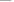
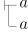
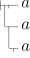

# frege-logic — supp-after（supplement）

> （《frege-logic》词条补充材料，源：plato.stanford.edu/entries/frege-logic/supp-after.html）

#### Supplement to Frege’s Logic

## Frege’s Logic After the Paradox

As is well known, the logic of *Grundgesetze* is inconsistent: Basic Law V falls prey to Russell’s Paradox (see Sections 2.5–2.7 in the entry Frege’s Theorem and Foundations for Arithmetic for a discussion of how the paradox arises in Frege's system). Unsurprisingly, however, Frege continued to write about, and teach, logic well after the discovery of the Russell paradox that rendered the system of *Grundgesetze* inconsistent.

Frege did not, at any point after the discovery of the paradox that plagued the logic of *Grundgesetze*, provide a full characterization of his logic of the sort found in *Begriffsschrift* and *Grundgesetze*. But it is clear from his later writings (for example, his extensive replies to Jourdain, which were published as footnotes in the latter’s essay on Frege’s logic [Jourdain 1912]) that he did not abandon his formal logic entirely. On the contrary, he continued to teach a semester-long course titled “Begriffsschrift” regularly until the end of his teaching career in 1918, and occasionally taught a sequel, titled “Begriffsschrift II”. Fortunately, Rudolf Carnap took both courses—the first in the Winter semester of 1910–1911, and the second in the Summer semester of 1913—and we have (most of) his lecture notes (RA04, edited by Erich H. Reck and Steve Awodey), from which we can re-construct a relatively good picture of what portions of Frege’s logic were retained after the paradox forced him to abandon Basic Law V and, eventually, his logicism.

The logic that appears in Carnap’s notes is quite similar to the logic presented in the early sections of *Grundgesetze*, and outlined above. Of course, value-ranges have disappeared, and hence Basic Laws V and VI make no appearance in the notes. But may of the theses distinctive of the logic of *Grundgesetze* do re-appear. For example, Carnap’s notes contain explicit mention of the sense/reference distinction, the doctrine that sentences (here, as in *Grundgesetze*, understood as expressions lacking the judgement stroke) refer to truth-values, the idea that functions are unsaturated and in need of completion via an appropriate argument, and the distinction between first-level and second-level functions.

With regard to the rules of inference, we find occurrences of all of the rules of inference given in *Grundgesetze*, including Generalized Modus Ponens, Generalized Hypothetical Syllogism, Generalized Contraposition, Generalized Dilemma, Concavity Introduction, (all easily recognizable given the fact that Frege, in the lectures, uses the same transition signs for these rules as are given in *Grundgesetze*), and Roman Letter Elimination (RA04: 55–63, see also 93–96). In addition, Frege at least occasionally uses the “generalized” versions of these rules that depend on the multiple ways that a complex conditional construction can be parsed into supercomponent and subcomponents (see, for example, the application of Generalized Contraposition, RA04: 58). Permutation of subcomponents (RA04: 52) and the fusion of identical subcomponents (RA04: 61) are explicitly discussed. Although the fusion of horizontals is not presented in full generality, Frege does show (informally) that “  (  $A)={}$  $A$” (RA04: 73), and the more general version is implicit in some applications of Roman Letter Elimination (see for example RA04: 96, fn. 28). In addition, Basic Laws IIa (RA04: 99), IIb (RA04: 93; mistakenly labelled “IIa” by Carnap) and III (RA04: 93) appear, in Carnap’s notes, in exactly the same form as they appear in *Grundgesetze*.

Basic Law I is a bit more complicated, however, since it is never explicitly introduced as an axiom in Carnap’s notes. As Reck and Awodey point out, in the notes from the second semester, which contains a much more formal presentation of the deductive system laid out somewhat loosely in the notes from the earlier course, the first few pages of notes are missing. The existence of missing content is evident not just from the blank pages in Carnap’s notebook, but also from the fact that the notes that do exist cite earlier results that do not actually appear in the notes. For example, Basic Law IIb is prefaced by the phrase “earlier we had” on the very first page of the extant notes (RA04: 93). Given that the simplified version of Basic Law I:

(RA04: 95)

is explicitly given in the notes, and in addition, consequences of Basic Law I such as:

(RA04: 97)

also appear, it seems clear that Axiom I was also presented in the same form as in *Grundgesetze* during the lectures corresponding to the missing section of notes.

What is perhaps most interesting about these course notes, however, is the fact that Basic Law IV makes no appearance. Reck and Awodey suggest that this omission is the result of Frege’s desire to present a pared-down version of his logic that involves no existential commitment to logical objects—i.e., his desire to present a logic that was free of quantification over both value-ranges and truth-values:

> The system is essentially the “logical” fragment of the system given in *Grundgesetze*. Specifically, it omits from that system the three axioms governing propositional equality (IV), extension of concepts (V), and the description operator (VI), which we now briefly describe […]
>
> By omitting these three axioms and the corresponding machinery of propositional equality, extensions of concepts, and definite descriptions, the logic presented by Frege in his lectures may be characterized as the *inferential* part of his mature system; i.e., it is that part involved in drawing logical inferences, without the constitutive or constructive part, involved in building up logical objects. Like modern systems of logic, it can be applied to reasoning about various different domains, but it has no domain of “logical objects” of its own to reason about. One might say, tentatively, that Frege has cut his system back to a tool for logical inference about other domains, rather than a self-sufficient theory of a domain of independent objects. (RA04: 33–34)

Reck and Awodey’s description of the system actually presented in the notes is accurate. Without Basic Laws IV, V, and VI, we do end up with a system that has been stripped of any means for proving results about logical objects (that is, value-ranges or truth-values). But their speculative suggestion that the reason Frege only presented Basic Laws I, II, and III was that he wished to avoid commitment to logical objects is somewhat implausible, given that the claim that sentences within the logic refer to truth values occurs explicitly in the notes for both semesters of the course (RA04: 73, 87).

There is another potential explanation for the omission of Basic Law IV that can be eliminated. If Basic Law IV were derivable from the other Basic Laws, and if Frege discovered this between the publication of *Grundgesetze* and the version of the course that Carnap attended, then perhaps he omitted IV for this reason. This cannot be the reason for the lack of any mention of Basic Law IV in the notes, however, since Basic Law IV is not provable from Basic Laws I, II, and III. Here is an informal proof of the independence of IV: Consider a “model” where the domain is some collection of objects that includes the truth values, and where the conditional stroke, the negation stroke, the concavity, identity, and Roman letters are all interpreted as Frege suggests (but restricted to this domain). Let the horizontal be interpreted as the first-level unary identity function—that is, it is the function that maps each object to itself. Then Basic Laws I, II, and III all hold, and the rules of inference (including, importantly, the fusion of horizontals!) are all valid, but Basic Law IV fails. So Basic Law IV is independent of Basic Laws I, II, and III.

Thus, the reason for Frege’s non-inclusion of Basic Law IV in his courses on logic was likely for a much more pedestrian reason: He still held that it was a legitimate Basic Law, but he just did not need it for the applications that he covered within the course.
