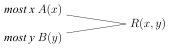

# Generalized Quantifiers
**First published Mon Dec 5, 2005; substantive revision Thu Sep 5, 2024**

*Westerståhl, Dag*

Generalized quantifiers are now standard equipment in the toolboxes of both logicians and linguists. The purpose of this entry is to describe these tools: where they come from, how they work, and what they can be used to do. The description is by necessity sketchy, but several more comprehensive surveys exist in the literature and will be referred to when appropriate. To fully appreciate the text below, basic familiarity with elementary set theoretic terminology, and with the language of first-order logic will be helpful.

## 1. Preliminaries

The term “generalized quantifier” reflects that these entities were introduced in logic as generalizations of the standard quantifiers of modern logic, $\forall$ and $\exists$.[^note-1] In retrospect one may say that $\forall$ and $\exists$ have been found to be just two instances of a much more general concept of quantifier, making the term “generalized” superfluous. Today it is also common to use just “quantifier” for the general notion, but “generalized quantifier” is still frequent for historical reasons. This article employs both terms, with a tendency to insert “generalized” in logical contexts, and to drop it in linguistic contexts.

We distinguish *quantifier expressions* from what they signify or denote, the (generalized) quantifiers themselves. In logical languages, quantifier expressions are variable-binding operators. Thus, $\exists$ is the familiar operator such that in a formula $\exists x\f$,[^note-2] $\exists x$ binds all free occurrences of *x* in $\f$. It signifies the quantifier “there exists”—we’ll see shortly exactly what this object is. Likewise, the symbol $Q_0$ is often used as a variable-binding operator signifying “there exist infinitely many”.

In natural languages a variety of expressions have been seen as quantifier expressions, for example, each of the following English expressions:

everything, nothing, three books, the ten professors, John, John and Mary, only John, firemen, every, at least five, most, all but ten, less than half of the, John’s, some student’s, no…except Mary, more male than female, usually, never, each other.[^note-3]

What, then, are generalized quantifiers? Before answering that question, a brief historical prelude is helpful.

## 2. Aristotle

Aristotle’s syllogistics can be seen as a formal study of the meaning of the four basic quantifier expressions all, no, some, not all, and of their properties. For example, the validity, according to Aristotle, of the syllogism

- all(A,B)
- all(B,C)
- some(A,C)

shows that he considered, in contrast with modern logical usage, all to have *existential import*, so that All A are B entails that A is not an empty term. Likewise, the validity of the syllogism

- some(A,B)
- all(B,C)
- some(A,C)

expresses that some is *monotone increasing* (as we now put it) in the second argument. Each valid syllogism formalizes part of the meaning of these quantifier expressions, but Aristotle’s study of their properties went beyond the syllogistics. He observed, for example, that some and no are *convertible* or, as we might now say, *symmetric*, since they satisfy the scheme

- Q(A,B)
- Q(B,A)

in contrast with all and not all. Further, he studied how various forms of *negation* combined with quantifier expressions in (what was later called) the *square of opposition*.[^note-4] Medieval logicians continued in Aristotle’s tradition, but also extended syllogistic reasoning to cases where A,B could themselves be quantified expressions, thus dealing with premises and conclusions like Some donkey of every man doesn’t run (example from John Buridan, 14th century). Even though Aristotelian logic falls short of the expressivity and precision of modern logic, the syllogistics certainly was a decisive contribution to the study of quantification. In fact, syllogistic systems of various expressive power have recently been studied in mathematical logic, precisely because of their affinity to natural reasoning and their simple computational properties; see section 18 below.

Especially interesting in the present context is the fact that these quantifier expressions take *two* arguments or terms, and thus can be seen as *binary relations*, both syntactically (as Aristotle no doubt saw them) and semantically: given that terms signify sets of individuals, the expression some can be taken to signify the relation of overlap, i.e., of having non-empty intersection, between two sets, and all signifies the inclusion relation. Note that these are not relations between individuals but between sets of individuals—*second-order* relations. Indeed, they are exactly the generalized quantifiers *some* and *all*, respectively (on a given universe).

This thread—that quantifier expressions signify second-order relations—was not picked up by any of Aristotle’s medieval followers (as far as we know). Instead, they picked up on the fact that the two terms have different status: the first combines with the quantifier expression to form a noun phrase (as we now say), which is the *subject* of the sentence, whereas the second is a verb phrase constituting the *predicate*. This led them to focus on what the subject—all men, some dogs, no sailors—signified, which conceptually seems to be a harder question. One might surmise that all men signifies every man (or the set of men), and that some dogs signifies some particular dog, but what about no sailors? In fact, one can show that approaches like these are doomed to failure.[^note-5] The modern “solution” is that noun phrases signify *sets of sets* of individuals, so that, for example some dogs signifies the set of sets containing at least one dog—but that appears to require a more abstract and mathematical approach to semantics than the idea, which is at least implicit in Aristotle, that quantifier phrases signify relations between (the denotations of) terms.

## 3. Frege

The second major historical contribution to the theory of generalized quantifiers came from the “inventor” of modern logic, Gottlob Frege, in the 1870s. In fact, Frege’s contribution is twofold. As every philosophy student knows, he introduced the language of predicate logic, with sentential connectives, identity, and the variable-binding operator $\forall$ (though his 2-dimensional logical notation is no longer used). These are the quantifiers that logicians during the 1950’s began to “generalize”. But Frege also explicitly formulated the abstract notion of a quantifier as a second-order relation, or, as he called it, a *second level concept* (“*Begriff zweiter Stufe*”). He was well aware that the four Aristotelian quantifiers were prime examples, but he wanted to avoid the focus on subject-predicate form, which he (with much justification) saw as having been a major obstacle to the development of logic after Aristotle. It was therefore an important discovery that these quantifiers could all be defined in terms of $\forall$ and sentential operators (replacing all$(A,B)$ by $\forall x(A(x) \rightarrow B(x)$), some$(A,B)$ by $\neg\forall x(A(x) \rightarrow \neg B(x)$), etc.).

In fact, the only significant difference between Frege’s notion of a second-level concept and the modern notion of a generalized quantifier is that Frege did not have the idea of an *interpretation* or *model*, which we now (since the advent of model theory in the 1950s) see as a *universe* that the quantifiers range over, plus an assignment of suitable semantic objects to the non-logical symbols. Frege’s symbols all had fixed meanings, and the only universe he considered was the totality of everything. But apart from this, one may well say that it was Frege who discovered generalized quantifiers. This aspect of Frege’s logic, however, remained in the background for a long time, and model theorists in the 50s and 60s seem not to have been aware of it.

## 4. Generalizing the Universal and Existential Quantifier

Modern predicate logic fixes the meaning of $\forall$ and $\exists$ with the respective clauses in the truth definition, which specifies inductively the conditions under which a formula $\f(x_1,\ldots,x_n)$ (with at most $x_1,\ldots,x_n$ free) is *satisfied* by corresponding elements $a_1,\ldots,a_n$ in a model $\M = (M,I)$ (where *M* is the universe and *I* the interpretation function assigning suitable extensions to non-logical symbols): $\M \models \f(a_1,\ldots,a_n)$. The clauses are (where “iff” as usual stands for “if and only if”)

**(1)**

$\M \models \forall x\p(x,a_1,\ldots,a_n)$ iff for each $a\in M$, $\M \models \p(a,a_1,\ldots,a_n)$

**(2)**

$\M \models \exists x\p(x,a_1,\ldots,a_n)$ iff there is some $a\in M$ s.t. $\M \models \p(a,a_1,\ldots,a_n)$

To introduce other quantifiers, one needs to appreciate what kind of expressions $\forall$ and $\exists$ are. Syntactically, they are operators binding one variable in one formula. To see how they work semantically it is useful to rewrite (1) and (2) slightly. First, every formula $\p(x)$ with one free variable denotes in a model $\M$ a subset of *M*; the set of individuals in *M* satisfying $\p(x)$. More generally, if $\p(x,x_1,\ldots,x_n) = \p(x,\xbar)$ has at most the free variables shown and $\abar = a_1,\ldots,a_n$ are elements of *M*, let

$$\p(x,\abar)^{\M,x} = \{a\in M: \M \models \p(a,\abar)\}$$

be the *extension* of $\p(x,\xbar)$ in $\M$ relative to $a_1,\ldots,a_n$. Then we can reformulate (1) and (2) as follows:

**(3)**

$\M \models \forall x\p(x,\abar)$ iff $\p(x,\abar)^{\M,x} = M$

**(4)**

$\M \models \exists x\p(x,\abar)$ iff $\p(x,\abar)^{\M,x} \neq\emp$

Thus, the conditions on the right hand side emerge as *properties of the sets* $\p(x,\abar)$. In fact, we can think of $\forall$ and $\exists$ as denoting these properties, i.e., the property of being identical to the universe, and of being non-empty, respectively. And now it is easy to think of other properties of sets that can also be treated as quantifiers, for example, the property of containing at least 5, or exactly 3, elements, or of being infinite.[^note-6]

Note that these properties depend only on the universe *M*, not on the rest of the model. Extensionally, they are simply sets of subsets of *M*. This leads to the following definition. essentially from Mostowski (1957)[^mostowski-1957]:

**Definition 1** A *generalized quantifier Q* of type ${\langle}1{\rangle}$ is

**(5)**

a. syntactically, a variable-binding operator such that whenever $\f$ is a formula so is $Qx\f$, and $Qx$ binds all free occurrences of *x* in $\f$;

**b.**

semantically, a mapping from arbitrary universes (non-empty sets) *M* to a set $Q_M$ of subsets of *M*, which interprets formulas of the form $Qx\f$ according to the clause $$\tag{i} \M \models Q x\p(x,\abar) \text{ iff } \p(x,\abar)^{\M,x} \in Q_M $$

Here we use the same symbol for the quantifier expression and the mapping that it signifies or denotes. Thus, $\forall$ is now taken to denote the universal quantifier, also written $\forall$, which is the mapping given by

$$\forall_M = \{M\}$$

for all *M*. Similarly, $\exists$ denotes the mapping defined by

$$\exists_M = \{A\subseteq M: A\neq\emp\}$$

And here are some other generalized quantifiers (where $|A|$ is the size or cardinality of $A$):

$$\begin{alignat}{2} \tag{6}\label{ex-qlist1} (\exists_{\geq 5})_M & = \{A\subseteq M: |A| \geq 5\}\\ (\exists_{= 3})_M & = \{A\subseteq M: |A|= 3\}\\ (Q_0)_M & = \{A\subseteq M: A \text{ is infinite}\}\\ (Q^R)_M & = \{A\subseteq M: |A| > |M-A|\} & \textrm{ (the “Rescher}\\ && \textrm{quantifier”)} \\ (Q_{\text{even}})_M & = \{A\subseteq M: |A| \text{ is even}\} \end{alignat} $$

We now have a precise notion of a generalized quantifier, of which $\forall$ and $\exists$ are instances, along with infinitely many others. Moreover, we see how to extend first-order logic *FO* to a logic $\FO(Q)$, by adding the clause (5a) to the formation rules, and the clause (5b-i) to the truth definition. Similarly if we add more than one generalized quantifier: $\FO(Q_1,\ldots,Q_n)$.

In such a logic one may be a able to say things that are not expressible in *FO*. For example, it is well-known that in *FO* the notion of finiteness cannot be expressed. Thus there is no way to say, of an ordering relation $<$, that each element has only finitely many predecessors, for instance. But this is just the sort of thing one can express in $\FO(Q_0)$:

$$\tag{7} \forall x \neg Q_0 y (y < x) $$

Likewise, one cannot say in *FO* that a (finite) set *A* contains exactly half of the elements of the universe *M*, but that is expressible in $\FO(Q^R)$:

$$\tag{8} \neg Q^RxA(x) \wedge \neg Q^Rx\neg A(x) $$

(The first conjunct says that $|A|\leq |M-A|$, and the second that $|M-A|\leq |A|$.)

## 5. Generalized Quantifiers of Arbitrary Types

Further generalization is possible. First, we can let *Q* bind one variable in two or more formulas. Second, we can let it simultaneously bind two or more variables in (some of) these formulas. The *typing* of *Q* indicates this: *Q* is of type ${\langle}n_1,\ldots,n_k{\rangle}$ (where each $n_i$ is a natural number $\geq 1$) if it applies to *k* formulas, and binds $n_i$ variables in the *i*th formula. This explains why the quantifiers in the previous section were said to be of type ${\langle}1{\rangle}$.

In the general case, one normally chooses distinct variables $x_{i1},$…,$x_{in_i} = \xbar_i$ for $1\leq i \leq k$, so that a formula beginning with *Q* has the form

$$ Q\xbar_1,\ldots,\xbar_k(\f_1,\ldots,\f_k) $$

where all free occurrences of $x_{i1},\ldots,x_{in_i} $ in $\f_i$ become bound. Now *Q* associates with each universe *M* a *k*-ary relation $Q_M$ between relations over *M*, where the *i*th argument is an $n_i$-ary relation between individuals. The corresponding clause in the truth definition becomes

$$\begin{align} \tag{9}&\M\models Q\xbar_1,\ldots,\xbar_k (\p_1(\xbar_1,\abar),\ldots,\p_k(\xbar_k,\abar)) \textrm{ iff }\\ &Q_M(\p_1(\xbar_1,\abar)^{\M,\xbar_1},\ldots,\p_k(\xbar_k,\abar)^{\M,\xbar_k}) \end{align}$$

Here $\p_i(\xbar_i,\ybar)$ is a formula with at most the free variables shown, $\abar$ is a sequence of elements of *M* corresponding to $\ybar$, and $\p_i(\xbar_i,\abar)^{\M,\xbar_i}$ is the extension of $\p_i(\xbar_i,\ybar)$ in $\M$ relative to $\abar$, i.e., the set of $n_i$-tuples $\bbar_i$ such that $\M\models\p_i(\bbar_i,\abar)$.

This is the official concept of a generalized quantifier in this article. It was introduced by Lindström (1966)[^lindström-1966], and these quantifiers are sometimes called “Lindström quantifiers”.[^note-7] If we fix *M* to the universe containing “everything”, we essentially have Frege’s notion of a second-level concept.[^note-8]

*Q* is *monadic* if on each universe *M* it is a relation between subsets of *M*, i.e., if its type is ${\langle}1,\ldots,1{\rangle}$; otherwise it is *polyadic*. For example, the Aristotelian quantifiers mentioned earlier are of type ${\langle}1,1{\rangle}$:[^note-9]

$$\begin{align} \tag{10}\label{ex-qlist2} \textit{all}_M(A,B) & \iff A \subseteq B\\ \textit{some}_M(A,B) & \iff A \cap B \neq\emp\\ \textit{no}_M(A,B) & \iff A \cap B = \emp\\ \textit{not all}_M(A,B) & \iff A \not\subseteq B \end{align} $$

Here are some more type ${\langle}1,1{\rangle}$ quantifiers:[^note-10]

$$ \begin{alignat}{2} \label{ex-qlist3}\tag{11} (\textit{at least five})_M(A,B) &\iff |A \cap B|\geq 5\\ (\textit{exactly three})_M(A,B) &\iff |A \cap B|= 3\\ (\textit{infinitely many})_M(A,B) &\iff A \cap B \text{ is infinite} \\ \textit{most}_M(A,B) &\iff |A \cap B|> |A-B| \\ (\textit{an even number of})_M(A,B) &\iff |A \cap B|\text{ is even}\\ \textit{MO}_M(A,B) &\iff |A| > B|\\ \textit{I}_M(A,B) &\iff |A| = |B| \hspace{2em}\textrm{(the “Härtig}\\ &\hspace{9em}\textrm{quantifier”)} \end{alignat} $$

With monadic quantifiers it is convenient to use just *one* variable, and let *Q* bind that same variable in each of the formulas. Thus, to say that most *A*s are not *B*, for example, one may write

$$ \textit{most}\: x (A(x),\neg B(x)) $$

in the corresponding logical language, rather than

$$\textit{most} [x,y (A(x),\neg B(y)).$$

Here are a few polyadic quantifiers with their types given on the right:

$$\begin{alignat}{2} \label{ex-qlist4}\tag{12} W_M(R) &\iff R \text{ is a well-ordering of } M & {\langle}2{\rangle} \\ (Q_0^n)_M(R) & \iff \text{there is an infinite} \\ & \hphantom{\iff\ } A\subseteq M \ST A^n \subseteq R & {\langle}n{\rangle}\\ Res^k(\textit{most})_M(R,S) & \iff |R\cap S| > |R-S| & {\langle}k,k{\rangle}\\ \textit{RECIP}_M(A,R) & \iff \textrm{for all distinct } a,b\in A \\ &\hphantom{\iff\ } \textrm{ there is } n\geq 1 \\ &\hphantom{\iff\ } \textrm{ and } c_0,\ldots,c_n \ST c_0 = a \\ &\hphantom{\iff\ } {} \amp c_n = b \amp c_iRc_{i+1} \textrm{ for } i < n\quad & {\langle}1,2{\rangle} \end{alignat} $$

*W* and $Q_0^n$ come from logic and set theory. $Res^k(\textit{most})$ is the *resumption* of *most* to *k*-tuples. Resumption can be applied to any quantifier (in the syntax, this means replacing each individual variable by a corresponding *k*-tuple of variables); it has logical uses but also, like *RECIP*, uses in the interpretation of certain sentences in natural languages; see section 16 below.

## 6. Topic Neutrality

Both Mostowski and Lindström had one additional condition in their definitions of generalized quantifiers: they should not distinguish isomorphic models. Informally, they are “topic-neutral”: the truth of a statement of the form $\f = Qx,yz(A(x),R(y,z))$, say, in a model $\M$ doesn’t depend on the particular individuals *M* consists of. If the individuals of *M* are mapped in a one-one fashion onto the individuals of another universe $M'$, and if *A* and *R* are mapped accordingly, one obtains an *isomorphic* model $\M'$. *Isomorphism Closure* then says that $\M\models\f$ iff $\M'\models\f$.

More formally, if $\M = (M,I)$ and $\M' = (M',I')$ are models for the same vocabulary *V* of non-logical symbols, *f* is an *isomorphism* from $\M$ to $\M'$, iff

- *f* is a bijection (a one-one onto function) from *M* to $M'$;
- whenever *P* is an *n*-ary predicate symbol in *V* and $a_1,\ldots,a_n \in M$, $$ (a_1,\ldots,a_n) \in I(P) \textrm{ iff } (f(a_1),\ldots,f(a_n)) \in I'(P); $$
- whenever *c* is an individual constant in *V*, $I'(c) = f(I(c))$.

$\M$ and $\M'$ are *isomorphic*, in symbols,

$$\M \cong \M'$$

if there is an isomorphism from one to the other. Now if *Q* is a generalized quantifier of type ${\langle}n_1,\ldots,n_k{\rangle}$, $P_i$ is an $n_i$-ary predicate symbol for $1\leq i\leq k$, $\M = (M,I)$ is a model for the vocabulary $\{P_1,\ldots,P_k\}$, and $R_i = I(P_i)$, we also write

$$\M = (M,R_1,\ldots,R_k)$$

Then *Q* satisfies *Isomorphism Closure*, or just Isom, if the following holds:

$$\begin{align}\label{ex-isom}\tag{13} &\textrm{If } (M,R_1,\ldots,R_k) \cong (M',R'_1,\ldots,R'_k), \\ &\textrm{then } Q_M(R_1,\ldots,R_k) \Leftrightarrow Q_{M'}(R'_1,\ldots,R'_k). \end{align}$$

One easily checks that all the generalized quantifiers exemplified so far are indeed Isom. We did not include this requirement in the definition of generalized quantifiers however, since there are natural language quantifiers that do not satisfy it; see below. But logic is supposed to be topic-neutral, so Isom is almost always imposed. Then two important things follow. First, as indicated above, sentences in logical languages do not distinguish isomorphic models. More precisely, we have the following

**Fact 2**

If $L = \FO(Q_1,\ldots,Q_n)$, each $Q_i$ is Isom, $\f$ is an *L-sentence*, and $\M \cong \M'$, then $\M\models\f \Leftrightarrow \M'\models\f$.

Second, Isom takes a particularly interesting form for *monadic* quantifiers. If $\M = (M,A_1,\ldots,A_k)$, where $A_i \subseteq M$ for each *i*, then $A_1,\ldots,A_k$ *partition* *M* into $2^k$ pairwise disjoint subsets (some of which may be empty); let us call them the *parts* of $\M$. We illustrate with $k=2$ and $\M = (M,A,B)$:

*Figure 1*

Now it is not hard to see that only the *sizes of the parts* determine whether two models of this kind are isomorphic or not:

**Fact 3**

$(M,A_1,\ldots,A_k) \cong (M',A'_1,\ldots,A'_k)$ iff the cardinalities of the corresponding parts are the same.

This shows that monadic and Isom generalized quantifiers indeed deal only with *quantities*, i.e., with *sizes* of sets rather than the sets themselves. The list \\eqref{ex-qlist3} of type ${\langle}1,1{\rangle}$ generalized quantifiers clearly illustrates this, but also the Aristotelian quantifiers can be formulated in terms of cardinalities,

$$ \begin{align} \textit{all}_M(A,B) & \iff |A-B|=0\\ \textit{some}_M(A,B) & \iff |A \cap B|>0 \end{align} $$

etc., and similarly for the type ${\langle}1{\rangle}$ examples we gave.

More generally, under Isom, monadic quantifiers can be seen as relations between (cardinal) numbers. For example, if *Q* is of type ${\langle}1{\rangle}$, then define (using the same symbol *Q* for the relation between numbers)

$$ Q(\kappa,\lambda) \iff \text{there is } (M,A) \ST |M\!-\!A|=\kappa \amp |A|=\lambda \amp Q_M(A) $$

Isom guarantees that this is well-defined, and we have

$$ Q_M(A) \iff Q(|M\!-\!A|,|A|) $$

## 7. Relativization

Every statement involving a generalized quantifier *Q* takes place within some universe *M*. Sometimes it is useful to be able to mirror this relativization to a universe *inside* *M*. This means defining a new quantifier with one extra set argument which says that *Q* behaves on the universe restricted to that argument exactly as it behaves on *M*. Thus, if *Q* is of type ${\langle}n_1,\ldots,n_k{\rangle}$, we define $Q{^{\text{rel}}}$ of type ${\langle}1,n_1,\ldots,n_k{\rangle}$ as follows:

$$\tag{14} (Q{^{\text{rel}}})_M(A,R_1,\ldots,R_{n_k}) \mathbin{\Longleftrightarrow_{\text{def}}} Q_A(R_1\!\restriction\! A,\ldots,R_{n_k}\!\restriction\! A) $$

where $R_i \subseteq M^{n_i}$ and $R_i\!\restriction\! A$ is the *restriction* of $R_i$ to *A*, i.e., the set of $n_i$-tuples in $R_i\cap A^{n_i}$.

We have in fact already seen several examples of relativization: since one easily verifies (see the lists \\eqref{ex-qlist1} and \\eqref{ex-qlist3}) that

$$\begin{align} \tag{15} \textit{all} & = \forall{^{\text{rel}}}\\ \textit{some} & = \exists{^{\text{rel}}}\\ \textit{at least five} & = (\exists_{\geq 5}){^{\text{rel}}}\\ \textit{exactly three} & = (\exists_{= 3}){^{\text{rel}}}\\ \textit{infinitely many} & = (Q_o){^{\text{rel}}}\\ \textit{most} & = (Q^R){^{\text{rel}}}\\ \textit{an even number of} & = (Q_{\text{even}}){^{\text{rel}}} \end{align} $$

## 8. Expressive Power

We described how generalized quantifiers can be added to *FO*, resulting in more expressive logics. A *logic* in this sense roughly consist of a set of sentences, a class of models, and a truth relation (or a satisfaction relation) between sentences and models. Such logics are often called *model-theoretic logics*, since they are defined semantically in terms of models and truth, rather than proof-theoretically in terms of a deductive system for deriving theorems.[^note-11] Here we restrict attention to logics of the form $\FO(Q_1,Q_2,\ldots)$, formed by adding generalized quantifiers to *FO*, where each quantifier comes with a formation rule and a semantic clause for the truth definition as described in section 5 above.

There is an obvious way to compare the expressive power of model-theoretic logics. $L_2$ is *at least as expressive as* $L_1$, in symbols,

$$L_1 \leq L_2$$

if every $L_1$-sentence $\f$ is *logically equivalent* to some $L_2$-sentence $\p$, i.e., $\f$ and $\p$ are true in the same models. Also, $L_1$ and $L_2$ have the *same expressive power*, $L_1 \equiv L_2$, if $L_1 \leq L_2$ and $L_2 \leq L_1$, and $L_2$ is *stronger* than $L_1$, $L_1 < L_2$, if $L_1 \leq L_2$ but $L_2 \not\leq L_1$. Thus, $L_1 < L_2$ if everything that can be said in $L_1$ can also be said in $L_2$, but there is some $L_2$-sentence which is not equivalent to any sentence in $L_1$.

How does one establish facts about expressive power? It seems as if in order to show $L_1 \leq L_2$ one has to go through all of the infinitely many sentences in $L_1$ and for each one find an equivalent in $L_2$. But in practice it suffices to show that the generalized quantifiers in $L_1$ are *definable* in $L_2$. If *Q* is of type ${\langle}1,2{\rangle}$, say, *Q* is *definable* in $L_2$ if there is an $L_2$-sentence $\p$ whose non-logical vocabulary consists exactly of one unary and one binary predicate symbol, such that for all models $\M = (M,A,R)$,

$$Q_M(A,R) \iff (M,A,R)\models\p$$

Similarly for other types. For example, the quantifier *all* is definable in *FO*, since the following holds:

$$\textit{all}_M(A,B) \iff (M,A,B)\models \forall x(A(x) \rightarrow B(x))$$

Likewise, $Q^R$ is definable in $\FO(\textit{most})$, since

$$(Q^R)_M(A) \iff (M,A,B)\models \textit{most}\: x(x=x, A(x))$$

(note that all our logics contain the logical apparatus of *FO*, so they are all extensions of *FO*). The latter is an instance of the following observation:

**(16)**

For any generalized quantifier *Q*, *Q* is definable in $\FO(Q{^{\text{rel}}})$.

Such facts about definability can be easy or hard to establish,[^note-12] but they suffice to establish positive facts about expressivity, since we have:

**Fact 4**

$\FO(Q_1,\ldots,Q_n) \leq L$ if and only if each $Q_i$ is definable in *L*.

On the other hand, to prove *inexpressibility*, i.e., that some sentence is *not* equivalent to any *L*-sentence, is harder. One way that sometimes works is to establish that $L_1$ has some property that $L_2$ lacks; then one might be able to conclude that $L_1 \not\leq L_2$. Some properties that are typical of *FO*, but fail for most stronger logics, are:

- The *Löwenheim property*: If a sentence is true in some infinite model, it is also true in some countable model.
- The *Tarski property*: If a sentence is true in some countably infinite model, it is also true in some uncountable model.
- The *compactness property*: If no model makes every element of the set of sentences *Φ* true, then there is a finite subset *Ψ* of *Φ* such that no model makes every sentence in *Ψ* true.
- The *completeness property*: The set of valid sentences is recursively enumerable (i.e., can be generated by some formal system).

For example, $\FO(Q_0)$ does not have the compactness property.[^note-13] This can be seen by looking at the set of sentences

$$\Phi \:=\: \{\neg Q_0x(x=x)\} \cup \{\theta_n: n=1,2,\ldots\}$$

where $\theta_n$ is an *FO*-sentence saying that there are at least *n* elements in the universe. If you take any finite subset $\Phi'$ of *Φ*, and *M* is a universe whose cardinality is the largest *n* such that $\theta_n$ belongs to $\Phi'$, then all sentences in $\Phi'$ are true in *M*. But no universe can make all sentences in *Φ* true. And this shows that $Q_0$ is not definable in *FO*, i.e., that $\FO(Q_0) \not\leq \FO$, since otherwise we could replace *Φ* by an equivalent set of *FO*-sentences, but *FO* does have the compactness property, so that it impossible.

However, this way of proving inexpressibility only works for logics with properties like those above. Moreover, they only work if infinite universes are allowed, but interesting inexpressibility facts hold also for finite models, for example, the fact that $Q^R$ and $Q_{\text{even}}$ are not definable in *FO*, or that *most* = $(Q^R){^{\text{rel}}}$ is not definable in $\FO(Q^R)$. Logicians have developed much more direct and efficient methods of showing undefinability results that work also for finite models.[^note-14]

The above properties in fact *characterize* *FO*, in the sense that no proper extension of *FO* can have (certain combinations of) them. This is the content of a celebrated theorem about model-theoretic logics, Lindström’s Theorem, a version of which is given below. For an accessible proof see, for example, Ebbinghaus, Flum, and Thomas (1994). We say that a logic $L = \FO(Q_1,\ldots,Q_n)$ *relativizes* if the “converse” of (16) holds for each $Q_i$, i.e., if each $(Q_i){^{\text{rel}}}$ is definable in *L*.

**Theorem 5 (Lindström)** If *L* is compact and has the Löwenheim property, then $L \equiv \FO$. Also, provided *L* relativizes, if *L* is complete and has the Löwenheim property, or if *L* has both the Löwenheim and the Tarski properties, then $L \equiv \FO$.

## 9. Generalized Quantifiers and Computation

In addition to the truth conditions associated with generalized quantifiers, one may study the computations required to establish the truth of a quantified statement in a model. Indeed, generalized quantifiers turn up in various places in the part of computer science that studies *computational complexity*. In this context, we restrict attention to *finite* universes, and assume Isom throughout. So a quantifier is essentially a set of finite models; by Isom we can assume that models of cardinality *m* all have the same domain $M = \{1,\ldots,m\}$. Such models can be coded as *words*, i.e., finite strings of symbols. For example, a model $(M,A)$ of type ${\langle}1{\rangle}$ can be seen as a binary word $a_1\ldots a_m$, where $a_i$ is 1 if $i\in A$ and 0 otherwise. Thus $|A|$ is the number of 1’s and $|M\!-\!A|$ the number of 0’s; by Isom, the order in the string doesn’t matter. So *Q* becomes a set $W_Q$ of words, that is, a *formal language*: a subset of the set of all finite strings of coding symbols.[^note-15]

We can now ask what it takes to recognize that a word belongs to $W_Q$. The abstract notion of an *automaton* gives an answer; automata are machines that *accept* or *reject* words, and they are classified according to the complexity of the operations they perform. The language *recognized* by an automaton is the set of words it accepts.[^note-16]

A *finite automaton* has a finite number of *states*, including a start state and at least one accepting state. It starts scanning a word at the leftmost symbol in the start state, and at each step it moves one symbol to the right and enters a (possibly) new state, according to a given *transition function*. If it can move along the whole word ending in an accepting state, the word is accepted. The application of automata theory to generalized quantifiers was initiated in van Benthem (1986)[^benthem-1986] (Ch. 7, “Semantic automata”). It is easy to construct a finite automaton recognizing $\forall$ (or $\forall{^{\text{rel}}}=$ *all*), i.e., checking that *w* consists only of 1’s: just remain in the start state = accepting state as long as 1’s are encountered, but go to a rejecting state as soon as a 0 is scanned, and remain there whatever is encountered afterwards. A slightly more complex automaton recognizes $Q_{\text{even}}$: again there are two states, a start state = the accepting state and a rejecting state, and this time remain in the same state when 0’s are scanned, but go to the *other* state when a 1 is scanned. To end in the accepting state it is then necessary and sufficient that there are an even number of 1’s. This machine essentially uses *cycles* of length 2, whereas the first example had only 1-cycles. Call an automaton of the latter kind *acyclic*. Van Benthem showed that the *FO*-definable quantifiers are exactly the ones accepted by finite automata that are acyclic and permutation closed.[^note-17]

A slightly more complex automaton, the *pushdown* automaton, has rudimentary memory resources in the form a of stack of symbols that can be pushed or popped from the top, enabling it to keep track to some extent of what went on at earlier steps. Another result by van Benthem is that the type ${\langle}1{\rangle}$ quantifiers accepted by pushdown automata are precisely those for which the corresponding binary relation between numbers is definable (with first-order means) in *additive arithmetic*, i.e., in the model $(N,+)$, where $N = \{0,1,2,\ldots\}$. An example is $Q^R$ (or its relativization *most*): we have $Q^R(m,n) \Leftrightarrow m < n$, and the right hand side is definable in $(N,+)$ by $\exists x (x \neq 0 \wedge m + x = n)$.[^note-18]

Thus, an algorithmic characterization is matched with a logical one. This is one prominent direction in the study of algorithmic complexity. Consider now the most general abstract automata or computational devices, i.e., *Turing machines*. One (of many) interesting complexity classes is PTIME: a problem, identified with its corresponding set of words, is PTIME if there is a polynomial $p(x)$ and a Turing machine accepting *W* such that whenever $w \in W$ has length *n*, the accepting computation takes at most $p(n)$ steps. PTIME problems are usually considered “tractable”, whereas more complex problems are “intractable”, such as EXPTIME ones, where the number of steps required may grow exponentially. An early result by Immerman and Vardi is that the PTIME sets of (words coding) finite models are precisely those describable by single sentences in $\FO(\LFP)$, which is *FO* logic with an added mechanism for forming *least fixed-points*.[^note-19] Here we need to represent not just monadic models but arbitrary ones. For example, a binary relation on the universe $\{1,\ldots,m\}$ can be represented by a word $w_{11}\cdots w_{1m}\# \ldots \#w_{m1}\cdots w_{mm}$, where the relation holds of $(i,j)$ iff $w_{ij} = 1$. But this time the order does seem to matter, and in fact the Immerman and Vardi result just mentioned only holds for models with a given linear order and a binary predicate symbol standing for that order.

Logics like $\FO(\LFP)$ can be recast as logics of the form $\FO(Q_1,Q_2,\ldots)$. Here infinitely many quantifiers may be required, but in some cases a single one suffices. As to $\FO(\LFP)$, it suffices to add all the resumptions (see the end of section 5 above) of a single quantifier. More generally, let $\FO^*(Q_1,Q_2,\ldots)$ be like $\FO(Q_1,Q_2,\ldots)$ but with mechanisms for making relativizations (section 7) and for resuming each $Q_i$ to *k*-tuples for each *k*. Then there is a single quantifier *Q* such that $\FO(\LFP) = \FO^*(Q)$.

So generalized quantifiers remain a simple and versatile way of adding expressive power to *FO*. One natural question was if the logical characterization of PTIME mentioned above could be improved using generalized quantifiers, in particular if one could remove the restriction to ordered structures in this way. The answer, however, turned out to be negative, since Hella (1989)[^hella-1989] proved that the PTIME computable properties of arbitrary finite structures cannot be characterized by adding a finite number of generalized quantifiers to *FO*, or even to $\FO(\LFP)$. The question of whether PTIME can be characterized by a logic of the form $\FO^*(Q)$ remains open, however (indeed, solving it would be a major breakthrough in complexity theory).

## 10. Generalized Quantifiers and Natural Language

In the late 1960s Richard Montague showed how the semantics of significant parts of natural languages could be handled with logical tools.[^note-20] One of his main insights was that noun phrases (NPs) can be interpreted as sets of subsets of the domain, i.e., as (what we now call) type ${\langle}1{\rangle}$ quantifiers. Montague worked in type theory, but around 1980 a number of linguists and logicians began to apply the model-theoretic framework of logics with generalized quantifiers to natural language semantics.[^note-21] Consider the structure of a simple English sentence whose subject is a quantified NP:[^note-22]

**(17)**

![Linguistics tree [S [NP [Det [most]] [N [students]]] [VP [smoke]]]](../assets/generalized-quantifiers/ex17.svg)

The (subject) NP consists of a determiner and a noun (N). Both the noun and the verb phrase (VP) have sets as extensions, and so the determiner is naturally taken to denote a binary relation between sets, i.e., a type ${\langle}1,1{\rangle}$ quantifier. An utterance of (17) has a (discourse) universe in the background (say, the set of people at a particular university), but the meaning of most, every, at least five and similar expressions is not tied to particular universes. For example, the meaning of all in

**(18)**

a. All cats like milk.

**b.**

All electrons have negative charge.

**c.**

All natural numbers have a successor.

**d.**

All twins like each other.

**e.**

All compact subsets of Hausdorff spaces are closed.

has nothing to do with cats or electrons or numbers or twins or Hausdorff spaces, nor with the discourse universes that may be associated with the above examples. It simply stands for the inclusion relation, regardless of what we happen to be talking about. Therefore, the generalized quantifier *all*, which with each universe *M* associates the inclusion relation over *M*, is eminently suitable to interpret all, and similarly for other determiners.

However, it is characteristic of sentences of the form (17) that the noun argument and the VP argument are not on a par. The noun combines with the determiner to form the NP, a separate constituent, and this constituent can also be taken to signify a generalized quantifier, this time of type ${\langle}1{\rangle}$. Thus, at least five students denotes the set of subsets of the universe which contain at least five students. This quantifier results from *freezing* the first argument of the type ${\langle}1,1{\rangle}$ *three* to the set of students; we write this *three*$^{\textit{student}}$. In general, if *A* is a fixed set and *Q* a type ${\langle}1,1{\rangle}$ quantifier, one may define the type ${\langle}1{\rangle}$ quantifier $Q^A$ by

$$\tag{19} \label{QA} (Q^A)_M(B) \;\Longleftrightarrow_{\text{def}}\; Q_{M\cup A}(A,B) $$

for any *M* and any $B\subseteq M$. In a compositional semantics it is natural to take each constituent part of a sentence to have a separate signification or meaning, and the default significations of noun phrases are type ${\langle}1{\rangle}$ quantifiers.

This holds also for some NPs that lack determiners, such as proper names. While the lexical item John is assigned some individual *j* by an interpretation, the NP John can be taken to denote the quantifier $I_j$, defined, for any *M*, by

$$(I_j)_M = \{B\subseteq M\!: j\in B\}$$

This is in fact well motivated, not only because the interpretation of NPs becomes more uniform, but also because John can combine with quantified NPs:

**(20)**

John and three professors came to the meeting.

Here it is convenient if John and three professors have the same semantic category. Note that generalized quantifiers—in contrast with individuals!—have a clear Boolean structure; define (here in the type ${\langle}1{\rangle}$ case, but similarly for any other type)

$$ \begin{align} (Q_1 \wedge Q_2)_M(A) & \iff (Q_1)_M(A) \textrm{ and } (Q_2)_M(A)\\ (\neg Q)_M(A) & \iff \textrm{ not } Q_M(A) \end{align} $$

Then we can take the complex determiner in (20) to denote $I_j \wedge \textit{three}^{\textit{professor}}$. Similarly, the complex NP in

**(21)**

John and Mary came to the meeting.

signifies $I_j \wedge I_m$.

The first argument (coming from the noun) of a type ${\langle}1,1{\rangle}$ determiner denotation is often called its *restriction*, and the second its *scope*. The difference in syntactic status between these two arguments turns out to have a clear semantic counterpart.

## 11. Conservativity

It was observed early on that type ${\langle}1,1{\rangle}$ quantifiers denoted by determiners in natural languages have the following property:

**(22)**

*Conservativity* (Conserv): For all *M* and all $A,B\subseteq M$, $$Q_M(A,B) \iff Q_M(A,A\cap B).$$

This can be seen from sentence pairs such as the following, where it is clear that the second sentence is just an awkward way of expressing the first:

**(23)**

a. Most students smoke.

**b.**

Most students are students who smoke.

**(24)**

a. At least five professors were absent.

**b.**

At least five professors were absent professors.

**(25)**

a. More than one third of the graduate students are foreigners.

**b.**

More than one third of the graduate students are foreign graduate students.

Conserv says that only the part of *B* which is common to *A* matters for the truth of $Q_M(A,B)$. That is, the part $B-A$ in Figure 1 doesn’t matter. This appears to hold for all determiner denotations, but it fails for perfectly natural logical quantifiers, such as *MO* and *I* from the list \\eqref{ex-qlist3} above. The reason is that it is characteristic of determiner denotations that the restriction argument *restricts the domain of quantification* to that argument.

## 12. Extension

Actually, the idea of domain restriction has one further ingredient. To restrict the domain of quantification to a subset *A* of *M* means not only that $B-A$ is irrelevant but the whole part of *M* that lies outside *A*, and hence also the part $M-(A\cup B)$ in Figure 1. This in turn is an instance of a more general property, applicable to arbitrary generalized quantifiers:

**(26)**

*Extension* (Ext): If *Q* is of type ${\langle}n_1,\ldots,n_k{\rangle}$, $R_i \subseteq M^{n_i}$ for $1\leq i\leq k$, and $M \subseteq M'$, then $$Q_M(R_1,\ldots,R_k) \iff Q_{M'}(R_1,\ldots,R_k).$$

That is, nothing happens when the universe is extended, or shrunk, as long as the arguments are not changed. Now recall that for type ${\langle}1{\rangle}$ quantifiers we already provided a logical mechanism for restricting the quantification domain to a subuniverse, in terms of relativization (section 7). We can now see (in (b) below) that the combination of Conserv and Ext amounts to exactly the same thing:

**Fact 6**

1. For any quantifier *Q*, $Q{^{\text{rel}}}$ satisfies Ext.
2. A type ${\langle}1,1{\rangle}$ quantifier is Conserv and Ext if and only if it is the relativization of a type ${\langle}1{\rangle}$ quantifier.[^note-23]

Again, all determiner denotations appear to satisfy Ext. At first sight, nothing in principle would seem to prevent a language from containing a determiner, say evso, which meant *every* on universes with less than 10 elements and *some* on larger universes. But not only is there in fact no such determiner in any language—there couldn’t be, if the noun argument of a determiner is to restrict the domain of quantification to the denotation of that noun.

A quantifier such as evso is intuitively *not constant*, in the sense that it doesn’t mean the same, or is not interpreted by the same rule, on every universe. Ext can be seen as a strong requirement of constancy: the rule interpreting *Q* doesn’t even mention the universe. Indeed, many quantifiers from language and logic are Ext. As we saw, all relativized quantifiers are Ext, and all the other quantifiers in the lists \\eqref{ex-qlist2}–\\eqref{ex-qlist4} as well, except *W*.[^note-24] In fact, it seems that all quantifiers taking more than one argument that show up in natural language contexts are Ext. And many type ${\langle}1{\rangle}$ quantifiers are Ext too, for example, $\exists$, $I_j$, $Q^A$ (when *Q* is Ext; see \\eqref{QA} above), and all in the list \\eqref{ex-qlist1} except $Q^R$.

But $\forall$ and $Q^R$ are not Ext. Yet one is inclined to say for them too that they mean the same on every universe. The case of $\forall$ is particularly interesting since one might argue that it interprets NPs like everything or every thing. The crux here is thing. If this expression is seen as a logical constant that always denotes the universe, then these NPs do denote $\forall$: for all *M* and all $B\subseteq M$,

$$ \begin{align} (\textit{every}^{\textit{thing}})_M(B) & \iff \textit{every}_M(M,B) \\ & \iff M\subseteq B \\ & \iff M = B \\ & \iff \forall_M(B) \end{align} $$

When Ext holds, we can usually drop the subscript *M* and write, for example,

$$Q(A,B)$$

rather than $Q_M(A,B)$. That is, a suitable universe can be presupposed but left in the background.

## 13. Symmetry and Monotonicity

Other properties are not shared by all natural language quantifiers but single out important subclasses. We mentioned two already in section 2 above: *symmetry* and *monotonicity*. Typical symmetric quantifiers are *some, no, at least five, exactly three, an even number of, infinitely many,* whereas *all, most, at most one-third of the* are non-symmetric. Another way to express symmetry is to say that the truth-value of $Q(A,B)$ only depends on the set $A\cap B$. More precisely, call *Q* *intersective* if for all *M* and all $A,A',B,B' \subseteq M$:

**(27)**

If $A\cap B = A'\cap B'$ then $Q_M(A,B) \Leftrightarrow Q_M(A',B')$.

One easily verifies:

**Fact 7**

For conservative type ${\langle}1,1{\rangle}$ quantifiers, symmetry and intersectivity are equivalent.[^note-25]

We noted that some of the syllogisms express monotonicity properties. In more succinct notation, a type ${\langle}1,1{\rangle}$ quantifier *Q* is

*right increasing* (*right decreasing*) iff for all *M* and all $A,B \subseteq B' \subseteq M$ (all $A,B' \subseteq B \subseteq M$), $Q_M(A,B)$ implies $Q_M(A,B')$.

Similarly for *left* increasing or decreasing, and indeed for monotonicity in any given argument place of a generalized quantifier. In particular, it is clear what it means for a type ${\langle}1{\rangle}$ quantifier to be monotone. Monotonicity is ubiquitous among natural language quantifiers. It seems that syntactically simple English NPs all denote monotone (increasing or decreasing) type ${\langle}1{\rangle}$ quantifiers, and almost all syntactically simple English determiners denote right monotone quantifiers.[^note-26] We also have:

**(28)**

a. The quantifiers $I_j$ (proper names) are increasing

**b.**

$Q^A$ is increasing (decreasing) iff *Q* is right increasing (decreasing).

The Aristotelian *all, some, no* are monotone in both arguments (e.g., *all* is right increasing and left decreasing), as are *at least five, no more than ten, infinitely many*, whereas *most, at least two-thirds of the* are right increasing but neither increasing nor decreasing in the left argument. *Exactly three, between two and seven* are non-monotone, though both of these are conjunctions of a (right and left) increasing and a decreasing quantifier (e.g., *at least three and at most three*), in contrast with *an even number of*, which is not a (finite) Boolean combination of monotone quantifiers.

Both symmetry and monotonicity have important explanatory roles for certain linguistic phenomena. Symmetry is a feature of (most of) the quantifiers allowed in so-called existential there sentences (e.g., There are at least five men in the garden is fine, but There are most men in the garden is not). Monotonicity is crucial for explaining the distribution of polarity items (No one will ever succeed is fine but Someone will ever succeed is not: negative polarity items such as ever require a decreasing environment).[^note-27] Furthermore, monotonicity is crucially involved in *natural forms of reasoning*; see section 18.

## 14. Determiners that are not ISOM

Consider

**(29)**

John’s books were stolen.

**(30)**

Some student’s books have not been returned.

**(31)**

No professor except Mary came to the meeting.

**(32)**

All beach goers except a few enthusiastic swimmers were fully clothed.

**(33)**

More male than female students smoke.

The expressions John’s, some student’s, no _ except Mary, all _ except a few enthusiastic swimmers, more male than female are quite naturally seen as determiners: when combined with nouns they form phrases that behave like ordinary NPs. Also, the type ${\langle}1,1{\rangle}$ quantifiers they signify are Conserv and Ext. For example, the sentences in the following pair are trivially equivalent:

**(34)**

a. John’s books were stolen.

**b.**

John’s books are books that were stolen.

But in contrast with the previous examples, they are not Isom, since they involve some fixed individual or property: if John’s books were stolen, and the number of stolen books is the same as the number of red pencils (in some discourse universe), and the number of books that weren’t stolen is the same as the number of pencils that aren’t red, it does *not* follow that John’s pencils are red, as Isom would have it.

However, just as the non-Isom quantifier *three*$^{\textit{student}}$ results by freezing the restriction argument of the Ext quantifier *three*, the non-Isom quantifiers above result by freezing arguments in more abstract relations, which *are* Isom. We illustrate this with the possessive determiner John’s.[^note-28]

Given that John denotes an individual *j*, the determiner John’s can be defined, for all *M* and all $A,B\subseteq M$, by[^note-29]

$$ \texttt{John’s}_M(A,B) \iff \emp\neq A\cap R_j\subseteq B $$

where $R_j = \{b\in M\!: R(j,b)\}$ and *R* is some “possessor” relation; it is well-known that this relation varies a lot with the circumstances—one could be talking about the books that John owns, or has written, or borrowed, or bought as a present to Mary, etc. Suppose *R* is ownership. Then (29) says that John owns at least one book, and that all of the books he owns were stolen. Now consider the more general “quantifier” defined, for $a\in M$, $R\subseteq M^2$, and $A,B\subseteq M$, by

$$\mathbf{P}_M(a,R,A,B) \iff \emp\neq A \cap R_a \subseteq B$$

We could say that this is a generalized quantifier of type ${\langle}0,2,1,1{\rangle}$, letting 0 stand for individuals. $\mathbf{P}$ is Isom (extending definition \\eqref{ex-isom} in the obvious way to quantifiers of this type), and John’s results by freezing the first two arguments to suitable values.

Similar constructions work for other cases of quantifier expressions in natural languages that denote non-Isom quantifiers. For example, the determiner no _ except Mary denotes (given that Mary refers to *m*)

$$(\texttt{no }\_\texttt{ except Mary})_M(A,B) \iff A\cap B = \{m\}$$

That is, (31) says that Mary is a professor, that she came to the meeting, and that no other professor did. Again, a corresponding Isom quantifier of type ${\langle}0,1,1{\rangle}$ is readily defined. So in this way Isom can be retrieved for natural language quantifiers. On the other hand, associating type ${\langle}1,1{\rangle}$ quantifiers with determiners agrees better with syntax, and allows many generalizations concerning determiner denotations to hold in the non-Isom case as well.

## 15. Constancy

Isom, i.e., topic neutrality, is standardly seen as at least a necessary condition for being a *logical constant*.[^note-30] It is possible to distinguish *logicality* from *constancy* in the earlier mentioned sense of meaning the same over different universes. For one thing, logicality is a property that ought to be *closed under definability*, whereas it is not at all clear that constancy should be similarly closed. Note, for example, that the class of Ext quantifiers is not closed under first-order definability. More precisely, it is closed under the usual Boolean operations, but not under *inner negation* and hence not under taking *duals*, where the inner negation of a type ${\langle}1{\rangle}$ quantifier *Q* is defined by $(Q\neg)_M(A) \Leftrightarrow Q_M(M\!-\!A)$, and the dual by $Q^d = \neg(Q\neg)$. For example, $\exists^d = \forall$.

One intuition might be that Ext suffices for constancy. But a different intuition is that a quantifier meaning the same on all universes in particular should satisfy Isom, which forces *Q* to be the “same” on all universes of the same cardinality. These two ideas are incompatible, since together they would imply that Ext implies Isom, which is manifestly false. Clearly, the vague notion of meaning the same across different universes admits of different precisifications. On closer inspection, it seems unlikely that there is one precise version that would accommodate all intuitions about sameness.

In this situation, a suggestion would be to simply stipulate that constancy amounts to Ext + Isom. This would be a Carnapian explication of constancy. Quantifiers with this combination of properties seem certain to mean the same on all universes. On the other hand, Ext but non-Isom quantifiers like *three*$^{\textit{student}}$ or *some professor’s* would not have the same meaning across different domains, which as we saw accords with one intuition. Furthermore, the few natural non-Ext quantifiers we have encountered are all definable from Ext + Isom quantifiers.[^note-31]

## 16. Polyadic Natural Language Quantifiers

Consider a typical English sentence where both subject and object are quantified:

**(35)**

Most films were reviewed by two critics.

The truth conditions of (36) can be given in terms of a *polyadic* quantifier, of type ${\langle}1,1,2{\rangle}$ (omitting *M*):

$$Q(A,B,R) \iff \textit{most}(A,\{a\!: \textit{two}(B,R_a)\})$$

(This is the “narrow scope” reading; the “wide scope” reading would be instead $\textit{two}(B,\{b\!: \textit{most}(A,(R^{-1})_b))$.) But this polyadic quantifier results from two type ${\langle}1,1{\rangle}$ quantifiers by a ubiquitous construction that we call *iteration*. If $Q,Q'$ are of type ${\langle}1{\rangle}$, defined the type ${\langle}2{\rangle}$ quantifier $Q\cdot Q'$ by

$$\tag{36} Q\cdot Q'(R) \iff Q(\{a\!: Q'(R_a)\}) $$

Then we obtain the iteration of two type ${\langle}1,1{\rangle}$ quantifiers $Q_1,Q_2$ as above with $Q_1^A \cdot Q_2^B$. Properties of iterations are studied in van Benthem (1989)[^benthem-1989], Keenan (1992)[^keenan-1992], Westerståhl (1994)[^westerståhl-1994], and Steinert-Threlkeld and Icard (2013).

Keenan thinks of iteration as the *Frege boundary*. As he and others pointed out, there appear to be many natural language quantifiers beyond that boundary, i.e. not definable as iterations. We give a few examples here; many more can be found in the references just given. The next sentence may look like expressing an iteration but in fact doesn’t.

**(37)**

Different students answered different questions at the exam.

Example (37) presumably has various interpretations, for example one using the following type ${\langle}1,1,2{\rangle}$ quantifier:

$$ Q(A,B,R) \iff \forall a,b \in A(a\neq b \Rightarrow B\cap R_a \neq B\cap R_b) $$

This quantifier is still first-order definable but not an iteration.[^note-32] Next, consider

**(38)**

a. People usually are grateful to firemen who rescue them.

**b.**

Men seldom make passes at girls who wear glasses. (Dorothy Parker)

Adverbs like usually, seldom, always, never can be taken to denote generalized quantifiers (an observation originally made in Lewis (1975)[^lewis-1975]). For example, Dogs never meow is roughly synonymous with No dogs meow. But for (38) it can be argued that there is a reading where the quantifier applies to *pairs*: among the pairs consisting of a person and a fireman who rescues that person, a majority are such that the person is grateful. This is just the *resumption* of *most* to pairs, that we defined in \\eqref{ex-qlist4}:

$$Res^2(\textit{most})(R,S) \iff |R\cap S| > |R-S|$$

So in (38b), $R(a,b)$ iff $a \in \textit{person}$ and $b \in \textit{fireman}$ and $a\: \textit{rescued } b$, and $S(a,b)$ iff *a* *is grateful to* *b*. It can be shown that for many quantifiers, in particular *most*, $Res^n(Q)$ is not definable in $\FO(Q)$. In fact, $Res^2(\textit{most})$ is not definable from any finite number of monadic quantifiers, so it is an example of an irreducibly polyadic quantifier.[^note-33]

Next:

**(39)**

a. Five Boston pitchers sat alongside each other.

**b.**

Most of the parliament members refer to each other indirectly.

Here (39a) can have the truth conditions

$$\exists X \subseteq \textit{Boston pitcher} [|X| = 5 \amp \textit{RECIP}(X, \textit{sat alongside})]$$

where *RECIP* is the type ${\langle}1,2{\rangle}$ quantifier defined in \\eqref{ex-qlist4}. That is, there is a set of five Boston pitchers such that if you take any two of those, either they sit next to each other, or there is one pitcher, or two, or at most three (all in the chosen set), between them. Similarly for (39b). This is just one of several constructions of polyadic quantifiers that occur in reciprocal sentences.[^note-34]

Finally, consider the sentence

**(40)**

Most boys in your class and most girls in my class have all dated each other.

(40) has been put forward as an example of *branching quantification*, which can be written in a two-dimensional logical format as

**(41)**

where the intended reading is that there is a subset *X* of *A* containing most of the elements of *A*, and a similarly large subset *Y* of *B*, such that each pair $(a,b)$ where $a \in X$ and $b \in Y$ belongs to the relation *R*. More generally, we have a polyadic quantifier of type ${\langle}1,1,2{\rangle}$ defined for any $Q_1,Q_2$ of type ${\langle}1,1{\rangle}$ by

$$\begin{align} \tag{42}\label{ex-br} &Br(Q_1,Q_2)(A,B,R) \iff\\ \exists X\subseteq A \: \exists Y&\subseteq B \, [Q_1(A,X) \amp Q_2(B,Y) \amp X\times Y \subseteq R] \end{align}$$

Quite plausibly, this gives a reading of (40). Note that *x* and *y* here are *independent* of each other. If one instead would use any one of the linear sentences

$$\begin{align} &\textit{most}\: x(A(x),\textit{most}\: y(B(y),R(x,y)))\\ &\textit{most}\: y(B(y),\textit{most}\: x(A(x),R(x,y))) \end{align}$$

then either *y* depends on *x* or vice versa. The two-dimensional syntax in (41) reflects this semantic independence.[^note-35]

It can be shown that $Br(\textit{most},\textit{most})$ is not expressible in $\FO(\textit{most})$ alone; indeed not with any finite number of monadic quantifiers (for a proof, see Hella, Väänänen, and Westerståhl (1997)). On the other hand, branching quantifiers are obtained with a “lifting” operation applied to monadic quantifiers, and similarly for resumption. Indeed, although natural language exhibits numerous polyadic quantifiers well beyond the Frege boundary, one might still make a case for the claim that these are all obtained *from* monadic quantifiers in systematic ways.

## 17. GQ Theory and Linguistics

The advent of generalized quantifiers had a huge impact on linguistic semantics via Montague’s work in the late 60s, reinforced by the application of model-theoretic methods in the early 80s by Barwise and Cooper, Keenan and Stavi, and others (see note [21)](notes.html#note-21). In almost all examples in these works, the natural language was English. Linguists have since applied and tested the tools and methods of “GQ theory” on other languages. The collection Bach et al. (1995) has, among many other things, seven case studies of quantification in other languages. It also emphasizes the distinction between *D-quantification* and *A-quantification*. In D-quantification, which most of our examples so far exhibit, the quantifier expression is (usually) a determiner which applies to a noun. A-quantification is performed by other means—A stands for adverbs, auxiliaries, affixes, and argument-structure adjusters. Many languages prefer A-quantification, some exclusively. English has both types; recall the adverbs of quantification in (38).[^note-36]

More recently, the volumes Keenan and Paperno (2012) and Paperno and Keenan (2017) have a separate chapter answering a fixed set of questions about expressing quantification for each of 34 different languages (different also from those mentioned above), in order to make an extensive inventory of their expressive resources.[^note-37] The approach is semantic: the questions are of the form “Can one express X in your language, and if so in what ways?”, which allows precise questions about conservativity, monotonicity, polarity items, monadic vs. polyadic quantification, etc. to be put to each language. The summary in the last chapter shows that many of the generalizations that hold for English, concerning the existence of expressions denoting certain quantifiers and the properties of those, hold in all or most of the other languages studied as well (Keenan and Paperno list 25 such generalizations).

On the other hand, beginning in the 1990s some linguists have argued that GQ theory is unable to account for a range of important semantic phenomena—in English and other languages—related to quantification. Szabolcsi (2010)[^szabolcsi-2010] gives a detailed account of these developments. One issue is that GQ theory appears to have nothing to say about the compositional meaning of *complex determiners*. For example, how is the meaning of more than five derived from the meanings of its parts? Or consider most, which is often treated as a simple determiner, even though its meaning seems to somehow come from being a superlative of more, or perhaps many; see, for example, Pietrosky et al (2009), and Hackl (2000, 2010)[^hackl-2000].

Another problematic phenomenon is *scope*. While GQ theory in principle seems to allow all theoretically possible scopings of nested quantifier expressions, natural languages have restrictions regulating which of these are actually allowed. Indeed, scope is a major topic in linguistic syntax and semantics, and a complex one. The problem is also methodological: how to determine if a given sentence *S* *can* actually mean *Y* (where *Y* corresponds to a particular scoping)? First, one must filter out cases where the unavailability of *Y* depends on facts about the world, not about language. Second, whose intuitions should count: the linguist’s, or those of native speakers in a test situation, or perhaps statistical evidence should play a role? Still, while it is true that many readings that seem impossible at first sight are in fact available in sufficiently specific contexts, it is plausible that languages have scope restrictions beyond the reach of GQ theory.[^note-38]

The “GQ theorist” could reply that her tools were never meant to fully explain scope, or enable compositional analyses of every complex expression. The model-theoretic framework is first of all *descriptive*: it provides mathematical objects that can serve as (models of) meaning, and formulate properties of and relations between these objects. Sometimes, facts about the mathematical objects reveal insights about the things they are modeling, as in the case of monotonicity and polarity items, or the case of the meaning of conjoined noun phrases. But there is no reason to expect this to happen in every case.

These are positions in an ongoing debate about the role of formal methods, and in particular of model-theoretic tools, in semantics; a debate which is by no means settled. What seems clear is that the phenomena related to quantification in natural languages continue to provide excellent material for that discussion.

## 18. Quantification and Cognition

In recent years there has been an explosion of work connecting semantics, reasoning, and cognition, much of it related to how speakers understand and learn and reason with quantified expressions. A major strand of research concerns *monotonicity* (section 13). Already Barwise and Cooper (1981) noted the ubiquity of monotone quantifiers in natural languages, and suggested a way of showing that monotone quantifiers are easier to process than non-monotone ones, and that increasing quantifiers are easier than decreasing ones. They also suggested that psychological experiments might be used to test their hypothesis. Their technical proposal was developed further in van Benthem (1986)[^benthem-1986], which introduced a notion of *count complexity* and showed that, under some assumptions, the quantifiers with minimal count complexity are precisely the ones with a certain strong monotonicity property.[^note-39]

Monotonicity is also involved in what van Benthem has called “one-step” reasoning, which appears to be easily available to speakers. The monotonicity behavior of basic determiners already shows how such reasoning is licensed. Marking right increasing (decreasing) type ${\langle}1,1{\rangle}$ quantifiers with a + (a $-$) to the right, and similarly for left monotonicity, we have, for example:

$-\textit{every}+$ $+\textit{some}+$ $-\textit{no}-$ $\cdot\,\textit{most}+$ $\cdot\,\textit{exactly three}\,\cdot$

where $\cdot$ marks that the position is neither decreasing nor increasing. A nice example is the following inference (from Icard and Moss (2014), adapting an example in Geurts and Slik (2005)):

**(43)**

Most Americans who know a foreign language speak it at home Most Americans who know a foreign language speak it at home or at work

The premise is a “donkey sentence” with most, and it is notoriously hard to pin down the exact truth conditions of these. In fact, several readings are possible.[^note-40] In spite of this, speakers seem to have no problem making this inference, apparently since *most* is right increasing (the VP argument *speak it at home* is extended to *speak it at home or at work*), regardless of what the subject noun phrase (the same in both sentences) exactly means.

Many other expressions and phrases besides determiners show fixed monotonicity patterns. Beginning with van Benthem (1986)[^benthem-1986] this has led to algorithms for how *polarity markers* are assigned to the nodes of analysis trees of sentences (relative to a given grammar), or how to incorporate such markers directly in the type notation; see Icard and Moss (2014) for an overview and further references. Besides their role in inference, such marking can also explain, and sometimes even predict, the distribution of negative polarity items in languages (end of section 13). Moreover, in many cases no syntactic analysis is necessary: inferences can be made directly on surface form, and would in this sense be available “on the fly” to speakers; compare (43). The paper just mentioned also presents a complete axiomatization of a formal *Monotonicity Calculus*, in which many varieties of reasoning with monotonicity can be expressed.[^note-41]

A somewhat parallel development has been the formal study of various *syllogistic fragments*; we noted in section 2 that many syllogisms express monotonicity properties. These fragments, most of which were studied by Ian Pratt-Hartmann and above all Larry Moss, range from those containing only simple sentences like *allXY* or *someXY* to ones allowing complements, relative clauses, transitive verbs, non-first-order quantifiers like *most*, and other features. Here is an example (Moss p.c.) of an inference in such a fragment:

- Everyone likes everyone who likes Pat
- Pat likes every clarinetist
- Everyone likes everyone who likes everyone who likes every clarinetist

This illustrates how quite involved reasoning can be expressed in a simple syllogistic-like language. The inference is valid, but one has to think a bit to see that.[^note-42] A main feature of most of these fragments is that, in addition to having explicit complete axiomatizations, validity in them is *decidable*, in contrast with first-order logic. This also holds for some fragments with quantifiers that are not *FO*-definable. Like the monotonicity calculus, the study of syllogistic fragments is part of the enterprise somewhat loosely called *natural logic*, resulting in well-behaved subsystems of more familiar logics, in the sense of being both closer to natural language and computationally more tractable; see Moss (2015)[^moss-2015] for a survey.[^note-43]

On the cognitive side, questions of understanding and learning related to quantification and monotonicity have been studied both in psychology and neuroscience. Geurts and Slik (2005) asked subjects whether certain inferences involving monotonicity were valid or not; the results largely corroborated Barwise and Cooper’s earlier hypotheses. The meaning of individual determiners has also been studied empirically; Pietroski et al. (2009) investigated most, where the method was to show subjects a picture with yellow and blue dots for a very short time (to eliminate counting) and ask, say, if it is true or false that most of the dots are yellow. Variations of this kind of experiment are common in the literature; a recent instance is Odic et al. (2018), which studies the mass/count distinction in cognition and semantics, and Knowlton et al (2022) on the mental representation of universal quantifiers. These studies also address the human *number sense* and its relation to understanding quantificational language. One might entertain a “Whorfian” hypothesis that the latter is a prerequisite for the former. This was tested with neurobiological methods (brain-scan methods combined with psychological tests with patients suffering from various brain disorders) in Clark and Grossman (2007). They did not find any empirical support for that hypothesis; see also Clark (2011a)[^clark-2011a] for a description of the experiment and more on research on quantification and number sense.

There are by now a fair number of empirical studies of how various classes of quantifiers identified by logical or computational means are reflected in terms of learning, understanding, cognitive load, etc. Conversely, linguistic and cognitive facts suggest new theoretical questions. For example, as regards computational complexity, Sevenster (2006) showed that the branching of *most* as in (40) in section 9 is intractable.[^note-44] Subsequently, Szymanik observed that if the operations of *resumption* and *iteration* (as in (38) and (36), respectively) are applied to PTIME quantifiers, the result is again in PTIME, in contrast with branching. Similarly, some forms of reciprocal constructions preserve PTIME computability whereas other don’t: “lifting” *exactly five* with *RECIP* as in (39a) does, but similarly lifting *most* as in (39b) does not.

In van Benthem’s semantic automata setting (section 9), Steinert-Threlkeld and Icard (2013) proved that the Frege boundary (section 16) is robust in the sense that if two Conserv and Ext type ${\langle}1,1{\rangle}$ quantifiers are recognizable by finite (or push-down) automata, then so is their iteration. Moreover, Steinert-Threlkeld (2016)[^steinert-threlkeld-2016] showed that for large classes of type ${\langle}1,1,2{\rangle}$ quantifiers, it is decidable whether they are iterations of type ${\langle}1,1{\rangle}$ quantifiers or not. A recent presentation of both theoretical and empirical results around the cognitive aspects of quantifier recognition is Szymanik (2016)[^szymanik-2016].

Computational models of *learning* the meaning of quantifiers have been given; for example by Clark (2011a)[^clark-2011a] in the semantic automata setting. In a recent development, Steinert-Threlkeld and Szymanik (2019) study learnability with the technology of neural networks, testing whether certain quantifiers satisfying three commonly proposed *universals*—that simple determiner denotations are monotone, Isom, and Conserv, respectively—are easier to learn than quantifiers that do not have these properties. For each universal, the time it takes the network to learn a quantifier satisfying it is compared to the time it takes to learn a quantifier that doesn’t. It turns out that monotone and Isom quantifiers are easier than non-monotone and non-Isom ones, whereas there is no detectable difference for Conserv.[^note-45]Van de Pol et al (2023) compare these facts to experimental results concerning how easy it is to *describe* quantifiers, relative to various measures of complexity of description.

These are just glimpses of ongoing research. The investigation of how speakers process quantified expressions, combining the basic model-theoretic analysis with methods from psychology, neuroscience, and computer science, is by now a rich area in the study of generalized quantifiers.

## References（引用注释）

> 原文参考文献已转为脚注引用：文内“作者-年份”引用组后附 [^key] 标记，完整条目见本文末脚注定义。

## Academic Tools

> |   | [How to cite this entry](https://plato.stanford.edu/cgi-bin/encyclopedia/archinfo.cgi?entry=generalized-quantifiers). |
> | --- | --- |
> |   | [Preview the PDF version of this entry](https://leibniz.stanford.edu/friends/preview/generalized-quantifiers/) at the [Friends of the SEP Society](https://leibniz.stanford.edu/friends/). |
> |   | [Look up topics and thinkers related to this entry](https://www.inphoproject.org/entity?sep=generalized-quantifiers&redirect=True) at the Internet Philosophy Ontology Project (InPhO). |
> |   | [Enhanced bibliography for this entry](https://philpapers.org/sep/generalized-quantifiers/) at [PhilPapers](https://philpapers.org/), with links to its database. |

## Other Internet Resources

[Please contact the author with suggestions.]

## Related Entries

Aristotle, General Topics: logic | Frege, Gottlob | logic: classical | model theory | square of opposition

## Notes（原文脚注）

[^note-1]: The use of “quantifier” (German “*quantor*”, French “*quantificateur*”, etc. to denote $\forall$ and $\exists$ became established in logic toward the end of the 1920s.

[^note-2]: I use the standard convention of letting mathematical expressions denote themselves whenever convenient.

[^note-3]: As a rule of thumb I use type-writer font for quantifier expressions and italics for the signified quantifiers. In logical languages, on the other hand, it is convenient to abuse notation somewhat by using the same symbol for both the expression and the quantifier, when no confusion results. I sometimes do the same for predicate symbols, so that the letters *A*, *B* …, *R*,… stand for both the symbol and the set or relation it denotes.

[^note-4]: See Parsons (1997 [2017]) and Read (2015)[^read-2015] for illuminating accounts of the Aristotelian square of opposition and some common misunderstandings about it, and Westerståhl (2012)[^westerståhl-2012] for a comparison with the “modern square”, in which all and no don’t have existential import but some and not all do. Read argues that the reversal of existential import regarding all and not all is the only difference between the two squares, and that once this is realized, all the logical properties Aristotle ascribed to these quantifiers are satisfied. This holds even when empty terms (winged horse, unicorn) are allowed; Read further argues that the common belief that Aristotle restricted attention to non-empty terms is mistaken.

[^note-5]: See Peters and Westerståhl (2006: Ch. 2.5), for a proof that there does not exist a semantics assigning individuals or sets of individuals even to phrases of the two forms all A and some B in a systematic (compositional) way.

[^note-6]: Some such properties were considered even in the early days of predicate logic, for example, the quantifier $\exists !$ meaning “there exists exactly one”.

[^note-7]: Rather than seeing generalized quantifiers as mappings from universes to second-order relations, Lindström took them to be classes of models of the corresponding type. This is a negligible difference, since we have $$Q_M(R_1,\ldots,R_k) \iff (M,R_1,\ldots,R_k) \in Q$$ (see section 6 for the notation on the right-hand side).

[^note-8]: It is often held that the idea of a totality of everything has been shown to be incoherent by Russell’s paradox. Indeed, the paradox proved Frege’s original system to be inconsistent, and shows that there cannot be a *set* containing all sets. Williamson (2003)[^williamson-2003] claimed that an absolute notion of “everything” can be made formally coherent, although a semantics in which interpretations are not objects is needed. This sparked off a debate about absolutely general quantification; see, e.g., Cartwright (1994)[^cartwright-1994], Glanzberg (2004)[^glanzberg-2004], Linnebo (2006)[^linnebo-2006], Rayo (2012)[^rayo-2012], and the collection Rayo and Uzquiano (2006). Filin Karlsson (2018) gives an overview and suggests an account in terms of stratified set theory (NFU).

[^note-9]: These are the modern variants. Aristotle considered all with existential import, i.e.,

$$(\textit{all}_{\,\text{ei}})_M(A,B) \iff \emp\neq A \subseteq B$$

and similarly for not all, which he took to be the negation of $\textit{all}_{\,\text{ei}}$.

[^note-10]: Below, we are interpreting most as “more than half of the” (on finite universes). Often, most rather seems to mean something like “a large majority of the”. There is probably some vagueness involved, as well as an ambiguity: the “threshold” may be set at different values in different contexts. We are not dealing with vagueness here, and we assume that a *fixed context assumption* chooses a suitable meaning. By default, we thus set the “threshold” to 1/2.

[^note-11]: A main source for the mathematics of model-theoretic logics is Barwise and Feferman (1985).

[^note-12]: Here is a fact which is non-trivial but still relatively easy to prove:

$$\FO(\textit{MO}) \equiv \FO(Q_0,\textit{most})$$

See Peters and Westerståhl (2006) for proofs of this and similar facts.

[^note-13]: Nor does it have the completeness property or the Tarski property, though it does have the Löwenheim property.

[^note-14]: See Ebbinghaus and Flum (1995) for the mathematics, and Westerståhl (1989)[^westerståhl-1989] or Peters and Westerståhl (2006) for surveys focused on linguistic applications.

[^note-15]: For the coding of quantifiers of arbitrary monadic types, or polyadic quantifiers, it may be practical to use a few more symbols in the coding language.

[^note-16]: See, for example, Hopcroft and Ullman (1979) for an introduction to automata theory.

[^note-17]: In the sense that if a binary word is accepted, so are all permutations of that word (when coded as suggested above).

[^note-18]: Here 0 can be defined as the unique *y* in *N* such that $y + y = y$. For more results in this area, see M. Mostowski (1998)[^mostowski-1998] and Steinert-Threlkeld and Icard (2013).

[^note-19]: This is one way of providing for *recursive definitions* in the logic. A simpler operator that one can add is the transitive closure operator. If *R* is a binary relation, the *transitive closure* of *R*, $\TC(R)$, is the smallest transitive relation containing *R*. It can also be defined as follows (cf. the definition of *RECIP* in the list (12)):

$$\begin{align} a\TC(R)b &\iff \\ &\exists n \geq 1\, \exists x_0,\ldots,x_{n} [x_0 = a \wedge x_{n} = b \wedge x_iRx_{i+1} \text{ for } i<n] \end{align}$$

Note the quantification over *n*: $\TC(R)$ is not in general definable in *FO* from *R*. It can also be defined recursively:

$$a\TC(R)b \iff aRb \vee \exists x [aRx \wedge x\TC(R)b]$$

To be able to do this *inside* our logic we can add formulas of the form $\TC(x,y,\f)(u,v)$ whenever $\f$ is a formula, and the semantic rule that when $a,b \in M$, $\p(x,y,\zbar)$ has the free variables shown, and $\cbar$ corresponds to $\zbar$,

$$\M\models \TC(x,y,\p(x,y,\cbar))(a,b) \iff (a,b) \in \TC(\p(x,y,\cbar)^{\M,x,y})$$

This gives us the logic $\FO(\TC)$; the LFP operator generalizes this to other forms of recursion. See Ebbinghaus and Flum (1995) for details about the definitions, and for results about these logics, including those mentioned in this and the next two paragraphs.

[^note-20]: Thereby contradicting common claims that natural languages are too unsystematic and chaotic to allow for a mathematically precise treatment; cf., for example, Russell’s “Misleading Form Thesis”. See Montague (1974)[^montague-1974], in particular the papers “Universal grammar” and “The proper treatment of quantification in ordinary English”.

[^note-21]: Barwise & Cooper (1981), Keenan & Stavi (1986), Higginbotham & May (1981). The papers in Benthem (1986)[^benthem-1986] provided further logical and linguistic development of these ideas. Surveys of the whole area are Westerståhl (1989)[^westerståhl-1989], Keenan & Westerståhl (2011), and Peters & Westerståhl (2006).

[^note-22]: I use the traditional NP for “noun phrase” and N for “noun”; linguists today prefer DP and NP, respectively.

[^note-23]: (a) is practically immediate, and for (b) it is easy to verify that $Q{^{\text{rel}}}$ always satisfies Conserv and Ext when *Q* is of type ${\langle}1{\rangle}$. In the other direction, any Conserv and Ext $Q'$ has a type ${\langle}1{\rangle}$ “counterpart” *Q* defined by $Q_{M}(B) \Leftrightarrow Q'_{M}(M,B)$; then

$$ \begin{align} Q{^{\text{rel}}}_{M}(A,B) & \iff Q_{A}(A\cap B) & \text{(by definition of }Q{^{\text{rel}}})\\ & \iff Q'_{A}(A,A\cap B) & \text{(by definition of } Q') \\ & \iff Q'_{M}(A,A\cap B) & \text{(by E}\textsc{XT})\\ &\iff Q'_{M}(A,B) & \text{(by C}\textsc{ONSERV}), \end{align} $$

so $Q' = Q{^{\text{rel}}}$.

[^note-24]: But there again it is often natural to consider the Ext quantifier $W{^{\text{rel}}}$, where $W{^{\text{rel}}}_M(A,R)$ says that *R* is a well-ordering of *A*.

[^note-25]: Indeed, the intersective quantifiers mentioned so far have the stronger property of being *cardinal*; i.e., only the cardinality of $A\cap B$ matters. An example of an intersective but non-cardinal quantifier is *no _ except Mary*, defined in the next section.

[^note-26]: See Keenan and Westerståhl (2011: sect. 19.2) for discussion.

[^note-27]: For detailed discussion and further references, see Peters and Westerståhl (2006): Ch. 6.3 for existential there sentences, and Ch. 5 for much more on monotonicity, including the connection with polarity items.

[^note-28]: For much more on this, and on the treatment of possessive and exceptive determiners in general, see Peters and Westerståhl (2006, 2013, 2023).

[^note-29]: This is the *universal* reading of John’s. There is also an *existential* reading, e.g., in

When John’s dogs escape, his neighbors usually catch them.

The antecedent doesn’t say that all of his dogs escape, only that some of them do.

[^note-30]: See Bonnay (2008)[^bonnay-2008] and references therein for an overview of the discussion of conditions like Isom in the context of logicality.

[^note-31]: For example, from their relativized versions. This suggestion about sameness or constancy is further discussed in Westerståhl (2017)[^westerståhl-2017].

[^note-32]: van Benthem (1989)[^benthem-1989] suggested that (37) could be interpreted as: “*R* includes a 1-1 function from *A* to *B*”, which is not *FO*-definable.

[^note-33]: This result is proved in Luosto (2000)[^luosto-2000]; the proof is quite difficult. More general results on the undefinability of resumption can be found in Hella, Väänänen, & Westerståhl (1997). Some discussion of the linguistic aspects appears in Peters & Westerståhl (2002).

[^note-34]: See Dalrymple et al. (1998) for an extended discussion. *RECIP* is not definable in *FO*.

[^note-35]: Branching or partially ordered quantifiers is another way of generalizing (prefixes of) $\forall$ and $\exists$; it appeared in logic with Henkin (1961)[^henkin-1961]. Hintikka (1973)[^hintikka-1973] argued that partially ordered prefixes with $\forall$ and $\exists$ that are not first-order definable occur essentially in English too. The debate that followed Hintikka’s proposal was re-analyzed in Barwise (1981)[^barwise-1981], who also suggested that (42) is a clearer example of branching in English than Hintikka’s original examples. Semantically, branching quantifiers are already subsumed under our notion of a generalized quantifier, since they can all be seen as polyadic quantifiers, like $Br(Q_1,Q_2)$, although the special syntax is then lost.

Note that the construction in (42) only makes good sense when $Q_1$ and $Q_2$ are *right monotone increasing*, i.e., $Q_i(A,B)$ and $B\subseteq B'$ entails that $Q_(A,B')$, $i = 1,2$. Then

$$Q_i(A,B) \iff \exists X\, [Q_i(A,X) \amp X \subseteq B]$$

and one sees that (42) is a generalization of this. There has been some discussion about if and how (42) can be reformulated for other quantifiers; apart from Barwise (1979)[^barwise-1979], see Westerståhl (1987)[^westerståhl-1987] and Sher (1997)[^sher-1997].

[^note-36]: Peters and Westerståhl (2006) argues that the difference between D- and A-quantification is mainly syntactic, and that all languages appear to be able to express Conserv and Ext type ${\langle}1,1{\rangle}$ quantifiers (whether by determiners or other means), even though some languages are claimed to lack phrases denoting type ${\langle}1{\rangle}$ quantifiers.

[^note-37]: These 34 chapters are written by linguists or linguistics students, most of whom are native speakers of the respective language.

[^note-38]: Szabolcsi agrees that some alleged shortcomings of GQ theory are orthogonal to its aims, but thinks the compositionality and scope problems are serious. As to compositional analysis of the meaning of complex determiners, she sees no principled problems with adding such analyses to current GQ theory. Her intricate discussion of scope is too complex to be sketched here.

[^note-39]: The ubiquity of this property, which is also called *smoothness*, is discussed at length in Peters and Westerståhl (2006: Ch. 5).

[^note-40]: For example, is the premise true if most Americans who know three foreign languages speak at least one of them at home? Or must they speak all three, or in general most of the foreign languages they know, at home?

[^note-41]: In fact, not just monotonicity but also *exclusion*: being able to reason from the fact that two predicates are disjoint, which also comes naturally to speakers. Technically, the insight—which essentially goes back to Keenan and Faltz (1984)—is that while mere monotonicity only requires a *pre-order* (reflexive and transitive), $x \leq y$ entails $f(x) \leq f(y)$, the domains of the relevant functions here are usually *bounded distributive lattices*, which enables one to express other properties besides monotonicity, in particular exclusion. A recent formulation of the monotonicity calculus in given in Icard, Moss, and Tune (2017).

[^note-42]: Let *C* be the predicate “likes every clarinetist”. So Pat is a *C* (second premiss). So if you like every *C* you like Pat. But then, using the first premiss, if you like every *C*, everyone likes *you*. And that’s what the conclusion says. Each step in this argument can be construed as an application of the monotonicity profile $-\textit{every}+$.

[^note-43]: As should be clear from the above, the monotonicity calculus and the axiomatized syllogistic fragments can be seen as different ways to approach the same phenomena, a point of view explored in Icard (2014)[^icard-2014][^icard-2014-2].

[^note-44]: More exactly, it is NP-complete. Further, Mostowski and Wojtyniak (2004) proved that the branching construction in Hintikka’s famous villagers sentence is also NP-complete:

Some relative of each villager and some relative of each townsman hate each other.

[^note-45]: This is supervised learning (back-propagation through a recurrent neural network): the network is asked if $Q_M(A,B)$ holds in simple models $(M,A,B)$, reacts to feedback depending on the answer, and tries again. The lack of an effect for Conserv is explained by the fact that in the set-up used there is no difference between *A* and *B* in the models: the sets $A-B$, $A\cap B$, $B-A$, and $M-(A\cup B)$ are all on a par.

[^bach-1995]: Bach, Emmon, Eloise Jelinek, Angelika Kratzer, and Barbara H. Partee (eds.), 1995, *Quantification in Natural Languages*, (Studies in Linguistics and Philosophy 54), Dordrecht: Springer Netherlands. doi:10.1007/978-94-017-2817-1

[^barwise-1979]: Barwise, Jon, 1979, “On Branching Quantifiers in English”, *Journal of Philosophical Logic*, 8(1): 47–80. doi:10.1007/BF00258419

[^barwise-1981]: Barwise, Jon and Robin Cooper, 1981, “Generalized Quantifiers and Natural Language”, *Linguistics and Philosophy*, 4(2): 159–219. doi:10.1007/BF00350139

[^barwise-1985]: Barwise, Jon and Solomon Feferman (eds.), 1985, *Model Theoretic Logics*, (Perspectives in Mathematical Logic), New York: Springer-Verlag.

[^benthem-1986]: van Benthem, Johan, 1986, *Essays in Logical Semantics*, (Studies in Linguistics and Philosophy, 29), Dordrecht: D. Reidel.

[^benthem-1989]: –––, 1989, “Polyadic Quantifiers”, *Linguistics and Philosophy*, 12(4): 437–464. doi:10.1007/BF00632472

[^benthem-2011]: van Benthem, Johan F. A. K. and Alice ter Meulen (eds.), 2011, *Handbook of Logic and Language*, second edition, Amsterdam: Elsevier.

[^pol-2023]: van de Pol, Iris, Paul Lodder, Leendert van Maanen, Shane Steinert-Threlkeld and Jakub Szymanik, 2023, “Quantifiers Satisfying Semantic Universals have Shorter Minimal Description Length”, *Cognition*, 232: 105150. doi:10.1016/j.cognition.2022.105150.

[^bonnay-2008]: Bonnay, Denis, 2008, “Logicality and Invariance”, *Bulletin of Symbolic Logic*, 14(1): 29–68. doi:10.2178/bsl/1208358843

[^cartwright-1994]: Cartwright, Richard L., 1994, “Speaking of Everything”, *Noûs*, 28(1): 1–20. doi:10.2307/2215917

[^clark-2011a]: Clark, Robin, 2011a, “Generalized Quantifiers and Number Sense”, *Philosophy Compass*, 6(9): 611–621. doi:10.1111/j.1747-9991.2011.00419.x

[^clark-2011b]: –––, 2011b, “On the Learnability of Quantifiers”, in van Benthem and ter Meulen 2011: 911–923.

[^clark-2007]: Clark, Robin and Murray Grossman, 2007, “Number Sense and Quantifier Interpretation”, *Topoi*, 26(1): 51–62. doi:10.1007/s11245-006-9008-2

[^dalrymple-1998]: Dalrymple, Mary, Makoto Kanazawa, Yookyung Kim, Sam McHombo, and Stanley Peters, 1998, “Reciprocal Expressions and the Concept of Reciprocity”, *Linguistics and Philosophy*, 21(2): 159–210. doi:10.1023/A:1005330227480

[^ebbinghaus-1995]: Ebbinghaus, Heinz-Dieter and Jörg Flum, 1995, *Finite Model Theory*, (Springer Monographs in Mathematics), Berlin: Springer Berlin Heidelberg. doi:10.1007/3-540-28788-4

[^ebbinghaus-1994]: Ebbinghaus, Heinz-Dieter, Jörg Flum, and Wolfgang Thomas, 1994, *Mathematical Logic* (*Einführung in die mathematische Logik*), second edition, New York: Springer-Verlag. doi:10.1007/978-1-4757-2355-7

[^filin-2017]: Filin Karlsson, Martin, 2017, “All There Is: On the Semantics of Quantification over Absolutely Everything”, Ph.D. Thesis, University of Gothenburg, (Acta Philosophica Gothoburgensia 31). [[Karlsson 2017 available online](http://hdl.handle.net/2077/54485)]

[^geurts-2005]: Geurts, Bart and Frans van der Slik, 2005, “Monotonicity and Processing Load”, *Journal of Semantics*, 22(1): 97–117. doi:10.1093/jos/ffh018

[^glanzberg-2004]: Glanzberg, Michael, 2004, “Quantification and Realism”, *Philosophy and Phenomenological Research*, 69(3): 541–572. doi:10.1111/j.1933-1592.2004.tb00518.x

[^hackl-2000]: Hackl, Martin, 2000, “Comparative Quantifiers”, PhD Thesis, Massachusetts Institute of Technology. [[Hackl 2000 available online](https://dspace.mit.edu/handle/1721.1/8765)]

[^hackl-2009]: –––, 2009, “On the Grammar and Processing of Proportional Quantifiers: *most versus more than half*”, *Natural Language Semantics*, 17: 63–98.

[^hella-1989]: Hella, Lauri, 1989, “Definability Hierarchies of Generalized Quantifiers”, *Annals of Pure and Applied Logic*, 43(3): 235–271. doi:10.1016/0168-0072(89)90070-5

[^hella-1997]: Hella, Lauri, Jouko Väänänen, and Dag Westerståhl, 1997, “Definability of Polyadic Lifts of Generalized Quantifiers”, *Journal of Logic, Language and Information*, 6(3): 305–335. doi:10.1023/A:1008215718090

[^henkin-1961]: Henkin, Leon, 1961, “Some Remarks on Infinitely Long Formulas”, in *Infinitistic Methods: Proceedings of the Symposium on Foundations of Mathematics, Warsaw, 2-9 September 1959*, Oxford: Pergamon Press, 167–183.

[^higginbotham-1981]: Higginbotham, James and Robert May, 1981, “Questions, Quantifiers and Crossing”, *The Linguistic Review*, 1(1): 41–79. doi:10.1515/tlir.1981.1.1.41

[^hintikka-1973]: Hintikka, Jaakko, 1973, “Quantifiers vs. Quantification Theory”, *Dialectica*, 27(3–4): 329–358. doi:10.1111/j.1746-8361.1973.tb00624.x

[^hopcroft-1979]: Hopcroft, John E. and Jeffrey D. Ullman, 1979, *Introduction to Automata Theory, Languages, and Computation*, (Addison-Wesley Series in Computer Science), Reading, MA: Addison-Wesley.

[^icard-2014]: Icard III, Thomas F., 2014, “Higher-Order Syllogistics”, in *Formal Grammar 2014*, Glyn Morrill, Reinhard Muskens, Rainer Osswald, and Frank Richter (eds.), (Lecture Notes in Computer Science 8612), Berlin, Heidelberg: Springer Berlin Heidelberg, 1–14. doi:10.1007/978-3-662-44121-3_1

[^icard-2014-2]: Icard III, Thomas Icard and Lawrence S. Moss, 2014, “Recent Progress in Monotonicity”, in *Perspectives on Semantic Representations for Textual Inference*, (LiLT 9), Stanford, CA: CSLI Publications, 167–194. [[Icard and Moss 2014 available online](https://www.semanticscholar.org/paper/Recent-Progress-in-Monotonicity-Icard-Moss/b2d657f26e22c3756608e10f9afd72fd0fcf1199)]

[^icard-2017]: Icard, Thomas, Lawrence Moss, and William Tune, 2017, “A Monotonicity Calculus and Its Completeness”, in *Proceedings of the 15th Meeting on the Mathematics of Language*, London, UK: Association for Computational Linguistics, 75–87. doi:10.18653/v1/W17-3408

[^keenan-1992]: Keenan, Edward L., 1992, “Beyond the Frege Boundary”, *Linguistics and Philosophy*, 15(2): 199–221. doi:10.1007/BF00635807

[^keenan-1984]: Keenan, Edward L. and Leonard M. Faltz, 1984, *Boolean Semantics for Natural Language*, Dordrecht: Springer Netherlands. doi:10.1007/978-94-009-6404-4

[^keenan-1985]: Keenan, Edward L. and Lawrence S. Moss, 1985, “Generalized Quantifiers and the Expressive Power of Natural Language”, in *Generalized Quantifiers in Natural Language*, Alice ter Meulen and Johan van Benthem (eds.), Berlin, Boston: De Gruyter, 73–124. doi:10.1515/9783110867909.73

[^keenan-2012]: Keenan, Edward L. and Denis Paperno (eds.), 2012, *Handbook of Quantifiers in Natural Language*, (Studies in Linguistics and Philosophy 90), Dordrecht: Springer Netherlands. doi:10.1007/978-94-007-2681-9

[^keenan-1986]: Keenan, Edward L. and Jonathan Stavi, 1986, “A Semantic Characterization of Natural Language Determiners”, *Linguistics and Philosophy*, 9(3): 253–326. doi:10.1007/BF00630273

[^keenan-2011]: Keenan, Edward L. and Dag Westerståhl, 2011, “Generalized Quantifiers in Linguistics and Logic”, in van Benthem and ter Meulen 2011: 859–910.

[^knowlton-2022]: Knowlton, Tyler, Paul Pietrosky, Justin Halberda and Jeffrey Lidz, 2022, “The Mental Representation of Universal Quantifiers”, *Linguistics and Philosophy*, 45(4): 911–41. doi:10.1007/s10988-021-09337-8

[^lewis-1975]: Lewis, David, 1975, “Adverbs of Quantification”, in *Formal Semantics of Natural Language*, Edward L. Keenan (ed.), Cambridge: Cambridge University Press, 3–15. doi:10.1017/CBO9780511897696.003

[^lindström-1966]: Lindström, Per, 1966, “First Order Predicate Logic with Generalized Quantifiers”, *Theoria*, 32(3): 186–195. doi:10.1111/j.1755-2567.1966.tb00600.x

[^linnebo-2006]: Linnebo, Øystein, 2006, “Sets, Properties, and Unrestricted Quantification”, in Rayo and Uzquiano 2006: 149–178.

[^luosto-2000]: Luosto, Kerkko, 2000, “Hierarchies of Monadic Generalized Quantifiers”, *Journal of Symbolic Logic*, 65(3): 1241–1263. doi:10.2307/2586699

[^montague-1974]: Montague, Richard, 1974, *Formal Philosophy: Selected Papers of Richard Montague*, Richmond H. Thomason (ed.), New Haven, CT: Yale University Press.

[^moss-2015]: Moss, Lawrence S., 2015, “Natural Logic”, in *The Handbook of Contemporary Semantic Theory*, Shalom Lappin and Chris Fox (eds.), second edition, John Wiley & Sons, 646–681.

[^mostowski-1957]: Mostowski, Andrzej, 1957, “On a Generalization of Quantifiers”, *Fundamenta Mathematicae*, 44(1): 12–36. doi:10.4064/fm-44-1-12-36

[^mostowski-1998]: Mostowski, Marcin, 1998, “Computational Semantics for Monadic Quantifiers”, *Journal of Applied Non-Classical Logics*, 8(1–2): 107–121. doi:10.1080/11663081.1998.10510934

[^odic-2018]: Odic, Darko, Paul Pietroski, Tim Hunter, Justin Halberda, and Jeffrey Lidz, 2018, “Individuals and Non-Individuals in Cognition and Semantics: The Mass/Count Distinction and Quantity Representation”, *Glossa: A Journal of General Linguistics*, 3(1): 61. doi:10.5334/gjgl.409

[^paperno-2017]: Paperno, Denis and Edward L. Keenan (eds.), 2017, *Handbook of Quantifiers in Natural Language: Volume II*, (Studies in Linguistics and Philosophy 97), Cham: Springer International Publishing. doi:10.1007/978-3-319-44330-0

[^parsons-1997]: Parsons, Terence, 1997 [2017], “The Traditional Square of Opposition”, *The Stanford Encyclopedia of Philosophy*, (Summer 2017), Edward N. Zalta (ed.). URL = <[https://plato.stanford.edu/archives/sum2017/entries/square/](https://plato.stanford.edu/archives/sum2017/entries/square/)>

[^peters-2002]: Peters, Stanley and Dag Westerståhl, 2002, “Does English Really Have Resumptive Quantification?”, in *The Construction of Meaning*, David I. Beaver, Luis D. Casillas Martínez, Brady Z. Clark, and Stefan Kaufmann (eds.), Stanford, CA: CSLI Publications, 181–195.

[^peters-2006]: –––, 2006, *Quantifiers in Language and Logic*, Oxford: Oxford University Press. doi:10.1093/acprof:oso/9780199291267.001.0001

[^peters-2013]: –––, 2013, “The Semantics of Possessives”, *Language*, 89(4): 713–759. doi:10.1353/lan.2013.0065

[^peters-2023]: –––, 2023, “The Semantics of Exceptives”, *Linguistics & Philosophy*, 46: 197–235. doi:10.1007/s10988-022-09349-y

[^pietroski-2009]: Pietroski, Paul, Jeffrey Lidz, Tim Hunter, and Justin Halberda, 2009, “The Meaning of ‘Most’: Semantics, Numerosity and Psychology”, *Mind & Language*, 24(5): 554–585. doi:10.1111/j.1468-0017.2009.01374.x

[^rayo-2012]: Rayo, Agustín, 2012, “Absolute Generality Reconsidered”, in *Oxford Studies in Metaphysics Volume 7*, Karen Bennett and Dean W. Zimmerman (eds.), Oxford: Oxford University Press, 93–126. doi:10.1093/acprof:oso/9780199659081.003.0004

[^rayo-2006]: Rayo, Agustín and Gabriel Uzquiano (eds.), 2006, *Absolute Generality*, Oxford: Clarendon Press.

[^read-2015]: Read, Stephen, 2015, “Aristotle and Lukasiewicz on Existential Import”, *Journal of the American Philosophical Association*, 1: 535–44.

[^sher-1997]: Sher, Gila Y., 1997, “Partially-Ordered (Branching) Generalized Quantifiers: A General Definition”, *Journal of Philosophical Logic*, 26(1): 1–43. doi:10.1023/A:1017944808396

[^steinert-threlkeld-2016]: Steinert-Threlkeld, Shane, 2016, “Some Properties of Iterated Languages”, *Journal of Logic, Language and Information*, 25(2): 191–213. doi:10.1007/s10849-016-9239-6

[^steinert-threlkeld-2013]: Steinert-Threlkeld, Shane and Thomas F. Icard III, 2013, “Iterating Semantic Automata”, *Linguistics and Philosophy*, 36(2): 151–173. doi:10.1007/s10988-013-9132-6

[^steinert-threlkeld-2019]: Steinert-Threlkeld, Shane and Jakub Szymanik, 2019, “Learnability and Semantic Universals”, *Semantics and Pragmatics*, 12(4). doi:10.3765/sp.12.4.

[^szabolcsi-2010]: Szabolcsi, Anna, 2010, *Quantification*, Cambridge: Cambridge University Press. doi:10.1017/CBO9780511781681

[^szymanik-2016]: Szymanik, Jakub, 2016, *Quantifiers and Cognition: Logical and Computational Perspectives*, (Studies in Linguistics and Philosophy 96), Cham: Springer International Publishing. doi:10.1007/978-3-319-28749-2

[^westerståhl-1987]: Westerståhl, Dag, 1987, “Branching Generalized Quantifiers and Natural Language”, in *Generalized Quantifiers*, Peter Gärdenfors (ed.) (Studies in Linguistics and Philosophy 31), Dordrecht: Springer Netherlands, 269–298. doi:10.1007/978-94-009-3381-1_10

[^westerståhl-1989]: –––, 1989, “Quantifiers in Formal and Natural Languages”, in *Handbook of Philosophical Logic*, Dov M. Gabbay and Franz Guenthner (eds.), Dordrecht: Springer Netherlands, 4:1–131. Reprinted, 2007, *Handbook of Philosophical Logic*, Dov M. Gabbay and Franz Guenthner (eds.), Dordrecht: Springer Netherlands, 14:223–338. doi:10.1007/978-1-4020-6324-4_4

[^westerståhl-1994]: –––, 1994, “Iterated Quantifiers”, in *Dynamics, Polarity, and Quantification*, Makoto Kanazawa and Christopher J. Piñón (eds.), (CSLI Lecture Notes 48), Stanford, CA: CSLI Publications, 173–209.

[^westerståhl-2012]: –––, 2012, “Classical vs. Modern Squares of Opposition, and Beyond”, in *The Square of Opposition: A General Framework for Cognition*, Jean-Yves Beziau and Gillman Payette (eds.), Bern: P. Lang, 195–229.

[^westerståhl-2017]: –––, 2017, “Sameness”, in *Feferman on Foundations*, Gerhard Jäger and Wilfried Sieg (eds.), (Outstanding Contributions to Logic 13), Cham: Springer International Publishing, 449–467. doi:10.1007/978-3-319-63334-3_16

[^williamson-2003]: Williamson, Timothy, 2003, “Everything”, *Philosophical Perspectives*, 17(1): 415–465. doi:10.1111/j.1520-8583.2003.00017.x
