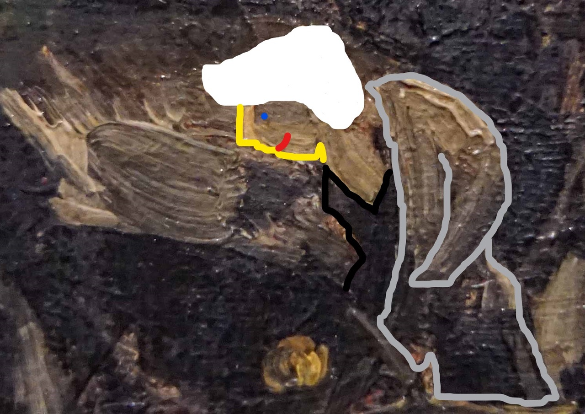

# Heidegger’s Aesthetics
**First published Thu Feb 4, 2010; substantive revision Wed Apr 3, 2024**

*Thomson, Iain*

Heidegger is against the modern tradition of philosophical “aesthetics” because he is for the true “work of art” which, he argues, the aesthetic approach to art eclipses. Heidegger’s critique of aesthetics and his advocacy of art thus form a complementary whole. Section 1 orients the reader by providing a brief overview of Heidegger’s philosophical stand *against aesthetics, for art*. Section 2 explains Heidegger’s philosophical critique of aesthetics, showing why he thinks aesthetics follows from modern “subjectivism” and leads to late-modern “enframing,” historical worldviews Heidegger seeks to transcend from within—in part by way of his phenomenological interpretations of art. Section 3 clarifies this attempt to transcend modern aesthetics from within, focusing on the way Heidegger seeks to build a phenomenological bridge from a particular (“ontic”) work of art by Vincent van Gogh to the ontological truth of art in general. In this way, as we will see, Heidegger seeks to show how art can help lead us into a genuinely meaningful postmodern age. Section 4 concludes by explaining how this understanding of Heidegger’s project allows us to resolve the longstanding controversy surrounding his interpretation of Van Gogh.

## 1. Introduction to “Heidegger’s Aesthetics”: Beyond the Oxymoron

Perhaps the first thing to be said about “Heidegger’s aesthetics” is that Heidegger himself would consider the very topic oxymoronic, a contradiction in terms like the idea of a “square circle,” “wooden iron,” or a “Christian philosopher” (Heidegger’s own three favorite examples of oxymorons).[^note-1] Treating Heidegger’s thinking about art as “aesthetics” would strike him as incongruous and inappropriate because he consistently insisted that the “aesthetic” approach has led Western humanity to understand and experience the work of art in a way that occludes its true historical significance. Nor can Heidegger’s thinking be sympathetically classified as “anti-aesthetic,” because he suggests that any such anti-aesthetics would remain blindly entangled in aesthetics (in the same way that, for example, atheism remains implicated in the logic of theism—both claiming to know the unknowable); in his view, any merely oppositional movement remains trapped in the logic of what it opposes (QCT 61/GA5 217). For Heidegger, as we will see, the only way to get beyond aesthetics is first to understand how it shapes us and then seek to pass through and beyond that influence, thereby getting over it as one might “recover” from a serious illness (ID 37/101). Because the aesthetic approach continues to eclipse our access to the role artworks can quietly play in forming and informing our historical worlds, Heidegger thinks that only such a post-aesthetic thinking about art can allow us to recognize and restore art’s true significance, helping us recognize the inconspicuous way in which art works to shape our basic sense of what is and what matters.[^note-2]

From a strictly Heideggerian perspective, then, any attempt to explain “Heidegger’s aesthetics” (or his “anti-aesthetics”) will look either malicious or misconceived, like a deliberate flaunting or else an unwitting display of ignorance about the basic tenets of Heidegger’s views on art. Fortunately, our starting point is not really so misconceived. Once we understand why exactly Heidegger criticizes (what we could call) the *aestheticization* of art, we will thereby have put ourselves on the right track to understanding his own post-aesthetic thinking about the work of art. (We should not confuse the aestheticization Heidegger critiques with “aestheticism,” a term standardly taken to refer to the “art for art’s sake” movement.[^note-3] For Heidegger, any such attempt to disconnect art from politics, philosophy, and other history-shaping movements would not even be thinkable without the prior reduction of art to aesthetics that he criticizes.) So, what exactly is supposed to be wrong with the aestheticization of art? What leads Heidegger to critique the dominant modern tradition that understands art in an “aesthetic” way, and why does he believe this aesthetic approach eclipses the true significance of the work of art?

### 1.1 Heidegger’s Understanding of the True Work of Art

To understand Heidegger’s critique of aesthetics, it will help first to sketch his positive view of art’s true historical role. Heidegger’s own understanding of the work of art is resolutely populist but with revolutionary aspirations. He believes that, at its greatest, art “grounds history” by “allowing truth to spring forth” (PLT 77/GA5 65).[^note-4] Building on Heraclitus’s view of the pervasive tension of normative conceptual oppositions (good/bad, worthy/worthless, noble/base, and the like) that undergird and implicitly structure our sense of ourselves and our worlds, Heidegger imagines the way [an ancient Greek temple at Paestum](https://commons.wikimedia.org/wiki/File:Paestum_-_Temple_of_Poseidon_-_Temple_of_Hera.JPG) once worked to help unify its historical world by tacitly reinforcing a particular sense of what is and what matters:

> It is the temple-work that first joins together and simultaneously gathers around itself the unity of those paths and relations in which birth and death, disaster and blessing, victory and disgrace, endurance and decline obtain the form of destiny for human being. …The temple first gives to things their look and to humanity their outlook on themselves. (PLT 42–3/GA5 27–9)

Great art works *work* in the background of our historical worlds, in other words, by partially embodying and so selectively reinforcing an historical community’s implicit sense of what is and what matters. In this way, great artworks both (1) “first give to things their look,” that is, they help establish an historical community’s implicit sense of what things *are*, and they give (2) “to humanity their outlook on themselves,” that is, they also help shape an historical community’s implicit sense of *what truly matters* in life (and so also what does not), which kinds of lives are most worth living, which actions are “noble” (or “base”), what in the community’s traditions most deserves to be preserved, and so on.

As this suggests, Heidegger subscribes to a doctrine of *ontological historicity* (refining a view first developed by Hegel). Put simply, Heidegger thinks that humanity’s fundamental experience of reality changes over time (sometimes dramatically), and he suggests that the *work* of art helps explain the basic mechanism of this historical transformation of intelligibility.[^note-5] Because great art *works* inconspicuously to establish, maintain, and transform humanity’s historically-variable sense of what is and what matters, Heidegger emphasizes that “*art is the becoming and happening of truth*” (PLT 71/GA5 59). Put simply, great artworks help establish the implicit ontology and ethics through which an historical community understands itself and its world.[^note-6] In keeping with this (initially strange) doctrine of ontological historicity, Heidegger understands “truth” ontologically as the historically-dynamic disclosure of intelligibility in time. As we will see in section 3, this historical unfolding of truth takes place—to use Heidegger’s preferred philosophical terms of art—as an “*a-lêtheiac*” struggle to “dis-close” or “un-conceal” (*a-lêtheia*) that which conceals (*lêthe*) itself, an “essential strife” between two interconnected dimensions of intelligibility (revealing and concealing) which Heidegger calls “world” and “earth” in his most famous work on art.

In sum, great art *works* by selectively focusing an historical community’s tacit sense of what is and what matters and reflecting it back to that community, which thereby comes implicitly to understand itself in the light of this artwork. Artworks thus function as ontological *paradigms*, serving their communities both as “models of” and “models for” reality, which means (as Dreyfus nicely puts it) that artworks can variously “manifest,” “articulate,” or even “reconfigure” the historical ontologies undergirding their cultural worlds.[^note-7] Heidegger suggests, in other words, that art can accomplish its world-disclosing work on at least three different orders of magnitude: (1) micro-paradigms he will later calls “things thinging,” which help us become aware of what matters most deeply to us; (2) paradigmatic artworks like Van Gogh’s painting and Hölderlin’s poetry, which disclose how art itself works; and (3) macro-paradigmatic “great” works of art like the Greek temple and tragic drama (works Heidegger also sometimes calls “gods”), which succeed in fundamentally transforming an historical community’s “understanding of being,” its most basic and ultimate understanding of what is and what matters.[^note-8]

It is with this ontologically revolutionary potential of great art in mind that Heidegger writes:

> Whenever [great] art happens—that is, when there is a beginning—a push enters history, and history either starts up or starts again. (PLT 77/GA5 65)

That is, great art is capable of overcoming the inertia of existing traditions and moving the interconnected ontological and ethical wheels of history, either giving us a new sense of what is and what matters or else fundamentally transforming the established ontology and ethics through which we make sense of the world and ourselves.[^note-9] Given Heidegger’s view of the literally revolutionary role art can thus play in inconspicuously shaping and transforming our basic sense of what is and what matters, his occasionally ill-tempered critiques of the reduction of art to aesthetics become much easier to understand. For, in his view, the stakes of our understanding of and approach to art could not be higher.

## 2. Heidegger’s Philosophical Critique of Aesthetics: Introduction

Heidegger believes that the aestheticization of art has gotten us late moderns stuck in the rarefied and abstract view according to which “the enjoyment of art serves [primarily] to satisfy the refined taste of connoisseurs and aesthetes.” Hence his amusing but harsh judgment that: “For us today, …art belongs in the domain of the pastry chef” (IM 140/GA40 140). That our culture blithely celebrates café baristas who compete over the “art” of pouring foamed milk into our cappuccinos suggests that we have lost sight of the role art can play in shaping history at the deepest level, an ontologically revolutionary role compared to which Heidegger finds the “artful” gestures of culinary expertise rather empty.

For the same reason, Heidegger is no more impressed by Kant’s highbrow view that the disinterested contemplation of art should “serve the moral elevation of the mind” (IM 140/GA40 140).[^note-10] Instead, Heidegger is clearly sympathetic to the “complaint” that, as he puts it:

> innumerable aesthetic considerations of and investigations into art and the beautiful have achieved nothing, they have not helped anyone gain access to art, and they have contributed virtually nothing to artistic creativity or to a sound appreciation of art. (N1 79/GA43 92)

Heidegger would thus agree with the sentiment behind Barnet Newman’s famous quip: “Aesthetics is for the artist as ornithology is for the birds.”[^note-11] Still, for Heidegger such complaints, while “certainly right,” are really only symptomatic of a much deeper philosophical problem, a problem which stems from the way modern aesthetics is rooted in the subject/object divide lying at the very heart of the modern worldview. In order to get to the heart of the problem, then, we need to take a step back and ask: How exactly does Heidegger understand *aesthetics*?[^note-12]

### 2.1 How Heidegger Understands Aesthetics

As Heidegger points out, the term “aesthetics” is a modern creation. It was coined by Alexander Baumgarten in the 1750s and then critically appropriated by Kant in his *Critique of Judgment* (published in 1790).[^note-13] Baumgarten formed the term “aesthetics” from the Greek word for “sensation” or “feeling,” *aisthêsis* (N1 83/GA43 98). As this indicates, modern “aesthetics” was originally conceived as the science of *aisthêta*, matters perceptible by the senses, as opposed to *noêma*, matters accessible to thought alone, like the truths dealt with in mathematical logic. In fact, modern aesthetics is born of the aspiration to be “in the field of sensuousness what logic is in the domain of thinking” (N1 83/GA43 98). That is, just as logic (conceived as the science of thought) seeks to understand our relation to the true, so aesthetics (conceived as the science of sensation or feeling) seeks to understand our relation to the beautiful.[^note-14]

To recognize that the central focus of modern aesthetics is beauty is not to deny its traditional interest in the sublime or its late-modern preoccupations with the abject, the obscene, kitsch, and so on. Heidegger’s point, rather, is that

> aesthetics is that kind of meditation on art in which humanity’s state of feeling in relation to the beautiful represented in art is the point of departure and the goal that sets the standard for all its definitions and explanations. (N1 78/GA43 91)

In its paradigmatic form (the form “that sets the standard” for all its other “definitions and explanations”), modern “aesthetics is the consideration of humanity’s state of feeling in relation to the beautiful” (N1 78/GA43 90).

Heidegger is not denying that there are numerous disagreements within the modern aesthetic tradition (between Kant and Baumgarten, just to begin with). Instead, his thesis is that even the disagreements in the modern aesthetic tradition take place within the framework of a common approach. It is this shared framework that Heidegger designates when he refers to the “aesthetic” approach to art. As we would expect, this basic framework undergirds the paradigmatic inquiry of modern aesthetics, the study of beauty through a “consideration of humanity’s state of feeling in relation to the beautiful.” In all the aesthetic investigations which take their cues from this one, Heidegger observes:

> The artwork is posited as the “object” for a “subject,” and this subject-object relation, specifically as a relation of feeling, is definitive for aesthetic consideration. (N1 78/GA43 91)

In other words, modern aesthetics frames its understanding of art by presupposing the subject/object dichotomy: Aesthetics presupposes a fundamental divide between the art “object” and the experiencing “subject,” a divide which is subsequently crossed by the commerce of sensation or feeling. Of course, the subject/object dichotomy forms the very basis of the modern worldview, so we would be surprised if modern aesthetics did not presuppose it. So, what specifically does Heidegger object to about the way the aesthetic approach to art presupposes a viewing subject, standing before some art object, enjoying (or not enjoying) his or her sensory experience of this artwork? What is supposed to be the problem with this aesthetic picture of art?

### 2.2 Heidegger’s Critique of the Aesthetic Approach

In a provocatively-titled essay delivered in 1938, “The Age of the World Picture,” Heidegger provides a succinct formulation of what it means to approach art aesthetically that helps us reach the core of his objection to aesthetics. When “art gets pushed into the horizon of aesthetics,” he writes, this

> means [1] that the artwork becomes an object of lived experience [*Gegenstand des Erlebens*], and [2] in this way art comes to count as an expression of human life [*Lebens*]. (QCT 116/GA5 75)

Heidegger is making two connected points here (which are numbered accordingly). The first is that when art is understood and approached “aesthetically,” artworks become *objects* for human subjects to experience in an especially intense, vital, or meaningful way. We can see this if we unpack his typically dense language: As Heidegger frequently points out, in the modern, post-Cartesian world, an “object,” *Gegenstand*, is something that “stands opposite” a human subject, something *external* to subjectivity. In order to experience an object, the modern subject supposedly must first get outside the immanent sphere of its own subjectivity so as to encounter this “external” object, and then return back to its subjective sphere bearing the fruits of this encounter. Given the modern subject/object dichotomy, such an adventure beyond subjectivity and back again is required for the experience of any object. But in the case of the art object, Heidegger is pointing out, the adventure beyond subjectivity and back again is a particularly intense, meaningful, or enlivening one: A “lived experience” is an experience that makes us feel “more alive,” as Heidegger suggests by emphasizing the etymological connection between *Erleben* and *Lebens*, “lived experience” and “life.”

The second point Heidegger is trying to make is that when artworks become objects for subjects to have particularly meaningful experiences of, these artworks themselves also get understood thereby as meaningful expressions of an artistic subject’s own life experiences. Heidegger does not ever develop any argument for this point; the thought simply seems to be that once aesthetics understands artworks as objects of which we can have meaningful experiences, it is only logical to conceive of these art objects themselves in an isomorphic way, as meaningful expressions of the lives of the artists who created them. Still, this alleged isomorphism of aesthetic “expression and impression” is not immediately obvious.[^note-15] Think, for example, about the seriously playful “found art” tradition in Surrealism, dada, Fluxus, and their heirs, a tradition in which ordinary objects get seditiously appropriated as “art.” (The continuing influence of Marcel Duchamp’s “readymade” remains visible in everything from Andy Warhol’s meticulously reconstructed “[Brillo Boxes](https://www.gallery.ca/collection/artwork/brillo-soap-pads-boxes)” (1964) to Ruben Ochoa’s large-scale installations of industrial detritus such as broken concrete, rebar, and chain-link fencing, such as “Ideal Disjuncture” (2008). Vattimo thus suggests that Duchamp’s “Fountain” illustrates the way an artwork can disclose a new world, a world in which high art comes to celebrate not only the trivial and ordinary but also the vulgar and even the obscene.)[^note-16] This tradition initially seems like a series of deliberate counter-examples to the aesthetic assumption that artworks are meaningful expressions of an artist’s own subjectivity.

Even in this tradition, however, the artists’ appropriations are never truly random but invariably require some selection, presentation, and the like, and thus inevitably reopen interpretive questions about the significance these art objects have for the artistic subject who chose them. (Why this particular object? Why present it in just this way?) It is thus not surprising that the founding work of found “anti-art,” [“Duchamp’s Fountain](https://commons.wikimedia.org/wiki/File:Duchamp_Fountaine.jpg)” (1917)—his deliciously seditious installation of a deliberately inverted, humorously signed (by “R. Mutt”), and brilliantly re-titled urinal in an art gallery—is typically treated in contemporary aesthetics as an extreme expression of Duchamp’s own artistic subjectivity, not as its absence.[^note-17] Here one could also point to the failure of Robert Rauschenberg’s attempt to deconstruct the found art ideal of unique and spontaneous invention in his incredible “combines,” “[Factum I and Factum II,](http://www.portlandart.net/archives/Rauschenberg%20Factum%20I%20and%20Factum%20II%201957.bmp)” works which, despite Rauschenberg’s painstaking efforts to make them identical, instead work to suggest the stubborn uniqueness of any given artwork. So, even the found art tradition of the readymade and its heirs reinforces Heidegger’s point that, *in the basic aesthetic approach to art, art objects are implicitly understood as meaningful expressions of artists’ lives that are capable of eliciting particularly intense or meaningful experiences in viewing subjects*.

In this aesthetic approach, to put it simply, *art objects express and intensify human subjects’ experiences of life*. What Heidegger thus characterizes as the aesthetic approach to art will probably seem so obvious to most people that it can be hard to see what he could possibly find objectionable about it. Art objects express and intensify human subjects’ experiences of life; to many people, it might not even be clear what it could mean to understand art in any other way. How should we understand and approach art, if not in terms of the meaningful experiences that a subject might have of some art object, an art object which is itself a meaningful expression of the life of the artist (or artists) who created it? What exactly does Heidegger think is wrong with this “picture” of art?

Despite what one might expect from a phenomenologist like Heidegger, his objection is not that the aesthetic view mischaracterizes the way we late moderns ordinarily experience “art.” On the contrary, Heidegger clearly thinks that what he characterizes as “the increasingly aesthetic fundamental position taken toward art as a whole” (N1 88/GA43 103) does accurately describe the experiences of art that take place—when they do take place—in museums, art galleries, and installations; in performance spaces, theaters, and movie houses; in cathedrals, coliseums, and other ruins; in cityscapes as well as landscapes; in concert halls, music clubs, and comic books; even when we listen to our speakers, headphones, ear-buds; and, sometimes (who could credibly deny it?), when we sit in front of our television screens, computer monitors, iPhones, and so on. The experiences we have of what rises to the level of “art” in all such settings are indeed “aesthetic” experiences, that is, particularly intense or meaningful experiences that make us feel more alive; and, if we think about it, we do tend to approach these art objects as expressions of the life of the artists who created them. The aesthetic view correctly characterizes our typical experience of “art” in the contemporary world—and for Heidegger that is part of the problem.[^note-18]

### 2.3 Symptoms of Subjectivism

This returns us to the bigger question we have been pursuing, and which we are now prepared to answer: Why exactly does Heidegger object to our contemporary tendency to understand and approach art in this aesthetic way? In the revealingly titled essay we have been drawing on, “The Age of the World Picture,” Heidegger explains that “the process by which art gets pushed into the horizon of aesthetics” is neither conceptually neutral nor historically unimportant. On the contrary, the historical process by which Western humanity came to understand art as “aesthetics” is so freighted with significance that it needs to be recognized as “one of the essential phenomena of the contemporary age” (QCT 116/GA5 75). Strikingly, Heidegger goes so far as to assert that our tendency to treat art as aesthetics is just as significant for and revealing of our current historical self-understanding as are the increasing dominance of science and technology, the tendency to conceive of all meaningful human activity in terms of culture, and the growing absence of any god or gods in our Western world (QCT 116–7/GA5 75–6). This is a surprising and deliberately provocative claim, one apparently meant to provoke us into noticing and thinking through something we ordinarily overlook. For, how can our understanding of art as aesthetics be just as essential to our current historical self-understanding as are the dominance of science, the growing influence of technology, the ubiquitous discussions of “culture,” and the withdrawal of gods from our history—four seemingly much larger and more momentous historical developments?

These five “essential phenomena”—the historical ascendance of science, technology, aesthetics, and culture, on the one hand, and, on the other, that historical decline of the divine which Heidegger (echoing Schiller) calls the “ungodding” or “degodification” (*Entgötterung*) of the world—these all are “equally essential” (*gleichwesentliche*), Heidegger explains, because these five interlocking phenomena express and so reveal the underlying direction in which the contemporary world is moving historically. Science, technology, aesthetics, culture, and degodification are “equally essential” as five major historical developments that feed into and disclose (what we could think of as) *the* *current*, that is, the underlying historical direction or *Zeitgeist* of our contemporary world.[^note-19] In the late 1930s, Heidegger’s name for the underlying direction in which the age is moving is “subjectivism,” a movement he defines as humanity’s ongoing attempt to establish “mastery over the totality of what-is” (QCT 132/GA5 92). *Subjectivism*, in other words, designates humanity’s increasingly global quest to achieve complete control over every aspect of our objective reality, to establish ourselves as the being “who gives the measure and provides the guidelines for everything that is” (QCT 134/GA5 94). Heidegger’s fundamental objection to the aesthetic approach to art, then, is that such an approach follows from and feeds back into *subjectivism*, contemporary humanity’s ongoing effort to establish “our unlimited power for calculating, planning, and molding [or ‘breeding,’ *Züchtung*] all things” (QCT 135/GA5 94).

### 2.4 How Aesthetics Reflects and Reinforces Subjectivism

In order to understand why Heidegger thinks the aesthetic approach to art reflects and reinforces subjectivism, we need to know why Heidegger characterizes humanity’s ongoing attempt to master every aspect of our objective reality as “subjectivism” in the first place.[^note-20] We saw earlier that in the modern, post-Cartesian world, an “object” (*Gegen-stand*), is something that “stands opposite” a human *subject*, something which is “external” to the subjective sphere. This subject/object dichotomy seems obvious when one is theorizing from within the modern tradition, in which it has functioned as an axiom since Descartes famously argued that the subject’s access to its own thinking possesses an indubitable immediacy not shared by our access to objects, which must thus be conceived of as external to subjectivity.

Yet, as Heidegger argues in *Being and Time* (1927), taking this modern subject/object dichotomy as our point of departure leads us to fundamentally mischaracterize the way we experience the everyday world in which we are usually unreflectively immersed, the world of our practical engagements. By failing to recognize and do justice to the integral entwinement of self and world that is basic to our experiential navigation of our lived environments, modern philosophy effectively splits the subject off from objects and from other subjects. In this way, modern philosophy lays the conceptual groundwork for *subjectivism*, the “worldview” in which an intrinsically-meaningless objective realm (“nature”) is separated epistemically from isolated, value-bestowing, self-certain subjects, and so needs to be mastered through the relentless epistemological, normative, and practical activities of these subjects. Heidegger suggests that this problem is not merely theoretical, because the subjectivism of the modern worldview functions historically like a self-fulfilling prophecy. Its progressive historical realization generates not only the political freedoms and scientific advances we cherish, but also unwanted downstream consequences such as our escalating environmental crisis and less predictable side-effects like the aestheticization of art.[^note-21]

### 2.5 Undermining the Subject/Object Dichotomy Phenomenologically

So, how does the aestheticization of art follow from subjectivism? (This is easier to see than Heidegger’s converse claim—that the aestheticization of art feeds back into and reinforces subjectivism—so we will address it first.) *Being and Time* does not undermine the subject/object dichotomy by trying to advance the incredible thesis that the self really exists in a continuous and unbroken unity with its world. Instead, Heidegger seeks to account for the fact that our fundamental, practical engagement with our worlds can easily break down in ways that generate the perspective the subject/object dichotomy describes. Most of the time, we encounter ourselves as immediately and unreflectively immersed in the world of our concerns rather than as standing over against an “external” world of objects. Just think, for example, of the way you ordinarily encounter a hammer when you are hammering with it, or a pen while you are writing with it, a bike while riding it, a car while driving it, or even, say, a freeway interchange as you drive over it for the umpteenth time. This all changes, however, when our practical engagement with the world of our concerns breaks down. When the head flies off the hammer and will not go back on (and no other hammering implement is available to complete the task at hand); when the pen we are writing with runs out of ink (and we have no other); when our bike tire goes flat or our car breaks down in the middle of a trip; when we find ourselves standing before an artwork that we cannot make sense of; or, in general, when we are still learning how to do something and encounter some unexpected difficulty which stops us in our tracks—in all such cases what Heidegger calls our ordinary, immediate “hands-on” (*zuhanden*) way of coping with the world of our practical concerns undergoes a “transformation” (*Umschlag*) in which we come to experience ourselves as isolated subjects standing reflectively before a world of external objects, which we thereby come to experience as standing over against us in the mode of something objectively “on hand” (*vorhanden*) (BT 408–9/SZ 357–8).

In other words, Heidegger does not deny the reality of the subject/object relation but, rather, points out that our experience of this subject/object relation *derives* *from* and so *presupposes* a more fundamental level of experience, a primordial modality of engaged existence in which self and world are united rather than divided. Heidegger believes that modern philosophy’s failure to solve the problem of skepticism about the external world shows that those who begin with the subject/object divide will never be able to bridge it subsequently (BT 249–50/SZ 205–6). He thus insists that this more primordial level of practically engaged, “hands-on” existence—in which self and world are unified—must be the starting point of any description of ordinary human experience that seeks to do justice to what such experience is really like, a phenomenological dictum Heidegger insists should also govern our attempts to describe our meaningful encounters with works of art.

### 2.6 Phenomenology Against Aesthetic Subjectivism

Following the phenomenological dictum that we should describe our experience of art in a way that is not distorted by the presuppositions we have inherited from the metaphysical tradition is easier said than done, however, for at least two reasons. First, the subject/object dichotomy is so deeply entrenched in our self-understanding that it has come to implicitly structure the fundamental aesthetic approach (as we have seen). Second, it is not immediately clear where (let alone how) we should look to discover art in a non-aesthetic way. Indeed, it now seems natural for us to think that what makes our experience of art objects significant is that such experiences allow us human subjects temporarily to transcend the sphere of our own subjectivity by getting in touch with art objects outside ourselves, because these transcendent experiences can profoundly enrich our subjective experience.

In Heidegger’s view, however, this aesthetic perspective gets the story backward. We do not begin confined to our subjective spheres, temporarily leave those spheres behind in order to experience art objects, only to return back to subjectivity once again, enriched by the “booty” we have captured during our adventure in the external world of art objects (BT 89/SZ 62). The reverse is true: Human *existence* originally “stands outside” (*ek-sistere*) itself, integrally involved with the world in terms of which we ordinarily make sense of ourselves.[^note-22] We do occasionally experience ourselves as subjects confronting objects (for example, when we try to learn to draw or paint realistically, or when we find ourselves standing befuddled before an art object), but the experience of ourselves as subjects confronting objects is comparatively infrequent and takes place on the background of a more basic experience of ourselves as integrally involved with the world of our practical concerns, an experience of fundamental self/world intertwinement to which we always return.

“Proximally and for the most part [or ‘initially and usually,‘ *zunächst und zumeist*],” as Heidegger likes to say, we do not stand apart from the entities that populate our world, observing them dispassionately—or even passionately, hoping to transcend an isolated subjective sphere which in fact we are usually already beyond. Why, then, should we privilege the detached, subject/object framework that results from the breakdown of our engaged experience when we try to approach art philosophically? We should not; trying to approach art while staying within the aesthetic approach is like trying to learn what it is like to ride a bike by staring at a broken bicycle: It is so to privilege the detached perspective of the observer that the participatory perspective gets eclipsed and forgotten. In Heidegger’s view, the phenomenologically faulty presuppositions of modern philosophy have misled aesthetics into looking for the work of art in the wrong place, at a derived rather than the basic level of human interaction with the world, and thus into mistaking an intense subjective experience of an external object for an encounter with the true work of art.

Modern aesthetics presupposes the subject/object dichotomy and then problematically tries to describe the subsequent interaction between two allegedly heterogeneous domains, instead of recognizing and seeking to describe the prior role works of art play in the background of our everyday worldly engagement, in which no such dichotomy can yet be found. Heidegger’s post-aesthetic thinking about the work of art will thus instead seek to describe the usually unnoticed way in which artworks can form and inform our basic historical sense of what is and what matters (as we saw in section 1.1). Heidegger’s thinking about the formative role art can play in the background of our self-understanding is “post-aesthetic” in that it seeks to get past the constitutive mistakes of aesthetics, but it might also be characterized as “pre-aesthetic” insofar as the way he tries to go beyond aesthetics is by getting back behind aesthetics in order to do justice to that more primordial level of existence aesthetics overlooks. Indeed, although this initially sounds paradoxical, Heidegger suggests that *the best way to get beyond aesthetic experience is to transcend it from within* (that is, to experience the way a subject’s experience of an aesthetic object can lead beyond or beneath itself), as we will see when we turn to his phenomenological analysis of Van Gogh’s painting.

To sum up, then, because aesthetics tries to describe artworks from the perspective of a subject confronting an external art object, the aesthetic approach begins always-already “too late” (BT 249/SZ 207). Aesthetics looks for art in the wrong place (at a derivative rather than primordial level of human interaction with the world), and what it finds there is not the true work of art. Misled by the presuppositions of modern philosophy, aesthetics overlooks that more primordial level of human existence where, Heidegger will argue, true art inconspicuously accomplishes its ontologically-revolutionary work.

### 2.7 From Modern Subjectivism to Late-Modern Enframing in Aesthetics

Before turning our attention to Heidegger’s post-aesthetic thinking, the last thing we need to do is to clarify his more difficult claim that aesthetics not only follows from but also *feeds back into* subjectivism. What makes this claim difficult to grasp is the specific twist Heidegger gives to it: Put simply, aesthetics feeds back into subjectivism in a way that leads subjectivism beyond itself—and into something even worse than subjectivism. In aesthetics, Heidegger suggests, subjectivism “somersaults beyond itself [*selbst überschlägt*]” into enframing (N1 77/GA43 90). We can see how subjectivism somersaults beyond itself into enframing if we return to Heidegger’s definition of subjectivism in “The Age of the World Picture,” according to which modern *subjectivism* names our modern attempt to secure “our unlimited power for calculating, planning, and molding [or ‘breeding,’ *Züchtung*] all things” (QCT 135/GA5 94). It is not difficult to detect a subtle resistance to the National Socialist worldview and (what Heidegger understood as) its Nietzschean roots in Heidegger’s 1938 critique of Western humanity’s drive toward the total mastery of the world through “calculating, planning, and breeding.” But more importantly for our purposes, such descriptions of humanity’s drive to master the world completely through the coldly rational application of *calculative* reasoning also show that what Heidegger calls “subjectivism” is a conceptual and historical precursor to what he will soon call “enframing” (or *Gestell*).

“Enframing” is Heidegger’s famous name for the technological understanding of being that underlies and shapes our contemporary age. Just as Descartes inaugurates modern *subjectivism* (as we have seen), so Nietzsche inaugurates late-modern *enframing* by understanding being—the “totality of entities as such”—as “eternally recurring will to power.” Heidegger thinks that Nietzsche’s “ontotheology” (that means, to put it briefly, Nietzsche’s way of grasping the totality of what-is from both the inside-out and the outside-in at the same time) worked to inaugurate our own late-modern view that reality is nothing but forces coming-together and breaking-apart with no end other than the self-perpetuating growth of force itself. By tacitly approaching reality through the lenses of this Nietzschean ontotheology, we increasingly come to understand and so to treat all entities as intrinsically-meaningless “resources” (*Bestand*) standing by for efficient and flexible optimization. It is (to cut a long story short) this nihilistic *technologization* of reality that Heidegger’s later thinking is dedicated to finding a path beyond.[^note-23] For Heidegger, true art opens just such a path, one that can guide us beyond enframing’s ontological “commandeering of everything into assured availability” (PLT 84/GA5 72), as we will see in section 3.

First, however, we need to understand how subjectivism leads beyond itself into enframing. Put simply, subjectivism becomes enframing when the subject objectifies *itself*—that is, when the human subject, seeking to master and control all aspects of its objective reality, turns that impulse to control the world of objects back onto itself. If we remember that modern *subjectivism* designates the human subject’s quest to achieve total control over all objective aspects of reality, then we can see that late-modern *enframing* emerges historically out of subjectivism as subjectivism increasingly transforms the human subject itself into just another object to be controlled. *Enframing*, we could say, *is subjectivism squared* (or subjectivism applied back to the subject). For, the subjectivist impulse to master reality redoubles itself in enframing, even though enframing’s objectification of the subject dissolves the very subject/object division that initially drove the subject’s relentless efforts to master the objective world standing over against it (Thomson 2005)[^thomson-2005][^thomson-2005-2]. Subjectivism “somersaults beyond itself” in our late-modern age of “enframing” because the impulse to control everything intensifies and accelerates even as it breaks free of its modern moorings and circles back on the subject itself, turning the human subject into just one more object to be mastered and controlled—until the modern subject becomes just another late-modern entity to be efficiently optimized along with everything else. We are thus moving from modern subjectivism to the late-modern enframing of reality insofar as we understand and relate to all things, *ourselves included*, as nothing but intrinsically-meaningless “resources” standing by for endless optimization. Interestingly, Heidegger saw this technological understanding of being embodied in contemporary works of art like the [modern butterfly interchange on a freeway](https://commons.wikimedia.org/wiki/File:Big_I.JPG), which, like a late-modern temple, quietly reinforces our technological understanding of all reality as “[a network of long-distance traffic, spaced in a way calculated for maximum speed](http://i130.photobucket.com/albums/p243/BRANDONAC2010/Bigi2.jpg)” (PLT 152/GA7 155), an optimizing function now served even more efficiently and pervasively by the internet (to which we are now connected by millions of little shrines, made ever faster, more efficient and portable, and which we find ourselves increasingly unable to live without).[^note-24]

In the late 1930s, Heidegger understood such technological optimization as an all-encompassing attempt to derive the maximal output from the minimal input, a quantification of quality that threatens to dissolve quality in the same way that the objectification of the subject threatens to dissolve subjectivity. Heidegger seems first to have recognized this objectification of the subject in the Nazis’ coldly calculating eugenics programs for “breeding” a master race, but (as he predicted) that underlying impulse to objectively master the human subject continues unabated in more scientifically plausible and less overtly horrifying forms of contemporary genetic engineering.[^note-25] Most importantly for us here, Heidegger also recognized this ongoing objectification of the subject in the seemingly innocuous way that aesthetics “somersaults beyond itself” into neuroscientific attempts to understand and control the material substrate of the mind. For, once aesthetics reduces art to intense subjective experience, such experiences can be studied objectively through the use of EEGs, *f*MRIs, MEG and PET scans (and the like), and in fact aesthetic experiences are increasingly being studied in this way. At the University of New Mexico’s MIND Institute, to mention just one telling example, subjects were given “beautiful” images to look at and the resulting neuronal activity in their brains was studied empirically using one of the world’s most powerful functional Magnetic Resonance Imaging machines. In this way, as Heidegger predicted in 1937:

> Aesthetics becomes a psychology that proceeds in the manner of the natural sciences; that is, states of feeling become self-evident facts to be subjected to experiments, observation, and measurement. (N1 89/GA43 106)

“Here,” Heidegger writes, “the final consequences of the aesthetic inquiry into art are thought through to the end” (N1 91/GA43 108). Aesthetics reaches its logical conclusion—the “fulfillment or consummation” (*Vollendung*) which completes it and so brings it to its end—when it thus “somersaults beyond itself” into enframing.

Heidegger’s objection to aesthetic enframing, then, is not just that the work of art is increasingly falling under the influence of enframing—that artworks too are becoming mere resources for the art industry, standing reserves piled in storerooms “like potatoes in a cellar” to be quickly and efficiently “shipped like coal…or logs…from one exhibition to another” (PLT 19/GA5 3). He is even more troubled by the way art, reduced to aesthetics, does not just get enframed but participates in the enframing—for example, when the feeling of beauty is reduced to a purportedly objective brain state to be precisely measured and controlled through cognitive neuroscience.[^note-26]

As the human subject turns its subjectivist impulse to control the objective world back onto itself in such neuroscientific experimentation, aesthetics increasingly becomes just one more approach reinforcing the technological “enframing” of all reality. Heidegger thus reaches a harsh verdict: Aesthetic “experience is the element in which art dies. This dying goes on for so long that it takes several centuries” (PLT 79/GA5 67).[^note-27] Fortunately, Heidegger’s prognosis is not as bleak as this apparent death sentence suggests. That art is slowly dying as aesthetics, he clarifies in a later addition,

> does not mean that art is utterly at an end. That will be the case only if [aesthetic] experience remains the sole element for art. Everything depends on getting out of [aesthetic] experience and into being-here [*Da-sein*], which means reaching an entirely different “element” for the “becoming” of art. (P 50 note b/GA5 67 note b)

In other words, art is dying only as aesthetics, and the death of art as aesthetics makes possible the transformative rebirth of art as something other than a subject’s experience of an object. Indeed, just as modern subjectivism led beyond itself historically into late-modern enframing, so Heidegger believes enframing, in turn, can lead beyond itself into a genuine post-modernity, an age that transcends our late-modern age’s ongoing technologization of reality and its nihilistic erosion of all intrinsic meaning (the void which we try to fill with all our superficial talk about “values”) (see Thomson 2011, 60–2)[^thomson-2011]. This hope for an historical turning toward a genuinely meaningful post-modernity is what motivates Heidegger’s phenomenological attempt to describe and so convey a post-aesthetic encounter with art, to which we now turn.

### 2.8 Conclusion and Transition: From Hegel’s End of Art to Heidegger’s Other Beginning

Because of the predicament in which modern aesthetics has left us, Heidegger provisionally accepts the truth of Hegel’s famous judgment that:

> Art no longer counts for us as the highest manner in which truth obtains existence for itself. …[I]n its highest determination, vocation, and purpose [*Bestimmung*], art is and remains for us…a thing of the past. (PLT 80/GA5 68)

Still, Heidegger nurtures the hope that (*pace* Hegel) the distinctive truth manifest in art could once again attain the kind of history-transforming importance that Hegel and Heidegger agree it had for the ancient Greeks but has lost in the modern world.

This “highest” truth of art for which Heidegger still hopes, however, is not Hegel’s “certainty of the absolute” (GA5 68 note a). That is, Heidegger does not hold out hope for some perfect correspondence between (1) the historically-unfolding “concept” Hegel believed was implicit in the development of humanity’s intersubjective self-understanding and (2) an objective manifestation of that intersubjective self-understanding in art. Thus, in Hegel’s most famous example, the tragic conflict between Antigone and Creon in Sophocles’ *Antigone* perfectly embodied the fundamental but as of yet unresolved ethical conflicts—between conscience and law, the family and the state, and so on—which had arisen implicitly in the intersubjective self-understanding of fifth-century Athens. Hegel thinks it is no longer possible for an artwork to perfectly express the tensions implicit in the self-understanding of the age and thereby call for an historical people to envision a future age in which those tensions would be resolved (because this role was taken over by religion and then by philosophy as our historical self-understanding grew increasingly complex). Heidegger, however, continues to hope for even more, namely, an artwork that *already* embodies the transition between this age and the next and which is thus capable of helping to inaugurate that future age, here and now.

In tacit opposition to Hegel, Heidegger thus suggests that art’s highest “[t]ruth is [not ‘the certainty of the absolute’ but] the unconcealedness of entities as entities. Truth is the truth of being” (PLT 81/GA5 69). Heidegger’s defining hope for art, in other words, is that works of art could manifest and thereby help usher in a new understanding of the being of entities, a literally “post-modern” understanding of what it means for an entity to be, a postmodern ontology which would no longer understand entities either as modern objects to be controlled or as late-modern resources to be optimized.[^note-28] Heidegger expresses this hope that separates him from Hegel in the form of a question: “The truth of Hegel’s judgment has not yet been decided,” he writes, because

> the question remains: Is art still an essential and a necessary way in which that truth happens which is decisive for our historical existence, or is art this no longer? (PLT 80/GA5 68)

Heidegger’s point is that Hegel will no longer be right—the time of great art will no longer be at an end—if contemporary humanity still needs an encounter with art in order to learn how to understand the being of entities in a genuinely post-modern way, and if we still remain capable of such an encounter.[^note-29]

As this suggests, the ultimate goal of Heidegger’s thinking about art is to show what it would mean to move from a modern aesthetic experience of an art object to a genuinely post-modern encounter with a work of art, so that we can thereby learn from art how to transcend modernity from within. As Heidegger will later claim, when we encounter a true work of art,

> the presencing [*Anwesen*] of that which appears to our look…is different than the standing of what stands-opposite [us] in the sense of an object. (PLT 82/GA5 71)

But what exactly is the difference between an aesthetic experience of an art object and an encounter with the true “presencing” of a work of art? And how is the traversing of that difference in our engagement with a particular work of art supposed to teach us to understand being in a post-modern way? Part III explains Heidegger’s fairly complex answers to these difficult but momentous questions.

## 3. Heidegger for Art, Introduction: The Three Pillars of Heidegger’s Understanding of Art

“The Origin of the Work of Art”—an essay Heidegger delivered repeatedly between 1935 and 1936, rewriting and expanding it into three lectures (which became the three main sections of the published essay, to which Heidegger then added a brief “Afterword” near the end of the 1930s and a slightly longer “Addendum” in 1957)—is far and away the most important source for understanding his attempt to articulate an alternative to the aesthetic understanding of art, although several other works (contemporaneous as well as later) also provide important clues to his view.[^note-30] In the final version of this famous essay, Heidegger meditates on three different works of art in succession: A painting of “A Pair of Shoes” by Vincent van Gogh; a poem entitled “The Roman Fountain” by C. F. Meyer, and an unspecified Greek temple at Paestum (most likely the temple to Hera). Leading Heidegger scholars such as Hubert Dreyfus and Julian Young rely almost entirely on Heidegger’s interpretation of the ancient Greek temple in order to explicate his “promethean” view of art’s historically revolutionary potential, its ability to focus and transform our sense of what is and what matters (as we saw in section 1.1). Young (2001, p. 22) and Dreyfus (2005, p. 409) suggest that Heidegger’s interpretation of Van Gogh is “anomalous” and “largely irrelevant” to this view, despite the fame generated by the longstanding controversy surrounding it (a controversy to which we will return at the end).[^note-31] Like almost all other scholars, moreover, Dreyfus and Young simply overlook Heidegger’s introduction of Meyer’s poem—even as they recognize that for Heidegger, like Plato, “poetry” names the very essence of art (namely, *poiêsis* or “bringing into being”), hence Heidegger’s claim that: “*All art* [that is, all bringing-into-being] … *is essentially poetry*” (PLT 73/GA5 59). We thus have to wonder: Is the only complete poem Heidegger included in the essay that advances this view of poetry as the essence of art really of no significance?[^note-32]

In my view, Heidegger’s analysis of each of these three works contributes something important to his overarching attempt to guide readers into a phenomenological encounter with art that is capable of helping us transcend modern aesthetics from within. To put it simply, the temple motivates and helps develop the details of Heidegger’s larger project; the poem implicitly contextualizes and explains it; and the painting (and only the painting) directly exemplifies it. In order to see how, let us take these points in order. Heidegger’s imaginative reconstruction of the lost temple helps motivate his quest for a non-aesthetic encounter with art, but not (as is often said) because he seeks some nostalgic return to the Greek world. Heidegger dismisses such a revival as an impossibility because the ancient temple—just like the medieval cathedral—no longer gathers its historical world around it and thus no longer works as great art, and such “world-withdrawal and world-decay can never be reversed” (PLT 41/GA5 26). Instead, the Greek temple shows that art was once encountered in a way other than as a subject’s intense aesthetic experience of an object, and thus suggests that, while those ancient and medieval worlds have been lost irretrievably, other works of art might yet be encountered non-aesthetically in our late-modern world. Heidegger thus elaborates his philosophical vision of how the temple worked for a time to unify a coherent and meaningful historical world around itself (by inconspicuously focusing and illuminating its people’s sense of what is and what matters) in order to suggest that a non-aesthetic encounter with art might yet do the same thing once again: A work of art might yet help to gather a new historical world around itself by focusing and illuminating an understanding of being that does not reduce entities either to modern objects to be controlled or to late-modern resources to be optimized.

While Heidegger’s project is thus undeniably inspired by the past, this inspiration serves his goal of helping us move historically into the future. His guiding hope, we have seen, is that a non-aesthetic encounter with a contemporary artwork will help us learn to understand the being of entities not as modern objects (“subjectivism”) or as late-modern resources (“enframing”) but in a genuinely post-modern way, thereby making another historical beginning. So, which work of art does Heidegger think can help us late moderns learn to transcend modern aesthetics from within and thereby discover a path leading beyond modernity? There are only two viable candidates to fill this crucial role in “The Origin of the Work of Art”: Meyer’s poem and Van Gogh’s painting.[^note-33]

So, why does Heidegger give such pride of place to Meyer’s poem? The answer to this puzzle (which too few readers even notice) is that the poem introduces the broader philosophical context of Heidegger’s project by conveying his emerging understanding of *historicity*, the doctrine according to which our fundamental sense of reality changes over time.[^note-34] The ontological “truth” that Meyer’s poem embodies—and “sets to work,” in Heidegger’s creative appropriation of the poem—is that truth itself is essentially historical and, moreover, that this essential history of truth forms three successive “epochs,” in the same way that the “jet” of water fills the three consecutive “basins” in Meyer’s eponymous fountain.[^note-35] For Heidegger, to put it more precisely, the relations Meyer’s poem describes between the fountain’s original “jet” and its three successive water basins illuminate the relations between “being” itself (that is, as we will see, the inexhaustible ontological source of historical intelligibility) and the three main historical “epochs” or ages in Western humanity’s understanding of being (as Heidegger conceived of this “history of being” in 1936), namely, ancient “Greece,” “the middle ages,” and “the modern age” (PLT 76–7/GA5 64–5).[^note-36]

Thus, for example, just as the original “jet” of water “falls” into the fountain’s successive basins, so the “overflowing” ontological riches concealed in the ancient world were first diminished in the medieval world. “The Origin of the Work of Art” make the contentious case that this ontological diminution “begins” when concepts central to the ancient Greek understanding of being get translated into Latin without a full experience of what those concepts originally revealed (PLT 23/GA5 8). Hence the obvious appeal for Heidegger of Meyer’s suggestive line: “Veiling itself, this [first basin] overflows / Into a second basin’s ground” (PLT 37/GA5 23). What remained of these ontological “riches” in the medieval world was then transposed into and reduced further in the modern epoch which, like the fountain’s third basin, stands at the furthest remove from its original source. It thus seems clear that Heidegger included Meyer’s poem because he believed it suggestively illuminated the way the history of being unfolds as an epochal history of decline, a “fall” which results from this history’s increasing forgetting of the source from which it ultimately springs—the *Ur-sprung* or “origin” of Heidegger’s essay’s title—in a word: “Being” (*Sein*), Heidegger’s famous name for the source from which all historical intelligibility originates (by way of the disclosive “naming-into-being” which Heidegger understands as the “poetic” essence of art, as we will see in the next section). In other words, Heidegger uses Meyer’s poem to allude to the broader philosophical context that helps explain and motivate the new historical beginning he hopes art will help us inaugurate. Heidegger’s use of this particular poem suggests, moreover, that in order to accomplish this “other beginning,” Western humanity needs to learn to tap back into that original, ontological source (the overflowing “jet” of being), and that such a reconnection with the source of historical intelligibility is something art can still teach us. (Although interpreters also overlook this, the quiet presence of a homophonous “third reich” in Meyer’s poem reminds us of the deeply-troubling dimension of Heidegger’s thinking in the mid-1930s, the fact that his philosophical hopes for the future were for a brief time deeply entwined with his idiosyncratic understanding of the direction that the burgeoning National Socialist “revolution” might yet take.)[^note-37]

While both the temple and the poem thus remain quite important, only Van Gogh’s painting directly exemplifies what Heidegger thinks it means to encounter art in a way that allows us to transcend modern aesthetics from within. This means that Heidegger’s interpretation of Van Gogh’s painting, far from being irrelevant, is actually the most important part of his essay. For, it is only from Heidegger’s phenomenological interpretation of Van Gogh’s artwork that we late moderns can learn how to transcend modern aesthetics from within, and thereby learn from art what it means to encounter being in a post-modern way. Since we have already summarized Heidegger’s “promethean” view of the historically-revolutionary work accomplished by the ancient Greek temple (in section 1.1), we will expand on the point of his return to Greece only briefly (in section 3.1), saying more about how this return to the past is supposed to help lead us into the future. The rest of what follows will be dedicated primarily to explaining Heidegger’s pivotal understanding of Van Gogh’s painting.[^note-38] Our ultimate objective will be to show how Heidegger’s interpretation of Van Gogh allows him to move phenomenologically from the analysis of a particular, individual (“ontic”) work of art to the ontological structure of artwork in general. Along the way, we will present the main details of the postmodern understanding of being that Heidegger thinks we can learn from a non-aesthetic encounter with the work of art (section 3.7). Once we understand the ordered sequence of steps in the phenomenological interpretation whereby Heidegger thinks we can transcend modern aesthetics from within, moreover, we will finally be able to resolve the long-standing controversy surrounding Heidegger’s interpretation of Van Gogh (as we will see in section 4).

### 3.1 Back to the Future: Heidegger on the Essence of Art

Heidegger’s introduction of “a well-known painting by Van Gogh, who painted such shoes several times” (PLT 33/GA5 18), is notoriously abrupt and puzzling to many readers. The path that leads Heidegger to Van Gogh’s painting should not be too surprising, however, because it is the same path we have been following here. Looking back at “The Origin of the Work of Art” two years later (in 1938), Heidegger will write that:

> The question of the origin of the work of art does not aim to set out a timelessly valid determination of the essence of artwork which could also serve as the guiding thread for an historically retrospective clarification of the history of art. The question is most intimately connected with the task of overcoming aesthetics, which also means overcoming a certain conception of entities as what are objectively representable. (CP 354/GA65 503)[^note-39]

We have seen that because aesthetics tries to describe artworks as objects that express and intensify human subjects’ experiences of life, the aesthetic approach begins “always already” too late. Modern aesthetics presupposes the perspective of a subject confronting an external object and thereby misses the way art works inconspicuously in the background of human existence to shape and transform our sense of what is and what matters.

Heidegger expands this critique to include “representation” here because representations are what modern philosophy typically uses to try to bridge the divide Descartes opened between subjects and objects. (The objective world allegedly “external” to subjectivity gets duplicated in miniature, as it were, and “re-presented” to the mind—as in the famous Cartesian picture of consciousness as an internal “theater of representations.”) Of course, Heidegger does not deny that representations sometimes mediate our experience of the world. What he denies is that representations go “all the way down,” that they plumb the depths of existence. Instead, representations presuppose a level of existence they cannot explain. Heidegger’s fundamental phenomenological critique of the modern theoretical picture is that it overlooks and then cannot recapture the more basic level of engaged existence, a practical coping with equipment in which no subject/object dichotomy has yet opened up because self and world remain integrally entwined and mutually determining.[^note-40] This primordial level of engaged existence, we will see, is what Heidegger thinks Van Gogh’s painting allows us to encounter and understand in a way that no mere aesthetic representation ever could. In so doing, Heidegger thinks, Van Gogh’s painting allows us to encounter the very essence of art.

On the basis of passages like the one above, however, some interpreters claim that “The Origin of the Work of Art” does not seek to “uncover the essence of art,” but that is misleading.[^note-41] As Heidegger says, his essay does not seek to set out one “timelessly valid determination” of the essence of art which would apply retrospectively to the entire history of art, but that is only because he does not understand essences the way they have been understood from Plato to Kripke, namely, as “timelessly valid determinations” of what something is.[^note-42] In fact, “The Origin of the Work of Art” does attempt to uncover and communicate art’s historical “essence,” by which Heidegger means that structure which allows art to reveal itself in different ways as it unfolds in the human understanding across time. What is confusing for many readers is that this historical essence of art is not some substance underlying the different forms of art or even a fixed property that would enable us to distinguish art from non-art but, instead, an insubstantial and ever-changing “essential strife” that is built into the structure of all intelligibility (the structure whereby entities become intelligible as entities), as we will see.[^note-43]

Rather than forcing Heidegger to develop an entire art history, the normative demands of his critical project only require him to focus on two crucial historical moments in Western humanity’s changing historical understanding of art—a kind of before and after, as it were, which contrasts the fullness of what has been possible with the narrowness of what is currently actual. Heidegger is thus primarily concerned to show, first, how the ancient Greeks encountered art in a non-aesthetic way (and so enshrined it in their temples), and second, how art is typically understood and experienced by us late moderns, who remain caught in the grip of modern aesthetics and so under the influence of “modern subjectivism” (PLT 76/GA5 63). As subjectivism’s unlimited ambition to establish “mastery over the totality of what-is” (QCT 132/GA5 92) works to objectify even modernity’s vaunted subject, moreover, it increasingly transforms modern subjectivism into late-modern “enframing” (as we saw in 2.7).

In “The Origin of the Work of Art,” Heidegger suggests that modern subjectivism and late-modern enframing can be understood as symptoms of Western humanity’s continuing inability to accept our defining existential finitude. The limitless ambition of our subjectivist quest to master all reality conceptually results from our refusal to own up to, make peace with, and find non-nihilistic ways to affirm the tragic truth Heidegger gleans from the ancients:

> Much of what is cannot be brought under the rule of humanity. Only a little becomes known. What is known remains approximate; what is mastered remains unstable. What-is is never something [entirely] man-made or even only a representation, as it can all too easily appear. (PLT 53/GA5 39)

Heidegger takes off here from the second choral ode in Sophocles’ *Antigone* (which he discussed at length in 1935’s *Introduction to Metaphysics*). For Sophocles’ Theban elders, the one thing humanity cannot master is death. For Heidegger, thinking about death opens us up to the terrifyingly “awesome” insight that the known rests on the unknown, the mastered on the unmastered, like a small ship floating on a deep and stormy “sea” (IM 159, 164/GA40 159, 162).[^note-44] We like to believe that humanity is well on its way to mastering the universe, but art teaches us that we are far from having exhausted the possibilities inherent in intelligibility.

Yet, rather than leading us into despair over our essential human finitude (the fact that we will never master the totality of what-is), art helps us learn to embrace this finitude by reminding us of its other side, namely, the fact that intelligibility will never exhaust its source. For, it remains possible for being to continue to become newly intelligible only if it cannot ever become fully intelligible. Art thus teaches us to embrace the insight that meanings will never be exhausted as precisely what makes it possible for us to continue to discover new meanings, and in this way art helps us see that human finitude is not something we should despair over or seek to deny though compensatory subjectivistic fantasies (of complete control or finally complete systems). Of course, the claim that we should give up thinking we could ever know everything does not entail that we should give up trying to know new things—quite the contrary. If the heroic is what helps us affirm and thereby transform the tragic (as the famous speech by Sarpêdon in Homer’s *Iliad* suggests), then Heidegger’s thinking about art is heroic: Art teaches us to embrace the initially tragic insight that being will never be completely revealed in time as the very thing that makes it possible for human beings to continue to understand what-is in new and potentially more meaningful ways.

In sum, the point of Heidegger’s juxtaposition of modern spleen and ancient ideal is not to call for the impossible revival of the lost Greek past but, rather, to help motivate a new, post-aesthetic understanding of what art could still mean for us, now and in the future. If, instead of trying to obtain a kind of cognitive mastery over art through aesthetics—or using aesthetics to extend our late-modern understanding of all that is as intrinsically-meaningless resources standing by to be optimized—we simply allow ourselves to experience what is happening within a great work of art, then Heidegger thinks we will be able to encounter the “essential strife” in which the true work of art paradoxically “rests” and finds its “repose.” When we encounter the “movement” that paradoxically rests in the masterful “composure” of a great artwork, moreover, what we discover therein is an “instability” that underlies the entire intelligible order, an ontological tension (between revealing and concealing, emerging and withdrawing) which can never be permanently stabilized and thus remains even in what is “mastered.”[^note-45] Indeed, what is truly mastered artistically, Heidegger suggests, is what somehow captures, preserves, and communicates this tension in the structure of intelligibility, allowing us to encounter and understand this essential tension in a way that helps us learn to transcend the limits of our modern and late-modern ways of understanding what beings are.

### 3.2 The Phenomenological Approach to Art

To encounter the paradoxical movement at rest within a great artwork (the mysterious movement that, Hammermeister nicely suggests, enables art to move us in turn), Heidegger believes we need only follow the phenomenological dictum that we should “simply describe” our experience of the work of art “without any philosophical theory” (PLT 32/GA5 18).[^note-46] The phenomenological approach to art obliges us to

> restrain from all usual doing and prizing, knowing and looking, in order to linger within the truth that is happening in the work. Only the restraint of this lingering allows what is created to first be the work that it is. (PLT 66/GA5 54)[^note-47]

Yet, simply “to let a being be the way it is [*wie es ist*]” turns out to be “the most difficult of tasks” (PLT 31/GA5 16). For, insofar as the concepts we use to make sense of our experience remain uninterrogated as to their own built-in interpretive biases, we tend not even to notice when inappropriate conceptual categories lead us to a distorted or inadequate apprehension of the phenomenon at issue.

Phenomenology’s ideal of pure description thus requires us to struggle vigilantly against our usual tendency to force the square peg of recalcitrant experience into the round hole of ready-made conceptual categories. (For example, since metaphysics tells us that things at rest cannot move, we are inclined to dismiss any inkling of movement in an artwork as some sort of idiosyncratic, subjective projection on our parts.) In order truly to be open to the way things show themselves to us, then, we have “to keep at a distance all preconceptions and interfering misconceptions” [*Vor- und Übergriffe*] of what things *are*. Rather than giving us license simply to do what comes “naturally,” following Husserl’s famed phenomenological dictum—“Back to the things themselves!”—requires us to struggle to discern and neutralize the usually unnoticed metaphysical presuppositions (such as the modern assumption of a fundamental subject/object dichotomy) which, although they remain “derivative” of more basic experiences that they cannot explain, nevertheless continue to pass themselves off as “self-evident” and so lead modern aesthetics off track (PLT 31/GA5 16).

It is not a coincidence that Van Gogh’s painting is the first example of an actual work of art that Heidegger mentions in “The Origin of the Work of Art,” and the context is revealing. Heidegger is introducing the concept of a “thing,” a seemingly obvious idea the complex history of which he then goes on to explicate and deconstruct in detail (PLT 20–30/GA5 5–16), thereby undermining its initial appearance of obviousness.[^note-48] By showing that none of the three standard metaphysical conceptions of a thing (which conceive of a thing variously as “the bearer of traits, as the unity of a sensory manifold, and as formed matter” [PLT 30/GA5 15]) manages to capture fully our sense of what things are, Heidegger is able to make the crucial suggestion that there is something about a thing which eludes all our attempts to capture and express it conceptually:

> The inconspicuous thing withdraws itself from thought most stubbornly. Or can it be that this self-refusal of the mere thing, this self-contained refusal to be pushed around, belongs precisely to the essential nature of things? (PLT 31–2/GA5 17)

By suggesting that an ineliminable elusiveness—an independence from human designs—is in fact essential to what things are, Heidegger is motivating his own concept of the “earth” as what both informs and resists conceptualization. (Indeed, this crucial insight that there is something essential to things that resists human control seems to be what motivates Heidegger to make the transition from talking about the “nothing” to discussing the “earth,” as we will see.) At the same time, Heidegger is also illustrating the phenomenological dictum that our common-sense view of things—although it appears “natural” and “self-evident”—is often freighted with unnoticed metaphysical presuppositions that can eclipse and so prevent a full encounter with the phenomena we face. By revealing the limitations of Western philosophy’s metaphysical conceptions of what “things” are, Heidegger gives a concrete demonstration of his critical-phenomenological (and obviously Nietzsche-influenced) view that: “What seems natural to us is presumably just the familiarity of a long-established custom which has forgotten the unfamiliarity from which it arose” (PLT 24/GA5 9).

The fact that Heidegger’s first mention of Van Gogh is framed by these two ways of undermining our usual sense of the obviousness of things should lead us to suspect that he is introducing an ordinary idea that he will subsequently use phenomenology to try to excavate beneath and so go beyond. Once we recognize the context, it is not difficult to detect the irony in Heidegger’s initial suggestion that “artworks are familiar to everyone” already since they populate our world just like all the other objects “on hand”:

> One [*Man*] finds works of architecture and sculpture erected in public places, in churches, and in private dwellings. …Works are of course on hand [*vorhanden*, i.e., objectively present] like any other thing. The picture hangs on the wall like a rifle or a hat. A painting, for example the one by Van Gogh that represents a pair of farmer’s shoes, travels from one exhibit to another. Works are shipped like coal from the Ruhr and logs from the Black Forest. (PLT 19/GA5 3)

In fact, it is clear that for Heidegger the very obviousness of the public knowledge that artworks are *objects* and that they *represent* things conceals the more “original” truths about art which he seeks to uncover in “The Origin of the Work of Art.”[^note-49]

That the initial familiarity of the anonymous “everyone” (*jedermann*) with art objects and representational paintings turns out to be a superficial acquaintance that covers over the true depths of the matter at issue should not be surprising. Almost a decade earlier, when *Being and Time* famously sought to disclose the ubiquitous and thus usually unnoticed ways in which the anonymous “one [*das Man*] unfolds its true dictatorship,” Heidegger had already observed that “we read, see, and judge literature and art the way *one* sees and judges.” So, for example, “everyone knows” that Da Vinci’s “[Mona Lisa](https://commons.wikimedia.org/wiki/File:La_Gioconda.jpg)” is a great work of art; we think we “know” this even if the painting has never spoken to us at all, or if we have only heard that “they say” the enigmatic hint of a smile on her face is supposed to suggest the numinous presence of God, or the wry smirk of a secret lover, or, more recently, that the sublime elusiveness of her smile finally can be “explained” by neuroscientific findings about the way our brains process different spatial frequencies.[^note-50] Through this kind of “leveling down” to a publicly-accessible, take-home message,

> everything primordial gets glossed over as something long familiar. Everything gained by a struggle becomes just something to be manipulated. Every mystery loses its power. (BT 164–5/SZ 126–7)

“The Origin [*Ursprung*] of the Work of Art” suggests, conversely, that by struggling personally with the mysteries at work in Van Gogh’s painting of a “A Pair of Shoes,” we can gain an insight into art’s most “primordial” (or “original,” *Ursprüngliche*) level of truth.

Unfortunately, it is quite difficult to present the deepest truths that emerge from the kind of personal struggle that existential phenomenology demands without thereby inadvertently supplying the public with another leveled-down formula to bandy about, a familiar catchphrase (like “language is the house of being”) that quickly becomes a superficial substitute for the insight it bespeaks. The problem, expressed metaphorically, is that receiving a souvenir from someone else’s journey makes a poor substitute for taking that voyage for oneself. Heidegger’s recognition of this difficulty helps explain why he seeks to *show* at least as much as to *say* what he takes to be art’s deepest truths in “The Origin of the Work of Art.” Indeed, the distinguishing mark of the later Heidegger’s “poetic” style comes from the fact that, after *Being and Time*, he is no longer content simply to construct arguments in relatively straightforward philosophical prose, but also begins to try to lead his audience performatively to see the phenomenon ultimately at issue for themselves. This is a large part of what makes Heidegger’s later works even more elusive and challenging for contemporary philosophical readers than *Being and Time*.[^note-51] Nonetheless, by drawing on Heidegger’s early as well as his later works, we can clearly understand the enduring philosophical challenge that his phenomenological approach to art seeks to surmount.

### 3.3 The Phenomenological Difficulty Heidegger Introduces Van Gogh to Address

The basic problem, we have seen, is that the way works of art function in the background of our everyday experience cannot be adequately described in aesthetic terms (as a subject’s experience of an art object) because: (1) aesthetics presupposes the subject/object dichotomy; (2) this subject/object dichotomy emerges only at a secondary level of experience, when our primary, integral engagement with the world of practical equipment breaks down; and (3) secondary structures of experience like the subject/object dichotomy cannot recapture the primordial level of our engagement with the world (the level from which it originally derives), because any such description of an external object “on hand” for a subject misses precisely *what it is like* to encounter “equipment” in a hands-on way. Objective descriptions of equipment bypass the very “equipmentality of equipment [*Zeughaften des Zeuges*]” (PLT 32/GA5 17)—as Heidegger still phrases the point in “The Origin of the Work of Art”—because such descriptions fail to notice, let alone capture, what it is like to be integrally involved with equipment in engaged use. The fundamental problem, then, is: How can such engaged use ever be adequately described and communicated?

It is this difficult attempt to describe phenomenologically “what equipment in truth is” (PLT 32/GA5 17)—that is, to convey the way we encounter something when we are not aware of it as an object at all but, instead, are completely immersed in our practical engagement with it—that motivates Heidegger not just to mention but genuinely to introduce Van Gogh’s painting, which Heidegger thus presents simply “as an example of a common sort of equipment—a pair of farmer’s shoes” (PLT 32/GA5 18). In Van Gogh’s most famous painting of “[A Pair of Shoes](http://www.vangoghgallery.com/catalog/Painting/378/Pair-of-Shoes,-A.html)” (1886), Heidegger believes we can “discover what the equipmental being of equipment is in truth” (PLT 33/GA5 18). In other words, Heidegger thinks Van Gogh’s painting reveals what it is like genuinely to encounter a shoe in its use as a shoe. As he puts it:

> The farming woman wears her shoes in the field. Only here are they what they are. They are all the more genuinely so, the less the farming woman at work thinks about the shoes, or senses them at all, or is even aware of them. (PLT 33/GA5 18)

Heidegger thus introduces Van Gogh’s painting of (what he takes to be) a farmer’s shoes in order “to facilitate the visual realization” of “equipmentality,” that primordial modality of existence in which we are integrally involved with our world and so encountering equipment in a non-thematic, hands-on way.[^note-52]

Yet, this is a deeply paradoxical move, as Heidegger himself realizes, because Van Gogh’s painting does not picture shoes being used as equipment; it pictures shoes merely standing there like objects in a still-life painting! We will thus remain caught in an aesthetic experience, Heidegger acknowledges, “as long as we simply look at the empty, unused shoes as they stand there in the picture” (PLT 33/GA5 19). The deep puzzle here, then, is: How is Van Gogh’s picture of “empty, unused shoes” standing there like objects supposed to help us uproot and transcend the subject/object dichotomy lying at the heart of modern aesthetics? How, to put the puzzle in Heidegger’s terms, is a picture supposed to help us find a way out of the age of the world picture? How is our experience of a painting of a pair of shoes standing there like objects supposed to lead us back to a pre-objective encounter with “equipmentality”? How, in other words, can aesthetics transcend itself from within?

Here Heidegger has set up a genuine aporia—or better, an *Holzweg*, a “forest path” or, more colloquially, “a path to nowhere.” It is not a coincidence that *Holzwege* is the title Heidegger gave to the book of essays that opens with “The Origin of the Work of Art.” As Heidegger hints (in the otherwise empty page he had inserted into the book, before its first page), an *Holzweg* is a path through the woods made by foresters (and known to backwoods hikers as well as locals who follow these paths to gather their own firewood, as Heidegger himself did). Such a path eventually comes to an apparent dead-end, but this dead-end—seen differently—turns out to be a “clearing” (or *Lichtung*), that is, a place from which the trees have been removed which thus offers an unexpected vista, an epiphany that, although it results only from walking a particular path for oneself, nevertheless seems to come from out of the middle of nowhere. For Heidegger, moreover, the encounter with a “clearing” in a forest from which all the trees have been removed—that is, an encounter with *nothing*, initially—makes it possible for us to notice the light through which we ordinarily see the forest. In his terms, a clearing redirects our attention from entities to being, that usually unnoticed ontological light through which things ordinarily appear. Seeing differently, Heidegger thus suggests, can turn an apparent dead-end into the occasion for an ontological epiphany.

### 3.4 Seeing Differently: From the Noth-ing of the Nothing to the Essential Strife of Earth and World

With this crucial idea of seeing differently in mind, notice a related aporia that appears a bit earlier in Heidegger’s text. While developing his phenomenological critique of the way the modern conception of what “things” *are* implicitly structures and so distorts the aesthetic understanding of art, Heidegger observes that once this “subject-object relation is coupled with the conceptual pair form-matter,” and this conceptual matrix is combined with the “rational/irrational” and “logical/illogical” dichotomies,

> then representation has at its command a conceptual machinery which nothing can stand against [*eine Begriffsmechanik, der nichts widerstehen kann*]. (PLT 27/GA5 12)

Heidegger seems to mean us to take his words seriously: Aesthetic representation now possesses “a conceptual machinery which nothing can stand against.” Taken seriously, however, these words leave no room for Heidegger’s hope of transcending aesthetics. We reach a dead-end, that is, until we hear these words differently, as suggesting instead that (the) nothing can indeed stand against the otherwise irresistible conceptual machinery of aesthetics.

That might sound bizarre at first, but remember that, for Heidegger, the nothing is not nothing at all but, rather, does something; “the nothing itself noths or nihilates [*das Nichts selbst nichtet*]” [P 90/GA9 114], as he notoriously put it in 1929.[^note-53] This active “noth-ing” of the nothing was the first name Heidegger came up with to describe the phenomenological manifestation of that which both elicits and eludes complete conceptualization, an initially inchoate phenomenon we encounter when we go beyond our guiding conception of what-is. To experience this “noth-ing” is to become attuned to something which is not a thing (hence “nothing”) but which conditions all our experiences of things, something which fundamentally informs our worlds but which we experience primarily as what escapes and so defies our “subjectivistic” impulse to extend our conceptual mastery over everything. With the help of Heidegger’s strange thought that only this “nothing” can stand against the conceptual machinery of aesthetics, we are now poised to understand his phenomenological interpretation of Van Gogh’s painting.

To turn a dead-end into a clearing one has to see it differently. Notice how Heidegger looks at Van Gogh’s still-life painting of a seemingly ordinary pair of well-worn shoes. The pivotal point in Heidegger’s meditation takes place when he attends to the fact that “[t]here is nothing surrounding this pair of farmer’s shoes” (PLT 33/GA5 18–9).[^note-54] Although all the English translations obscure this (and no other interpreters seem to notice it), it is clear that for Heidegger this nothing is not nothing at all. Heidegger literally says:

> Surrounding this pair of farmer’s shoes there is nothing, in which and to which they can belong… [*Um dieses Paar Bauernschuhe herum ist nichts, wozu und wohin sie gehören könnten…*] (PLT 33/GA5 18–9)

Heidegger thrice introduces Van Gogh’s painting of “A Pair of Shoes” by employing the word “nothing” in precisely this ambiguous way; as we will see, this is how he begins every extended discussion of Van Gogh’s painting. The crucial phenomenological question, then, is: What would it mean to really see this “nothing,” to encounter it not as nothing at all but, quite differently, as that “in which and to which” the shoes can indeed belong?[^note-55]

If, following Heidegger, one attends long enough to the “nothing surrounding this pair of farmer’s shoes,” meditating (with sufficient patience and care)[^note-56] on “the undefined space” (PLT 33/GA5 19) in Van Gogh’s painting—[the strange space which surrounds these shoes like an underlying and yet also enveloping atmosphere](http://www.vangoghgallery.com/catalog/Painting/378/Pair-of-Shoes,-A.html)—one can notice that inchoate forms begin to emerge from the background but never quite take a firm shape; in fact, these shapes tend to disappear when one tries to pin them down.[^note-57] The background of the painting not only inconspicuously supports the foreground image of the shoes but, when we turn our attention to this ordinarily inconspicuous background, we can notice that it continues to offer up other inchoate shapes which resist being firmly gestalted themselves. This intriguing phenomenon is more obvious in some of Van Gogh’s other paintings; that Van Gogh seems to have embedded his own hat-wearing visage into the sole light that illuminates his famous “[Café Terrace at Night](https://commons.wikimedia.org/wiki/File:Vincent_Willem_van_Gogh_-_Cafe_Terrace_at_Night_(Yorck).jpg)” is perhaps easiest to see. It is clear that “Vincent recognized that something important happened in the old shoes painting, for he went on to experiment several times with the theme” (Edwards 2004, p. 51)[^edwards-2004], and if one studies another of Van Gogh’s paintings of “[A Pair of Shoes](http://www.vangoghgallery.com/catalog/Painting/379/Pair-of-Shoes,-A.html)” (this one from the following year, 1887), it seems hard to miss the faces half-emerging from the background in the upper-right corner of the painting, or the Christ-like figure in the upper-left.[^note-58]

Heidegger later described this phenomenon as “the tension of emerging and not emerging,” and it is central to his remarks on the painting of Cézanne and Klee.[^note-59] As Young nicely shows, Heidegger especially admired Klee’s later works, such as “Saint from a Window” (1940), in which the eponymous image in the foreground barely manages to emerge from the muted cacophony of other images half-suggesting themselves from the background.[^note-60] Here the tension between emerging and withdrawing is almost as palpable as the central figure, which seems to be disappearing back into the subtly dynamic background from which other figures continue to suggest themselves. In a note he made beneath a sketch of Klee’s “Saint from a Window,” Heidegger asks: “If one erases the ‘image’-character [from a picture], what [is left] to ‘see’?” He answers in another note by quoting Klee himself: “The inner structure organizing the picture itself thus begins to come to the fore—and come toward truth, *coûte que coûte* [whatever the cost].”[^note-61] For Heidegger, to put it simply, Klee’s late paintings preserve the phenomenological struggle of emerging and withdrawing, and so bring the usually inconspicuous tension between foreground and background itself to the fore, thereby offering us a glimpse of the underlying structure hidden within all art. This phenomenological “tension of emerging and not emerging” that Heidegger finds in Klee and Cézanne, however, he first discovered in Van Gogh’s painting of “A Pair of Shoes,” specifically, in the way Van Gogh’s painting manifests what “The Origin of the Work of Art” famously calls “the essential strife” between “earth and world” (PLT 49/GA5 35).

We can encounter this phenomenological “strife” for ourselves if we can recognize the way in which what initially seems like “nothing” in the background of Van Gogh’s painting continues to tantalizingly offer itself to our understanding while also receding from our attempts to order what it offers us into any firm, settled meaning. Thus, when Heidegger defines the phenomenon of “earth” as “the essentially self-secluding” (PLT 47/GA5 33), he quickly qualifies this definition by specifying that:

> The self-seclusion of earth is not a uniform, inflexible staying under cover; rather, it unfolds itself in an inexhaustible abundance of simple modes and shapes [*eine unerschöpfliche* *Fülle einfacher Weisen und Gestalten*]. (PLT 47/GA5 34)

“Earth,” in other words, is an inherently dynamic dimension of intelligibility that simultaneously offers itself to and resists being fully brought into the light of our “worlds” of meaning and permanently stabilized therein, despite our best efforts. These very efforts to bring the earth’s “inexhaustible abundance of simple modes and shapes” completely into the light of our worlds generates what Heidegger calls the “essential strife” between “earth” and “world”:

> The world grounds itself on the earth and the earth juts through the world. …The world, in resting upon the earth, strives to raise the earth completely [into the light]. As self-opening, the world cannot endure anything closed. The earth, however, as sheltering and concealing, tends always to draw the world into itself and keep it there. (PLT 49/GA5 35)

In Heidegger’s view, then, for a great artwork to *work*—that is, for it to help focus and preserve a meaningful “world” for an audience[^note-62]—this artwork must maintain an essential tension between the *world* of meanings it pulls together and the more mysterious phenomenon of the “earth.” *Earth*, in his analysis, both informs and sustains this meaningful world and also resists being interpretively exhausted by it, thereby allowing a great artwork quietly to maintain the sanctity of the inexhaustible within the very world of meanings it conveys.

Like that notorious “nothing” which (Heidegger wrote in 1929) “makes possible the manifestation of entities as such for human existence [or ‘being-here,’ *Dasein*]” (P 91/GA9 115), the “earth” is thus Heidegger’s name in 1935–36 for what he most frequently calls “being as such,” a dynamic phenomenological “presencing” (*Anwesen*) which gives rise to our worlds of meaning without ever being exhausted by them, a dimension of intelligibility we experience both as it informs and as it escapes our attempts to pin it down.[^note-63] What this suggests, then, is that by 1935 Heidegger had become dissatisfied with his broadly misunderstood “nothing noths” terminology, and so seeks here to redescribe and more carefully elaborate the mysterious phenomenon he had called the “noth-ing” six years earlier as the “essentially self-secluding earth,” the self-seclusion of which becomes palpable in its resistance to our best efforts to bring the phenomenon fully into the light of our worlds. We can even observe this refining redescription taking place in Heidegger’s interpretation of Van Gogh.

### 3.5 From the Phenomenology of Van Gogh’s Painting to the Ontology of Art

Heidegger’s most famous presentation of Van Gogh’s painting pivots again on an ambiguous use of “nothing,” to which Heidegger now adds an elliptical, intimating locution (“And yet…”) in order to encourage his audience to hear a subtle shift and so notice the meaning suggested by his otherwise superfluous addition, “and nothing more.” Heidegger’s use of this ambiguous locution (“and nothing more”) was a well-established rhetorical trope for him by 1935; it was his preferred method for introducing the idea of that “nothing” we encounter when we move beyond the totality of entities toward that which makes it possible to encounter these entities the way we do. Heidegger had established the pattern in 1929’s “What Is Metaphysics?” by deliberately employing just such ambiguous locutions seven times in a row, referring to “the entity itself—and nothing besides [*und sonst nichts*],” “the entity itself—and nothing further [*und weiter nichts*],” “the entity itself—and beyond that, nothing,” etc., and then driving the point home with the rhetorical question: “Is this only a manner of speaking—and nothing besides?” (P 84/GA9 105)

Seen in this light, the fact that Heidegger repeats the same rhetorical strategy when he introduces Van Gogh’s painting becomes unmistakable:

> A pair of farmer’s shoes and nothing more. And yet. [*Ein Paar Bauernschuhe und nichts weiter. Und dennoch.*]
>
> From out of the dark opening of the worn insides of the shoes the toilsome tread of the worker stares forth… The shoes vibrate with the silent call of the earth, its quiet gift of the ripening grain [i.e., “earth” makes “world” possible by inconspicuously *giving* itself to the world] and the earth’s unexplained self-refusal in the fallow desolation of the wintry field [i.e., it is also constitutive of earth that it *resists* this world by receding back into itself]. (PLT 33–4/GA5 19)

As the editorial insertions suggest, the point of Heidegger’s phenomenological interpretation of Van Gogh’s painting of the shoes is not to engage in an armchair anthropology of farming but, rather, to suggest that attending to the “nothing” in Van Gogh’s painting reveals the deepest level of “truth” at work in art, namely, the essential tension in which the phenomenologically abundant “earth” simultaneously makes possible and also resists being finally mastered or fully expressed within the “world.”

When attending to the mysterious nothing allows us to recognize the dynamic tension between “earth” and “world” preserved in Van Gogh’s painting, then we have thereby encountered what is for Heidegger the inner tension at the heart of art, a tension which not only drives art and keeps it alive but also allows humanity’s understanding of being to unfold historically. “Art” in this essential sense—which Heidegger also calls “poetry” or *poiesis*, that is, *bringing into being*—can be understood as an unending creative struggle to express that which conditions and informs our worlds of meaning and yet resists being exhaustively articulated in the terms of these worlds.[^note-64] The conflict preserved in Van Gogh’s painting—between emerging into the light and receding into the darkness, revealing and withdrawing, “emerging and not emerging”—is thus for Heidegger the basic structure of intelligibility as it takes place in time.

Heidegger’s description of this essential conflict between earth and world should be understood as his attempt to elaborate phenomenologically his enduring ontological understanding of truth as the inherently agonistic manifestation of *a-lêtheia*, that is, “truth” conceived ontologically as historically-variable “un-concealment” or “dis-closure.” It is, we could say, the *hyphen* in *a-lêtheia*—the joining together, literally “under one” (*hypo* + *hen*), of revealing and concealing—that Heidegger develops as the essential strife between world and earth.[^note-65] With world and earth, in other words, Heidegger seeks to name and so render visible the quietly conflictual structure at the heart of intelligibility, the unified opposition that allows “being” to be “dis-closed” in time. Since *Being and Time* at least, Heidegger had insisted on the “equiprimordiality” or “co-originality” (*Gleichursprünglichkeit*) of “truth” and “untruth” (BT 265/SZ 222), building on Husserl’s phenomenological axiom that the emergence of one thing or aspect of a thing into intelligibility requires the concealing of another. (Taken to its extreme, this axiom allows Heidegger to suggest that the totality of what-is stands in the place of and so conceals the “nothing” from which it emerges.)[^note-66] For Heidegger, the fact that there can be no revealing without concealing (and vice versa) is a necessary feature not just of perception or cognition but of intelligibility in general.[^note-67]

The truth disclosed by Van Gogh’s particular (“ontic”) work of art is thus *ontological*. That is, the tension between emerging and withdrawing that is visible in Van Gogh’s painting implicitly conditions all artistic creation, which (we have seen) means all bringing-into-being, that is, all historical intelligibility. Heidegger thus goes so far as to claim that:

> The world is the self-disclosing openness of the broad paths of the simple and essential decisions in the destiny of an historical people. The earth is the spontaneous forthcoming of that which is continually self-secluding and to that extent sheltering and concealing. World and earth are essentially different from one another and yet are never separated… The work-being of the work consists in the fighting of the battle [*der Bestreitung des Streites*] between world and earth. (PLT 49/GA5 35–6)

As “earth,” in other words, intelligibility tantalizingly offers previously unglimpsed aspects of itself to our understanding and yet also withdraws from our attempts to order those aspects into a single fixed meaning. As “world,” we struggle nevertheless to force a stable ordering onto this inexhaustible phenomenological abundance, however temporarily. In this way, “earth” both supports and resists “world,” tantalizingly eliciting, always informing, and yet also partly escaping all our attempts to finally stabilize our intelligible worlds, to assign a firm shape to things once and for all.

The “essential strife” of this *a-lêtheiac* struggle between concealing and revealing, earth and world, is precisely what Heidegger thinks Van Gogh renders visible in his painting of “A Pair of Shoes.”[^note-68] What we can thus learn from a work of art like Van Gogh’s painting—in which this usually inconspicuous tension is masterfully preserved and conveyed—is that our intelligible worlds are shaped by what we take from and make of a dynamic phenomenological abundance that we can never fully grasp or finally master.[^note-69] By partly informing and yet always also partly eluding our attempts to order those aspects the earth offers to our understanding into a single, final historical “world,” the abundant earth preserves itself for future orderings, for worlds still yet to be disclosed.[^note-70]

### 3.6 Representing Nothing: Transcending Aesthetic Subjectivism from Within

For Heidegger, then, the essential tension between “world” and “earth”—the dynamic back-and-forth whereby some things (or aspects of things) cannot emerge into the light of our intelligible worlds without others withdrawing into the background (which means that it is impossible for everything to take place in intelligibility all at once)—names the basic conflict in the structure of intelligibility, a conflict which is ultimately responsible for the historical unfolding of what *is*.[^note-71] Once we realize this, we can see that Heidegger’s only other major reference to Van Gogh’s painting (in 1935’s *The Introduction to Metaphysics*) again follows the same basic sequence of phenomenological steps. This important passage turns once more on the double meaning of (the) “nothing” (which Heidegger again seeks to suggest with the subtly ambiguous locution, “nothing else”):

> A painting by Van Gogh: a pair of tough farmer’s shoes, nothing else [*sonst nichts*]. The picture really represents nothing [*Das Bild stellt eigentlich nichts dar*]. Yet, what *is* there, with that you are immediately alone, as if on a late autumn evening, when the last potato fires have burned out, you yourself were heading wearily home from the field with your hoe. (IM 37–8/GA40 38)

Readers often take Heidegger’s deliberately provocative claim that “[t]he picture really represents nothing” as a flat-footed assertion that Van Gogh’s painting does not represent shoes.[^note-72] But that obscures Heidegger’s deeper point and, in fact, would make no more sense than if, beneath “[The Treason of Images](https://commons.wikimedia.org/wiki/File:Magritte_treachery.jpg)” (1929)—Magritte’s realistic representation of a pipe against a blank background— Magritte had painted not the famous words, “This is not a pipe [*Ceci n’est pas une pipe*]” but instead: “This is not a *representation* of a pipe.” For, Magritte’s most obvious point is that a representation of a pipe (be it pictorial or linguistic) is not itself a pipe. The surreal effect of “The Treason of Images” comes from the way it encourages viewers to confront the usually unnoticed distance between representations and the things they represent. “This is not a pipe” calls the very obviousness of representation into question, and so points toward the mysteries concealed beneath the system of representation we usually take for granted.[^note-73]

The effect of Heidegger’s provocative claim about Van Gogh’s painting of “A Pair of Shoes” is similar. When Heidegger states that “[t]he picture really represents nothing,” he is not advancing the bizarre claim that Van Gogh’s painting of a pair of shoes does not represent shoes. The fact that Van Gogh’s painting represents shoes is the first thing anyone notices about it and it is also (as we have seen) the first thing Heidegger himself mentioned about it: Van Gogh’s picture “represents [*darstellt*] a pair of farmer’s shoes” (PLT 19/GA5 3). Heidegger is not retracting that claim but, instead, building upon it, suggesting that Van Gogh’s painting does more than just represent a pair of shoes: Van Gogh’s painting “really, properly, or authentically” (*eigentlich*) represents (the) nothing. Indeed, it represents (the) nothing in a way that ultimately allows us to transcend aesthetic representation from within—by getting us back in touch with a more basic level of human existence which the order of objective representations presupposes but cannot fully recapture.[^note-74]

The suggestively ambiguous phrase, “nothing out of the ordinary,” might make a good title for Heidegger’s attempt to show how the mysterious “nothing” emerges from Van Gogh’s painting of a seemingly ordinary pair of shoes. For Heidegger, it is not that the person who broke in these empty shoes, although absent from the painting, nevertheless remains present there in his or her very absence. It is true, as Edwards (2004, p. 54) suggests, that the palpable presence of the missing person whose feet shaped the shoes that Van Gogh painted quite naturally leads those who study the painting carefully to wonder, *Whose* *shoes* were these originally? And that question, in turn, helps fuel the controversy that still surrounds Heidegger’s interpretation of the painting (see section 4). For Heidegger, however, the “nothing” that is visible in Van Gogh’s painting is not the haunting presence of these shoes’ absent owner but, instead, the equally paradoxical (and no less phenomenologically discernible) appearance of that which is neither an entity nor merely nothing at all and yet conditions our experience of all entities. We can encounter this active nothing phenomenologically as we learn to be receptive to the textural hints of that which is not yet a thing and yet offers itself, in the suggestive hints of a “outline” or “rift-structure”, beckoning to be gestated and so brought into being by our disclosive capacities.

What Heidegger finally wants to suggest, then, is not just that the nothing emerges from the ordinary (that the nothing makes itself visible in Van Gogh’s painting of an ordinary pair of shoes) but also the reverse, that what we now think of as “ordinary” first originated out of the “nothing,” through the essential struggle between earth and world. For, in Heidegger’s view, initially extraordinary creations, once brought into being, eventually become stabilized in intelligibility and so perceived as merely “ordinary” (in much the same way that what begins as a revealing poetic insight is eventually routinized into a worn-out cliché).[^note-75] As he thus puts it:

> Does truth, then, originate out of nothing? In fact it does, if by “nothing” we mean no more than that which is not a being, and if “a being” represents that which is objectively on hand [*Vorhandene*] in the normal way—a [way of conceiving] “being,” the merely putative truth of which comes to light and thereby becomes shattered by the standing-there of the work. (PLT 71/GA5 59)

In other words, the encounter with the nothing in the work of art “shatters” the taken-for-granted obviousness of the modern theoretical framework in which subjects seek to master external objects, a framework implicit in the basic aesthetic view according to which subjects undergo intensive experiences of art objects. The phenomenological encounter with Van Gogh’s painting undermines the obviousness of the modern worldview by returning us directly to the primordial level of engaged existence in which subject and object have not yet been differentiated. Indeed, Heidegger thinks that aesthetics transcends itself from within in the encounter with Van Gogh’s painting because this encounter with the work of art brings us back to this engaged level of existence in a particularly lucid and revealing way. This lucid encounter, moreover, is supposed to help us transform our guiding sense of what beings are, leading us beyond both the modern and late-modern understandings of being as objects to be mastered and resources to be optimized. But how exactly?

Heidegger thinks we can transcend modern aesthetics from within if, in what begins as an ordinary aesthetic experience of an object—Van Gogh’s painting of a pair of shoes—that stands opposite us (as if external to our own subjectivity), we notice and carefully attend to the way these shoes take shape on and against an inconspicuously dynamic background (the “noth-ing” rethought as “earth”), a background which is not nothing at all but, rather, both supports and exceeds the intelligible world that emerges from it.[^note-76] Our experience of an aesthetic object transcends itself here because, in order to encounter Van Gogh’s artwork in its full phenomenological richness (by recognizing the struggle between “earth and world” that is preserved in the painting), we can no longer approach the meaning of this work as if this meaning were entirely contained within an external object standing apart from us. Our phenomenological encounter with Van Gogh’s painting shows us that its meaning is neither located entirely in the object standing over against us nor is it simply projected by our subjectivity onto an inherently meaningless work; the work’s meaning must instead be inconspicuously accomplished in our own engagement with the work. Through our engagement with Van Gogh’s painting, Heidegger suggests, we lucidly encounter the negotiation by which we are always-already making sense of the world.

It is crucial for Heidegger that we not reinterpret this encounter as a subject’s selective cognitive and perceptual uptake of an objective world. What we encounter in art is something more deeply rooted in existence which the modern subject/object dichotomy skates right over. Our encounter with the work teaches us that that meaning does not happen solely in the art object or the viewing subject but instead takes place, we could say, *between* us and the work. This, again, is an *ontological* truth; it holds true of (human) existence in general. To be *Dasein* is to be “the being of the ‘*between’*” (HCT 251/GA20 346–7), as Heidegger first put it in 1925. This means that our encounter with Van Gogh’s painting helps us to realize and so *become what we are*. For, what we lucidly encounter in art is our making-sense of the place in which we find ourselves, a fundamental “world-disclosing” that is always already at work in human “existence,” our standing-out into intelligibility. For Heidegger, Van Gogh’s painting allows us to lucidly encounter what we already are, most fundamentally, but without realizing it—namely, *Dasein*, “being-here,” the active making intelligible of the place in which we find ourselves. Art teaches us to become what we already are by allowing us lucidly to undergo the transition from understanding and experiencing ourselves as meaning-bestowing subjects standing over against an objective world to recognizing that, at a deeper level, we are always implicitly participating in the making-intelligible of our worlds.[^note-77]

### 3.7 Heidegger’s Post-Modern Understanding of Art

This implicit struggle whereby being becomes intelligible in time, we have seen, is the very essence of art, the “poetic” heart of creation responsible for both providing and renewing our sense of what-is. As Heidegger puts it:

> everything with which humanity is endowed must, in the [poetic] projection [that “brings-into-being” or makes things newly intelligible], be drawn up from out of the closed ground [i.e., from the “earth” understood as the untapped possibilities still concealed within the tradition] and set upon this ground. (PLT 75–6/GA5 63)

Humanity’s ontological “endowment” (our sense of what entities are) comes from the poetic “naming-into-being” (or making intelligible) at the heart of art. Moreover, Heidegger adds (showing that he was indeed a conservative revolutionary, in 1936 at least), Western humanity’s sense of being can only be changed historically through the creative discovery of possibilities hidden within the tradition that has come down to us. Only by discovering the tradition’s hidden heritage can we hope to reshape our communal sense of what is and what matters, thereby redrawing the basic contours of this tradition and so creating new possibilities for human understanding and action. In this way, for Heidegger, art remains capable of redrawing the lines that establish our basic sense of what-is and what matters.

For art to accomplish this revolutionary task, however, the artist must be able to see something beginning to take shape where others see nothing at all. All great creators must be able to discern the inchoate contours of something previously unseen and, as if thus playing midwife to being, help draw it into the light of the world.

> Because it is such a drawing, all creation is a drawing-up (like drawing water from a well). Modern subjectivism, of course, misinterprets creation as the product of the genius of the self-sovereign subject [and so imagines that a genius creates *ex nihilo*, by simply projecting his or her subjectivity onto an otherwise meaningless world]. …The poeticizing projection comes out of nothing in the sense that it never derives its gift from what is familiar and already there. But in another sense it does not come out of nothing; for what it projects is only the withheld determination of historical existence [*Dasein*] itself. (PLT 76/GA5 63–4)

As this suggests, at the very core of Heidegger’s understanding of art is an encounter with a “nothing” that is not simply nothing at all but, rather, designates possible meanings still concealed within the tradition, which preserves historical intelligibility as it has come down to us. The inchoate contours of that which is not yet a thing need to be drawn out in an original way in order to release the possibilities inherent in the tradition and so create or renew humanity’s ontological inheritance for the future. In other words, artistic creation requires the exercise of an active receptivity we might call *ontological* *response-ability*, that is, an ability to respond to the inchoate ways in which being offers itself to intelligibility. For, only such an ability will prove capable (in Heidegger’s terms) of bringing that which was hidden in the “noth-ing” (or still slumbering in the “earth”) into the light of our historical worlds.

To participate in such creation, the artist needs to be receptive to what “The Origin of the Work of Art” calls the “rift-design” or “fissure” (*Riß*) that joins the world to the earth. By “creatively” and selectively responding to the abundance of ways in which being genuinely offers itself to us, the artist establishes one of these possibilities, bringing it into the light of day for the first time, just as Michelangelo legendarily spent weeks carefully studying the subtle network of veins and fissures running through that famous piece of marble before he could set his “David” free from the stone. This is not to say that David was the only possible form slumbering in that particular piece of marble; the rifts and fissures running through it might have been taken up by the artist and creatively gestalted in other ways, thereby giving birth to other, more or less different sculptures.[^note-78] In any such case, however, “the establishing of truth in the work is the bringing forth of a being such as never was before and will never come to be again” (PLT 62/GA5 50). In artistic creation, the artist responds to what offers itself, creatively discerning and helping to realize the outlines of a new world in the manifold possibilities offered up by the earth.[^note-79] As Heidegger puts it:

> There certainly lies hidden in nature a rift-design, a measure and border, and, tied to it, a capacity for bringing-forth—that is, art. But it is equally certain that this art hidden in nature becomes manifest only through the work, because it is lodged originarily in the work. (PLT 70/GA5 58)

In Heidegger’s view, then, all great artists learn to recognize and respond to the complex texture of edges, lines, and breaks which together constitute an open-ended “basic design” or “outline sketch” (PLT 63/GA5 51), which the artist then creatively gestalts in order to bring at least one of the “inexhaustible” shapes still hidden in the earth into the light of the world.

To gestalt the hints nature offers us in one way is necessarily not to gestalt them in another, but Heidegger thinks that Van Gogh’s painting of the shoes preserves the hints of other possible gestalts in its quietly dynamic tension between what clearly takes shape in the foreground and what recedes into the background. For, in Van Gogh’s painting, what recedes into the phenomenological background does so in such a way that, rather than completely disappearing behind the foreground image, it continues to manifest a complex texture of rifts and fissures that suggest the possibility of other gestalts, new ways of drawing out what simultaneously offers itself to and withdraws from our grasp, even ones that challenge the habitual ways in which we have come to see things (as an ordinary pair of shoes, for example). As Heidegger thus puts it, a truly great artistic “beginning…always contains the undisclosed abundance of the unfamiliar and extraordinary, which means that it also contains the strife with the familiar and the ordinary” (PLT 76/GA5 64).

Heidegger’s view that the hints intelligibility offers us can be gestalted in more than one way makes him an *ontological* *pluralist* (or *plural realist*), but he does not believe that just anything goes. As his thoughts on the “rift-structure” permeating intelligibility suggest, Heidegger firmly believes that there is a coming into being in nature itself which the bringing into being through art should serve. This means that there must be limits on what the artist can creatively impose that arise from the matter itself. The “abundant” dimension of intelligibility Heidegger calls “earth” has to genuinely resist the artist’s creative efforts to bring it into the light of the world at some point (or points), or else art would just be a frictionless subjective projection or hallucination (or even a deeper ontological destructiveness masquerading as creativity), rather than an ontologically-maieutic gestalting that finds a genuinely creative way to be grounded in and truly responsive to the ways things show themselves. The importance of acknowledging that there is always something in intelligibility that resists our merely subjective designs (and not Carnap’s famous critique) seems to be the main reason Heidegger stopped talking about the “nothing” and began referring to the “earth.” All genuine creativity, all bringing-into-being, must learn to recognize and respect (what we could think of as) the texture of the text with which it works. This mean that all artists—indeed, all those who would bring-into-being in a meaningful way, whatever media they work with—must learn to draw creatively upon an elusive and excessive dimension of being that cannot be entirely appropriated, finally mastered, or definitively manipulated.[^note-80]

Heidegger thus implicitly contrasts two drastically different ways of comporting ourselves toward that which shows itself to us—namely, the active receptivity of a genuinely “post-modern” responsiveness to the phenomenological “abundance” of being, on the one hand, and, on the other, the endless domination of modern subjectivism (which treats everything as an object to be mastered) or, even worse, the obtuse reductiveness of late-modern enframing (which understands and so relates to everything as an intrinsically-meaningless resource to be optimized). Perhaps the easiest way to understand the difference between the poetic and technological modes of revealing Heidegger contrasts is to think in terms of the ancient Greek distinction between *poiesis* and *technê*. Simply think, first, of a poetic midwifery that respects and seeks to draw out the natural potentialities of the matters with which it works, as Michelangelo legendarily *freed* his “David” from the marble or, less hyperbolically put, as a skillful woodworker notices the inherent qualities of particular pieces of wood (attending to subtleties of shape and grain, shades of color, weight, and hardness), while deciding what (or even whether) to build from that wood. In the same way, Heidegger contends, “[t]he authentic interpretation must show what does not stand there in the words and yet is said nevertheless” (IM 173/GA40 171). For Heidegger, as this suggests, an “authentic” hermeneutics must work creatively to bring forth the hidden riches of a text in the same way that a true woodworker learns to “answer and respond above all to the different kinds of wood and to the shapes slumbering within wood—to wood as it enters into human dwelling with all the hidden riches of its nature” (WCT 14/GA8 17). Our creative yet responsive disclosure of such hermeneutic possibilities is what Heidegger calls “preservation,” because it works to keep the world opened by the work alive historically as a way of seeing and understanding.

The distinctive character of this post-modern responsiveness to the abundance of being stands out most clearly when we contrast it with our defining late-modern tendency toward the kind of technological making which imposes form on matter without paying any heed to its intrinsic potentialities, in the way that, for example, an industrial factory indiscriminately grinds wood into woodchips in order to paste them back together into straight particle board which can then be used flexibly to efficiently construct a maximal variety of useful objects.[^note-81] To emphasize the difference, Heidegger pointedly asks: “But where in the manipulations of the industrial worker is there any relatedness to such things as the shapes slumbering within wood?” (WCT 23/GA8 26) Insofar as such a relatedness cannot be found, something crucial has gone missing.[^note-82] For, without such an ontological responsiveness, human beings lose touch with what Heidegger understands as the source of meaning. Although our late-modern metaphysics leads us to assume that all meaning comes from us, as the result of our subjective “value positings,” Heidegger is committed to the less subjectivistic and more phenomenologically accurate view that, at least with respect to that which most matters to us (the paradigm case being love), what we care about most is not entirely up to us, not simply within our power to control, and that this is a crucial part of what makes it so important.[^note-83]

To learn from art how to understand the being of entities in a post-modern way means learning to cultivate and develop the ontological responsiveness that allows us to understand and experience entities as being richer in meaning than we are capable of doing justice to conceptually, rather than taking them as intrinsically meaningless resources awaiting optimization. In this way, we can learn to approach the humble things that make up our worlds with care, humility, patience, gratitude, even awe.[^note-84] This subjectivism-humbling lesson in ontological responsiveness is precisely what Heidegger thinks great art like Van Gogh’s painting of “A Pair of Shoes” can help teach us.[^note-85] In the contemporaneous “Hölderlin and the Essence of Poetry” (1936), Heidegger argues that the German Romantic poet Friedrich Hölderlin is the “poet of poetry” because Hölderlin’s poetry expresses poetically what poetry *is*: Hölderlin’s poetry names-into-being the fact that poetry itself is essentially a naming-into-being.[^note-86] In the same way, “The Origin of the Work of Art” presents Van Gogh as the painter of painting. For Heidegger, Van Gogh is the painter who paints what painting really *is*, because his painting captures and preserves that essential tension between revealing and concealing, “earth” and “world,” which is at work in all *art*, indeed, in all creation, all bringing into and maintaining in intelligibility.

What drew Heidegger to Van Gogh, then, was not just their mutual affinity for rural life, their shared awareness of the way its pastoral rhythms are rooted in nature’s cycles and bespeak a fundamental faith that hard work can bring forth the earth’s hidden bounty. Heidegger seems to have been deeply moved by the way half-formed figures seem to struggle to take shape in the background of Van Gogh’s paintings, less in clear lines than in the thick texture of the paint, brush strokes, and deep fields of color. (This is something that, unfortunately, even the most realistic representations of his paintings fail fully to convey, which is why there is no substitute for encountering Van Gogh’s paintings in person.) For Heidegger, these two sources of attraction work together; it is the mysterious bounty of the strife between world and earth that comes through in the tension between what shows itself in the foreground and what recedes into the background of Van Gogh’s paintings. In Heidegger’s interpretation, Van Gogh’s painting preserves the essential strife whereby the “nothing noths,” both calling for and partly eluding conceptualization, and his painting thereby allows us to encounter the way the earth both yields to and resists our worlds and so, out “of the calm of great riches, ripens and dispenses what is inexhaustible” (IM 164/GA40 118).

## 4. Conclusion: Resolving the Controversy Surrounding Heidegger’s Interpretation of Van Gogh

Heidegger’s subtle but ambitious effort to show phenomenologically how aesthetics can transcend itself from within in an encounter with Van Gogh’s painting has not been well understood, and Heidegger’s attempt, as part of that effort, to link Van Gogh’s painting with the deep spiritual wisdom of rural life proved highly controversial (to say the least). Unfortunately, this controversy has subsequently distracted readers from understanding what Heidegger was really trying to do. By working through this controversy here, however, we can finally resolve it, draw its important lessons, and so put it behind us.

As we have seen, Heidegger assumes that the shoes Van Gogh painted belong to a farming woman. The standard but unfortunate translation of *die Bäuerin*—literally “the female farmer”—as “the peasant woman” is not just classist but misleading. That the shoes disclose the world of a *farmer* is important for Heidegger precisely because the farmer’s world is deeply attuned to the struggle with the earth; the farming woman works the earth daily, caring for, struggling with, and ultimately depending on the earth to nurture and bring forth her harvest.[^note-87] Heidegger suggests that no one is more immediately attuned to the struggle between earth and world than the experienced farmer, long intimate with “the uncomplaining fear as to the certainty of bread” as well as “the wordless joy of having once more withstood want” (PLT 34/GA5 19). Of course, farmers forced to abandon their farms in the dust bowl might find Heidegger’s vision of the earth as that which, from out “of the calm of great riches, ripens and dispenses what is inexhaustible” (IM 164/GA40 118) to be a romantic exaggeration. Nevertheless, during the great depression era of the 1930s, “the earth” really was Heidegger’s chosen name for that “inexhaustible” dimension of intelligibility experienced not only by farmers while farming but also by poets while poetizing, painters while painting, thinkers while thinking, and, indeed, by all those who create by patiently and carefully seeking to bring something long nurtured and concealed in a protective darkness into the light of day. That such metaphors also suggest pregnancy might help explain why Heidegger imagines the farmer as a woman, despite the fact that the shoes in Van Gogh’s painting appear rather masculine to our contemporary aesthetic sensibilities. Or Heidegger might simply have assumed that the shoes belonged to a female farmer because the exhibition in which he originally saw [Van Gogh’s 1886 painting of “A pair of shoes”](http://www.vangoghgallery.com/catalog/Painting/378/Pair-of-Shoes,-A.html) was probably populated with some of Van Gogh’s many paintings from 1885 of women [engaged in farm work](http://www.vangoghgallery.com/catalog/Painting/406/Peasant-Woman-Digging.html) (women [digging in the fields](http://www.vangoghgallery.com/catalog/Painting/404/Peasant-Woman-Digging.html), [planting](http://www.vangoghgallery.com/catalog/Painting/393/Peasant-and-Peasant-Woman-Planting-Potatoes.html), [harvesting](http://www.vangoghgallery.com/catalog/Painting/408/Peasant-Woman-Digging-Up-Potatoes.html) and [peeling potatoes](http://www.vangoghgallery.com/catalog/Painting/410/Peasant-Woman-Peeling-Potatoes.html), and so on).

In fact, however, we have no way of knowing exactly which paintings Heidegger saw at the 1930 exhibit of Van Gogh’s works in Amsterdam he later recalled having visited.[^note-88] The debate surrounding Heidegger’s interpretation of Van Gogh’s painting can be traced back to the fact that initially it is not even clear which painting Heidegger is referring to when he invokes an allegedly “well known painting by Van Gogh, who painted such shoes several times.” (Here are links to three of them, dated [Spring 1887](http://www.vangoghgallery.com/catalog/Painting/380/Pair-of-Shoes,-A.html), [early 1887](http://www.vangoghgallery.com/catalog/Painting/379/Pair-of-Shoes,-A.html), and [June 1886](http://www.vangoghgallery.com/catalog/Painting/377/Pair-of-Shoes,-A.html).) If Heidegger was aware that Van Gogh painted no fewer than five works titled “A Pair of Shoes” between 1886 and 1888, plus several other pairs of wooden farmer’s [clogs](http://www.vangoghgallery.com/catalog/Painting/534/Still-Life-with-Clogs-and-Pots.html), [leather clogs](http://www.vangoghgallery.com/catalog/Painting/375/Pair-of-Leather-Clogs,-A.html), and paintings of [more than one pair of shoes](http://www.vangoghgallery.com/catalog/Painting/616/Three-Pairs-of-Shoes.html), then he does not seem to have thought this fact significant. The art historian who was closest to Heidegger, Heinrich Petzet, proposes that the “various versions [of Van Gogh’s ‘A Pair of Shoes’] each show the same thing,” and this might well be what Heidegger himself thought (if he ever even thought about it): Each of these paintings manifests the struggle between earth and world.[^note-89] Yet, there are lots of other differences between these paintings; anyone who studies them will quickly see that they are not even all paintings of the same pair of shoes. Given the subsequent fame of Heidegger’s essay, it is quite understandable that both art historians and phenomenologists would want to determine precisely which painting Heidegger was referring to in “The Origin of the Work of Art” so as to be able to evaluate his interpretation for ourselves. When the eminent art historian Meyer Schapiro took up the task of identifying the painting in the 1960s, however, the mystery over which shoes Heidegger was actually referring to exploded into a whole new controversy.

Schapiro wrote to Heidegger to find out where and when he had actually seen Van Gogh’s painting; Heidegger, then nearing eighty, recalled having seen an exhibition in Amsterdam in 1930, so Schapiro cross-referenced all the works that could possibly have been exhibited there with Heidegger’s own descriptions of the painting in his essay. In the end, Schapiro concluded not just that Heidegger had melded several paintings together in his memory but that, in so doing, Heidegger had mistaken as the shoes of a female farmer shoes that in fact belonged to Van Gogh himself.[^note-90] The significance of Schapiro’s famous criticism has been hotly debated ever since. Art historians have typically taken Schapiro’s claim that Heidegger mistakenly attributed Van Gogh’s own shoes to a farming woman as a devastating objection that pulls the rug right out from under Heidegger’s interpretation of the painting, whereas philosophers sympathetic to Heidegger often conclude that Schapiro’s objection simply misses Heidegger’s point.[^note-91] (These philosophers thus treat Heidegger’s apparent error of attribution as if it were of no more philosophical importance than the remarkably similar fact that the work Heidegger attributed to Duns Scotus in his Habilitation thesis was shown subsequently to have been written instead by Thomas of Erfurt.)[^note-92]

To wit, Dreyfus dismisses the question of who the shoes originally belonged to as “irrelevant to how the picture works” (2005, p. 409). Although Dreyfus is ultimately right, his dismissal is much too quick to convince the many who disagree. For, Schapiro’s criticism does indeed constitute a devastating objection to Heidegger’s interpretation of Van Gogh, if that interpretation is understood in the standard way. According to what most readers take to be the sequence of phenomenological steps in Heidegger’s interpretation of Van Gogh, Heidegger begins (1) with the assumption that the shoes belong to a farmer, an assumption which then allows him (2) to invoke that struggle with the earth with which the farmer’s world is so closely attuned, so that he can finally (3) postulate this earth/world tension as the ontological truth of art. On this reconstruction of his argument, however, if Heidegger is wrong that the shoes belonged to a farmer then the phenomenological bridge he is trying to build between a particular (“ontic”) work of art and the ontological truth of art in general would collapse before it even gets off the ground, severed at its very first step.

Indeed, Heidegger’s entire interpretation of Van Gogh as the painter of the ontological truth of painting implodes if its first step is merely an idiosyncratic and arbitrary projection on Heidegger’s part—or something worse. And this is precisely what Schapiro alleges. As Schapiro delivers his verdict:

> Alas for him, the philosopher has deceived himself. He has retained from his encounter with Van Gogh’s canvas a moving set of associations with peasants and the soil, which are not sustained by the picture itself. They are grounded rather in his own social outlook with its heavy pathos of the primordial and earthy. He has indeed “imagined everything and projected it into the painting.” (Schapiro 1968, p. 138)[^schapiro-1968]

As this attempt to link Heidegger’s thinking of earth with “the soil” and his “social outlook” suggests, Schapiro’s famous criticism has an obvious political subtext. To put it bluntly, Schapiro is insinuating that Heidegger projected his own National Socialist-tainted associations onto Van Gogh’s work, then mistook these “blood and soil” projections for the truth of the painting.[^note-93] Even stripped of the political subtext that motivates it, this allegation that Heidegger’s interpretation of Van Gogh’s painting is really nothing more than a projection of Heidegger’s own subjective biases represents a potentially formidable objection to Heidegger’s attempt to move beyond the subject/object dichotomy at the heart of aesthetics. For, if Heidegger’s interpretation really just covertly reinstalls his own subjective perspective, then this attempt to transcend aesthetic subjectivism from within looks dubious at best.

Heidegger’s response to this particular objection (which he anticipates in “The Origin of the Work of Art”) is simply to turn it around. Heidegger maintains, in effect, that any objection that he is merely projecting is merely a projection on the part of the objector. As he puts it (in the line Schapiro throws back at him in the quotation above):

> It would be the worst self-deception to believe that our description had first pictured [or imagined, *ausgemalt*] everything thus as a subjective act and then projected it onto the painting. (PLT 35–6/GA5 21)

Here, however, we seem to reach a deadlock. To Schapiro, Heidegger’s anticipatory denial of projection looks like an unconscious confession, what Freud called a *denegation*, that is, a disavowal that really confirms the truth of what it denies (the classic example of which is: “I have no idea what my dream meant, Dr. Freud, I only know it was *not* about my mother!”).[^note-94] To Heidegger, Schapiro would seem to have deceived himself in the “worst” way; by projecting projection onto Heidegger’s essay, Schapiro’s interpretation will have been led astray by its own maliciousness. Is there no way to avoid leaving the debate in such an unfriendly state, where the explicit avowal of “not A” is taken as an unconscious confession of “A,” no one’s motives remain above the hermeneutics of suspicion, and art interpretation threatens to collapse into the relativism of competing subjective projections?[^note-95]

The way out of this impasse is to take Heidegger’s phenomenology much more seriously, as we have done here. What we have seen is that, rather than just asserting his interpretation of Van Gogh, Heidegger provides *a phenomenological argument* for it, that is, a series of steps meant to take his audience from an experience of an “ontic” work of art to an encounter with the ontological truth of art in general. Insofar as we can personally experience the phenomenological sequence of steps to which Heidegger refers, we ourselves can attest to the truth of his interpretation. (And if we cannot experience that sequence, or we experience something else instead, then we can seek to redescribe, refine, or contest his interpretation for ourselves). Let us thus seek to finally resolve this longstanding controversy by summarizing and then clarifying the basic sequence of steps in Heidegger’s phenomenological interpretation of [Van Gogh’s 1886 painting](http://www.vangoghgallery.com/catalog/Painting/378/Pair-of-Shoes,-A.html) of “A pair of shoes.”

When Heidegger discusses Van Gogh’s painting of “A Pair of Shoes,” we have seen, his analysis takes us from: (1) experiencing Van Gogh’s painting as an aesthetic object (a painting of a pair of shoes apparently on hand for our viewing); to (2) attending to the nothing (that is, the way the painting’s background continues to suggest other possibilities which nevertheless resist being fully gestalted and so brought into the foreground); to thereby (3) encountering the essential tension between earth and world (the inconspicuous struggle between revealing and concealing implicit in “what *is* there”), and so finally (4) coming to see for oneself what it is like to walk in a farmer’s shoes (by encountering for oneself, in the artwork, the struggle to bring the bounty of the earth forth into the light of the world). We can see this quite clearly by looking at one of the crucial passages again, this time with the four steps in Heidegger’s phenomenological transition explicitly labeled:

> [1] A painting by Van Gogh: a pair of tough farmer’s shoes, [2] nothing else. The picture really represents nothing. [3] Yet, what *is* there, with that you are immediately alone, [4] as if on a late autumn evening, when the last potato fires have burned out, you yourself were heading wearily home from the field with your hoe. (IM 37–8/GA40 38)

These four steps, taken together, form the phenomenological bridge that allows us to move from an interpretation of a particular work of art to the ontological truth inherent in all art (indeed, in all coming-into-being). In other words, these are the four steps in the phenomenological argument whereby Heidegger discovers what he calls the *a-lêtheiac* “essential strife” between “earth” and “world”—that is, the tension of emerging and withdrawing implicit in all intelligibility—in [Van Gogh’s 1886 painting](http://www.vangoghgallery.com/catalog/Painting/378/Pair-of-Shoes,-A.html) of “A pair of shoes”.

We can unpack that third step—and better understand its connection to the fourth—by further examining Heidegger’s curiously specific assertion:

> Yet, what *is* there, with that you are immediately alone, as if on a late autumn evening, when the last potato fires have burned out, you yourself were heading wearily home from the field with your hoe. (IM 37–8/GA40 38)

Initially this certainly sounds, as Schapiro alleges, like a highly idiosyncratic projection of Heidegger’s own subjective prejudices onto Van Gogh’s work. Of course, art historians like Schapiro commonly observe that in late works like “A Pair of Shoes,” Van Gogh seems to devote as much care and attention to his use of color and brush strokes as he does to representing the fairly simple subject at the center of the painting.[^note-96] What is so interesting for us about this, however, is that if one attends carefully to what emerges from “[o]ut of the dark opening of the well-worn insides of shoes” (PLT 33/GA5 19)—attending specifically to the lighter patches of color that emerge from the dark opening of the shoe on the right—one can in fact discern the head (hair bonnet and face in profile), torso, and arms of what could easily be a woman, carrying a hoe (a small shovel), with what could even be a small orange-brown “fire” smoldering behind her.

Insofar as we too can discern this “little old woman who lived in the shoe” (as we could call this figure Heidegger seems to have seen), then we can be certain (*pace* Derrida) that Schapiro did in fact correctly identify the precise painting Heidegger was discussing: “A Pair of Shoes” (1886). But this also means that Heidegger is not using Van Gogh’s painting as a jumping off point for his own free-associations (as Schapiro assumes); instead, Heidegger is drawing directly on his own phenomenological encounter with the painting when he describes “what *is* there” (IM 37–8/GA40 38) in the work’s inconspicuous earth/world struggle.[^note-97] This would also explain what Heidegger means when he says (immediately following the quotation Schapiro throws back at him):

> If anything is questionable here, it is rather that we experienced too little in the vicinity of the work and that we expressed the experience too crudely and *too literally*. (PLT 36, emphasis added/GA5 21)

If Heidegger was *literally* describing the figure he saw emerging from “[o]ut of the dark opening of the well-worn insides of shoes” (PLT 33/GA5 19) in Van Gogh’s painting of “A Pair of Shoes” (1886), however, then what Heidegger offers us is not merely the projection of his own subjective associations onto a blank canvas but, instead, a meaningful gestalting of something from what is really there, something we too can phenomenologically confirm for ourselves. (It may help to examine this detail from the shoe on the right-hand side of Van Gogh’s “A Pair of Shoes” (1886); here the figure of the farming woman that, I argue, Heidegger creatively disclosed “[s]taring forth from out of the dark opening of the worn insides of the shoes” (PLT 33/GA5 19) has been outlined by Mark Wrathall in order to make it easier for others to see.)

Detail from the shoe on the right side of Van Gogh’s “A Pair of Shoes”

This is important, because to make something from what is really there—something which is neither obviously determined by what offers itself to us nor simply ignores what offers itself to us in order to impose its own subjective idea—this is what all true artistic creation does, according to Heidegger’s view (presented in section 3.7).[^note-98] As we saw, every “authentic” hermeneutics must do this; to interpret any great work of art, “you yourself” have to struggle to bring forth its hidden riches, just as the farmer must struggle with the earth to bring forth the bounty nurtured within it. To engage in such phenomenological hermeneutics, we might thus say, is to encounter oneself as *a farmer of meaning*. For, such an encounter allows us to understand for ourselves what it is like when the earth comes to inform our worlds with a genuine, partly independent meaning which we ourselves brought forth creatively and yet did not simply make-up or project onto the work. When we catch ourselves in the act of making-sense of an artwork in this way, then we experience for ourselves that fundamental making-sense from which, for Heidegger, all genuine meaning ultimately derives.

Here, then, we reach the important fourth and final step in Heidegger’s phenomenological interpretation, which still needs to be explicitly unpacked and explained. As we saw in sections 3.5–6, Heidegger claims that by experiencing the implicitly dynamic tension between earth and world in Van Gogh’s painting, we can thereby come to encounter the same primordial level of practical meaning that is unknowingly known by the farmer who uses her shoes “without noticing or reflecting” on them (PLT 34/GA5 19). From what has been said, we should now be able to understand just how that is supposed to be possible. In our phenomenological encounter with Van Gogh’s painting, we catch ourselves in the act of struggling to impose a stable world of meanings upon an inherently dynamic intelligible domain that both informs and resists this world. To thus find ourselves “worlding the earth” in our encounter with art, we have just seen, is to experience for ourselves essentially the same struggle as the farmer who must struggle with the earth in order to bring forth and maintain her world. In our encounter with Van Gogh’s painting, we thus learn for ourselves what it is like to walk in a farmer’s shoes (where earth and world meet, both literally and figuratively), because we too have experienced the way the earth both informs and exceeds the world of meanings we take from it, enduring the same struggle to world the earth (albeit on a smaller scale) in our own hermeneutic and phenomenological engagement with Van Gogh’s painting (and Heidegger’s texts, which seek to “preserve,” that is, creatively disclose, the inexhaustible world of meanings at work in the work, thereby helping to hold open this ontologically-pluralistic and so nascently postmodern world).[^note-99]

The most important point to grasp here, then, is that Heidegger does not maintain (as it is easy but nonetheless a mistake to assume) that Van Gogh’s painting allows us somehow first to directly intuit the world of a farmer as she might experience it so that, by getting in touch with her farming world, we can thereby come to experience the “essential tension” between earth and world with which a farmer is intimately familiar. That cannot be right because it begs the question, assuming the aporetic step that Heidegger realizes needs to be explained (as we saw in 3.3), namely, how can we move from an aesthetic experience of a painting on hand like an object to an encounter with the “equipmentality” of equipment? It is crucial to see that Heidegger does not first assume that the shoes in the painting belong to a farmer, and then, by alluding to the farmer’s world, introduce the essential struggle between earth and world as the truth of the painting. If that were the sequence of steps in Heidegger’s argument, then not only would he be knowingly begging his own question but, worse, Schapiro’s telling criticism that the shoes in Van Gogh’s painting could not in fact have been used by a farmer would constitute a completely devastating objection to Heidegger’s interpretation. For, *Schapiro is certainly right that the shoes in the painting could not have been used by a woman while farming*, for the simple reason that the Dutch farmers Van Gogh painted wore wooden clogs in the damp potato fields, not leather shoes like those worn by farmers in Southern Germany, which would have quickly rotted from the damp soil in the Netherlands.[^note-100] Thus, if Heidegger had sought simply to move from what he assumed were a pair of *farmer’s* shoes to an intimation of the earth/world struggle familiar to farmers, and then from there to the essence of art, Schapiro’s objection would destroy the bridge Heidegger was seeking to build from an ontic work of art to the ontological truth of art in general.

This longstanding controversy can finally be resolved, however, once we realize that Heidegger’s phenomenological interpretation of Van Gogh actually follows a different sequence of steps. As we have seen, Heidegger moves from: (1) experiencing an objective painting of unused shoes (in the standard aesthetic way); to (2) noticing and attending to the dynamic “nothing” in the background of the painting and thereby (3) encountering the earth/world struggle implicit in the work; to finally (4) intimating, from this earth/world struggle, what a farmer’s inconspicuous use of shoes as equipment is like. The trick Schapiro misses (along with most other readers of Heidegger’s famous essay) is that attending to the “nothing” that makes itself visible in the background of Van Gogh’s painting allows us to encounter the essential tension between world and earth for ourselves, and it is this encounter—with the tension between that which comes forth into the light (“world”) and that which nurtures this coming forth and yet also shelters itself in the darkness (“earth”)—that allows us to understand, as though from the inside, *what it is like* to walk in the shoes of a farmer.

In the end, then, Schapiro’s objection that the shoes belonged not to a farmer but to Van Gogh himself does indeed miss Heidegger’s philosophical point. Once we understand the actual sequence of steps in Heidegger’s phenomenological argument, we can see that Schapiro’s criticism really only temporarily complicates the inference from step 3 to step 4 (that is, the move from encountering the conflict between earth and world to understanding what it is like to walk in a farmer’s shoes). This is an inference, however, that Heidegger could have reached just as easily by discussing the world of Van Gogh himself (whom Schapiro takes to be rightful owner of the shoes in the painting). In Heidegger’s view of him, Van Gogh clearly understood the earth/world struggle at least as lucidly as the farmers he painted (so Heidegger could just as easily have moved from encountering the earth/world struggle to understanding what it is like to walk in the shoes of a painter like Van Gogh). Indeed, Heidegger’s final point (the point conveyed by his references to “you” and “you yourself”) is that Van Gogh and these farmers lived the same struggle in different ways, and so do all of us meaning farmers, that is, all of us who genuinely create by discerning inchoate contours and struggling to give shape to something that previously was only partly glimpsed at best and so remained hidden in darkness. Art thus teaches us not to try to banish the darkness that surrounds the light of intelligibility, but to learn to see into that ubiquitous “noth-ing” so as to discern therein the enigmatic “earth” which nurtures all the genuine meanings that have yet to see the light of day. Insofar as we can learn from Van Gogh (or other similarly great artists) to see in this poetic way ourselves, Heidegger suggests, we will find ourselves dwelling in a postmodern world permeated by genuinely meaningful possibilities.

## References（引用注释）

> 原文参考文献已转为脚注引用：文内“作者-年份”引用组后附 [^key] 标记，完整条目见本文末脚注定义。

### Primary Sources

Abbreviations Used for Works by Heidegger (translations often modified)

| BT | *Being and Time*. J. Macquarrie and E. Robinson, trans. New York: Harper & Row, 1962. |
| --- | --- |
| CP | *Contributions to Philosophy (From Enowning)*. P. Emad and K. Maly, trans. Bloomington, IN: Indiana University Press, 1999. |
| EP | *The End of Philosophy*. J. Stambaugh, trans. New York: Harper & Row, 1973. |
| DT | *Discourse on Thinking*. J. Anderson and E. Freund, trans. New York: Harper & Row, 1966. |
| EHP | *Elucidations of Hölderlin’s Poetry*. K. Hoeller, trans. New York: Humanity Books, 2000. |
| G | *Gelassenheit*. Pfulligen: Neske, 1959. |
| GA5 | *Gesamtausgabe*, Vol. 5: *Holzwege*. Friedrich-Wilhelm von Herrmann, ed. Frankfurt: V. Klostermann, 1977. |
| GA7 | *Gesamtausgabe* Vol. 7: *Vorträge und Aufsätze*. Friedrich-Wilhelm von Herrmann, ed. Frankfurt a. M.: V. Klostermann, 2000. |
| GA8 | *Gesamtausgabe* Vol. 8: *Was Heißt Denken?* P.-L. Coriando, ed. Frankfurt a. M.: V. Klostermann, 2002. |
| GA9 | *Gesamtausgabe* Vol. 9: *Wegmarken*. Friedrich-Wilhelm von Herrmann, ed. Frankfurt a. M.: V. Klostermann, 1976. |
| GA20 | *Gesamtausgabe*, Vol. 20: *Prolegomena zur Geschichte des Zeitbegriffs*. Petra Jaeger, ed. Frankfurt: V. Klostermann, 1979. |
| GA39 | *Gesamtausgabe*, Vol. 39: *Hölderlins Hymnen “Germanien” und “Der Rhein,”* S. Ziegler, ed., Frankfurt: V. Klostermann, 1980. |
| GA40 | *Gesamtausgabe*, Vol. 40. *Einführung in die Metaphysik*. Petra Jaeger, ed. Frankfurt: V. Klostermann, 1983. |
| GA41 | *Gesamtausgabe*, Vol. 41. *Die Frage nach dem Ding*. Petra Jaeger, ed. Frankfurt: V. Klostermann, 1984. |
| GA43 | *Gesamtausgabe*, Vol. 43. *Nietzsche: Der Wille zue Macht als Kunst. Bernd Heimbüchel*, ed. Frankfurt: V. Klostermann, 1985. |
| GA53 | *Gesamtausgabe*, Vol. 53. *Hölderlins Hymne “Der Ister,” Walter Biemel*, ed. Frankfurt: V. Klostermann, 1984. |
| GA65 | *Gesamtausgabe*, Vol. 65: *Beiträge zur Philosophie (Vom Ereignis)*. Friedrich-Wilhelm von Herrmann, ed. Frankfurt: V. Klostermann, 1989. |
| HB | “Selected Letters from the Heidegger-Blochmann Correspondence.” F. Edler, trans. *Graduate Faculty Philosophy Journal* 14–15 (1992): 559–77. |
| HBC | Heidegger, Martin, and Blochmann, Elizabeth. *Martin Heidegger-Elizabeth Blochmann, Briefwechsel 1918–1969*. Ed. J. W. Storck. Marbach: Deutsche Literaturarchiv, 1989. |
| HCT | *History of the Concept of Time*. T. Kisiel, trans. Bloomington and Indianapolis: Indiana University Press, 1985. |
| HHI | *Hölderlin’s Hymn “The Ister”*, W. McNeill and J. Davis, trans. Bloomington and Indianapolis: Indiana University Press, 1996. |
| ID | *Identity and Difference*. J. Stambaugh, trans. New York: Harper & Row, 1969. |
| IM | *Introduction to Metaphysics*. G. Fried and R. Polt, trans. New Haven: Yale University Press, 2000. |
| N1 | *Nietzsche: The Will to Power as Art*. David Farrell Krell, ed. and trans. New York: Harper & Row, 1979. |
| OBT | *Off the Beaten Path*. J. Young and K. Haynes, eds. and trans. Cambridge: Cambridge University Press, 2002. |
| P | *Pathmarks*. William McNeill, ed. Cambridge: Cambridge University Press, 1998. |
| PLT | *Poetry, Language, Thought*. A. Hofstadter, trans. New York: Harper & Row, 1971. |
| QCT | *The Question Concerning Technology*. W. Lovitt, trans. New York: Harper and Row, 1977. |
| QT | *The Question Concerning the Thing*. J. Reid and B. Crowe, trans. New York: Rowman and Littlefield, 2018. |
| SZ | *Sein und Zeit*. Tübingen: M. Niemeyer, 1993. |
| WCT | *What Is Called Thinking?* J. G. Gray, trans. New York: Harper & Row, 1968. |

### Secondary Sources

## Academic Tools

> |   | [How to cite this entry](https://plato.stanford.edu/cgi-bin/encyclopedia/archinfo.cgi?entry=heidegger-aesthetics). |
> | --- | --- |
> |   | [Preview the PDF version of this entry](https://leibniz.stanford.edu/friends/preview/heidegger-aesthetics/) at the [Friends of the SEP Society](https://leibniz.stanford.edu/friends/). |
> |   | [Look up topics and thinkers related to this entry](https://www.inphoproject.org/entity?sep=heidegger-aesthetics&redirect=True) at the Internet Philosophy Ontology Project (InPhO). |
> |   | [Enhanced bibliography for this entry](https://philpapers.org/sep/heidegger-aesthetics/) at [PhilPapers](https://philpapers.org/), with links to its database. |

## Other Internet Resources

- [Ereignis—Martin Heidegger in English](http://www.beyng.com/)
- [*A Pair of Shoes*](http://www.vangoghmuseum.nl/vgm/index.jsp?page=1576), 1886, Vincent van Gogh, at the Van Gogh Museum

## Related Entries

hegel-aesethetics | Heidegger, Martin | hermeneutics | information technology: phenomenological approaches to ethics and | Nietzsche, Friedrich | phenomenology | postmodernism

### Acknowledgments

Earlier versions of this work were presented as the Gale Memorial Lecture to the Department of Art and Art History, University of New Mexico, in Albuquerque (17 November 2008), and to the International Society for Phenomenological Studies, in Asilomar, California (21 July 2009). For helpful comments and criticisms, I would especially like to thank Kelly Becker, David Craven, Steven Crowell, Hubert Dreyfus, Manfred Frings, Charles Guignon, Allison Hagerman, Brent Kalar, Joachim Oberst, Tao Raspoli, Matthew Ratcliffe, Joseph Rouse, Joseph Schear, Gino Signoracci, Tina Tahir, Mungo Thomson, Mark Wrathall, and several anonymous referees.

## Notes（原文脚注）

[^note-1]: In the early 1920s, Heidegger will repeatedly proclaim that genuine philosophy “is and remains atheism” (HCT 80/GA20 109–10) because true philosophical questioning must follow freely where the questions themselves lead and so cannot agree ahead of time to abide by the external limits imposed by the Church or any other would-be authorities over matters of the mind or spirit. For precisely the same reason, of course, a “Nazi Philosopher” would also be an oxymoron, a fact Heidegger unfortunately failed to grasp between 1933 and 1937.

[^note-2]: As Bernasconi (1998, p. 378) rightly observes, “there has been relatively little scrutiny of Heidegger’s attempt to free the concept of art itself from its status as an aesthetic category.” For nice explications of the broader historical context of Heidegger’s hermeneutic and phenomenological understanding of art, see Guignon 2003, Crowell 2010, and Wrathall 2011.

[^note-3]: David Whewell (in Cooper 1995, p. 6)[^cooper-1995] defines “aestheticism” as: “The doctrine that art should be valued for itself alone and not for any purpose or function it may happen to serve,” which connects this idea to the *l’art pour l’art* movement that emerged in mid-nineteenth century France.

[^note-4]: Julian Young’s excellent translation of “The Origin of the Work of Art” (see OBT) has frequently been consulted, and the emendations he makes to the better known translation of the essay by Hofstadter (in PLT) have often been adopted here.

[^note-5]: For Heidegger, the historical transformation of intelligibility (or “history of being”) proceeds—*via* what we would now call a “punctuated equilibrium”—through five different Western “epochs” or historical constellations of intelligibility: the Presocratic, Platonic, Medieval, Modern, and late-Modern epochs. For a full discussion of Heidegger’s understanding of the mechanisms responsible for establishing, maintaining, and transforming our fundamental sense of what is and what matters, see Thomson 2005, Ch. 1.

[^note-6]: Heidegger’s view of art applies to all great art, including, e.g., great *poetic* works of art. Thus he writes that in a masterful Greek tragedy like Aeschylus’s *Oresteia*, “the struggle of the new gods against the old is being fought. The work of language…does not speak about this struggle; rather, it transforms the saying of the people so that every essential word fights the battle and puts up for decision what is holy and unholy, what great and what small, what brave and what cowardly, what precious and what fleeting, what master and what slave (cf. Heraclitus, Fragment 53)” (PLT 43/GA5 29). For a clear explanation of how Aeschylus’s tragic drama functions like a “God,” transforming the self-understanding of fifth century Greece, see Dreyfus and Kelly 2011, 90–102. There would, moreover, be much to say about the complex political subtext of the seemingly self-referential passages quoted here, with their abundant use of such Nazi buzzwords as *Kampf* (struggle), derivatives of *führen* (leading), and the opposition of *Sieg* (victory) and *Schmach* (disgrace). Typically, Heidegger’s rhetorical strategy is to try to appropriate these buzzwords by radically reinterpreting them in terms of his own philosophy.

[^note-7]: Dreyfus draws on Clifford Geertz (along with Thomas Kuhn and Charles Taylor) to help illuminate Heidegger. As Dreyfus (2005, p. 412) explains: “The temple draws the people who act in its light to clarify, unify, and extend the reach of its style, but being a material thing it resists rationalization. And since no interpretation can ever completely capture what the work means, the temple sets up a struggle between earth and world. The result is fruitful in that the conflict of interpretations that ensues generates a culture’s history.” On Hegel’s influence on Heidegger’s understanding of the temple, see Harries 2009, 105–6; for a Hegelian response to Heidegger (and more on their philosophical disagreement), see Pippin 2014, ch. 4 (esp. pp. 98–116); and, for a Heideggerian rejoinder, see Torson 2014.

[^note-8]: This view was first sketched in Thomson 1998. Heidegger raises an important puzzle for this view, however, when he implicitly but deliberately includes Van Gogh’s painting as a “great” work of art in “The Origin of the Work of Art,” stating that “great art…is all we are talking about here” (PLT 40/GA5 26). The solution to this puzzle is that the way Van Gogh’s painting illuminates what art itself is, as we will see, is supposed to help us transcend modern aesthetics from within, and this encounter itself is supposed to exemplify—and so help us learn to understand—what it means to encounter being in a “post modern” way. For Heidegger, i.e., Van Gogh’s painting is both a paradigmatic and a macroparadigmatic work; for, *it shows us what art is in a way that changes our understanding of what it means for anything to be*. (This post-modern understanding of being applies universally but it is not totalizing, moreover, because of the way it helps us understand and so encounter all that is as conceptually inexhaustible, as we will see in section 3.7 below.)

[^note-9]: In his important book, Young rightly recognizes “the inseparability of ontology and ethics” as “a thesis fundamental to all phases of Heidegger’s thinking” (Young 2001, p. 24)[^young-2001].

[^note-10]: Even if this rather esoteric view represents the romantic kernel in Kant’s aesthetic thought, it nevertheless presupposes the same subject/object divide that, as we will see, Heidegger believes has led the entire aesthetic tradition off track. (For more on Heidegger’s critique of the modern metaphysics underlying aesthetics, see Torsen 2016.)[^torsen-2016]

[^note-11]: Cf. T.S. Eliot’s well-crafted line (from “The Love Song of J. Alfred Prufrock”): “And I have known the eyes already, known them all— / The eyes that fix you in a formulated phrase, / And when I am formulated, sprawling on a pin, / When I am pinned and wriggling on the wall, / Then how should I begin…”

[^note-12]: In the scholarly literature, the answer to this question is often drawn from Heidegger’s “Six Basic Developments in the History of Aesthetics” (section 13 from the first of Heidegger’s famous *Nietzsche* lectures, *The Will to Power as Art*, delivered between 1936 and 1937). The history of aesthetics Heidegger presents here is typically taken as Heidegger’s own view, despite the fact that this raises puzzles about why Heidegger seems to have drastically different views in essays written at almost the same time. It is not always easy to separate Heidegger’s own view from the Nietzschean position he claims to be explicating (especially in the first of his *Nietzsche* lectures—this becomes much less of a problem by the end of the second lecture series, as Heidegger becomes increasingly disillusioned with Nazism and so more careful to distinguish Nietzsche’s views from his own). Nevertheless, Heidegger clearly claims that the history of aesthetics he presents here is in fact drawn *from* *Nietzsche*, and should be understood as “an attempt to simplify Nietzsche’s presentations concerning art to what is essential” (N1 122/GA43 143). Recognizing this makes it less surprising that Heidegger occasionally contradicts these views when speaking in his own voice elsewhere (as in the lecture delivered the following year, “The Age of the World Picture”, explicated below).

[^note-13]: Heidegger suggests in 1937 that modern aesthetics stays within the traditional philosophical approach to art. “The name ‘aesthetics’ for a meditation on art and the beautiful is young and stems from the eighteenth century. But the matter itself so aptly named by this name—that is, the way of inquiring into art and the beautiful on the basis of the state of feeling in enjoyers and producers—is old, just as old as mediation on art and the beautiful in Western thought. *The philosophical meditation on the essence of art and the beautiful already begins as aesthetics.*” (N1 79/GA43 92) Heidegger’s more careful view is that aesthetics proper presupposes the modern subject/object divide, but because he holds Plato responsible for inaugurating this divide (see Thomson 2005, ch. 4)[^thomson-2005][^thomson-2005-2], he can loosely trace the “aesthetic” way of conceiving art all the way back to Aristotle, as he does here.

[^note-14]: As Heidegger puts it: “What determines thinking, that is, logic, and what thinking comports itself toward, is the true.” Analogously: “What determines human feeling, that is, aesthetics, and what feeling comports itself toward, is the beautiful” (N1 78/GA43 90). Hence: “Aesthetics is the way in which the essence of the beautiful and of art is determined metaphysically, namely, in terms of modern metaphysics.” (HHI 88/GA53 109)

[^note-15]: Heidegger presupposes the same point again in *What Is Called Thinking* (1951–52). Here he glosses “seeing art aesthetically” by adding: “that is, from the point of view of expression and impression—the work as expression and the impression as experience” (WCT 128/GA8 132).

[^note-16]: On Heidegger and Duchamp, see Vattimo 2008, pp. xvi, 45–7, 105, and 159. Vattimo even suggests that Duchamp’s “Fountain” is a better illustration of art’s revolutionary potential than Heidegger’s own example of the Greek temple. (On this point, see also O’Halloran 2020.)[^o’halloran-2020] Yet, there are for Heidegger clearly different orders of magnitude here. In this regard, Wright nicely captures Heidegger’s larger point when she writes that: “The temple celebrates the extraordinary event of Greece’s emergence as a history-making force that gives direction to the next two thousand years of Western history” (Wright 1998, p. 385)[^wright-1998]. Or, as Dreyfus 2005 (p. 419 note 4) puts it: “The [Greek] temple and the Presocratic thinkers had to take the style that was already in the language and, for the first time, focus it and hold it up to the people. According to Heidegger, this is the origin (*Ur-sprung*) of our Western culture.”

[^note-17]: In his treatment of Shapiro’s critique of Heidegger, Michael Kelly raises the same objection to Heidegger’s interpretation of Van Gogh, suggesting that Heidegger sets himself a difficult challenge in his “attempt to desubjectivize aesthetics while discussing Van Gogh,” an artist who placed his work under the bold signature, “Vincent,” and is often taken as “the paradigm case of subjective art.” Kelly’s interpretation of “the subjectivization of aesthetics” as the tendency “to understand and judge art in terms of the viewer’s subjective experience or judgment of it” allows him to bring Heidegger into dialogue with central issues in contemporary aesthetics (Kelly 2003, pp. 49–50)[^kelly-2003], but this interpretation overlooks what Heidegger most fundamentally objects to about aesthetics, viz., its relation to “subjectivism.” Heidegger’s deepest objection to aesthetics is not that our understanding of art is overly constrained by idiosyncratic, “subjective” biases but, as we have seen, that aesthetics follows from (and feeds back into) the modern subject’s “subjectivistic” compulsion to control the entire objective world—a compulsion that Heidegger argues derives from modern metaphysics and thus from the “history of being,” and so requires a response at this deeper level. (For more on this point, see Thomson 2011, ch. 1.)[^thomson-2011]

[^note-18]: As Heidegger begins to extend his critique of aesthetic subjectivism so as to connect it to “enframing” (i.e., our reductive way of understanding the being of entities in terms of Nietzsche’s ontotheology of eternally recurring will-to-power), he will go so far as to claim that: “The aesthetic state is the tunnel-vision through which we constantly see.” (N1 139/GA43 170) (On Heidegger’s relation to the fugue in particular and to music more generally, see Thomson 2011, ch. 6 (“The Philosophical Fugue”); Nowell-Smith 2012; and Rentmeester and Warren 2022.)

[^note-19]: Schiller’s famous poem, “The Gods of Greece,” mournfully contrasts the experience of the ancient Greeks, in which “Everything to the initiate’s eye / Showed the trace of a God,” with our modern experience of “A Nature shorn of the divine [or, less poetically, ”a de-divinized nature,“ *die entgötterte Natur*]” (quoted by Taylor 2007, pp. 316–7)[^taylor-2007]. Heidegger himself will pit (what we could think of as) *the texture of the text* against this modern *current* in order to resist its more nihilistic effects and try to lead it beyond itself (as we will see in parts 4 and 5 below).

[^note-20]: In his broader “history of being,” Heidegger traces “subjectivism” back to Plato, whose doctrine of the ideas begins a movement whereby truth is no longer understood solely in terms of the manifestation of entities themselves but, instead, becomes a feature of our own “representational” capacities. In this way, truth becomes a matter of the way we secure our knowledge of entities rather than of the prior way entities disclose themselves to us. (On this “displacement of the locus of truth” from being to human subjectivity, see Thomson 2005, p. 160.)[^thomson-2005][^thomson-2005-2]

[^note-21]: The modern prejudice that (to put it simply) *all meaning comes from the human subject* reaches its most powerful apotheosis in Nietzsche and Freud. From Heidegger’s perspective, however, this phenomenologically mistaken view misses (and subsequently obscures) the fact that meaning emerges at the prior practical intersection of human beings with their worlds (as well as in our engaged negotiations with one another). Heidegger is thus an ethical realist, one whose phenomenological investigations led him to recognize that the world is no mute partner but, rather, actively contributes to our most profound sense of what matters (see below and Thomson 2004)[^thomson-2004].

[^note-22]: In “The Origin of the Work of Art,” Heidegger again presents his phenomenological conception of “existence” as a way to undercut and transcend the modern subject/object dichotomy: “In existence, however, humanity does not first move out of something ‘interior’ to something ‘exterior’; rather, the essence of existence is the out-standing standing within the essential separation [i.e., the ontological difference between being and entities thought in terms of the essential strife that joins ”earth and world“] belonging to the clearing of beings.” (PLT 67/GA5 55)

[^note-23]: As this suggests, Heidegger’s later work is dedicated to detecting, resisting, and, ultimately, transcending what he took to be the core of the Nazi ideology. For a justification of this admittedly provocative claim, see Thomson 2011, Ch. 7 and Thomson 2017A. On Heidegger’s attempt to transcend aesthetics from within, see also Sallis 2008, Ch. 8.

[^note-24]: Dreyfus (2005, p. 413) calls the freeway interchange a “debased work of art” because he thinks it “imposes such an efficient order on nature that earth is no longer able to resist.” Thomson (2005, pp. 70–1) suggests that this is a bit too bleak to be the view of Heidegger, who instead followed the Hölderlinian dictum: “Where the danger is, however, there grows / that which saves as well [*Wo aber Gefahr ist, wächst / Das Rettende auch*].” For more on this point, see Thomson 2011, ch. 7. See also Brodsley 1981 and Dreyfus 2009.

[^note-25]: On Heidegger’s prediction, see Thomson 2011, Ch. 7. For a neo-Heideggerian critique of our ongoing attempts to optimize ourselves technologically, see Sandel 2007.

[^note-26]: In the early 1950s, e.g., Heidegger again asks, “while science records the brain currents, what becomes of the tree in bloom? …[W]e shall forfeit everything before we know it, once the sciences of physics, physiology, and psychology, not to forget scientific philosophy, display the panoply of their documents and proofs, to explain to us that what we see and accept is properly not a tree but in reality a void, thinly sprinkled with electric charges here and there that race hither and yon at enormous speeds” (WCT 42–3/GA8 45–6).

[^note-27]: Concerning “great art,” Heidegger acknowledges that many of the “works themselves [still] stand and hang in museums and exhibitions,” but and asks: “[A]re they here in themselves as the works they themselves are, or are they not rather here as objects of the art industry?” Heidegger’s point is that “placing artworks in a collection has withdrawn them from their own world” (PLT 40/GA5 26); i.e., the “great works of art” have been uprooted from the worlds of meaning they once focused and preserved in a way that kept the future of those worlds open. Although it might initially sound counter-intuitive, then, Heidegger is suggesting that most of the great works we find collected in museums no longer keep their worlds open, and thus no longer work *as art*. As he puts it: “As soon as the thrust into the extraordinary is parried and captured by the sphere of familiarity and connoisseurship,” the work of art has ended and “the art business has begun” (PLT 68/GA5 56). In Heidegger’s rather polemical view: “The whole art industry, even if carried to the extreme and exercised in every way for the sake of the works themselves, extends only to the object-being of the works. But this object-being [of artworks] does not constitute their work-being” (PLT 41/GA5 27). This reduction of art-*works* to art “objects” is, as we have seen, at the core of the *aestheticization* of art Heidegger opposes. An objection often raised in the literature—viz., that Heidegger’s own work on Van Gogh, e.g., cannot hope to escape making a contribution to aesthetics and the art industry—misses the fact that Heidegger seeks to transcend aesthetics from within (as we will see) by trying to “preserve” (that is, creatively and responsively disclose) what he argues phenomenologically is the true significance of Van Gogh’s painting. (On Heidegger’s “perfectionist” vision of learning such “response-ability” in order to cultivate human existence at its best, see Thomson 2004, 2005 ch. 4, and 2016.)[^thomson-2004][^thomson-2005][^thomson-2016][^thomson-2005-2] Here as elsewhere, then, Heidegger employs the rhetorical strategy Derrida refers to as a “phoenix motif”: “One burns or buries what is *already dead* [or dying] so that life…will be reborn and regenerated from these ashes.” (See Derrida 1985, p. 26, discussed in Thomson 2005, p. 154.)[^derrida-1985][^thomson-2005][^thomson-2005-2]

[^note-28]: Heidegger understands the manifestation of a new truth of being in art as “beauty” (PLT 81/GA5 69), but *beauty* understood in a post-aesthetic sense as the revelation of a new understanding of being. As he puts it in the early 1950s: “Beauty is a fateful gift of the essence of truth, whereby truth means the unconcealment of the self-concealing. The beautiful is not what pleases, but what falls within that fateful gift of truth which comes into its own when that which is eternally unapparent [or inconspicuous, *Unscheinbare*] and therefore invisible attains its most radiantly apparent appearance.” (WCT 19/GA8 21) On the distinctive sense of “postmodern” that can rightly be applied to Heidegger, see Thomson 2011, Ch. 4.

[^note-29]: As Hammermeister (2002, p. 175) shows convincingly, however, “Heidegger’s claim for a fresh start glosses over his affinities for the idealist tradition, especially Schelling.” Heidegger’s views on art also owe significant philosophical debts to Dilthey, as Hansen (2017)[^hansen-2017] shows.

[^note-30]: Heidegger’s famous essay was first published in 1950, along with its undated “Afterword” (which, judging from its terminology, stems from about 1938), as the first chapter of *Holzwege*; the 1956 “Addendum” was first added to the 1960 Reclam edition. For interpretations of the changes which take place between the earliest drafts of Heidegger’s famous art essay, see Taminiaux 1993 and Bernasconi 1999. Clearly, a significant transformation occurs between the earliest, German nationalistic version of Heidegger’s essay and the much more famous, published version, in which traces of that earlier nationalism still survive (in the largely undeveloped references to Greek tragedy and to Hölderlin, e.g.) but can no longer be said to dominate the piece (*pace* Wright 1998)[^wright-1998]. For an interpretation of the ways in which Heidegger further modified his view after the 1930s, see Young 2001.

[^note-31]: Young is right that Heidegger’s interpretation of Van Gogh is “anomalous” if we understand anomaly in a Kuhnian way, as an inexplicable detail that, when properly understood, transforms our entire previous view.

[^note-32]: As Plato puts it: “everything that is responsible for creating something out of nothing is a kind of poetry; and so all the creations of every craft and profession are themselves a kind of poetry, and everyone who practices a craft is a poet” (*Symposium*, 205b, Woodruff and Nehamas translation).

[^note-33]: There are, nonetheless, other possibilities. It could be that “The Origin of the Work of Art” (as it is often read) merely prepares for this crucial encounter with an artwork capable of ushering in a new understanding of being, an encounter which perhaps *never* arrives (such that Heidegger himself dies waiting for the arrival of a salvific event that never comes, as Wolin (1990)[^wolin-1990] and others suggest by misreading Heidegger’s famous *Der Spiegel* interview, “Only a God Can Save Us”). Or it could be that Heidegger is here simply setting-up his reading of the German Romantic poet Friedrich Hölderlin, whose work Heidegger does most frequently nominate to play such a pivotal role (including in his 1934–35 lectures, see GA39). The latter hypothesis receives some apparent support from the fact that “The Origin of the Work of Art” closes by quoting two lines from Hölderlin’s poem, “The Journey”: “What dwells near the origin / Leaves that place with reluctance” (PLT 78/GA5 66). Wright (1998)[^wright-1998] makes the strongest case for reading these lines as a nationalistic call for Germany to break with the history of the West that began in Greece and begin history again, but Wright’s genealogical analysis of Heidegger’s essay, while insightful and revealing, misses the emergent view that took shape only in the final version of the essay, where Van Gogh rather than Hölderlin plays the starring role. (By the time Heidegger wrote the final draft of “The Origin of the Work of Art”, moreover, he is no longer assigning a vanguard role to “Germany” in the dissemination of this postmodern view, as he did in its first draft, following GA39. By “Germany,” moreover, Heidegger always primarily meant *himself*, a thinker creatively interpreting Hölderlin’s meaning for German history *in terms of his own philosophical views*—and Heidegger’s idea that his thought was crucial for a postmodern revolution is something he never stopped believing.) Heidegger does conclude his famous essay by proposing Hölderlin’s lines as “a test” that is supposed “infallibly” to tell us whether, “in our comportment to art,” our existence stands within art’s “origin” or whether we are merely relying on a cultured acquaintance with the past. Hölderlin’s suggestive lines are polysemic (and their full significance for Heidegger could be explicated at length, bringing is such facts as Heidegger’s recent and very public refusal to leave his home near the Black Forest in order to accept a prestigious chair of philosophy in Berlin, as well as the allusion to the Greek adage, “All beginnings are difficult,” which Wright nicely picks up on). Read in the context of the published essay, however, Heidegger uses these lines primarily to suggest that *we can tell that we are genuinely encountering art when we find it as difficult to put its inherently-polysemic meaning into words as the artist found it to capture that meaning in the work in the first place*. As we will see, “The Origin of the Work” seeks to lead its audience performatively to encounter this “enigma of art” (PLT 79/GA5 67) for ourselves, recognizing how the inexhaustible earth resists being fully stabilized within the light of any single world, in order to learn to understand being in a post-modern, ontologically-pluralistic way. (On the political implications of these later views, see Thomson 2016.)[^thomson-2016] Indeed, this performative dimension is a central and defining feature of all Heidegger’s most important later works, each of which (despite many important connections to Heidegger’s other works) seeks to be self-contained in this respect, i.e., each of these essays seeks to lead its audience to see something important (even existentially transformative) for ourselves. Heidegger’s famous essay does not indefinitely postpone such an encounter or even merely prepare for it to happen at some point in the future or in another of his works; he thinks he has prepared for it to happen in (or through) “The Origin of the Work of Art” itself. As he thus puts it there: “Our efforts concerning the actual working of the work [*die Wirklichkeit des Werkes*] should have prepared the ground for discovering, in this working of the work, art and its essential nature” (PLT 70/GA5 58). As strange as it sounds initially, this means that it is primarily Van Gogh rather than Hölderlin whom Heidegger turns to in order to teach us how to encounter the work of art in a postmodern way in his most famous essay on art.

[^note-34]: After this chapter was written, another scholar was discovered who notices this intriguing puzzle and interprets it similarly (see Gover 2008)[^gover-2008]. Gover, however, goes so far as to present the poem itself as the central work in Heidegger’s famous essay. Gover is right that Meyer’s poem is much more important to Heidegger’s essay than previous interpreters have realized, but once one recognizes that Heidegger’s goal is to transcend modern aesthetics from within, then the painting clearly emerges as the most crucial work of art in his essay. A further bit of evidence for this view can be found in the fact that Heidegger’s three examples—the Greek temple, the “Roman Fountain” poem, and Van Gogh’s painting—map onto the three main ages in his history of being, viz., the ancient, medieval, and modern, respectively. The poem nicely discloses that history for Heidegger (as we will see in the next note), but his attempt to transcend modernity from within takes place primarily through his interpretation of the modern work: Van Gogh’s painting of “A Pair of Shoes.”

[^note-35]: Heidegger provides the key to unlocking his understanding of Meyer’s poem in the linked rhetorical questions he poses right after introducing it. The crucial clue to his understanding of the ontological “truth set into the work” of the poem comes when he asks (rhetorically—he often uses rhetorical questions to make bold assertions): “Which truth happens in the work? Can truth happen at all and thus be historical?” (PLT 38/GA5 23) In an otherwise-insightful treatment of the poem, Mulhall (2019)[^mulhall-2019] resists this reading even while quoting these lines that support it. For Heidegger, the poem is not allegorical but rather embodies and discloses ontological truths about (what I have called) “historicity” and “epochality” (that is, the linked ideas that our understanding of being changes over time and that these changes take shape as unified but overlapping ontological epochs; see Thomson 2011, Ch. 1)[^thomson-2011]. The poem itself shows how the three epochs in the history of being are not equally disclosive (pace Mulhall 2019, note 7)[^mulhall-2019]; just like the successive basins of the fountain, the ontological truth embodied in the first, Greek epoch is uniquely “veiled over” in the second Medieval epoch when (so Heidegger alleges) the ontology embodied in central Greek philosophical terms get mistranslated into Latin in a way that conceals the Greek understanding of truth as aletheia or ontological disclosure. Of course, because Meyer surely did not intend his poem to mean what Heidegger takes it to mean (viz., that truth is essentially historical; that this history is epochal; that the aletheic truth of the essential earth-world tension embodied in the epoch of Greek antiquity was already lost in the Medieval epoch; so that this original aletheiac understanding of truth as a disclosive struggle between earth and world can be rediscovered through a return to “the origin”), it is only natural to worry here about the thorny issue of the significance authors’ intentions have for the meaning of their work. For Heidegger, works of art have two *equally* important sides: their creation (by an artist) and their preservation (by a community of interpreters). As he puts it: “Just as a work cannot be without being created and thus is essentially in need of creators, so what is created cannot itself come into being without those who preserve it.” (PLT 66/GA5 54) An artwork without an interpretive community remains mute (and static), and an interpretive community without a guiding artwork remains blind (and unformed). At the game time, Heidegger suggests that artworks’ creators are often unreliable guides to the meaning of their own work. Notoriously, Heidegger was never shy about asserting that he understood a work better than its own author, whether that author was a philosopher (whose essential but “unthought” ontological thoughts Heidegger sought to disclose) or an artist (with an insufficient philosophical understanding of his work to recognize its place in or relevance for the history of being). E.g., Petzet tells us that, although Paul Klee’s work was “of crucial significance for Heidegger,” Heidegger was convinced that Klee himself “does not know what is happening” in his own work (Petzet 1993, pp. 147, 149)[^petzet-1993]. As if to justify this view, Heidegger quotes from Klee’s *Creative Confessions*, where Klee writes: “Art plays an unknowing game with the ultimate things and yet reaches them nonetheless!” (Seubold 1993, p. 9)[^seubold-1993] Heidegger will thus seek to deepen Klee’s self-understanding by questioning Klee’s own presuppositions. E.g., Heidegger takes the first sentence of Klee’s *Creative Confessions*—viz., “Art does not give the visible but, instead, makes visible”—and asks: “What? The invisible and from where and in what way the invisible determines?” (Seubold 1993, p. 12)[^seubold-1993] Perhaps the most sympathetic way to understand Heidegger’s undeniable hermeneutic arrogance is that, as a phenomenologist, he is committed to the view that our knowledge of authors’ intentions can easily narrow and so distort our appreciation of the essentially polysemic meaning of their work (assuming it is indeed “great” work). This would, at any rate, help explain Heidegger’s belief that the truth of the work shows itself to us most “purely, …[p]recisely where the artist and the process and the circumstances surrounding the genesis of the work remain unknown” (PLT 65/GA5 53). On Klee’s own views and their relation to Heidegger’s phenomenological approach to art, see also Wrathall 2011, pp. 21–28.

[^note-36]: As we saw in part one, it was not until 1938 (in “The Age of the World Picture”) that Heidegger began to distinguish modern “subjectivism” (the modern subject’s quest to completely control the objective world) from “enframing” (the objectification of that subject whereby everything gets reduced to the status of an intrinsically-meaningless “resource,” *Bestand*, merely standing by to be optimized and efficiently ordered for further use). Heidegger also later distinguishes between two phases in the Ancient world, viz., the Presocratic and the Platonic (see Thomson 2005, Ch. 1)[^thomson-2005][^thomson-2005-2].

[^note-37]: In this regard, it is quite possible that Heidegger does not envision a new fountain, or even a fourth basin, here in 1936 but instead imagines a (much more politically problematic) revitalization of the third basin, along the lines of his then current faith in the possibility of redirecting the Third Reich philosophically. Given the timing of Heidegger’s essay, the suggestive proximity of the words “reich / Der dritten” (“…riches / the third…”) in lines 5 and 6 of Meyer’s poem are certainly troubling in this regard (PLT 37/GA5 23). This worry cannot be dismissed by pointing to the obvious fact that Meyer employs the *reich* of “riches” rather than the homophonic *Reich* of “empire,” because Heidegger’s own understanding of poetry stresses the central importance of poetry’s ineliminable polysemy. Indeed, it is precisely here that those searching for a hidden allusion to Nazism in Heidegger’s essay should look (rather than to Heidegger’s interpretation of Van Gogh’s painting, as Shapiro suggests—see section 4 below). That Heidegger chose a poem containing these words at this time is surely no coincidence but, rather, another significant aspect of the otherwise mysterious attraction Meyer’s rather mediocre poem held for him. Yet, this initially alarming allusion, taken in context, actually suggests Heidegger’s view of the spiritual poverty of the Third Reich as it existed in 1935–6, a poverty which for a brief time Heidegger hoped to remedy by helping to lead the Nazi movement philosophically to a “second, deeper awakening” (HB 571), a more profound spiritual “awakening” which Heidegger rather megalomaniacally thought Nazism could attain by being grounded not in Hitler’s eugenic vision (which Heidegger rejects as a “biologistic” extension of Nietzschean metaphysics) but, instead, in his own philosophical understanding of the history of being. In general, the political context of Heidegger’s essay is too complicated and momentous an issue to address adequately here. For a careful treatment of the broader political issues raised by Heidegger’s thinking of art, see Young 2001 as well as the suggestive view outlined by Wright 1998. Contrast the polemical view advanced by Geulen 2006, Ch. 6. On the more direct connection between Heidegger’s philosophy and his politics, see Thomson 2005, Ch. 3, and Thomson 2017A. For more on the “other beginning” Heidegger was then calling for, see his CP/GA65 and Thomson 2011, Ch, 6. To this literature, we might simply add that Heidegger’s simultaneous celebration of Van Gogh (an artist Hitler hated and who became for the Nazis a prime example of “degenerate art”) and of a *female* farmer (the very image of a woman laborer became an anti-fascist trope) suggests how far Heidegger was from the central tenets of Nazi ideology. (Thanks to David Craven for suggesting these latter two points.)

[^note-38]: Understanding Heidegger’s phenomenological interpretation of Van Gogh allows us to recognize that the less culturally-monolithic understanding of art which Dreyfus and Young rightly discern in Heidegger’s later writings can already be found in a nascent form in his phenomenological interpretation of Van Gogh, alongside the more culturally-unified view suggested by Heidegger’s thoughts on the ancient Greek temple. The trick is that the post-modern understanding of being Heidegger believes Van Gogh can help us inaugurate historically would understand the being of beings in terms of being as such, i.e., not in a single, monolithic way but, instead, as essentially inexhaustible and thus necessarily polysemic (as we will see in section 3.7), and so the origin of a nascently postmodern, plural realism (see Thomson 2011, 2016)[^thomson-2011][^thomson-2016].

[^note-39]: In this quotation from his middle period, Heidegger calls for an “overcoming” (*Überwindung*) of modern aesthetics, but he will soon reject the idea of overcoming modern metaphysics directly (for the aforementioned reason that any such attempt to move directly “anti-” inevitably remains entangled in that which it opposes), instead calling for a “twisting-free” (*Verwindung*) of modern metaphysics, i.e., a kind of passing through and getting beyond, as one might “get over” or recover from a serious illness (see EP).

[^note-40]: According to the theoretical picture at the core of modern philosophy, we have no unmediated acquaintance with reality; instead, we only ever experience the objective world as it is re-presented in our own consciousness. From the perspective of phenomenology, however, this doubling of the world in representation looks like a mischaracterization of ordinary existence, in which we usually encounter people and trees, e.g., not representations of people and trees. Of course, we do explicitly encounter representations in certain types of break-down cases, for example, when our only access to a painting is through various representations of it and, as we study them, we become aware of subtle differences between these different representations of the same work; or when we our only way to see our family is by a bad telephone connection or low-resolution videoconference in which the sound or picture make it difficult to ignore the medium of our interaction. In such break-down cases, we become aware of representations coming between us and the world precisely because we experience them as a poor substitute for the thing they represent. Interestingly, thinking about such media of perception (especially the empirical study of optics) originally helped Descartes motivate the rather strange idea that representations of which we are unaware pervasively mediate our experience of the world. On Heidegger’s radical challenge to this view, see Guignon 1993; Richardson 1986; Olafson 1987); and Dreyfus 1991. Heidegger’s theory of the transformation from the “hands-on” (*zuhanden*) the “on-hand” (*vorhanden*), discussed in part one above, helps explain why it is that when our practical engagement with the world of our involvements breaks down or runs into unexpected difficulties, we often find ourselves explicitly deliberating, making plans, articulating our beliefs and desires, trying out various interpretations, and the like. Given Heidegger’s radical challenge to the subject/object divide which has been axiomatic to modern metaphysics since Descartes, it seems problematic to try to understand his original and challenging views by shoe-horning them into the terms developed in contemporary discussions of modern aesthetics, since this risks missing what is most original, challenging, and inspiring about Heidegger’s original postmodern phenomenology of art.

[^note-41]: Hammermeister, e.g., advances this claim (see Hammermeister 2002, p. 238 note 8)[^hammermeister-2002]; on this point, however, Bartky (1981)[^bartky-1981] seems closer to the truth. This specific question of whether Heidegger believes art has an essence (he does) leads back to the larger question of whether, given Heidegger’s understanding of this essence (as a poetic naming-into-being), he can properly be said to have a “philosophy of art,” properly speaking. Pöggeler (1972)[^pöggeler-1972] famously argues that Heidegger does not have a “philosophy of art” at all, because Heidegger does not think art distinctively *as* art but only in terms of the role that art plays disclosing being in time. But Pöggeler’s criticism seems to beg the question against Heidegger’s ontological understanding of art, as von Herrmann (1980) suggests. (Von Herrmann, like Young, finds Heidegger’s distinctive philosophy of art only in his later work, but we will see that it can already be found in his phenomenological reading of Van Gogh.) On this disagreement between Pöggeler and von Herrmann, see also Seubold 1996, pp. 41–7.

[^note-42]: Plato’s metaphysical understanding of the forms already lays the ground for Kripke’s influential definition of an essence as an invariant property that can be “rigidly designated” across all possible worlds. For more on Heidegger’s historical understanding of essences (which is closer to Hegel than to Plato, but lacks Hegel’s teleological commitments), see Thomson 2005, pp. 52–61. Owing to the nature of his project, Heidegger is much less concerned to get all the details correct in an historical genealogy of art than he is to show how modern aesthetics eclipses the true work of art so that, on the basis of this critique of aesthetics, he can try to describe and so suggest how the work of art might be encountered in a post-aesthetic way.

[^note-43]: The essence of art, as we will see, is the essential tension whereby being becomes intelligible in time, so Pöggeler is right that recognizing this essence does not allow us to distinguish art from non-art. This essential tension conditions the becoming-intelligible of all things, Heidegger suggests, even technological works of art that efface and deny this struggle like the freeway interchange noted earlier. For this reason, such works can be subjected to immanent critiques which show that they deny, efface, or contradict their own condition of possibility.

[^note-44]: Heidegger’s more specific point here is that the way things show themselves to us is not determined solely by us: Human beings do not simply get to decide the fundamental conceptual parameters through which we make sense of reality and ourselves. Instead, the great poets and thinkers receptively shape the lenses through which we see the world and ourselves by selectively appropriating from among the ways things show themselves. Even for the great poets and thinkers, then, the way that entities reveal their being is never entirely within human control or simply a product our own representational capacities. (See Thomson 2011, ch. 1.)[^thomson-2011]

[^note-45]: Heidegger describes the paradoxical movement at rest in a great work of art as “the constantly self-exceeding composure of the work’s movement” (PLT 50/GA5 36). This fundamental ontological instability which can be discovered in the inconspicuous movement of a great artwork is precisely what “The Origin of the Work of Art” describes as the “essential strife” between “earth” and “world.” For Heidegger, the preservation of this inconspicuous movement at rest in a work—e.g., in the paintings of Van Gogh, Cézanne, and Klee—is a sign of the highest artistic mastery, for it allows such works to convey rather than conceal the conditions of their own generation.

[^note-46]: Hammermeister (2002, p. 183) picks up on Heidegger’s paradoxical description of the movement resting in a great artwork and suggests that: “Only because the work of art moves can it move us. Yet there is nothing restless about the work of art either. …[The artwork] must be thought of as simultaneously moving and at rest.” Mining a parallel vein, Harries (1998, p. 376) suggests that: “To be open to the earth is inevitably to be affected, moved, claimed. Heidegger’s talk of the earth thus gestures also toward the affective base without which all our talk of values or divinities is ultimately groundless… The step beyond nihilism is possible only as a recovery of the earth.”

[^note-47]: Heidegger continues: “This letting the work be a work is what we call preservation [*Bewahrung*, i.e., the preservation of the ontological *truth* or phenomenologically dynamic happening] of the work.” (PLT 66/GA5 54) Such preservation happens as a creative and responsive disclosure of the seemingly inexhaustible truth embodied in a great work of art; such disclosure helps keep that truth open by living in its light and so developing it further.

[^note-48]: Heidegger discusses the Ancient *hypokeimenon* and *symbebêkos*—which get reduced to the Medieval “substance and accidents” and the Modern “primary and secondary properties”—as well as Aristotle’s “formed matter” and Kant’s “unity of a sensory manifold” (see PLT 20–30/GA5 5–16). Here Heidegger is building on the contemporaneous lectures he gave between 1935 and 1936 on *The Question Concerning the Thing* (QT/GA41).

[^note-49]: Thus, e.g., the last line of this quotation points to the way aesthetics serves enframing (as we saw in section 3.3). We have good reason to be skeptical of this description because, as Taylor Carman nicely puts it, “just as a useful thing is not a mere object with functional properties added on, neither is a work of art simply a useful thing with aesthetic qualities in addition.” See Carman, “Heidegger, Martin: Survey of Thought,”, vol. 2., p. 373. On Heidegger’s relation to architecture, see Sharr 2006.

[^note-50]: From Heidegger’s perspective, the last explanation is the most problematic; it not only illustrates the ways in which aesthetics come to serve the “enframing” of all that is through neuroscience but also shows how the enigma of art gets “explained” away in the process. See Livingstone’s remarks at [http://neuro.med.harvard.edu/faculty/livingstone.html](http://neuro.med.harvard.edu/faculty/livingstone.html) .

[^note-51]: Heidegger assumes his original audience (viz., “the Art-Historical Society of Freiburg”) will recognize that his argument for art in “The Origin of the Work of Art” comes out of his complementary critique of aesthetics, because as Kelly (2003, p. 35) notes, “the title of the colloquium at which he first presented an early version of the ‘Origin’ essay (and which he coorganized) was entitled ‘The Overcoming of Aesthetics in the Question of Art.’” On Heidegger’s deliberate and strategic decision to begin writing in a more poetic style in order to do better justice to (what he has newly recognized as) the inherently polysemic nature of being as such, see Thomson 2017A.

[^note-52]: We address the famous *whose shoes* controversy in section 4.

[^note-53]: This famously chagrined Carnap, for whom such a seeming hypostatization of negation was the very epitome of metaphysical nonsense. Carnap completely misunderstood Heidegger, and Friedman (2000)[^friedman-2000] argues that this sentence effectively represents the moment which split the so-called analytic and continental traditions asunder. Because “The Origin of the Work of Art” rethinks and develops this phenomenon of the “nothing” in terms of the “earth,” this essay helps us better understand what Heidegger was groping toward with that initially obscure formulation from 1929. The active “noth-ing” Heidegger is describing can be encountered phenomenologically in the suggestive glimmering of that which is not-yet a thing but which seems to beckon us to put it into words and thereby bring it fully into being (like philosophical midwives). Still, Heidegger transitions to the “earth” because this allows him to describe the way we encounter the texture-laden “rift-structure” of being better than the overly amorphous and textureless sounding “noth-ing.” For more on the philosophical motivations behind Heidegger’s controversial phenomenological descriptions of the “noth-ing” of the nothing, see Thomson 2021 and Thomson 2024 (esp. chs. 1, 3, and 8).

[^note-54]: “From Van Gogh’s painting we cannot even determine where these shoes stand” (PLT 33/GA5 18)—or “to whom they belong” (GA5 18 note a), Heidegger adds in a note he made in the margins of a copy of the 1960 Reclam edition, clearly in response to Meyer Shapiro’s criticism. On this basis, Shapiro concluded that (1) “Heidegger changed his interpretation of Van Gogh’s painting” and (2) “ended up admitting that he was uncertain about whose shoes they were.” Meyer’s former conclusion is exaggerated (Heidegger retracts nothing essential from his phenomenological interpretation of Van Gogh, as we will see in section 4), and his second misses the point of Heidegger’s note, which is that *no one* (neither he nor Shapiro) can be certain about who originally broke in the shoes which Van Gogh painted. See Shapiro 1968(p. 142 note 9) and Shapiro 1994. The quotations above are taken from Craven 1997, p. 161. On Shapiro, see also Craven 1994.

[^note-55]: Heidegger is not the only one who thinks that the key to the enduring appeal Van Gogh’s famous painting of “A Pair of Shoes” can be found in the poignant way in which the painting paradoxically depicts an absence making itself present. Cliff Edwards, who spent “many hours in Amsterdam’s Van Gogh Museum with this painting,” suggests that “Vincent, in these empty shoes, painted absence,” although, as we will see, Heidegger means something different by this than Edwards does (see Edwards 2004, pp. 52, 54)[^edwards-2004].

[^note-56]: As noted earlier, Klee became extremely important for the later Heidegger, who would spend many “hours [alone] with Klee’s paintings.” But when Heidegger’s art-historian friend Petzet helped make a television program about Klee, Heidegger watched it and then vociferously objected to the way that the “random movement of the camera forces the eye to take certain leaps that hinder an intensive, quiet viewing as well as a thoughtful staying-with (or a ‘lingering thinking-after,’ *verweilendes Nachdenken*), which each single work and the relations within it deserve.” Petzet was so convinced by Heidegger’s criticism that this technologically-mediated viewing necessarily “missed the tenderness and intimacy that flourish between Klee’s lines” that he resolved never again to make a television program about art (Petzet 1993, pp. 146, 150)[^petzet-1993]. For more on Heidegger’s relation to Klee, see Schmidt 2013. On Heidegger’s relation to such other modern artists as Ernst Barlach, Bernhard Heilinger, and Eduardo Chillida, see Mitchell 2010.

[^note-57]: Even Shapiro eventually found it important to draw our attention to “[t]he thickness and heaviness of the impasto pigment substance, the *emergence* of the dark shoes from the shadow into the light, the irregular, angular patterns and surprisingly loosened laces extended beyond the silhouettes of the shoes” (1994, p. 146, emphasis added), all without ever realizing how close he was coming to Heidegger’s phenomenological interpretation of Van Gogh’s painting.

[^note-58]: Some art historians are so convinced that such subliminal figures were intentional on Van Gogh’s part that their presence has been used not only to interpret his mental health but even to try to authenticate his disputed works. Personal experience suggests that some people can see these figures quite easily, while others apparently cannot. The scientific “skeptic,” Michael Shermer (2008)[^shermer-2008], plausibly suggests that the tendency to make sense out of non-sense evolved in human beings because missing a real pattern potentially has much higher evolutionary costs than noticing a false one; e.g., to mistake the wind in the grass for a lion is much more dangerous than the reverse. Of course, making sense of what initially seems senseless also surely has immense evolutionary benefits (giving rise to science itself, e.g.!), and the art historians are surely right to suppose that at least some of the “patterns” in Van Gogh’s backgrounds are not in fact meaningless data (upon which one merely projects one’s own subjective associations, as in a Rorschach test). Still, Shermer’s hypothesis opens the door to the phenomenologically problematic possibility that only those who have inherited an evolutionarily non-universal tendency toward a kind of hyperactive pattern-recognition might be able to appreciate Heidegger’s point. If so, one interesting further question would be whether such a trait is more prevalent in artists, poets, sculptors, etc.? That might support Heidegger’s understanding of the essence of artistic creation, but it might also limit the force of his call for us to *learn* to practice “dwelling”—as a poetic sensitivity and openness to other possible meanings—if such an openness is largely hard-wired. The crucial question here, then, would be whether such an openness can be learned, or at least improved upon. And absent some specific empirical study of the matter, it is not clear how optimistic one is entitled to be here. As Vincent wrote to his brother Theo on 9 August 1882 (a famous correspondence which Heidegger read enthusiastically—in 1919 Heidegger mentions Van Gogh and Martin Luther as his two exemplars of authenticity): “They [our parents] will *never* [emphasis added] be able to understand what painting is. They cannot understand that the figure of a laborer—some furrows in a ploughed field, a bit of sand, sea and sky—are serious subjects, so difficult, but at the same time so beautiful, that it is indeed worthwhile to devote one’s life to expressing the poetry hidden in them.” (Van Gogh 1991, letter #226.)

[^note-59]: In a birthday note to the to the poet René Char in 1971, Heidegger wrote of Cézanne that: “In the late work of the painter, the tension of emerging and not emerging has become onefold, transformed into a mysterious identity. Is there shown here a pathway that opens onto a belonging-together of poet and thinker?” (Quoted in Petzet 1993, pp. 143–4.)[^petzet-1993] See below and Young’s unsurpassed treatment of Heidegger’s later work on art (in Young 2001)[^young-2001]. The understanding of art Young discovers in the later Heidegger can already be found in his more famous middle works, however, if one focuses on his interpretation of Van Gogh’s painting and not only on his better known understanding of the Greek temple.

[^note-60]: A black and white reproduction of Klee’s “Saint from a Window” can be found in Young 2001, p. 160.

[^note-61]: (Heidegger’s unpublished notes on Klee are partly reproduced by Seubold 1993; quotations taken from pp. 8, 11.)[^seubold-1993] In his later works, Klee began to erase the lines that typically distinguish a painting’s foreground image from its background, and he populated this background with numerous other figures that enter into a viewer’s awareness to greater and lesser degrees. Thus Klee’s late works, Heidegger suggests, paint the usually inconspicuous tension of emerging and withdrawing, the usually unnoticed opposition of foreground and background which allows painting to work. The “cost” of Klee’s “semi-abstraction” (Young 2001, p. 163)[^young-2001] seems to be that Klee’s paintings sacrifice the longstanding tradition of a clear and unambiguous central image. Of course, Klee is far from alone in bearing this “cost,” but his semi-abstraction did help open the door for the abstract and conceptual art movements that followed, the merits of which Heidegger remained more skeptical about, as his acquaintance with them was minimal (as Young 2001 shows)[^young-2001]. If, in the terms of the early Heidegger, Van Gogh helps lead us back from the presence of an on-hand object to the encounter with hands-on equipmentality, Klee seems to leave us half-submerged within such equipmentality. Or, to put this in a later Heideggerian light, one could say (with Young) that “whereas, like Cézanne, Klee thematizes the presencing of world, unlike Cézanne, the works [of Klee] explicitly present us with the presencing of other worlds as well.” (Young 2001, p. 162.)[^young-2001] What Young says here of Cézanne can also be said of Van Gogh, whose work already showed such ontological pluralism to Heidegger (as we will see), helping to inspire his nascent postmodern thinking. (On the origins of Heidegger’s postmodernism, see also Thomson 2011 and 2017A.)[^thomson-2011] Indeed, Van Gogh seems to be somewhere between Cézanne and Klee, in that Heidegger sees at least one other world slumbering in “A Pair of Shoes,” viz., the world of the farmer (to which we return below). In the terms the later Heidegger still uses, he says that Klee depicts “no object” but, instead, “the nothing coming to presence [*Nichts Anwesendes*]” (Seubold 1993, p. 11)[^seubold-1993], which is precisely the insight that Heidegger finds in Van Gogh in the mid 1930s. For Heidegger, Van Gogh, Cézanne, and Klee also stand in close proximity to “East Asian ‘Art’”—specifically, to “Zen” painting (see e.g. this famous “[Enso](http://zenpaintings.com/images/hakuin-good-color-enso.jpg),” or circle, by the Zen master Hakuin)—which, as Heidegger points out, “is in itself not concerned with a ‘representation’ of what is, but rather with the approach of humanity to the enveloping nothingness” (ibid.).

[^note-62]: For Heidegger, this audience is a group of “preservers” in whose lives the meaning of the work becomes profoundly important. These preservers are thus a group which the work first constitutes but also a group without which the work cannot accomplish any work at all.

[^note-63]: Heidegger already anticipates his 1935 thinking of the essential conflict of earth and world in 1929, when he adds: “The nothing does not merely serve as the counterpart of beings; rather, it originally belongs to their essential unfolding [a later note specifies: ‘the essential unfolding of being’] as such.” (P 91/GA9 115)

[^note-64]: This is true only for as long as the artwork “lives.” For Heidegger all artwork has a finite lifespan, since the preservation of the world of meaning it opens depends not only on its materiality but also on “preservers” who struggle to keep its world open by living in its light and creatively and responsively disclosing its significance. For a clear phenomenological development of Heidegger’s view, see Wrathall 2006, pp. 71–87.

[^note-65]: Although Heidegger toned down his rhetorical presentation of such “conflicts” in his later work, this Heraclitean tension of unified opposites is maintained even in his much less overtly agonistic thinking of the (now dual) oppositions that join the reconceived “earth” to “the heavens” and the “mortals” to “the divinities” (along two different axes) in his later thinking of “the fourfold” in essays such as “The Thing” and “Building Dwelling Thinking” (both in *Poetry, Language, Thought*). Nonetheless, the “earth” Heidegger refers to in his later “fourfold” is quite different from the “earth” in “The Origin of the Work of Art”; put simply, the earth loses much of its inexhaustibility, which Heidegger transfers to the fourfold as a whole.

[^note-66]: The “earth” is Heidegger’s response to the problem that this move seems to make all creation *ex nihilo*, as we will see.

[^note-67]: This helps explain why Heidegger placed Klee “higher than Picasso” (Seubold 1993, p. 6)[^seubold-1993]. While Klee’s semi-abstraction brings this tension between revealing and concealing itself to the fore (and so teaches us about the necessarily partial nature of perception and our experience of intelligibility more generally), Picasso’s cubism seems to follow the Modern subjectivistic impulse toward total control by seeking to represent all the hidden aspects of a figure simultaneously.

[^note-68]: As Heidegger puts it: “What happens here? What is at work in the work? Van Gogh’s painting is the revelation [*Eröffnung*] of what equipment, the pair of farmer shoes, *is* in truth. This entity steps out here into the unconcealment of its being. This unconcealment is what the Greeks called *alêtheia*.” (PLT 36/GA5 21) Manifesting the tension between earth and world, the shoes in Van Gogh’s painting emerge from the background to which they nevertheless continue to belong. In the 1956 “Addendum” to “The Origin of the Work of Art,” Heidegger refers to this dynamic union of “clearing *and* concealing” whereby being becomes intelligible in time as “the movement of the clearing of self-concealment as such” (PLT 84/GA5 71-2). For more on Van Gogh’s transformative phenomenology of things, see Longtin 2017.

[^note-69]: Given the way Heidegger moves from a particular ontic work of art to the ontological truth of art in general, it is probably not be a coincidence that he seems to generalize from his description of the nothing that emerges from Van Gogh’s particular (“ontic”) painting of “A Pair of Shoes” when he makes the following, ontological claim about the structure of intelligibility: “And yet—beyond what is, not apart from but, rather, before it, there is still something else that happens. In the midst of all that is an open place comes to presence. There is a clearing. Thought from the perspective of entities, this clearing has more being than entities do. This open center is therefore not surrounded by what is; rather, the clearing center itself encircles all that is, like the nothing which we scarcely know.” (PLT 53/GA5 39–40)

[^note-70]: This holds true, moreover, whether these worlds are more monolithic historical epochs implicitly held together by great works of art like the Greek temple, or initially much smaller and (insofar as Heidegger’s ambition takes root in his successors) ultimately more pluralistic historical worlds like the one brought together around Van Gogh’s painting by Heidegger’s attempt to “preserve” its phenomenological truth.

[^note-71]: Here Heidegger’s views have obviously been deeply influenced by Nietzsche’s early view that a fundamental conflict between Dionysian and the Apollonian forces is the engine driving the unfolding of history—an opposition Heidegger traces back to Hölderlin’s positing of a basic distinction between Greek “fire” and German “clarity,” as Young (2001, pp. 40–1) shows. (But Young exaggerates when he suggests that Hölderlin’s view is “identical” with Heidegger’s thinking of the earth/world duality.)

[^note-72]: This, however, *is* the point of Heidegger’s understanding of the ancient Greek temple. What confuses matters here is that Heidegger seems to have gotten stuck in a rhetorical habit by the time he introduces the Greek temple and Tragedy, and thus misleadingly suggests that: “A building, a Greek temple, displays nothing.” (PLT 41/GA5 27) And: “In the tragedy nothing is staged or displayed theatrically…” (PLT 43/GA5 29). In the former case at least, Heidegger’s point really is the more straightforward one that the Greek temple is not a representation of anything (since there was not anything preceding the temple that it sought to re-present). The temple is thus quite different from Van Gogh’s painting of the shoes, which for Heidegger really represents the nothing.

[^note-73]: Although Magritte’s painting initially appears “as simple as a page borrowed from a botanical manual,” as Foucault suggests (1983, p. 19), the mysteries of the painting are quickly multiplied by the vague pronoun reference in “This is not a pipe”: “This” could refer to the image of the pipe, the words beneath it, or the entire ensemble.

[^note-74]: It is true that for Heidegger Van Gogh’s painting is not wholly representational—and should not, in the end, be understood representationally—but this is because it really represents the nothing, and does so in a way that exceeds and so transcends aesthetic representation from within. “The picture which shows the farmer’s shoes…[does] not *only* [emphasis added] make manifest what these isolated entities are as isolated entities… [Rather, the picture allows] unconcealment as such to happen in relation to the totality of what is” (PLT 56/GA5 43). Heidegger’s “if they manifest entities at all” has been deliberately excised from this quotation because the doubt it expresses stems from the fact that in this quotation he is also discussing Meyer’s poem “Fountain” (the second elision), which Heidegger suggests (perhaps falsely, see Mulhall 2019)[^mulhall-2019] might not in fact represent an actual fountain the way Van Gogh’s painting of “A Pair of Shoes” does represent an actual pair of shoes (among the other things that it does). Heidegger’s doubt thus suggests that he thinks Meyer’s poem is more like the completely non-representational Greek temple than the initially representational painting.

[^note-75]: Here we see the deeper point behind Heidegger’s aforementioned phenomenological dictum: “What seems natural to us is presumably just the familiarity of a long-established custom which has forgotten the unfamiliarity from which it arose.” (PLT 24/GA5 9) See also the emphasis Rorty (1991)[^rorty-1991] places on this important affinity between Nietzsche and Heidegger.

[^note-76]: Another way to experience this “essential strife” of earth and world in Van Gogh’s painting might be to notice how the painting’s subtly rich and dynamic background not only supports but also envelops the foreground image of the shoes. The shoes in the foreground belong so integrally to their background that they can even appear to recede back into it. Notice, for example, how both shoes (but especially the left one) seem almost to melt back into their own black shadows, and the way the lightest colors “behind” the shoes bleed over across the edges of these shoes in Van Gogh’s thick brushwork (especially between the two shoes and along the right edge of the right shoe). In such ways, as Heidegger suggests, “the earth…tends to draw the world into itself and keep it there” (PLT 49/GA5 35).

[^note-77]: In *Being and Time* (1927), the claim that existence always-already “stands-out” into temporally-structured intelligibility is presented as a phenomenological description of how we ordinarily encounter ourselves when we are not paying attention to the encounter. In “The Origin of the Work of Art” (1936), however, such “existence” no longer simply describes the way we always-already are; it now becomes an existential task to *become* Dasein by realizing what we already are implicitly. Heidegger thus writes that the goal of “The Origin of the Work of Art”—“the step toward which everything that has been said up to now leads” (PLT 66/GA5 54)—is to help us learn from art to become what we are: To “resolutely” own up to what human existence most truly is, Heidegger writes, means entering into the essential conflict of “earth and world” and thereby encountering the “self-transcendence” of existence in “the sober standing-within the extraordinary awesomeness of the truth that is happening in the work” (PLT 67–8/GA5 55). “The Origin of the Work of Art” thus suggests that art is a particularly direct and revealing actualization of the human essence. For, to be a human being, in Heidegger’s terms, is to realize oneself as a world-discloser, struggling to world the earth in the right sort of way (as the next section explains). On this perfectionist issue of how we learn to become what we are, see Thomson 2004b, Thomson 2013B.

[^note-78]: Heidegger does clearly think, however, that the earth allows itself to be brought into its own, i.e., that there are ways of gestalting the inchoate forms that the earth offers us that best respect what was there, e.g., when Michelangelo gestalts David from that piece of marble, or when Heidegger’s gestalts (what we will call) “the old woman who lived in the shoe” in Van Gogh’s particular painting (see section 4 below), or even, perhaps, when we gestalt the nothing in Heidegger’s own essay. Indeed, such a creative “truth event”—in which entities and human beings come “into their own” simultaneously (for it is not only the marble but also Michelangelo himself who is realized in this act of sculptural world-disclosure)—is what Heidegger means by *Ereignis*, hence the aptness of the otherwise strange translation of this later term of art as “enowning” rather than simply “event.” (From this perspective, we can also see that the older “event of appropriation” risks suggesting something more subjectivistic than Heidegger intends.) On the meaning of such transformative events for Heidegger, see Thomson 2011 (pp. 22–5), 2013B, and 2017B.

[^note-79]: It is perhaps not a coincidence that Heidegger’s thinking of the mysterious and yet familiar “rift structure” that joins earth and world should emerge out of his phenomenological meditation on Van Gogh’s painting of a pair of shoes; shoes are precisely the place where our worlds ordinarily make contact with the earth.

[^note-80]: Heidegger thus makes the case that creation can be grounded no longer in geographical but in ontological indigeny in his “Memorial Address” (in DT).

[^note-81]: Or, to take another example, think of the way our institutions of higher education increasingly seek to make students into whatever society currently values most, rather than helping them identify, cultivate, and develop their intrinsic skills and capacities and yoke these to serving their generation’s emerging needs. (Heidegger’s arguments to this effect are developed in Thomson 2005, Ch. 4.)[^thomson-2005][^thomson-2005-2]

[^note-82]: Heidegger does not rule out a poetic receptiveness within technological settings but, rather, suggests that such settings do undermine receptivity, and that recognizing how they do so helps us to find meaning within them nevertheless. For a revealing analysis of how such meaning can be discovered within technological settings (as well as how they work against it), see Crawford 2009.

[^note-83]: What the later Heidegger thus suggests is a fundamental *ontological* *pluralism*. We need to be sensitive enough to intrinsic meanings to be able to cut reality at the joints, as it were, but, in each case, there will be more than one way of cutting reality at these joints (or of gestalting Heidegger’s “rift-structure”). This means, for example, that, just as a talented artisan can make more than one thing from a single piece of wood, so there was also more than one form slumbering in the marble from which Michelangelo freed David, and more than one meaningful career open to a talented student. Like the neo-Aristotelian view of “open resoluteness” (*Ent-schlossenheit*) Heidegger developed in *Being and Time*, his later view of active receptivity (*Gelassenheit*) suggests a kind of ethical and aesthetic *phronêsis* or practical wisdom. The point (Thomson 2004 argues)[^thomson-2004] is that, rather than getting hung up looking for the one right answer—and, when we finally despair of finding that right answer, rebounding back to the relativistic view that no answer is better than any other (or concluding nihilistically that intrinsic meanings are an obsolete myth)—we should instead cultivate the recognition that in most situations there will be more than one right answer to questions of what to do or how to go on. The hermeneutic principle to follow—in ethics as well as aesthetics—is that there is more than one intrinsic meaning to be found. For, if being is inexhaustible, capable of yielding meaning again and again, then the intrinsic meanings of things must be plural (however paradoxical that initially seems, given our obsession with formal systems capable of monosemic exactness).

[^note-84]: In Heidegger’s terms of art, this means understanding the “being of entities” in terms of “being as such” (Thomson 2005, p. 164)[^thomson-2005][^thomson-2005-2].

[^note-85]: Hence, the humble but difficult “task” (*Aufgabe*) Heidegger thus sets for himself and for us in “The Origin of the Work of Art,” as he rather mysteriously suggests, is simply “to see the riddle…that art itself is,” not “to solve the riddle” (PLT 79/GA5 67), or to encounter for ourselves the seemingly inexhaustible abundance of possibilities that great art discloses, not to try to yoke them all together into a totalizing framework.

[^note-86]: See EHP, pp. 51–65; “The Origin of the Work of Art” builds on the same view: “Language, by naming beings for the first time, first brings beings to word and to appearance.” (PLT 73/GA5 61)

[^note-87]: Shapiro misses this point; his Marxian presuppositions lead him to assume that “Heidegger’s argument throughout refers to the shoes of a *class* of persons” (Shapiro 1994, p. 150, emphasis added).

[^note-88]: See Shapiro, “A Note on Heidegger and van Gogh,” in *Theory and Philosophy of Art*, p. 136.

[^note-89]: See Heinrich Wiegand Petzet, *Encounters and Dialogues with Martin Heidegger: 1929–1976*, P. Emad and K. Maly, trans. (Chicago: University of Chicago Press, 1993), p. 134.

[^note-90]: Shapiro (1968) explains this background and gives the date of his letter to Heidegger.

[^note-91]: As Babich (2003, p. 155) reports, Shapiro’s objection was widely understood by art historians as having “conclusively discredited Heidegger’s essay… by discounting its objective legitimacy or accuracy.” The strange fact that philosophers and art historians typically reach very different judgments about the significance of Heidegger’s alleged attribution error has itself become the impetus for an interesting philosophical reflection (see Kelly 2003, pp. 20–54)[^kelly-2003].

[^note-92]: The notable exception here is Martin (2006, p. 104), where Martin addresses this “fateful omen for Heideggerian historiography.”

[^note-93]: Derrida recognizes this political subtext and suggests that Shapiro’s reduction of earth to soil misses precisely what remained most unorthodox and challenging about Heidegger’s Nazism, viz., his philosophical attempt to replace the Nazi’s identity-defining philosopheme of the blood-drenched “soil” with his own conception of the inexhaustible, non-totalizable, but nonetheless existence supporting “earth.” (See Derrida 1987, pp. 272–3, and the more detailed discussion in Thomson 2005, p. 135 note 103.)[^derrida-1987][^thomson-2005][^thomson-2005-2]

[^note-94]: One problem with such hermeneutic denegation detection is that it becomes very difficult to circumscribe its legitimate application: To someone like Derrida, every “clearly,” “obviously,” “of course,” “to be sure,” etc., begins to look like an author’s unconscious confession of a repressed uncertainty (except, apparently, when it is Derrida himself who is employing such emphatic expressions of certainty). The specific problem here, moreover, is that Shapiro overlooks the fact that philosophers like Heidegger are trained to anticipate and respond to critics’ likely objections. (Such training, which comes from studying the history of philosophy, gets powerfully reinforced if one becomes well-known enough for one’s own work to become the frequent subject of the criticisms of others, as happened to Heidegger with the publication of *Being and Time* in 1927.) In the sentence in question, Heidegger shows that he recognizes that he is saying something that will sound idiosyncratic to readers, and how could he not? The sympathetic way to respond to his denial of projection, then, is to look for an alternative explanation for his description of the farming woman—a figure which, his next sentence goes on to say, he *literally* saw in his own extended phenomenological encounter with Van Gogh’s painting. That is what we are doing here.

[^note-95]: Shapiro’s own Marxian-Freudian interpretation of Van Gogh’s painting—which holds that for “an artist to isolate his worn shoes as the subject of a picture is for him to convey a concern with the fatalities of his social being” (Shapiro 1968, p. 140)—seems equally open to the charge of subjective projection. And Shapiro’s further development of this way of interpreting Van Gogh’s painting—which unblinkingly suggests that the shoes are “morbid,” “deviant,” “deformed,” “unsightly,” “depressed and broken” (Shapiro 1994, 147)—does little to diminish such an impression.

[^note-96]: It is perhaps unfortunate that the amazing subtleties of Van Gogh’s use of color and brush-stroke are barely intimated by even the highest-contrast reproductions of the famous work; Van Gogh’s paintings simply must be seen in person in order to be fully appreciated. Heidegger would probably celebrate this fact, however, as another sense in which Van Gogh’s painting resists both representation and the efficient ordering of late-modern enframing, which makes it easy to quickly see *all* of Van Gogh’s paintings on-line and yet difficult to meaningfully encounter any of them.

[^note-97]: Kockelmans (1987, p. 128) makes essentially the same mistake as Shapiro when he confidently asserts of Heidegger’s description that “it is obvious that all of this cannot be *seen* in the picture” and so concludes that Heidegger is not “describing” Van Gogh’s painting at all. As we shall see, Heidegger is indeed *describing* his experience of Van Gogh’s painting (an experience grounded phenomenologically in his discernment of the figure of “the little old woman” emerging from the shoe on the right).

[^note-98]: It is, e.g., clearly what Heidegger seeks to do when he describes the farming woman Van Gogh painted (as well as what we seek to do here by describing the nothing Heidegger himself evokes). We can say that this figure is not obvious because no one has ever mentioned it before. Even if it seems obvious in retrospect (as masterful artistic gestalts often do), we can nevertheless imagine gestalting those bits of color and paint otherwise (at least subtly so). This, then, is quite different from a “hidden eye picture” or even from the subliminal images Mark Tansey cleverly conceals in the background of his work, which can be hard to see but, once seen, cannot be seen in any other way; e.g., see his “West Face,” 2004). In effect, Heidegger is offering us his own creative gestalt, his own way of “worlding” this bit of earth, in order to exemplify the very view he is seeking to convey, a creative disclosure that “preserves” the multiple simultaneous (and thus ontological pluralistic) postmodern truth disclosed by Van Gogh’s painting.

[^note-99]: (See Thomson 2011, ch. 7.)[^thomson-2011] As Heidegger laconically puts this rather complex point: “Truth happens in Van Gogh’s painting. That does not mean that something on-hand is correctly portrayed but, rather, that the totality of what-is, world and earth in their counter-play, attains unconcealment in the becoming manifest of the equipmental being of the shoe-equipment” (PLT 56/GA5 43).

[^note-100]: Derrida and Babich both seek to unsettle the controversy by, in effect, developing Heidegger’s suggestion that we cannot tell with certainty “to whom [the shoes] belong” (GA5 18 note a). Derrida (1987, pp. 257–382) dedicates more than one hundred pages to multiplying a seemingly unending succession of skeptical questions which seem meant to suggest that the identity of the shoes is radically undecidable (since we cannot even be sure to which painting Heidegger referred, or whether the shoes in question form a pair, and so on). Babich argues that, even if we grant to Shapiro that Van Gogh owned the shoes in the painting, this does not mean they were Van Gogh’s shoes in the appropriate sense. On the basis of the same historiographical evidence Shapiro appeals to (Van Gogh’s letter to his brother, Gauguin’s account of Van Gogh’s studio, etc.), Babich shows that Van Gogh bought the pair of shoes in question not in order to wear them himself but rather, “like the rough beer steins Van Gogh also collected, …in order to paint them” (Babich 2003, pp. 157–8)[^babich-2003], thus leaving open the question of who originally broke them in. Yet, this line of reasoning is open to the game-changing response that, as Kelly (2003, p. 51) starkly puts it, “The Painting is van Gogh’s, according to Shapiro, because he [Van Gogh] invested himself in it, because his subjectivity is *embodied* (not merely *represented*) in it. This idea—that embodied subjectivity is constitutive of what modern art is—is what Shapiro affirms and Heidegger denies.” Although Kelly subtly changes the terms of the debate here, he nicely brings us to the crux of the issue: For Shapiro (on Kelly’s reconstruction), Van Gogh’s very act of painting the shoes transformed them into an expression of his own subjectivity, whereas, for Heidegger, Van Gogh’s painting shows us a way beyond the subject/object metaphysics that Shapiro clearly presupposes. Still, the most basic problem for all those who would defend Heidegger by arguing that the shoes originally did (or could have) belonged to a farmer is that this line of defense overlooks Shapiro’s most telling objection. (This is quite understandable, because the objection does not come through at all clearly in Shapiro’s work. The understanding of it presented here would not have been achieved without personal conversations with the art historian David Craven, who interviewed Shapiro several times, see Craven 1997.)[^craven-1997] Shapiro’s seemingly incontrovertible objection is that the shoes Van Gogh painted could not have been used by a farmer while farming because the Dutch farmers Van Gogh painted wore wooden clogs in the field, not leather shoes, which would have quickly rotted from the damp conditions in the fields (at least before the later advent of rubber souls). J. Kockelmans (1985, pp. 126–32) implicitly acknowledges the force of this criticism by attempting to dodge it, claiming that Heidegger is not in fact describing Van Gogh’s painting but only using it as a phenomenological jumping off point to evoke the entirely different shoes of the farmers with which he was familiar. This reading not only misses Heidegger’s use of the “nothing” but, more seriously, fails to understand the way Heidegger’s phenomenology seeks to build a direct bridge from the ontic to the ontological (a bridge that cannot be built by the kind of free-associations Kockelmans attributes to him). Kockelmans seems to presuppose here that the ontic and ontological are heterogeneous domains (again understandably, as this was a central tenet of the orthodox Heideggerian scholars of the last generation and continues to be proclaimed by influential critics such as Habermas), but such a mistaken view would destroy the bridge between the ontic and ontological domains and so risk placing Heideggerian phenomenology beyond the realm of any meaningful kind of communal adjudication and development. (For more on Heidegger’s phenomenological method for moving back and forth between ontic entities and the ontological structures that condition them, see Thomson 2013A.)

[^babich-2003]: Babich, B. E., 2003, “From Van Gogh’s Museum to the Temple at Bassae: Heidegger’s Truth of Art and Schapiro’s Art History,” *Culture, Theory & Critique*, 44(2): 151–69.

[^bartky-1981]: Bartky, S., 1981, “Heidegger’s Philosophy of Art,” in T. Sheehan (ed.), *Heidegger: The Man and the Thinker*, Chicago: Precedent Publishing.

[^bernasconi-1998]: Bernasconi, R., 1998, “Heidegger’s Displacement of the Concept of Art,” in M. Kelly (ed.), *Encyclopedia of Aesthetics* (Volume 2), Oxford: Oxford University Press.

[^bernasconi-1999]: –––, 1999, “The Greatness of the Work of Art,” in J. Risser (ed.), *Heidegger Toward the Turn: Essays on the Work of the 1930s*, Albany: SUNY Press.

[^brodsley-1981]: Brodsley, D., 1981, *L.A. Freeway: An Appreciative Essay*, Berkeley: University of California Press.

[^carman-1998]: Carman, T., 1998, “Heidegger, Martin: Survey of Thought,” in Kelly, ed., *Encyclopedia of Aesthetics* (Volume 2), Oxford: Oxford University Press.

[^cooper-1995]: Cooper, D. (ed.), 1995, *A Companion to Aesthetics*, Oxford: Blackwell.

[^craven-1994]: Craven, D., 1994, “Meyer Schapiro, Karl Korsch, and the Emergence of Critical Theory,” *The Oxford Art Journal* 17(1): 42–54.

[^craven-1997]: –––, 1997, “A Series of Interviews: Meyer Schapiro and Lillian Milgram Schapiro with David Craven,” *Res*, 31: 151–68.

[^crawford-2009]: Crawford, M. B., 2009, *Shop Class as Soulcraft: An Inquiry Into the Value of Work*, New York: Penguin.

[^crowell-2010]: Crowell, S., 2010, “Phenomenology and Aesthetics; or, Why Art Matters,” in *Phenomenology and the Visual Arts*, Joseph Parry (ed.), London: Routledge.

[^derrida-1985]: Derrida, J., 1985, *The Ear of the Other: Otobiography, Transference, Translation*, C. V. MacDonald (ed.), P. Kamuf and A. Ronell (trans.), New York: Schocken Books.

[^derrida-1987]: –––, 1987, *The Truth in Painting*, G. Bennington and I. McLeod (trans.), Chicago: University of Chicago Press.

[^dreyfus-1991]: Dreyfus, H. L., 1991, *Being-in-the-World: A Commentary on Heidegger’s* Being and Time, *Division I*, Cambridge, MA: MIT Press.

[^dreyfus-2005]: –––, 2005, “Heidegger’s Ontology of Art,” in H. L. Dreyfus and M. A. Wrathall (eds.), *A Companion to Heidegger*, Oxford: Blackwell.

[^dreyfus-2009]: –––, 2009, *On the Internet*, 2ⁿᵈ ed., London: Routledge.

[^dreyfus-2011]: Dreyfus, H. L., and S. D. Kelly, 2011, *All Things Shining: Reading the Western Classics to Find Meaning in a Secular Age*, New York: Free Press.

[^edwards-2004]: Edwards, C., 2004, *The Shoes of Van Gogh: A Spiritual and Artistic Journey to the Ordinary*, New York: The Crossroad Publishing Company.

[^eldred-2006]: Eldred, M., 2006, “Heidegger’s Hölderlin and John Cage,” *Artefact* (12), [available online](http://www.arte-fact.org/heicagen.html).

[^foucault-1983]: Foucault, M., 1983, *This Is Not a Pipe*, J. Harkness (ed. and trans.), Berkeley: University of California Press.

[^friedman-2000]: Friedman, M., 2000, *A Parting of the Ways*: *Carnap, Cassirer, and Heidegger*, Chicago: Open Court.

[^geulen-2006]: Geulen, E., 2006, *The End of Art: Readings in a Rumor after Hegel*, J. McFarland (trans.), Stanford: Stanford University Press.

[^gover-2008]: Gover, K., 2008, “The Overlooked Work of Art in ‘The Origin of the Work of Art,’” *International Philosophical Quarterly*, 48(2): 143–54.

[^guignon-1983]: Guignon, C., 1983, *Heidegger and the Problem of Knowledge*, Indianapolis: Hackett.

[^guignon-2003]: –––, 2003, “The Origin of the Work of Art” *Midwest Studies in Philosophy*, 27(1): 25–44.

[^hammermeister-2002]: Hammermeister, K., 2002, *The German Aesthetic Tradition*, Cambridge: Cambridge University Press.

[^hansen-2017]: Hansen, R. L., 2017, “Immanent Transcendence in the Work of Art: Jaspers and Heidegger on Van Gogh,” in *Van Gogh Among the Philosophers: Painting, Thinking, Being*, David Nichols (ed.), Lanham: Lexington.

[^harries-1998]: Harries, K., 1998, “Heidegger’s Confrontation with Aesthetics,” in M. Kelly (ed.), *Encyclopedia of Aesthetics* (Volume 2), Oxford: Oxford University Press.

[^harries-2009]: –––, 2009, *Art Matters: A Critical Commentary on Heidegger’s* “The Origin of the Work of Art,” Dordrecht: Springer.

[^kelly-2003]: Kelly, M., 2003, *Iconoclasm in Aesthetics*, Cambridge: Cambridge University Press.

[^kockelmans-1985]: Kockelmans, J., 1985, *Heidegger on Art and Art Works*, Dordrecht: Nijhoff.

[^longtin-2017]: Longtin, R., 2017, “Immanent Transcendence in the Work of Art: Heidegger and Jaspers on Van Gogh,” in Nichols (ed.), *Van Gogh Among the Philosophers: Painting, Thinking, Being*, Lanham, MD: Lexington, pp. 137–58.

[^martin-2006]: Martin, W., 2006, *Theories of Judgment: Psychology, Logic Phenomenology*, Cambridge: Cambridge University Press.

[^mitchell-2010]: Mitchell, A. J., 2010, *Heidegger Among the Sculptors: Body, Space, and the Art of Dwelling*, Stanford: Stanford University Press.

[^mulhall-2019]: Mulhall, S., 2019, “Heidegger’s Fountain: Ecstasis, Mimesis, and Engrossment in the Origin of the Work of Art,” *Proceedings of the Aristotelian Society*, CXIX(2): 4–22.

[^nowell-smith-2012]: Nowell-Smith, D., 2012, “The Art of Fugue: Heidegger on Rhythm,” *Gatherings: The Heidegger Circle Annual*, 2: 41–64.

[^o’halloran-2020]: O’Halloran, P., 2020, “What if Heidegger used Fountain instead of van Gogh’s Shoes to Launch the Origin of a Work of Art?”, *The Marcel Duchamp Studies Online Journal* (18 August 2020). [[O’Halloran 2020 available online](https://www.toutfait.com/what-if-heidegger-used-fountain-instead-of-van-goghs-shoes-to-launch-the-origin-of-a-work-of-art)]

[^olafson-1987]: Olafson, F. A., 1987, *Heidegger and the Philosophy of Mind*, New Haven, Yale University Press.

[^petzet-1993]: Petzet, H. W., 1993, *Encounters and Dialogues with Martin Heidegger, 1929–1976*, P. Emad and K. Maly (trans.), Chicago: The University of Chicago Press.

[^pippin-2014]: Pippin, R., 2014, *After the Beautiful: Hegel and the Philosophy of Pictorial Modernism*, Chicago: University of Chicago Press.

[^pöggeler-1972]: Pöggeler, O., 1972, *Philosophie und Politik bei Heidegger*, Freiburg: Alber.

[^richardson-1986]: Richardson, J., 1986, *Existential Epistemology: A Heideggerian Critique of the Cartesian Project*, Oxford: Clarendon.

[^rentmeester-2022]: Rentmeester, C. and Warren, Jeff R. (eds), 2022, *Heidegger and Music*, Lanham, MD: Rowman & Littlefield.

[^rorty-1991]: Rorty, R., 1991, *Essays on Heidegger and Others: Philosophical Papers Volume 2*, Cambridge: Cambridge University Press.

[^sallis-2008]: Sallis, J., 2008, *Transfigurements: On the True Sense of Art*, Chicago: University of Chicago Press.

[^sandel-2007]: Sandel, M. J., 2007, *The Case Against Perfection: Ethics in the Age of Genetic Engineering*, Cambridge, MA; Belknap.

[^seubold-1993]: Seubold, G., 1993, “Heideggers nachgelassene Klee-Notizen,” *Heidegger Studies* 9, 5–12

[^seubold-1996]: –––, 1996, *Kunst als Ereignis: Heideggers Weg zu einer nicht mehr metaphysischen Kunst*, Bonn: Bouvier Verlag.

[^schapiro-1968]: Schapiro, M., 1968, “The Still Life as a Personal Object—A Note on Heidegger and van Gogh,” in M. Schapiro, *Theory and Philosophy of Art: Style, Artist, and Society*, New York: George Braziller, 1994.

[^schapiro-1994]: –––, 1994, “Further Notes on Heidegger and van Gogh,” in M. Schapiro, *Theory and Philosophy of Art: Style, Artist, and Society*, New York: George Braziller.

[^schmidt-2013]: Schmidt, D., 2013, *Heidegger, Klee, and Gadamer on Gesture and Genesis*, Bloomington: Indiana University Press.

[^sharr-2006]: Sharr, A., 2006, *Heidegger’s Hut*, Cambridge, MA; The MIT Press.

[^shermer-2008]: Shermer, M., 2008, “Patternicity: Finding Meaningful Patterns in Meaningless Noise,” *Scientific American Magazine*, December, [[available online](http://www.scientificamerican.com/article.cfm?id=patternicity-finding-meaningful-patterns)].

[^taminiaux-1993]: Taminiaux, J., 1993, “The Origin of ‘The Origin of the Work of Art,’” in J. Sallis (ed.), *Reading Heidegger: Commemorations*, Bloomington: Indiana University Press.

[^taylor-2007]: Taylor, C., 2007, *A Secular Age*. Cambridge, MA: Harvard University Press.

[^thomson-1998]: Thomson, I., 1998, “The Silence of the Limbs: Critiquing Culture from a Heideggerian Understanding of the Work of Art,” *Enculturation*, 2(1), [[available online](http://www.enculturation.net/2_1/thomson.html)].

[^thomson-2004]: –––, 2004, “Ontology and Ethics at the Intersection of Phenomenology and Environmental Philosophy,” *Inquiry*, 47(4): 380–412.

[^thomson-2004b]: –––, 2004b, “Heidegger’s Perfectionist Philosophy of Education in *Being and Time*,” *Continental Philosophy Review*, 37(4): 439–467.

[^thomson-2005]: –––, 2005, *Heidegger on Ontotheology: Technology and the Politics of Education*, Cambridge: Cambridge University Press.

[^thomson-2011]: –––, 2011, *Heidegger, Art, and Postmodernity*, Cambridge: Cambridge University Press.

[^thomson-2013a]: –––, 2013A, “Death and Demise in *Being and Time*,” in Mark Wrathall (ed.), *The Cambridge Companion to Being and Time*, Cambridge: Cambridge University Press.

[^thomson-2013b]: –––, 2013B, “Heideggerian Perfectionism and the Phenomenology of the Pedagogical Truth Event,” in Kevin Hermberg and Paul Gyllenhammer (eds.), *Phenomenology and Virtue Ethics*, London: Bloomsbury.

[^thomson-2016]: –––, 2016, “Heideggerian Phenomenology and the Postmetaphysical Politics of Ontological Pluralism,” in S. West Gurley and Geoffrey Pfeifer (eds.), *Phenomenology and the Political*, London: Rowman and Littlefield.

[^thomson-2017a]: –––, 2017A, “Heidegger’s Nazism in the Light of his early *Black Notebooks*: A View from America,” in Alfred Denker and Holger Zaborowski (eds.), *Zur Hermeneutik der ‘Schwarzen Hefte’: Heidegger Jahrbuch 11*, Freiburg: Karl Alber.

[^thomson-2017b]: –––, 2017B, “Thinking Love: Heidegger and Arendt,” *Continental Philosophy Review*, 50(4): 453–78.

[^thomson-2021]: –––, 2021, “The Nothing,” in Mark Wrathall (ed.), *The Heidegger Lexicon*, Cambridge: Cambridge University Press.

[^thomson-2005-2]: –––, 2005, *Rethinking Death in and after Heidegger*, Cambridge: Cambridge University Press.

[^torsen-2014]: Torsen, I., 2014, “What Was Abstract Art? (From the Point of View of Heidegger),” *The Journal of Aesthetics and Art Criticism*, 72(3): 291–302.

[^torsen-2016]: –––, 2016, “Disinterest and Truth. On Heidegger’s Interpretation of Kant’s Aesthetics,” *British Journal of Aesthetics*, 56(1): 15–32.

[^torsen-2018]: –––, 2018, “The Problem of Agency in Heidegger’s Interpretation of Van Gogh,” in *Van Gogh Among the Philosophers: Painting, Thinking, Being*, David Nichols (ed.), Lanham: Lexington.

[^van-1872]: Van Gogh, V., 1872–89 [1991], *The Complete Letters of Vincent van Gogh*, 3 volumes, R. Harrison (ed.), J. van Gogh-Bonger, (trans.), Boston, MA: Bulfinch.

[^vattimo-2008]: Vattimo, G., 2008, *Art’s Claim to Truth*, S. Zabala (ed.), L. D’Isanto (trans.), New York: Columbia University Press.

[^von-1980]: Von Herrmann. F.-W., 1980, *Heideggers Philosophie der Kunst*, Frankfurt: Klostermann.

[^wolin-1990]: Wolin, R., 1990, *The Politics of Being: The Political Thought of Martin Heidegger*, New York: Columbia University Press.

[^wrathall-2006]: Wrathall, M. A., 2006, *How to Read Heidegger*, New York: Norton.

[^wrathall-2011]: –––, 2011, “The Phenomenological Relevance of Art,” in Joseph D. Parry (ed.), *Art and Phenomenology*, London: Routledge University Press, 9–30.

[^wright-1998]: Wright, K., 1998, “Heidegger and Hölderlin,” in M. Kelly (ed.), *Encyclopedia of Aesthetics* (Volume 2), Oxford: Oxford University Press.

[^young-2001]: Young, J., 2001, *Heidegger’s Philosophy of Art*, Cambridge: Cambridge University Press.
