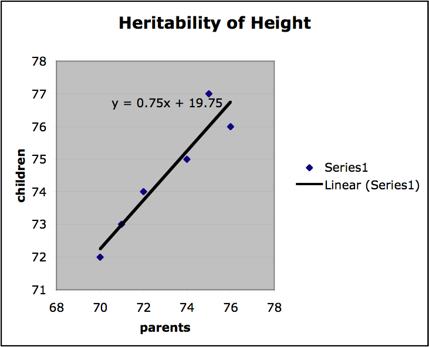
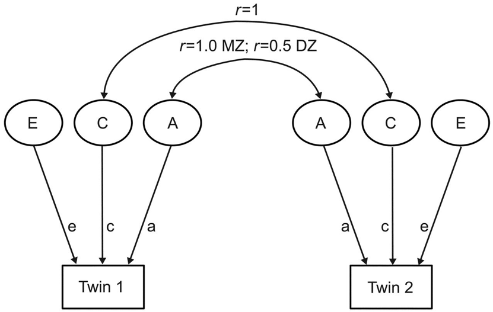
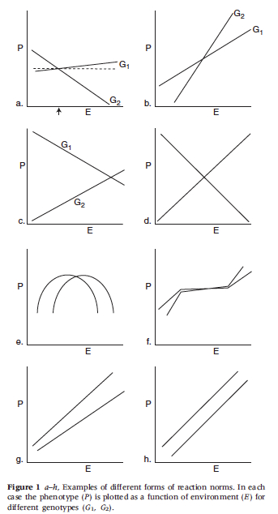

# Heritability
**First published Tue Feb 27, 2024**

*Downes, Stephen M., Matthews, Lucas*

[*Editor's Note: The following entry replaces and is based on the former entry titled [Heritability](https://plato.stanford.edu/archives/win2023/entries/heredity/).*]

A heritable trait is most simply an offspring’s trait that resembles the parents’ corresponding trait more than it resembles the same trait in a random individual in the population. Inheritance or heredity was a focus of systematic research before its inclusion as a key concept within evolutionary theory. The systematic study of heredity in the 20ᵗʰ century focused on the gene as the unit of heredity. (There is a vast amount of helpful work on the history of heredity including Keller (2002)[^keller-2002], Griesemer (1994)[^griesemer-1994], Morange (1998), Moss (2003)[^moss-2003], Sapp (2003), Sarkar (1998)[^sarkar-1998], Wade (1992)[^wade-1992], Winther (2000; 2001)[^winther-2000][^winther-2001] and contributors to Buerton et al. (eds.) (2000).) Two traditions now dominate the study of heredity: population genetics and molecular biology. The notion of a quantitative measure of the heritability of any given trait comes from population genetics and heritability measures are commonly used in behavioral genetics (Plomin et al. 1990 and Plomin et al. 1997 and see Panofsky 2014, Tabery 2014, Taylor 2014 and Turkheimer 2000 for critical reflection on behavioral genetics and heritability analysis)[^panofsky-2014][^plomin-1990][^plomin-1997][^tabery-2014][^taylor-2014][^turkheimer-2000]. The idea that what is inherited is a stock of DNA, or the information contained in the DNA sequence, comes from molecular biology.

Philosophical discussions of heredity have predominantly focused on the sustainability of heritability analyses. Here we introduce the concept of heritability, its theoretical history, alternate approaches to determining the heritability of traits and the philosophical problems associated with these alternate approaches.

## 1. Terminological issues

The term “heritable” applies to traits that vary in the population and are more similar in parents and offspring than they are in randomly selected individuals in the population. We inherit numerous attributes from our parents including their religious beliefs and, if we are lucky, their vast fortunes. The kinds of hereditary traits that biologists are interested in are those that are reliably transmitted from one generation to the next as a matter of biology. Darwin (1859 [1968]), working without the advantages that genetics would later bring, discussed hereditary traits at the level of phenotypes. Darwin demonstrated that natural selection sorts among hereditary variations, for example, the height of an organism, its weight, the color of its coat and so on. Most contemporary discussions of heredity constrain hereditary traits to those that can be demonstrated to be passed on genetically. The concept of “heritability” was introduced “to quantify the level of predictability of passage of a biologically interesting phenotype from parent to offspring” (Feldman, 151). Heritability is usually assessed by complex statistical analysis, careful experimentation, or both.

Discussions of heredity invite confusions between mechanisms responsible for individual development and mechanisms responsible for the transmission of traits from one generation to the next. Genes are the standard units of inheritance discussed in biology. Genes are also taken to be the most important causal component in the development of an organism’s traits. Methods derived from population genetics to assess heritability provide no information about the causal mechanisms contributing to the development of an individual’s traits. Population geneticists study the patterns of transmission of traits in populations from one generation to the next. Molecular biologists identify coding sequences of DNA and hence the proteins that these sequences produce in the developing organism. Working together, molecular biologists and population geneticists can produce a convergent account of a particular gene, providing both its pattern of transmission and an account of its role in development. For example, medical geneticists may discover a pattern of inheritance for a disease in a family that leads them to hypothesize that there is a gene (or a number of genes) responsible for the development of the trait in individual humans. Molecular analysis may then lead to the discovery of a sequence of DNA that codes for an unusual protein that is in part responsible for the development of the symptoms of the disease. Finally, population genetics techniques, such as heritability analysis, may then be applied to mechanisms discovered by molecular biologists (See e.g. Visscher et al. 2008)[^visscher-2008].

## 2. Heritability and Population Genetics

Mendelian genetics provides laws that govern the passing on of discrete traits from one generation to the next. For example, Mendel experimentally demonstrated particular patterns of inheritance for smooth and wrinkled peas in a population of pea plants (See Olby 1979 for a discussion of Mendel’s own specific contributions to genetics and Kampourakis 2024 and Raddick 2022 for reflections on Mendel’s contributions and how we should understand them in the context of contemporary genetics.)[^kampourakis-2024][^olby-1979]. Discrete or discontinuous traits contrast with continuous or quantitative traits. Height in humans and leaf number in trees are continuous traits. Continuous traits vary on a continuum that can be represented as a normal distribution, graphed as a bell curve. Most philosophical discussion about heredity and heritability arises from the study of continuous traits.

The study of quantitative or continuous traits can be carried out by looking simply at phenotypes. For example, if a population of plants varies in height we can ask how much of this variation is due to genes. Assessing the proportion of the variation of a trait in a population that is due to genes is achieved by a statistical method called the analysis of variance (ANOVA). Once this analysis has been carried out a simple formula provides a number between 0 and 1 that is the heritability measure for the trait in question. We use a few simple examples to illustrate the important concepts involved in producing heritability measures.

Before we consider the analysis of variance and its contribution to heritability measures, it is helpful to understand the general concept of heritability. Heritability is taken to be a measure of genetic influence on variation by both behavior geneticists and animal breeders. On this account, if a trait has high heritability, its varying from individual to individual in a population can be explained genetically. Plomin (2018)[^plomin-2018][^plomin-2018-2] and other behavior geneticists adopt this account, whereas Schaffner proposes a weaker construal: “Heritability estimates […] are meant to indicate how much of the phenotypic variation in the population is due to genetic variation” (2016, 10)(See also Longino, 2013.)[^longino-2013] An imaginary example illustrates one way of assessing heritability. Say we have two students from a class and student *a* is 6′2″ and student *b* is 4′2″. To discover the influence of genes on height, we could clone both students and then swap the clones’ environments and see what happens. In the figure below, the environments that *a* and *b* grew up in are $\rE a$ and $\rE b$. Clones of *a* and *b* are $\rC a$ and $\rC b$.

$$ \begin{array}{cccl} & \rE a & \rE b & \text{Height results} \ldots \\ \hline 1 & \rC b=4^{\prime}2^{\prime\prime} & \rC a=6^{\prime}2^{\prime\prime} & \text{from genes} \\ \hline 2 & \rC b=5^{\prime}8^{\prime\prime} & \rC a=5^{\prime}8^{\prime\prime} & \text{from genes and environment} \\ \hline 3 & \rC b=6^{\prime}2^{\prime\prime} & \rC a=4^{\prime}2^{\prime\prime} & \text{entirely from environment} \\ \hline \end{array} $$

Figure 1.

A scenario like 2 is the most likely outcome. Of course we can’t clone humans (or faithfully replicate the environments they grow up in). We can, however, do this with plants and other kinds of experimental organisms and as a result we can get a good sense of the contribution of genes to variation in a phenotypic trait.

Heritability can be estimated in humans by comparing resemblance in the phenotypic traits of twins (See Section 4. For a more detailed discussion of twin studies.) or other pairings of genetically related individuals (e.g. siblings, parents, cousins, etc.). Twin studies make the following assumptions: Monozygotic, (identical), twins share all their genes and their environment but dizygotic, (fraternal), twins share half their genes and their environment. For any given trait, say height, we get the following results:

> a) If heritability is high and variation is due mostly to genes, then monozygotic twins will be closer in height than fraternal twins.

> b) If heritability is low and variation in height is due mostly to the environment, then monozygotic twins will be as different in height from one another as dizygotic twins.

Finally, we can get a sense of the heritability of a trait by finding the slope of the regression line on the plots of offspring value for a trait graphed with parental value. If the slope is 1, the trait is entirely genetic and if the slope is 0, then the trait is not genetic at all. If the variation among individuals is due to variation in their genes, then offspring ought to resemble their parents. Heritability is always a value between 1 and 0. In the graph below (Figure 2.) values for mid-parent height and mid-offspring height are plotted for a small sample population (mid-parent height is the average of the height of both parents). The slope of the regression line is .75, which indicates high heritability. (It should be stressed that this is a very informal presentation of this kind of estimation of heritability and for this approach to provide any useful results important constraints on the nature of the population and the relevant environment would have to be satisfied.)

*Figure 2.*

So far we have introduced methods of measuring or calculating heritability that are somewhat intuitive. The problem is that these methods do not acknowledge all that is involved in the production of variation in the quantitative traits of organisms in a population. If we stick to the example of variation in height in a sample population of humans, we will discover that in most representative samples, heights are distributed more or less normally. The variance in height is defined as the average of the squared difference between each measured height and the mean height for the population. Variance in phenotype or phenotypic variance is symbolized as $V_P$. (From here until the end of this section we adopt a specific strategy for presenting the equations used in spelling out heritability relations. We start out, with equation (1) below, by presenting the simplest version of the relevant equations. Simple equations such as (1) below are rarely ever satisfied but are routinely presented as adequate in elementary introductions to behavioral genetics. Subsequent equations in the sequence below render the relevant situation more accurately. Population geneticists endorse variants of (1′) below and do not endorse (1).)

$$\tag{1} V_P = V_G + V_E $$

Equation (1) simply says that the phenotypic variance is the variance due to genes plus the variance due to the organisms’ environment. Behavioral geneticists and psychologists introduce heritability in the following way: Heritability is the proportion of phenotypic variance that is attributable to genotypic variance: heritability $= \bfrac{V_G}{V_P}$ (Some also talk of “environmentability”, which is $\bfrac{V_E}{V_P}$.)

This notion of heritability is called broad sense heritability, $h_b^2$ , and is “the proportion of phenotypic differences due to all sources of genetic variance” (Plomin 1990, 234)[^plomin-1990]. Narrow sense heritability, $h^2$, is “the proportion of phenotypic variance due solely to additive genetic variance” (Plomin 1990, 234)[^plomin-1990].

$$\tag{2} h_b^2 = \frac{V_G}{V_P} $$ $$\tag{3} h^2 = \frac{V_A}{V_P} $$

“Additive genetic variation $(V_{A})$ is variation among individuals due to the additive effects of genes” (Freeman and Heron, 206). For example, variation in height of organisms could result from the contribution of several alleles at a locus where each allele contributes more height to the organism. More precisely, allele *A* could contribute .5 units to an organism’s height, allele *a* another .5 units and so on. A contrast with additive genetic variance is dominance variance $(V_{D})$. In this case, say two alleles (*A* and *a*) are responsible for the organism’s height. An organism with *aa* is 1.0 units high, an organism with *AA* is 2.0 units high but an organism with *Aa* is also 2.0 units high. Total genetic variance, $V_G$, is actually the sum of all the genetic variance. In the simplified case presented here this is

$$\tag{4} V_G = V_A + V_D $$

The implied equation for $V_P$ from the discussion so far is

$$\tag{\(1^{\prime}\)} V_P = V_A + V_D + V_E $$

But this equation still oversimplifies the situation and requires more refining to deal with quantitative traits. Variance in phenotype can result from gene interaction effects, or epistatic variance, $V_{I}$. This occurs when alleles at one locus have an effect on the phenotype that is dependent upon alleles at one or more other loci. Further, there may be a contribution to phenotypic variance from gene/environment interaction, $V_{G\times E}$ (See Tabery 2014 for a detailed discussion of gene/environment interaction.)[^tabery-2014]. This occurs when the effect of the environment on the phenotype differs between genotypes. Finally, $V_P$ can be affected by non-random correlations between genotypes and environments referred to as gene-environment covariation, $\COV(G,E)$. For example, if plants with a genotype that tends to produce large plants also select nutrient- rich environments, by root growth or seed dispersal, and plants with a genotype that tends to produce small plants also select nutrient- poor environments, the variance in height would be increased. If the relation were switched the variance would decrease (Futuyma 1998)[^futuyma-1998]. Factoring all the above in we now have the following:

$$\tag{\(1^{\prime\prime}\)} V_P = V_A + V_D + V_I + V_E + V_{G\times E} + \COV(G,E) $$

And

$$\tag{\(4^{\prime}\)} V_G = V_A + V_D + V_I $$

The assumption made by many evolutionary biologists is that $V_I, V_{G\times E}$ and $\COV(G,E)$ are generally small and the most important component of variance from an evolutionary standpoint is $V_A$. Evolutionary biologists, psychologists and behavior geneticists are all interested in $h^2 (= \bfrac{V_A}{V_P})$ but for different reasons. Psychologists and behavior geneticists are interested in the contribution of genes to human psychological traits whereas evolutionary biologists (and animal breeders) often use heritability measures to predict and measure the response of a trait to selection (See Lynch and Walsh 1998, 50)[^lynch-1998]. The relevant equation here is

$$\tag{5} h^2 = \frac{R}{S} $$

where, *R* is response to selection and *S* is the selection differential. Heritability in this context is referred to as realized heritability.

Philosophical discussion over measuring heritability has arisen mostly from the use of $h^2$ measures in behavioral genetics and psychology. Much of this discussion takes off from a paper by Lewontin (1974)[^lewontin-1974] in which he argues that the analysis of variance cannot provide us with answers to questions about how much genes contribute to variance in a given trait. Before we turn to this and related discussions, we provide more detail on how heritability is measured in humans.

## 3. Measuring heritability: From Galton to GWAS

Francis Galton promoted a version of Darwin’s account of inheritance that clearly identified an internal, material contribution to hereditary traits. He proposed the distinction between nature and nurture, arguing that traits due to nature were the products of inherited biological material. He also was the first to propose the study of human twins as a way of understanding the contribution of nature, as opposed to nurture, to human traits (Burbridge 2001; see also Kronfeldner 2018)[^burbridge-2001][^kronfeldner-2018]. Galton’s early work set the basis for a paradigm in behavior genetics: twin and family studies. In studies of plants and other organisms, genetic makeup and environment can be systematically varied to assess the relative impact of genes and environment on phenotypic traits. Twin studies are human behavioral geneticists’ analogue to such experiments (See Shaffner 2016)[^shaffner-2016]. By tracking similarities and differences between groups of genetically related individuals reared in similar environments, twin and family studies permit some scientific investigation into sources of variance attributable to genetics and environment. Downes and Turkheimer (2021) lay out some of the early history of twin studies that long predate the use of the ACE model. Twin researchers, such as Holzinger had a measure they originally labeled $t^2$, which “measures the relative influence of A [nature] to B [nurture] factors in producing differentiation” (Holzinger 1929, 247). Holzinger and colleagues (See e.g. Newman et al. 1937, 115) turned to using $h^2$ instead of $t^2$ but did not call their measure heritability (their $t^2$ provided measures in numbers above zero and $h^2$ provided measures between 0 and 1). They used a similar equation to “Falconer’s formula” (discussed below) to generate their $h^2$.

The predominant tool for twin studies practitioners since the late 1970’s is the statistical ‘ACE model’ (Figure 3.).

*Figure 3.*

The ACE model is a factor analytic model that partitions phenotypic variance (represented with boxes) into three latent components (represented with circles). The first latent factor, ‘A’ represents ‘additive’ genetic variance and captures genetic similarities and dissimilarities between twin pairs, as monozygotic (MZ) ‘identical’ twins share roughly 100% of their DNA while dizygotic (DZ) ‘fraternal’ twins share roughly 50% of their DNA, just like normal siblings. The component ‘*C*’ represents ‘common’ environment, signifying environmental variance that is shared by twin pairs reared together. For example, because both MZ and DZ twin pairs live in the same home, the correlation between their shared environment equals 1. Finally, ‘*E*’ represents ‘unique’ or non-shared environmental variance, capturing environmental variables that vary between twin pairs. In effect, it is the environmental variation that is not shared by twins outside the home which ends up getting couched as ‘*E*’, as is the case when twins attend different institutions or undergo different life events.

The ACE model, depicted in Figure 3., is a visual representation—in the form of a path analysis—of the underlying mathematics of heritability estimation, known as ‘Falconer’s formula’ (Falconer and McKay 1998). (Interestingly, Falconer himself introduced this idea informally and then rejected it as an inadequate way of estimating heritability on the grounds that it ignored non-additive genetic variance, which he thought to be an unreasonable assumption (Falconer 1960)[^falconer-1960] (See Downes and Turkheimer 2021).) The formula is derived from an observed population statistic: the phenotypic correlation between pairs of MZ and DZ twins. For any phenotype the MZ correlation or ‘$r_{\MZ}$’ is typically higher than the DZ correlation or ‘$r_{\DZ}$’. Perhaps unsurprisingly, genetically identical twins are more similar than fraternal twins. The implication is that the greater the genetic similarity, the greater the phenotypic similarity. Thus, narrow-sense, quantitative genetic heritability is intuitively defined as the *difference* between MZ and DZ correlations: the greater the difference, the higher the heritability. On the flip side, if there is minimal difference between MZ and DZ correlations, it would imply that genetics have little to do with variance in the trait in question, and result in a low heritability estimate.

Falconer’s formula starts from the simple observation that MZ twin pairs share two of the three components in common: 100% of their genes and 100% of their common environment. Thus, MZ correlation are treated as the sum of A and C:

$$ r_{\MZ} = A + C$$

Similarly, DZ twin pares share 100% of their common environment, but only half their genetic relatedness. Thus, the DZ correlation is the sum of half additive genetic variance and common environment:

$$r_{\DZ} = \frac{A}{2} + C$$

Here is Falconer’s formula for heritability estimation, which calculates the difference between MZ and DZ correlations:

$$A = 2(r_{\MZ} - r_{\DZ})$$

And here is the formula for estimating shared environment (*C*):

$$C = 2 r_{\DZ} - r_{\MZ}$$

Finally, non-shared environment may be derived from the assumption that genetic similarity, shared environment, and non-shared environment comprise the total variance in an observed trait, giving:

$$E = 1- r_{\MZ}$$

Consider the following example. In a twin study, one conducts a study of height, revealing that $r_{\MZ} = .95$ and $r_{\DZ} = .55.$ With this information, the basic techniques of quantitative genetics may be used to partition said variance into sources attributable to shared genetics or environments. Starting with heritability:

$$ \begin{align} A & = 2(r_{\MZ} - r_{\DZ})\\ A & = 2(.95-.55)\\ A & = 2(.4) \\ A & = .8 \\ \end{align} $$

Although philosophically contentious (for reasons discussed below), the outcome above suggests that 80% of the variance in height in the studied population of twins reared together is attributable to genetic differences. To estimate non-shared environment (*C*), recall the formula derived earlier:

$$ \begin{align} C & = 2r_{\DZ} - r_{\MZ}\\ C & = 2(.55) - .95\\ C & = .15\\ \end{align} $$

Finally, total variance in height attributable to non-shared environment:

$$ \begin{align} E & = 1 - r_{\MZ}\\ E & = 1 - .95 \\ E & = .05\\ \end{align} $$

In this example, 80% of the variance in height is attributable to additive genetics (*A* = .8), 15% to shared environment (*C* = .15), and 5% to non-shared environment (*E* = .05).

Research on heritability is currently undergoing a major transition. For nearly a century, heritability has been estimated in the ‘traditional’ sense, through twin and family studies, which are silent with respect to the underlying biological units of genetic transmission. Twin and family studies and the ACE model, that is, proceed from coarse-grained assumptions about genetic relatedness: MZ twin share roughly 100% of their genetic material, DZ just half. It wasn’t until Watson and Crick’s co-discovery of the double helical model of DNA that geneticists could refine heritability estimation with attention to biological details. Too much has happened since the discovery of DNA to detail here, such as linkage analysis and candidate gene studies, but a few key developments are integral to understanding the most recent approaches to estimating heritability.

First, all modern approaches to heritability estimation are constructed from empirical data on single nucleotide polymorphisms (SNPs). In effect, SNPs are the fundamental units of genetic differences that occur between individuals and are assumed to be scientifically informative. While genetic sequences between humans are greater than 99% identical, SNPs are the points that differ. SNP chips, derived from blood or saliva samples, allow researchers to acquire a large set of SNPs for an individual. Early SNP chips tracked up to 500,000 variants across the genome; recent technology allows for detection in excess of millions of SNPs.

With the development of fast and affordable SNP chips within the past 20 years, geneticists now have the ability to assess large populations for DNA-based differences between individuals, which confers a new approach to estimating heritability (Mills et al., 2020)[^mills-2020]. The first human genome sequence cost around \$1 billion but now entire genomes can be sequenced for between \$200 and \$2000, rendering lots of genomic data relatively cheaply. SNP chips standardly contain a fraction of each genome and are now very cheap to produce. Through a large family of approaches, genome wide association studies (GWAS) identify statistical associations between SNPs and thousands of phenotypes, from physical traits (e.g., height, weight, BMI, etc.) to behavioral and psychiatric traits (e.g., IQ, schizophrenia, depression, etc.) and, more recently, to social and behavioral outcomes (e.g., educational attainment, household income, and math ability). Most GWAS are conducted as case-control studies: SNP profiles are collected from one population of individuals who share a trait (such as high ADHD or macular degeneration) and these are compared to the SNP profiles of a control population lacking in the trait under investigation.

GWAS identify SNPs that are statistically correlated with phenotypes of interest. After nearly a century of twin and family studies consistently demonstrating relatively high heritability of traits, there was some expectation within the behavioral genetics community that early GWAS would find similarly large SNP-heritabilities. GWAS results in this respect have been disappointing. For example, while twin studies indicate that roughly 50% of the total variance in cognitive ability is explained by genetic differences, individual SNPs associated with cognitive ability typically explain less than .04% total variance.

## 4. Polygenic Scores and SNP-heritability

Given the disappointing proportions of variance accounted for by individual SNP hits identified by GWAS, behavior geneticists and researchers in socio-genomics have developed polygenic risk scores (PRS) or, more recently, polygenic scores (PGS) (The term polygenic index (PGI) is also used by some researchers for the same measure.). In the simplest form, a PGS represents a sum of the many, miniscule effects of all SNPs significantly associated with a phenotype of interest (See Mills et al., 2020, 105)[^mills-2020]. With N referring to the number of statistically significant SNPs, and *$β_i$* as the beta (or effect size) of each individual variant (*i*) for an individual sample of DNA (*j*), a basic polygenic score is calculated using the following formula:

$$PGS_j = ∑_i^Nβ_i$$

In an effort to increase the amount of phenotypic variance accounted for by GWAS results, Yang et al. (2015) developed genome complex trait analysis (GCTA), now referred to as ‘SNP-based heritability’ or ‘SNP-heritability’ presented as h²_{SNP} (Mills et al. 2020)[^mills-2020]. SNP-heritability typically refers to the proportion of phenotypic variance accounted for by available SNPs (Mills et al. 2020)[^mills-2020]. While traditional heritability is estimated from coarse-grained genetic similarity of related individuals, SNP-heritability is estimated from fine-grained genetic similarity of unrelated individuals. SNP-heritability is assessed by using a family of highly sophisticated statistical techniques that seek to maximize proportions of phenotypic variance attributable to observed or imputed SNP variants (See Mills et al. 2020 for an introduction to some of these techniques)[^mills-2020].

SNP-heritability exhibits a few features worth attention. First, instead of limiting analysis to SNPs that meet the strict p-value GWAS significance threshold, SNP-heritability is derived by analyzing the complete set of SNPs for each participant sample, even those that are not associated with the trait of interest. To this end, SNP-heritability is biologically non-obvious. Second, SNP-heritability assumes linear additivity of SNP effects. Third, SNP-heritability represents the current limit on the total variance that could be explained by SNPs, for any given phenotype. So, for example, if a polygenic score were maximally predictive, it would be equivalent to SNP-heritability. Fourth, SNP-heritability is consistently lower than twin heritability, for any behavioral trait. This gap between twin heritability and SNP-heritability is sometimes referred to as the missing heritability problem, which we discuss below.

## 5. Philosophical issues arising from twin studies and heritability analysis

Discussions of the viability of heritability measures were very heated in the 1970s and 1980s. In the 1970s discussions about IQ and race came to a head (this issue was revisited in the 1990s with the publication of Herrnstein and Murray (1994)), and in the late 1970s and early 1980s sociobiology came under critical scrutiny. Both proponents of the hereditary nature of IQ and sociobiologists made a connection between human behavioral traits and genes. Hereditarians in the IQ debates explicitly relied upon twin heritability analyses such as those introduced above. Critics of sociobiology and hereditarianism over IQ included biologists, philosophers and many social scientists as well as many left-leaning political and social activists (See Gould (1981), Paul (1998)[^paul-1998] and Segerstråle (2000)[^segerstråle-2000] for some of the relevant history here).

The point of departure for many philosophers criticizing heritability analysis is Lewontin’s (1974)[^lewontin-1974] paper on the analysis of variance. (It is worth noting that Lewontin’s paper is somewhat informal and should perhaps be best viewed as Lewontin’s attempt to pass on the received wisdom among population geneticists at the time to a wider audience. The formal arguments Lewontin alludes to are presented in a number of places including Layzer (1974)[^layzer-1974] (and later Kempthorne (1978)[^kempthorne-1978]) and precursors to these arguments can be found in Hogben (1933)[^hogben-1933] and can also be found in R.A. Fisher’s work (See also Sarkar 1998)[^sarkar-1998].) Lewontin claims that equation $(1^{\prime\prime}$) above presents the most accurate picture of the contributions to phenotypic variance. He goes on to argue that $V_{I}, V_{G\times E}$ and $\COV(G,E)$ are not negligible (a point Falconer had already made in 1960, as noted above)[^falconer-1960]. In fact, Lewontin argues that these are always part and parcel of the variance in traits. As a result, apportioning the phenotypic variance between genes and environment is no easy matter and standard analyses of variance simply cannot come up with useful and informative values for $h_b^2$ and $h^2$. Lewontin also points out that many proponents of heritability measures mistakenly attribute the heritability values to individuals rather than populations. Further, he argues that norms of reaction gave a more accurate picture of the relations between genes, environment and phenotypic traits. A norm of reaction is a graph of a quantitative phenotype plotted as a function of environment for different genotypes (See Figure 4. below, from Lewontin 1974)[^lewontin-1974]. Many philosophers and biologists have extended and refined Lewontin’s criticism of the analysis of variance (e.g. Block 1995, Kitcher 1985, Sarkar 1998, Sober 1988, Northcott 2006)[^block-1995][^kitcher-1985][^northcott-2006][^sarkar-1998][^sober-1988] and most share his conclusions that heritability measures are hard to come by and that norms of reaction are a superior way to examine gene/environment interactions.

*Figure 4.*

Lewontin (2006)[^lewontin-2006] later adds “The point of the (1974) paper was to explain why the statistical partitioning of observed variation in phenotype into variance associated with variation in genetic relationship as opposed to variance assigned to environmental dissimilarities does not, in fact, separate genetic and environmental causes in development” (2006, 536). He adds that advances in molecular genetics now make it “possible to provide a detailed molecular analysis of the chain of causation between nucleotide substitution and cell development and function” (Lewontin, 2006, 536)[^lewontin-2006]. (Sober (1988)[^sober-1988] also emphasizes this aspect of Lewontin’s criticism of the analysis of variance.) Lewontin makes clear what he takes genetic causation to be: the causal chain from a DNA sequence to a protein product taking place within cells of organisms. His point is that statistical methods of population genetics and behavioral genetics alone are not appropriate to the task of revealing genetic causes construed this way. We revisit this issue in Section 6. recast in light of GWAS and other “molecular” techniques of measuring heritability.

One response to these kinds of criticisms is to emphasize caution in the use of heritability measures and to re-emphasize Lewontin’s point that such measures do not provide information about the traits of individuals (See e.g. Plomin et al. 1990; 1997, Hamer and Copeland 1998)[^hamer-1998][^plomin-1990]. Kitcher (1985)[^kitcher-1985] pointed out in response to this line of defense that words of caution do not seem to be enough and many behavioral geneticists and psychologists still talk as if they can discover the genetic components of human behavioral traits by using heritability analyses. A second line of response is to argue that norms of reaction are almost impossible to generate for complex human traits and, as a result, are not a serious contender in the business of ascertaining the genetic causes of human traits. Lewontin himself introduced this problem for norms of reaction. In organisms whose genotypes and environments can be exhaustively manipulated, a norm of reaction for a particular trait can be produced. Lewontin cites early work on *Drosophila* larvae’s responses to temperature as pioneering work of this kind. The problem for most human traits, particularly human behavioral traits, is that we have no clear sense of either what the relevant genes to examine are or what the range of relevant environments is. This response need not necessarily blunt Lewontin’s critical attack on heritability measures, as in cases where a norm of reaction can be reliably produced, we do have more information about the relations between genes and environment than can be provided by a standard analysis of variance. Further, attempts to experimentally partition the contribution of genetic variance to phenotypic variance run into problems for human traits similar to the problems presented by attempts to generate norms of reaction. The examples in Section 2. above are artificial for a reason: it is hard to establish the relevant genotypes and environments that lead to variance in human traits. The current consensus among philosophers of biology is that heritability analyses are misleading about the genetic causes of human traits but Pearson (2007)[^pearson-2007] provides a cautious defense of the explanatory usefulness of heritability analyses. Omri Tal also presents modest defenses of heritability via his application of probability to heritability analysis. He does this both in cases in which there is assumed to be no gene-environment interaction (2009) and in cases in which there is gene-environment interaction (2011). Sesardic’s (1993 and 2005) work stands in stark contrast both the anti-heritability consensus and the moderate and carefully measured support for heritability provided by Pearson and Tal. Sesardic strongly supports heritability analyses and vehemently criticizes critics of heritability analysis. In recent years other philosophers have come to defend causal interpretations of heritability, such as Lynch and Bourrat (2016). Bourrat (2019)[^bourrat-2019], in particular, considers causal interpretations of heritability using an interventionist framework of causation. Finally, work on norms of reaction (see e.g. Pigliucci 2001)[^pigliucci-2001] since Lewontin’s invoking of the measure reinforces his point about the information that can be gained from such analyses.

There is something of a consensus in many fields (e.g. philosophy of biology, evolutionary biology and population genetics) that heritability measures only have a very limited use (Downes and Kaplan (2022) provide a recent expression of this view). The consensus among philosophers of biology is that broad heritability measures are uninformative but there are a few dissenting voices (e.g. Sesardic 1993 and 2005, Pearson 2007 and Tal 2009 and 2011)[^pearson-2007][^sesardic-1993][^sesardic-2005][^tal-2009][^tal-2011]. (The notion of consensus used here is informal, techniques in science studies and experimental philosophy of science could be used to test claims of consensus.) Kaplan (2000)[^kaplan-2000] provides an introduction to heritability and its use in behavioral genetics. Sarkar (1998)[^sarkar-1998] presents a sophisticated (and technically quite difficult) treatment of arguments against heritability. Freeman and Heron (1998) present a clear analysis of the problems with the use of heritability measures by proponents of the connection between IQ and race (understanding this analysis requires some knowledge of statistics). Block (1995)[^block-1995] presents an overview of arguments against the use of heritability measures in the IQ and race literature. This overview is helpful and specifically designed for a non-technical audience. Sober (1988)[^sober-1988] presents a defense of Lewontin’s (1974)[^lewontin-1974] criticism of the use of the analysis of variance in assessing the role of genes in the formation of traits of individuals and Northcott (2006)[^northcott-2006] provides further helpful analysis of Lewontin’s and Sober’s work. Both Tabery (2014)[^tabery-2014] and Taylor (2014)[^taylor-2014] provide sustained criticism of heritability analysis via their alternate reflections on the nature/nurture debates. Finally, Turkheimer (2000)[^turkheimer-2000] provides a critical perspective from within behavior genetics on the value of heritability measures derived from twin studies.

Sesardic’s recent work is a criticism of those who invoke Lewontin-style arguments against heritability analyses. He argues in favor of hereditarianism by attacking its critics. He summarizes his complaint as follows: “For some reason in [the heritability] debate philosophers have displayed a surprising lack of intellectual curiosity and analytical acuity” (2005, 9). This is because “they hastily accepted anti-hereditarian arguments that possessed only superficial plausibility” and “are often poorly informed about basic scientific facts in the very domain of their explorations” (2005, 9). Sesardic’s criticism is polemical and does not introduce any new techniques in heritability analysis to the philosophical audience. Rather, he relies on a recapitulation of earlier views, such as those of Jensen, one of the original targets of Lewontin’s critique. There are several spirited responses to Sesardic’s book (Tabery’s 2006 and 2009b reviews are examples)[^tabery-2006][^tabery-2009b] and Gri Oftedal (2005)[^oftedal-2005] presents a clarification of the issues at stake between Sesardic and Lewontin.

Part of what is at stake between followers of Lewontin and Sesardic is whether or not $V_{GxE}$ and other components of variance are negligible or significant. This issue is not purely philosophical and can and has been tackled experimentally. Tabery (2009a and 2014) draws attention to a longitudinal study by psychologists Caspi and Moffitt, who show GxE effects in a longitudinal study of human anti-social behavior disorders, in support of a view in line with Lewontin’s. Douglas Wahlsten also pursues this issue in much of his experimental work (Wahlsten 1990 summarizes his theoretical views and Wahlsten and Gottlieb 1997 is a good survey of some of the relevant experimental work on animals)[^wahlsten-1990][^wahlsten-1997]. Further, understanding gene-environment covariance, $\COV(G,E)$, as part of heritability has led some to incorrectly attribute environmental effects on phenotype to genes. Dickens and Flynn (2001) use an example of basketball playing ability, which they label BP, to make this point. They argue that if we assume that BP is highly heritable, there still appears to be a large environmental component to BP. On their account, this makes sense is we take gene/environment covariance seriously. Just as our tall plants, in Section 2. above, can end up in nutrient rich environments that shorter plants do not, tall, athletic individuals are often placed in environments that enhance their BP. As Dickens and Flynn point out, identical twins who are tall and athletic, including those separated at birth, could have parents who play basketball with them or could be placed in basketball training regimens in school or college. In these situations each individual’s BP would increase but it is wrong to attribute this increase in BP to genes for height and athleticism, since the relevant environment has a significant influence on the phenotype.

There is some irony in the fact that philosophers of biology, who focus their attention almost exclusively on evolutionary biology, are critics of heritability. Heredity is a central component to evolutionary change and heritability analysis, particularly via the notion of realized heritability (see equation (5) above), is an important component of theoretical evolutionary biology (See Lynch and Walsh 1998)[^lynch-1998]. Much of the critical attack on heritability arises against the background of nature/nurture debates (see e.g. Tabery 2014)[^tabery-2014] and concerns over genetic determinism and is best understood as a critical appraisal of behavioral genetics in psychology. There is growing interest among philosophers in critically assessing the notion of heritability in its evolutionary context. The notion of realized heritability is briefly discussed by Samir Okasha (2006)[^okasha-2006] (See also Downes 2010)[^downes-2010] and by Sober (2008)[^sober-2008]. Until recently, thorough discussion of the relations between heritability and other central concepts of evolutionary theory was pursued exclusively by evolutionary biologists (See e.g. Lynch and Walsh 1998 and Rice 2004)[^lynch-1998][^rice-2004]. Peter Visscher et al.’s (2008) review article is a nice introduction to much of the work in this area. Philosophers have now presented and defended some radical claims about heritability and heredity including the claim that evolution can occur without heredity (see e.g. Earnshaw-Whyte 2012 and Bourrat 2013)[^bourrat-2013]. Focusing on heritability in the context of evolutionary theory is a productive area for philosophical research as evidenced by Bourrat’s (2014)[^bourrat-2014] examination of the role of heritability in the recipe approach to evolution by natural selection. Finally, further expanding philosophical perspectives of heritability in evolutionary biology, Bourrat (2022) attempts to develop a ‘unified’ conception of heritability.

## 6. Philosophical issues arising from GWAS, PGS, and SNP-heritability

The lion’s share of philosophical discourse on heritability engages what, today, may be considered the prior paradigm of genetics: traditional twin study genetics. The development of alternative methods of estimating heritability (e.g., GWAS and SNP-heritability) has engendered both a return to old philosophical questions in light of new methods, as well as identification of novel philosophical issues arising from recent technological developments.

### 6.1 Revisiting Old Questions

A majority of philosophical discourse on traditional heritability can be roughly characterized with two questions. First, is heritability useful? Second, is heritability causal (i.e., does it elucidate causal relationships between genotypes and phenotypes)? Although these two questions are closely intertwined, they do capture distinct philosophical issues related to heritability that are now being re-examined in light of SNP-heritability. As of this SEP entry’s update, while the field’s interest is on the rise, only a limited number of papers have been published on this topic by philosophers.

Notably, the development of GWAS and SNP-heritability raises anew old philosophical questions regarding causal relationships. Researchers in the field are well aware of a handful of conceptual issues that provoke skepticism regarding the question of whether or not SNPs identified by GWAS are causal or not. John Dupré identifies GWAS as one among several approaches in the increasingly large effort to correlate genetic differences with phenotypic differences. He says that GWAS “uses the large amount of genetic data we now have about human populations to find correlations with medical outcomes — physiological and psychological disease” (2013, 285). Dupre goes on to say “as everyone involved in such research is aware, this is hardly a search for sufficient causes. GWAS will at best provide clues to the detailed causal processes involved in pathology” (2013, 286). Some GWAS researchers are more bullish on causation than Dupré indicates (See e.g. Plomin 2018)[^plomin-2018][^plomin-2018-2]. A well-known issue in population genetics, linkage disequilibrium, occurs when there is non-random association of alleles at different loci. GWAS researchers acknowledge that many of the SNPs of interest today are in linkage with many other SNPs in the genome. The implication is that it remains underdetermined whether SNPs are causal variants, or merely in linkage with causal variants (perhaps through evolutionary drift). It is also possible that the SNPs of interest are in no way casually relevant to the trait(s) under consideration.

There is also strong evidence that current GWAS are susceptible to population stratification. Because human populations exhibit ethnic or cultural subgroups with distinct allele frequencies, population stratification increases the likelihood that GWAS identify false positive SNPs (See Schaffner 2016). Not only is there evidence of population stratification among large groups of individuals of different biogeographic ancestries (Europeans, Asians, Africans), but populations are stratified within groups as well. For example, individuals of European descent would include both Parisians as well as English immigrants to the United States.

What may be the greatest impediment to causal interpretations of SNP-heritability is that GWAS and associated techniques have not yet led to many biological discoveries (See Turkheimer 2012)[^turkheimer-2012]. SNP-heritability is constructed using all genetic variants included in any given SNP chip, a significant portion of which are statistically insignificant. Moreover, although SNP-heritability purports to provide another genetic explanation of phenotypic variance, SNP-heritability has not led to the discovery of meaningful biological accounts or etiologies that would causally link patterns of nucleotides to patterns of complex human behaviors (See e.g. Meyer et al. 2023)[^meyer-2023]. Judea Pearl and Dana MacKenzie refer to GWAS as a “prototypical ‘big data’ method that allows researchers to comb through the whole genome statistically, looking for genes that happen to show up more in people with a certain disease” (2018, 339–340). They go on to say “It is important to notice the word ‘association’ in the term GWAS. This method does not prove causality; it only identifies genes associated with a certain disease in the given sample” (340). They echo our point here, in saying that the methods used in GWAS hamper efforts at making causal inferences.

Despite limited publications, there appears to be a growing consensus in the philosophical community that most, if not all, of the old problems with (or criticisms of) traditional heritability measures have not been obviated by the most recent developments in genomics (namely, GWAS, PGS, and SNP-heritability). PGS are embraced by many practitioners in medical genetics and behavior genetics due to their promise of delivering about genes causing traits in individuals, as opposed to rendering population measures. However, Sarkar (2023)[^sarkar-2023], for example, argues that, like traditional heritability, PGS are problematized by GxG and GxE interactions and, consequently, are not useful. Relatedly, Woodward and Kendler (2023) argue that PGS are not causal (although they can have useful applications). Serpico (2023)[^serpico-2023] argues that the idealizations built into the models that underlie PGS undermines their effectiveness and Tabery (2023)[^tabery-2023] contends that PGS will not deliver the precise predictions required for “personalized” medicine. Non and Cerdeña (2024), while more sanguine about applications of PGS in medicine than Tabery, recommend caution in the context of genetics of social and behavioral traits. On the other hand, practicing geneticists engaging in philosophical discourse argue that PGS are both causal and useful with respect to all traits (See e.g. Madole and Harden 2023)[^madole-2023]. Lynch (2021)[^lynch-2021] provides a useful overview of appeals to causal language in genetics. Further, Lewontin’s (1974)[^lewontin-1974] critical take on the generalizability of heritability — the problem of portability — has been likened to a similar problem of generalizability for PGS (Matthews 2022)[^matthews-2022][^matthews-2022-2].

### 6.2 The Missing Heritability Problem

The new methods used, and new kinds of evidence found, in the scientific examination of the relationship between genotype and phenotype have generated at least one novel philosophical problem, referred to as the missing heritability problem. The development of GWAS, PGS, and SNP-heritability has created a variety of different ways of measuring the purported influence of genotypes on phenotypes, in comparison to traditional heritability. At face value, the missing heritability problem arises out of a numerical gap between traditional heritability estimates and SNP-based heritability estimates of the same trait. For example, traditional heritability estimates for IQ obtained using twin and family studies range between .5 and .7 while SNP-based heritability estimates of IQ are currently no greater than .25 (Plomin and von stumm 2018)[^plomin-2018][^plomin-2018-2]. Missing heritability is greatest among complex, behavioral traits.

Since Maher (2008)[^maher-2008] first coined the term “missing heritability,” statisticians and geneticists have written extensively about the issue. In nearly all cases, contributors speak to possible explanations for why there is missing heritability and emphasize technological and methodological solutions that should close the numerical gap between traditional and SNP-heritability estimates (But see Turkheimer 2011)[^turkheimer-2011]. Explanations for missing heritability typically focus on various manners in which standard format GWAS are unable to track genetic effects that are unavoidably part and parcel of twin and family studies. Notably, contributors appeal to non-linear interactions between genetic variants (‘GxG interaction’, or epistasis). Epistatic interactions between SNPs entail that the effect of a given SNP will be modified (enhanced or diminished, for example) in the presence of another SNP, which violates the additivity assumption of SNP-heritability. Similarly, gene-environment interaction and epigenesis have been proposed as explanations for missing heritability (Zuk et al. 2012)[^zuk-2012]. Specific variants or groups of variants may have effects that are enhanced, diminished, or even muted with different environments, again violating the additivity assumption of SNP-heritability. Some missing heritability may be attributable to the presence of low-frequency, high-penetrance variants, which require massive samples to detect (Zuk et al. 2014)[^zuk-2014].

Philosophers have begun to engage the missing heritability problem in a variety of ways. First, Bourrat and Lu (2017) defend a deflationary approach to the problem by arguing that it is largely ‘dissolved.’ in two complementary steps. On the one hand, Bourrat and Lu indicate that the numerical gap between alternative methods of estimating heritability may be partially narrowed by decreasing traditional estimates, which have historically been charged as being overestimated. On the other hand, Bourrat and Lu argue that the numerical gap may be closed even more by altering SNP-heritability techniques so as to include non-linear and epigenetic factors that they claim are currently untracked by GWAS.

In contrast, Matthews and Turkheimer (2022) argue that the missing heritability problem is much more severe and prospective dissolutions are out of sight. Their analysis tracks the historical introduction of missing heritability by Maher, who commented on a broader challenge facing behavioral geneticists in the ongoing effort to explain, understand, and accurately predict the overwhelming complex relationships between genetic differences and complex behavioral differences, such as schizophrenia, depression, and intelligence. Matthews and Turkheimer offer a tripartite characterization of the problem, which treats the numerical gap between traditional and SNP-heritability as just one quantitative and independent leg of a multi-faceted problem. On their view, the remaining two legs of the problem regard prediction (the challenge of accurately predicting complex behavioral phenotype from molecular genotype) and mechanism (the challenge of elucidating meaningful causal-mechanical stories that link molecular genetic differences to complex behavioral differences). Although most behavioral geneticists, as well as Bourrat and Liu, focus their efforts on the numerical gap between alternative methods of estimating heritability, Matthews and Turkheimer emphasize that resolving the statistical problem will not advance predictions nor explanations of human behavior provided by heritability measures. Finally, Matthews and Turkheimer (2021) explore implications of the problem for topics in philosophy of biology, such as scientific pluralism.

## 7. Looking forward

The study of heritability has a long and rich history. Many scientific developments have led to refined techniques for estimating heritability and each of these scientific developments has been the focus of philosophical analysis. In recent years, empirical approaches toward the investigation and construction of heritability estimates have undergone great changes, especially with the introduction of GWAS, SNP chips, and SNP-heritability. These recent developments are beginning to see more attention from philosophers. There is need for more philosophical analysis regarding the nature of heritability and a fine-grained perspective of the differences between heritability derived from twin studies and SNP-heritability. In addition to philosophical arguments for, or against, causal interpretations of SNPs and heritability, scientists present their own cases, often appealing to sophisticated statistical techniques as sufficing for the identification of causal relationships in human genetics. Philosophers could profitably address such techniques — notably Mendelian randomization — with an eye for how they align with broader philosophical frameworks such as alternate accounts of causation (See e.g. Woodward and Kendler (2023) for new work in this area.).

As we noted above (Section 6.2), the advent of SNP-heritability gives rise to a new and interesting issue: the missing heritability problem. Although Matthews and Turkheimer (2021) have considered the implications of the missing heritability problem for debates about scientific pluralism, we expect that the implications are broader. More philosophical work here should prove to be productive.

Finally, heritability is unequivocally tethered to bioethics. To the extent that twin heritability estimates played a central role in debates about race science from the 70s through the 90s, the advent of SNP-heritability warrants a renewed assessment. Just as it was for twin heritability, SNP-heritability is now being used to assess old, controversial questions about the genetic basis of racial differences in intelligence and cognitive ability. As twin heritability and SNP-heritability are conceptually and methodologically distinct, there is demand for philosophers and scientists to re-assess the legitimacy of group-difference investigations that appeal to SNP-heritability.

## References（引用注释）

> 原文参考文献已转为脚注引用：文内“作者-年份”引用组后附 [^key] 标记，完整条目见本文末脚注定义。

## Academic Tools

> |   | [How to cite this entry](https://plato.stanford.edu/cgi-bin/encyclopedia/archinfo.cgi?entry=heritability). |
> | --- | --- |
> |   | [Preview the PDF version of this entry](https://leibniz.stanford.edu/friends/preview/heritability/) at the [Friends of the SEP Society](https://leibniz.stanford.edu/friends/). |
> |   | [Look up topics and thinkers related to this entry](https://www.inphoproject.org/entity?sep=heritability&redirect=True) at the Internet Philosophy Ontology Project (InPhO). |
> |   | [Enhanced bibliography for this entry](https://philpapers.org/sep/heritability/) at [PhilPapers](https://philpapers.org/), with links to its database. |

## Other Internet Resources

- [History of Recent Science and Technology](http://hrst.mit.edu/), includes a Bioinformatics site and a Molecular Evolution site.
- [Online Mendelian Inheritance in Man](http://www.ncbi.nlm.nih.gov/entrez/query.fcgi?db=OMIM).

## Related Entries

adaptationism | altruism: biological | Aristotle, General Topics: biology | biology: experiment in | biology: philosophy of | Darwinism | eugenics | evolution | gene | genetics: genotype/phenotype distinction | genetics: molecular | genetics: population | human genome project | information: biological | inheritance systems | innate/acquired distinction | molecular biology | natural selection | parenthood and procreation

### Acknowledgments

The authors would like to thank Eric Turkheimer for his helpful comments on this entry.

[^beurton-2000]: Beurton, P. J., R. Falk, *et al*. (eds.), 2000. *The Concept of the Gene in Development and Evolution*, Cambridge: Cambridge University Press.

[^block-1995]: Block, N., 1995. “How heritability misleads about race,” *Cognition*, 56: 99–128.

[^bourrat-2013]: Bourrat, P., 2013. “From survivors to replicators: Evolution by natural selection revisited,” *Biology and Philosophy*, 29: 517–538.

[^bourrat-2014]: –––, 2014. “How to read heritability in the recipe approach to natural selection,” *British Journal for the Philosophy of Science*, 66: 883–903.

[^bourrat-2019]: –––, 2019. “Heritability, causal influence and locality,” *Synthese*, 198: 6689–6715.

[^bourrat-2020]: –––, 2020. “Causation and Single Nucleotide Polymorphism Heritability,” *Philosophy of Science*, 87: 1073–1083.

[^bourrat-2017]: Bourrat, P. and Lu, Q., 2017. “Dissolving the Missing Heritability Problem,” *Philosophy of Science*, 84: 1055–1067.

[^burbridge-2001]: Burbridge, D., 2001. “Francis Galton on Twins, Heredity and Social Class,” The British Journal for the History of Science, 34: 323–340.

[^darwin-1859]: Darwin, C., 1859 [1968]. *The Origin of Species*, London: Penguin Books.

[^dickens-2001]: Dickens, W.T. and Flynn, J.R., 2001. “Heritability Estimates Versus Large Environmental Effects: The IQ Paradox Resolved,” *Psychological Review*, 108: 346–369.

[^downes-2010]: Downes, S.M., 2010. “Moving past the levels of selection debates: Review of Samir Okasha, *Evolution and the Levels of Selection*, Oxford, Oxford University Press (2006),” *Biology and Philosophy*, 25: 417–423.

[^downes-2022]: Downes, S.M. and Kaplan, J.M., 2022. “Changes in heritability: Unpredictable and of limited use,” *Behavioral and Brain Sciences*, 45: e159.

[^dupré-2013]: Dupré, J., 2013. *Processes of Life*, Oxford: Oxford University Press.

[^earnshaw-white-2012]: Earnshaw-White, E., 2012. “Increasingly Radical Claims about Heredity and Fitness,” *Philosophy of Science*, 79: 396–412.

[^falconer-1960]: Falconer, D.S., 1960. *Introduction to quantitative genetics*, New York, NY: Ronald Press.

[^feldman-1992]: Feldman, M.W., 1992. “Heritability: Some Theoretical Ambiguities,” *Keywords in Evolutionary Biology*, E. A. Lloyd and E. Fox Keller (eds.), Cambridge, Harvard University Press, 151–157.

[^freeman-1998]: Freeman, S. and J. C. Herron, 1998. *Evolutionary Analysis*, Upper Saddle River, NJ: Prentice Hall.

[^futuyma-1998]: Futuyma, D., 1998. *Evolutionary Biology*, Sunderland, MA: Sinauer.

[^gould-1996]: Gould, S. J., 1996 [1981]. *The Mismeasure of Man*, New York: W.W. Norton.

[^griesemer-1994]: Griesemer, J. R., 1994. “Tools for Talking: Human nature, Weismannism, and the interpretation of genetic information,” *Are Genes Us? The Social Consequences of the New Genetics*, C. F. Cranor (ed.), New Brunswick: Rutgers University Press.

[^hamer-1998]: Hamer, D. and P. Copeland, 1998. *Living with Our Genes*, New York: Doubleday.

[^herrnstein-1994]: Herrnstein, R. J. and C. Murray, 1994. *The Bell Curve*, New York: Free Press.

[^hitchcock-2004]: Hitchcock, C. (ed.), 2004. *Contemporary Debates in the Philosophy of Science*, Oxford: Blackwell.

[^hogben-1933]: Hogben, L., 1933. *Nature and Nurture*, New York: W.W. Norton.

[^hull-1981]: Hull, D.L., 1981. “Units of Evolution: A metaphysical essay,” *The Philosophy of Evolution*, R.Jensen and R.Harre (eds.), Brighton: Harvester: 23–44.

[^kampourakis-2024]: Kampourakis, K., 2024. *How we get Mendel wrong, and why it matters: challenging the narrative of Mendelian genetics*, Boca Raton, FL: CRC Press.

[^kaplan-2000]: Kaplan, J., 2000. *The Limits and Lies of Human Genetic Research*, London: Routledge.

[^keller-2000]: Keller, E.F., 2000. “Decoding the Genetic Program: Or, some circular logic in the logic of circularity,” *The Concept of the Gene in Development and Evolution*, P. J. Beurton, R. Falk and H. Rheinberger (eds.), Cambridge: Cambridge University Press: 159–177.

[^keller-2002]: –––, 2002. *The Century of the Gene*, Cambridge, MA: Harvard University Press.

[^kempthorne-1978]: Kempthorne, O., 1978. “Logical, Epistemological and Statistical Aspects of Nature Nurture Data Interpretation,” *Biometrics*, 34: 1–23.

[^kitcher-1985]: Kitcher, P., 1985. *Vaulting Ambition: Sociobiology and the Quest for Human Nature*, Cambridge, MA: MIT Press.

[^kronfeldner-2018]: Kronfeldner, M., 2018. *What’s Left of Human Nature*, Cambridge, MA: MIT Press.

[^layzer-1974]: Layzer, D., 1974. “Heritability Analyses of IQ Scores: Science or Numerology?” *Science*, 183: 1259–1266.

[^lewontin-1974]: Lewontin, R., 1974. “The analysis of variance and the analysis of causes,” *American Journal of Human Genetics*, 26: 400–411.

[^lewontin-2006]: Lewontin, R. C., 2006. “Commentary: Statistical Analysis or Biological Analysis as Tools for Understanding Biological Causes.” *International Journal of Epidemiology*, 35: 536–537.

[^lloyd-1988]: Lloyd, E.A., 1988. *The Structure and Confirmation of Evolutionary Theory*, Princeton, NJ: Princeton University Press.

[^longino-2013]: Longino, H.E., 2013. *Studying Human Behavior: How scientists investigate aggression and sexuality*, Chicago, IL: University of Chicago Press.

[^lynch-2021]: Lynch, K.E., 2021. “The meaning of ‘cause’ in genetics,” *Cold Spring Harbor Perspectives in Medicine*, 11: a040519.

[^lynch-2016]: Lynch, K.E. and Bourrat, P., 2016. “Interpreting Heritability Causally,” *Philosophy of Science*, 84: 11–34.

[^lynch-1998]: Lynch, M. and B. Walsh, 1998. *Genetics and Analysis of Quantitative Traits*, Sunderland, MA: Sinauer.

[^madole-2023]: Madole, J.W. and Harden, K.P., 2023. “Building causal knowledge in behavior genetics,” *Behavioral and Brain Sciences*, 46: e182.

[^maher-2008]: Maher, B., 2008. “The case of the missing heritability,” *Nature*, 456: 18–21.

[^matthews-2022]: Matthews, L.J., 2022. “Half a century later and we’re back where we started: How the problem of locality turned in to the problem of portability,” *Studies in History and Philosophy of Science*, 91: 1–9

[^matthews-2021]: Matthews, L. and Turkheimer, E., 2021. “Across the great divide: pluralism and the hunt for missing heritability,” *Synthese*, 198: 2297–2311

[^matthews-2022-2]: Matthews, L. and Turkheimer, E., 2022. “Three legs of the missing heritability problem,” *Studies in History and Philosophy of Science*, 93: 183–191

[^meyer-2023]: Meyer, M.N. et al., 2023. “Wrestling with Social and Behavioral Genomics: Risks, Potential Benefits, and Ethical Responsibility,” *Hastings Center Report*, 53: S1

[^mills-2020]: Mills, M., Barban, N. and Tropf, F., 2020. *An Introduction to Statistical Genetic Data Analysis*, Cambridge, MA: MIT Press.

[^moss-2003]: Moss, L., 2003. *What Genes Can’t Do*, Cambridge, MA: MIT Press.

[^non-2024]: Non, A.L. and Cerdeña, J.P., 2024. “Considerations, Caveats, and Suggestions for the Use of Polygenic Scores for Social and Behavioral Traits,” *Behavior Genetics*, 54: 34–41.

[^northcott-2006]: Northcott, R., 2006. “Causal efficacy and the analysis of variance,” *Biology and Philosophy*, 21: 253–276.

[^odling-smee-2003]: Odling-Smee, F. J., K. N. Laland, *et al*., 2003. *Niche Construction: The neglected process in evolution*, Princeton: Princeton University Press.

[^oftedal-2005]: Oftedal, G., 2005. “Heritability and Genetic Causation,” *Philosophy of Science*, 72: 699–709.

[^okasha-2006]: Okasha, S., 2006. *Evolution and the Levels of Selection*, Oxford: Oxford University Press.

[^olby-1979]: Olby, R., 1979. “Mendel no Mendelian?,” *History of Science*, 17: 53–72.

[^panofsky-2014]: Panofsky, A., 2014. *Misbehaving Science: Controversy and the development of behavior genetics*, Chicago: University of Chicago Press.

[^paul-1998]: Paul, D. B., 1998. *The Politics of Heredity*, Albany: SUNY Press.

[^pearl-2018]: Pearl, J. and MacKenzie, D., 2018. *The Book of Why*, New York, NY: Basic Books.

[^pearson-2007]: Pearson, C., 2007. “Is heritability explanatorily useful?” *Studies in History and Philosophy of Biological and Biomedical Sciences*, 38: 270–288.

[^pigliucci-2001]: Pigliucci, M., 2001. *Phenotypic Plasticity: Beyond Nature and Nurture*, Baltimore: Johns Hopkins University Press.

[^plomin-2018]: Plomin, R.,2018. *Blueprint: How DNA makes us who we are*, Cambridge, MA: MIT Press.

[^plomin-1990]: Plomin, R., J. C. DeFries, et al., 1990. *Behavioral Genetics: A Primer*, New York: W.H.Freeman.

[^plomin-1997]: –––, 1997. *Behavioral Genetics*, New York: W.H. Freeman.

[^plomin-2018-2]: Plomin, R. and von Stumm, 2018. “The new genetics of intelligence,” *Nature Reviews. Genetics*, 19: 148–159.

[^rice-2004]: Rice, S., 2004. *Evolutionary Theory: Mathematical and Conceptual Foundations*, Sunderland, MA: Sinauer.

[^robinson-2014]: Robinson, M. R., Wray, N. R., Visscher, P. M., 2014. “Explaining additional genetic variation in complex traits,” *Trends in Genetics*, 30: 124–132.

[^sarkar-1996]: Sarkar, S., 1996. “Biological Information: A skeptical look at some central dogmas of molecular biology,” *The Philosophy and History of Molecular Biology: New Perspectives*, S.Sarkar (ed.), Dordrecht: Kluwer, 187–231.

[^sarkar-1998]: –––, 1998. *Genetics and Reductionism*, Cambridge: Cambridge University Press.

[^sarkar-2023]: –––, 2023. “GWASs and polygenic scores inherit all the old problems of heritability estimates,” *Behavioral and Brain Sciences*, 46: e227.

[^segerstråle-2000]: Segerstråle, U., 2000. *Defenders of the Truth: The Battle for Science in the Sociology Debate and Beyond*, Oxford: Oxford University Press.

[^serpico-2023]: Serpico, D., 2023. “A Wolf in Sheep’s Clothing: Idealisations and the aims of polygenic scores,” *Studies in History and Philosophy of Science*, 102: 72–83.

[^sesardic-1993]: Sesardic, N., 1993. “Heritability and Causation,” *Philosophy of Science*, 60: 396–418.

[^sesardic-2005]: –––, 2005. *Making Sense of Heritability*, Cambridge: Cambridge University Press.

[^shaffner-2016]: Shaffner, K., 2016. *Behaving: What’s genetic, what’s not, and why should we care?*, New York, NY: Oxford University Press.

[^sober-1988]: Sober, E., 1988. “Apportioning Causal Responsibility,” *Journal of Philosophy*, 85: 303–318.

[^sober-2008]: –––, 2008. *Evidence and Evolution: The logic behind the science*, Cambridge: Cambridge University Press.

[^tabery-2006]: Tabery, J., 2006, “Fueling the (In)Famous Fire,” (A Review of *Making Sense of Heritability*, by Neven Sesardic, 2005), *Metascience*, 15(3): 605–609.

[^tabery-2009a]: –––, 2009a, “Interactive Predispositions,” *Philosophy of Science*, 76: 876–888.

[^tabery-2009b]: –––, 2009b, “Making Sense of the Nature-Nurture Debate” (Review of Neven Sesardic, *Making Sense of Heritability*), *Biology and Philosophy*, 24: 711–723.

[^tabery-2014]: –––, 2014. *Beyond Versus: The Struggle to Understand the Interaction of Nature and Nurture*, Cambridge, MA: MIT Press.

[^tabery-2023]: –––, 2023. *Tyranny of the gene: personalized medicine and its threat to public health*, New York, NY: Alfred A. Knopf.

[^tal-2009]: Tal, O., 2009, “From Heritability to Probability,” *Biology and Philosophy*, 24: 81–105.

[^tal-2011]: –––, 2011, “The impact of gene-environment interaction and correlation on the interpretation of heritability,” *Acta Biotheoretica*, 60: 225–237.

[^taylor-2014]: Taylor, P., 2014, *Nature-Nurture? No: Moving the Sciences of Variation and Heredity Beyond the Gaps*, Arlington, MA: The Pumping Station.

[^turkheimer-2000]: Turkheimer, E., 2000, “Three laws of behavior genetics and what they mean,” *Current Directions in Psychological Science*, 9: 160–164.

[^turkheimer-2011]: –––, 2011, “Still Missing,” *Research in Human Development*, 8: 227–241.

[^turkheimer-2012]: –––, 2012, “Genome Wide Association Studies of Behavior are Social Science,” *Philosophy of Behavioral Biology* (Boston Studies in the Philosophy of Science: 282), K. Plaisance and T. Reydon (eds.), Dordrect: Springer, 43–63.

[^visscher-2008]: Visscher, P.M., Hill, W.G. and Wray, Naomi. R., 2008. “Heritability in the genomics era: concepts and misconceptions,” *Nature Reviews Genetics*, 9: 255–266.

[^wade-1992]: Wade, M. J., 1992. “Heritability: Historical Perspectives,” *Keywords in Evolutionary Biology*, E. A. Lloyd and E. Fox Keller (eds.), Cambridge, MA: Harvard University Press, 149–150.

[^wahlsten-1990]: Wahlsten, D., 1990. “Insensitivity of the analysis of variance to heredity-environment interaction,” *Behavioral and Brain Sciences*, 13: 109–120.

[^wahlsten-1997]: Wahlsten, D., and Gottlieb, G., 1997. “The invalid separation of effects of nature and nurture: Lessons from animal experimentation,” in R. J. Sternberg and E. L. Grigorenko (eds.), *Intelligence, Heredity and Environment*, Cambridge: Cambridge University Press, 163–192.

[^weedon-2008]: Weedon M.N. and Frayling, T.N., 2008. “Reaching new heights: insights into the genetics of human stature,” *Trends in Genetics*, 24: 595–603.

[^west-eberhard-2003]: West-Eberhard, M. J., 2003. *Developmental Plasticity and Evolution*, Oxford: Oxford University Press.

[^williams-1966]: Williams, G. C., 1966. *Adaptation and Natural Selection*, Princeton: Princeton University Press.

[^williams-1992]: –––, 1992. *Natural Selection: Domains, Levels and Challenges*, New York: Oxford University Press.

[^winther-2000]: Winther, R., 2000. “Darwin on Variation and Heredity,” *Journal of the History of Biology*, 33: 425–455.

[^winther-2001]: –––, 2001. “August Weismann on Germ-Plasm Variation,” *Journal of the History of Biology*, 34: 517–555.

[^woodward-2023]: Woodward, J., and Kendler, K., 2023. “Polygene Risk Scores: A Philosophical Exploration,” *Philosophy of Medicine*, 4.

[^yang-2010]: Yang, J., Visscher, P.M. et al., 2010. “Common SNPs explain a large proportion of the heritability for human height,” *Nature Genetics*, 42: 565–569.

[^yang-2015]: Yang, J. et al., 2015. “Genetic variance estimation with imputed variants finds negligible missing heritability for human height and body mass index,” *Nature Genetics*, 47: 1114–1120.

[^zuk-2012]: Zuk, O. et al., 2012. “The mystery of missing heritability: Genetic interactions create phantom heritability,” *Proceedings of the National Academy of Sciences*, 109: 1193–1198.

[^zuk-2014]: Zuk, O. et al., 2014. “Searching for missing heritability: Designing rare variant association studies,” *Proceedings of the National Academy of Sciences*, 111: E455–E464.
