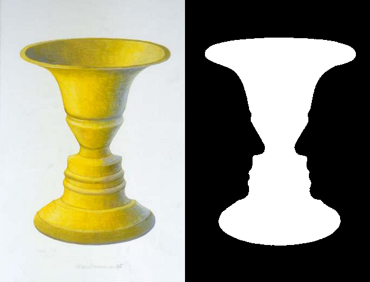

# Introspection
**First published Tue Feb 2, 2010; substantive revision Thu Apr 25, 2024**

*Schwitzgebel, Eric*

Introspection, as the term is used in contemporary philosophy of mind, is a means of learning about one’s own currently ongoing, or perhaps very recently past, mental states or processes. You can, of course, learn about your own mind in the same way you learn about others’ minds—by reading psychology texts, by observing facial expressions (in a mirror), by examining readouts of brain activity, by noting patterns of past behavior—but it’s generally thought that you can also learn about your mind *introspectively*, in a way that no one else can. But what exactly is introspection? No simple characterization is widely accepted.

Introspection is a central concept in epistemology, since introspective knowledge is often thought to be particularly secure, maybe even immune to skeptical doubt. Introspective knowledge is also often held to be more immediate or direct than sensory knowledge. Both of these putative features of introspection have been cited in support of the idea that introspective knowledge can serve as a ground or foundation for other sorts of knowledge.

Introspection is also central to philosophy of mind, both as a process worth study in its own right and as a court of appeal for other claims about the mind. Philosophers of mind offer a variety of theories of the nature of introspection; and philosophical claims about consciousness, emotion, free will, personal identity, thought, belief, imagery, perception, and other mental phenomena are often thought to have introspectible consequences or to be susceptible to introspective verification. For similar reasons, empirical psychologists too have discussed the accuracy of introspective judgments and the role of introspection in the science of the mind.

(This entry focuses on the cognitive process of introspection and its role in self-knowledge. For a treatment of self-knowledge more generally, with a focus on its distinctiveness and the various means of acquiring it, see the entry on self-knowledge.)

## 1. General Features of Introspection

### 1.1 Necessary Features of an Introspective Process

Introspection is generally regarded as a process by means of which we learn about our own currently ongoing, or very recently past, mental states or processes. Not all such processes are introspective, however: Few would say that you have introspected if you learn that you’re angry by seeing your facial expression in the mirror. However, it’s unclear and contentious exactly what more is required for a process to qualify as introspective. A relatively restrictive account of introspection might require introspection to involve attention to and direct detection of one’s ongoing mental states; but many philosophers think attention to or direct detection of mental states is impossible or at least not present in some paradigmatic instances of introspection.

For a process to qualify as “introspective” as the term is ordinarily used in contemporary philosophy of mind, it must minimally meet the following three conditions:

1. *The mentality condition*: Introspection is a process that generates, or is aimed at generating, knowledge, judgments, or beliefs about *mental* events, states, or processes, and not about affairs outside one’s mind, at least not directly. In this respect, it is different from sensory processes that normally deliver information about outward events or about the non-mental aspects of one’s body. The border between introspective and non-introspective knowledge can seem to blur with respect to bodily self-knowledge such as proprioceptive knowledge about the position of one’s limbs or nociceptive knowledge about one’s pains. But in principle the introspective part of such processes, pertaining to judgments about one’s mind—e.g., that one has the feeling as though one’s arms were crossed or of toe-ishly located pain—can be distinguished from the non-introspective judgment that one’s arms are in fact crossed or one’s toe is being pinched.
2. *The first-person condition*: Introspection is a process that generates, or is aimed at generating, knowledge, judgments, or beliefs about *one’s own mind only* and no one else’s, at least not directly. Any process that in a similar manner generates knowledge of one’s own and others’ minds is by that token not an introspective process. (Some philosophers have contemplated peculiar or science fiction cases in which we might introspect the contents of others’ minds directly—for example in telepathy or when two people’s brains are directly wired together—but the proper interpretation of such cases is disputable; see Gertler 2000; Langland-Hassan 2015.)
3. *The temporal proximity condition*: Introspection is a process that generates knowledge, beliefs, or judgments about one’s *currently ongoing* mental life only; or, alternatively (or perhaps in addition) *immediately past* (or even future) mental life, within a certain narrow temporal window (sometimes called the specious present; see the entry on the temporal consciousness). You may know that you were thinking about Montaigne yesterday during your morning walk, but you cannot know that fact by current introspection alone—though perhaps you can know introspectively that you currently have a vivid memory of having thought about Montaigne. Likewise, you cannot know by introspection alone that you will feel depressed if your favored candidate loses the election in November—though perhaps you can know introspectively what your current attitude is toward the election or what emotion starts to rise in you when you consider the possible outcomes. Whether the target of introspection is best thought of as one’s current mental life or one’s immediately past mental life may depend on one’s model of introspection: On self-detection models of introspection, according to which introspection is a causal process involving the detection of a mental state (see Section 2.2 below), it’s natural to suppose that a brief lapse of time will transpire between the occurrence of the mental state that is the introspective target and the final introspective judgment about that state, which invites (but does not strictly imply) the idea that introspective judgments generally pertain to immediately past states. On self-shaping and self-fulfillment models of introspection, according to which introspective judgments create or embed the very state introspected (see Sections 2.3.1 and 2.3.2 below), it seems more natural to think that the target of introspection is one’s current mental life or perhaps even the immediate future.

Few contemporary philosophers of mind would call a process “introspective” if it does not meet some version of the three conditions above, though in ordinary language the temporal proximity condition may sometimes be violated. (For example, in ordinary speech we might describe as “introspective” a process of thinking about why you abandoned a relationship last month or whether you’re really as kind to your children as you think you are.) However, many philosophers of mind will resist calling a process that meets these three conditions “introspective” unless it also meets some or all of the following three conditions:

1. *The directness condition*: Introspection yields judgments or knowledge about one’s own current mental processes relatively *directly* or *immediately*. It’s difficult to articulate exactly what directness or immediacy involves in the present context, but some examples should make the import of this condition relatively clear. Gathering sensory information about the world and then drawing theoretical conclusions based on that information should not, according to this condition, count as introspective, even if the process meets the three conditions above. Seeing that a car is twenty feet in front of you and then inferring from that fact about the external world that you are having a visual experience of a certain sort does not, by this condition, count as introspective. However, as we will see in Section 2.3.4 below, those who embrace transparency theories of introspection may reject at least strong formulations of this condition.
2. *The detection condition*: Introspection involves some sort of *attunement to* or *detection of* a *pre-existing* mental state or event, where the introspective judgment or knowledge is (when all goes well) *causally* but not *ontologically* dependent on the target mental state. For example, a process that involved creating the state of mind that one attributes to oneself would not be introspective, according to this condition. Suppose I say to myself in silent inner speech, “I am saying to myself in silent inner speech, ‘haecceities of applesauce’”, without any idea ahead of time how I plan to complete the embedded quotation. Now, what I say may be true, and I may know it to be true, and I may know its truth (in some sense) directly, by a means by which I could not know the truth of anyone else’s mind. That is, it may meet all the four conditions above and yet we may resist calling such a self-attribution introspective. Self-shaping (Section 2.3.2 below), expressivist (Section 2.3.3 below), and transparency (Section 2.3.4 below) accounts of self-knowledge emphasize the extent to which our self-knowledge often does not involve the detection of pre-existing mental states; and because something like the detection condition is implicitly or explicitly accepted by many philosophers, some philosophers (including some but not all of those who endorse self-shaping, expressivist, and/or transparency views) would regard it as inappropriate to regard such accounts of self-knowledge as accounts of *introspection* proper.
3. *The effort condition*: Introspection is not *constant, effortless, and automatic*. We are not every minute of the day introspecting. Introspection involves some sort of special reflection on one’s own mental life that differs from the ordinary un-self-reflective flow of thought and action. The mind may monitor itself regularly and constantly without requiring any special act of reflection by the thinker—for example, at a non-conscious level certain parts of the brain or certain functional systems may monitor the goings-on of other parts of the brain and other functional systems, and this monitoring may meet all five conditions above—but this sort of thing is not what philosophers generally have in mind when they talk of introspection. However, this condition, like the directness and detection conditions, is not universally accepted. For example, philosophers who think that conscious experience requires some sort of introspective monitoring of the mind and who think of conscious experience as a more or less constant feature of our lives may reject the effort condition (Armstrong 1968, 1999; Lycan 1996)[^armstrong-1968][^armstrong-1999][^lycan-1996].

Though not all philosophical accounts that are put forward by their authors as accounts of “introspection” meet all of conditions 4–6, most meet at least two of those. Because of differences in the importance accorded to conditions 4–6, it is not unusual for authors with otherwise similar accounts of self-knowledge to differ in their willingness to describe their accounts as accounts of “introspection”.

### 1.2 The Targets of Introspection

Accounts of introspection differ in what they treat as the proper *targets* of the introspective process. No major contemporary philosopher believes that all of mentality is available to be discovered by introspection. For example, the cognitive processes involved in early visual processing and in the detection of phonemes are generally held to be introspectively impenetrable and nonetheless (in some important sense) mental (Marr 1983; Fodor 1983)[^fodor-1983][^marr-1983]. Many philosophers also accept the existence of unconscious beliefs or desires, in roughly the Freudian sense, that are not introspectively available (e.g., Gardner 1993; Velleman 2000; Moran 2001; Wollheim 2003; though see Lear 1998)[^gardner-1993][^lear-1998][^moran-2001][^velleman-2000][^wollheim-2003]. Although in ordinary English usage we sometimes say we are “introspecting” when we reflect on our character traits, contemporary philosophers of mind generally do not believe that we can directly introspect character traits in the same sense in which we can introspect some of our other mental states (especially in light of research suggesting that we sometimes have poor knowledge of our traits, reviewed in Taylor and Brown 1988; Vazire 2010)[^taylor-1988][^vazire-2010].

The two most commonly cited classes of introspectible mental states are *attitudes*, such as beliefs, desires, evaluations, and intentions, and *conscious experiences*, such as sensory experiences and the experiential aspects of emotion and imagery. (These two groups may not be disjoint: Depending on other aspects of their view, a philosopher may regard some or all conscious experiences as involving attitudes, and/or they may regard attitudes as things that are or can be consciously experienced.) It of course does not follow from the fact (if it is a fact) that some attitudes are introspectible that all attitudes are, or from the fact that some conscious experiences are introspectible that all conscious experiences are. Some accounts of introspection focus on attitudes (e.g., Nichols and Stich 2003)[^nichols-2003], while others focus on conscious experiences (e.g., Hill 1991; Goldman 2006; Schwitzgebel 2012)[^goldman-2006][^hill-1991][^schwitzgebel-2012]; and it is sometimes unclear to what extent philosophers intend their remarks about the introspection of one type of target to apply to the other type. There is no guarantee that the same mechanism or process is involved in introspecting all the different potential targets.

Generically, this article will describe the targets of introspection as *mental states*, though in some cases it may be more apt to think of the targets as processes rather than states. Also, in speaking of the targets of introspection as *targets*, no presupposition is intended of a self-detection view of introspection as opposed to a self-shaping or containment or expressivist view (see Section 2 below). The targets are simply the states self-ascribed as a consequence of the introspective process if the process works correctly, or if the introspective process fails, the states that would have been self-ascribed.

### 1.3 The Products of Introspection

Though philosophers have not explored the issue very thoroughly, accounts also differ regarding the *products* of introspection. Most philosophers hold that introspection yields something like beliefs or judgments about one’s own mind, but others prefer to characterize the products of introspection as “thoughts”, “representations”, “awareness”, “acquaintance”, and so on. For ease of exposition, this article will describe the products of the introspective process as judgments, without meaning to assume the falsity of alternative views.

## 2. Introspective Versus Non-Introspective Accounts of Self-Knowledge

This section will outline several approaches to self-knowledge. Not all deserve to be called introspective, but an understanding of introspection requires an appreciation of this diversity of approaches—some for the sake of the contrast they provide to introspection proper and some because it’s disputable whether they should be classified as introspective. These approaches are not exclusive. Surely there is more than one process by means of which we can obtain self-knowledge.

### 2.1 Self/Other Parity Accounts

Symmetrical or *self/other parity* accounts of self-knowledge treat the processes by which we acquire knowledge of our own minds as essentially the same as the processes by which we acquire knowledge of other people’s minds. A simplistic version of this view is that we know both our own minds and the minds of others only by observing outward behavior. For example, we might know we like Thai food because we’ve noticed that we sometimes drive all the way across town to get it, or we might know that we’re happy because we see or feel ourselves smiling.

On such a view, introspection strictly speaking is impossible, since the first-person condition on introspection (condition 2 in Section 1.1) cannot be met: There is no distinctive process that generates knowledge of one’s own mind only. Twentieth-century behaviorist principles tended to encourage this view, but no prominent treatment of self-knowledge accepts this view in its most extreme and simple form. (The closest is probably Bem 1972.)[^bem-1972] Advocates of parity accounts sometimes characterize our knowledge of our own minds as arising from “theories” that we apply equally to ourselves and others (as in Nisbett and Ross 1980; Gopnik 1993a, 1993b)[^gopnik-1993a][^gopnik-1993b][^nisbett-1980]. Consequently, this approach to self-knowledge is sometimes called the *theory theory*.

**2.1.1 Theory Theory Accounts**

Nisbett, Wilson, and their co-authors (Nisbett and Bellows 1977; Nisbett and Wilson 1977; Nisbett and Ross 1980; Wilson 2002)[^nisbett-1977][^nisbett-1980][^nisbett-1977-2][^wilson-2002] argue for self/other parity in our knowledge of the bases or causes of our own and others’ attitudes and behavior, describing cases in which people seem to show poor knowledge of these bases or causes. For example, people queried in a suburban shopping center about why they chose a particular pair of stockings appeared to be ignorant of the influence of position on that choice, including explicitly denying that influence when it was suggested to them. People asked to rate various traits of supposed job applicants were unaware that their judgments of the applicant’s flexibility were greatly influenced by having been told that the applicant had spilled coffee during the job interview (see also Section 4.2.2 below). In such cases, Nisbett and his co-investigators found that participants’ descriptions of the causal influences on their own behavior closely mirrored the influences hypothesized by outside observers. From this finding, they infer that the same mechanism drives the first-person and third-person attributions, a mechanism that that does not involve any special private access to the real causes of one’s attitudes and behavior and instead relies heavily on intuitive psychological theories.

Gopnik (1993a, 1993b; Gopnik and Meltzoff 1994)[^gopnik-1994] deploys developmental psychological evidence to support a parity theory of self-knowledge. She points to evidence that for a wide variety of mental states, including believing, desiring, and pretending, children develop the capacity to ascribe those states to themselves at the same age they develop the capacity to ascribe those states to others. For example, children do not seem to be able to ascribe to themselves past false beliefs (after having been tricked by the experimenter) any earlier than they can ascribe false beliefs to other people. This appears to be so even when that false belief is in the very recent past, having only just been revealed to be false. According to Gopnik, this pervasive parallelism shows that we are not given direct introspective access to our beliefs, desires, pretenses, and the like. Rather, we must develop a “theory of mind” in light of which we interpret evidence underwriting our self-attributions. The appearance of the immediate givenness of one’s mental states is, Gopnik suggests, merely an “illusion of expertise”: Experts engage in all sorts of tacit theorizing that they don’t recognize as such—the expert chess player for whom the strength of a move seems simply visually given, the doctor who immediately intuits cancer in a patient. Since we are all experts at mental state attribution, we don’t recognize the layers of theory underwriting the process.

#### 2.1.2 Restrictions on Parity

The empirical evidence behind self/other parity views remains contentious (Nichols and Stich 2003; Carruthers 2011; Cassam 2014)[^carruthers-2011][^cassam-2014][^nichols-2003]. Furthermore, though Nisbett, Wilson, and Gopnik all stress the parallelism between mental state attribution to oneself and others and the inferential and theoretical nature of such attributions, they all also leave some room for a kind of self-awareness different in kind from the awareness one has of others’ mental lives. Thus, none endorses a *purely* symmetrical or self/other parity view. Nisbett and Wilson emphasize that we lack access only to the “processes” or causes *underlying* our behavior and attitudes. Our attitudes themselves and our current sensations, they say, can be known with “near certainty” (1977, 255; though contrast Nisbett and Ross 1980, 200–202, which seems sympathetic to skepticism about special access even to our attitudes)[^nisbett-1980]. Gopnik allows that we “may be well equipped to detect certain kinds of internal cognitive activity in a vague and unspecified way”, and that we have “genuinely direct and special access to certain kinds of first-person evidence [which] might account for the fact that we can draw some conclusions about our own psychological states when we are perfectly still and silent”, though we can “override that evidence with great ease” (1993a, 11–12). In the analytic philosophical tradition, Ryle (1949)[^ryle-1949] similarly emphasizes the importance of outward behavior in the self-attribution of mental states while acknowledging the presence of “twinges”, “thrills”, “tickles”, and even “silent soliloquies”, which we know of in our own case and that do not appear to be detectable by observing outward behavior. However, none of these authors develops an account of this apparently more direct self-knowledge. Their theories are consequently incomplete. Regardless of the importance of behavioral evidence and general theories in driving our self-attributions, in light of the considerations that drive Nisbett, Wilson, Gopnik, and Ryle to these caveats, it is probably impossible to sustain a view on which there is complete parity between first- and third-person mental state attributions. There must be some sort of introspective, or at least uniquely first-person, process.

Self/other parity views can also be restricted to particular subclasses of mental states: Any mental state that can only be known by cognitive processes identical to the processes by which we know about the same sorts of states in other people is a state to which we have no distinctively introspective access. States for which parity is often asserted include personality traits, unconscious motives, early perceptual processes, and the bases of our decisions (see Section 4.2.1 below for more on this). We learn about these states in ourselves, perhaps, in much the same way we learn about such states in other people. Carruthers (2011; see also Section 4.2.2 below) presents a case for parity of access to propositional attitudes like belief and desire (in contrast to inner speech, visual imagery, and the like, which he holds to be introspectible).

### 2.2 Self-Detection Accounts

Etymologically, the term “introspection”—from the Latin “looking into”—suggests a perceptual or quasi-perceptual process. Locke writes that we have a faculty of “Perception of the Operation of our own Mind” which, “though it be not Sense, as having nothing to do with external Objects; yet it is very like it, and might properly enough be call’d internal Sense” (1690 [1975, 105], italics suppressed). Kant (1781/1997) says we have an “inner sense” by which we learn about mental aspects of ourselves that is in important ways parallel to the “outer sense” by which we learn about outer objects.

But what does it mean to say that introspection is like perception? In what respects? As Shoemaker (1994a, 1994b, 1994c)[^shoemaker-1994a][^shoemaker-1994b][^shoemaker-1994c] observes, in a number of respects introspection is plausibly *unlike* perception. Both friends and foes of self-detection accounts have tended to agree that introspection does not involve a distinctive phenomenology of “introspective appearances” (Shoemaker 1994a, 1994b, 1994c; Lycan 1996; Rosenthal 2001; Siewert 2012; though Kriegel forthcoming might be an exception)[^lycan-1996][^rosenthal-2001][^shoemaker-1994a][^shoemaker-1994b][^shoemaker-1994c][^siewert-2012]: The visual experience of redness has a distinctive sensory quality or phenomenology that would be difficult or impossible to convey to a blind person; analogously for the olfactory experience of smelling a banana, the auditory experience of hearing a pipe organ, and the experience of touching something painfully hot. To be analogous to sensory experience in this respect, introspection would have to generate an analogously distinctive phenomenology—some quasi-sensory phenomenology in addition to, say, the visual phenomenology of seeing red that is the phenomenology of the *introspective appearance* of the visual phenomenology of seeing red. This would seem to require two layers of appearance in introspectively attended sensory perception: a visual appearance of the outward object and an introspective appearance of that visual appearance. (This isn’t to say, however, that introspection, or at least conscious introspection, doesn’t involve some sort of “cognitive phenomenology”—if there is such a thing—of the sort that accompanies conscious thoughts in general: See Bayne and Montague, eds., 2011.)[^bayne-2011] Proponents of quasi-perceptual models of introspection concede the existence of such disanalogies (e.g., Lycan 1996)[^lycan-1996].

We might consider an account of introspection to be quasi-perceptual, or less contentiously to be a “self-detection” account, if it meets the first five conditions described in Section 1.1—that is, the mentality condition, the first-person condition, the temporal proximity condition, the directness condition, and the detection condition. One aspect of the detection condition deserves special emphasis here: Detection requires the ontological independence of the target mental state and the introspective judgment—the two states will be causally connected (assuming that all has gone well) but not *constitutively* connected. (Shoemaker (1994a, 1994b, 1994c)[^shoemaker-1994a][^shoemaker-1994b][^shoemaker-1994c] calls models of self-knowledge that meet this aspect of the detection condition “broad perceptual” models.)

Self-detection accounts of self-knowledge seem to put introspection epistemically on a par with sense perception. To many philosophers, this has seemed a deficiency in these accounts. A long and widespread philosophical tradition holds that self-knowledge is epistemically special, that we have specially “privileged access” to—perhaps even infallible or indubitable knowledge of—at least some portion of our mentality, in a way that is importantly different in kind from our knowledge of the world outside us (see Section 4 below). Both self/other parity accounts (Section 2.1 above) and self-detection accounts (this section) of self-knowledge either deny any special epistemic privilege or characterize that privilege as similar to the privilege of being the only person to have an extended view of an object or a certain sort of sensory access to that object. Other accounts of self-knowledge to be discussed later in Section 2.3 are more readily compatible with, and often to some extent driven by, more robust notions of the epistemic differences between self-knowledge and knowledge of environmental objects.

#### 2.2.1 Simple Monitoring Accounts

Armstrong (1968, 1981, 1999)[^armstrong-1968][^armstrong-1981][^armstrong-1999] laid the groundwork for simple, quasi-perceptual, monitoring accounts of introspection. Armstrong describes introspection as a “self-scanning process in the brain” (1968, 324), and he stresses what he sees as the important ontological distinction between the state of awareness produced by the self-scanning procedure and the target mental state of which one is aware by means of that scanning—the distinction, for example, between one’s pain and one’s introspective awareness of that pain. Armstrong also appears to hold that the quasi-perceptual introspective process proceeds at a fairly low level cognitively—quick and simple, typically without much interference by or influence from other cognitive or sensory processes, and approximately continuous. Note that in calling reflexive self-monitoring “introspection”, Armstrong violates the effort condition from Section 1.1, which requires that introspection not be constant and automatic.

Morales (forthcoming) offers a similarly simple monitoring account, inspired by the framework of “signal detection theory” in the psychology of perception (Green and Swets 1966)[^green-1966]. Morales characterizes introspection as a matter of focusing one’s attention on current conscious experiences of varying “phenomenal magnitude” or “strength” in order to produce judgments about them. The strength and accuracy of the introspective response normally covaries with the strength of the target conscious experience.

Nichols and Stich (2003) employ a model of the mind on which having a propositional attitude such as a belief or desire is a matter of having a representation stored in a functionally-defined (and metaphorical) “belief box” or “desire box” (see also the entries on belief and functionalism). On their account, self-awareness of these attitudes typically involves the operation of a simple “Monitoring Mechanism” that merely takes the representations from these boxes, appends an “I believe that …”, “I desire that …”, or whatever (as appropriate) to that representation, and adds it back into the belief box. For example, if I desire that my father flies to Hong Kong on Sunday, the Monitoring Mechanism can copy the representation in my desire box with the content “my father flies to Hong Kong on Sunday” and produce a new representation in my belief box—that is, create a new belief—with the content “I desire that my father flies to Hong Kong on Sunday”. Nichols and Stich also propose an analogous but somewhat more complicated mechanism (they leave the details unspecified) that takes percepts as its input and produces beliefs about those percepts as its output.

Nichols and Stich emphasize that this Monitoring Mechanism does not operate in isolation, but often co-operates or competes with a second means of acquiring self-knowledge, which involves deploying theories along the lines suggested by Gopnik (see Section 2.1.1 above). Nichols and Stich argue that autistic people have very poor theoretical knowledge of the mind, as suggested by their very poor performance in “theory of mind” tasks (tasks like assessing when someone will have a false belief), and yet they succeed in monitoring their mental states as shown by their ability to describe their mental states in autobiographies and other forms of self-report. Conversely, Nichols and Stich argue that schizophrenic people remain excellent theorizers about mental states but monitor their own mental states very poorly—for example, when they fail to recognize certain actions as their own and struggle to report, or deny the existence of, ongoing thoughts. If this view is empirically correct, the pattern of “double dissociation” suggests that theoretical inference and self-monitoring are distinct and separable processes.

#### 2.2.2 Multi-Process Monitoring Accounts

Goldman (2006)[^goldman-2006] criticizes the account of Nichols and Stich (see Section 2.2.1 above) for not describing how the Monitoring Mechanism detects the attitude type of the representation (belief, desire, etc.). He argues that a simple mechanism could not discern the dispositional and causal relational facts in virtue of which an attitude is the type it is (see the entry on functionalism). Goldman also argues that the Nichols and Stich account leaves unclear how we can discern the strength or intensity of our beliefs, desires, and other propositional attitudes. Goldman’s positive account starts with the idea that introspection is a quasi-perceptual process that involves attending to individual mental states, which are then classified into broad categories (similarly, in visual perception we can classify seen objects into broad categories). However, on Goldman’s view this process can only generate introspective knowledge of the general *types* of mental states (such as belief, happiness, bodily sensation) and some properties of those mental states (such as degree of confidence for belief, and “a multitude of finely delineated categories” for bodily sensation). Specific contents, especially of attitudes like belief, are too manifold, Goldman suggests, for pre-existing classificational categories to exist for each one. Rather, we represent the specific content of such mental states by “redeploying” the representational content of the mental state, that is, simply copying the content of the introspected mental state into the content of the introspective belief or judgment (somewhat like in the Nichols and Stich account). Finally, Goldman argues that some mental states require “translation” into the mental code appropriate to belief if they are to be introspected. Visual representations, he suggests, have a different format or mental code than beliefs, and therefore cognitive work will be necessary to translate the fine-grained detail of visual experience into mental contents that can be believed introspectively.

Hill (1991, 2009)[^hill-1991][^hill-2009] also offers a multi-process self-detection account of introspection. Like Goldman, Hill sees attention (in some broad, non-sensory sense) as central to introspection, though he also allows for introspective awareness without attention (1991, 117–118). Hill (2009)[^hill-2009] argues that introspection is a process that produces *judgments about*, rather than perceptual awareness of, the target states, and suggests that the processes that generate these judgments vary considerably, depending on the target state, and are often complex. For example, judgments about enduring beliefs and desires must, he says, involve complex procedures for searching “vast and heterogeneous” long-term memory stores. Central to Hill’s (1991)[^hill-1991] account is an emphasis on the capacity of introspective attention to transform—especially to amplify and enrich, even to create—the target experience. In this respect Hill argues that the introspective act differs from the paradigmatic observational act which does not transform the object perceived (though of course both scientific and ordinary—especially gustatory—observation can affect what is perceived); and thus Hill’s account contains a “self-fulfillment” or “self-shaping” aspect in the sense of Section 2.3.1 and Section 2.3.2 below, and only qualifiedly and conditionally meets the detection condition on accounts of introspection as described in Section 1.1 above—the condition that introspection involves attunement to or detection of a pre-existing mental state or event.

Like Hill, Prinz (2004)[^prinz-2004] argues that introspection must involve multiple mechanisms, depending both on the target states (e.g., attitudes vs. perceptual experiences) and the particular mode of access to those states. Access might involve controlled attention or it might be more of a passive noticing; it might involve the verbal “captioning” or labeling of experiences or it might involve the kind of non-verbal access that even monkeys have to their mental states. Prinz (2007)[^prinz-2007] sharply distinguishes between the *conceptual classification* of our conscious experiences into various types that can be recognized and re-identified over time—classifications which he thinks must necessarily be somewhat crude—and non-conceptual knowledge of ongoing conscious experiences attained by “pointing” at them with attention. The latter type of knowledge, Prinz argues, is much more detailed and finely structured than the former but cannot be expressed or retained over time. Prinz also follows Hill in emphasizing that introspection often intensifies or otherwise modifies the target experience. In such cases, Prinz argues, introspective “access” is only access in an attenuated sense.

### 2.3 Introspection Without Self-Detection?

There are several ways to generate judgments, or at least statements, about one’s own current mental life—self-ascriptions, let’s call them—that are reliably true though they do not involve the detection of a pre-existing state. Consider the following four types of case:

1. *Automatically self-fulfilling self-ascriptions*: I think to myself, “I am thinking”. Or: I judge that I am making a judgment about my own mental life. Or: I say to myself in inner speech “I am saying to myself in inner speech: ‘blu-bob’”. Such self-ascriptions are automatically self-fulfilling. Their existence conditions are a subset of their truth conditions.
2. *Self-ascriptions that prompt self-shaping*: I declare that I have a mental image of a pink elephant. At the same time I make this declaration, I deliberately cause myself to form the mental image of a pink elephant. Or: A man uninitiated in romantic love declares to a prospective lover that he is the kind of person who sends flowers to his lovers. At the same time he says this, he successfully resolves to be the kind of person who sends flowers to his lovers. The self-ascription either precipitates a change or buttresses what already exists in such a way as to make the self-ascription accurate. In these cases, unlike the cases described in (A), some change or self-maintenance is necessary to render the self-ascription true, beyond the self-ascriptional event itself.
3. *Accurate self-ascription through self-expression*: I learn to say “I’m in pain!” instead of “ow!” as an automatic, unreflective response to painful stimuli. Or: I use the self-attributive sentence “I believe Russell changed his mind about pacifism” simply as a cautious way of expressing the belief that Russell changed his mind about pacifism, this expression being the product of reflecting upon Russell rather than a product of reflection upon my own mind. Self-expressions of this sort are assumed here to flow naturally from the states expressed in roughly the same way that facial expressions and non-self-attributive verbal expressions flow naturally from those same states—that is, without being preceded by any attempt to detect the state self-ascribed.
4. *Self-ascriptions derived from judgments about the outside world*: From the non-self-attributive fact that Stanford is south of Berkeley I derive the self-attributive conclusion that I believe that Stanford is south of Berkeley. Or: From the non-self-attributive fact that it would be good to go to home now, I derive the self-attributive judgment that I want to go home now. These derivations may be inferences, but if so, such inferences require no specific premises about ongoing mental states. Perhaps one embraces a general inference principle like “from *P*, it is permissible to derive *I believe that P*”, or “normally, if something is good, I want it”.

The following accounts of self-knowledge all take advantage of one or more of these facts about self-ascription. Because these ways of obtaining self-knowledge all violate the detection condition on introspection (condition 5 in Section 1.1 above), and because philosophers are divided about whether methods of obtaining self-knowledge that violate that condition count as *introspective* methods strictly speaking, philosophers are divided about whether accounts of self-knowledge of the sort described in this section should be regarded as accounts of introspection.

#### 2.3.1 Self-Fulfillment and Containment

An emphasis on infallible knowledge through self-fulfilling self-ascriptions goes back at least to Augustine (c. 420 C.E./1998) and is most famously deployed by Descartes in his *Discourse on Method* (1637/1985) and *Meditations* (1641/1984), where he takes the self-fulfilling thought that he is thinking as indubitably true, immune to even the most radical skepticism, and a secure ground on which to build further knowledge.

Contemporary self-fulfillment accounts tend to exploit the idea of *containment*. In a 1988 essay, Burge writes:

> When one knows one is thinking that *p*, one is not taking one’s thought (or thinking) that *p* merely as an object. One is thinking that *p* in the very event of thinking knowledgeably that one is thinking it. It is thought and thought about in the same mental act. (654)

This is the case, Burge argues, because “by its reflexive, self-referential character, the content of the second-order [self-attributive] judgment is locked (self-referentially) onto the first-order content which it both contains and takes as its subject matter” (1988, 659–660; cf. Heil 1988; Gertler 2000, 2001; Heil and Gertler describe such thoughts as introspective while Burge appears not to think of self-knowledge so structured as introspective: 1998, 244; see also 1988, 652)[^gertler-2000][^gertler-2001][^heil-1988]. In judging that I am thinking of a banana, I thereby necessarily think of a banana: The self-attributive judgment contains, as a part, the very thought self-ascribed, and thus cannot be false. In a 1996 essay, Burge extends his remarks to include not just self-attributive “thoughts” as targets but also (certain types of) “judgments” (e.g., “I judge, herewith, that there are physical entities” and other judgments with “herewith”-like reflexivity, 92)

Shoemaker (1994a, 1994b, 1994c)[^shoemaker-1994a][^shoemaker-1994b][^shoemaker-1994c] deploys the containment idea very differently, and over a much wider array of introspective targets, including conscious states like pains and propositional attitudes like belief. Shoemaker speculates that the relevant containment relation holds not between the *contents* or *concepts employed* in the target state and in the self-ascriptive state but rather between their neural realizations in the brain. To develop this point, Shoemaker distinguishes between a mental state’s “core realization” and its “total realization”. One might think of mental processes as transpiring in fairly narrow regions of the brain (their core realization), and yet, Shoemaker suggests, it’s not as though we could simply carve off those regions from all others and still have the mental state in question. To be the mental state it is, the process must be embedded in a larger causal network involving more of the brain (the total realization). Relationships of containment or overlap between core realization and total realization between the target state and the self-ascriptive judgment might then underwrite introspective accuracy. For example, the total brain-state realization of the state of pain may simply be a subset of the total brain-state realization of the state of believing that one is in pain. Introspective accuracy might then be explained by the fact that the introspective judgment is not an independently existing state.

Philosophers have also applied Burge-like content-containment models (as opposed to Shoemaker-like realization-containment models) to self-knowledge of conscious states, or “phenomenology”, in particular—for example, Gertler (2001)[^gertler-2001], Papineau (2002)[^papineau-2002], Chalmers (2003)[^chalmers-2003], Horgan and Kriegel (2007), Balog (2012)[^balog-2012], and Giustina (2021)[^giustina-2021]. Husserl (1913/1982) offers an early phenomenal containment approach, arguing that we can at any time put our “cogitatio”—our conscious experiences—consciously before us through a kind of mental glancing, with the self-perception that arises containing as a part the conscious experience toward which it is directed, and incapable of existing without it. Papineau offers a “quotational” account on which in introspection we self-attribute “the experience: ___”, where the blank is completed by the experience itself. Chalmers writes that “direct phenomenal beliefs” about our experiences are “partly *constituted* by an underlying phenomenal quality”, in that the two will be tightly coupled across “a wide range of nearby conceptually possible cases” (2003, 235).

One possible difficulty with such accounts is that while it seems plausible to suppose that an introspective thought or judgment might contain another thought or judgment as a part, it’s less clear how a self-attributive judgment or belief might contain a piece of conscious experience as a part. Beliefs, and other belief-like mental states like judgments, one might think, contain *concepts*, not conscious experiences, as their constituents (Fodor 1998)[^fodor-1998]; or, alternatively, one might think that beliefs are functional or dispositional patterns of response to input (Dennett 1987; Schwitzgebel 2002)[^dennett-1987][^schwitzgebel-2002], again rendering it unclear how a piece of phenomenology could be part of belief. Perhaps with this concern in mind, advocates of containment accounts often appeal to “phenomenal concepts” that are, like the introspective judgments to which they contribute, partly constituted by the conscious experiences that are the contents of those concepts. Such concepts are often thought to be obtained by demonstrative attention to our conscious experiences as they are ongoing. Alternatively, Giustina’s containment account (2021, 2022) treats the product of introspection as a non-conceptual acquaintance with the target experience rather than a conceptual judgment.

It would seem, at least, that beliefs, concepts, or judgments containing pieces of phenomenology would have to expire once the phenomenology has passed and thus that the introspective judgments could not be used in later inferences without recreating the state in question. Chalmers (2003)[^chalmers-2003] concedes the temporal locality of such phenomenology-containing introspective judgments and consequently their limited use in speech and in making generalizations. Papineau (2002)[^papineau-2002], in contrast, embraces a theory in which the imaginative recreation of phenomenology in thinking about past experience is commonplace.

#### 2.3.2 Self-Shaping

Although we can seemingly at least sometimes arrive at true self ascriptions through the self-shaping and the self-expression procedures (B and C) described at the beginning of Section 2.3, and although such procedures may meet the first three conditions on an account of introspection as described in Section 1.1—that is, they may (depending on how they are described and developed) be procedures that can yield only knowledge or judgments (or at least self-ascriptions) about one’s own currently ongoing or very recently past mental states—few philosophers would describe such procedures as “introspective”. Nonetheless, they warrant brief treatment here, partly for the same reason self/other parity accounts warranted treatment in Section 2.1 above—that is, as skeptical accounts suggesting that the scope of introspection may be considerably narrower than is generally thought—and partly as background for the “transparency” accounts to be discussed in Section 2.3.4 below, with which they are often married.

It is difficult to find accounts of self-knowledge that stress the self-shaping technique in its purest, forward-looking, causal form—perhaps because it’s clear that self-knowledge must involve considerably more than this (Gertler 2011)[^gertler-2011]. However, McGeer (1996, 2008; McGeer and Pettit 2002)[^mcgeer-2002] and Zawidzki (2016)[^zawidzki-2016] emphasize the importance of self-shaping. McGeer writes that “we learn to use our intentional self-ascriptions to instill or reinforce tendencies and inclinations that fit with these ascriptions, even though such tendencies and inclinations may at best have been only nascent at the time we first made the judgments” (McGeer 1996, 510)[^mcgeer-1996]. If I describe myself as brave in battle, or as a committed vegetarian—especially if I do so publicly—I create commitments and expectations for myself that help to make those self-ascriptions true. McGeer compares self-knowledge to the knowledge a driver has, as opposed to a passenger, of where the car is going: The driver, unlike the passenger, can make it the case that the car goes where the driver says it is going.

There are also strains in Dennett (though Dennett may not have an entirely consistent view on these matters; see Schwitzgebel 2007)[^schwitzgebel-2007] that suggest either a self-fulfillment or a self-shaping view. In some places, Dennett compares “introspective” self-reports about consciousness to works of fiction, immune to refutation in the same way that fictional claims are. One could no more go wrong about one’s consciousness, Dennett says, than Doyle could go wrong about the color of Holmes’s easy chair (e.g., 1991, 81, 94). Such remarks are consistent with either an anti-realist view of fiction (there are no facts about the easy chair or about consciousness; see 366–367) or a self-fulfillment or self-shaping realist view (Doyle *creates* facts about Holmes as he thinks or writes about him; we create facts about what it’s like to be us in thinking or making claims about our consciousness, as perhaps on 81 and 94). More moderately, in discussing attitudes, Dennett emphasizes how the act of formulating an attitude in language—for example, when ordering a menu item—can involve self-attributing a degree of specification in one’s attitudes that was not present before, thereby committing one to, and partially or wholly creating, the specific attitude self-ascribed (1987, 20).

*Commissive* accounts of self-knowledge also involve self-shaping, but not a form of self-shaping in which the introspective judgment brings into existence an ontologically distinct target state, but rather a kind of self-shaping involving a self-fulfillment or containment component similar to that discussed in Section 2.3.1 above. Moran (2001)[^moran-2001], for example, argues that normally when we are prompted to think about what we believe, desire, or intend (and he limits his account primarily to these three mental states), we reflect on the (outward) phenomena in question and make up our minds about what *to* believe, desire, or do. Rather than attempting to detect a pre-existing state, we open or re-open the matter and come to a resolution. Since we normally do believe, desire, and intend what we resolve to believe, desire, and do, we can therefore accurately self-ascribe those attitudes. Coliva (2016)[^coliva-2016] argues that the self-ascription “I believe that P” is like a performative statement in that it constitutes a comment to the belief that P or to the truth of P. (See also Wright 1989; Falvey 2000; Heal 2002; Boyle 2009, 2024; Singh forthcoming.)[^boyle-2009][^boyle-2024][^heal-2002][^wright-1989]

#### 2.3.3 Expressivism

Wittgenstein writes:

> [H]ow does a human being learn the meaning of the names of sensations?—of the word “pain” for example. Here is one possibility: words are connected with the primitive, the natural, expressions of the sensation and used in their place. A child has hurt himself and he cries; and then adults talk to him and teach him exclamations and, later, sentences. They teach the child new pain-behaviour.

> “So you are saying that the word ‘pain’ really means crying?”—On the contrary: the verbal expression of pain replaces crying and does not describe it. (1953/1968, sec. 244)

And

> “It can’t be said of me at all (except perhaps as a joke) that I *know* I am in pain. What is it supposed to mean—except perhaps that I *am* in pain?” (1953/1968, sec. 246).

On Wittgenstein’s view, it is both true that I am in pain and that I say of myself that I am in pain, but the utterance in no way emerges from a process of *detecting* one’s pain.

A simple expressivist view—sometimes attributed to Wittgenstein on the basis of these and related passages—denies that the expressive utterances (e.g., “that hurts!”) genuinely ascribe mental states to the individuals uttering them. Such a view faces serious difficulties accommodating the evident semantics of self-ascriptive utterances, including their use in inference and the apparent symmetries between present-tense and past-tense uses and between first-person and third-person uses (Wright 1998; Bar-On 2004)[^bar-on-2004][^wright-1998]. Consequently, Bar-On advocates, instead, what she calls a neo-expressivist view according to which expressive utterances can share logical and semantic structure with non-expressive utterances, despite the epistemic differences between them.

Expressivists have not always been clear about exactly the range of target mental states expressible in this way, but it seems plausible that at least in principle some true (or apt) self-ascriptions could arise in this manner, with no intervening introspective self-detection. The question would then be whether this is how we *generally* arrive at true self-ascriptions, for some particular class of mental states, or whether some more archetypically introspective process is also available. (For a more detailed treatment of expressivism, consult the section about the expressivist model of self-knowledge in the entry self-knowledge.)

#### 2.3.4 Transparency

Evans writes:

> [I]n making a self-ascription of belief, one’s eyes are, so to speak, or occasionally literally, directed outward—upon the world. If someone asks me, “Do you think there is going to be a third world war?”, I must attend, in answering him, to precisely the same outward phenomena as I would attend to if I were answering the question “Will there be a third world war?” I get myself into the position to answer the question whether I believe that *p* by putting into operation whatever procedure I have for answering the question whether *p*. (1982, 225)

*Transparency* approaches to self-knowledge, like Evans’, emphasize cases in which it seems that one arrives at an accurate self-ascription not by means of attending to, or thinking about, one’s own mental states, but rather by means of attending to or thinking about the external states of the world that the target mental states are about. Note that this claim has both a negative and a positive aspect: We do *not* learn about our minds by as it were gazing inward; and we *do* learn about our minds by reflecting on the aspects of the world that our mental states are about. The positive and negative theses are separable: A pluralist might accept the positive thesis without the negative one; an advocate of a self/other parity theory or an expressivist account of self-knowledge (with respect to a certain class of target states) might accept the negative thesis without the positive. (N.B.: In the philosophical literature on self-knowledge “transparency” is also sometimes used to mean something like self-intimation in the sense of Section 4.1.1 below, for example in Wright 1998; Bilgrami 2006. This is a completely different usage, not to be confused with the present usage.)[^bilgrami-2006][^wright-1998] Because transparency accounts emphasize the outward focus of our thought in arriving at self-ascriptions, calling such accounts accounts of “introspection” strains against the etymology of the term. Nonetheless, some prominent advocates of transparency accounts, such as Dretske (1995)[^dretske-1995] and Tye (2000)[^tye-2000], offer them explicitly as accounts of introspection.

The range of target states to which transparency applies is a matter of some dispute. Among philosophers who accept something like transparency, belief is generally regarded as transparent (Gordon 1995, 2007; Gallois 1996; Moran 2001; Fernández 2003; Byrne 2018)[^byrne-2018][^fernández-2003][^gallois-1996][^gordon-1995][^gordon-2007][^moran-2001]. Perceptual states or perceptual experiences are also often regarded as transparent in the relevant sense. Harman’s example is the most cited:

> When Eloise sees a tree before her, the colors she experiences are all experienced as features of the tree and its surroundings. None of them are experienced as intrinsic features of her experience. Nor does she experience any features of anything as intrinsic features of her experiences. And that is true of you too. There is nothing special about Eloise’s visual experience. When you see a tree, you do not experience any features as intrinsic features of your experience. Look at a tree and try to turn your attention to intrinsic features of your visual experience. I predict you will find that the only features there to turn your attention to will be features of the presented tree. (Harman 1990, 667)[^harman-1990]

Harman’s emphasis here is on the negative thesis, which goes back at least to Moore (1903; though Moore does not unambiguously endorse it). The view that it is impossible to attend directly to perceptual experience has been especially stressed by Tye (1995, 2000, 2002; see also Evans 1982; Van Gulick 1993; Shoemaker 1994a; Dretske 1995; Martin 2002; Stoljar 2004)[^dretske-1995][^evans-1982][^martin-2002][^shoemaker-1994a][^stoljar-2004][^van-1993], and directly conflicts with accounts according to which we learn about our sensory experience primarily by directing introspective attention to it (e.g., Goldman 2006; Petitmengin 2006; Hill 2009; Siewert 2012; and back at least to Wundt 1888 and Titchener 1908 [1973])[^goldman-2006][^hill-2009][^petitmengin-2006][^siewert-2012][^titchener-1908][^wundt-1888].

Gordon (2007)[^gordon-2007] argues (contra Nichols and Stich 2003 and Goldman 2006)[^goldman-2006][^nichols-2003] that Evans-like *ascent routines* (ascending from “*p*” to “I believe that *p*”) can drive the accurate self-ascription of all the attitudes, not just belief. He makes his case by wedding the transparency thesis to something like an expressive account of self-ascription: To answer a question about what I want—for example, which flavor ice cream do I want?—I think not about my desires but rather about the different flavors available, and then I *express* the resulting attitude self-ascriptively. Similarly for hopes, fears, wishes, intentions, regrets, etc. Gordon points out that from a very early age, before they likely have any self-ascriptive intent, children learn to express their attitudes self-ascriptively, for example with simple phrases like “[I] want banana!” (see also Bar-On 2004)[^bar-on-2004].

Commissive accounts of self-knowledge (see Section 2.3.2 above) also generally affirm transparency: Reflecting on the world generates commitment to a belief, desire, or intention, which one thereby also knows or self-ascribes (Falvey 2000; Moran 2001; Coliva 2016; Boyle 2024)[^boyle-2024][^coliva-2016][^moran-2001].

The transparency thesis is in fact consistent, not just with expressivism and commissive accounts, but with any of the four non-detection-based self-ascription procedures described at the beginning of this section (and indeed Aydede and Güzeldere 2005 attempt to reconcile aspects of the transparency view with a broadly detection-like approach to introspection)[^aydede-2005]. This manifold compatibility flows from the fact that by itself the transparency thesis does not go far toward a positive view of the mechanisms of self-knowledge.

Byrne (2018)[^byrne-2018], Dretske (1995)[^dretske-1995], and Roche (2016, 2023)[^roche-2016][^roche-2023] bring together transparency and something like a derivational model of self-knowledge—a model on which I derive the conclusion that I believe that *P* directly from *P* itself, or the conclusion that I am representing *x* as *F* from the fact that *x* is *F*—a fact which must of course, to serve as a premise in the derivation, be represented (or believed) by me. Byrne argues that just as one might abide by the following epistemic rule:

> DOORBELL: If the doorbell rings, believe that there is someone at the door

so also might someone abide by the rule:

> BEL: If *P*, believe that you believe that *P*.

To determine whether you believe that *P*, first determine whether *P* is the case, then follow the rule BEL. Byrne (2018)[^byrne-2018] offers similar accounts of self-knowledge of intention, thinking, seeing, and desire.

Dretske analogizes introspection to ordinary cases of “displaced perception”—cases in which one perceives that something is the case by way of directly perceiving some other thing (e.g., hearing that the mail carrier has arrived by hearing the dog’s barking; seeing that you weigh 110 pounds by seeing the dial on the bathroom scale): One perceives that one represents *x* as *F* by way of perceiving the *F*-ness of *x*. Dretske notes, however, two points of disanalogy between the cases. In the case of hearing that the mail carrier has arrived by hearing the dog’s bark, the conclusion (that the mail carrier has arrived) is only established if the premise about the dog’s barking is true, and furthermore it depends on a defeasible connecting belief, that the dog’s barking is a reliable indicator of the mail’s arrival. In the introspective case, however, the inference, if it is an inference, does not require the truth of the premise about *x*’s being *F*. Even if *x* is not *F*, the conclusion that I’m representing *x* as *F* is supported. Nor does there seem to be any sort of defeasible connecting belief.

Tye also emphasizes transparency in his account of introspection, though he limits his remarks to the introspection of conscious experience or “phenomenal character”. In his 2000 book, Tye develops a view like Dretske’s, analogizing introspection to displaced perception, though Tye unlike Dretske explicitly denies that inference is involved, instead proposing a mechanism similar to the sort of mechanism envisioned by simple monitoring accounts like those of Nichols and Stich (2003; see Section 2.2.1 above), a reliable process that, in the case of perceptual self-awareness, takes awareness of external things as its input and yields as its output awareness of phenomenal character.[^note-1]However, in his 2009 book, Tye rejects the displaced perception model in favor of a version of the transparency view that *identifies* phenomenal character with external qualities in the world, so that perceiving features of the world just is perceiving phenomenal character—a view that he recognizes is then charged with the difficult task of explaining how phenomenal character is a property (or “quality”) of external objects rather than, as is generally assumed, a property only of experiences of those objects.

Several authors have challenged the idea that sensory experience necessarily eludes attention—that is, they have denied the central claim of transparency theories about sensory experience. Block (1996)[^block-1996], Kind (2003)[^kind-2003], and Smith (2008)[^smith-2008] have argued that phosphenes—those little lights you see when you press on your eyes—and visual blurriness are aspects of sensory experiences that can be directly attended (though see Gow 2019 for objections to this line of reasoning)[^gow-2019]. Siewert (2004)[^siewert-2004] has argued that what’s intuitively appealing in the transparency view is primarily the observation that in reflecting on sensory experience one does not *withdraw* attention from the objects sensed; but, he argues, this is compatible with also devoting a certain sort of attention to the sensory experience itself. In early discussions of attention, perceptual attention was sometimes distinguished from “intellectual attention” (James 1890 [1981]; Baldwin 1901–1905; see also Peacocke 1998; Mole 2011)[^baldwin-1901][^james-1890][^mole-2011][^peacocke-1998], that is, from the kind of attention we can devote to purely imagined word puzzles or to philosophical issues. If non-sensory forms of attention are possible, then the transparency thesis for sensory experience will require restatement: Is it only sensory attention to sensory experience that is impossible? Or is it any kind of attention whatsoever? Simply to say we don’t attend sensorily to our mental states is to make only a modest claim, akin to the claim that we see objects rather than seeing our visual experiences of objects; but to say that we cannot attend to our mental states even intellectually appears extreme. In light of this, it remains unclear how to cast the transparency intuition to better bring out the core idea that is meant to be conveyed by the slogan that introspecting sensory experience is not a matter of attending to one’s own mind (see also Weksler, Jacobson, and Bronfman 2019)[^weksler-2019].

### 2.4 Introspective Pluralism

Philosophers discussing self-knowledge often write as if approaches highlighting one of these non-self-detection methods of generating self-ascriptions conflict with approaches that highlight other of these non-self-detection methods, and also as if approaches of this general sort conflict with self-detection approaches (Section 2.2 above). While conflicts will certainly exist between different accounts intended to serve as *exhaustive* approaches to self-knowledge, it is implausible that any one or even any few of these approaches to self-knowledge is exhaustive. Plausibly, all of the non-self-detection approaches described above can lead, at least occasionally, to accurate self-ascriptions. Enthusiasts for other models needn’t deny this. It also seems hard to deny that we at least *sometimes* reach conclusions about our mental lives based on the kind of theoretical inference or self-interpretation emphasized by advocates of self/other parity accounts (Section 2.1 above). Finally, even philosophers concerned about strong or oversimple self-scanning views might wish to grant that the mind can do *some* sort of tracking of its own present or recently past states—for example, when we trace back a stream of recently past thoughts that presumably can’t (because past) be self-ascribed by self-fulfillment, self-shaping, self-expression, or transparency methods.

Schwitzgebel (2012)[^schwitzgebel-2012] elevates this pluralism into a negative account of introspection. Introspective judgments, he says, arise from a shifting confluence of many processes, recruited opportunistically, none of which can be called introspection proper. Just as there is no single, unified faculty of poster-taking-in that one employs when trying to take in a poster at a psychological conference or science fair, there is, on Schwitzgebel’s view, no single, unified faculty of introspection or one underlying core process, nor even a few dedicated mechanisms or processes. Instead, the introspector, like the poster-viewer, brings to bear a diverse range of cognitive resources as suits the occasion. A process wouldn’t be worth calling “introspective”, he says, unless the introspector aimed to reach a judgment about their current or very recently past conscious experience, using at least some resources specific to the first-person case and that exhibit some relatively direct sensitivity to the target state; but this limitation does not imply the existence of any dedicated introspective processes. Defenders of less extreme versions of pluralism that are compatible with the existence of several dedicated introspective processes include Prinz (2004)[^prinz-2004], Hill (2009)[^hill-2009], Coliva (2016)[^coliva-2016], Samoilova (2016)[^samoilova-2016], and Spener (2024)[^spener-2024].

## 3. The Role of Introspection in Scientific Psychology

### 3.1 The Rise of Introspective Psychology as a Science

Philosophers have long made introspective claims about the human mind—or, to speak more cautiously, they’ve made claims seemingly at least in part introspectively grounded. Aristotle (3rd c. BCE/1961) asserts that thought does not occur without imagery. Mengzi (3rd c. BCE/2008) argues that our hearts are pleased by moral goodness and revolted by evil, even if the pleasure and revulsion are not evident in our outward behavior. Berkeley finds in himself no “abstract ideas” like that of a triangle that is, in Locke’s terms “neither oblique, nor rectangle, neither equilateral, equicrural, nor scalenon, but all and none of these at once” (Berkeley 1710/1965, 12; Locke 1689/1975, 596)[^berkeley-1710]. James Mill (1829 [1878]) attempts a catalog of the varieties of sense experience.

Although a number of early modern philosophers had aimed to initiate the scientific study of the mind, it wasn’t until the middle of the 19th century—with the appearance of *quantitative introspective methods*, especially regarding sensory consciousness—that the study of the mind took shape as a progressive, mathematical, laboratory-based science. Early quantitative psychologists such as Helmholtz (1856/1962), Fechner (1860 [1964]), and Wundt (1896 [1902]) sought quantitative answers to questions like: By how much must two physical stimuli differ for the experiences of them to differ noticeably? How weak a stimulus can still be consciously perceived? What is the mathematical relationship between stimulus intensity and the intensity of the resulting sensation? (The Weber-Fechner law holds that the relationship is logarithmic.) Along what dimensions, exactly, can sense experience vary? (The “color solid” [see the link to the Munsell solid in Other Internet Resources, below], for example, characterizes color experience by appeal to just three dimensions of variation: hue, saturation, and lightness or brightness.) Although from very early on, psychologists also employed non-introspective methods (e.g., performance on memory tests, reaction times), most early characterizations of the field stood introspection at the center. James, for example, wrote that “introspective observation is what we have to rely on first and foremost and always” (1890 [1981, 185]).

In contrast with the dominant philosophical tradition that has, since Descartes, stressed the special privilege or at least high accuracy of introspective judgments about consciousness (see Section 4.1 below) many early introspective psychologists held that the introspection of currently ongoing or recently past conscious experience is difficult and prone to error if the introspective observer is insufficiently trained. Wundt, for example, reportedly did not credit the introspective reports of people with fewer than 50,000 trials of practice in observing their conscious experience (Boring 1953)[^boring-1953]. Titchener, a leading American introspective psychologist, wrote a 1600-page introspective training manual for students, arguing that introspective observation is at least as difficult as observation in the physical sciences (Titchener 1901–1905; see also Wundt 1874 [1908]; Müller 1904; for recent discussions of introspective training see Varela 1996; Vermersch 1999; Nahmias 2002; Schwitzgebel 2011b)[^müller-1904][^nahmias-2002][^schwitzgebel-2011b][^titchener-1901][^varela-1996][^vermersch-1999][^wundt-1874]. This difference in optimism about untrained introspection may partly reflect differences in the types of judgments foregrounded in the two disciplines. Philosophers stressing privilege tend to focus on coarse and (seemingly) simple judgments such as “I’m having a visual experience of redness” or “I believe it’s raining”. The projects of interest to introspective psychologists often required much finer judgments—such as determining with mathematical precision whether one visual sensation has twice the “intensity” of another or determining along what dimensions emotional experience can vary.

### 3.2 Early Skepticism about Introspective Observation

Early introspective psychologists’ theoretical discussions of the nature of introspection were often framed in reaction to skepticism about the scientific viability of introspection, especially the concern that the introspective act interferes with or destroys the mental state or process that is its target.[^note-2]) The most influential formulation of this concern was Comte’s:

> But as for observing in the same way *intellectual* phenomena at the time of their actual presence, that is a manifest impossibility. The thinker cannot divide himself into two, of whom one reasons whilst the other observes him reason. The organ observed and the organ observing being, in this case, identical, how could observation take place? This pretended psychological method is then radically null and void (1830, using the translation of James 1890 [1981, 188])[^james-1890].

Introspective psychologists tended to react to this concern in one of three ways. The most concessive approach—recommended, for example, by James (1890 [1981]; see also Mill 1865 [1961]; Lyons 1986)[^lyons-1986][^mill-1865]—was to grant Comte’s point for *concurrent* introspection, that is, introspection simultaneous with the target state or process, and to emphasize in contrast *immediate retrospection*, that is, reflecting on or attending to the target process (usually a conscious experience) very shortly *after* it occurs. Since the scientific observation occurs only after the target process is complete, it does not interfere with that process; but of course the delay between the process and the observation must be as brief as possible to ensure that the process is accurately remembered.

Brentano (1874 [1973]) responded to Comte’s concern by distinguishing between “inner observation” [*innere* *Beobachtung*] and “inner perception” [*innere* *Wahrnehmung*]. Observation, as Brentano characterizes it, involves dedicating full attention to a phenomenon, with the aim of apprehending it accurately. This dedication of attention necessarily interferes with the process to be observed if the process is a mental one; therefore, he says, inner observation is problematic as a scientific psychological method. Inner *perception*, in contrast, according to Brentano, does not involve attention to our mental lives and thus does not objectionably disturb them. While our “attention is turned toward a different object … we are able to perceive, incidentally, the mental processes which are directed toward that object” (1874 [1973, 30]). Brentano concedes that inner perception necessarily lacks the advantages of attentive observation, so he recommends conjoining it with retrospective methods.

Wundt (1888)[^wundt-1888] agrees with Comte and Brentano that observation necessarily involves attention and so often interferes with the process to be observed, if that process is an inner, psychological one. To a much greater extent than Brentano, however, Wundt emphasizes the importance to scientific psychology of direct attention to experience, including planful and controlled variation. The psychological method of “inner perception” is, for Wundt, the method of holding and attentively manipulating a memory image or reproduction of a past psychological process. Although Wundt sees some value in this retrospective method, he thinks it has two crucial shortcomings: First, one can only work with what one remembers of the process in question—the manipulation of a memory-image cannot discover new elements. And second, foreign elements may be unintentionally introduced through association—one might confuse one’s memory of a process with one’s memory of another associated process or object.

Therefore, Wundt suggests, the science of psychology must depend upon perception or observation of mental processes as they occur. It is too pessimistic to think that the target mental process are necessarily distorted, when a well-trained scientist is performing the introspective task. A *subclass* of mental processes remains relatively unperturbed by introspection—the “simpler” mental processes, especially perception (1896/1902, 27–28). The experience of seeing red, Wundt claims, is more or less the same whether or not one is introspecting the psychological fact that one is experiencing redness. Wundt also suggests that the basic processes of memory, feeling, and volition can be systematically introspected and without excessive disruption. These *alone*, he thinks, can be studied by introspective psychology (see also Wundt 1874 [1904]; 1896 [1902]; 1907; for a detailed treatment of the history of Comte’s objection and the distinction between self-observation and inner perception, see Spener 2024)[^spener-2024][^wundt-1874]. Other aspects of our psychology must be approached through non-introspective methods such as the observation of language, mythology, culture, and human and animal development.

### 3.3 The Decline of Scientific Introspection

Although introspective psychologists were able to build scientific consensus on some issues concerning sense experience—issues such as the limits of sensory perception in various modalities and some of the contours of variation in sensory experience—by the early 20th century it was becoming clear that on many issues consensus was elusive. The most famous dispute concerned the existence of “imageless thought” (see Humphrey 1951; Kusch 1999)[^humphrey-1951][^kusch-1999]; but other topics proved similarly resistant such as the structure of emotion or “feeling” (James 1890 [1981]; Külpe 1893 [1895]; Wundt 1896 [1902]; Titchener 1908 [1973])[^james-1890][^külpe-1893][^titchener-1908][^wundt-1896] and the experiential changes brought about by shifts in attention (Wundt 1896 [1902]; Pillsbury 1908; Titchener 1908 [1973]; Chapman 1933)[^chapman-1933][^pillsbury-1908][^titchener-1908][^wundt-1896].

By the 1910s, behaviorism (which focused simply on the relationship between outward stimuli and behavioral response) had declared war on introspective psychology, portraying it as bogged down in irresolvable disputes between differing introspective “experts”, and also rebuking the introspectivists’ passive taxonomizing of experience, recommending that psychology focus instead on socially useful paradigms for modifying behavior (e.g., Watson 1913)[^watson-1913]. In the 1920s and 1930s, introspective studies were increasingly marginalized. Although strict behaviorism declined in the 1960s and 1970s, its main replacement, cognitivist functionalism (which treats functionally defined internal cognitive processes as central to psychological inquiry), generally continued to share behaviorism’s disdain of introspective methods.

Psychophysics (the study of the relationship between physical sensory input and consequent psychological state or response), where the introspective psychologists had found their greatest success, underwent a subtle shift in this period from a focus on *subjective* methods—methods that involve asking subjects to report on their experiences or percepts—to a focus on *objective* methods such as asking participants to report on states of the outside world, including insisting that participants guess even when they feel they don’t know or have no relevant conscious experience (especially with the rise of signal detection theory in psychophysics: Green and Swets 1966; Cheesman and Merikle 1986; Macmillan and Creelman 1991; Merikle, Smilek, and Eastwood 2001)[^cheesman-1986][^green-1966][^macmillan-1991]. Perhaps in accord with transparency views of introspection (Section 2.3.4 above), the two types of instruction seem very similar (compare the subjective “tell me if you visually experience a flash of light” with the objective “tell me if the light flashes”). On the other hand, perhaps in tension with transparency views, subjective and objective instructions seem sometimes to differ importantly, especially in cases of known illusion, Gestalt effects such as perceived grouping, stimuli near the limits of perceivability, and the experience of ambiguous figures (Boring 1921; Merikle, Smilek, and Eastwood 2001; Siewert 2004)[^boring-1921][^siewert-2004].

### 3.4 The Re-Emergence of Scientific Introspection

Introspective methods were never *entirely* abandoned by psychologists, and in the last few decades, they have made something of a comeback, especially with the rise of the interdisciplinary field of “consciousness studies” (see, e.g., Jack and Roepstorff, eds., 2003, 2004)[^jack-2003][^jack-2004]. Ericsson and Simon (1984/1993; to be discussed further in Section 4.2.3 below) have advocated the use of “think-aloud protocols” and immediately retrospective reports in the study of problem solving. Other researchers have emphasized introspective methods in the study of imagery (Marks 1985; Kosslyn, Reisbert, and Behrmann 2006)[^kosslyn-2006][^marks-1985] and emotion (Lambie and Marcel 2002; Barrett et al. 2007; LeDoux and Brown 2017)[^barrett-2007][^lambie-2002][^ledoux-2017].

Beeper methodologies have been developed to facilitate immediate retrospection, especially by Hurlburt (1990, 2011; Hurlburt and Heavey 2006; Hurlburt and Schwitzgebel 2007)[^hurlburt-2006][^hurlburt-2007][^schwitzgebel-2007] and Csikszentmihalyi (Larson and Csikszentmihalyi 1983; Csikszentmihalyi 2014)[^csikszentmihalyi-2014][^larson-1983]. Traditional immediately retrospective methods required the introspective observer in the laboratory somehow to intentionally refrain from introspecting the target experience as it occurs, arguably a difficult task. Hurlburt and Csikszentmihalyi, in contrast, give participants beepers to wear during ordinary, everyday activity. The beepers are timed to sound only at long intervals, surprising participants and triggering an immediately retrospective assessment of their “inner experience”, emotion, or thoughts in the moment before the beep.

Introspective or subjective reports of conscious experience have also played an important role in the search for the “neural correlates of consciousness” (as reviewed in Rees and Frith 2007; Prinz 2012; Koch et al. 2016; see also Varela 1996)[^koch-2016][^prinz-2012][^rees-2007][^varela-1996]. One paradigm is for researchers to present ambiguous sensory stimuli, holding them constant over an extended period, noting what neural changes correlate with changes in subjective reports of experience. For example, in “binocular rivalry” methods, two different images (e.g., a face and a house) are presented, one to each eye. Participants typically say that only one image is visible at a time, with the visible image switching every few seconds. Researchers have sometimes reported finding evidence that activity in “early” visual areas (such as V1) is not temporally coupled with reported changes in visual experience, while changes in conscious percept are better temporally coupled with activity in parietal and maybe also frontal areas further downstream and to large-scale changes in neural synchronization or oscillation; however, the evidence is disputed (Lumer, Friston, and Rees 1998; Polonsky et al. 2000; Tong, Meng, and Blake 2006; Frässle et al. 2014; Tsuchiya et al. 2015; Brascamp et al. 2018; Block 2020; Hesse and Tsao 2020; Bock et al. 2023)[^block-2020][^bock-2023][^brascamp-2018][^frässle-2014][^hesse-2020][^lumer-1998][^tong-2006][^tsuchiya-2015].

Another version of the ambiguous sensory stimuli paradigm involves presenting the participant with an ambiguous figure such as the Rubin faces-vase figure:

Using this paradigm, researchers have found neuronal changes both in early visual areas and in later areas, as well as changes in widespread neuronal synchrony, that correspond temporally with subjective reports of flipping between one way and another of seeing the ambiguous figure (Kleinschmidt et al. 1998; Rodriguez et al. 1999; Parkkonen et al. 2008; de Graaf et al. 2011; Megumi et al. 2015; Brascamp et al. 2018; Zhu, Hardstone, and Le 2022)[^brascamp-2018][^graaf-2011][^kleinschmidt-1998][^megumi-2015][^parkkonen-2008][^rodriguez-1999][^zhu-2022].

In masking paradigms, stimuli are briefly presented then followed by a “mask”. On some trials, participants report seeing the stimuli, while on others they don’t. In trials in which the participant reports that the stimulus was visually experienced, researchers have tended to find higher levels of activity through at least some of the downstream visual pathways, spontaneous electrical oscillations near 40 Hz, and a negative amplitude EEG response in “early” posterior brain regions about 200 ms after the stimulus (Dehaene et al. 2001; Summerfield, Jack, and Burgess 2002; Del Cul, Baillet, and Dehaene 2007; Quiroga et al. 2008; Salti et al. 2015; Förster, Koivisto, and Revonsuo 2020)[^dehaene-2001][^del-2007][^förster-2020][^quiroga-2008][^salti-2015][^summerfield-2002]. However, it remains contentious how properly to interpret such attempts to find neural correlates of consciousness (Noë and Thompson 2004; Dehaene and Changeux 2011; Aru et al. 2012; de Graaf, Hsieh, and Sack 2012; Koch et al. 2016; Phillips 2018; Fink, Kob, and Lyre 2021; Andersen et al. 2022)[^andersen-2022][^aru-2012][^graaf-2012][^dehaene-2011][^fink-2021][^koch-2016][^noë-2004][^noë-2004-2][^phillips-2018].

If we report our attitudes by introspecting upon them, then much of survey research is also introspective, though psychologists have not generally explicitly described it as such. As with subjective vs. objective methods in psychophysics, there appears to be only a slight difference between subjectively phrased questions (“Do you approve of the President’s handling of the war?”, “Do you think marijuana should be legalized?”) and objectively phrased questions (“Has the President handled the war well?”, “Should marijuana be legalized?”). This would seem to support the observation at the core of transparency theory (discussed in Section 2.3.4 above) that questions about the mind and questions about the outside world often call for the same type of reflection.

## 4. The Accuracy of Introspection

### 4.1 Varieties of Privilege

It’s plausible to suppose that people have some sort of *privileged access* to at least some of their own mental states or processes: You know about your own mind, or at least some aspects of it, in a different way and better than you know about other people’s minds, and maybe also in a different way and better than you know about the outside world. Consider pain. It seems you know your own pains differently and better than you know mine, differently and (perhaps) better than you know about the coffee cup in your hand. If so, perhaps that special “first-person” privileged knowledge arises through something like introspection, in one or more of the senses described in Section 2 above.

Just as there is a diversity of methods for acquiring knowledge of or reaching judgments about one’s own mental states and processes, to which the label “introspection” applies with more or less or disputable accuracy, so also is there a diversity of forms of “privileged access”, with different kinds of privilege and to which the idea of access applies with more or less or disputable accuracy. And as one might expect, the different introspective methods do not all align equally well with the different varieties of privilege.

#### 4.1.1 Varieties of Perfection: Infallibility, Indubitability, Incorrigibility, and Self-Intimation

A substantial philosophical tradition, going back at least to Descartes (1637/1985; 1641/1984; also Augustine c. 420 C.E./1998), ascribes a kind of epistemic perfection to at least some of our judgments (or thoughts or beliefs or knowledge) about our own minds—infallibility, indubitability, incorrigibility, or self-intimation. Consider the judgment (thought, belief, etc.) that *P*, where *P* is a proposition self-ascribing a mental state or process (for example *P* might be *I am in pain*, or *I believe that it is snowing*, or *I am thinking of a dachshund*). The judgment that *P* is *infallible* just in case, if I make that judgment, it is not possible that *P* is false. It is *indubitable* just in case, if I make the judgment, it is not possible for me to doubt the truth of *P*. It is *incorrigible* just in case, if I make the judgment, it is not possible for anyone else to show that *P* is false. And it is *self-intimating* if it is not possible for *P* to be true without my reaching the judgment (thought, belief, etc.) that it is true. Note that the direction of implication for the last of these is the reverse of the first three. Infallibility, indubitability, and incorrigibility all have the form: “If I judge (think, believe, etc.) that *P*, then …”, while self-intimation has the form “If *P*, then I judge (think, believe, etc.) that *P*”. All four theses also admit of weakening by adding conditions to the antecedent “if” clause (e.g., “If I judge that *P* as a result of normal introspective processes, then …”). (See Alston 1971 for a helpful dissection of these distinctions. Also note that some philosophers [e.g. Ayer 1936/1946; Armstrong 1963; Chalmers 2003; Tye 2009][^armstrong-1963][^ayer-1936][^chalmers-2003][^tye-2009] use “incorrigibility” to mean infallibility as defined here, while others [e.g., Ayer 1963; Alston 1971; Rorty 1970; Dennett 2000][^alston-1971][^ayer-1963][^dennett-2000][^rorty-1970] use it with the more etymologically specific meaning of [something like] “incapable of correction”.)

Descartes (1641/1984) famously endorsed the indubitability of “I think”, which he extends also to such mental states as doubting, understanding, affirming, and seeming to have sensory perceptions. He also appears to claim that the thought or affirmation that I am in such states is infallibly true, at least if that thought is clear and distinct. He was followed in this—especially in his infallibilism—by Locke (1690 [1975]), Hume (1739 [1978]), twentieth-century thinkers such as Husserl (1913 [1982]), Ayer (1936 [1946], 1963), Lewis (1946)[^lewis-1946], the early Shoemaker (1963)[^shoemaker-1963], and many others. Historical arguments for indubitability and infallibility have tended to center on intuitive appeals to the apparent impossibility of doubting or going wrong about such matters as whether one is having a thought with a certain content or is experiencing pain or having a visual experience as of seeing red.

Recent infallibilists have added to this intuitive appeal structural arguments based on self-fulfillment accounts of introspection or self-knowledge (see Section 2.3.1 above)—generally while also narrowing the scope of infallibility, for example to thoughts about thoughts (Burge 1988, 1996)[^burge-1988][^burge-1996], or to “pure” phenomenal judgments about consciousness (Chalmers 2003; see also Wright 1998; Gertler 2001; Horgan, Tienson, and Graham 2006; Horgan and Kriegel 2007; Tye 2009; with important predecessors in Brentano 1874 [1973]; Husserl 1913 [1982])[^brentano-1874][^chalmers-2003][^gertler-2001][^horgan-2006][^horgan-2007][^husserl-1913][^tye-2009][^wright-1998], or to beliefs as “commitments” (Coliva 2016)[^coliva-2016]. The intuitive idea behind most of these structural arguments is that somehow the self-ascriptive thought or judgment *contains* the mental state or process self-ascribed: the thought that I am thinking of a pink elephant contains the thought of a pink elephant; the judgment that I am having a visual experience of redness contains the red experience itself.

In contrast, self/other parity (Section 2.1) and self-detection (Section 2.2) accounts of introspection or self-knowledge appear to stand in tension with infallibilism. If introspection or self-knowledge involves a causal process from a mental state to an ontologically distinct self-ascription of that state, it appears that, however reliable such a process may generally be, there is inevitably room in principle for interference and error. Minimally, it seems, stroke, quantum accident, or clever neurosurgery could break otherwise generally reliable relationships between target mental states and the self-ascriptions of those states. Similar considerations apply to self-shaping (Section 2.3.2) and expressivist (Section 2.3.3) accounts, to the extent that these are interpreted causally rather than constitutively.

Introspective incorrigibility, as opposed to either infallibility or indubitability, was held by Rorty (1970)[^rorty-1970] to be “the mark of the mental”—and thus as applying to a wide range of mental states. Dennett (2000, 2002)[^dennett-2000][^dennett-2002] defends a similar view, for conscious experiences. The idea behind incorrigibility, recall, is that no one else could show your self-ascriptions to be false; or we might say, more qualifiedly and a bit differently, that if you arrive at the right kind of self-ascriptive judgment (perhaps an introspectively based judgment about a currently ongoing conscious process that survives critical reflection), then no one else, perhaps not even you in the future, aware of this, can rationally hold that judgment to be mistaken. If I judge that right now I am in severe pain, and I do so as a result of considering introspectively whether I am indeed in such pain (as opposed to, say, merely inferring that I am in pain based on outward behavior), and if I pause to think carefully about whether I really am in pain and conclude that I indeed am, then no one else who is aware of this can rationally believe that I’m not in pain, regardless of what my outward behavior might be (say, calm and relaxed) or what shows up in the course of brain imaging (say, no activation in brain centers normally associated with pain).

Incorrigibility does not imply infallibility: I may not actually be in pain, even if no one could *show* that I’m not. Consequently, incorrigibility is compatible with a broader array of sources of self-knowledge than is infallibility. Neither Rorty nor Dennett, for example, appear to defend incorrigibility by appeal to self-fulfillment accounts of introspection (though in both cases, interpreting their positive accounts is difficult). Causal accounts of self-knowledge may be compatible with incorrigibility if the causal connections underwriting the incorrigible judgments are vastly more trustworthy than judgments obtained without the benefit of this sort of privileged access. Of course, unless one embraces a strict self-fulfillment account, with its attendant infallibilism, one will want to rule out abnormal cases such as quantum accident; hence the need for qualifications.

Self-intimating mental states are those such that, if a person (or at least a person with the right background capacities) has them, they necessarily believe or judge or know that they do. Conscious states are often held to be in some sense self-intimating, in that the mere having of them involves, requires, or implies some sort of representation or awareness of those states. Brentano argues that consciousness, for example, of an outward stimulus like a sound, “clearly occurs together with consciousness of this consciousness”, that is, the consciousness is “of the whole mental act in which the sound is presented and in which the consciousness itself exists concomitantly” (1874 [1995, 129]; see also phenomenological approaches to self-consciousness). “Higher order” and “same order” theories of consciousness (Armstrong 1968; Rosenthal 1990, 2005; Gennaro 1996; Lycan 1996; Carruthers 2005; Kriegel 2009; Montague 2016; Lau and Brown, 2019; see also higher-order theories of consciousness)[^armstrong-1968][^carruthers-2005][^gennaro-1996][^kriegel-2009][^lau-2019][^lycan-1996][^montague-2016][^rosenthal-1990][^rosenthal-2005] explain consciousness in terms of some thought, perception, or representation of the mental state that is conscious—the presence of that thought, perception, or representation being what makes the target state conscious. (On same order theories, the target mental state, or an aspect of it, represents itself, with no need for a distinct higher order state.) Thus, Horgan, Kriegel, and others have described consciousness as “self-presenting” (Horgan, Tienson, and Graham 2005; Horgan and Kriegel 2007)[^horgan-2007]. Shoemaker (1995, 2012)[^shoemaker-1995][^shoemaker-2012] argues that beliefs—as long as they are “available” (i.e., readily deployed in inference, assent, practical reasoning, etc.), which needn’t require that they are occurrently conscious—are self-intimating for individuals with sufficient cognitive capacity. Shoemaker’s idea is that if the belief that *P* is available in the relevant sense, then one is disposed to do things like say “I believe *P*”, and such dispositions are themselves constitutive of believing that one believes that *P*.

Self-intimation claims (unlike infallibility, indubitability, and incorrigibility claims) are not usually cast as claims about “introspection”. This may be because knowledge acquired through self-intimation would appear to be constant and automatic, thus violating the effort condition on introspection (condition 6 in Section 1.1 above).

#### 4.1.2 Weaker Guarantees

A number of philosophers have argued for forms of first-person privilege involving some sort of epistemic guarantee—not just conditional accuracy as a matter of empirical fact, but something more robust than that—without embracing infallibility, indubitability, incorrigibility, or self-intimation in the senses described in Section 4.1.1 above.

Shoemaker (1968)[^shoemaker-1968], for example, argues that self-knowledge of certain psychological facts such as “I am waving my arm” or “I see a canary”, when arrived at “in the ordinary way (without the aid of mirrors, etc.)”, is *immune to error through misidentification relative to the first-person pronoun* (see also Campbell 1999; Pryor 1999; Bar-On 2004; Hamilton 2008: Langland-Hassan 2015)[^bar-on-2004][^campbell-1999][^langland-hassan-2015][^pryor-1999]. That is, although one may be wrong about waving one’s arm (perhaps the nerves to your arm were recently severed unbeknownst to you) or about seeing a canary (perhaps it’s a goldfinch), one cannot be wrong due to mistakenly identifying the person waving the arm or seeing the canary *as you*, when in fact it is someone else. This immunity arises, Shoemaker argues, because there is no need for identification in the first place, and thus no opportunity for *mis*-identification. In this respect, Shoemaker argues, knowledge that a particular arm that is moving is your arm (not immune to misidentification since maybe it’s someone else’s arm, misidentified in the mirror) is different from the knowledge that *you* are moving your arm—knowledge, that is, of what Searle (1983)[^searle-1983] calls an “intention in action”.

Shoemaker has also argued for the conceptual impossibility of introspective *self-blindness* with respect to one’s beliefs, desires, and intentions, and for somewhat different reasons one’s pains (1988, 1994b). A self-blind creature, by Shoemaker’s definition, would be a rational creature with a conception of the relevant mental states, and who can entertain the thought that they have this or that belief, desire, intention, or pain, but who nonetheless utterly lacks introspective access to the type of mental state in question. A hypothetical self-blind creature could still gain “third person” knowledge of the mental states in question, through observing their own behavior, reading textbooks, and the like. (Thus, strict self/other parity accounts of self-knowledge of the sort described in Section 2.1 are accounts according to which one is self-blind in Shoemaker’s sense.) Shoemaker’s case against self-blindness with respect to belief turns on the dilemma of whether the self-blind creature can avoid “Moore-paradoxical” sentences (see Moore 1942, 1944 [1993]; Shoemaker 1995)[^moore-1942][^moore-1944][^shoemaker-1995] like “it’s raining but I don’t believe that it’s raining” in which the subject asserts both *P* and that they don’t believe that *P*. If the subject is truly self-blind, Shoemaker suggests, there should be cases in which their best evidence is both that *P* and that they don’t believe that *P* (the latter, perhaps, based on misleading facts about their behavior). But if the subject asserts “*P* but I don’t believe that *P*” in such cases, they do not (contra the initial supposition) really have a rational command of the nature of belief and assertion. Alternatively, if they can reliably avoid such Moore-paradoxical sentences, self-attributing belief in an apparently normal way, it seems that they are indistinguishable from normal people in thought and behavior and hence not self-blind. Shoemaker develops similar anti-self-blindness arguments for desire, intention, and pain. Shoemaker uses his case against self-blindness as part of his argument against self-detection accounts of introspection (described in Section 2.2 above): If introspection were a matter of detecting the presence of states that exist independently of the introspective judgment or belief, then it ought to be possible for the faculty enabling the detection to break down entirely, as in the case of blindness, deafness, etc., in outward perception (see also Nichols and Stich 2003, who argue that schizophrenia provides such a case)[^nichols-2003].

Transcendental arguments for the accuracy of certain sorts of self-knowledge offer a different sort of epistemic guarantee—“transcendental arguments” being arguments that assume the existence of some sort of experience or capacity, then develop insights about the background conditions necessary for that experience or capacity, and finally conclude that those background conditions must in fact be met. Burge (1996; see also Shoemaker 1988)[^shoemaker-1988] argues that to be capable of “critical reasoning” one must be able to recognize one’s own attitudes, knowledgeably evaluating, identifying, and reviewing one’s beliefs, desires, commitments, suppositions, etc., where these mental states are known to be the states they are. Since we are (by assumption, for the sake of transcendental argument) capable of critical reasoning, we must have some knowledge of our attitudes. Bilgrami (2006)[^bilgrami-2006] argues that we can only be held responsible for actions if we know the beliefs and desires that “rationalize” our actions; since we can (by assumption) sometimes be held responsible, we must sometimes know our beliefs and desires. Wright (1989)[^wright-1989] argues that the “language game” of ascribing “intentional states” such as belief and desire to oneself and others requires as a background condition that self-ascriptions have special authority within that game. Given that we successfully play this language game, we must indeed have the special authority that we assume and others grant us in the context of the game.

#### 4.1.3 Privilege Without Guarantee

Developing an analogy from Wright (1998)[^wright-1998], if it’s your turn with the kaleidoscope, you have a type of privileged perspective on the shapes and colors it presents. If someone else in the room wants to know what color dominates, for example, the most straightforward course would be to ask you. But this type of privileged access comes with no guarantee. At least in principle, you might be quite wrong about the tumbling shapes. You might be dazzled by afterimages, or momentarily confused, or hallucinating, or (unbeknownst to you) colorblind. (Yes, people often don’t know they are colorblind, a point stressed by Kornblith 1998.)[^kornblith-1998] It is also at least in principle possible that others may know better than you, perhaps even systematically so, what is transpiring in the kaleidoscope. You might think the figure shows octagonal symmetry, but the rest of us, familiar with the kaleidoscope’s design, might know that the symmetry is hexagonal. A brilliant engineer may invent a kaleidoscope state detector that can dependably reveal from outside the shape, color, and position of the tumbling chunks.

Wright raises this analogy to suggest that people’s privilege with respect to certain aspects of their mental lives must be different from that of the person with the kaleidoscope; but other philosophers, especially those who embrace self-detection accounts of introspection, should find the analogy at least somewhat apt: Introspective privilege is akin to the privilege of having a unique and advantageous sensory perspective on something. Metaphorically speaking, we are the only ones who can gaze directly at our attitudes or our stream of experience, while others must rely on us or on outward signs. Less metaphorically, in generating introspective judgments (or beliefs or knowledge) about one’s own mentality one employs a detection process available to no one else. It is then an empirical question how accurate the deliverances of this process are; but on the assumption that the deliverances are in a broad range of conditions at least somewhat accurate and more accurate than the typical judgments other people make about those same aspects of your mind, you have a “privileged” perspective. Typically, advocates of self-detection models of introspection regard the mechanism or cognitive process generating introspective judgments or beliefs as reliable in roughly this way, but not infallible, and not immune to correction by other people (Armstrong 1968; Hill 1981, 2009; Lycan 1996; Nichols and Stich 2003; Goldman 2000, 2006; Morales forthcoming)[^armstrong-1968][^goldman-2000][^goldman-2006][^hill-2009][^lycan-1996][^nichols-2003].

### 4.2 Empirical Evidence on the Accuracy of Introspection

The arguments of the previous section are a priori in at least the broad sense of that term (the psychologists’ sense): They depend on general conceptual considerations and armchair folk psychology rather than on empirical research. To these might be added the argument, due to Boghossian (1989)[^boghossian-1989] that “externalism” about the content of our attitudes (the view that our attitudes depend constitutively not just on what is going on internally but also on facts about our environment; Putnam 1975; Burge 1979)[^burge-1979][^putnam-1975] seems to problematize introspective self-knowledge of those attitudes. This issue will not be treated here, since it is amply covered in the entries on externalism about mental content and externalism and self-knowledge.

Now we turn to empirical research on our self-knowledge of those aspects of our minds often thought to be accessible to introspection. Since character traits are not generally regarded as introspectible aspects of our mentality, we’ll skip the large literature on the accuracy or inaccuracy of our judgments about them (e.g., Taylor and Brown 1988; Funder 1999; Vazire 2010; see also Haybron’s 2008 skeptical perspective on our knowledge of how happy we are)[^funder-1999][^haybron-2008][^taylor-1988][^vazire-2010]; nor will we discuss self-knowledge of subpersonal, nonconscious mental processes, such as the processes underlying visual recognition of color and shape.

As a general matter, while a priori accounts of the epistemology of introspection have tended to stress its privilege and accuracy, empirical accounts have tended to stress its failures.

#### 4.2.1 Of the Causes of Attitudes and Behavior

Perhaps the most famous argument in the psychological literature on introspection and self-knowledge is Nisbett and Wilson’s argument that we have remarkably poor knowledge of the causes of, and processes underlying, our behavior and attitudes (Nisbett and Wilson 1977; Nisbett and Ross 1980; Wilson 2002)[^nisbett-1977][^nisbett-1980][^nisbett-1977-2][^wilson-2002]. Section 2.1 above briefly mentioned their emblematic finding that people in a shopping mall were often ignorant of a major factor—position—influencing their judgments about the quality of pairs of stockings. In Nisbett and Bellows (1977), also briefly mentioned above, participants were asked to assess the influence of various factors on their judgments about features of a supposed job applicant. As in Nisbett and Wilson’s stocking study, participants denied the influence of some factors that were in fact influential; for example, they denied that the information that they would meet the applicant influenced their judgments about the applicant’s flexibility. (It actually had a major influence, as assessed by comparing the judgments of participants who were told and not told that they would meet the applicant.) Participants also attributed influence to factors that were not in fact influential; for example, they falsely reported that the information that the applicant accidentally knocked over a cup of coffee during the interview influenced “how sympathetic the person seems” to them. Nisbett and Bellows found that ordinary observers’ hypothetical ratings of the influence of the various factors on the various judgments closely paralleled the participants’ own ratings of the factors influencing them—a finding used by Nisbett to argue that people have no special access to causal influences on their judgments and instead rely on the same sorts of theoretical considerations outside observers rely on (the self/other parity view described in Section 2.1). Despite some objections and methodological concerns (e.g., Newell and Shanks 2014)[^newell-2014], both psychologists and philosophers now tend to accept Nisbett’s and Wilson’s view that any first-person advantage in assessing the factors influencing our judgments and behavior is more modest than non-psychologists generally tend to assume.

In series of experiments, Gazzaniga (1995)[^gazzaniga-1995] presented commissurotomy patients (people with severed corpus callosum) with different visual stimuli to each hemisphere of the brain. With cross-hemispheric communication severely impaired due to the commissurotomy, the left hemisphere, controlling speech, had information about one part of the visual stimulus, while the right hemisphere, controlling some aspects of movement (especially the left hand) had information about a different part. Gazzaniga reported finding that when these “split brain” patients were asked to explain why they did something, when that action was clearly caused by input to the right, non-verbal hemisphere, the left hemisphere would sometimes fluently confabulate an explanation. For example, Gazzaniga reports presenting an instruction like “laugh” to the right hemisphere, making the patient laugh. When asked why he laughed, the patient would say something like “You guys come up and test us every month. What a way to make a living!” (1393). When a chicken claw was shown to the left hemisphere and snow scene to the right, and the patient was asked to select an appropriate picture from an array, the right hand would point to a chicken and the left hand to a snow shovel, and when asked why they selected those two things, the patient would say something like “Oh, that’s simple. The chicken claw goes with the chicken and you need a shovel to clean out the chicken shed” (ibid.; for a detailed discussion of such cases, see Schechter 2018)[^schechter-2018]. Similar confabulation about motives is sometimes (but not always) seen in people whose behavior is, unbeknownst to them, driven by post-hypnotic suggestion (Richet 1884; Moll 1889 [1911])[^moll-1889][^richet-1884], and in disorders such as hemineglect (anosognosia), blindness denial (Anton’s syndrome), and Korsakoff’s syndrome (Hirstein 2005)[^hirstein-2005].

In a normal population, Johansson and collaborators (Johansson et al. 2005; Johansson et al. 2006)[^johansson-2005][^johansson-2006] manually displayed to participants pairs of pictures of women’s faces. On each trial, the participant was to point to the face they found more attractive. The picture of that face was then centered before the participant while the other face was hidden. On some trials, participants were asked to explain the reasons for their choices while continuing to look at the selected face. On a few key trials, the experimenters used sleight-of-hand to present to the participant the face that was *not* selected as though it had been the face selected. Strikingly, the switch was noticed only 28% of the time. What’s more, when the change was not detected participants actually gave explanations for their choice that appealed to specific features of the unselected face that were not possessed by the selected face 13% of the time. For example, one participant claimed to have chosen the face before him “because I love blondes” when in fact he had chosen a dark-haired face (Johansson et al. 2006, 690)[^johansson-2006]. Johansson and colleagues failed to find any systematic differences in the explanations of choice between the manipulated and non-manipulated trials, using a wide variety of measures. They found, for example, no difference in linguistic markers of confidence (including pauses in speech), emotionality, specificity of detail, complexity or length of description, or general position in semantic space. These results, like Nisbett’s and Wilson’s, suggest that at least some of the time when people think they are explaining the bases of their decisions, they are instead merely theorizing or confabulating.

The literature on “cognitive dissonance” is replete with cases in which participants’ attitudes appear to change for reasons they do, or would, deny. According to cognitive dissonance theory, when people behave or appear to behave counternormatively (e.g., incompetently, foolishly, immorally), they will tend to adjust their attitudes so as to make the behavior seem less counternormative or “dissonant” (Festinger 1957; Cooper and Fazio 1984; Stone and Cooper 2001; Harmon-Jones 2019)[^cooper-1984][^festinger-1957][^harmon-jones-2019][^stone-2001]. For example, people induced to falsely describe as enjoyable a monotonous task they’ve just completed will tend, later, to report having a more positive attitude toward the task then those not induced to lie (though much less so if they were handsomely paid to lie in which case the behavior is not clearly counternormative; Festinger and Carlsmith 1959)[^festinger-1959]. Presumably, if such attitude changes were known to the person they would generally fail to have their dissonance-reducing effect. Research psychologists have also confirmed such familiar phenomena as “sour grapes” (Elster 1983/2016; Lyubomirsky and Ross 1999; Kay, Jiminez, and Jost 2002)[^elster-1983][^kay-2002][^lyubomirsky-1999] and “self-deception” (Mele 2001)[^mele-2001] which presumably also involve ignorance of the factors driving the relevant judgments and actions (for a general review of these and other sources of distortion, see Pronin 2009)[^pronin-2009]. And of course the Freudian psychoanalytic tradition has also long held that people often have only poor knowledge of their motives and the influences on their attitudes (Wollheim 1981; Cavell 2006)[^cavell-2006][^wollheim-1981].

In light of this empirical research, no major philosopher now holds (perhaps no major philosopher ever held) that we have infallible, indubitable, incorrigible, or self-intimating knowledge of the causes of our judgments, decisions, and behavior. Perhaps weaker forms of privilege also come under threat. But the question arises: Whatever failures there may be in assessing the causes of our attitudes and behavior, are those failures failures of *introspection*, properly construed? Psychologists tend to cast these results as failures of “introspection”, but if it turns out that a very different and more trustworthy process underwrites our knowledge of some other aspects of our minds—such as what our present attitudes are (however caused) or our currently ongoing or recently past conscious experience—then perhaps we can call only *that* process introspection, thereby retaining some robust form of introspective privilege while acceding to the psychological consensus regarding (what we would now call non-introspective) first-person knowledge of causes. Indeed, few contemporary philosophical accounts of introspection or privileged self-knowledge highlight, as the primary locus of privilege, the causes of our attitudes and behavior (Bilgrami 2006 is a notable exception)[^bilgrami-2006]. Thus, the literature reviewed in this section can be interpreted as suggesting that the causes of our behavior are not, after all, the sorts of things to which we have introspective access.

#### 4.2.2 Of Attitudes

Research psychologists have generally not been as skeptical of our knowledge of our attitudes as they have been of our knowledge of the causes of our attitudes (Section 4.2.1 above). In fact, many of the same experiments that purport to show inaccurate knowledge of the causes of our attitudes nonetheless rely unguardedly on self-report for assessment of the attitudes themselves—a feature of those experiments criticized by Bem (1967)[^bem-1967]. Attitudinal surveys in psychology and social science generally rely on participants’ self-report as the principal source of evidence about attitudes (de Vaus 1985/2014; Nardi 2002/2018)[^nardi-2002]. However, as in the case of motives and causes, there’s a long tradition in clinical psychology skeptical of our self-knowledge of our attitudes.

A key challenge in assessing the accuracy of people’s beliefs or judgments about their attitudes is the difficulty of accurately measuring attitudes independently of self-report. There is at present no tractable measure of attitude that is generally seen by philosophers as overriding individuals’ own reports about their attitudes. However, in the psychological literature, “implicit” measures of attitudes—measures of attitudes that do not reply on self-report—have recently gained considerable attention (see Wittenbrink and Schwarz, eds., 2007; Petty, Fazio, and Briñol, eds., 2009; Gawronski, De Houwer, and Sherman 2020)[^gawronski-2020][^petty-2009][^wittenbrink-2007]. Such measures are sometimes thought capable of revealing unconscious attitudes or implicit attitudes either unavailable to introspection or erroneously introspected (Wilson, Lindsey, and Schooler 2000; Lane et al. 2007; though see Hahn et al. 2014; Brownstein, Madva, and Gawronski 2019)[^brownstein-2019][^hahn-2014][^lane-2007][^wilson-2000].

Research on implicit attitude measures originated to a substantial extent with attempts to measure racism in North America and Europe, in accord with the view that racist attitudes, though common, are considered socially undesirable and therefore often not self-ascribed even when present. For example, Campbell, Kruskal, and Wallace (1966) explored the use of seating distance as an index of racial attitudes, noting that racially Black and White students tended to aggregate in classroom seating arrangements. Using facial electromyography (EMG), Vanman et al. (1997) found White participants to display facial responses indicative of negative affect more frequently when asked to imagine co-operative activity with Black than with White partners—results interpreted as indicative of racist attitudes. Cunningham et al. (2004) showed White and Black faces to White participants while participants were undergoing fMRI brain imaging. They found less amygdala activation when participants looked at faces from their own group than when participants looked at other faces; and since amygdala activation is generally associated with negative emotion, they interpreted this tendency suggesting a negative attitude toward outgroup members (see also Hart et al 1990; and for discussion Ito and Cacioppo 2007)[^ito-2007].

Much of the recent implicit attitude research has focused on response priming and interference in speeded tasks. In priming research, a stimulus (the “prime”) is briefly displayed, followed by a mask that hides it, and then a second stimulus (the “target”) is displayed. The participant’s task is to respond as swiftly as possible to the target, typically with a classification judgment. In *evaluative priming*, for example, the participant is primed with a positively or negatively valenced word or picture (e.g., snake), then asked to make a swift judgment about whether the subsequently presented target word (e.g., “disgusting”) is good or bad, or has some other feature (e.g., belongs to a particular category). Generally, negative primes will speed response for negative targets while delaying response for positive targets, and positive primes will do the reverse. Researchers have found that photographs of Black faces tend to facilitate the categorization of negative targets and delay the categorization of positive targets for White participants—a result widely interpreted as revealing racist attitudes (Fazio et al. 1995; Dovidio et al. 1997; Wittenbrink, Judd, and Park 1997)[^dovidio-1997][^fazio-1995][^wittenbrink-1997]. In the *Implicit Association Test*, respondents are asked to respond disjunctively to combined categories, giving for example one response if they see either a dark-skinned face or a positively valenced word and a different response if they see either a light-skinned face or a negatively valenced word. As in evaluative priming tasks, White respondents tend to respond more slowly when asked to pair dark-skinned faces with positively valenced words than with negatively valenced words, which is interpreted as revealing a negative attitude or association (Greenwald, McGhee, and Schwartz 1998; Lane et al. 2007; Jost 2019)[^greenwald-1998][^jost-2019][^lane-2007]. However, it should be noted that despite its prominence, the Implicit Association Task has been criticized as having poor test-retest reliability, low predictive validity, and weak correlations with other measures of racism (Oswald, Mitchell, Blanton, Jaccard, and Tetlock 2013; Gawronski, Morrison, Phills, and Galdi 2017; Payne, Vuletich, and Lundberg 2017; Machery 2022)[^gawronski-2017][^oswald-2013][^payne-2017].

As mentioned above, such implicit measures are often interpreted as revealing attitudes to which people have poor or no introspective access. The evidence that people lack introspective knowledge of such attitudes generally turns on the low correlations between such implicit measures of racism and more explicit measures such as self-report—though due to the recognized social undesirability of racial prejudice, it is difficult to disentangle self-presentational from self-knowledge factors in self-reports (Fazio et al. 1995; Wilson, Lindsey, and Schooler 2000; Greenwald and Nosek 2009; )[^fazio-1995][^greenwald-2009][^wilson-2000]. People who appear racist by implicit measures might disavow racism and inhibit racist patterns of response on explicit measures (such as when asked to rate the attractiveness of faces of different races) because they don’t want to be *seen* as racist—a motivation that might drive them whether or not they have accurate self-knowledge of their racist attitudes. Still, it seems prima facie plausible that people have at best limited knowledge of the patterns of association that drive their responses on priming and other implicit measures.

But what do such tests really measure? In philosophy, Zimmerman (2018)[^zimmerman-2018] and Gendler (2008a, 2008b)[^gendler-2008a][^gendler-2008b] have argued that measures like the Implicit Association Test do not measure actual racist beliefs but rather something else, something under less rational control (Gendler calls them “aliefs”). Schwitzgebel (2010)[^schwitzgebel-2010] argues that people who are implicitly prejudiced but explicitly egalitarian are “in between” believing and failing to believe the egalitarian propositions that they sincerely accept (see also Levy 2015)[^levy-2015]. Machery (2016)[^machery-2016] argues that implicit measures reveal multi-track dispositions, rather than attitudes. Gawronski and Bodenhausen (2006) advance a model according to which there is a substantial difference between implicit attitudes, defined in terms of associative processes, and explicit attitudes which have a propositional structure and are guided by standards of truth and consistency (see also Wilson, Lindsey, and Schooler 2000; Greenwald and Nosek 2009)[^greenwald-2009][^wilson-2000]. Mandelbaum (2016)[^mandelbaum-2016] and Borgoni (2016)[^borgoni-2016] also endorse views on which people who are implicitly prejudiced but explicitly egalitarian have contradictory attitudes, though they argue that both the implicit and the explicit attitudes are propositionally structured and to some extent subject to norms of rationality. Payne, Vuletich and Lundberg (2017) argue that implicit measures capture the situationally-variable accessibility of culturally given concepts.

How one answers this question about the relation between implicit bias and belief or other attitudes bears on the question of the accuracy of introspection of the belief or other attitude in question. On the assumption that people are unaware of the extent of their bias, or at least have no direct introspective access to their bias, that failure of introspection of bias constitutes a failure of introspection with respect to the attitude in question. On the other hand, if what is at stake is merely an association or trait-like disposition, rather than an attitude, failure of introspectibility is unsurprising and does not bear on the general question of the introspection of attitudes.

The issue generalizes beyond implicit bias. To the extent attitudes are held to be reflected in, or even defined by, our explicit judgments about the matter in question and also, differently but perhaps not wholly separably (see Section 2.3.4 above), our explicit judgments about our *attitudes* toward the matter in question, our self-knowledge would seem to be correspondingly secure and implicit measures beside the point. To the extent attitudes are held to crucially involve swift and automatic, or unreflective, patterns of reaction and association, our self-knowledge of them would appear to be correspondingly problematic, corrigible by data from implicit measures (Bohner and Dickel 2011; Schwitzgebel 2011a, 2021)[^bohner-2011][^schwitzgebel-2011a][^schwitzgebel-2021].

Similarly, Carruthers (2011; see also Bem 1967, 1972; Rosenthal 2001; Cassam 2014)[^bem-1967][^bem-1972][^cassam-2014][^rosenthal-2001] argues that evidence of the sort described in Section 4.2.1 above shows that people confabulate not just in reporting the *causes* of their attitudes but also in reporting the attitudes themselves. For example, Carruthers suggests that if someone in Nisbett and Wilson’s famous 1977 study confabulates “I thought this pair was softest” as an explanation of their choice of the rightmost pair of stockings, they err not only about the cause of their choice but also in self-ascribing the judgment that the pair was softest. On this basis, Carruthers adopts a self/other parity view (see Section 2.1 above) of our self-knowledge of our attitudes, holding that we can only introspect, in the strict sense, conscious experiences like those that arise in perception and imagery.

#### 4.2.3 Of Conscious Experience

Currently ongoing conscious experience—or maybe immediately past conscious experience (if we hold that introspective judgment must temporally follow the state or process introspected)—is both the most universally acknowledged target of the introspective process and the target most commonly thought to be known with a high degree of privilege. Infallibility, indubitability, incorrigibility, and self-intimation claims (see Section 4.1.1) are most commonly made for self-knowledge of states such as being in pain or having a visual experience as of the color red, where these states are construed as qualitative states, or subjective experiences, or aspects of our phenomenology or consciousness. (All these terms are intended interchangeably to refer to what Block [1995], Chalmers [1996], and other contemporary philosophers call “phenomenal consciousness”.) If attitudes are sometimes conscious, then we might also be capable of introspecting those attitudes as part of our capacity to introspect conscious experience generally (Goldman 2006; Hill 2009; Smithies forthcoming)[^goldman-2006][^hill-2009].

It’s difficult to study the accuracy of self-ascriptions of conscious experience for the same reasons it’s difficult to study the accuracy of our self-ascriptions of attitudes (Section 4.2.2): There’s no widely accepted measure to trump or confirm self-report. In the medical literature on pain, for example, no behavioral or physiological measure of pain is generally thought capable of overriding self-report of current pain, despite the fact that scaling issues remain a problem within and especially between subjects (Williams, Davies, and Chadury 2000)[^williams-2000] as does retrospective assessment (Redelmeier and Kahneman 1996)[^redelmeier-1996]. When physiological markers of pain and self-report dissociate, it’s by no means clear that the physiological marker should be taken as the more accurate index (for methodological recommendations see Price and Aydede 2005)[^aydede-2005][^price-2005]. Corresponding remarks apply to the case of pleasure (Haybron 2008)[^haybron-2008].

As mentioned in Section 3.3 above, early introspective psychologists asserted the difficulty of accurately introspecting conscious experience and achieved only mixed success in their attempts to obtain scientifically replicable (and thus presumably accurate) data through the use of trained introspectors. In some domains they achieved considerable success and replicability, such as in the construction of the “color solid” (a representation of the three primary dimensions of variation in color experience: hue, saturation, and lightness or brightness), the mapping of the size of “just noticeable differences” between sensations and the “liminal” threshold below which a stimulus is too faint to be experienced, and the (at least roughly) logarithmic relationship between the intensity of a sensory stimulus and the intensity of the resulting experience (the “Weber-Fechner law”). Contemporary psychophysics—the study of the relation between physical stimuli and the resulting sense experiences or percepts—is rooted in these early introspective studies. However, other sorts of phenomena proved resistant to cross-laboratory introspective consensus—such as the possibility or not of imageless thought (see the entry on “mental imagery”), the structure of emotion, and the experiential aspects of of attention. Perhaps these facts about the range of early introspective agreement and apparently intractable disagreement cast light on the range over which careful and well-trained introspection is and is not reliable.

Ericsson and Simon (1984/1993; Ericsson 2003)[^ericsson-2003] discuss and review relationships between the participant’s performance on various problem-solving tasks, their concurrent verbalizations of conscious thoughts (“think aloud protocols”), and their immediately retrospective verbalizations. The existence of good relationships in the predicted directions in many problem-solving tasks lends empirical support to the view that people’s reports about their stream of thoughts often accurately reflect those thoughts. For example, Ericsson and Simon find that think-aloud and retrospective reports of thought processes correlate with predicted patterns of eye movement and response latency. Ericsson and Simon also cite studies like that of Hamilton and Sanford (1978), who asked participants to make yes or no judgments about whether pairs of letters were in alphabetical order (like MO) or not (like RP) and then to describe retrospectively their method for arriving at the judgments. When participants retrospectively reported knowing the answer “automatically” without an intervening conscious process, reaction times were swift and did not depend on the distance between the letters. When participants retrospectively reported “running through” a sequential series of letters (such as “LMNO” when prompted with “MO”) reaction times correlated nicely with reported length of run-through. On the other hand, Flavell, Green, and Flavell (1995)[^flavell-1995] report gross and widespread introspective error about recently past and even current (conscious) thought in young children; and Smallwood and Schooler (2006) review literature that suggests that people are not especially good at detecting when their mind is wandering.

In the 20th century, philosophers arguing against infallibilism often devised hypothetical examples in which they suggested it was plausible to attribute introspective error; but even if such examples succeed, they are generally confined to far-fetched scenarios, pathological cases, or very minor or very brief mistakes (e.g., Armstrong 1963; Churchland 1988)[^armstrong-1963][^churchland-1988]. In the 21st century, philosophical critics of the accuracy of introspective judgments about consciousness shifted their focus to cases of widespread disagreement or (putative) error, either among ordinary people or among research specialists. Dennett (1991)[^dennett-1991], Blackmore (2002)[^blackmore-2002], and Schwitzgebel (2011b)[^schwitzgebel-2011b], for example, argue that most people are badly mistaken about the nature of the experience of peripheral vision. These authors argue that people experience visual clarity only in a small and rapidly moving region of about 1–2 degrees of visual arc, contrary to the (they say) widespread impression most people have that they experience a substantially broader range of stable clarity in the visual field. Other recent arguments against the accuracy of introspective judgments about conscious experience turn on citing the widespread disagreement about whether there is a “phenomenology of thinking” beyond that of imagery and emotion, about whether sensory experience as a whole is “rich” (including for example constant tactile experience of one’s feet in one’s shoes) or “thin” (limited mostly just to what is in attention at any one time), and about the nature of visual imagery experience (Hurlburt and Schwitzgebel 2007; Bayne and Spener 2010; Schwitzgebel 2011b; though see Hohwy 2011)[^bayne-2010][^hohwy-2011][^hurlburt-2007][^schwitzgebel-2007][^schwitzgebel-2011b].

Irvine (2013, 2021)[^irvine-2013][^irvine-2021] has argued that the methodological problems in this area are so severe that the term “consciousness” should be eliminated from scientific discourse as impossible to effectively operationalize or measure. Feest (2014)[^feest-2014], Timmermans and Cleeremans (2015), and Spener (2024)[^spener-2024] similarly highlight the substantial methodological challenges using introspective reports in the science of consciousness, though without being quite as pessimistic as Irvine. In light of such concerns, Pauen and Haynes (2021) emphasize the value of complementing introspective with “extroceptive” measures.

## References（引用注释）

> 原文参考文献已转为脚注引用：文内“作者-年份”引用组后附 [^key] 标记，完整条目见本文末脚注定义。

## Academic Tools

> |   | [How to cite this entry](https://plato.stanford.edu/cgi-bin/encyclopedia/archinfo.cgi?entry=introspection). |
> | --- | --- |
> |   | [Preview the PDF version of this entry](https://leibniz.stanford.edu/friends/preview/introspection/) at the [Friends of the SEP Society](https://leibniz.stanford.edu/friends/). |
> |   | [Look up topics and thinkers related to this entry](https://www.inphoproject.org/entity?sep=introspection&redirect=True) at the Internet Philosophy Ontology Project (InPhO). |
> |   | [Enhanced bibliography for this entry](https://philpapers.org/sep/introspection/) at [PhilPapers](https://philpapers.org/), with links to its database. |

## Other Internet Resources

- [Implicit Association Test](https://implicit.harvard.edu/implicit/demo/), from Project Implicit, Harvard University.
- [Difference Tone Training](http://www.faculty.ucr.edu/~eschwitz/SchwitzPapers/TitchDemo030417.htm), Schwitzgebel’s (2005)[^schwitzgebel-2005] recreation of an introspective training procedure from Titchener’s (1901–1905) lab manual.

## Related Entries

behaviorism | belief | bias, implicit | Brentano, Franz | consciousness | consciousness: and intentionality | consciousness: higher-order theories | consciousness: representational theories of | consciousness: unity of | delusion | Descartes, René: epistemology | externalism: and self-knowledge | externalism about the mind | folk psychology: as a theory | folk psychology: as mental simulation | functionalism | inner speech | intentionality: phenomenal | James, William | Kant, Immanuel: view of mind and consciousness of self | mental content: narrow | mental imagery | mental representation | pain | perception: the problem of | phenomenology | propositional attitude reports | qualia | Ryle, Gilbert | self-consciousness | self-consciousness: phenomenological approaches to | self-deception | self-knowledge | Wundt, Wilhelm Maximilian

## Notes（原文脚注）

[^note-1]: The key difference between Tye’s 2000 account on the one hand and the Nichols and Stich account on the other that warrants the classification of Tye’s view here rather than in the section on self-detection models is this: Tye rejects the idea that the process is one of internal detection, while Nichols and Stich stress that idea. To adjudicate the dispute between those two positions, and to determine whether it might, in fact, be merely nominal, it would be helpful to have a clearer sense than has so far been given of what it means to say that one subpersonal system detects, or “monitors” or “scans”, the states or contents of another.

[^note-2]: A related concern in contemporary discussion is the *refrigerator light illusion*. The refrigerator-light illusion is named after the error a child might make in thinking that the refrigerator light is always on because it’s always on whenever she looks to see whether it is. We fall victim to this illusion, it’s sometimes suggested, if we think we have constant visual experience of the far periphery of the visual field or constant tactile experience of our feet in our shoes. On this view, we do not have such constant peripheral experiences, it’s suggested, but whenever we *think*, or introspect, about such matters, we *create* such experiences, resulting in the illusion that such experiences are always there. See Jaynes 1976; Dennett 1991; Thomas 1999; Noë 2004; Block 2007; Schwitzgebel 2007a. Among those who hold that we *do* have constant peripheral experiences are James 1890/1981 and Searle 1992.

[^alston-1971]: Alston, William P., 1971, “Varieties of privileged access”, *American Philosophical Quarterly*, 8: 223–241.

[^amedi-2005]: Amedi, Amir, Rafael Malach, and Alvaro Pascual-Leone, 2005, “Negative BOLD differentiates visual imagery and perception”, *Neuron*, 48: 859–872.

[^andersen-2022]: Andersen, Lau M., Mikkel C. Vinding, Kristian Sandberg, and Morten Overgaard, 2022, “Task requirements affect the neural correlates of consciousness”, *European Journal of Neuroscience*, 56: 5810–5822.

[^aristotle-1961]: Aristotle, 3rd c. BCE/1961, *De Anima*, W.D. Ross (ed.), Oxford: Oxford University Press.

[^armstrong-1963]: Armstrong, David M., 1963, “Is introspective knowledge incorrigible?”, *Philosophical Review*, 72: 417–432.

[^armstrong-1968]: –––, 1968, *A materialist theory of the mind*, London: Routledge.

[^armstrong-1981]: –––, 1981, *The nature of mind and other essays*, Ithaca, NY: Cornell University Press.

[^armstrong-1999]: –––, 1999, *The mind-body problem*, Boulder, CO: Westview.

[^aru-2012]: Aru, Jaan, Talis Bachmann, Wolf Singer, and Lucia Melloni, 2012, “Distilling the neural correlates of consciousness”, *Neuroscience and Biobehavioral Reviews*, 36: 737–746.

[^augustinus-1998]: Augustinus, Aurelius, c. 420 C.E./1998, *The city of God against the pagans*, R.W. Dyson (tr.), Cambridge: Cambridge University Press.

[^aydede-2005]: Aydede, Murat, and Güven Güzeldere, 2005, “Cognitive architecture, concepts, and introspection: An information-theoretic solution to the problem of phenomenal consciousness”, *Noûs*, 39: 197–255.

[^ayer-1936]: Ayer, A.J., 1936 [1946], *Language, truth, and logic*, 2nd ed., London: Gollancz.

[^ayer-1963]: –––, 1963, *The concept of a person*, New York: St. Martin’s.

[^baldwin-1901]: Baldwin, James Mark, 1901–1905, *Dictionary of philosophy and psychology*, New York: Macmillan.

[^balog-2012]: Balog, Katalin, 2012, “Acquaintance and the mind-body problem”, in *New Perspectives on Type Identity*, Simone Gozzano & Christopher S. Hill (eds.), Cambridge: Cambridge University Press.

[^bar-on-2004]: Bar-On, Dorit, 2004, *Speaking my mind*, Oxford: Oxford University Press.

[^barrett-2007]: Barrett, Lisa Feldman, Batja Mesquita, Kevin N. Ochsner, and James J. Gross, 2007, “The experience of emotion”, *Annual Review of Psychology*, 58: 373–403.

[^bayne-2011]: Bayne, Tim, and Michelle Montague, eds., 2011, *Cognitive phenomenology*, Oxford: Oxford University Press.

[^bayne-2010]: Bayne, Tim, and Maja Spener, 2010, “Introspective humility”, *Philosophical Issues*, 20, 1–22.

[^bem-1967]: Bem, Daryl J., 1967, “Self-perception: An alternative interpretation of cognitive dissonance phenomena”, *Psychological Review*, 74: 183–200.

[^bem-1972]: –––, 1972, “Self-perception theory”, *Advances in Experimental Social Psychology*, 6: 1–62.

[^berkeley-1710]: Berkeley, George, 1710/1965, *A Treatise Concerning the Principles of Human Knowledge*, in *Principles, Dialogues, and Philosophical Correspondence*, Colin M. Turbayne (ed.), New York: Macmillan, 3–101.

[^bilgrami-2006]: Bilgrami, Akeel, 2006, *Self-knowledge and resentment*, Cambridge, MA: Harvard University Press.

[^blackmore-2002]: Blackmore, Susan, 2002, “There is no stream of consciousness”, *Journal of Consciousness Studies*, 9(5–6), 17–28.

[^block-1995]: Block, Ned, 1995, “On a confusion about a function of consciousness”, *Behavioral and Brain Sciences*, 18: 227–247.

[^block-1996]: –––, 1996, “Mental paint and mental latex”, *Philosophical Issues*, 7: 19–49.

[^block-2020]: –––, 2020, “Finessing the bored monkey problem”, *Trends in Cognitive Sciences*, 24: 167–168.

[^bock-2023]: Bock, Elizabeth A., Jeremy D. Fesi, Jason Da Silva Castenheira, Sylvain Baillet, and Janine D. Mendola, 2023, “Distinct dorsal and ventral streams for binocular rivalry dominance and suppression”, *European Journal of Neuroscience*, 57: 1317–1334.

[^boghossian-1989]: Boghossian, Paul, 1989, “Content and self-knowledge”, *Philosophical Topics*, 17: 5–26.

[^bohner-2011]: Bohner, Gerd, and Nina Dickel, 2011, “Attitudes and attitude change”, *Annual Review of Psychology*, 62: 391–417.

[^borgoni-2016]: Borgoni, Cristina, 2016, “Dissonance and irrationality”, *Pacific Philosophical Quarterly*, 97: 48–57.

[^boring-1921]: Boring, Edwin G., 1921, “The stimulus-error”, *American Journal of Psychology*, 32: 449–471.

[^boring-1953]: –––, 1953, “A history of introspection”, *Psychological Bulletin*, 50: 169–189.

[^boyle-2009]: Boyle, Matthew, 2009, “Two kinds of self-knowledge”, *Philosophy & Phenomenological Research*, 78: 133–164.

[^boyle-2024]: –––, 2024, *Transparency and reflection*, Oxford: Oxford University Press.

[^brascamp-2018]: Brascamp, Jan, Philipp Sterzer, Randolph Blake, and Tomas Knapen, 2018, “Multistable perception and the role of the frontoparietal cortex in perceptual inference”, *Annual Review of Psychology*, 69: 77–103.

[^brentano-1874]: Brentano, Franz, 1874 [1995], *Psychology from an empirical standpoint*, 2nd English edition, Antos C. Rancurello, D. B. Terrell and Linda L. McAlister (trans.), New York: Routledge.

[^brownstein-2019]: Brownstein, Michael, Alex Madva, and Bertram Gawronski, 2019, “What do implicit measures measure?”, *WIREs Cognitive Science*, 10: e1501.

[^burge-1979]: Burge, Tyler, 1979, “Individualism and the mental”, *Midwest Studies in Philosophy*, 4: 73–121.

[^burge-1988]: –––, 1988, “Individualism and self-knowledge”, *Journal of Philosophy*, 85: 649–663.

[^burge-1996]: –––, 1996, “Our entitlement to self-knowledge”, *Proceedings of the Aristotelian Society*, 96: 91–116.

[^burge-1998]: –––, 1998, “Reason and the first person”, in *Knowing our own minds*, Crispin Wright, Barry C. Smith, and Cynthia Macdonald (eds.), Oxford: Oxford University Press, 243–270.

[^byrne-2018]: Byrne, Alex, 2018, *Transparency and self-knowledge*, Oxford: Oxford University Press.

[^campbell-1966]: Campbell, Donald T., William H. Kruskal, and William P. Wallace, 1966, “Seating aggregation as an index of attitude”, *Sociometry*, 29: 1–15.

[^campbell-1999]: Campbell, John, 1999, “Immunity to error through misidentification and the meaning of a referring term”, *Philosophical Topics*, 25(1–2), 89–104.

[^carruthers-2005]: Carruthers, Peter, 2005, *Consciousness: Essays from a higher-order perspective*, Oxford: Oxford University Press.

[^carruthers-2011]: –––, 2011, *The opacity of mind*, Oxford: Oxford University Press.

[^cassam-2014]: Cassam, Quassim, 2014, *Self-knowledge for humans*, Oxford: Oxford University Press.

[^cavell-2006]: Cavell, Marcia, 2006, *Becoming a subject*, Oxford: Oxford University Press.

[^chalmers-1996]: Chalmers, David J., 1996, *The conscious mind*, New York: Oxford University Press.

[^chalmers-2003]: –––, 2003, “The content and epistemology of phenomenal belief”, in *Consciousness: New philosophical perspectives*, Quentin Smith and Aleksandar Jokic (eds.), Oxford: Oxford, 220–272.

[^chapman-1933]: Chapman, Dwight W., 1933, “Attensity, clearness, and attention”, *American Journal of Psychology*, 45: 156–165.

[^cheesman-1986]: Cheesman, Jim, and Philip M. Merikle, 1986, “Distinguishing conscious from unconscious perceptual processes”, *Canadian Journal of Psychology*, 40: 343–367.

[^churchland-1988]: Churchland, Paul M., 1988, *Matter and consciousness*, rev. ed., Cambridge, MA: MIT Press.

[^coliva-2016]: Coliva, Annalisa, 2016, *Varieties of self-knowledge*, London: Palgrave.

[^comte-1830]: Comte, Auguste, 1830, *Cours de philosophie positive*, volume 1, Paris: Bacheleier, Libraire pour les Mathématiques.

[^cooper-1984]: Cooper, Joel, and Russell H. Fazio, 1984, “A new look at dissonance theory”, *Advances in Experimental Social Psychology*, 17: 229–266.

[^csikszentmihalyi-2014]: Csikszentmihalyi, Mihaly, 2014, *Flow and the Foundations of Positive Psychology*, Dordrecht: Springer.

[^cui-2007]: Cui, Xu, Cameron B. Jeter, Dongni Yang, P. Read Montague, and David M. Eagleman, 2007, “Vividness of mental imagery: Individual variability can be measured objectively”, *Vision Research*, 47: 474–478.

[^cunningham-2004]: Cunningham, William A., et al., 2004, “Separable neural components in the processing of Black and White faces”, *Psychological Science*, 15: 806–813.

[^graaf-2011]: de Graaf, Tom A., Maartje c. de Jong, Rainer Goebel, Raymond van Ee, and Alexander T. Sack, 2011, “On the functional relevance of frontal cortex for passive and volunatarily controlled bistable vision”, *Cerebral Cortex*, 21: 2322–2331.

[^graaf-2012]: de Graaf, Tom A., Po-Jang Hsieh, and Alexander T. Sack, 2012, “The ‘correlates’ in neural correlates of consciousness”, *Neuroscience and Biobehavioral Reviews*, 36: 191–197.

[^de-1985]: De Vaus, David, 1985/2014, *Surveys in social research*, 6th ed., London: Routledge.

[^dehaene-2001]: Dehaene, Stanislaus, et al., 2001, “Cerebral mechanisms of word masking and unconscious repetition priming”, *Nature Neuroscience*, 4: 752–758.

[^dehaene-2011]: Dehaene, Stanislaus, and Jean-Pierre Changeux, 2011, “Experimental and theoretical approaches to conscious processing”, *Neuron*, 70: 200–227.

[^del-2007]: Del Cul, Antoine, Sylvain Baillet, and Stanislas Dehaene, 2007, “Brain dynamics underlying the nonlinear threshold for access to consciousness”, *PLoS Biology*, 5(10): e260).

[^dennett-1987]: Dennett, Daniel C., 1987, *The intentional stance*, Cambridge, MA: MIT Press.

[^dennett-1991]: –––, 1991, *Consciousness explained*, Boston: Little, Brown, and Co.

[^dennett-2000]: –––, 2000, “The case for rorts”, in *Rorty and his critics*, R.B. Brandom (ed.), Malden, MA: Blackwell, 91–101.

[^dennett-2002]: –––, 2002, “How could I be wrong? How wrong could I be?”, *Journal of Consciousness Studies*, 9(5–6): 13–6.

[^descartes-1637]: Descartes, René, 1637/1985, *Discourse on the method*, in *The philosophical writings of Descartes*, vol. 1, John Cottingham, Robert Stoothoff, and Dugald Murdoch (editors and translators), Cambridge: Cambridge University Press, 111–151.

[^descartes-1641]: –––, 1641/1984, *Meditations on first philosophy*, in *The philosophical writings of Descartes*, vol. 2, John Cottingham, Robert Stoothoff, and Dugald Murdoch (editors and translators,), Cambridge: Cambridge University Press, 1–62.

[^dovidio-1997]: Dovidio, John F., Kerry Kawakami, Craig Johnson, Brenda Johnson, and Adaiah Howard, 1997, “On the nature of prejudice: Automatic and controlled processes”, *Journal of Experimental Social Psychology*, 33: 510–540.

[^dretske-1995]: Dretske, Fred, 1995, *Naturalizing the mind*, Cambridge, MA: MIT.

[^ebbinghaus-1885]: Ebbinghaus, Hermann, 1885/1913, *Memory: A contribution to experimental psychology*, Henry A. Ruger and Clara E. Bussenius (translators), New York: Columbia.

[^elster-1983]: Elster, Jon, 1983/2016, *Sour grapes*, Cambridge: Cambridge University Press.

[^ericsson-2003]: Ericsson, K. Anders, 2003, “Valid and non-reactive verbalization of thoughts during performance of tasks: Towards a solution to the central problems of introspection as a source of scientific data”, *Journal of Consciousness Studies*, 10(9–10): 1–18.

[^ericsson-1984]: Ericsson, K. Anders, and Herbert A. Simon, 1984/1993, *Protocol analysis*, revised edition, Cambridge, MA: MIT.

[^evans-1982]: Evans, Gareth, 1982, *The varieties of reference*, John McDowell (ed.), Oxford: Clarendon; New York: Oxford University Press.

[^fazio-1995]: Fazio, Russell H., Joni R. Jackson, Bridget C. Dunton, and Carol J. Williams, 1995, “Variability in automatic activation as an unobtrusive measure of racial attitudes: A bona fide pipeline?”, *Journal of Personality and Social Psychology*, 69(6): 1013–1027.

[^fechner-1860]: Fechner, Gustav, 1860 [1964], *Elements of psychophysics*, Helmut E. Adler, Davis H. Howes, and Edwin G. Boring (ed. and trans.), New York: Holt, Rinehart, and Winston.

[^feest-2014]: Feest, Uljana, 2014, “Phenomenal experiences, first-person methods, and the artificiality of experimental data”, *Philosophy of Science*, 81: 927–939.

[^fernández-2003]: Fernández, Jorgi, 2003, “Privileged access naturalized”, *Philosophical Quarterly*, 53: 352–372.

[^festinger-1957]: Festinger, Leon, 1957, *A theory of cognitive dissonance*, Stanford, CA: Stanford.

[^festinger-1959]: Festinger, Leon, and James M. Carlsmith, 1959, “Cognitive consequences of forced compliance”, *Journal of Abnormal and Social Psychology*, 58: 203–210.

[^fink-2021]: Fink, Sascha Benjamin, Lukas Kob, and Holger, Lyre, 2021. “A structural constraint on neural correlates of consciousness”, *Philosophy and the Mind Sciences*, 2 (7). doi:10.33735/phimisci.2021.79

[^flavell-1995]: Flavell, John H., Frances L. Green, and Eleanor R. Flavell, 1995, *Young children’s knowledge about thinking*, *Monographs of the Society for Research in Child Development*, 60 (1).

[^fodor-1983]: Fodor, Jerry A., 1983, *Modularity of mind*, Cambridge, MA: MIT.

[^fodor-1998]: –––, 1998, *Concepts: Where cognitive science went wrong*, Oxford: Oxford University Press.

[^förster-2020]: Förster, Jona, Mika Koivisto, and Antti Revonsuo, 2020, “ERP and MEG correlates of visual consciousness: The second decade”, *Consciousness and Cognition*, 80 (102917). doi:10.1016/j.concog.2020.102917

[^frässle-2014]: Frässle, Stefan, Jens Sommer, Andreas Jansen, Marnix Naber, and Wolfgang Einhäuser, 2014, “Binocular rivalry: Frontal activity relates to introspection and action but not to perception”, *Journal of Neuroscience*, 34: 1738–1747.

[^funder-1999]: Funder, David C., 1999, *Personality judgment*, London: Academic.

[^gallois-1996]: Gallois, Andre, 1996, *The world without, the mind within*, Cambridge: Cambridge University Press.

[^galton-1869]: Galton, Francis, 1869/1891, *Hereditary genius*, rev. ed., New York: Appleton.

[^gardner-1993]: Gardner, Sebastian, 1993, *Irrationality and the philosophy of psychoanalysis*, Cambridge: Cambridge University Press.

[^gazzaniga-1995]: Gazzaniga, Michael S., 1995, “Consciousness and the cerebral hemispheres”, in *The Cognitive Neurosciences*, Michael S. Gazzaniga (ed.), Cambridge, MA: MIT, 1391–1400.

[^gawronski-2006]: Gawronski, Bertram, and Galen V. Bodenhausen, 2006, “Associative and propositional processes in evaluation: An integrative review of implicit and explicit attitude change”, *Psychological Bulletin*, 132: 692–731.

[^gawronski-2017]: Gawronski, Bertram, Mike Morrison, Curtis E. Phills, and Silvia Galdi, 2017, “Temporal stability of implicit and explicit measures: A longitudinal analysis”, *Personality and Social Psychology Bulletin*, 43: 300–312.

[^gawronski-2020]: Gawronski, Bertram, Jan De Houwer, and Jeffrey W. Sherman, 2020, “Twenty-five years of research using implicit measures”, *Social Cognition*, 38: S1–S25.

[^gendler-2008a]: Gendler, Tamar Szabó, 2008a, “Alief and belief”, *Journal of Philosophy*, 105: 634–663.

[^gendler-2008b]: –––, 2008b, “Alief in action, and reaction”, *Mind & Language*, 23: 552–585.

[^gennaro-1996]: Gennaro, Rocco J., 1996, *Consciousness and Self-Consciousness*, Amsterdam: John Benjamins.

[^gertler-2000]: Gertler, Brie, 2000, “The mechanics of self-knowledge”, *Philosophical Topics*, 28: 125–146.

[^gertler-2001]: –––, 2001, “Introspecting phenomenal states”, *Philosophy and Phenomenological Research*, 63: 305–328.

[^gertler-2011]: –––, 2011, “Self-knowledge and the transparency of belief”, in *Self-knowledge*, Anthony Hatzimoysis (ed.), Oxford: Oxford University Press.

[^giustina-2021]: Giustina, Anna, 2021, “Introspective acquaintance: An integration account”, *European Journal of Philosophy*, 31: 380–397.

[^giustina-2022]: –––, 2022, “Introspective knowledge by acquaintance”, *Synthese*, 200 (128): 1–23.

[^goldman-1989]: Goldman, Alvin I., 1989, “Interpretation psychologized”, *Mind and Language*, 4: 161–185.

[^goldman-2000]: –––, 2000, “Can science know when you’re conscious?”, *Journal of Consciousness Studies*, 7(5): 3–22.

[^goldman-2006]: –––, 2006, *Simulating minds*, Oxford: Oxford University Press.

[^gopnik-1993a]: Gopnik, Alison, 1993a, “How we know our minds: The illusion of first-person knowledge of intentionality”, *Behavioral and Brain Sciences*, 16: 1–14.

[^gopnik-1993b]: –––, 1993b, “Psychopsychology”, *Consciousness and Cognition*, 2: 264–280.

[^gopnik-1994]: Gopnik, Alison, and Andrew N. Meltzoff, 1994, “Minds, bodies and persons: Young children’s understanding of the self and others as reflected in imitation and ‘theory of mind’ research”, in *Self-awareness in animals and humans*, Sue Taylor Parker, Robert W. Mitchell, and Maria L. Boccia (eds.), New York: Cambridge, 166–186.

[^gordon-1995]: Gordon, Robert M., 1995, “Simulation without introspection or inference from me to you”, in *Mental simulation*, Martin Davies and Tony Stone (eds.), Oxford: Blackwell.

[^gordon-2007]: –––, 2007, “Ascent routines for propositional attitudes”, *Synthese*, 159: 151–165.

[^gow-2019]: Gow, Laura, 2019, “Everything is clear: All perceptual experiences are transparent”, *European Journal of Philosophy*, 27: 412–425.

[^green-1966]: Green, David M., and John A. Swets, 1966, *Signal detection theory and psychophysics*, Oxford: Wiley.

[^greenwald-1998]: Greenwald, Anthony G., Debbie E. McGhee, and Jordan L.K. Schwartz, 1998, “Measuring individual differences in implicit cognition: The Implicit Association Test”, *Journal of Personality and Social Psychology*, 74: 1464–1480.

[^greenwald-2009]: Greenwald, Anthony G., and Brian A. Nosek, 2009, “Attitudinal dissociation: What does it mean?”, in *Attitudes: Insights from the New Implicit Measures*, Richard E. Petty, Russell H. Fazio, and Pablo Briñol (eds.), New York: Taylor and Francis, 65–82.

[^hahn-2014]: Hahn, Adam, Charles M. Judd, Holen K. Hirsh, and Irene V. Blair, 2014, “Awareness of implicit attitudes”, *Journal of Experimental Psychology: General*, 143: 1369–1392.

[^hamilton-2007]: Hamilton, Andy, 2007, “Memory and self-consciousness: Immunity to error through misidentification”, *Synthese*, 171: 409–417.

[^hamilton-1978]: Hamilton, J.M.E., and A.J. Sanford, 1978, “The symbolic distance effect for alphabetic order judgements: A subjective report and reaction time analysis”, *Quarterly Journal of Experimental Psychology*, 30: 33–43.

[^harman-1990]: Harman, Gilbert, 1990, “The intrinsic quality of experience”, in James Tomberlin, (ed.), *Philosophical Perspectives*, 4, Atascadero, CA: Ridgeview, 31–52.

[^harmon-jones-2019]: Harmon-Jones, Eddie, 2019, *Cognitive Dissonance, 2nd ed.*, Washington, DC: American Psychological Association.

[^hart-2000]: Hart, Allen J., Paul J. Whalen, Lisa M. Shin, Sean C. McInerney, Hakan Fischer, and Scott L. Rauch, 2000, “Differential response in the human amygdala to racial outgroup *vs* ingroup face stimuli”, *NeuroReport*, 11: 2351–2355.

[^haybron-2008]: Haybron, Daniel M., 2008, *The pursuit of unhappiness*, Oxford: Oxford University Press.

[^heal-2002]: Heal, Jane, 2002, “On first-person authority”, *Proceedings of the Aristotelian Society*, 102: 1–19.

[^heil-1988]: Heil, John, 1988, “Privileged access”, *Mind*, 97: 238–251.

[^helmholtz-1856]: Helmholtz, Hermann, 1856/1962, *Helmholtz’s Treatise on Physiological Optics*, James P.C. Southall (ed.), New York: Dover. [Translation based on 1924 edition.]

[^hesse-2020]: Hesse, Janis Karan, and Doris Y Tsao, 2020, “A new no-report paradigm reveals that face cells encode both consciously perceived and suppressed stimuli”, *eLife*, 9: e58360.

[^hill-1991]: Hill, Christopher S., 1991, *Sensations: A defense of type materialism*, Cambridge: Cambridge University Press.

[^hill-2009]: –––, 2009, *Consciousness*, Cambridge: Cambridge University Press.

[^hirstein-2005]: Hirstein, William, 2005, *Brain fiction*, Cambridge, MA: MIT.

[^hohwy-2011]: Hohwy, Jakob, 2011, “Phenomenal variability and introspective reliability”, *Mind & Language*, 26: 261–286.

[^horgan-2006]: Horgan, Terence, John L. Tienson, and George Graham, 2006, “Internal-world skepticism and mental self-presentation”, in *Self-representational approaches to consciousness*, Uriah Kriegel and Kenneth Williford (eds.), Cambridge, MA: MIT, 191–207.

[^horgan-2007]: Horgan, Terence, and Uriah Kriegel, 2007, “Phenomenal epistemology: What is consciousness that we may know it so well?”, *Philosophical Issues*, 17(1): 123–144.

[^hume-1739]: Hume, David, 1739 [1978], *A treatise of human nature*, L.A. Selby-Bigge and P.H. Nidditch (eds.), Oxford: Clarendon.

[^hume-1748]: –––, 1748/1975, *An enquiry concerning human understanding*, in *Enquiries concerning human understanding and concerning the principles of morals*, L.A. Selby-Bigge and P.H. Nidditch (eds.), Oxford: Clarendon, 1–165.

[^humphrey-1951]: Humphrey, George, 1951, *Thinking: An introduction to its experimental psychology*, London: Methuen.

[^hurlburt-1990]: Hurlburt, Russell T., 1990, *Sampling normal and schizophrenic inner experience*, New York: Plenum.

[^hurlburt-2011]: Hurlburt, Russell T., 2011, *Investigating pristine inner experience*, Cambridge: Cambridge University Press.

[^hurlburt-2006]: Hurlburt, Russell T., and Christopher L. Heavey, 2006, *Exploring inner experience*, Amsterdam: John Benjamins.

[^hurlburt-2007]: Hurlburt, Russell T., and Eric Schwitzgebel, 2007, *Describing inner experience? Proponent meets skeptic*, Cambridge, MA: MIT.

[^husserl-1913]: Husserl, Edmund, 1913 [1982], *Ideas*, Book I, T.E. Klein and W.E. Pohl (trs.), Dordrecht: Kluwer.

[^irvine-2013]: Irvine, Elizabeth, 2013, *Consciousness as a scientific concept*, Dordrecht: Springer.

[^irvine-2021]: –––, 2021, “Developing dark pessimism towards the justificatory role of introspective reports”, *Erkenntnis*, 86: 1319–1344

[^ito-2007]: Ito, Tiffany A., and John T. Cacioppo, 2007, “Attitudes as mental and neural states of readiness”, in *Implicit measures of attitudes*, Bernd Wittenbrink and Norbert Schwarz (eds.), New York: Guilford, 125–158.

[^jack-2003]: Jack, Anthony, and Andreas Roepstorff, 2003, *Trusting the subject*, vol. 1, special issue of the *Journal of Consciousness Studies*, no. 10(9–10).

[^jack-2004]: –––, 2004, *Trusting the subject*, vol. 2, special issue of the *Journal of Consciousness Studies*, 11(7–8).

[^james-1890]: James, William, 1890 [1981], *The principles of psychology*, Cambridge, MA: Harvard University Press.

[^jaynes-1976]: Jaynes, Julian, 1976, *The origin of consciousness in the breakdown of the bicameral mind*, New York: Houghton Mifflin.

[^johansson-2005]: Johansson, Petter, Lars Hall, Sverker Sikström, and Andreas Olsson, 2005, “Failure to detect mismatches between intention and outcome in a simple decision task”, *Science*, 310: 116–119.

[^johansson-2006]: Johansson, Petter, Lars Hall, Sverker Sikström, Betty Tärning, and Andreas Lind, 2006, “How something can be said about telling more than we can know: On choice blindness and introspection”, *Consciousness and Cognition*, 15: 673–692.

[^jost-2019]: Jost, John T., 2019, “The IAT is dead, long live the IAT: Context-sensitive measures of implicit attitudes are indispensable to social and political psychology”, *Current Directions in Psychological Science*, 28:10–19.

[^kant-1781]: Kant, Immanuel, 1781/1997, *The critique of pure reason*, Paul Guyer and Allen W. Wood (eds. and trs.), Cambridge: Cambridge University Press.

[^kay-2002]: Kay, Aaron C., Maria C. Jimenez, and John T. Jost, 2002, “Sour grapes, sweet lemons, and the anticipatory rationalization of the status quo”, *Personality and Social Psychology Bulletin*, 28: 1300–1312.

[^kihlstrom-nd]: Kihlstrom, John F., “Implicit methods in social psychology”, in *The SAGE handbook of methods in social psychology*, Carol Sansone, Carolyn C. Morf, and A.T. Panter (eds.), Thousand Oaks, CA: Sage, 195–212.

[^kind-2003]: Kind, Amy, 2003, “What’s so transparent about transparency?”, *Philosophical Studies*, 115: 225–244.

[^kleinschmidt-1998]: Kleinschmidt, A., C. Büchel, S. Zeki, and R.S.J. Frackowiak, 1998, “Human brain activity during spontaneously reversing perception of ambiguous figures”, *Proceedings of the Royal Society B*, 265: 2427–2433.

[^knapen-2011]: Knapen, Tomas, Jan Brascamp, Joel Pearson, Raymond van Ee, and Randolph Blake, 2011, “The role of frontal and parietal areas in bistable perception”, *Journal of Neuroscience*, 31: 10293–10301.

[^koch-2016]: Koch, Christof, Marcello Massimini, Melanie Boly, and Giulio Tononi, 2016, “ Neural correlates of consciousness: progress and problems”, *Nature Reviews Neuroscience*, 17: 307–321.

[^kornblith-1998]: Kornblith, Hilary, 1998, “What is it like to be me?”, *Australasian Journal of Philosophy*, 76: 48–60.

[^kosslyn-2006]: Kosslyn, Stephen M., Daniel Reisberg, and Marlene Behrmann, 2006, “Introspection and mechanism in mental imagery”, in *The Dalai Lama at MIT*, Anne Harrington and Arthur Zajonc (eds.), Cambridge, MA: Harvard, 79–90.

[^kriegel-2009]: Kriegel, Uriah, 2009, *Subjective consciousness*, Oxford: Oxford University Press.

[^kriegel-nd]: –––, forthcoming, “A new perceptual theory of introspection”, in *The Routledge Handbook of Introspection*, A. Giustina (ed.), London: Routledge.

[^külpe-1893]: Külpe, Oswald, 1893 [1895], *Outlines of psychology*, Edward Titchener (trans.), London: George Allen & Unwin.

[^kusch-1999]: Kusch, Martin, 1999, *Psychological knowledge*, London, Routledge.

[^lambie-2002]: Lambie, John A., and Anthony J. Marcel, 2002, “Consciousness and the varieties of emotion experience: A theoretical framework”, *Psychological Review*, 109: 219–259.

[^lane-2007]: Lane, Kristin A., Mahzarin R. Banaji, Brian A. Nosek, and Anthony G. Greenwald, 2007, “Understanding and using the Implicit Association Test: IV”, in *Implicit measures of attitudes*, Bernd Wittenbrink and Norbert Schwarz (eds.), New York: Guilford, 59–102.

[^langland-hassan-2015]: Langland-Hassan, Peter, 2015, “Introspective misidentification”, *Philosophical Studies*, 172: 1737–1758.

[^larson-1983]: Larson, Reed, and Mihaly Csikszentmihalyi, 1983, “The Experience Sampling Method” in Harry T. Reis, (ed.), *Naturalistic approaches to studying social interaction*, San Francisco: Jossey-Bass, 41–56.

[^lau-2019]: Lau, Hakwan and Richard Brown Brown, 2019, “The emperor’s new phenomenology? The empirical case for conscious experience without first-order representations”, in *Blockheads! Essays on Ned Block’s Philosophy of Mind and Consciousness*, A. Pautz and D. Stoljar (eds.) , Cambridge, MA: MIT Press, 171–197.

[^lear-1998]: Lear, Jonathan, 1998, *Open-minded*, Cambridge, MA: Harvard University Press.

[^ledoux-2017]: LeDoux, Joseph E., and Richard Brown, 2017, “A higher-order theory of emotional consciousness”, *PNAS*, 114: E2016–E2025.

[^levy-2015]: Levy, Neil, 2015, “Neither fish nor fowl: Implicit attitudes as patchy endorsements”, *Noûs*, 49: 800–823.

[^lewis-1946]: Lewis, C.I., 1946, *An analysis of knowledge and valuation*, La Salle, IL: Open Court.

[^locke-1690]: Locke, John, 1690 [1975], *An essay concerning human understanding*, Peter H. Nidditch (ed.), Oxford: Oxford University Press.

[^lumer-1998]: Lumer, Erik D., Karl J. Friston, and Geraint Rees, 1998, “Neural correlates of perceptual rivalry in the human brain”, *Science*, 280: 1930–1934.

[^lycan-1996]: Lycan, William G., 1996, *Consciousness and experience*, Cambridge, MA: MIT.

[^lyons-1986]: Lyons, William, 1986, *The disappearance of introspection*, Cambridge, MA: MIT.

[^lyubomirsky-1999]: Lyubomirsky, Sonja, and Lee Ross, 1999, “Changes in attractiveness of elected, rejected, and precluded alternatives: A comparison of happy and unhappy individuals”, *Journal of Personality and Social Psychology*, 76: 988–1007.

[^machery-2016]: Machery, Edouard, 2016, “De-Freuding implicit attitudes”, in *Implicit Bias and philosophy, volume 1: Metaphysics and epistemology*, Michael Brownstein and Jennifer Saul (eds.), Oxford: Oxford University Press.

[^macmillan-1991]: Macmillan, Neil A., and C. Douglas Creelman, 1991, *Detection theory*, Cambridge: Cambridge University Press.

[^mandelbaum-2016]: Mandelbaum, Eric, 2016. “Attitude, inference, association: On the propositional structure of implicit bias”, *Noûs*, 50: 629–658.

[^marks-1985]: Marks, David F., 1985, “Imagery paradigms and methodology” *Journal of Mental Imagery*, 9: 93–105.

[^marr-1983]: Marr, David, 1983, *Vision*, New York: Freeman.

[^martin-2002]: Martin, Michael G.F., 2002, “The transparency of experience”, *Mind and Language*, 17: 376–425.

[^maudsley-1867]: Maudsley, Henry, 1867 [1977], *Physiology and pathology of the mind*, Daniel N. Robinson (ed.), Washington, DC: University Publications of America.

[^mcgeer-1996]: McGeer, Victoria, 1996, “Is ‘self-knowledge’ an empirical problem? Renegotiating the space of philosophical explanation”, *Journal of Philosophy*, 93: 483–515.

[^mcgeer-2008]: –––, 2008, “The moral development of first-person authority”, *European Journal of Philosophy*, 16: 81–108.

[^mcgeer-2002]: McGeer, Victoria, and Philip Pettit, 2002, “The self-regulating mind”, *Language and Communication*, 22: 281–299.

[^megumi-2015]: Megumi, Fukuda, Bahador Bahrami Ryota Kanai, and Geraint Rees, 2015, “Brain activity dynamics in human parietal regions during spontaneous switches in bistable perception”, *NeuroImage*, 107: 190–197.

[^mele-2001]: Mele, Alfred, 2001, *Self-deception unmasked*, Princeton, NJ: Princeton University Press.

[^mengzi-2008]: Mengzi, 3rd c. BCE [2008], TITLE, B.W. Van Norden (tr.), Indianapolis: Hackett.

[^merickle-2001]: Merickle, Philip M., Daniel Smilek, and John D. Eastwood, 2001, “Perception without awareness: Perspectives from cognitive psychology”, *Cognition*, 79: 115–134.

[^mill-1829]: Mill, James, 1829 [1878], *Analysis of the Phenomena of the Human Mind*, John Stuart Mill (ed.), London: Longmans, Green, Reader, and Dyer.

[^mill-1865]: Mill, John Stuart, 1865 [1961], *Auguste Comte and positivism*, Ann Arbor, MI: University of Michigan.

[^mole-2011]: Mole, Christopher, 2011, *Attention is cognitive unison*, Oxford: Oxford University Press.

[^moll-1889]: Moll, Albert, 1889 [1911], *Hypnotism*, Arthur F. Hopkirk (ed.), New York: Charles Scribner’s Sons.

[^montague-2016]: Montague, Michelle, 2016, *The given: Experience and its content*, Oxford: Oxford University Press.

[^moore-1903]: Moore, George Edward, 1903, “The refutation of idealism”, *Mind*, 12: 433–453.

[^moore-1942]: –––, 1942, “A reply to my critics”, in *The philosophy of G.E. Moore*, in P.A. Schilpp (ed.), New York: Tudor, 535–677.

[^moore-1944]: –––, 1944 [1993], “Moore’s paradox”, in G.E. Moore, *Selected writings*, Thomas Baldwin (ed.), London: Routledge, 207–212.

[^morales-nd]: Morales, Jorge, forthcoming, “Introspection is signal detection”, *British Journal for Philosophy of Science*.

[^moran-2001]: Moran, Richard, 2001, *Authority and estrangement*, Princeton: Princeton University Press.

[^müller-1904]: Müller, G.E., 1904, *Die Gesichtspunkte und die Tatsachen der psychophysischen Methodik*, Wiesbaden: J.F. Bergmann.

[^nahmias-2002]: Nahmias, Eddy, 2002, “Verbal reports on the contents of consciousness: Reconsidering introspectionist methodology”, *Psyche*, 8(21).

[^nardi-2002]: Nardi, Peter M., 2002/2018, *Doing survey research, 4th ed.* New York: Routledge.

[^newell-2014]: Newell, Ben R., and David R. Shanks, 2014, “Unconscious influences on decision making: A critical review”, *Behavioral and Brain Sciences*, 37: 1–61.

[^nichols-2003]: Nichols, Shaun, and Stephen P. Stich, 2003, *Mindreading*, Oxford: Oxford University Press.

[^nisbett-1977]: Nisbett, Richard E., and Nancy Bellows, 1977, “Verbal reports about causal influences on social judgments: Private access versus public theories”, *Journal of Personality and Social Psychology*, 35: 613–624.

[^nisbett-1980]: Nisbett, Richard E., and Lee Ross, 1980, *Human inference*, Englewood Cliffs, NJ: Prentice-Hall.

[^nisbett-1977-2]: Nisbett, Richard E., and Timothy DeCamp Wilson, 1977, “Telling more than we can know: Verbal reports on mental processes”, *Psychological Review*, 84: 231–259.

[^noë-2004]: Noë, Alva, 2004, *Action in perception*, Cambridge, MA: MIT Press.

[^noë-2004-2]: Noë, Alva, and Evan Thompson, 2004, “Are there neural correlates of consciousness?”, *Journal of Consciousness Studies*, 11: (1): 3–28.

[^oswald-2013]: Oswald, Frederick, Gregory Mitchell, Hart Blanton, James Jaccard, and Philip Tetlock, 2013, “Predicting ethnic and racial discrimination: A meta-analysis of IAT criterion studies”, *Journal of Personality and Social Psychology*, 105: 171–192.

[^papineau-2002]: Papineau, David, 2002, *Thinking about consciousness*, Oxford: Oxford University Press.

[^parkkonen-2008]: Parkkonen, Lauri, Jesper Andersson, Matti Hämäläinen, and Riitta Hari, 2008, “Early visual brain areas reflect the percept of an ambiguous scene”, *Proceedings of the National Academy of Sciences*, 105: 20500–20504.

[^pauen-2021]: Pauen, Michael, and John-Dylan Haynes, 2021, “Measuring the mental”, *Consciousness and Cognition*, 80: 103106.

[^payne-2017]: Payne, B. Keith, Heidi A. Vuletich and Kristjen B. Lundberg, 2017, “The bias of crowds: How implicit bias bridges personal and systemic prejudice”, *Psychological Inquiry*, 28: 233–248.

[^peacocke-1998]: Peacocke, Christopher, 1998, “Conscious attitudes, attention, and self-knowledge”, in *Knowing our own minds*, Crispin Wright, Barry C. Smith, and Cynthia Macdonald (eds.), Oxford: Oxford University Press, 63–99.

[^petitmengin-2006]: Petitmengin, Claire, 2006, “Describing one’s subjective experience in the second person: An interview method for the science of consciousness”, *Phenomenology and the Cognitive Sciences*, 5: 229–269.

[^petty-2009]: Petty, Richard E., Russell H. Fazio, and Pablo Briñol (eds.), 2009, *Attitudes: Insights from the new implicit measures*, New York: Taylor and Francis.

[^phillips-2018]: Phillips Ian, 2018, “The methodological puzzle of phenomenal consciousness”, *Philosophical Transactions of the Royal Society B*, 373: 20170347.

[^pillsbury-1908]: Pillsbury, W.B., 1908, *Attention*, London: Swan Sonnenschein.

[^price-2005]: Price, Donald D., and Murat Aydede, 2005, “The experimental use of introspection in the scientific study of pain and its integration with third-person methodologies: The experiential-phenomenological approach”, in *Pain: New essays on its nature and the methodology of its study*, Murat Aydede (ed.), Cambridge, MA: MIT, 243–273.

[^prinz-2004]: Prinz, Jesse, 2004, “The fractionation of introspection”, *Journal of Consciousness Studies*, 11(7–8): 40–57.

[^prinz-2007]: –––, 2007, “Mental pointing: Phenomenal knowledge without concepts”, *Journal of Consciousness Studies*, 14(9–10): 184–211.

[^prinz-2012]: –––, 2012, *The conscious brain*, Oxford: Oxford University Press.

[^pronin-2009]: Pronin, Emily, 2009, “The introspection illusion”, *Advances in Experimental Social Psychology*, 41: 1–67.

[^pryor-1999]: Pryor, James, 1999, “Immunity to error through misidentification”, *Philosophical Topics*, 26(1–2): 271–304.

[^putnam-1975]: Putnam, Hilary, 1975, “The meaning of ‘meaning’” in Hilary Putnam, *Philosophical papers*, vol. 2, Cambridge: Cambridge University Press, 215–271.

[^quiroga-2008]: Quiroga, R. Quian, R. Mukamel, E.A. Isham, and I. Fried, 2008, “Human single-neuron responses at the threshold of conscious recognition”, *Proceedings of the National Academy of Sciences*, 105: 3599–3604.

[^redelmeier-1996]: Redelmeier, Donald A., and Daniel Kahneman, 1996, “Patients’ memories of painful medical treatments: Real-time and retrospective evaluations of two minimally invasive procedures”, *Pain*, 66: 3–8.

[^rees-2007]: Rees, Geraint, and Chris Frith, 2007, “Methodologies for identifying the neural correlates of consciousness”, in *The Blackwell Companion to Consciousness*, Max Velmans and Susan Schneider (eds.), Malden, MA: Blackwell, 553–566.

[^richet-1884]: Richet, Charles, 1884, *L’homme et l’intelligence*, Paris: F. Alcan.

[^roche-2016]: Roche, Michael, 2016, “Knowing what one believes – in defense of a dispositional reliabilist extrospective account”, *American Philosophical Quarterly*, 53: 365–379.

[^roche-2023]: –––, 2023, “Introspection, transparency, and desire”, *Journal of Consciousness Studies*, 30(3): 132–154.

[^rodriguez-1999]: Rodriguez, Eugenio, Nathalie George, Jean-Philippe Lachauz, Jacques Martinerie, Bernard Renault, and Francisco J. Varela, 1999, “Perception’s shadow: Long-distance synchronization of human brain activity”, *Nature*, 397: 430–433.

[^rorty-1970]: Rorty, Richard, 1970, “Incorrigibility as the mark of the mental”, *Journal of Philosophy*, 67: 399–424.

[^rosenthal-1990]: Rosenthal, David M., 1990, “Two concepts of consciousness”, *Philosophical Studies*, 49: 329–359.

[^rosenthal-2001]: –––, 2001, “Introspection and self-interpretation”, *Philosophical Topics*, 28(2): 201–233.

[^rosenthal-2005]: –––, 2005, *Consciousness and Mind*, Oxford: Oxford University Press.

[^ryle-1949]: Ryle, Gilbert, 1949, *The concept of mind*, New York: Barnes and Noble.

[^samoilova-2016]: Samoilova, Kateryna, 2016, “Transparency and introspective unification”, *Synthese*, 193: 3363–3381.

[^salti-2015]: Salti, Moti, et al., 2015, “Distinct cortical codes and temporal dynamics for conscious and unconscious percepts”, *eLife*, 4: e05652.

[^schechter-2018]: Schechter, Elizabeth, 2018, *Self-consciousness and “split” brains*, Oxford: Oxford University Press.

[^schwitzgebel-2002]: Schwitzgebel, Eric, 2002, “A phenomenal, dispositional account of belief”, *Noûs*, 36: 249–275.

[^schwitzgebel-2005]: –––, 2005, “Difference tone training”, *Psyche*, 11(6).

[^schwitzgebel-2007]: –––, 2007, “No unchallengeable epistemic authority, of any sort, regarding our own conscious experience—contra Dennett?”, *Phenomenology and the Cognitive Sciences*, 6: 107–113.

[^schwitzgebel-2010]: –––, 2010, “ Acting contrary to our professed beliefs, or the gulf between occurrent judgment and dispositional belief”, *Pacific Philosophical Quarterly*, 91: 531–553.

[^schwitzgebel-2011a]: –––, 2011a, “Knowing your own beliefs”, *Canadian Journal of Philosophy*, 35 (Supplement: Belief and Agency, ed. D. Hunter): 41–62.

[^schwitzgebel-2011b]: –––, 2011b, *Perplexities of consciousness*, Cambridge, MA: MIT.

[^schwitzgebel-2012]: –––, 2012, “Introspection, what?”, in *Introspection and consciousness*, Declan Smithies and Daniel Stoljar (eds.), Oxford: Oxford University Press.

[^schwitzgebel-2021]: –––, 2021, “The pragmatic metaphysics of belief”, in *The fragmented mind*, Cristina Borgoni, Dirk Kindermann, and Andrea Onofri (eds.), Oxford: Oxford University Press.

[^scollon-2005]: Scollon, Christie Napa, Ed Diener, Shigehiro Oishi, Robert Biswas-Diener , 2005, “An experience-sampling and cross-cultural investigation of the relation between pleasant and unpleasant affect”, *Cognition and Emotion*, 19: 27–52.

[^searle-1983]: Searle, John R., 1983, *Intentionality*, Cambridge: Cambridge University Press.

[^searle-1992]: –––, 1992, *The rediscovery of the mind*, Cambridge, MA: MIT Press.

[^shoemaker-1963]: Shoemaker, Sydney, 1963, *Self-knowledge and self-identity*, Ithaca, NY: Cornell University Press.

[^shoemaker-1968]: –––, 1968, “Self-reference and self-awareness”, *Journal of Philosophy*, 65: 555–567.

[^shoemaker-1988]: –––, 1988, “On knowing one’s own mind”, *Philosophical Perspectives*, 2: 183–209.

[^shoemaker-1994a]: –––, 1994a, “Self-knowledge and ‘inner sense’. Lecture I: The object perception model”, *Philosophy and Phenomenological Research*, 54: 249–269.

[^shoemaker-1994b]: –––, 1994b, “Self-knowledge and ‘inner sense’. Lecture II: The broad perceptual model”, *Philosophy and Phenomenological Research*, 54: 271–290.

[^shoemaker-1994c]: –––, 1994c, “Self-knowledge and ‘inner sense’. Lecture III: The phenomenal character of experience”, *Philosophy and Phenomenological Research*, 54: 291–314.

[^shoemaker-1995]: –––, 1995, “Moore’s paradox and self-knowledge”, *Philosophical Studies*, 77: 211–228.

[^shoemaker-2012]: –––, 2012, “Self-intimation and second-order belief”, in *Introspection and consciousness*, Declan Smithies and Daniel Stoljar (eds.), Oxford: Oxford University Press.

[^siewert-2004]: Siewert, Charles, 2004, “Is experience transparent?”, *Philosophical Studies*, 117: 15–41.

[^siewert-2012]: –––, 2012, “On the phenomenology of introspection”, in *Introspection and consciousness*, Declan Smithies and Daniel Stoljar (eds.), Oxford: Oxford University Press.

[^singal-2017]: Singal, Jesse, 2017, “Psychology’s favorite tool for measuring racism isn’t up to the job”, *The Cut*, [available online](https://www.thecut.com/2017/01/psychologys-racism-measuring-tool-isnt-up-to-the-job.html).

[^singh-nd]: Singh, Keshav, forthcoming, “Belief as commitment to truth”, in *The Nature of Belief*, Jonathan Jong and Eric Schwitzgebel (eds.), Oxford: Oxford University Press.

[^smallwood-2006]: Smallwood, Jonathan, and Jonathan W. Schooler, 2006, “The restless mind”, *Psychological Bulletin*, 132: 946–958.

[^smith-2008]: Smith, A.D., 2008, “Translucent experiences”, *Philosophical Studies*, 140:197–212.

[^smithies-nd]: Smithies, Declan, forthcoming, “Belief as a feeling of conviction”, in *The Nature of Belief*, Jonathan Jong and Eric Schwitzgebel (eds.), Oxford: Oxford University Press.

[^spener-2024]: Spener, Maja, 2024, *Introspection: First-person access in science and agency*, Oxford: Oxford University Press.

[^stoljar-2004]: Stoljar, Daniel, 2004, “The argument from diaphanousness”, in *New essays in the philosophy of language and mind*, Maite Ezcurdia, Robert J. Stainton, and Christopher Viger (eds.), Calgary: University of Calgary, 341–390.

[^stone-2001]: Stone, Jeff, and Joel Cooper, 2001, “A self-standards model of cognitive dissonance”, *Journal of Experimental Social Psychology*, 37: 228–243.

[^summerfield-2002]: Summerfield, Christopher, Anthony Ian Jack, and Adrian Philip Burgess, 2002, “Induced gamma activity is associated with conscious awareness of pattern masked nouns”, *International Journal of Psychophysiology*, 44: 93–100.

[^taylor-1988]: Taylor, Shelley E., and Jonathon D. Brown, 1988, “Illusion and well-being: A social psychological perspective on mental health”, *Psychological Bulletin*, 103: 193–210.

[^thomas-1999]: Thomas, Nigel, 1999, “Are theories of imagery theories of imagination?”, *Cognitive Science*, 23: 207–245.

[^timmermans-2015]: Timmermans, Bert, and Alex Cleeremans, 2015, “How can we measure awareness? An overview of current methods”, in *Behavioural methods in consciousness research*, Morten Overgaard (ed.), Oxford: Oxford University Press.

[^titchener-1901]: Titchener, E.B., 1901–1905, *Experimental psychology*, New York: Macmillan.

[^titchener-1908]: –––, 1908 [1973], *Lectures on the elementary psychology of feeling and attention*, New York: Arno.

[^titchener-1912a]: –––, 1912a, “Prolegomena to a study of introspection”, *American Journal of Psychology*, 23: 427–448.

[^titchener-1912b]: –––, 1912b, “The schema of introspection”, *American Journal of Psychology*, 23: 485–508.

[^tong-2006]: Tong, Frank, Ming Meng, and Randolf Blake, 2006, “Neural bases of binocular rivalry”, *Trends in Cognitive Sciences*, 10: 502–511.

[^tononi-2008]: Tononi, Giulio, and Christof Koch, 2008, “The neural correlates of consciousness: An update”, *Annals of the New York Academy of Sciences: The Year in Cognitive Neuroscience 2008*, 1124: 239–261.

[^tsuchiya-2015]: Tsuchiya, Naotsugu, Melanie Wilke, Stefan Frässle, and Victor A.F. Lamme, 2015, “No-report paradigms: Extracting the true neural correlates of consciousness”, *Trends in Cognitive Sciences* 19: 757–770.

[^tye-1995]: Tye, Michael, 1995, *Ten problems about consciousness*, Cambridge, MA: MIT.

[^tye-2000]: –––, 2000, *Consciousness, color, and content*, Cambridge, MA: MIT.

[^tye-2002]: –––, 2002, “Representationalism and the transparency of experience” *Noûs*, 36: 137–151.

[^tye-2009]: –––, 2009, *Consciousness revisited*, Cambridge, MA: MIT.

[^van-1993]: Van Gulick, Robert, 1993, “Understanding the phenomenal mind: Are we all just armadillos?”, in *Consciousness: Psychological and philosophical essays*, Martin Davies and Glyn W. Humphreys (eds.), Oxford: Blackwell, 134–154.

[^vanman-1997]: Vanman, Eric J., Brenda Y. Paul, Tiffany A. Ito, and Norman Miller, 1997, “The modern face of prejudice and structural features that moderate the effect of cooperation on affect” *Journal of Personality and Social Psychology*, 73: 941–959.

[^varela-1996]: Varela, Francisco J., 1996, “Neurophenomenology: A methodological remedy for the hard problem”, *Journal of Consciousness Studies*, 3(4): 330–49.

[^vazire-2010]: Vazire, Simine, 2010, “Who knows what about a person? The Self-Other Knowledge Asymmetry (SOKA) model”, *Journal of Personality and Social Psychology*, 98: 281–300.

[^velleman-2000]: Velleman, J. David, 2000, *The possibility of practical reason*, Oxford: Oxford University Press.

[^vermersch-1999]: Vermersch, Pierre, 1999, “Introspection as practice”, *Journal of Consciousness Studies*, 6 (2–3): 17–42.

[^watson-1913]: Watson, John B., 1913, “Psychology as the behaviorist views it”, *Psychological Review*, 20: 158–177.

[^weksler-2019]: Weksler, Assaf, Hilla Jacobson, and Zohar Z. Bronfman (2019). “The transparency of experience and the neuroscience of attention”, *Synthese*, 198: 4709–4730.

[^williams-2000]: Williams, Amanda C. de C., Huw Talfryn Oakley Davies, and Yasmin Chadury, 2000, “Simple pain rating scales hide complex idiosyncratic meanings”, *Pain*, 85: 457–463.

[^wilson-2002]: Wilson, Timothy D., 2002, *Strangers to ourselves*, Cambridge, MA: Harvard University Press.

[^wilson-2000]: Wilson, Timothy D., Samuel Lindsey, and Tonya T. Schooler, 2000, “A model of dual attitudes”, *Psychological Review*, 107: 101–126.

[^wittenbrink-1997]: Wittenbrink, Bernd, Charles M. Judd, and Bernadette Park, 1997, “Evidence for racial prejudice at the implicit level and its relationship with questionnaire measures”, *Journal of Personality and Social Psychology*, 72: 262–274.

[^wittenbrink-2007]: Wittenbrink, Bernd, and Norbert Schwarz (eds.), 2007, *Implicit measures of attitudes*, New York: Guilford.

[^wittgenstein-1953]: Wittgenstein, Ludwig, 1953/1968, *Philosophical investigations*, 3rd edition, G.E.M. Anscombe (translator), New York: Macmillan.

[^wollheim-1981]: Wollheim, Richard, 1981, *Sigmund Freud*, New York: Cambridge University Press.

[^wollheim-2003]: –––, 2003, “On the Freudian unconscious”, *Proceedings and Addresses of the American Philosophical Association*, 77(2): 23–35.

[^wright-1989]: Wright, Crispin, 1989, “Wittgenstein’s later philosophy of mind: Sensation, privacy, and intention”, *Journal of Philosophy*, 86: 622–634.

[^wright-1998]: –––, 1998, “Self-knowledge: The Wittgensteinian legacy”, in *Knowing our own minds*, Crispin Wright, Barry C. Smith, and Cynthia Macdonald (eds.), Oxford: Oxford University Press.

[^wundt-1874]: Wundt, Wilhelm, 1874 [1908], *Grundzüge der physiologischen Psychologie* (6th ed.), Leipzig: Wilhelm Engelmann.

[^wundt-1888]: –––, 1888, Selbstbeobachtung und innere Wahrnehmung, *Philosophische Studien*, 4: 292–309.

[^wundt-1896]: –––, 1896 [1902], *Outlines of psychology* (4th ed.), 2nd English ed., Charles Hubbard Judd (trans.), Leipzig: Wilhelm Engelmann.

[^wundt-1907]: –––, 1907, “Über Ausfrageexperiments und über die Methoden zur Psychologie des Denkens”, *Psychologische Studien*, 3: 301–360.

[^zawidzki-2016]: Zawidzki, Tad, 2016, “Mindshaping and self-interpretation”, in *The Routledge Handbook of the Philosophy of the Social Mind*, Julian Kiverstein (eds), New York: Routledge, 495–513.

[^zhu-2022]: Zhu, Michael, Richard Hardstone, and Biyu J. He, 2022, “Neural oscillations promoting perceptual stability and perceptual memory during bistable perception”, *Scientific Reports*, 12 (2760).

[^zimmerman-2018]: Zimmerman, Aaron, 2018, *Belief: A pragmatic picture*, Oxford: Oxford University Press.
