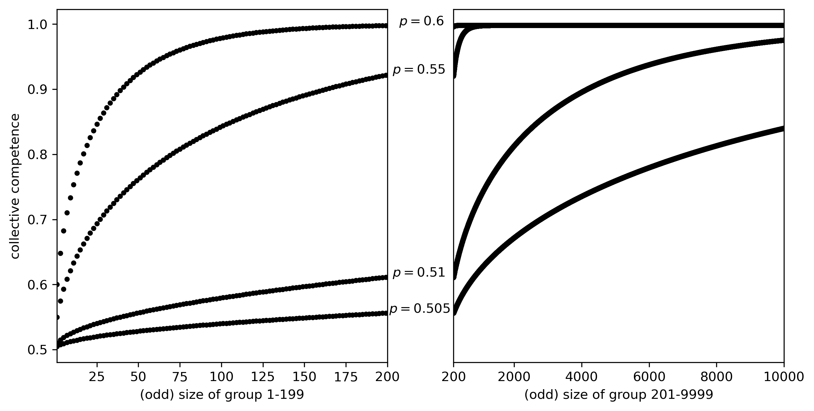
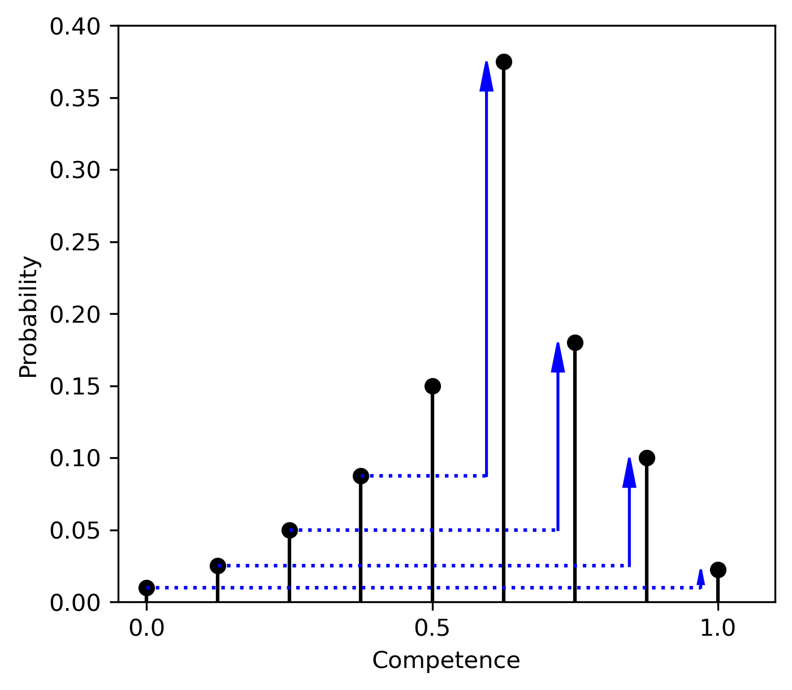
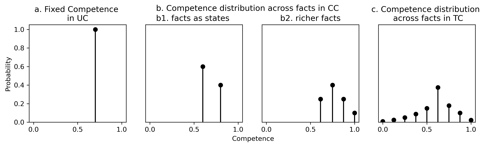
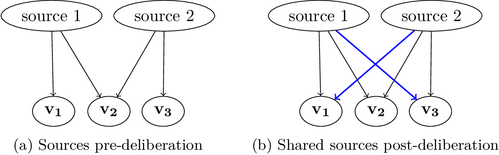
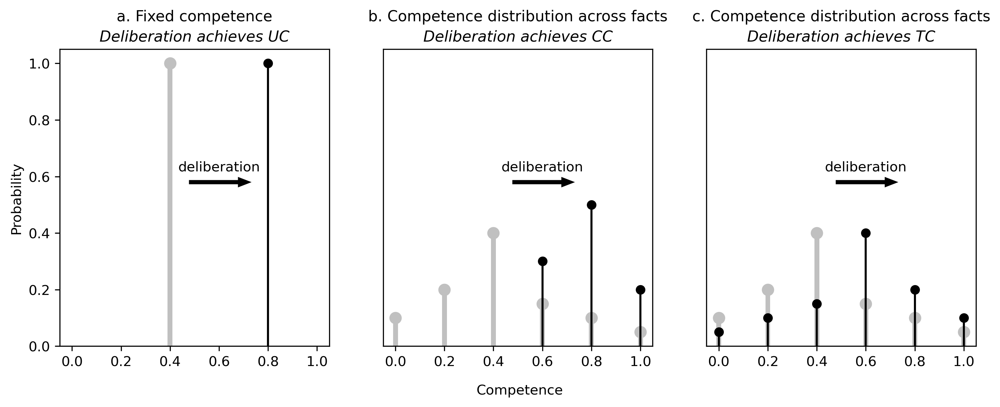

# Jury Theorems
**First published Wed Nov 17, 2021**

*Dietrich, Franz, Spiekermann, Kai*

Jury theorems are mathematical theorems about the ability of collectives to make correct decisions. Several jury theorems carry the optimistic message that, in suitable circumstances, “crowds are wise”: many individuals together (using, for instance, majority voting) tend to make good decisions, outperforming fewer or just one individual. Jury theorems form the technical core of epistemic arguments for democracy, and provide probabilistic tools for reasoning about the epistemic quality of collective decisions. The popularity of jury theorems spans across various disciplines such as economics, political science, philosophy, and computer science.

This entry reviews and critically assesses a variety of jury theorems. It first discusses Condorcet’s initial jury theorem, and then progressively introduces jury theorems with more appropriate premises and conclusions. It explains the philosophical foundations, and relates jury theorems to diversity, deliberation, shared evidence, shared perspectives, and other phenomena. It finally connects jury theorems to their historical background and to democratic theory, social epistemology, and social choice theory.

## 1. Introduction

### 1.1 What are jury theorems?

How many individuals should be entrusted with a given decision? Epistemically speaking, what matters is how the correctness or quality of decisions depends on the number of participants, for instance, how the correctness of jury verdicts (“innocent” or “guilty”) depends on jury size, how the quality of parliamentary decisions depends on parliament size, how the quality of election outcomes depends on the size of the electorate, or how the quality of expert advice depends on the size of the advisory body. Jury theorems address this problem. Their perspective is epistemic rather than procedural: the sole aim is to reach “good” or “correct” decisions by an external standard rather than to respect individual participation rights or ensure democratically legitimate decisions. The reliance on correctness facts is the central philosophical commitment of jury theorems (see Section 4.1).

This entry refers to the set of individuals participating in the decision as the *group* or *(decision) body*, and to the larger set from which this group is selected as the *population*. Examples are electoral bodies selected from the population of citizens, and scientific advisory bodies selected from the population of scientists. In real life, some decision bodies are very large: electoral bodies often contain millions of citizens. Other bodies have medium size: juries in court often involve 12 members. Yet other bodies have few or just one member: authoritarian states are ruled by small cliques or just one person.

Jury theorems are mathematical theorems of the following general structure:

**Generic Jury Theorem:** Given a choice problem of type *X*, a voting procedure of type *Y*, and premises about individuals *Z*, the epistemic performance of group decisions depends on group size in ways *W*.

This schematic statement contains several parameters, filled in differently by different jury theorems. The first and simplest jury theorem goes back to French enlightenment philosopher and mathematician Marie Jean Antoine Nicolas de Caritat, Marquis de Condorcet. In Condorcet’s (1785)[^condorcet-1785] theorem,

- the choice problem is binary, like the guilty-or-innocent problem of juries;
- the voting procedure is majority voting;
- the premises on individuals are competence and independence assumptions of particularly simple kinds;
- the conclusion is that “crowds are wise” in the twofold sense that the probability of a correct group decision (i) increases in group size and (ii) converges to one as group size approaches infinity.

These two Condorcetian “wisdom of crowds” conclusions have considerably shaped the field, because they reappear (partly or fully) in many other jury theorems, whilst being controversial. The research programme of the jury theorem literature is partly an attempt to place one or both Condorcetian conclusions on improved premises, and partly an attempt to derive jury theorems reaching rival conclusions, such as the optimality of some finite and possibly small group size (against Condorcet’s first conclusion) or the fallibility of asymptotically large bodies (against Condorcet’s second conclusion).

Taken in themselves, the Condorcetian conclusions represent two controversial wisdom-of-crowds hypotheses, which can be stated more generally (Dietrich & Spiekermann 2020)[^dietrich-2020]:

**The Increasing-Reliability Hypothesis:** Larger bodies are better truth-trackers. They make epistemically better decisions than smaller bodies or single individuals.

**The Infallibility Hypothesis:** Huge bodies are infallible truth-trackers. They make epistemically optimal decisions in the limit as group size tends to infinity.

Upon deeper analysis, the infallibility hypothesis is untenable, and cannot even serve as an approximation, idealisation or paradigm of how large-scale democracy performs (see Section 2). The fact that many jury theorems reach this over-optimistic conclusion has not always been helpful, by threatening the credibility of the jury theorem literature as a whole. The right response is to revise the premises of jury theorems such that they become justifiable and imply plausible conclusions, like increasing reliability. Jury theorems with more plausible premises and conclusions are indeed achievable (see Section 2).

The increasing-reliability hypothesis thus appears to be the more appropriate rendition of the wisdom of crowds. The infallibility hypothesis should arguably give way, as will emerge in Section 2 and Section 4.2 (see Section 4.3 for a potential exception). Jury theorems reaching the infallibility conclusion can be mathematically interesting; philosophically, they might be seen as arguments against their own premises.

### 1.2 A broad notion of decision

Jury theorems address collective “decisions” in a broad sense. Decisions could, for instance, stand for collective *beliefs* or collective *actions or choices*. In the legal arena, jury verdicts represent beliefs (about guilt or innocence), whereas court rulings represent actions (of convicting or acquitting defendants). In the political arena, parliamentary decisions and referendum decisions usually represent choices. Depending on its mandate, an ethical or scientific commission either produces collective beliefs (which serve as advice), or performs actions, e.g., sets a budget or institutes ethical standards.

But there is one key condition: decisions must be *correctness-apt*, i.e., be either factually correct or incorrect (or, more generally, of some correctness degree). Which facts determine correctness? Belief-type decisions are correct if the belief has true content. Action-type decisions are correct depending on some state; e.g., court rulings are correct depending on past actions of the defendant.

Collective beliefs are examples of collective *attitudes*. Other possible collective attitudes are collective values, desires, preferences, or intentions. They too can be formed through aggregation: think of preference aggregation rules generating collective preferences. Any collective attitude whose possession can be factually correct or incorrect is potentially an object of jury theorems. Whether attitudes can be correct is, of course, more controversial for non-belief attitudes (cf. Section 4.1).

In sum, jury theorems address collective decisions of any correctness-apt kind, including collective actions, beliefs, and other attitudes.

## 2. Three Jury Theorems

This section states and discusses three jury theorems about majority decisions between two alternatives. They assume a population of individuals, labelled $1, 2, \ldots,$ representing the possible members of the decision-making group. The population might contain, for example, all citizens of a state (for a political decision) or all scientists (for a scientific decision). It is infinite—an idealisation needed for considering arbitrarily large decision bodies. The group has any finite size $n\geq1$ and consists of the first $n$ individuals $1, 2, \ldots, n.$ Each member votes for one alternative. The alternative receiving a majority wins (if $n$ is even, there can be a tie without collective decision). Following the epistemic approach, one alternative is *correct* (right, better, etc.) and the other is *incorrect* (wrong, worse, etc.), independently of the decision process. This makes any individual judgment and any group decision correct or incorrect.

Jury theorems operate in a probabilistic framework: anything unknown is modelled as a random event or variable (defined relative to some background probability space[^note-1]).

*Notation:* For any jury theorem of the entry, the probability function (of the underlying probability space) is denoted $P$. Where needed by a jury theorem, the event that individual $i (=1, 2, \ldots)$ is correct is denoted $R_{i}$, and for each possible group size $n\in\{1,2,\ldots\}$ the event that a majority is correct (i.e., that more than half of $R_{1},\ldots,R_{n}$ hold) is denoted $\Maj_{n}$.[^note-2]

### 2.1 Condorcet’s Jury Theorem

Condorcet’s (1785)[^condorcet-1785] jury theorem will be discussed first on grounds of simplicity and historic importance, setting aside concerns about its premises and conclusions. Condorcet’s text does not follow modern mathematics, but many later authors have stated his theorem formally (e.g., Grofman 1975; Grofman, Owen, & Feld 1983)[^grofman-1975][^grofman-1983].[^note-3] The theorem operates in a simple formal framework, with only the following ingredients:

*Primitives of Condorcet’s Jury Theorem:* correctness events $R_{1},$ $R_{2}, \ldots,$ defined relative to a probability space.

In these primitives (and those of the two other jury theorems in this section), the correctness events could be replaced by more basic primitives, namely the following random variables: votes (judgments) of the individuals $1, 2, \ldots,$ whose values are alternatives, and a “state” variable, whose value is, or more generally determines, the correct alternative. Each correctness event $R_{i}$ is then defined as the event that $i$’s vote equals the correct alternative, and the whole analysis stays unchanged. For instance, in a court’s decision problem, the votes of judges could take values in $\{\text{convict},\text{acquit}\}$ and the state could take values in $\{\text{guilty},\text{innocent}\}$, where $\text{convict}$ is correct if the state is $guilty$, and $\text{acquit}$ is correct if the state is *$innocent$*. Equivalently, and more parsimoniously, votes and state could all take values in $\{0,1\}$, where $R_{i}$ is the event that $i$’s vote equals the state.[^note-4]

Condorcet’s theorem assumes that correctness is independent across individuals and has (the same) probability greater $\frac{1}{2}$ for each individual. Formally:

**Unconditional Independence (UI).** The individual correctness events $R_{1},$ $R_{2}, \ldots$ are (unconditionally) independent.

**Unconditional Competence (UC).** The (unconditional) individual correctness probability $P(R_{i})$—the *general competence*—exceeds $\frac{1}{2}$ and is the same for all individuals $i$.

**Condorcet’s Jury Theorem:** Assuming UI and UC, the probability of majority correctness, $P(\Maj_{n})$, increases in (odd[^note-5]) group size $n$ and converges to 1.

This theorem paints an optimistic picture of the wisdom of crowds, by concluding that majority outcomes are not only increasingly reliable as voters are added, but also infallible in the limit.

*Figure 1.* The probability of majority correctness for different group sizes and competence levels. [An extended description of Figure 1 is in the supplement.]

Figure 1 illustrates increasing majority reliability, for different levels of individual competence $p=P(R_{i})$. Note the fast convergence to one, even for just slightly competent individuals.

Why does this theorem hold? Intuitively, UI and UC imply that the individual judgments behave like independent tosses of the same coin biased towards the truth. The more often the coin is tossed, the more likely the majority of the tosses are “correct”, and this likelihood converges to one.

Technically, the increasing-reliability conclusion follows via a non-trivial combinatorial argument. The infallibility conclusion has an easy proof, which can be sketched here. By UC, general competence $p=P(R_{i})$ is voter-independent. The group’s proportion of correct votes is a random variable that converges stochastically to $p$ by the law of large numbers, using UI. So, as $p>\frac{1}{2}$ by UC, the probability that this proportion exceeds $\frac{1}{2}$, which is precisely $P(\Maj_{n})$, converges to 1 as $n\rightarrow\infty$.

Although “increases” should be read as “weakly increases” in Condorcet’s and the other two jury theorems, the stronger conclusion of strictly increasing $P(\Maj_{n})$ holds in all non-degenerate cases of these theorems.[^note-6]

### 2.2 The problem of common causes of votes

A tempting mistake is to believe that votes are probabilistically independent as soon as they are *causally* independent, i.e., do not affect one another. Votes are often causally independent: secret voting prevents someone’s vote from influencing someone else’s vote. Sometimes not only the votes (or voting acts), but even the individuals more broadly (their reasonings, perspectives, knowledge, votes, etc.) are causally independent. This happens if individuals do not deliberate or otherwise interact—a rare, but possible scenario. Deliberation immediately creates causal dependence between individuals, but not between their (secret) votes.

Causal independence (between votes or even individuals) by no means makes votes *probabilistically* independent, since common causes create correlations. This fact will be obvious to empirical scientists, statisticians, or causal-network theorists; see, for instance, the entry on Reichenbach’s common cause principle, as well as Reichenbach (1956)[^reichenbach-1956], Pearl (2000)[^pearl-2000] and Dietrich and List (2004) on common causes in jury theorems. Common causes of votes are factors influencing two or more votes. They exist in abundance. Voters are usually exposed to

- shared evidence, such as witness reports;
- shared perspective-shaping influences, coming from a shared language, shared concepts, a shared methodology, or shared hypotheses;
- shared contextual influences that are unrelated to the decision task yet affect judgment skills, such as noise or heat.

Unfortunately, the resulting correlations between votes—and ultimately between correctness events $R_{1},R_{2},\ldots$—are usually positive, which undermines diversity and reinforces tendencies and errors. Positive correlation between correctness events means: *given* that someone votes correctly, others are more likely to vote correctly. Why is the correlation positive? A correct judgment by, say, individual 1 (the event $R_{1}$) raises the probability that the common causes take a truth-conducive form (i.e., that evidence is non-misleading, contextual influences support judgmental skills, etc.), which in turn raises the probability that other individuals are correct (the events $R_{2},R_{3},\ldots$). Conversely, an error by individual 1 raises the probability of misleading common causes, which raises the probability of errors by others.

In sum, voting and correctness are interpersonally (positively) correlated through common causes, against Condorcet’s independence assumption.

### 2.3 Partial solution: the Conditional Jury Theorem

Dependencies between votes can be “conditionalised away”. *Given* the common causes—the shared evidence, etc.—votes no longer exhibit dependence, as they no longer carry new information about common causes, hence about one another. Conditionalisation blocks the information flow through common causes. These considerations apply a well-known principle: causally independent phenomena are probabilistically independent conditional on their common causes (Reichenbach 1956)[^reichenbach-1956].

The conditionalisation strategy assumes that votes do not influence one another, i.e., are *causally* independent, as in secret voting. Otherwise information can flow between votes *directly*, not just via common causes, and conditionalising on common causes fails to make votes probabilistically independent.

To implement conditionalisation, introduce a random variable $\mathbf{x}$, called the *facts*, on which to conditionalise. One could interpret the facts as the totality of common causes, but simpler interpretations are also possible. The facts could be some proxy of common causes. Most commonly, $\mathbf{x}$ is the fact determining the correct alternative. This correct-making fact is standardly called the *state (of the world)*. In a court’s convict-or-acquit decision, its possible values could be “guilty” and “innocent”, which make “convict” or “innocent” correct, respectively. Section 2.1, Section 4.1 and Section 5.1 discuss the state.

The new jury theorem will therefore rest on the following primitives.

*Primitives of the Conditional Jury Theorem:* correctness events $R_{1},$ $R_{2}, \ldots$ and an arbitrary random variable $\mathbf{x}$ (the *facts* variable, representing for instance the state or the common causes), all defined relative to a probability space.

*Convention:* Definitions involving $\mathbf{x}$ will assume that each value of $\mathbf{x}$ has positive probability (which facilitates conditionalising, but restricts attention to discrete rather than continuous $\mathbf{x}$). All definitions could be generalised.[^note-7]

These are the revised premises and theorem.

**Conditional Independence (CI).** The individual correctness events $R_{1},$ $R_{2}, \ldots$ are independent given any value $x$ of the facts $\mathbf{x}$.

**Conditional Competence (CC).** For any value $x$ of the facts $\mathbf{x}$, the conditional correctness probability $P(R_{i}|x)$—the *specific competence on* $x$—exceeds $\frac{1}{2}$ and is the same for all individuals $i$.

**Conditional Jury Theorem:** Assuming CI and CC, the probability of majority correctness, $P(\Maj_{n})$, increases in (odd[^note-8]) group size $n$ and converges to 1.

This theorem reaches the same optimistic conclusions as Condorcet’s theorem, but based on new premises. The new independence assumption is more plausible to the extent that the facts $\mathbf{x}$ include common causes or proxies thereof. If the facts are the state of the world—a *very* rough proxy of common causes—one obtains the literature’s most common form of conditionalisation and the classical *State*-Conditional Jury Theorem (e.g., Austen-Smith & Banks 1996)[^austen-smith-1996]. The Conditional Jury Theorem generalises this familiar jury theorem to an arbitrary target of conditionalisation $\mathbf{x}$. Replacing state-conditionalisation by arbitrary conditionalisation makes the jury theorem more flexible, opening the door to genuinely plausible independence assumptions.

How has the competence assumption evolved? Conditional Competence is logically stronger than Unconditional Competence: individuals must outperform fair coins not just globally, but given any facts. For instance, in a court’s decision to convict or acquit, where the facts are the state of guilt or innocence, each individual (judge) must be more likely correct than incorrect given guilt and also given innocence.

An individual $i$’s general competence is expressible as his (probability-weighted) average specific competence across possible facts, i.e., possible values $x$ of $\mathbf{x}$:

$$\tag{1} P(R_{i})=\sum_{x}P(R_{i}|x)P(x). $$

This shows that CC implies UC.

Unfortunately, the Conditional Jury Theorem maintains the unrealistic conclusion of asymptotic infallibility. Conditionalisation on facts can repair the independence premise, but another problem in the premises remains, as will now be explained.

### 2.4 The fundamental tension between independence and competence

One might have hoped that the “conditional” premises CI and CC are jointly justified for at least *some* conditionalisation, i.e., *some* suitably designed facts variable $\mathbf{x}$. Then the Conditional Jury Theorem would rest on justified premises, and we could trust its conclusions. But a dilemma arises:

- Conditional Independence is only plausible if one packs many facts into $\mathbf{x}$ (ideally all common causes).
- Conditional Competence is only plausible if one packs few facts into $\mathbf{x}$ (ideally *no* facts, so that CC reduces to UC, the maximally plausible instance of CC).

Therefore, CI and CC require different conditionalisations. They are almost never justified *jointly*, but only justified *individually*, for different facts variables $\mathbf{x}$ (Dietrich 2008)[^dietrich-2008]. This is the fundamental tension between independence and competence. This tension lies not in a logical contradiction between both, but in the nature of realistic decision problems (for a potential exception, see Section 4.3).

Why does this tension exist? Formal theorizing aside, it is obvious that whether someone is competent—i.e., more often right than wrong—depends on the type (reference class) of judgment tasks considered. Plausibly, people are more often right among *all* conceivable judgment tasks (the maximal reference class), and presumably also among many large reference classes, such as all guilty-or-innocent judgment tasks. But someone is presumably incompetent—more often wrong—among some very specific types of judgment tasks, such as all *confusing* tasks, and all guilty-or-innocent judgment tasks *with seemingly honest but lying witnesses*.

Each instance $x$ of the facts $\mathbf{x}$ defines a type (reference class) of tasks: those tasks in which the facts are $x$. Some instances of the facts $\mathbf{x}$ make it easy to form correct judgments: instances $x$ where the evidence is transparent, witnesses are honest, laboratory tests are correct, etc. Here individuals $i$ are competent: $P(R_{i}|x)>\frac{1}{2}$. Perhaps some other instances of the facts $\mathbf{x}$ make it hard to form correct judgments: instances $x$ with misleading evidence, etc. Here voters are not competent: $P(R_{i}|x)\leq\frac{1}{2}$. Whether misleading instances exist—i.e., whether CC fails—depends on the facts variable $\mathbf{x}$ used. If all common causes are packed into $\mathbf{x}$ (presumably to ensure Conditional Independence CI), then almost inevitably certain instances $x$ of $\mathbf{x}$ represent misleading circumstances, in which voters $i$ have low competence $P(R_{i}|x)<\frac{1}{2}$. Ironically, if one packs much less information into the facts $\mathbf{x}$, possibly even reducing $\mathbf{x}$ to the state (often a variable with just two instances), then one may well rehabilitate Conditional Competence, whilst sacrificing Conditional Independence. This is the dilemma.

### 2.5 The Competence-Sensitive Jury Theorem

The dilemma can be escaped with a jury theorem with more plausible premises and conclusions. Think of the facts $\mathbf{x}$ as being rich enough to justify Conditional Independence; so $\mathbf{x}$ contains the common causes, or a good enough proxy or substitute for them.

Although voters will be incompetent under some (unfortunate) instances $x$ of the facts $\mathbf{x}$, they will plausibly be competent most of the time, i.e., under most facts instances. This suggests replacing Conditional Competence with the weaker premise of *Tendency to Competence*. What is this axiom? It says that competence is more often high than low. More precisely, competence exceeds 0.5 by some amount at least as often as it falls below 0.5 by this amount, for any positive amount. So, competence is 0.51 at least as often as 0.49; it is 0.55 at least as often as 0.45; etc. Formally, an individual $i$’s specific competence $P(R_{i}|\mathbf{x})$ depends on the (random) facts $\mathbf{x}$, hence is itself random. If its value exceeds $\frac{1}{2}$, the facts can be called *truth-conducive* or *easy* for $i$; if its value is below $\frac{1}{2}$, the facts can be called *misleading* or *difficult* for $i$; if its value is $\frac{1}{2}$, the facts can be called *neutral* for $i$, as they do not push in any direction. A discrete random number (such as specific competence $P(R_{i}|\mathbf{x})$) *tends to exceed* $\frac{1}{2}$ if, for each $\epsilon>0$, it equals $\frac{1}{2}+\epsilon$ at least as likely as $\frac{1}{2}-\epsilon$.

*Figure 2.* A competence distribution that tends to exceed $\frac{1}{2}.$ [An extended description of Figure 2 is in the supplement.]

Figure 2 gives an example where specific competence (with values $0, \frac{1}{8},$ $\frac{1}{4},$ $\frac{3}{8}, \ldots, 1)$ tends to exceed $\frac{1}{2}$: competence is $\frac{5}{8}$ with higher probably than $\frac{3}{8}$; it is $\frac{3}{4}$ with higher probably than $\frac{1}{4}$; etc. Visually, this makes the distribution lean to the right.

This leads to the following jury theorem (Dietrich & Spiekermann 2013a)[^dietrich-2013a].

*Primitives of the Competence-Sensitive Jury Theorem:* same as for the Conditional Jury Theorem.

**Tendency to Competence (TC):** The conditional correctness probability $P(R_{i}|\mathbf{x})$—the *specific competence*—tends to exceed $\frac{1}{2}$ and is the same for all individuals $i$.

**Competence-Sensitive Jury Theorem:** Assuming CI and TC, the probability of majority correctness, $P(\Maj_{n})$, increases in (odd[^note-9]) group size $n$ and converges to a value which is below 1 unless CC holds.

What is the limit of majority correctness under CI and TC? It is the probability that the facts (e.g., the shared evidence) are truth-conducive plus half the probability that the facts are neutral.[^note-10] Loosely speaking, group performance in the limit is as good as the facts. Unsurprisingly, the group cannot beat the facts. It should already count as a success to match the facts asymptotically.

The twofold evolution from the Conditional Jury Theorem is that the competence premise is weakened to TC and the infallibility conclusion is reversed. Therefore, majorities can be wrong even in asymptotically large bodies—unless CC holds, i.e., unless voters are *always* competent. “Unless” can be read strongly in the theorem, as meaning “if *and only if* it is not the case that”.

### 2.6 The three jury theorems compared

Table 1 summarizes the three jury theorems.

*Table 1. Three jury theorems compared*

|   | *Condorcet’s Jury Theorem* | *Conditional Jury Theorem* | *Competence-Sensitive Jury Theorem* |
| --- | --- | --- | --- |
| *Premise 1* | Unconditional Independence | Conditional Independence | Conditional Independence |
| *Premise 2* | Unconditional Competence | Conditional Competence | Tendency to Competence |
| *Conclusion 1* | Increasing Reliability | Increasing Reliability | Increasing Reliability |
| *Conclusion 2* | Asymptotic Infallibility | Asymptotic Infallibility | Asymptotic Fallibility |

All theorems yield increasing reliability, but only the first two yield asymptotic infallibility. The independence assumption evolves from unconditional to conditional.

*Figure 3.* The three competence axioms UC, CC and TC. [An extended description of Figure 3 is in the supplement.]

Figure 3 illustrates how the competence assumption evolves:

1. Condorcet’s Jury Theorem focuses on *general* competence, i.e., the fixed probability $P(R_{i})$, which must exceed $\frac{1}{2}$ (see Plot a).
2. The Conditional Jury Theorem focuses on *specific* competence, i.e., the facts-dependent probability $P(R_{i}|\mathbf{x})$, which must always exceed $\frac{1}{2}$. If one takes $\mathbf{x}$ to be the state of the world, i.e., considers the *State*-Conditional Jury Theorem, then (assuming the state is binary) only two competence levels are possible, one for each state (see Plot b1). Richer facts allow for many possible competence levels (see Plot b2).
3. The Competence-Sensitive Jury Theorem assumes, less demandingly, that specific competence *tends* to exceed $\frac{1}{2}$ (see Plot c).

Mathematically, the Competence-Sensitive Jury Theorem generalises the Conditional Jury Theorem, which generalises Condorcet’s Jury Theorem. Why?

- The Competence-Sensitive Jury Theorem encompasses the Conditional Jury Theorem as a special case, the case when CC holds, because in this extreme case (of *always* competent voters) the theorem asserts asymptotic infallibility.[^note-11]
- The Conditional Jury Theorem encompasses Condorcet’s Jury Theorem as a special case, obtained when plugging in a trivial facts variable $\mathbf{x}$ with only one possible value. Here the premises CI and CC reduce to Condorcet’s premises UI and UC, because conditionalising on facts that are certain is like not conditionalising at all.

## 3. Jury Theorems and Diversity

Intuitively, diversity—in backgrounds, perspectives, information, reasoning modes, skills, etc.—improves collective performance. Where can diversity be found in formal jury frameworks? Do the assumptions of jury theorems implicitly rule out diversity, or instead permit or even require diversity?

### 3.1 Diversity versus competence heterogeneity

Diversity is describable as plurality in sources and backgrounds: individuals reason differently, hold different perspectives, use different information, etc. Although diversity is a multi-dimensional and largely informal property, it manifests itself in jury models. As what? There are two natural candidates: competence heterogeneity and independence. The relation to competence heterogeneity will be clarified first (Section 3.3 turns to independence).

Diversity does *not* imply competence heterogeneity—fortunately, as otherwise the three jury theorems above would exclude diversity in the homogeneity clause of their competence assumptions. Diversity does not imply differences in competence *levels*, but differences in competence *sources*. Even under high diversity, members could be correct with identical probabilities—for different reasons.

Conversely, competence heterogeneity tends to imply diversity, i.e., non-diversity tends to imply competence homogeneity, because members with exactly same background, same information, same reasoning, etc., should be equally competent.

In sum, competence homogeneity is a systematic feature of non-diverse groups, but not vice versa.

### 3.2 Competence heterogeneity threatens the wisdom of crowds

Differential competence is the main threat to the increasing-reliability hypothesis. The political upshot is that the epistemic superiority of democracy is at stake—is it epistemically better for a society to be run by a few competent citizens? The wisdom-of-crowds conclusion indeed breaks down in all three theorems if one removes homogeneity from the competence premise. Larger bodies can then perform worse, because new members may be (much) less competent than existing members. Majority reliability can even become a *decreasing* function of group size, and can converge to a level as low as $\frac{1}{2}$ if competence of new members converges fast enough to $\frac{1}{2}$.

**Finite optimal group rather than wise crowds?** The question of whether decision bodies should be augmented when new members are less competent is not far-fetched, but a notorious issue in real-life committee design. This is the trade-off: adding less competent members, on the one hand, lowers average member competence, but, on the other hand, brings the advantage of size, namely that errors of individual members are more easily overruled (“washed out”) by the majority. Depending on which effect is stronger, the probability of majority correctness increases or falls by adding less competent members.

Whether some (finite) group is optimal or instead “bigger is better” has been treated analytically. Answers depend on model assumptions (see Karotkin & Paroush 2003)[^karotkin-2003].

How could the wisdom of crowds be rehabilitated? Both wisdom-of-crowds hypotheses are discussed in turn.

**Asymptotic infallibility despite heterogenous competence.** The asymptotic conclusion of Condorcet’s Jury Theorem remains true if UC is weakened to the existence of a fixed lower bound $\frac{1}{2}+\epsilon$ for everyone’s competence (Paroush 1998)[^paroush-1998]. This assumption can be relaxed further: it suffices that the infinitely many individuals are competent *on average*, which allows for many incompetent individuals[^note-12] (see Dietrich 2008; for related or more general results: Boland 1989; Owen, Grofman, & Feld 1989; Berend & Paroush 1998)[^berend-1998][^boland-1989][^boland-1989-2][^dietrich-2008][^owen-1989][^paroush-1998]. Unfortunately, these variants of Condorcet’s Jury Theorem (and analogous variants of the Conditional Jury Theorem) retain only the infallibility conclusion, sacrificing increasing reliability. The more problematic conclusion has been retained, one might complain.

**Increasing reliability despite heterogenous competence.** There are broadly two approaches to rehabilitate the increasing-reliability hypothesis and thereby defend large-scale democracy in the face of differential competence.

The first approach effectively denies that larger bodies have “worse” members, by postulating a different procedure to determine group members: members are selected anonymously, rather than (for instance) by competence. Increasing group size no longer means keeping the “old” members and adding “new”, often less competent, members, but it means drawing a fully new (larger) group from the population.[^note-13] This procedure for selecting members differs significantly from that where the members must be the first $n$ individuals in a predefined “priority order” of the individuals. The new procedure is anonymous, instead of effectively prioritising individual 1 over individual 2, individual 2 over individual 3, etc. Which procedure is more realistic is debatable and context-dependent.

A second approach assumes—quite realistically—that individual competence levels are unknown. Even if additional group members were *objectively* less competent, this fact would be insufficiently known or established (cf. Romeijn & Atkinson 2011)[^romeijn-2011]. The institutional designer can consider three kinds of justification for a large, inclusive group. An epistemic justification points out that any proxy used for competence might be misleading. For instance, it would seem unjustified to exclude citizens without university education because they might be just as competent or more competent; excluding them might lower collective competence. One procedural justification holds that it is unfair to exclude individuals from democratic decision-making even if their incompetence were established beyond reasonable doubt. Such procedural reasons for inclusion could, for example, be based on the democratic right to equal opportunity for influence. Another, more nuanced procedural view does not generally oppose voter exclusion, but requires the incompetence to be established to a high standard, as those excluded are owed reasons for being ruled by others.

A version of the last view is defended by Estlund (2008)[^estlund-2008]. He grants that some individuals can be more competent than others, thereby opening the door to arguments for “epistocracy” (decision by small bodies of competent citizens) rather than democracy (decision by all or most citizens, directly or indirectly). However, Estlund rejects epistocracy on grounds that competence levels cannot be identified beyond reasonable doubt. Individuals excluded from decision-making could rightfully object to being ruled by others (Estlund 2008: ch. 11)[^estlund-2008]. Estlund’s proposal has led to a lively debate on arguments for and against epistocracy and the role of uncertainty about competence (Lippert-Rasmussen 2012; Brennan 2018; Goodin & Spiekermann 2018: ch. 15; Gunn 2019)[^brennan-2018][^goodin-2018][^gunn-2019][^lippert-rasmussen-2012].

To formally tackle limited knowledge about individuals, one could, for instance, introduce subjective probabilities over competence levels, i.e., over objective correctness probabilities. More simply, one can eliminate objective probabilities and competence altogether from the model and work solely with subjective probabilities over individual judgments (rather than over individual competence levels). If individuals are subjectively indistinguishable, judgments can be assumed to be *interchangeable* in de Finetti’s sense of permutation-invariance. This implies (with an additional assumption) that larger bodies are more reliable, without becoming asymptotically infallible, by a *jury theorem for interchangeable voters* (Dietrich & Spiekermann 2013a; generalising Ladha 1993)[^dietrich-2013a][^ladha-1993]. Here, “reliable” and “infallible” are no longer objective features of the group, but features of knowledge about it.

This subjectivist approach begs the question of who should hold these credences. But at least it takes the problem of uncertainty about individuals seriously.

### 3.3 Diversity as judgmental independence

Diversity manifests itself as probabilistic *independence* between individual judgments. If diversity is small—i.e., individuals reason similarly, use similar evidence, etc.—then judgments are highly correlated. Without any diversity, judgments coincide, and the correctness events $R_{1},$ $R_{2}, \ldots$ are equivalent. If diversity is high, then judgments correlate less. Extreme diversity corresponds to full independence—or even to negative correlation, to mention a rare but interesting possibility (Hong & Page 2009; 2012)[^hong-2009].

Condorcet’s Jury Theorem implicitly presupposes extensive diversity by assuming independence. The Conditional and the Competence-Sensitive Jury Theorem are less restrictive: they permit more or less diversity, because their *conditional* independence assumption is compatible with more or less *unconditional* independence.

Many models of voter dependence have been proposed. A classical model introduces an “opinion leader” whose judgment each other individual copies with some probability (Boland, Porschan, & Tong 1989)[^boland-1989][^boland-1989-2]. Instead of a single opinion leader, the individuals could influence one another, as captured by pairwise correlations (e.g., Ladha 1992)[^ladha-1992]. The dependence structure could become yet more complex and escape a description in terms of pairwise correlations (Kaniovski 2010; Pivato 2017)[^kaniovski-2010][^pivato-2017].

Some authors focus on the merits of diversity, by presenting theorems in which more independence (diversity) leads to better majority decisions (e.g., Berg 1993; Ladha 1995)[^berg-1993][^ladha-1995]. The mechanism at work is this: more independence makes it more likely that errors of voters are compensated by correctness of other voters. Many authors also present jury theorems, showing that, despite some dependence or non-diversity, crowds can be “wise”, in the sense of increasing reliability (e.g., Berg 1993)[^berg-1993] or asymptotic infallibility (e.g., Pivato 2017)[^pivato-2017]. The infallibility conclusion remains objectionable (cf. Section 2).

Modelling voter dependence in adequate, transparent and tractable ways remains a central challenge for future jury theorem research.

### 3.4 Diversity affects both decision-making stages: deliberation and aggregation

Collective decision-making can be subdivided into a deliberation phase, in which the individuals form or revise their judgments, and an aggregation phase, in which the post-deliberation judgments are fed into a voting rule which returns the decision (Dryzek & List 2003)[^dryzek-2003]. Diversity affects not only the judgment profile in the group at any given moment, and hence the aggregation process, but also the deliberation process. Deliberation owes its richness and fruitfulness largely to diversity. Non-diverse bodies gain little from deliberating: their members already reason similarly, take similar perspectives, know similar things, etc. In diverse bodies, deliberation can broaden the informational, perspectival, and methodological horizon. The more diversity, the more potential for judgment revision through deliberation.

Causal graphs help to understand how diversity affects deliberation. Think of the votes (judgments) as embedded in a causal graph. Each individual’s vote is a (probabilistic) causal consequence of this individual’s judgment sources: informational sources, intellectual influences, etc. The more the sources differ across individuals, the more diverse the group is. In deliberation, members share their sources. This changes the causal structure: whenever a source is shared with an individual $i$, a causal arrow is added from that source to $i$’s vote. This enlarges a voter’s spectrum of sources.

*Figure 4.* Source sharing through deliberation. [An extended description of Figure 4 is in the supplement.]

Figure 4 gives an illustration with just two sources and three individuals. Source sharing makes the basis of judgments more similar across individuals, possibly letting judgments converge. Ideal deliberation achieves full source sharing, as in Figure 4. The more diverse the group was initially, the more sources there are to share, hence the more deliberation can “do”.

While deliberation reduces interindividual diversity by removing source asymmetries, it creates intraindividual diversity by widening the spectrum of someone’s sources. Individuals “internalise” diversity when deliberating.

## 4. Problems and Questions

### 4.1 Do correctness facts exist?

The controversial philosophical premise of jury theorems is that alternatives are factually correct or incorrect (or of some degree of correctness). The (possibly composite) fact that determines correctness is called the *state of the world* or just *state*.[^note-14]

To disambiguate, notice that formal models often use simplified notions of the state. Firstly, many models reduce the state to its unknown part; for instance, the state in a court decision might be modelled as the fact of whether a crime has been committed, treating all other determinants of correct verdicts (such as the right interpretation of the law, but also logical or physical facts) as known background facts not worth modelling. Secondly, and more radically, many models identify the state with the correct alternative itself; they might take the state in a court decision to *be* the correct verdict (“convict” or “acquit”).

Setting modelling practice aside, which (known or unknown) facts determine correctness, i.e., constitute the state? One can distinguish between logical, empirical and normative facts. When a group of logicians votes on whether an argument is valid, correctness depends on logical facts. When a panel of climate experts predicts the average global surface temperature in 2100, correctness also depends on empirical facts. When a parliament decides on whether to allocate more funding to the health system, correctness depends on normative facts, besides empirical (and logical) facts. In many social decisions, correctness depends both on unknown empirical facts and unknown normative facts, particularly for decisions on actions or on beliefs about what is valuable or ought to be done.

Critics of jury theorems often question the very notion of correctness. Some doubt the existence of normative facts necessary for correctness in political, moral, or other evaluative decisions. This critique is often voiced in the form that there is no “truth” pertaining to decisions in a certain domain (e.g., Muirhead 2014 criticizing Landemore 2013; cf. Gaus 2011 for how Estlund 2008 stakes out the domain of truth-apt political claims)[^estlund-2008][^gaus-2011][^landemore-2013][^muirhead-2014]. Certain decisions might indeed be non-epistemic. Judgments of taste, for instance, might express desires, or perhaps beliefs without correctness fact. For moral judgments, both the existence and the nature of correctness facts is controversial.

Note, however, that the existence of moral and other normative facts does not depend on meta-ethical realism, universalism, or naturalism. Constructivism about moral facts, for example, could provide an intersubjectively shared social fact that is perfectly suitable for jury theorems, as long as the construction predates decision-making, i.e., occurs previously in the society.

In sum, all that jury theorems need is the existence of correctness facts of *some* kind that are process-independent, i.e., independent of the choice of group (size), the deliberation, and the aggregation.

In political settings, the real problem often lies not in non-existent correctness facts, but in ambiguously defined decision problems. For example, in presidential elections, is the question who best promotes the public good, or who best satisfies the citizens’ preferences? Ambiguous decision problems lead to ambiguous correctness standards. Jury theorems stay applicable *in principle*, subject to resolving ambiguities.

### 4.2 Are correctness facts underdetermined?

Many group decision problems display what might be called *Possible Underdetermination*: the true state of the world can (with non-zero probability) be objectively underdetermined by the totality of influences on (one or more individuals in) the population, which includes all evidence.[^note-15] A jury’s choice between “guilty” and “innocent” verdicts normally displays Possible Underdetermination, since the total available evidence can be objectively inconclusive (despite supporting one of these states). Dietrich and List’s (2004) jury model implicitly assumes Possible Underdetermination, because even the ideal interpretation of total evidence can be incorrect. Landemore (2013: 145)[^landemore-2013] mentions settings in which the correctness of the decision remains objectively uncertain, since the truth is never revealed with certainty. This could be interpreted as a strong (“persisting”) type of underdetermination: the truth is objectively underdetermined not just by the influences at the time of decision, but even by all future influences.

Possible Underdetermination implies that individual judgments, the group judgment, and even the asymptotic group judgment (as group size increases) are all fallible, i.e., incorrect with non-zero probability. The reason is simple: each of these judgments is determined by something (the total influences) that can underdetermine the state, hence does not always match the state.

Exceptions exist. When mathematicians vote on the truth of a mathematical conjecture, the correct decision is given by logical facts, hence is never underdetermined. Even then, individual judgments and (finite or asymptotic) group judgments can be incorrect, because of a positive probability that the objectively accessible truth is not subjectively recognized, say due to subjectively misleading evidence, intransparent logical facts, or distracting circumstances.

The lesson is that the infallibility hypothesis is untenable under Possible Underdetermination, and dubious even without Possible Underdetermination. The next subsection will, however, discuss a special scenario in which the group *is* asymptotically infallible.

### 4.3 Unlimited evidence generation?

Perhaps the only possible case for asymptotic infallibility involves the idea of unlimited evidence generation (or “generated signals” in the words of Hong & Page 2009)[^hong-2009]. What does this mean, and how plausible is it?

Assume that each individual accesses independent private information, on which alone their judgment is based, without any information sharing or dependence on common influences (assumed in Dietrich & List 2004)[^dietrich-2004]. For instance, doctors perform independent tests on one and the same patient to judge whether some virus is present, or chemists perform independent experiments to judge whether a liquid contains a given molecule. This private information is truth-conducive: given any true state, the information supports the true state with probability above $\frac{1}{2}$—the same probability for each information (each individual). More problematically, private evidence is independent given the true state. This rules out, implausibly, that any common causes (except the state itself) affect different private information: for instance, the patient’s physiology cannot affect virus tests (possibly rendering all tests unreliable), and the liquid’s acidity level cannot affect tests for the molecule (possibly rendering all tests unreliable). Under these questionable assumptions, majority judgments are asymptotically infallible, as the (State-)Conditional Jury Theorem applies.

Such a scenario of fully private and independent information escapes the problem of common causes (Section 2.2) and the tension between independence of competence (Section 2.4), but only by excluding hidden common influences, excluding informational exchange between individuals, postulating an ever extendable rather than fixed body of information, and thereby indirectly excluding underdetermination of the truth discussed in Section 4.2.[^note-16] An individual “creates” new independent information (in the examples: through “experiments”) rather than facing the same shared information as others. Increasing the group thus adds information, not interpretations of information. This unlimited availability of independent information might be approximately realistic in decision problems where information is *produceable* (say, through experiments) rather than merely *observable*. But political and other real-life decision problems come with a limited and possibly difficult body of known or knowable facts, causing asymptotic fallibility.

### 4.4 The problem of incredible truths

Some truths are hard to recognize as they are highly specific, and thus unlikely to hold. Recognizing that *global temperature will rise* may be easy, but recognizing that *it will rise by 2.3 Degrees Celsius* is hard. Whenever some choice alternative (and thus its correctness) is highly specific, competence in jury models is threatened. Suppose a climate panel must form a belief about the proposition $p$ that global temperature will rise by 2.3 degrees. Someone’s competence given $p$ (more generally, given facts that entail $p$) can easily fall below $\frac{1}{2}$, because correctly recognizing $p$ is hard. Indeed, the available evidence might be compatible with a temperature rise close to, but distinct from 2.3 degrees. The other effect of $p$’s high specificity is that competence given not-$p$ (more generally, given facts that entail not-$p$) can become very high, because not-$p$ is a very unspecific and thus “credible” proposition. The lesson is that highly unbalanced choice alternatives—a highly specific alternative against a highly unspecific alternative—bring the competence assumption of the Conditional Jury Theorem to fall.

By contrast, the competence assumptions of Condorcet’s and the Competence-Sensitive Jury Theorem, UC and TC, are not vulnerable to this problem. Why?

- UC pertains to the general (“unconditional”) competence of an individual $i$, $P(R_{i})$, not their specific competence given facts $x$, $P(R_{i}|x)$. General competence stays above $\frac{1}{2}$, because the (error-conducive) event of the “specific truth” is much less likely than the (truth-conducive) event of the “unspecific truth”.[^note-17]
- TC explicitly allows (specific) competence to sometimes fall below $\frac{1}{2}$.

The problem of incredible truths is a variant of Estlund’s (2008: 232–4)[^estlund-2008] “disjunction problem” and of problems diagnosed in List (2005)[^list-2005] and Dietrich and Spiekermann (2020).

### 4.5 Deliberation: independence underminer or competence booster?

Two intuitions compete: does deliberation primarily threaten collective epistemic success, by reducing judgmental independence, *or* primarily increase epistemic success, by raising individual competence?

The first intuition needs nuancing. Deliberation reduces *unconditional* judgmental independence, by adding common sources of votes; see Section 3.4 and Figure 4.[^note-18] Thus, deliberation further undermines Condorcet’s (naive) Unconditional Independence axiom. But deliberation does not undermine the Conditional Independence axiom of the Conditional and the Competence-Sensitive Jury Theorem, provided one conditionalises on common causes.[^note-19]

Turning to the second intuition, deliberation certainly affects competence. Since deliberation tends to widen the basis of judgments (see again Section 3.4), the effect on competence tends to be positive, as one may conjecture. All three competence axioms considered in Section 2 would then hold more easily with deliberation than without. This conjecture is illustrated in Figure 5.

*Figure 5.* Three examples where deliberation improves competence. Grey: pre-deliberation. Black: post-deliberation. [An extended description of Figure 5 is in the supplement.]

Plots a, b and c refer to the competence axiom of Condorcet’s, the Conditional, and the Competence-Sensitive Jury Theorem, respectively. In all three plots, the competence axiom is violated pre-deliberation, and holds post-deliberation— an extreme example where deliberation is of vital importance. In Plot a, deliberation lets general competence $P(R_{i})$ move from 0.4 to 0.8 post-deliberation, so that Condorcet’s competence axiom UC becomes satisfied. In Plots b and c, the distribution of specific competence across facts moves upwards, making the respective competence axiom satisfied.

To be clear, deliberation sometimes distorts judgments. Sometimes misleading evidence and other judgment-deteriorating sources are shared, opinion cascades occur, bad opinion leaders emerge, etc. (e.g., Sunstein & Hastie 2014)[^sunstein-2014]. So the hypothesis that deliberation improves competence should be qualified: deliberation *usually* improves judgments, thereby helping competence axioms like UC, CC and TC become satisfied.

### 4.6 Group-dependent individual competence

The increasing-reliability hypothesis is threatened not only if additional group members are less competent than existing members (Section 3.2), but also if *existing* members lose competence when the group grows too much. Firstly, the deliberation process, to which members partly owe their competence (Section 4.5), can become less fruitful: some bodies are too large for successful deliberation. Secondly, large “anonymous” bodies can demotivate members, who feel individually less responsible and spend less effort on forming correct judgments. The opposite effect is also imaginable: adding members can improve deliberation and motivation. Bodies can be too small, not just too big (see the debates over optimal parliament size, e.g., Elster 2012)[^elster-2012].

All this puts a fundamental assumption of jury models into question: the assumption that someone’s judgment and thus competence are group-independent, hence, for instance, are the same in a 3-member group (with small-scale deliberation) as in a 333-member group (with large-scale deliberation). This denies any effects of group dynamics on judgments.

To model group-dependence, the event $R_{i}$ that an individual $i$ is correct should be replaced by group-size-dependent correctness events $R_{i,n}$ for all group sizes $n$ such that $n\geq i$ (i.e., such that the group includes $i$). An individual $i$’s competence, general or specific, becomes a group-size-dependent quantity, given by $P(R_{i,n})$ or $P(R_{i,n}|\mathbf{x})$, respectively. One might hypothesize that competence is an initially increasing and subsequently falling function of $n$, which therefore peaks at some “individually optimal” group size $n_{i}$. If one replaces the ordinary assumption of group-independent judgments by the latter hypothesis, then the increasing-reliability conclusion of jury theorems will still hold when restricted to group sizes $n$ of at most the individual optimum $n_{i}$ of each individual group member $i=1,\ldots,n$. The *collectively* optimal group size can exceed the individual optima of all individuals $i$, because the merits of drawing on many minds can outweigh individual competence losses. But the collective optimum can become finite, against the increasing-reliability hypothesis.

### 4.7 Epistemic-strategic voting

Conventional jury models implicitly assume that individuals share the same objective of a correct collective decision. Surprisingly, this assumption does not rule out strategic voting. To the contrary, voters may vote against what they believe to be correct *in order* to facilitate a correct aggregate decision.

This can be called *epistemic*-strategic voting, because voters strategise out of a shared epistemic objective rather than conflicting interests. How is this even possible? Suppose a 9-member jury reaches a guilty-or-innocent verdict by majority. A juror reasons:

> I believe in guilt. My vote only makes a difference if it is pivotal, i.e., if my jury colleagues are split 4:4. So, let me assume this split. But then four (competent) colleagues believe in innocence. So innocence is more likely than I thought. The higher probability of innocence justifies an “innocent” verdict. So I shall vote *innocent*.

She votes on the basis, not of her beliefs, but her conditional beliefs assuming pivotality. If everyone reasons alike, no one reveals their genuine judgment. Votes reflect no private information or insights, and collective decision are arbitrary. Defendants are unanimously acquitted even when everyone believes in guilt.

Fortunately, this absurd situation is no more stable than sincere voting. Why? The strategic reasoning leading to non-sincere voting cannot be universalised: it assumes others vote sincerely. Indeed, our example juror assumes her colleagues are sincere in her “But then” inference.

Epistemic-strategic voting has been addressed game-theoretically, using jury models enriched by voters’ private information; see Austen-Smith and Banks (1996), Feddersen and Pesendorfer (1999), Peleg and Zamir (2012), Bozbay, Dietrich, and Peters (2014), and many others. The generic finding is that sincere voting by everyone is no (Nash) equilibrium, but that the rationality of sincere voting can be restored by carefully adjusting the aggregation rule, raising a problem of procedure (“mechanism”) design rather than group design.[^note-20]

But is epistemic-strategic reasoning and voting really plausible? There are three very different objections. Firstly, voters may be boundedly rational and unable (or unwilling) to strategise. Secondly, variations of the decision procedure, possibly introducing pre-voting deliberation can make strategic voting less likely (e.g., Coughlan 2000; Gerardi & Yariv 2007)[^coughlan-2000][^gerardi-2007]. Thirdly, and most interestingly, sincere voting becomes perfectly rational under a richer and arguably more realistic picture of voter motivation, where the narrowly consequentialist concern for correct collective outcomes is replaced or complemented by a concern about the act of voting itself, often an intrinsic concern for being sincere, or for expressing one’s opinion, or for complying with norms of sincerity. The literature contrasts instrumental and expressive voting (Brennan & Lomasky 1993; Schuessler 2000)[^brennan-1993][^schuessler-2000]. Why do expressive concerns (even if just small) easily crowd out instrumental concerns, so that sincerity becomes rational? The reason is that, in sufficiently large groups, the probability of being pivotal, i.e., of affecting the outcome, is small, so that the instrumental concern almost cancels out when solving the voter’s optimisation problem. So, strategic voting may well be a game-theoretic artifact of ascribing purely instrumental preferences to voters.

## 5. Other Types of Jury Theorems

The jury theorems discussed above apply to binary choices and majority rule. This section defines the epistemic aggregation problem more generally (Section 5.1), and then discusses jury theorems for aggregating votes over multiple alternatives (Section 5.2), aggregating estimations (Section 5.3), aggregating evaluations or grades (Section 5.4), aggregating judgments over interconnected propositions (Section 5.5), and aggregating votes of voters tracking individual facts (Section 5.6). Many theorems reach the implausible infallibility conclusion; the critical analysis of this conclusion (Section 2) continues to apply.

### 5.1 The epistemic aggregation problem more generally

An epistemic aggregation problem has the following components.

**Alternatives, votes, and aggregation.** Let $\mathcal{A}$ be a non-empty set of “alternatives” in the most general sense—e.g., choice alternatives, belief or judgment sets, or value assignments to options. A decision-making group selects one alternative based on the members’ votes, applying some *aggregation rule* $F$ that maps each profile $(a_{1},\ldots,a_{n})\in\mathcal{A}^{n}$ of any number $n\geq 1$ of votes to a decision $F(a_{1},\ldots,a_{n})\in\mathcal{A}$ (or perhaps a subset $F(a_{1} ,\ldots,a_{n})\subseteq\mathcal{A}$, to allow for indeterminate outcomes).[^note-21] For example, for majority rule (assuming $\mathcal{A}$ contains just two alternatives), $F(a_{1},\ldots,a_{n})$ is the alternative in $\mathcal{A}$ occurring more than $n/2$ times among $a_{1},\ldots,a_{n}$.[^note-22]

Aggregation problems in which voter inputs and collective decisions differ in type (rather than both belonging to the same set $\mathcal{A}$) can also be of interest.[^note-23] We set them aside here.

**Correctness, state, and votes.** Each alternative possesses a “true” or “objective” value, quality, or correctness level. If alternatives are beliefs or belief sets, value usually depends on truth; if alternatives are evaluations of objects, value might depend on distance to correct evaluations; etc. Value is determined by an unknown “state”. Let $\mathcal{S}$ be the non-empty set of *possible states*. The votes of individuals $1, 2, \ldots$ and the state are interpreted as the outcomes of random variables $\mathbf{v}_{1},$ $\mathbf{v}_{2}, \ldots$ with range $\mathcal{A}$ and $\mathbf{s}$ with range $\mathcal{S}$, respectively. One can be more or less sophisticated:

- The *“simple”* standard of correctness distinguishes between just two correctness levels, “correct” and “incorrect”, and identifies the state with the (single) correct alternative: $\mathcal{S}=\mathcal{A}$. Epistemic performance is measured by correctness probability, i.e., probability that the judgment matches the state. So, individual $i$’s performance is measured by $P(\mathbf{v}_{i}=\mathbf{s})$, and collective performance by $$P(F(\mathbf{v}_{1},\ldots,\mathbf{v}_{n})=\mathbf{s}).$$
- Under a more general (“graded”) standard of correctness, each pair $(a,s)$ of an alternative and a state is assigned a number $V(a,s)$, the value or correctness degree of $a$ in state $s$. This defines a *value function* $V$ from $\mathcal{A}\times\mathcal{S}$ to $\mathbb{R}$. Epistemic performance is measured by expected decision value: $\mathbb{E} (V(\mathbf{v}_{i},\mathbf{s}))$ measures individual $i$’s performance, $\mathbb{E}(V(F(\mathbf{v}_{1},\ldots,\mathbf{v}_{n}),\mathbf{s}))$ measures collective performance. This general case is more flexible. It can, for instance, distinguish between type-1 errors (like false convictions) and type-2 errors (like false acquittals). The simple standard of correctness is a special case.[^note-24]

**The problem.** While much of epistemic social choice theory seeks to optimize the aggregation rule $F$ given a fixed group size $n$, jury theorems are an exception. They fix $F$ and vary $n$, addressing how collective epistemic performance—measured by correctness probability or more generally expected decision value—depends on group size. Notorious questions are: does performance increase in group size (increasing reliability) or peak at some finite group size? And how well does the collective perform in the limit?

### 5.2 Social choice between multiple alternatives

One can state jury theorems that apply at once to several aggregation rules and choice problems, showing that almost nothing hinges on the classic focus on binary choice and majority rule (Pivato 2017)[^pivato-2017]. More concretely, List and Goodin (2001) analyse plurality rule over some finite set of alternatives $\mathcal{A}$.[^note-25] Adopting the simple standard of correctness (see Section 5.1), they show that the plurality outcome is asymptotically infallible under essentially classical assumptions of independence, homogeneity, and competence. Specifically, given a correct alternative $a\in\mathcal{A}$, the individuals must vote following independent and identical probabilities, and vote for the correct alternative $a$ with higher probability than for each incorrect alternative. Interestingly, this correctness probability need not exceed 0.5, but only exceed the probability of each incorrect vote. One may conjecture that under these assumptions the plurality outcome is not only asymptotically infallible, but also increasingly reliable.

### 5.3 Aggregating estimates

Assume the group must estimate or predict some real-valued quantity, such as inflation, income inequality, or global temperature. Here, $\mathcal{A}$ is a real interval, e.g., $\mathcal{\mathbb{R}}$ or $[0,1]$, containing the possible estimates. Let the group aggregate members’ estimates by taking their average (rather than their median, as in Galton’s 1907 classic paper on the wisdom of crowds)[^galton-1907]. Formally,

$$F(x_{1},\ldots,x_{n})=\frac{1}{n}\sum_{i=1}^{n}x_{i}$$

for any group size $n$ and any individual estimates $x_{1},\ldots,x_{n}\in\mathcal{A}$. The state $\mathbf{s}$ is the true amount in $\mathcal{A}$ ($=\mathcal{S}$). Assume that, conditional on the state $\mathbf{s}$, the individual estimates $\mathbf{v}_{1},\mathbf{v}_{2},\ldots$ are

1. independent,
2. identically distributed, and
3. correct in expectation.[^note-26]

Condition (i) and (ii) reflect familiar ideas of voter independence and homogeneity. Condition (iii) captures competence as unbiasedness. Then, by Kolmogorov’s (1930)[^kolmogorov-1930] (strong) Law of Large Numbers, the average estimate $F(\mathbf{v}_{1},\ldots,\mathbf{v}_{n})$ converges to the true state $\mathbf{s}$ with probability one as $n$ tends to infinity.[^note-27] This implies asymptotic infallibility.[^note-28]

This turns the Law of Large Numbers into a jury theorem for aggregating estimates. Its independence and homogeneity assumptions could be significantly weakened.[^note-29] But the (suspicious) unbiasedness condition is essential, raising concerns about this jury theorem.

### 5.4 Aggregating evaluations or grades

Some option, prospect, or other object is being evaluated (“graded”) in terms of some criterion. A painting might be evaluated in terms of beauty: is it “beautiful”, “neutral”, or “ugly”? An academic applicant might be graded in terms of research skills. Let $\mathcal{A}$ be a finite set of possible grades, linearly ordered from “highest” to “lowest”. The state $\mathbf{s}$ is the true value or grade in $\mathcal{A}$ ($=\mathcal{S}$). Each group member assigns a grade. The resulting grading profile $(a_{1},\ldots,a_{n})$ is aggregated into the *median grade* $a=F(a_{1},\ldots,a_{n})$, i.e., the middle grade after putting $a_{1}, \ldots, a_{n}$ into a weakly increasing order $a_{1}^{\prime}, \ldots, a_{n}^{\prime}$ (to ensure medians exist, let $n$ be odd). If, for instance, a painting is evaluated twice as “beautiful” and once as “ugly”, where $n=3$, then the median evaluation is “beautiful”. Given an instance $s$ of the state, consider a voter $i$’s correctness probability $P(\mathbf{v}_{i}=s|s)$, over-valuation probability $P(\mathbf{v}_{i}>s|s)$, and under-valuation probability $P(\mathbf{v}_{i}<s|s)$. The absolute difference between the over- and under-valuation probability defines $i$’s *bias*, i.e., tendency to over- or under-value. Morreau (2021)[^morreau-2021] proves a “grading-jury theorem”: if, conditional on any state, the grades $\mathbf{v}_{1},\mathbf{v}_{2},\ldots$ are (i) independent, (ii) homogeneously distributed, and (iii) sufficiently unbiased (i.e., with bias below the correctness probability), then the correctness probability of the median evaluation increases in (odd) group size and converges to certainty.[^note-30] The correctness probability can become very small, provided it exceeds the bias. Having small bias seems particularly difficult if the true value is very high or very low, since extreme values are easily under- or over-estimated.

### 5.5 Judgment aggregation over interconnected propositions

In judgment aggregation, a group forms yes/no judgments on several propositions (List & Pettit 2002; Dietrich 2007; and see the entry on belief merging)[^dietrich-2007][^list-2002]. The group might judge whether economic growth will increase (proposition $p$), whether some climate goals will be missed (proposition $q$), and whether the former implies the latter (proposition $p\rightarrow q$). The three judgments are interconnected: one cannot consistently accept $p$, $p\rightarrow q$, and $\lnot q$. Let alternatives be complete and consistent judgment sets; in the example,

$$\mathcal{A}=\{\{p,p\rightarrow q,q\},\{\lnot p,p\rightarrow q,q\},\ldots\}.$$

The state $\mathbf{s}$ is the *correct* judgment set in $\mathcal{A}$ ($=\mathcal{S}$), containing the true propositions. Someone’s competence can vary across propositions. The propositions on which someone is competent, i.e., likely to judge the truth value correctly, form her *area of competence*.

Epistemically successful judgment-aggregation rules tend to rely on individual judgments where individuals are competent. How, in the example, should the group judge whether $q$, i.e., when should the collective judgment set contain $q$ and when $\lnot q$? The “conclusion-based procedure” adopts the majority judgment on whether $q$. The “premise-based procedure” adopts the logical implication of the majority judgments on whether $p$ and whether $p\rightarrow q$.[^note-31] Which of these two prominent procedures is more likely to find out the truth about $q$ depends, roughly speaking, on whether individuals are primarily competent on $q$ or primarily competent on $p$ and $p\rightarrow q$. The situation gets complicated if individuals have different areas of competence.

Further complications arise if not only correctness on $q$, but also correctness on $p$ and $p\rightarrow q$ matter. Technically, this refines the standard of correctness by which judgment sets in $\mathcal{A}$ are evaluated, i.e., the epistemic objective.[^note-32] Being correct about $p$ and $p\rightarrow q$ may matter in itself. Alternatively, judgments about $p$ and $p\rightarrow q$ may count as reasons for the judgment about $q$, and it may matter to be right about $q$ *for correct reasons*. Reasons or justifications matter in many real examples. For example, courts should not only make correct sentences (convict or acquit), but also justify them correctly in terms of facts and laws.

Jury theorems capturing these and other insights are developed in List (2005)[^list-2005] and Bovens and Rabinowicz (2006).

### 5.6 Jury theorems for voters tracking individual facts

Ordinary jury theorems assume the classic paradigm of epistemic democracy: collective decisions should be correct, and individuals vote for what they believe to be correct. But collective correctness can emerge even if voters do not pursue it. For instance, decisions can serve the collective interest even if voters vote for what they believe serves their personal interest. This is the message of *jury theorems for voters tracking individual facts*. They follow a semi-epistemic paradigm of democracy: collective decisions should still be correct, but voters express judgments about individual facts.

Within this paradigm, what vote is correct depends on the individual. The rationale could be that votes express judgments about agent-indexed facts, for instance about which alternative is best *for oneself*, i.e., serves *one’s own* interest. Obviously, correctness of judgments like “option *X* is in *my* interest” is voter-dependent. An entirely different rationale for voter-dependent correctness is that correctness facts are subjective—a meta-ethical thesis sometimes advanced for normative facts. Either way, an individual might not know with certainty which alternative is individually correct (e.g., serves their own interest or is subjectively correct). Individual competence, in this framework, is the ability to track one’s own correctness fact.

Which truth does *the group* track in its aggregate decision? The collective correctness standard combines the individual standards. Collective correctness could, for instance, be defined as correctness *for most individuals*.[^note-33] The natural procedure to track this collective truth is majority voting (assuming there are just two alternatives). Still, majority outcomes may be collectively incorrect, as individuals may cast individually incorrect votes. Yet, under some stylized assumptions, including broadly Condorcetian competence and independence assumptions, majority voting can generate increasingly reliable and possibly asymptotically infallible outcomes (see theorems conjectured by Miller 1986 and List & Spiekermann 2016)[^list-2016][^miller-1986].

But this standard of collective correctness can be questioned. It rests solely on *how often* an alternative is individually correct. Yet it might also matter *how strongly* someone’s correctness standard (e.g., her welfare) is satisfied or violated. This becomes evident in concrete examples.[^note-34] To account for degrees, let a correctness standard be given by a value function $V$, assigning a value or correctness degree to each alternative, formally $V:\mathcal{A}\rightarrow\mathbb{R}$. If $V_{1},V_{2},\ldots$ are the (unknown) value functions of the individuals $1,2,\ldots$, respectively, how valuable or correct are alternatives *collectively*? Under an additive approach, the collective value function is $V_{1}+\cdots+V_{n}$. If individual value represents individual welfare or interest, then such additive collective value represents utilitarian collective welfare; but nothing hinges on a welfarist interpretation of value. An alternative in $\mathcal{A}$ is now correct (individually or collectively) if it maximises the relevant value function. Here collective correctness no longer reduces to correctness for *most* individuals. Pivato’s (2016)[^pivato-2016] *statistical utilitarianism theorem*—initially a theorem about making approximately utilitarian-optimal decisions—can be interpreted as a jury theorem for individual correctness of this graded kind and collective correctness of additive kind.[^note-35]

Jury theorems with voters tracking individual facts depart from ordinary jury frameworks and classic epistemic democracy in two fundamental ways. First, different voters track different “truths”, against the epistemic conception of democracy. Second, the collectively correct alternative depends on group size $n$, hence is a moving target that changes as voters are added. Still, such theorems make a remarkable point: voting in pursuit of the individual good can create the collective good, as if through an invisible hand. Democracy finds the collective truth even if voters search for different, purely individual, truths. But does democracy find the collective truth *more easily* if voters express judged individual truth or judged collective truth? This is an open question for epistemic democracy.

## 6. Background and Selected Applications

### 6.1 Jury theorems and democratic theory

Whether masses can be wise and should be entrusted with important decisions is a question with long philosophical pedigree. The Athenian democracy increased the decision body compared to its oligarchic competitors, demonstrating that such an enlargement can engender collective epistemic success (Ober 2008; 2013)[^ober-2008]. Against this backdrop, the philosophical debate about the epistemic performance of democracy began. Aristotle, for instance, despite being generally sceptical of the rule by the people, concedes the possibility of group wisdom (Aristotle, *Politics*: 1281a11; Waldron 1995)[^waldron-1995], though this reading is contested (Cammack 2013; Lane 2013)[^cammack-2013][^lane-2013].

While the epistemic advantages of drawing on many minds had been debated long before Condorcet, he is the first to develop a probabilistic framework akin to modern jury theorems and to focus explicitly on voting mechanisms. Condorcet’s remarkable advance may also have rubbed off on his contemporaries. Jean-Jacques Rousseau’s argument for popular rule was influenced by Condorcet’s thought and resembles an informal statement of his theorem, according to an influential article by Grofman and Feld (1988) (but see Wyckoff 2011 for a critical take on that historical speculation)[^wyckoff-2011].

While Condorcet’s jury theorem largely falls into oblivion after his death, the mathematical take on aggregation which he had initiated remains. Francis Galton, for example, stumbles over useful data for testing the epistemic performance of belief aggregation when visiting a cattle fair in 1906. Galton observes a weight-judging competition: participants were asked to guess the slaughtering weight of an ox, submitting their guesses in writing. To Galton’s surprise, the median guess was within 0.8% of the actual weight, beating by far the individual judgments. While Galton does not directly invoke a jury theorem, he notes that

> the middlemost estimate expresses the *vox populi*, every other estimate being condemned as too low or too high by a majority of the voters. (Galton 1907)[^galton-1907]

Condorcet is a founding father of social choice theory, not only because of his jury theorem. When Duncan Black (1958)[^black-1958] famously rediscovers his work, his jury theorem receives new attention in political science and democratic theory (Grofman 1975 seems to have coined the term “Condorcet Jury Theorem”)[^grofman-1975]. However, the initial reception is not friendly: Black (1958: 163)[^black-1958] dismisses the idea of an independent standard of correctness in elections and John Rawls (1971 [1999]: 315) doubts that votes could be sufficiently independent. Brian Barry (1965 [2010: 205–6]) is perhaps the first twentieth-century political theorist to affirm the importance of the theorem for democratic theory.

Contemporary democratic theory remains divided on jury theorems. Broadly speaking, the field distinguishes between instrumental and procedural arguments for democracy (Dworkin 1987; List & Goodin 2001; Anderson 2009)[^anderson-2009][^dworkin-1987][^list-2001]. Recent years have seen increasing interest in instrumental, and especially epistemic arguments. But even among epistemic democrats (early proponents are Cohen 1986; Coleman & Ferejohn 1986; see Schwartzberg 2015 for an overview)[^cohen-1986][^coleman-1986][^schwartzberg-2015], the merits of jury theorems are controversial. Some epistemic democrats regard jury theorems as central tools for justifying democracy (e.g., List & Goodin 2001; Landemore 2013; Dietrich & Spiekermann 2013a; Goodin & Spiekermann 2018)[^dietrich-2013a][^goodin-2018][^landemore-2013][^list-2001]. Others disagree. Henry S. Richardson (2002)[^richardson-2002], for example, rejects Condorcet’s independence assumption. David Estlund instead rejects Condorcet’s competence assumption (Estlund 2008: ch. 12)[^estlund-2008] and dismisses Condorcet’s Jury Theorem as providing “too shaky a basis” (Estlund 2008: 223)[^estlund-2008]. Elizabeth Anderson also objects to Condorcet’s implausible assumptions and conclusions (Anderson 2006)[^anderson-2006].

Such debates in political philosophy were hampered by a focus on Condorcet’s initial version of the theorem with its problematic assumptions and conclusions (see Section 2); these objections often lose weight for other jury theorems.

Grofman and Feld fan worries about deliberation by attributing to Rousseau the view that “each voter is polled about his or her independently reached choice, without any group deliberation” (1988: 570). Unsurprisingly, since many democratic theorists see public deliberation as instrumentally or intrinsically valuable, the proposal to sacrifice deliberation for independence was not met with enthusiasm. Recent debates in democratic theory, however, have turned to conditional notions of independence which can better accommodate deliberation and fruitful exchange, thereby also avoiding the controversial infallibility conclusion (cf. Section 2 and Section 4.5).

Some epistemic democrats worry that an exaggerated focus on jury theorems (and aggregation more generally) suppresses other important epistemic mechanisms, such as democratic experimentation (Anderson 2006; Fuerstein 2008)[^anderson-2006][^fuerstein-2008], individual learning as opposed to aggregation (Müller 2018)[^müller-2018], distributed search, deliberation, and learning. Certainly, jury theorems are only *one* building block; a comprehensive epistemic analysis of collective decision-making also needs models of such other mechanisms. Nevertheless, jury theorems can assist the epistemic analysis of institutions and help assess political representation, bicameralism, epistemic division of labour, political cue taking, the merits of diversity, and the dangers of excessive bias, to name just a few applications (Goodin & Spiekermann 2018)[^goodin-2018]. Jury theorems have also been used to analyse legal institutions, including the importance of legal precedent and, of course, the (in)correctness of jury verdicts (e.g., Vermeule 2009; Feddersen & Pesendorfer 1998; Coughlan 2000)[^coughlan-2000][^feddersen-1998][^vermeule-2009].

### 6.2 Jury theorems and social epistemology

Social epistemology can be roughly divided into epistemology *of* groups and epistemology *in* groups (Dietrich and Spiekermann forthcoming). Jury theorems matter to the former, and indirectly also to the latter.

Epistemology *of* groups analyses how groups can be knowers and how they perform as knowers. A lively debate among applied social epistemologists explores how (and how well) different institutions promote group knowledge. Alvin Goldman’s seminal *Knowledge in a Social World* (1999), for example, draws on Condorcet’s Jury Theorem in his social-epistemological analysis of democracy. The debate extends to courts (Spiekermann & Goodin 2012; Sunstein 2009; Vermeule 2009)[^spiekermann-2012][^sunstein-2009][^vermeule-2009], to the internet (Masterton, Olsson and Angere 2016)[^masterton-2016], and even to knowledge of the scientific community and its perception by the wider public (Hahn, Harris, & Corner 2016)[^hahn-2016]. Stretching the boundaries of social epistemology further, one could even say that animal decision-making can be more or less conducive to group knowledge (e.g., Conradt & List 2009)[^conradt-2009].

Jury theorems matter more indirectly to social epistemology *in* groups, especially belief revision under peer disagreement. How ought one revise one’s beliefs when learning the beliefs of others? Many have argued that the number of peers, their competence and their independence all matter (Elga 2010; Kelly 2011; Lackey 2013)[^elga-2010][^kelly-2011][^lackey-2013]. Barnett (2019)[^barnett-2019], for example, discusses peer disagreement with a “group representative” who adopts the group’s majority view. Jury theorems can help approach such questions systematically.

The jury theorem literature also offers analyses of opinion independence in social contexts, distinguishing between different notions of independence: *causal* independence, *probabilistic* (“statistical”, “evidential”) independence, and *reasoning* independence (a form of autonomy of agents); see Section 2.2 and Lackey (2013)[^lackey-2013]. None of these notions entails another, but they are often unhelpfully mixed up.

### 6.3 Jury theorems and epistemic social choice theory

If viewed mathematically, jury theorems belong to epistemic social choice theory, a branch of social choice theory (see the entry on social choice theory). Social choice theory studies aggregation procedures in groups. Like democratic theory, social choice theory has a procedural and an epistemic branch. Procedural social choice theorists want procedures to be intrinsically “democratic” or “fair” to individuals; they formulate axiomatic requirements on procedures capturing normative principles (such as anonymity or Paretianism) and ask which procedure(s) satisfy them.[^note-36] Epistemic social choice theorists instead want procedures to “track the truth”; they formulate some epistemic criterion on outcomes (e.g., high probability of correctness) and analyse procedures in terms of how well their outcomes satisfy the criterion.

Jury theorems fall into the epistemic camp. What distinguishes them within epistemic social choice is the focus on decision-body size rather than more conventional procedural parameters, such as the acceptance threshold in a supermajority rule or the individual weights in a weighted voting rule. Jury theorems seek to optimize group size *given* a procedure (e.g., given majority rule), rather than optimizing the procedure *given* a group size. Procedure optimisation is sometimes possible analytically. The generic finding is that, under a classical independence assumption, the epistemically optimal procedure in binary choices is a weighted (simple, super- or sub-) majority rule in which a voter’s weight is a well-defined increasing function of competence (which becomes negative for competence below $\frac{1}{2}$); see, e.g., Nitzan and Paroush (1982), Ben-Yashar and Nitzan (1997), Dietrich (2006)[^dietrich-2006], and Pivato (2013)[^pivato-2013]. Simple majority rule can be far from optimal; in suitable circumstances, it is optimal if voters are *equally* competent and options are initially *equally* likely correct.

## References（引用注释）

> 原文参考文献已转为脚注引用：文内“作者-年份”引用组后附 [^key] 标记，完整条目见本文末脚注定义。

## Academic Tools

> |   | [How to cite this entry](https://plato.stanford.edu/cgi-bin/encyclopedia/archinfo.cgi?entry=jury-theorems). |
> | --- | --- |
> |   | [Preview the PDF version of this entry](https://leibniz.stanford.edu/friends/preview/jury-theorems/) at the [Friends of the SEP Society](https://leibniz.stanford.edu/friends/). |
> |   | [Look up topics and thinkers related to this entry](https://www.inphoproject.org/entity?sep=jury-theorems&redirect=True) at the Internet Philosophy Ontology Project (InPhO). |
> |   | [Enhanced bibliography for this entry](https://philpapers.org/sep/jury-theorems/) at [PhilPapers](https://philpapers.org/), with links to its database. |

## Other Internet Resources

[Please contact the authors with suggestions.]

## Related Entries

belief merging and judgment aggregation | Condorcet, Marie-Jean-Antoine-Nicolas de Caritat, Marquis de: in the history of feminism | democracy | epistemology: social | legitimacy, political | Reichenbach, Hans: common cause principle | social choice theory | voting: methods

## Notes（原文脚注）

[^note-1]: A *probability space* is a mathematical representation of what could happen, and with what probability. Formally, it is a structure $(\Omega,\mathcal{E},P)$ with the following components. Firstly, $\Omega$ is a non-empty set of *(possible) worlds*. Secondly, $\mathcal{E}$ is a set of *events* $E\subseteq\Omega$, representing propositions (such as *the defendant is guilty* or *individual* $3$ *votes correctly* or *the majority votes correctly in the group of size* $9$). $\mathcal{E}$ might contain *all* subsets of $\Omega$; in practice it contains at least those subsets which represent interesting propositions. Technically, $\mathcal{E}$ must be a *σ*-algebra: it contains the tautology ($\Omega\in\mathcal{E}$), is closed under negation ($E\in\mathcal{E}\Rightarrow\Omega\backslash E\in\mathcal{E}$), and is closed under countable disjunction ($E_{1},E_{2},\ldots\in\mathcal{E}\Rightarrow E_{1}\cup E_{2}\cup\dots\in\mathcal{E}$). Thirdly, $P$ is a probability measure on $\mathcal{E}$, i.e., a function assigning a probability $P(E)\in\lbrack0,1]$ to each event $E\in\mathcal{E}$, subject to the probability axioms: $P(\Omega)=1$ and, for all disjoint events $E_{1},E_{2},\ldots\in\mathcal{E}$, $P(E_{1}\cup E_{2}\cup\dots)=P(E_{1})+P(E_{2})+\cdots$.

[^note-2]: Formally, $\Maj_{n}=\cup_{I\subseteq \{1,\ldots,n\}:\left\vert I\right\vert >n/2}\cap_{i\in I}R_{i}$, the event that, for *some* subset $I$ containing a majority, *all* members of $I$ are correct.

[^note-3]: In the literature, the term “Condorcet jury theorem” sometimes refers to slightly different theorems, or to a vague type of theorem. The most basic rendition is chosen here.

[^note-4]: Formal models often define the state as an alternative (the “correct” one), so that the votes and the state all take values in the same set (the set of alternatives) and $R_{i}$ is the event that $i$’s vote equals the state. This makes the model more parsimonious. But philosophically it lumps together different objects. In a highly explicit but unparsimonious model of the court’s decision between *convict* and *acquit*, the state is neither the correct alternative, nor *guilty* or *innocent*, but a complex fact about the defendant’s actions. Here the state takes values in a large set of possible complex facts, and the function mapping each possible state value to the corresponding correct attentive is many-to-one.

[^note-5]: The growing-reliability conclusion is restricted to bodies of odd size: the probability of majority correctness $P(\Maj_{n})$ increases as group size $n$ moves from 1 to 3, to 5, etc. Excluding even-sized groups is necessary because there can be ties in such groups, reducing the probability of a correct majority. For instance, $P(\Maj_{n})$ *falls* from $n=1$ to $n=2$, because majority correctness in the 1-member group only requires individual 1 to be correct (the event $R_{1}$) whereas majority correctness in the 2-member group requires two individuals to be correct (the event $R_{1}\cap R_{2}$). The restriction to odd $n$ could be lifted if ties are broken by an independent toss of a fair coin.

[^note-6]: For instance, in Condorcet’s Jury Theorem, $P(\Maj_{n})$ grows strictly *except* if individuals are infallible, i.e., if $P(R_{i})=1$.

[^note-7]: For general $\mathbf{x}$, the probability of an event $A$ conditional on $\mathbf{x}$, $P(A|\mathbf{x})$, remains definable (see standard probability textbooks). But $P(A|\mathbf{x})$ is a *non-unique* function of $\mathbf{x}$ if some or all values $x$ of $\mathbf{x}$ have probability $P(x)=0$. Still any two versions of $P(A|\mathbf{x})$ are essentially identical: they coincide outside a zero-probability event; equivalently, they coincide except if $\mathbf{x}$ takes a value in some zero-probability set of values. To restate CI and CC generally, after “any value $x$ of the facts $\mathbf{x}$” add “except possibly from a zero-probability set of values”. Later in Section 2.5, to restate TC generally, after “is the same for all individuals $i$” add “almost surely, i.e., except possibly in a zero-probability event” (the generalized definition of “tending to exceed $\frac{1}{2}$” is given in Dietrich & Spiekermann 2013a)[^dietrich-2013a].

[^note-8]: The remark in footnote 5 applies analogously.

[^note-9]: The remark in footnote 5 applies analogously.

[^note-10]: Formally,

$$\lim_{n\rightarrow\infty}Pr(\Maj_{n})=Pr\left( \mathbf{p}>\frac{1}{2}\right) +\frac{1}{2}Pr\left( \mathbf{p}=\frac{1}{2}\right),$$

where $\mathbf{p}$ denotes specific competence, $Pr(R_{i}|\mathbf{x})$, which does not depend on $i$ by TC.

[^note-11]: Asymptotic infallibility follows by the “unless” clause. Recall that “unless CC holds” means “if *and only if* CC does not hold”.

[^note-12]: That is, *infinite average competence* exceeds $\frac{1}{2}$. Infinite average competence is the limit of finite average competence,

$$\lim_{n\rightarrow \infty}\frac{1}{n}\sum_{i=1}^n P(R_{i}),$$

or in full generally (since this limit need not exist) the “limit inferior” or “limiting lower bound” of finite average competence,

$$\lim_{m\rightarrow\infty}\inf_{n\geq m}\frac{1}{n}\sum_{i=1}^n P(R_{i}).$$

A limit inferior always exists, and coincides with the ordinary limit when existent.

[^note-13]: To model this, consider a large finite population $\mathcal{I}$ of potential members, e.g., all living scientists in case of a scientific group. For each possible group size $n$ (at most the population size $\left\vert \mathcal{I}\right\vert$), the $n$-member group is drawn randomly from the set of possible $n$-member groups $\{N\subseteq\mathcal{I}:\left\vert N\right\vert =n\}$ following a uniform probability distribution. So decisions are doubly random: member judgments and member identity are both random. This restores the growing-reliability conclusion, despite competence heterogeneity (Berend & Sapir 2005)[^berend-2005]. The finiteness of the population $\mathcal{I}$ reflects reality (and makes the mentioned uniform distribution well-defined); but it sets an upper bound on group size, thereby excluding asymptotic considerations.

[^note-14]: In a more restricted sense, the “state” consists only of the *unknown* determinants of correctness.

[^note-15]: More precisely, assume all individual judgments are functions of a variable $\mathbf{t}$, “total influences”, interpretable as the vector of all private or shared causes of judgments. Underdetermination is the event that $\mathbf{t}$ takes a value conditional on which more than one state has non-zero probability. *Possible Underdetermination* means that underdetermination has positive probability (“possible” thus stands for probabilistic, not just logical, possibility).

[^note-16]: The infinite sequence of private evidence determines the truth with probability one, by the law of large numbers.

[^note-17]: As equation (1) shows, an individual $i$’s general competence $P(R_{i})$ is the probability-weighted average of their specific competence $P(R_{i}|x)$ across facts $x$. This average can exceeds $\frac{1}{2}$ even if $P(R_{i}|x)<\frac{1}{2}$ for some $x$ of sufficiently low probability.

[^note-18]: Deliberation lets individuals causally affect one another. Despite causation between individuals, there is normally no causation between *votes*, at least if voting is silent (cf. Section 2.2). This is why deliberation introduces common causes of, not causation between, votes.

[^note-19]: A group that has deliberated usually has more common causes of votes than a group that has not. So one may want to conditionalize on more facts than one would have in the absence of deliberation. This points towards a general issue: which sort of facts variable $\mathbf{x}$ makes the independence premise CI of a jury theorem plausible depends on several concrete circumstances, including whether and which deliberation happens prior to voting. Fortunately, the Conditional and Competence-Sensitive Jury Theorems hold for *any* facts variable $\mathbf{x}$.

[^note-20]: One has to replace the majority threshold by an acceptance threshold such that pivotal voters prefer to tip the decision in the direction of their private belief, rather than ignoring private information. So, clever institutional design might prevent strategic voting. Yet there are obstacles. One obstacle is that the particular acceptance threshold that induces truthful voting is highly sensitive to parameters such as voters’ prior correctness probabilities and strength of private information. Without knowing these parameters, the threshold cannot be set accordingly. Worse, the acceptance threshold that induces truthful voting may vary from voter to voter (for instance due to different prior beliefs), so that *no* acceptance threshold simultaneously prevents all voters from strategising.

[^note-21]: Formally, $F$ is a function on $\cup_{n=1,2,\ldots} \mathcal{A}^{n}$.

[^note-22]: Ties, in which both alternatives occur $n/2$ times among $a_{1},\ldots,a_{n}$ (for even $n$), could be handled in different ways. Either some tie-breaking rule selects a winning alternative. Or one allows outcomes to be sets, in which case either both alternatives are winners ($F(a_{1},\ldots,a_{n})=\mathcal{A}$) or no alternative is a winner ($F(a_{1} ,\ldots,a_{n})=\varnothing$).

[^note-23]: For instance, voters might submit more complex inputs than the collective output, e.g., rankings or “approval sets” over possible outputs.

[^note-24]: This is because expected decision value reduces to correctness probability if $\mathcal{A}=\mathcal{S}$ and moreover the value $V(a,s)$ is 1 for correct decisions ($a=s$) and 0 for incorrect decisions ($a\neq s$).

[^note-25]: Plurality rule selects the alternative receiving maximally many votes. Ties could be broken in different ways, as for majority rule (see footnote 22).

[^note-26]: I.e., each $\mathbf{v}_{i}$ has a conditional expectation equal to $\mathbf{s}$.

[^note-27]: More precisely, the assumptions (i)–(iii) guarantee state-conditional convergence of $F(\mathbf{v}_{1},\ldots,\mathbf{v}_{n})$ to $\mathbf{s}$ by applying the Law of Large Numbers state-by-state, which then implies unconditional convergence by taking the expectation across states.

[^note-28]: More precisely, the expected collective decision value is asymptotically maximal, under various plausible (non-simple) standards of correctness, i.e., under various plausible definitions of decision value. For instance, decision value could be negative absolute distance to the truth: $V(a,s)=-\left\vert a-s\right\vert$. The simple standard of correctness (cf. Section 5.1) would be inappropriate here, because it treats all deviations from the truth—small or large—as equally bad. Indeed, for continuously distributed input variables $\mathbf{v}_{1},\mathbf{v}_{2},\ldots$, the mere probability of (exact) collective correctness is zero, however much the group is increased.

[^note-29]: This follows from other statements of the Law of Large Numbers.

[^note-30]: This holds conditional on any state, and thus unconditionally.

[^note-31]: It is set aside here what happens in the absence of any implication.

[^note-32]: A purely conclusion-oriented standard of correctness can be captured by a value function $V$ assigning to a judgment-set/state pair $(J,s)$ the value 1 or 0 depending on whether or not the judgment on the conclusion proposition $q$ is correct, i.e., whether or not $q\in J\Leftrightarrow q\in s$. A refined standard of correctness that also cares about correctness on the premise propositions $p$ and $p\rightarrow q$ can be captured by a value function $V$ that is also sensitive to correctness on premise propositions. For instance, $V(J,s)$ could be defined as $\left\vert J\cap s\right\vert$, the number of true judgments; this correctness standard cares equally about correctness on the conclusion and correctness on each premise proposition.

[^note-33]: Here an alternative is collectively correct if and only if the number of group members for whom it is individually correct is maximal. The collectively correct alternative need not be unique: just imagine two alternatives are each individually correct for exactly $n/2$ members, which can happen for even group size $n$.

[^note-34]: Consider a distributional choice between keeping the status-quo distribution and taking all goods from the poorest citizen and redistributing them equally between everyone else. The redistribution seems incorrect according to egalitarian and utilitarian standards; but it benefits all but one individual, and hence counts as collectively correct if collective correctness means correctness for *most* individuals (and if moreover individual correctness is given by personal interest). The problem is the neglect of *how much* someone benefits. Degrees matter.

[^note-35]: Unconventionally, the inputs of aggregation are not alternatives $a_{1},\ldots,a_{n}$, i.e., not individual estimates of what is individually best, but entire value functions $W_{1},\ldots,W_{n}$, i.e., individual estimates of the true individual value functions $V_{1},\ldots,V_{n}$, respectively. So, everyone submits their judgment of how individually valuable or correct each alternative is. Let the submitted estimates be aggregated additively; the result $W_{1}+\cdots+W_{n}$ is an estimate of the true collective value function $V_{1}+\cdots+V_{n}$. The group then chooses an alternative maximising $W_{1}+\cdots+W_{n}$. Under some probabilistic assumptions about the quality and independence of individual estimates (and a finiteness assumption on $\mathcal{A}$), the probability that the collective choice is optimal, i.e., maximises true collective value, tends to one as $n$ grows (Pivato 2016)[^pivato-2016].

[^note-36]: The class of solutions may be empty—the case of impossibility theorems like Arrow’s Theorem. Here axioms are mutually inconsistent and must be relaxed. The class may be singleton—the ideal case. Here a single procedure emerges as admissible, and the theorist has finished her work. Or the class may contain many procedures—the underdetermination case. Here stronger axioms are needed for choosing a procedure.

[^anderson-2006]: Anderson, Elizabeth, 2006, “The Epistemology of Democracy”, *Episteme*, 3(1–2): 8–22. doi:10.3366/epi.2006.3.1-2.8

[^anderson-2009]: –––, 2009, “Democracy: Instrumental vs. Non-Instrumental Value”, in Thomas Christiano and John Christman (eds.), *Contemporary Debates in Political Philosophy*, Chichester: Wiley Blackwell. pp. 213–227.

[^aristotle-1988]: Aristotle, *The Politics* (Cambridge Texts in the History of Political Thought), Cambridge: Cambridge University Press, 1988.

[^austen-smith-1996]: Austen-Smith, David and Jeffrey S. Banks, 1996, “Information Aggregation, Rationality, and the Condorcet Jury Theorem”, *American Political Science Review*, 90(1): 34–45. doi:10.2307/2082796

[^barnett-2019]: Barnett, Zach, 2019, “Belief Dependence: How Do the Numbers Count?”, *Philosophical Studies*, 176(2): 297–319. doi:10.1007/s11098-017-1016-0

[^barry-1965]: Barry, Brian, 1965 [2010], *Political Argument*, New York: Humanities Press. Reprinted Routledge Revivals, New York: Routledge, 2010.

[^ben-yashar-1997]: Ben-Yashar, Ruth C. and Shmuel I. Nitzan, 1997, “The Optimal Decision Rule for Fixed-Size Committees in Dichotomous Choice Situations: The General Result”, *International Economic Review*, 38(1): 175–186. doi:10.2307/2527413

[^berend-1998]: Berend, Daniel and Jacob Paroush, 1998, “When Is Condorcet’s Jury Theorem Valid?”, *Social Choice and Welfare*, 15(4): 481–488. doi:10.1007/s003550050118

[^berend-2005]: Berend, Daniel and Luba Sapir, 2005, “Monotonicity in Condorcet Jury Theorem”, *Social Choice and Welfare*, 24(1): 83–92. doi:10.1007/s00355-003-0293-z

[^berg-1993]: Berg, Sven, 1993, “Condorcet’s Jury Theorem, Dependency among Jurors”, *Social Choice and Welfare*, 10(1). doi:10.1007/BF00187435

[^black-1958]: Black, Duncan, 1958, *The Theory of Committees and Elections*, Cambridge: Cambridge University Press.

[^boland-1989]: Boland, Philip J., 1989, “Majority Systems and the Condorcet Jury Theorem”, *Journal of the Royal Statistical Society: Series D (The Statistician)*, 38(3): 181–189. doi:10.2307/2348873

[^boland-1989-2]: Boland, Philip J., Frank Proschan, and Y. L. Tong, 1989, “Modelling Dependence in Simple and Indirect Majority Systems”, *Journal of Applied Probability*, 26(1): 81–88. doi:10.2307/3214318

[^bovens-2006]: Bovens, Luc and Wlodek Rabinowicz, 2006, “Democratic Answers to Complex Questions – An Epistemic Perspective”, *Synthese*, 150(1): 131–153. doi:10.1007/s11229-006-0005-1

[^bozbay-2014]: Bozbay, İrem, Franz Dietrich, and Hans Peters, 2014, “Judgment Aggregation in Search for the Truth”, *Games and Economic Behavior*, 87: 571–590. doi:10.1016/j.geb.2014.02.007

[^brennan-2018]: Brennan, Jason, 2018, “Does the Demographic Objection to Epistocracy Succeed?”, *Res Publica*, 24(1): 53–71. doi:10.1007/s11158-017-9385-y

[^brennan-1993]: Brennan, Geoffrey and Loren Lomasky (eds.), 1993, *Democracy and Decision: The Pure Theory of Electoral Preference*, Cambridge: Cambridge University Press. doi:10.1017/CBO9781139173544

[^cammack-2013]: Cammack, Daniela, 2013, “Aristotle on the Virtue of the Multitude”, *Political Theory*, 41(2): 175–202. doi:10.1177/0090591712470423

[^cohen-1986]: Cohen, Joshua, 1986, “An Epistemic Conception of Democracy”, *Ethics*, 97(1): 26–38. doi:10.1086/292815

[^coleman-1986]: Coleman, Jules and John Ferejohn, 1986, “Democracy and Social Choice”, *Ethics*, 97(1): 6–25. doi:10.1086/292814

[^condorcet-1785]: Condorcet, Marquis De, Marie Jean Antoine Nicolas de Caritat, 1785, *Essai sur l’application de l’analyse à la Probabilité des Décisions Rendues à la Pluralité des Voix*.

[^conradt-2009]: Conradt, Larissa and Christian List, 2009, “Group Decisions in Humans and Animals: A Survey”, *Philosophical Transactions of the Royal Society B: Biological Sciences*, 364(1518): 719–742. doi:10.1098/rstb.2008.0276

[^coughlan-2000]: Coughlan, Peter J., 2000, “In Defense of Unanimous Jury Verdicts: Mistrials, Communication, and Strategic Voting”, *American Political Science Review*, 94(2): 375–393. doi:10.2307/2586018

[^dietrich-2006]: Dietrich, Franz, 2006, “General Representation of Epistemically Optimal Procedures”, *Social Choice and Welfare*, 26(2): 263–283. doi:10.1007/s00355-006-0094-2

[^dietrich-2007]: –––, 2007, “A Generalised Model of Judgment Aggregation”, *Social Choice and Welfare*, 28(4): 529–565. doi:10.1007/s00355-006-0187-y

[^dietrich-2008]: –––, 2008, “The Premises of Condorcet’s Jury Theorem Are Not Simultaneously Justified”, *Episteme*, 5(1): 56–73. doi:10.3366/E1742360008000233

[^dietrich-2004]: Dietrich, Franz and Christian List, 2004, “A Model of Jury Decisions Where All Jurors Have the Same Evidence”, *Synthese*, 142(2): 175–202. doi:10.1007/s11229-004-1276-z

[^dietrich-2013a]: Dietrich, Franz and Kai Spiekermann, 2013a, “Epistemic Democracy with Defensible Premises”, *Economics and Philosophy*, 29(1): 87–120. doi:10.1017/S0266267113000096

[^dietrich-2013b]: –––, 2013b, “Independent Opinions? On the Causal Foundations of Belief Formation and Jury Theorems”, *Mind*, 122(487): 655–685. doi:10.1093/mind/fzt074

[^dietrich-2020]: –––, 2020, “Jury Theorems”, in Miranda Fricker, Peter J. Graham, Peter Henderson, and Nikolai J.L.L. Pedersen (eds.), *The Routledge Handbook of Social Epistemology*, New York and London: Routledge, ch. 38, pp. 386-96.

[^dietrich-nd]: –––, forthcoming, “Social Epistemology”, in Markus Knauff and Wolfgang Spohn (eds), *The Handbook of Rationality*, Cambridge, MA: MIT Press.

[^dryzek-2003]: Dryzek, John S. and Christian List, 2003, “Social Choice Theory and Deliberative Democracy: A Reconciliation”, *British Journal of Political Science*, 33(1): 1–28. doi:10.1017/S0007123403000012

[^dworkin-1987]: Dworkin, Ronald, 1987, “What Is Equality - Part 4: Political Equality Marshall P. Madison Lecture”, *University of San Francisco Law Review*, 22(1): 1–30.

[^elga-2010]: Elga, Adam, 2010, “How to Disagree about How to Disagree”, in Richard Feldman and Ted A. Warfield (eds.), *Disagreement*, Oxford: Oxford University Press, pp. 175–86.

[^elster-2012]: Elster, Jon, 2012, “The Optimal Design of a Constituent Assembly”, in Landemore and Elster 2012: 148–172. doi:10.1017/CBO9780511846427.008

[^estlund-2008]: Estlund, David M., 2008, *Democratic Authority: A Philosophical Framework*, Princeton, NJ: Princeton University Press.

[^feddersen-1998]: Feddersen, Timothy and Wolfgang Pesendorfer, 1998, “Convicting the Innocent: The Inferiority of Unanimous Jury Verdicts under Strategic Voting”, *American Political Science Review*, 92(1): 23–35. doi:10.2307/2585926

[^feddersen-1999]: –––, 1999, “Elections, Information Aggregation, and Strategic Voting”, *Proceedings of the National Academy of Sciences*, 96(19): 10572–10574. doi:10.1073/pnas.96.19.10572

[^fuerstein-2008]: Fuerstein, Michael, 2008, “Epistemic Democracy and the Social Character of Knowledge”, *Episteme*, 5(1): 74–93. doi:10.3366/E1742360008000245

[^galton-1907]: Galton, Francis, 1907, “Vox Populi”, *Nature*, 75(1949): 450–451. doi:10.1038/075450a0

[^gaus-2011]: Gaus, Gerald, 2011, “On Seeking the Truth (Whatever That Is) through Democracy: Estlund’s Case for the Qualified Epistemic Claim”, *Ethics*, 121(2): 270–300. doi:10.1086/658141

[^gerardi-2007]: Gerardi, Dino and Leeat Yariv, 2007, “Deliberative Voting”, *Journal of Economic Theory*, 134(1): 317–338. doi:10.1016/j.jet.2006.05.002

[^goldman-1999]: Goldman, Alvin I., 1999, *Knowledge in a Social World*, Oxford: Clarendon Press. doi:10.1093/0198238207.001.0001

[^goodin-2018]: Goodin, Robert E. and Kai Spiekermann, 2018, *An Epistemic Theory of Democracy*, Oxford: Oxford University Press. doi:10.1093/oso/9780198823452.001.0001

[^grofman-1975]: Grofman, Bernard, 1975, “A Comment on ‘Democratic Theory: A Preliminary Mathematical Model’”, *Public Choice*, 21: 99–103. doi:10.1007/BF01705949

[^grofman-1988]: Grofman, Bernard and Scott L. Feld, 1988, “Rousseau’s General Will: A Condorcetian Perspective”, *American Political Science Review*, 82(2): 567–576. doi:10.2307/1957401

[^grofman-1983]: Grofman, Bernard, Guillermo Owen, and Scott L. Feld, 1983, “Thirteen Theorems in Search of the Truth”, *Theory and Decision*, 15(3): 261–278. doi:10.1007/BF00125672

[^gunn-2019]: Gunn, Paul, 2019, “Against Epistocracy”, *Critical Review*, 31(1): 26–82. doi:10.1080/08913811.2019.1609842

[^hahn-2016]: Hahn, Ulrike, Adam J. L. Harris, and Adam Corner, 2016, “Public Reception of Climate Science: Coherence, Reliability, and Independence”, *Topics in Cognitive Science*, 8(1): 180–195. doi:10.1111/tops.12173

[^hitchcock-2020]: Hitchcock, Christopher and Miklós Rédei, 2020, “Reichenbach’s Common Cause Principle”, in Edward N. Zalta (ed.), *The Stanford Encyclopedia of Philosophy* (Spring 2020 edition). URL= $<$[https://plato.stanford.edu/archives/spr2020/entries/physics-Rpcc/](https://plato.stanford.edu/archives/spr2020/entries/physics-Rpcc/)$>$.

[^hong-2009]: Hong, Lu and Scott E. Page, 2009, “Interpreted and Generated Signals”, *Journal of Economic Theory*, 144(5): 2174–2196. doi:10.1016/j.jet.2009.01.006

[^hong-2012]: –––, 2012, “Some Microfoundations of Collective Wisdom”, in Landemore and Elster 2012: 56–71. doi:10.1017/CBO9780511846427.004

[^kaniovski-2010]: Kaniovski, Serguei, 2010, “Aggregation of Correlated Votes and Condorcet’s Jury Theorem”, *Theory and Decision*, 69(3): 453–468. doi:10.1007/s11238-008-9120-4

[^karotkin-2003]: Karotkin, Drora and Jacob Paroush, 2003, “Optimum Committee Size: Quality-versus-Quantity Dilemma”, *Social Choice and Welfare*, 20(3): 429–441. doi:10.1007/s003550200190

[^kelly-2011]: Kelly, Thomas, 2011, “Peer Disagreement and Higher Order Evidence”, in Alvin I. Goldman and Dennis Whitcomb (eds.), *Social Epistemology: Essential Readings*, New York: Oxford University Press, pp. 183–217.

[^kolmogorov-1930]: Kolmogorov, Andrey N., 1930, “Sur La Loi Forte Des Grands Nombres”, *Comptes Rendus de l’Académie Des Sciences*, 191: 910–912.

[^lackey-2013]: Lackey, Jennifer, 2013, “Disagreement and Belief Dependence Why Numbers Matter”, in David Christensen and Jennifer Lackey (eds.), *The Epistemology of Disagreement: New Essays*, Oxford: Oxford University Press. pp. 243–68.

[^ladha-1992]: Ladha, Krishna K., 1992, “The Condorcet Jury Theorem, Free Speech, and Correlated Votes”, *American Journal of Political Science*, 36(3): 617–634. doi:10.2307/2111584

[^ladha-1993]: –––, 1993, “Condorcet’s Jury Theorem in Light of de Finetti’s Theorem: Majority-Rule Voting with Correlated Votes”, *Social Choice and Welfare*, 10(1). doi:10.1007/BF00187434

[^ladha-1995]: –––, 1995, “Information Pooling through Majority-Rule Voting: Condorcet’s Jury Theorem with Correlated Votes”, *Journal of Economic Behavior & Organization*, 26(3): 353–372.

[^landemore-2013]: Landemore, Hélène, 2013, *Democratic Reason: Politics, Collective Intelligence, and the Rule of the Many*, Princeton, NJ: Princeton University Press.

[^landemore-2012]: Landemore, Hélène and Jon Elster (eds.), 2012, *Collective Wisdom: Principles and Mechanisms*, Cambridge: Cambridge University Press. doi:10.1017/CBO9780511846427

[^lane-2013]: Lane, Melissa, 2013, “Claims to Rule: The Case of the Multitude”, in *The Cambridge Companion to Aristotle’s Politics*, Marguerite Deslauriers and Pierre Destrée (eds.), Cambridge: Cambridge University Press, 247–274. doi:10.1017/CCO9780511791581.011

[^lippert-rasmussen-2012]: Lippert-Rasmussen, Kasper, 2012, “Estlund on Epistocracy: A Critique”, *Res Publica*, 18(3): 241–258. doi:10.1007/s11158-012-9179-1

[^list-2005]: List, Christian, 2005, “Group Knowledge and Group Rationality: A Judgment Aggregation Perspective”, *Episteme*, 2(1): 25–38. doi:10.3366/epi.2005.2.1.25

[^list-2013]: –––, 2013, “Social Choice Theory”, in Edward N. Zalta (ed.), *The Stanford Encyclopedia of Philosophy (Winter 2013)*, URL= $<$[https://plato.stanford.edu/archives/win2013/entries/social-choice](https://plato.stanford.edu/archives/win2013/entries/social-choice)/$>$.

[^list-2001]: List, Christian and Robert E. Goodin, 2001, “Epistemic Democracy: Generalizing the Condorcet Jury Theorem”, *Journal of Political Philosophy*, 9(3): 277–306. doi:10.1111/1467-9760.00128

[^list-2002]: List, Christian and Philip Pettit, 2002, “Aggregating Sets of Judgments: An Impossibility Result”, *Economics and Philosophy*, 18(1): 89–110. doi:10.1017/S0266267102001098

[^list-2016]: List, Christian and Kai Spiekermann, 2016, “The Condorcet Jury Theorem and Voter-Specific Truth”, in *Goldman and His Critics*, Brian P. McLaughlin and Hilary Kornblith (eds.), Hoboken, NJ: John Wiley & Sons, Inc., 219–233. doi:10.1002/9781118609378.ch10

[^masterton-2016]: Masterton, George, Erik J. Olsson, and Staffan Angere, 2016, “Linking as Voting: How the Condorcet Jury Theorem in Political Science Is Relevant to Webometrics”, *Scientometrics*, 106(3): 945–966. doi:10.1007/s11192-016-1837-1

[^miller-1986]: Miller, Nicholas R., 1986, “Information, Electorates, and Democracy: Some Extentions and Interpretations of the Condorcet Jury Theorem”, in Bernard Grofman and Guillermo Owen (eds.), *Information Pooling and Group Decision Making*, Greenwich, CT: JAI Press, pp. 173–192.

[^morreau-2021]: Morreau, Michael, 2021, “Democracy without Enlightenment: A Jury Theorem for Evaluative Voting\*”, *Journal of Political Philosophy*, 29(2): 188–210. doi:10.1111/jopp.12226

[^muirhead-2014]: Muirhead, Russell, 2014, “The Politics of Getting It Right”, *Critical Review*, 26(1–2): 115–128. doi:10.1080/08913811.2014.907045

[^müller-2018]: Müller, Julian F., 2018, “Epistemic Democracy: Beyond Knowledge Exploitation”, *Philosophical Studies*, 175(5): 1267–1288. doi:10.1007/s11098-017-0910-9

[^nitzan-1982]: Nitzan, Shmuel and Jacob Paroush, 1982, “Optimal Decision Rules in Uncertain Dichotomous Choice Situations”, *International Economic Review*, 23(2): 289–297. doi:10.2307/2526438

[^ober-2008]: Ober, Josiah, 2008, *Democracy and Knowledge: Innovation and Learning in Classical Athens*, Princeton, NJ: Princeton University Press.

[^ober-2013]: –––, 2013, “Democracy’s Wisdom: An Aristotelian Middle Way for Collective Judgment”, *American Political Science Review*, 107(1): 104–122. doi:10.1017/S0003055412000627

[^owen-1989]: Owen, Guillermo, Bernard Grofman, and Scott L. Feld, 1989, “Proving a Distribution-Free Generalization of the Condorcet Jury Theorem”, *Mathematical Social Sciences*, 17: 1–16. doi:10.1016/0165-4896(89)90012-7

[^paroush-1998]: Paroush, Jacob, 1998, “Stay Away from Fair Coins: A Condorcet Jury Theorem”, *Social Choice and Welfare*, 15(1): 15–20. doi:10.1007/s003550050088

[^pearl-2000]: Pearl, Judea, 2000, *Causality: Models, Reasoning and Inference*, Cambridge: Cambridge University Press.

[^peleg-2012]: Peleg, Bezalel and Shmuel Zamir, 2012, “Extending the Condorcet Jury Theorem to a General Dependent Jury”, *Social Choice and Welfare*, 39(1): 91–125. doi:10.1007/s00355-011-0546-1

[^pigozzi-2016]: Pigozzi, Gabriella, 2016, “Belief Merging and Judgment Aggregation”, in Edward N. Zalta (ed.). *The Stanford Encyclopedia of Philosophy (Winter 2016)*, Available at URL = <[https://plato.stanford.edu/archives/win2016/entries/belief-merging/](https://plato.stanford.edu/archives/win2016/entries/belief-merging/)>.

[^pivato-2013]: Pivato, Marcus, 2013, “Voting Rules as Statistical Estimators”, *Social Choice and Welfare*, 40(2): 581–630. doi:10.1007/s00355-011-0619-1

[^pivato-2016]: –––, 2016, “Statistical Utilitarianism”, in *The Political Economy of Social Choices*, Maria Gallego and Norman Schofield (eds.), (Studies in Political Economy), Cham: Springer International Publishing, 187–204. doi:10.1007/978-3-319-40118-8_8

[^pivato-2017]: –––, 2017, “Epistemic Democracy with Correlated Voters”, *Journal of Mathematical Economics*, 72: 51–69. doi:10.1016/j.jmateco.2017.06.001

[^rawls-1971]: Rawls, John, 1971 [1999], *A Theory of Justice*, Cambridge, MA: Belknap Press. Revised edition, Oxford: Oxford University Press, 1999.

[^reichenbach-1956]: Reichenbach, Hans, 1956, *The Direction of Time*, Berkeley, CA: University of California Press.

[^richardson-2002]: Richardson, Henry S., 2002, *Democratic Autonomy: Public Reasoning about the Ends of Policy*, New York: Oxford University Press.

[^romeijn-2011]: Romeijn, Jan-Willem and David Atkinson, 2011, “Learning Juror Competence: A Generalized Condorcet Jury Theorem”, *Politics, Philosophy & Economics*, 10(3): 237–262. doi:10.1177/1470594X10372317

[^schuessler-2000]: Schuessler, Alexander A., 2000, “Expressive Voting”, *Rationality and Society*, 12(1): 87–119. doi:10.1177/104346300012001005

[^schwartzberg-2015]: Schwartzberg, Melissa, 2015, “Epistemic Democracy and Its Challenges”, *Annual Review of Political Science*, 18: 187–203. doi:10.1146/annurev-polisci-110113-121908

[^spiekermann-2012]: Spiekermann, Kai and Robert E. Goodin, 2012, “Courts of Many Minds”, *British Journal of Political Science*, 42(3): 555–571. doi:10.1017/S000712341100041X

[^sunstein-2009]: Sunstein, Cass R., 2009, *A Constitution of Many Minds: Why the Founding Document Doesn’t Mean What It Meant Before*, Princeton, NJ: Princeton University Press.

[^sunstein-2014]: Sunstein, Cass R. and Reid Hastie, 2014, *Wiser: Getting Beyond Groupthink to Make Groups Smarter*, Boston, MA: Harvard Business Review Press.

[^vermeule-2009]: Vermeule, Adrian, 2009, “Many-Minds Arguments in Legal Theory”, *Journal of Legal Analysis*, 1(1): 1–45. doi:10.4159/jla.v1i1.7

[^waldron-1995]: Waldron, Jeremy, 1995, “The Wisdom of the Multitude: Some Reflections on Book 3, Chapter 11 of Aristotle’s *Politics*”, *Political Theory*, 23(4): 563–584. doi:10.1177/0090591795023004001

[^wyckoff-2011]: Wyckoff, Jason, 2011, “Rousseau’s General Will and the Condorcet Jury Theorem”, *History of Political Thought*, 32(1): 49–62.
