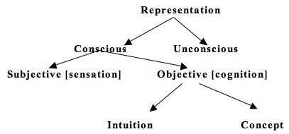
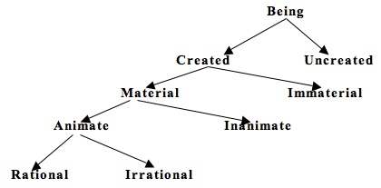

# Kant’s Views on Space and Time
**First published Mon Sep 14, 2009; substantive revision Fri Apr 1, 2022**

*Janiak, Andrew*

Even a casual reader of Kant’s *Critique of Pure Reason* (*Kritik der reinen Vernunft*, first published in 1781) will notice the prominence he gives to his discussion of space and time. In tandem, scholars consider this discussion to be central to Kant’s so-called critical philosophy. Given Kant’s reputation for developing difficult, not to say obscure, philosophical views, it will also not surprise the reader to learn that there is no consensus on how Kant’s conception of space and time ought to be characterized and explicated. So the goal of this entry is to bring some clarity to Kant’s views by situating them historically and philosophically within the milieu of some central debates concerning space and time in the early modern period, especially the rich century between the first edition of Newton’s *Principia mathematica*, which was first published in 1687, and the publication of the second edition of the *Critique of Pure Reason* exactly a hundred years later. The difficulty of comprehending Kant’s views gives interpreters a reason to place a special emphasis on context—I will especially highlight Kant’s reactions to his most significant predecessors in this area, Leibniz and Newton. The focus throughout will be on Kant’s magnum opus, the *Critique of Pure Reason*. Following tradition, and to some extent Kant’s own lead, the focus will also be on space and on our representation of space, although parallel points concerning time (and its representation) will sometimes be indicated.

In what follows, the *Critique of Pure Reason* is cited by the usual A/B method; other references are to *Kants gesammelte Schriften* (via “Ak” [for Akademie edition] followed by volume and page number). The Leibniz-Clarke correspondence is cited by referring to author-letter-section (e.g., L 3:1 refers to the first section of Leibniz’s third letter). All translations are by the author of this entry, unless otherwise noted. The following convention is adopted: concepts are referred to by using brackets; e.g., the concept gold is referred to by <gold>. By contrast, we employ ‘gold’ to refer to the word.

## 1. Introduction: philosophical questions about space and time

In the context of interpreting Kant’s views concerning space and time, a number of philosophical questions are relevant. Kant himself provides a litany of these questions in his so-called *Inaugural Dissertation* of 1770, a text in which he broke with his previous broadly “Leibnizian” views from the pre-critical period (Hatfield 2006, 72–6)[^hatfield-2006]. He writes:

> Space is not something objective and real, nor a substance, nor an accident, nor a relation; instead, it is subjective and ideal, and originates from the mind’s nature in accord with a stable law as a scheme, as it were, for coordinating everything sensed externally. (Ak 2: 403)

In this one pithy sentence, we find a list of many important early modern questions concerning space. Is space “real,” or is it “ideal” in some sense? Is it a substance in its own right, a property of some substance, or perhaps neither? Is it somehow dependent on the relations among objects, or independent of those relations? What is the relationship between space and the mind? And finally, how do these various issues intersect with one another?

The passage from the *Inaugural Dissertation* hints at five distinct questions or issues concerning space and time. First, there is the question of the ontology of space and time considered within the framework of what Kant would regard as the dogmatic metaphysics of the seventeenth century. This framework might suggest that if space and time are to exist, or to characterize the physical world, they must be considered either substances in their own right, or else properties of some substance. Neither option seems particularly attractive. Space and time seem distinct from substances because they are causally inert, causally inaccessible—their aspects or properties cannot be altered by interacting with any other substance—and imperceptible. Since they are often regarded as infinite, moreover, some thinkers have doubted that they could be substances, as God is often thought of as the sole infinite substance (Descartes may have conceived of space as “indefinite” for this reason). However, it is also difficult to think of space and time as properties of any substance, for then they would presumably be dependent on that substance for their existence. If we regard them as dependent on any contingent substance, it seems that we would be committed to the idea that space and time could fail to exist, or could disappear, depending on the happenings of that contingent substance. One might think instead that space and time depend on the one necessary substance, but this obviously raises a host of other issues. To think of space and time as properties of God is potentially to regard God as spatiotemporal, which is *verboten* from the point of view of many seventeenth-century thinkers (Janiak 2008, chapter five)[^janiak-2008].

A second topic arises if we consider the ontology of space and time independently from the substance-property metaphysical framework, e.g. by considering the relationship of space and time to physical objects. Following Newton’s discussion in the first (1687) edition of the Scholium following the Definitions in the *Principia*, the modern debate concerning space’s ontology has been centered on two overarching conceptions: absolutism (now sometimes called “substantivalism,” although that label raises certain issues), the view that space and time exist independently of all possible objects and object relations, or perhaps the view that space-time points exist; and relationalism, the view that space and time depend for their existence on possible objects and relations, or perhaps the view that space-time points do not exist (DiSalle 2006; Messina 2018)[^disalle-2006][^messina-2018].

Leaving aside questions about ontology, there is a distinct—or at least potentially distinct—issue regarding space and time: what is the origin of our representation of space and of time? This third issue arises from the sense in the early modern period that our idea or representation of space and time must somehow be importantly distinct from our idea or representation of ordinary physical objects. Many believed that space and time are causally inert and therefore imperceptible—how then are we are able to represent space and time at all? Few are willing to deny that we have a representation, not merely of spatial and of temporal objects, but also of space and time themselves, so there is a genuine puzzle lurking here.

The fourth topic follows on the heels of the third: what is the content of our idea or representation of space and time? From Kant’s point of view, the content of a representation might provide us with a guide to its possible origin. Alternatively, we might be able to consider the origin of a representation as providing us with a clue as to what its content might be. In the case of space, there may be reason to think that the content of our representation must somehow reflect what we know about space from Euclidean geometry.

The fifth and potentially final topic is closely connected with the third and fourth, and indeed, connects all four previous topics with one another: what is the relationship between space and time, on the one hand, and the human mind, on the other? This question obviously cries out for clarification. Part of what this question might mean can be characterized by the third and fourth questions above: if we think of the mind as representing space and time in a certain way, then perhaps this is part of our understanding of the mind’s relationship with space and time themselves. But within the context of Kant’s work, there is, at least *prima facie*, another issue lurking here—are space and time somehow dependent upon the mind for their existence? It may be that some kind of dependence is suggested by the origin—or by the content—of our representation of space and time (or perhaps by these two jointly). But Kant also seems to think that a view recognizing the dependence of space and time on the mind might offer advantages in addressing the ontological problems mentioned above.

Each of these five philosophical issues concerning space and time is relevant for understanding Kant’s views. As we will see below, part of the difficulty in interpreting Kant arises from the fact that he evidently transforms various aspects of the early modern debates concerning space and time through the perspective presented in the first *Critique* (Allison 2004, 120–1)[^allison-2004]. Within the context of the first issue raised above, the view that space and time are *real* may mean that space and time are substances in their own right, rather than merely properties; yet within the context of the absolutism-relationalism debate, if space and time are *real*, they exist independently of all objects and relations. But Kant uses the terms *real* and *ideal* to express views concerning the relation between space and time and the mind, leaving aside any views concerning objects and relations. This entry aims to clarify matters by separating these various considerations.

## 2. The background to Kant’s views in the *Critique*

### 2.1 Leibniz and Newton

There is no doubt that the debate between the Leibnizians and the Newtonians concerning the status of space and time forms part of the essential background to Kant’s views throughout his career. Although Newton originally formulated his conception of space and time in response to Descartes’s views in the *Principles of Philosophy* (1644), by the turn of the eighteenth century, Newton and his followers were embroiled in an extensive debate with Leibniz and his supporters on the Continent. This reflected, in part, the famous priority dispute regarding the calculus, but it also reflected some of Leibniz’s fundamental criticisms of Newton’s views of space, time and motion in *Principia mathematica* (1687, 1713—second edition). Leibniz raised many of those criticisms in his correspondence with Samuel Clarke, who defended Newton’s ideas. Kant mentions this debate frequently in the *Critique* (see, e.g., A23/B37, A39/B56, & A46/B64). Broadly speaking, Newton and his followers argued for the importance of thinking of space, time and motion as “absolute” or at least from an absolute point of view. This means that one regards space and time as existing independently of matter and relations amongst material bodies. As Newton (1999, 408)[^newton-1999] puts it, “Absolute space, of its own nature without reference to anything external, always remains homogeneous and immovable.” So absolute space, or space regarded from an absolute point of view, has a nature and has the properties of homogeneity and immovability independently of anything else. Since space on this conception has a nature and has properties independently of any relations, Newton was often interpreted as saying that space is a being or perhaps a substance. To the chagrin of many philosophers, Newton avoided using these categories in the *Principia* itself, although in a famous unpublished manuscript he denied that one should think of space as either a substance or as an accident (Newton 2014, 35–36)[^newton-2014]. In his correspondence with Clarke (1715–1716), Leibniz then argued that Newton’s conception of space and time conflicts with the principle of sufficient reason: if space were to exist independently of all matter and material relations, then there could be no reason for God to have chosen to create matter in one location rather than any other; independently of matter, all locations are indistinguishable (see L 5: 3–4). In part to solve this problem involving the principle of sufficient reason, Leibniz then argues that space is merely the order of relations amongst material bodies. So on his view, space depends on objects and their relations, which solves the problem: since space does not exist independently of matter, God never faced the question of “where” to place bodies in space. To create a bunch of matter just is to create space.

Many interpreters have thought that in the *Critique of Pure Reason*, and particularly in its first section, the Transcendental Aesthetic, Kant attempts to engage the Leibnizian “relationalist” and the Newtonian “absolutist” conceptions of space with transcendental idealism.[^note-1] As Charles Parsons puts it, “the issue between what are now called absolutist and relationalist conceptions of space and time, represented paradigmatically by Newton and Leibniz” represents “the background to all of [Kant’s] thinking” about space and time (Parsons 1992, 67; cf. Torretti 1999, 105)[^parsons-1992]. In the beginning of the Transcendental Aesthetic, Kant frames his view by contrasting it with the failures of the Leibnizians and the Newtonians to conceive of space appropriately:

> Now what are space and time? Are they actual entities [wirkliche Wesen]? Are they only determinations or also relations of things, but still such as would belong to them even if they were not intuited? Or are they such that they belong only to the form of intuition, and therefore to the subjective constitution of our mind, without which these predicates could not be ascribed to any things at all? (A23/B37–8).

The view that space and time are actual entities is meant to represent the Newtonian position, and the view that they are determinations or relations of things, the Leibnizian position (but cf. Hatfield 2006, 77–8)[^hatfield-2006]. Later in the Transcendental Aesthetic, he refers to the Newtonians as the “mathematical investigators” of nature, who contend that space and time “subsist” on their own, and to the Leibnizians as the “metaphysicians of nature,” who think that space and time “inhere” in objects and their relations (see A39–40/B56–57).

While Kant does clearly allude to this theoretical background, it is noteworthy that views of the sort he defends in the Aesthetic—that space and time are transcendentally ideal, that they are mere “forms” of intuition, that they depend upon the “subjective constitution of the mind,” and so on—do not obviously make contact with the Leibniz/Newton debate. This raises questions about Kant’s use of the Leibniz-Newton background. First, how does Kant understand the Leibnizian and the Newtonian conceptions of space and time? Does he think of them solely as views on what I have called the status of space vis-à-vis objects and relations, or does he think that they contain, or perhaps entail, views on other topics, such as the character of our representations of space and time? Does Kant regard himself as needing to undermine either, or both, of these prior conceptions in order to support his conclusion that space and time are transcendentally ideal? Does Kant’s rejection of *both* the Leibnizian and the Newtonian conceptions as types of “transcendental realism” illuminate what he means by transcendental idealism? And finally, is Kant on secure ground in characterizing his predecessors’ views in this way? These questions will help to guide the discussion below.

The fact that Kant focuses on the debate between the Leibnizians and the Newtonians is perplexing given his evident lack of interest, within the context of the *Critique*, in problems concerning motion. One of Newton’s principal reasons for distinguishing between an “absolute” (or “mathematical”) and a “relative” (or “common”) conception of space is to ground a distinction between true and merely relative motion. Newton construes the true motion of an object, as opposed to its merely “apparent” motion, not in terms of its change in relations to other objects, as Descartes had done in his *Principles*, but in terms of its change of absolute place (Janiak 2008, chapter five)[^janiak-2008]. So the very idea of absolute or mathematical space helps to express what true motion is. Discovering the true, as opposed to the merely apparent, motions of objects, so that one can then determine the forces that cause these true motions, represents one of the principal goals of Newton’s *Principia*.

Kant is perfectly well aware of these details from the Scholium to the *Principia*, but he makes it clear in the Transcendental Aesthetic that he wishes to bracket questions concerning the motion of objects. The reason is that he regards <motion> as an empirical concept, and the Aesthetic aims to articulate a purely *a priori* conception of space (see A 41/B 58; also MFNS, 4: 482). Instead, Kant tackles physical motion in the *Metaphysical Foundations*, where he contends that one can distinguish true from relative motion by determining the center of mass frame of the solar system (4: 482, 487, 555–6, 559–63), thereby avoiding the postulation of Newton’s mathematical (absolute) space.

But what if we abstract away from questions of physical motion? What if we consider motion within a much more abstract context: for instance, can the motion of a *mathematical point* through space be considered in the Aesthetic? Kant makes it clear that this remains empirical because the concept of motion itself is empirical, and so should still be deferred to the *Metaphysical Foundations*. Indeed, the latter begins with a consideration of motion in abstraction from various physical questions like the mass of the objects and then slowly progresses by adding further physical (or empirical) elements.

Kant does discuss the important notion of the “motion of the subject” in a famous footnote in §26 of the Transcendental Deduction. Is that kind of motion under discussion, perhaps implicitly, in the context of the Aesthetic? Kant does not think that the “motion of the subject,” for instance in drawing a circle, is empirical, but he does think that it requires—indeed, it apparently exemplifies—the unity of the manifold of intuition imposed by the unity of consciousness. Whatever this doctrine may mean, it seems clear that from Kant’s own perspective it cannot be dealt with in the Aesthetic, for the latter text abstracts from all contributions of understanding and therefore abstracts from any consideration of the unity of the manifold imposed by the unity of understanding. (This seems to be closely related to Kant’s point in §26 that it is only from within the point of view of the Transcendental Analytic that one is able to make a distinction between what he calls space as a *form of intuition* and space as a *formal intuition*.) So from Kant’s point of view, although various kinds of motion are considered in the critical philosophy—including the so-called motion of the subject in describing a space, the motion of a mathematical point through space, and the motion of a body through space—no kind of motion can be considered within the context of the Aesthetic (see Pollok 2006).

This seems to suggest that Kant’s interest in the absolutism-relationalism debate does not originate with his concern to discuss *motion* in any sense of the term. In what follows, then, one goal is to specify why Kant remains focused in the Aesthetic on the views of Leibniz and Newton (and their respective followers). It may be that Kant’s interest derives from his general interest in the views of what he calls the “metaphysicians,” the Leibnizians, and of what he calls the “mathematicians,” the Newtonians. Throughout the pre-critical and critical periods, Kant evinces considerable interest in various attempts to reconcile certain aspects of Leibnizian metaphysics with the Newtonian view of nature (Friedman 1992, 1–52)[^friedman-1992]. But there is also more to be said about Kant’s focus on the absolutism-relationalism debate (see especially Messina 2018)[^messina-2018], which we do below.

### 2.2 Kant’s understanding of representation

In a famous passage in the first *Critique*, Kant helpfully discusses his notion of representation (A320/B376–77):

*Figure 1.*

Kant regards an intuition as a conscious, objective representation—this is strictly distinct from sensation, which he regards not as a representation of an object, property, event, etc., but merely as a state of the subject. Whereas sensations do not represent anything distinct from the sensing subject (including perhaps the state of the subject’s body), intuitions are objective representations.[^note-2] Recent scholarship emphasizes the importance of his distinction between sensation and intuition (Allais 2015, 145–47, 154, 159–60)[^allais-2015].

The distinction between sensation and intuition in Kant’s thinking is fundamental to his overarching conception of space and time. This is the case for several reasons, not least because one should avoid thinking that Kant takes us to have a sensation of space; we have, rather, an intuition of it (see Carson 1997)[^carson-1997]. The distinction has many facets, but the basic idea is as follows. Sensations are subjective in the sense that they do not represent objects, they are modifications of the subject. A good example of a sensation would be an itch that I feel. Of course, an itch might be caused (e.g.) by some flour that fell on my nose while baking cookies, but the itch does not represent the flour, or indeed anything outside myself; the itch is simply what I feel. If we felt only sensations, we would lack representations of things other than ourselves, even if such things caused or helped to cause our sensations. Perhaps sensations would enable us to avoid injury or pain--one might, say, jump back when feeling heat from a fire. But without intuition, we would lack spatial awareness: that is, we would lack an awareness of things in spatial locations around us. In order to represent things other than ourselves, we require intutition, which Kant regards as a singular, immediate, objective representation (where sensations are merely subjective, as we have seen). In what sense is intuition an objective representation that is singular and immediate? That complex idea means, for starters, that intuition represents particulars, i.e., things with some spatial location vis-à-vis me and also other things. So when I feel an itch, I have a sensation; when I see the pile of flour in front of me next to the bowl on my counter, I have an intuition, a representation of something in space with a location relative to me and to other things. However, although intuition can represent flour on the counter next to the bowl, it does not represent it *as* flour. For that, one would require a *concept*.[^note-3]

As is well known, the distinction between concepts and intuition is also fundamental to Kant’s thought. Whereas intuitions are singular, immediate representations, concepts are general, mediate ones (Engstrom 2006)[^engstrom-2006]. Each item represents properties, objects, or states of affairs, but they do so distinctly. Unfortunately, there is no consensus on the right way to understand this idea.[^note-4]But roughly speaking, intuition represents some *X*—where *X* might be an object, a property, or perhaps even an event—as one represents *X* in perception. Thus it represents *X* as, for instance, *that there*.[^note-5]In contrast, a concept represents *X*—where, again, *X* might be a property, an object, or perhaps even an event—by placing *X* within one or more classes. Suppose that I want to represent my desk, at which I am sitting right now. To represent my desk in intuition is to represent it as something I point to, as *that there*. This does not indicate, of course, that this is a desk, my desk, a piece of furniture, made of wood, etc., but it does pick out a particular, something with a spatial location relative to me and to other things (like the carpet on the floor). It does so *immediately* at least in the sense that it makes use of no other representation. To represent my desk with a concept is to represent it as a *desk*, or as a *piece of furniture*, or as a *wooden thing*, etc. From Kant’s point of view, this is to represent my desk *mediately* at least in the sense that the concept, <desk>, represents an object through other concepts, such as <furniture>.[^note-6] It is also important to remember that in representing my desk through intuition, i.e., in representing it as a thing with some spatial location but not yet *qua* desk, I am *perceiving* the desk but not *judging* it to be a desk (or anything else). In order to *judge* that there is a desk in front of me, or indeed, in order to judge that there is something in front of me, I require concepts and the complex machinery discussed in the famous Transcendental Deduction, a key section of the *Critique* that arrives after the arguments of the Transcendental Aesthetic have been presented. Intuition alone is akin to perception--it plays a role in judgment, but it is not itself akin to judgment.[^note-7]

One of Kant’s surprising ideas is that each type of objective representation, intuition and concept, can be either empirical or *a priori*. The idea that some concepts are not empirical may not be surprising because of the famous early modern tradition concerning innate ideas. Of course, Kant’s conception of the *origin* of such concepts—outlined in what he calls the “metaphysical deduction” (B159, B377)—contains surprises because he does not embrace innate ideas (Longuenesse 1998)[^longuenesse-1998]. But leaving that complication aside, it is surely very surprising to hear that intuition, which in some regards is akin to perception (Parsons 1992, 65–66; Allais 2015, 147*ff*)[^allais-2015][^parsons-1992], can also be empirical or *a priori* in character. Here it helps to recall that Kant distinguishes sensation from intuition. There remains a question, however, of how we are to understand the very idea that we can have pure—or *a priori*, i.e., non-empirical—intuition at all. This idea comprises a central piece of Kant’s views on space and time, for he famously contends that space and time are nothing but forms of intuition, a view connected to the claim in the Transcendental Aesthetic that we have pure intuitions of space and of time. This means, as we have seen, that we have non-empirical, singular, immediate representations of space and of time. One goal of this entry is to clarify this idea. It is not a stretch to contend that it represents one of Kant’s most distinctive contributions to modern philosophy. Characteristically, it is profoundly difficult to grasp.

## 3. The “Metaphysical Exposition”

### 3.1 What is a metaphysical exposition?

What Kant calls the Metaphysical Exposition of the Concept of Space presents the first arguments of the Transcendental Aesthetic. Kant defines the “exposition” of a concept as follows: “By an exposition (*expositio*) I understand the clear (if it is not explicit) representation of what belongs to a concept; it is metaphysical if it contains what the concept presents as *a priori* given” (A23/B38). By a concept (*Begriff*) in this context I take Kant simply to mean a representation.[^note-8] So his goal is to characterize the content of the representation of space. For Kant, an “exposition” is different from a definition: he is not undertaking a definition of space, the word ‘space,’ or the concept <space> (for helpful discussion, see Dunlop 2012)[^dunlop-2012]. In this regard, Kant follows a long tradition emanating from Newton’s Scholium following the Definitions in the *Principia*, where Newton explains that space, time and motion are familiar to everyone and therefore will not be defined in his work, unlike unfamiliar technical concepts like mass or impressed force, which are defined (Newton 1999, 408)[^newton-1999]. Unlike Newton, however, Kant focuses primarily on our representation of space, rather than on space itself. That seems to be expressed by his notion of an exposition.

### 3.2 The origin of our representation of space

In the first argument of the Metaphysical Exposition, Kant suggests that the representation of space cannot be empirical:

> 1\. Space is not an empirical concept which has been derived from outer experiences. For in order that certain sensations be referred to something outside me (that is, to something in another region of space from that in which I find myself), and similarly in order that I may be able to represent them as outside and alongside one another, and accordingly as not only different but as in different places, the representation of space must already underlie them [dazu muß die Vorstellung des Raumes schon zum Grunde liegen]. Therefore, the representation of space cannot be obtained through experience from the relations of outer appearance; this outer experience is itself possible at all only through that representation (A23/B38).

One might wonder what type of view is at issue here. One potential target is a classic empiricist account of our idea of space, such as that found in Locke. Acknowledging in the *Essay* that the idea of space seems to be “remote” from our perception of objects, Locke contends nonetheless that its origin lies in experience (*Essay*, 2.13.2–4): perceivers observe objects in close proximity to one another, including the distance between objects, and then repeatedly add the ideas of these distances together, thereby obtaining an idea of as large a single space as they please. According to Locke’s view, a version of which was also defended by Hume (*Treatise*, 1.2.3), we obtain a representation of space—not of places, but of the one all-encompassing space, which *may* be akin to geometric space—from the perception of spatial relations.

Kant may be focusing attention on the starting place of Locke’s view. It seems that for Locke, we begin with an idea of the distance between any two bodies; this would presumably involve an idea of these two bodies as being in different places. Kant may be contending that in order to represent objects as in different places from one another, I must represent them as in space. But if this were true, then I would already have, as it were, the representation of space, and therefore could not obtain it in the way Locke outlines.

Daniel Warren clarifies this argument in an especially helpful way (Warren 1998; cf. Allison 2004, 100–104)[^allison-2004][^warren-1998]. Certainly, it is not true in general that in any order to represent any two entities, A and B, as related in some way, I must represent them as falling into a larger “space” of some relevant character. Warren gives a useful example: in order to represent A as “brighter than” B, I need not represent A and B as being part of a larger “brightness” space. I *could* do so: I could represent A and B via the “brightness” relation precisely by representing A as lying at one end of a brightness spectrum, and B as lying near its other end. But I need not do so: I could simply represent A and B themselves, and represent A as brighter than B, as I might do with two lights (Warren 1998, 200*ff*)[^warren-1998]. The suggestion is that in order to represent A and B as bearing a *spatial* relation with one another—say, to represent them as being some distance apart—I must represent A and B as *in space*. In that sense, the representation of objects as spatially related may presuppose the representation of space. The problem for Locke is that he begins with my perception, or idea, of a distance between two objects, and then proceeds to construct my idea of space from that initial point. But if my representation of a distance relation between any two objects already presupposes a representation of those objects as in space, then the former cannot be the beginning point of a process that issues in the latter.

Some commentators have noted that Locke—or another classical empiricist—may not be the only focus for Kant’s first argument. At some moments, Leibniz seems committed to the view that the representation of space is constructed from particular perceptions of distance relations (and the like). For instance, in a famous passage in his final letter to Clarke, Leibniz claims that in order to obtain a representation of space, one can consider a system of objects, some of which are in motion, and abstract the notion *same place* from that system.[^note-9] For A and B to occupy the same place is for them to have the same relation to the same bodies in space at different times. Space is what encompasses all such places.[^note-10] Kant’s first argument may have some bite against the view in this passage as well. Whether Kant’s argument also undermines Leibniz’s relationalism about space is a separate issue, and a matter of controversy.[^note-11]

Some commentators have thought that Kant’s second argument in the Metaphysical Exposition is intended specifically to undermine Leibniz’s relationalism (cf. Parsons 1992, 68–9)[^parsons-1992]:

> 2\. Space is a necessary *a priori* representation that underlies all outer intuitions. One can never forge a representation of the absence of space, though one can quite well think that no things are to be met within it. It must therefore be regarded as the condition of the possibility of appearances, and not as a determination dependent upon them, and it is an *a priori* representation that necessarily underlies outer appearances. (A24/B38–9)

Kant claims that although we can represent space as empty, we cannot represent to ourselves the absence of space. This point would undermine Leibnizian relationalism if the relationalist claim that space is not independent of objects is, at least in part, founded on the claim that the very idea of space existing independently of objects is incoherent. If one held such a view, one could raise doubts about relationalism by contending, as Kant does, that we can in fact conceive of space to be devoid of objects.

The view that space cannot exist independently of objects at any given instant does seem to entail that space cannot be utterly devoid of objects. Leibniz thinks that space is the order of the actual and *possible* relations among objects, so he has the resources to say that space can contain empty sectors—see *New Essays*, 127, and L 5: 43—but it seems he cannot claim that space is *altogether* empty, for then object relations would be absent. Yet this view seems perfectly compatible with the idea that we can *conceive* of empty space. Leibniz himself makes repeated and explicit use of the thought of such a situation when attempting to undermine the Newtonian view that space is absolute. Instead of arguing that the idea that space could be independent of objects is incoherent, Leibniz contends that it violates the principle of sufficient reason (see L3: 5; L 5: 53), a principle Clarke himself defends in a distinct version. The “fiction” (L5: 29; cf. L5: 55) that space could exist independently of objects violates the principle because the homogeneity and uniformity of space prevent there from being any reason for God to place the objects of the universe with one particular orientation within absolute space rather than with any other possible orientation. The idea that God could place objects within a pre-existing absolute space with one orientation rather than another is evidently not incoherent; rather, God would lack a *reason* for doing this. Similarly, Leibniz contends that absolutism violates the principle of the identity of indiscernibles (L4: 16) and that it bears theological difficulties (L4: 10).

This is not to deny that Leibniz’s relationalism intersects with his understanding of the representation of space. He thinks that we must not be fooled by the fact that we can think of space as empty of objects into concluding that space itself is something independent of objects and their relations. As with all mere abstractions, we must not reify space.[^note-12]

One might read Kant’s second argument instead as straightforwardly targeting the view that the representation of space is empirical. Kant claims that we cannot represent the absence of space, but that we can represent space as empty of objects. His point may be that empiricist philosophers who contend that the representation of space is obtained from the perception of objects must bear the burden of explaining how it is possible for us to conceive of space as empty of such objects. This consideration appears to be rather weak. But the further contention that one cannot represent the absence of space may be more difficult for an empiricist to accept. *Prima facie*, it is difficult to see why, if our representation of space is indeed empirical in origin, we should lack the ability to conceive of space’s *absence*. This might be read as Kant’s *prima facie* point against an empiricist view of the representation of space.

In these first two arguments, Kant considers, perhaps among other things, the origin of our representation of space, concluding that it is not empirical. It seems, though, that these first two arguments leave open the question of the *content* of our representation of space in two important senses. First, Kant’s first two arguments do not explicate what properties we represent space as having. Do we represent it, for instance, as finite or infinite, as homogeneous or not? And so on. Second, the first two arguments in the Transcendental Aesthetic apparently leave it open that the content of our representation of space could be conceptual. That is, they leave it open that our representation of space could be a concept, rather than an intuition—it could be either a general, mediate representation, or a singular, immediate one. We simply know—if Kant’s arguments are successful—that the representation is not empirical. And Kant certainly thinks that a non-empirical representation could be either a concept or an intuition; that is, he thinks that we have both *a priori* concepts and pure intuition. Since the idea of pure intuition is puzzling in a way that the idea of an *a priori* concept may not be, one interpretive goal is to clarify this idea in the course of understanding the second two arguments of the Metaphysical Exposition.

### 3.3 The content of our representation of space

In the third and fourth arguments, Kant contends that the representation of space has a specifiable content that is incompatible with it being a conceptual representation. That is, he argues that our representation of space is not a concept, but is in fact an intuition—it is a singular, immediate representation. As we have seen, the distinction between sensation and intuition indicates that this claim does not amount to the idea that we have a sensation of space (for reasons adduced above). Instead, it amounts to the claim that we have an objective representation of space, but one that is singular and immediate.

In order to understand the two arguments intended to establish the conclusion that we have a singular, immediate representation of space, it is helpful to recall Kant’s attitude toward concepts. From his point of view, whereas to fall “under” a concept means to be part of a concept’s extension, to fall “within” a concept means to be part of its intension. Just as significantly, the extension of a concept, in Kant’s way of thinking, is not the things that instantiate the concept, or the set of things to which the concept “applies”; rather, it is the class of concepts that function as sub-groupings falling under this more general heading. This idea requires clarification.

Consider the *extension* of <being>:[^note-13]

*Figure 2.*

The extension of <being> is those concepts on the conceptual tree that fall “under” <being>—those concepts are species of the genus, <being>. Kant speaks of a series of genus-species relations inhering between the members of the class of concepts that serve as a given concept’s extension; whether a concept serves as a genus or a species is relative. The concept <created> is a genus with respect to its species <material> and <immaterial>, but a species with respect to the genus <being>. The *intension* of a concept consists of those concepts that collectively constitute it. Hence the concept <human> has this intension: “rational animate material created being.” The concepts that collectively constitute a given concept are often called “Merkmale” or “Teilbegriffe,” or what might be called its conceptual parts (“Vienna Logic,” Ak 24: 913). To construct the concept <human>, one puts together the concepts <rational>, <animate>, *<*material>, <created>, and <being>. To formulate or to grasp the concept <human*>* just is to grasp these constituents.

With these distinctions in mind, we can consider Kant’s third argument in the Metaphysical Exposition. In this argument, Kant concentrates on the intension (in his sense) of a concept.

> 3\. Space is not a discursive, or as one says, general concept of relations of things in general, but a pure intuition. For, firstly, one can represent only one space, and if one speaks of many spaces, one thereby understands only parts of one and the same unique space. These parts cannot precede the one all-embracing space as being, as it were, constituents out of which it can be composed, but can only be thought as *in it*. It is essentially one; the manifold in it, and therefore also the general concept of spaces, depends solely on limitations. It follows from this that an *a priori* intuition (which is not empirical) underlies all concepts of space. Similarly, geometrical propositions, that, for instance, in a triangle two sides together are greater than the third, can never be derived from the general concepts of line and triangle, but only from intuition and indeed *a priori* with apodictic certainty. (A24–5/B39–40; cf. “Anticipations of Perception” at A169–70/B211)

The suggestion here is roughly this: if the representation of space were a concept rather than an intuition, one ought to be able to construct it by placing its parts together. This seems to require that it is possible to represent the parts independently of representing the concept to be constructed. This is the case with other concepts: it is possible to represent any of the parts of the intension of <human>, such as <material being>, without *ipso facto* representing the whole concept, <human>. Kant is claiming that this will not work in the case of the representation of space because we obtain the representation of places only by delimiting some subsection of our representation of the one all-encompassing space. To put the point in a way that highlights a parallel with the first argument of the Metaphysical Exposition: the representation of any place presupposes the representation of space. Thus we cannot represent any of the “parts” of space—any place—without *ipso facto* representing space itself. The idea, then, is that the part-whole relation of the representation of space is distinct from the part-whole relation that obtains for concepts.

It is not clear that this argument is successful. It seems, e.g., to conflate the following: (1) the relation between space and its parts; and, (2) the relation between the representation of space and its constituents. Without this conflation, it is not clear why we should expect to construct our concept of space from our concept of place. It would seem more sensible to construct our concept of space from other concepts, such as that of infinity, or that of a magnitude, and so on, rather than from the concept of a place. The claim of the conflation is predicated on the notion that Kant’s third argument concerns the representation of space rather than space itself. This notion, in turn, may conflict with the letter, although perhaps not with the spirit, of the first sentence of the third argument, which mentions that “Der Raum,” or space, is not a concept, but rather is an intuition. If one follows the letter of the argument, one can avoid this apparent conflation. But the price is somewhat high: what does it mean to wonder whether space itself is a concept, and who held something like that view? On the face of it, such a view may seem rather odd to the contemporary reader.[^note-14] One way to make progress in understanding this view is to re-read Leibniz. It is possible to read Leibniz as arguing that space itself is a kind of abstraction, rather than a real entity or substance, and perhaps it is not a stretch to contend that space must be a conceptual abstraction, like the entities of what Leibniz might call pure mathematics. That is, space itself, on this view, is a kind of conceptual abstraction in the way that an isosceles triangle is an abstraction, or a line is an abstraction, rather than a real entity or substance. Of course, this requires us to understand Leibniz’s position through a Kantian lens. Even so, if the view in focus is that space itself is a kind of concept, it remains unclear why one wouldn’t say that this concept is dependent on other constitutive concepts, such as the concept of infinity or that of homogeneity, which Kant himself tackles in the next numbered argument. Perhaps the best answer here is to read Kant as engaging specifically with Leibniz’s argument in his last (fifth) exchange with Clarke, mentioned above. The idea is that Leibniz’s argument might be understood as involving the claim that the concept of place is constitutive of the concept of space, and that space itself is really nothing but a kind of concept, which licenses the exclusive focus on the concept of space. Then the claim would be that the Leibnizian view that space itself is a conceptual abstraction obtained through some process of perceiving objects occupying various places is wrong on both counts.

Just as Kant’s second argument attempts to shore-up the idea, presented in the first argument, that the representation of space is *a priori*, his fourth and final argument attempts to shore-up the idea, presented in the third argument, that the representation of space is not conceptual in character. Here both the extension and the intension of concepts seem to be at issue:

> 4\. Space is represented as an infinite *given* magnitude. Now one must think every concept as a representation which is contained in an infinite number of different possible representations (as their common mark), and which therefore contains these *under itself*; but no concept, as such, can be thought as if it contained an infinite number of representations *within itself*. It is in this latter way, however, that space is thought (for all the parts of space are simultaneous in infinity [denn alle Teile des Raumes ins Unendliche sind zugleich]). Therefore the original representation of space is an *a priori intuition*, not a *concept* (B40).

Kant claims that since we represent space as containing an infinite number of places within it, our representation of space cannot be conceptual. Why should that be? The idea is that although concepts can have an infinite extension—a potentially infinite number of subordinate concepts *under* them—they cannot have an infinite intension, an infinite number of representations *within* them. A concept that is infinite in the latter sense could not be grasped by a finite mind.[^note-15] For a concept to have an infinite extension would be for it to have an infinite number of species, i.e. for it to be possible to distinguish an infinite number of sub-types “under” it on the conceptual tree. This does not harm our ability to grasp any concept within the tree, for to grasp any arbitrarily chosen concept within the tree, I merely need to grasp its constituents (those concepts *within it*), and those would be “above” it on the tree. But our ability to grasp concepts would be affected if they could contain an infinite number of constituents *within themselves*: if, say, <fish> contained an infinite number of constituents—if there were an infinite number of higher-level conceptual taxa “above” <fish> on the tree—it could not be grasped, and might even lack determinate content. Or at least, to specify its content would take an infinite number of steps.

According to Kant, however, we represent space as having an infinite number of constituents, namely places.[^note-16] If our representation of space were conceptual, we would be required to represent each of these constituents *in order to represent space itself*, just as we are required to represent metal in order to represent gold (for <gold> catergorizes gold as a metal). Yet we cannot represent every place within space in an effort to represent space itself. If we can take it as settled that we represent space, and as settled that we represent it as having an infinite number of places within it, then our representation of space presumably cannot be conceptual in Kant’s sense. The third argument in the Metaphysical Exposition seems to imply, as we have seen, that the representation of any place presupposes the representation of space itself. This fourth argument makes a distinct point: if the representation of space itself were to require the representation of each part that we represent space as having, then we could not represent space at all. Since we do represent space, and since we do represent it as having an infinite number of places within it, our representation of space is not conceptual in Kant’s sense. Of course, Kant’s readers may deny one of his apparent assumptions here, viz., that we represent space as infinite. Readers with broadly empiricist sympathies in particular may be skeptical of this assumption.

Kant’s view that we have an intuition, rather than a concept, of space can be seen to raise a difficult problem: space is not an object, and yet intuition seems to provide us with something akin to a perception of something. As Lucy Allais puts it, intuition involves “presence to consciousness of an object” (Allais 2015, 197*ff*)[^allais-2015], and yet space is not an object. It is difficult to see why we should think of ourselves as perceiving space at all. It is easy enough to understand the idea that some ordinary thing, like a tomato, is an object that is present to my consciousness, say when I look at the tomato on a farm stand. There are, of course, many philosophical theories of perception, and these theories will differ in their discussions even of simple cases of perception such as this one. But it seems uncontroversial to suppose that the tomato is present to my consciousness as an object at least in the sense that the tomato is one of the things that I’m looking at. And it also seems uncontroversial to think that there are many other things, besides tomatoes, that might be present to my consciousness in a similar way, from clouds to fog to rainbows, even though they are not “objects” in the simple sense in which a tomato is an object. However, it certainly seems like a stretch to say that space itself might be one of those things. That is not merely because space is not an object in any clear sense; it is also because space itself, in this historical and philosophical context, is not something that has a causal impact on me. So it remains doubly difficult to see how I might conclude, with Kant, that I have something akin to a perception of space. Kant assures us, of course, that we have an *a priori* intuition of space, so although he is discussing something akin to perception in one sense, in another sense what he is discussing is supposed to be quite distinct from ordinary perception. Whether that assurance helps to clarify this issue for his readers is a matter of debate. What is clear, however, is that this aspect of Kant’s conception of space remains one of the most controversial, and most difficult, aspects of his theoretical philosophy.

Kant may have other reasons for thinking that our representation of space is not a concept. If we recall Kant’s view that concepts are general, mediate representations, and his view of how these facts are reflected in the conceptual trees discussed above, then there is indeed at least a *prima facie* puzzle as to how we could have a concept, in Kant’s sense, of space. Consider a contrast class. Even if we think that <God> represents only a single entity, that fact does not undermine Kant’s view that this concept is a general, mediate representation (cf. Thompson 1972, 318–19, 328–29)[^thompson-1972]. For we represent God, in Kant’s view, by representing it through other concepts: for instance, God is a necessary substance (A678/B706), so <God> is a mediate representation. This is distinct from the way in which an intuition represents something. And the concept <substance>—which is one of the categories (A80/B106)—is a representation that we can grasp independently of grasping <God>. Hence <substance> is a constituent of <God>, but not *vice versa*. Moreover, <God> is a *general* representation because it places God within another class, namely the class of substances. It will then be a matter of some dispute whether the *generality* criterion and the *mediacy* criterion amount to the same thing (cf. Parsons 1992, 63–6)[^parsons-1992]. But the key point here is this: the fact that <God> picks out a single individual—and perhaps even, *can pick out only a single individual*—does not entail that this concept is not general or mediate. This suggests, in turn, that Kant’s point in the Metaphysical Exposition cannot be that our representation of space picks out a single individual and therefore cannot be a concept. Rather, he presumably thinks that we do not represent space either: (1) by representing its constituents, namely places; or (2) by representing it *through* other concepts. We have discussed (1) above; what about (2)?

Concerning (2), note that to represent space by representing it through other concepts may require one to take a (usually controversial) stand on the ontology of space in one of the senses outlined above. For instance, if one wishes to place <space> somewhere on the conceptual tree, one must presumably find a place for it under some concept such as <substance> or <being>. But there is no accepted view of space’s ontology: some regard it as a substance (or a being), others as a network of relations, others as a property of God, etc. Because of these long-standing, unresolved disputes, it seems reasonable to regard an approach that depends on their resolution as unpromising. Kant highlights the accepted fact that we represent space as an infinite Euclidean magnitude—this can be widely accepted, despite the dispute concerning space’s ontology.

Another way to clarify Kant’s arguments regarding conceptuality is to consider what opponent he has in mind for the second two arguments. It seems unlikely that Locke’s views are at issue in these arguments—instead, Kant probably had Leibniz in mind. Leibniz held the view that the idea (or representation) of space hails from the pure understanding, which he contrasts with the kind of Lockean view noted above. He writes in the *New Essays*:

> PHILALETHES: The ideas the perception of which comes to us “by more than one sense, are of space, or extension, figure, motion and rest.”
>
> THEOPHILUS: These ideas, which are said to come from more than one sense – like those of space, figure, motion – come rather from the common sense, which is to say, from the mind itself; for they are ideas of the pure understanding, though ones which relate to the external world and which the senses make us perceive, and so they admit of definitions and demonstrations. (*New Essays*, 128; see Leibniz 1840, 230)[^leibniz-1840]

Leibniz may have in mind the idea that our perceptions cannot give us the idea of a continuum, and he certainly thinks of space as a continuum. The senses, for instance, cannot give us the idea of something that is infinitely divisible. Elsewhere in the *New Essays*, Leibniz makes a related point by saying that space is akin to the entities of “pure mathematics.”

One question here is whether Leibniz and Kant agree sufficiently in their views of concepts for Kant’s arguments to have any bite against the kind of view Leibniz expresses in the *New Essays*, a text that Kant read sometime after it was first available in 1765 (Vaihinger 1922, 2: 133, 414 and 428–9)[^vaihinger-1922]. Leibniz, famously, has the idea of a complete concept of a substance, and it seems that such as concept would contain an infinite number of constituents—God grasps the complete concept of a substance by grasping all its constituents. Given this view, it may be that the considerations adduced in Kant’s fourth argument in the Metaphysical Exposition are unlikely to worry Leibniz, since he would simply accept the idea that the representation of space, as with any concept, might have an infinite number of constituents (Posy 2000)[^posy-2000]. However, the third argument may have more bite: if Kant is right in contending that the representation of any place presupposes the representation of space itself, then perhaps that representation lacks the ordinary part-whole structure of a concept. Leibniz may in fact accept that general conception of the part-whole structure of concepts. If so, this third argument may present a problem for his view.

Yet the first and second arguments of the Exposition are not merely opportunities to contend with empiricist views like those of Locke; nor are the third and fourth arguments merely aimed at challenging rationalist views like those of Leibniz. On the contrary, the claim that the representation of space is neither empirical nor conceptual is important in general for Kant’s transcendental idealism and, in tandem, it is significant for understanding what he regards as the philosophical mistakes embodied in transcendental realism, and in what Kant will later call “dogmatic idealism,” both of which he strongly opposes. These are discussed in the next section.

## 4. The “Transcendental Exposition” and Kant’s “conclusions”

### 4.1 What is a transcendental exposition?

In the B (1787) edition of the *Critique*, §2 of the Transcendental Aesthetic, the Metaphysical Exposition, is followed by §3, the Transcendental Exposition. Whereas the Metaphysical Exposition deals, as we have seen, with the origin and the content of the representation of space, its transcendental cousin apparently attempts to provide an explanation of what Kant takes to be the synthetic a priori knowledge (or cognition) available to us in geometry. This raises very difficult interpretive issues that arise with Kant’s philosophy of mathematics—such issues are dealt with in a separate entry in this *Encyclopedia* (see Lisa Shabel’s entry on Kant’s philosophy of mathematics). However, Kant may also be raising a related point in this section—consider the following passage, which is inserted within the discussion of geometry (cf. section 2-b above):

> Now how can an outer intuition inhabit the mind, which precedes the objects themselves, and in which the concept of the latter can be determined *a priori*? Obviously not otherwise than insofar as it has its seat solely in the subject, as its formal constitution for being affected by objects, and thereby gaining *immediate representation*, i.e., *intuition*, of them, therefore only as the form of outer *sense* in general. (B41)

We have seen in the Metaphysical Exposition that we have a pure (or *a priori*) intuition of space, that is, a non-empirical, singular, immediate representation of space. But how is such a representation so much as possible? If we are considering an *empirical*, singular, immediate representation, we can easily understand that in cases of ordinary perception, we can (e.g.) see a rose in a vase in front of us. Hence our perception may include a singular, immediate representation—that is, we may represent *that there*, an object with a spatial location. This empirical case is reasonably clear, but what does it mean to contend that we have a non-empirical, singular, immediate representation? This cannot be akin to a case of seeing an object directly in front of us, for one of Kant’s points in the Metaphysical Exposition, as we have seen, is that the representation of places, and of objects as bearing spatial relations, *presupposes* the (non-empirical) representation of space. But if our representation of space is not akin to seeing something directly in front of us, then what makes it immediate and singular? Kant’s suggestion in the passage above appears to be that intuition must somehow have its seat in the subject—it must somehow be a “form” of the mind, or more precisely, of what Kant calls here “outer sense”. This obviously brings us very close to the formulation of transcendental idealism—that view is stated explicitly for the first time in the *Critique* in the very next paragraph of the Transcendental Aesthetic. But the paragraph quoted above, coupled with Kant’s discussion of what a Transcendental Exposition is meant to be, suggests that part of Kant’s goal here is to *explain how a non-empirical, singular, immediate representation of space is possible*. (This is parallel to explaining how synthetic *a priori* knowledge within geometry is possible.)

Similarly, some commentators have noted that the “conclusions” following the Transcendental Exposition (in the very next paragraph following the one quoted above) are given no additional argumentative support, and are therefore intended to follow from the arguments within the Metaphysical Exposition and the Transcendental Exposition. That is, the view that the representation of space is an a priori intuition is supposed to entail the rather robust conclusions about space that Kant reaches in the Transcendental Aesthetic. His first such conclusion—labeled “a” and followed by another conclusion labeled “b”—is rather startling:

> Space represents no property at all of any things in themselves, nor any relation of them to one another, i.e., no determination of them that attaches to objects themselves and that would remain even if one were to abstract from all subjective conditions of intuition. For neither absolute nor relative determinations can—prior to the existence of the things to which they pertain, thus *a priori*—be intuited. (A26/B42)

Among other things, Kant returns here to the debate concerning space and time between the Leibnizians and the Newtonians mentioned at the outset of the Transcendental Aesthetic. It seems that Kant intends his view to be contrasted with the Newtonian view of space, which apparently tells us something about its “absolute” determinations, and also with the Leibnizian view, which apparently tells us something about its “relative” determinations. Perhaps Kant is suggesting here that the Newtonian and Leibnizian views of space and time, despite their evident differences along various dimensions, each indicate that the representation of space cannot be a non-empirical, singular, immediate representation, or perhaps they tacitly suppose that it cannot be such a representation. If he is suggesting that idea, one wonders why that would be the case. I discuss this issue in the next section.

In the next few paragraphs of the Transcendental Aesthetic, Kant reaches the famous conclusions that we can speak of space “only from the human standpoint” (A26/B42) and that space has “transcendental ideality” (A28/B44). This is the heart of one of Kant’s main positions in the *Critique of Pure Reason*. In order to clarify these ideas, I first follow Kant’s suggestion in the passage above that he intends his position to be contrasted in some respects with the positions of Leibniz and of Newton. This maneuver will place us in a position to understand transcendental idealism in a bit more depth.

### 4.2 Absolute/relational vs. real/ideal

Various confusions can plague one’s understanding of the modern debate between absolutism and relationalism about space and time—some of these confusions are especially pervasive in discussions of Kant’s views. For instance, absolutism is sometimes conflated with realism, and idealism with relationalism. One reason for the first conflation may be historical in nature. In their celebrated correspondence, which forms part of the essential background to Kant’s work on space and time in the *Critique*, Clarke and Leibniz often consider the proposition: *space is real*. By our lights, realism and anti-realism concern the question of whether something is in some sense dependent on the mind. We ask this question about tables and chairs, numbers and sets, and all manner of other things. But when Leibniz and Clarke discuss the “reality,” or the “absolute reality,” of space, they are typically concerned with the question of space’s status vis-à-vis objects. This is clearly the case when Leibniz and Clarke consider one of the principal questions of their correspondence, whether their common acceptance of the principle of sufficient reason entails that one of them holds the correct conception of space (cf. L3: 4 and C 3: 4–5). Leibniz contends, while Clarke denies, that if space were independent of objects, God would lack a sufficient reason for placing the objects of the universe into space with one orientation rather than another. Leibniz concludes from this that space lacks “reality” or that it lacks “absolute reality” (see L5: 29 and L5: 36). *Based on precisely the same considerations*, Leibniz denies that space is “absolute” (L3: 2–3, L3: 5, L4: 16, L4: 9–10) and contends that it is “relative” (L3: 4). Hence in this context, for space to be *real* is for space to exist independently of objects and relations.

Likewise, Leibniz’s contention that space is *ideal* (L5: 33) serves as his response to Clarke’s claim (C4: 7) that there can be “extramundane” space, that is, space beyond the boundaries of the object-universe. Here, too, the contention that space is ideal—or that it lacks reality—amounts to the contention that it *cannot exist independently of objects*. This is evident in a passage from Leibniz’s last letter:

> I have demonstrated that space is nothing other than an order of the existence of things observed in their simultaneity. And therefore the fiction of a material finite universe, moving forward in an infinite empty space, cannot be admitted. It is altogether unreasonable and impracticable. For, besides that there is no real space out of the material universe, such an action would be without any design in it: it would be working without doing any thing…It would produce no change which could be observed by any person whatsoever. These are imaginations of philosophers who have incomplete notions, who make of space an absolute reality [réalité absolue] (L 5: 29).

Note that by “real space out of the material universe” Leibniz does not mean space *independent of the mind*, but rather, space *independent of objects*.

This is not to say that there is no discussion of space’s status relative to the mind in the correspondence. Leibniz asserts in his last letter that relations are “ideal” because they are neither substances nor accidents, and are therefore not elements of reality (L5: 47). As he writes in the *New Essays*, in reality there are only substances and properties of substances; the mind “adds” relations (*New Essays*, 2.12; cf. also 2.30.4 and 2.25.1). Since space is the order of the possible relations of objects, it is presumably ideal in the sense of being mind-dependent. But Leibniz’s point here seems to be that just as people reify relations, thinking they exist independently of objects, they reify space, thinking it too exists independently of objects. So even when Leibniz discusses the ideality of space, he does so to indicate that we need not think of relations and of space as absolute in order to account for the tendency toward reification.

The ideality and reality of space bear a different significance for Kant than they do for Leibniz and Clarke. For Kant, asking whether something is real or ideal concerns its status vis-à-vis the mind. One of Kant’s most explicit discussions of realism and idealism appears in the Fourth Paralogism (A368–380), where he is concerned with the possible mind-dependent status of objects and with the status of our knowledge of their existence. Although it is clear that Kant is discussing the status of spatial objects vis-à-vis the mind, *in part by discussing the relation of space and time to the mind*, there is no treatment here of the status of space and time vis-à-vis objects *per se*.

> But I understand under the *transcendental idealism* of all appearances the doctrine according to which they are all together to be regarded as mere representations, and not as things in themselves, and accordingly that space and time are only sensible forms of our intuition, but not determinations given for themselves, or conditions of objects as things in themselves. This idealism is opposed by *transcendental realism*, which considers space and time as something given in themselves (independent of our sensibility). The transcendental realist therefore represents outer appearances (when one grants their reality) as things in themselves, which would exist independently of us and our sensibility, and therefore also would be outside us according to pure concepts of the understanding. (A369)

In light of these points, consider the following table:

| **Realist relationalism** Space is the order of possible relations among objects Relations are mind-independent | **Idealist relationalism** Space is the order of possible relations among objects Relations are mind-dependent |
| --- | --- |
| **Realist absolutism** Space is an object-independent framework for object relations Space is mind-independent | **Idealist absolutism {?}** Space is an object-independent framework for object relations Space is mind-dependent |

A realist can be a relationalist if she thinks space is the order of actual and possible relations among actual (and maybe possible) objects and she thinks those relations are *real*. This indicates, incidentally, that realists about space need not think of it as a kind of *object*: it can be perfectly real *and* the order of possible relations among objects. Indeed, Kant himself may have held this view in his *Physical Monadology* of 1755: he still accepted Leibinzian relationalism, but he rejected the Leibnizian construal of relations, holding them to be aspects of reality.[^note-17] Similarly, some contemporary defenders of relationalism seem to hold the view that space is the order of actual and possible relations among actual and possible objects, and those relations are perfectly real, that is, they are not dependent on the mind in any sense.

Absolutism raises other difficulties. It is possible to think of space as an instantaneous framework projected onto reality by the mind.[^note-18] If space is such a mind-dependent framework, it could still be thought of as independent of objects. At any rate, if absolutism indicates that space is independent of all objects and relations, and if that is held to entail that it must be independent of the mind as well, we probably require some clarification of this entailment, for it is not obvious (Ishiguro 1972, 109)[^ishiguro-1972]. In fact, Kant may have defended an absolutist-idealist conception of space in the *Inaugural Dissertation* of 1770 (Friedman 1992, 29–31)[^friedman-1992]. Clarity can be achieved only if one avoids conflating these myriad views.

Kant consistently writes in the *Critique* of ideality and reality in the more familiar modern sense, where mind-dependence is at issue. His usage serves to shift the philosophical discussion concerning space from a focus on relationalism and absolutism to one on idealism and realism. Hence when he reflects on the Newtonian and Leibnizian conceptions of space and time in general terms in the Transcendental Aesthetic, he eschews a discussion of the relative merits of absolutism and relationalism in favor of discussing the common mistake of his predecessors. For instance, after outlining his conception of space and time, Kant claims: “Those, however, who assert the absolute reality [*absolute Realität*] of space and time, whether they take it to be subsisting or only inhering, must themselves come into conflict with the principles [*Principien*] of experience” (A39/B56). The former group, also called “the mathematical investigators of nature,” is clearly identified with the Newtonians, and the latter, the “metaphysicians of nature,” with the Leibnizians (cf. Shabel 2005, 31, 45–9)[^shabel-2005]. So transcendental idealism is articulated as a kind of *replacement* for the Leibnizian and Newtonian conceptions of space and time, but it is not their status as relationalist and absolutist conceptions, respectively, that calls for their replacement. Rather, it is their status as representatives of a separate and overarching conception of space, a conception according to which space (like time) is said to bear an “absolute reality.” This occurrence of ‘absolute’ clearly cannot have the meaning that Leibniz and Clarke intend.

This raises a difficult question. Kant contends that transcendental idealism as a general conception of space is to be contrasted with transcendental realism, a position he attributes both to Newton and to Leibniz. Yet from Leibniz’s point of view, the only elements of reality are substances and their properties. Relations, which are neither substances nor properties, are not among such elements, if we are speaking with metaphysical rigor. This is evident in a number of texts; for instance, in response to his Lockean interlocutor, Leibniz writes in the *New Essays*: “This division of the objects of our thoughts into substances, modes, and relations is pretty much to my liking. I believe that qualities are nothing but modifications of substances and the understanding adds relations [l’entendement y adjoute les relations].” He adds that relations are “the work of the understanding” (*New Essays*, 145). Since space for Leibniz is just the order of object relations, and relations are ideal, space too is ideal in some sense (*New Essays*, 145; cf. Cassirer 1902, 248)[^cassirer-1902]. That is to say, there is a sense in which spatiality does not characterize reality (Adams 1994, 254–5)[^adams-1994]. These views are to be found in the letters to Clarke and in the *New Essays*, both of which Kant read, and Kant himself explicitly mentions some of them.[^note-19] The obvious obstacles to understanding Leibniz as a realist complicate the interpretation of transcendental idealism, since Kant clearly thinks it is an alternative to both Leibniz’s and Newton’s allegedly realist views. This problem is tackled in the next section.

## 5. What is transcendental realism?

### 5.1 Kant’s criticisms of Leibniz

Why might Kant characterize Leibniz as holding some version of the “transcendental realist” perspective that he also attributes to Newton? This characterization is puzzling, as we have seen. If we return to the conceptual matrix above, it is not merely that Leibniz considers space to be the order of the possible relations among objects, and therefore to be dependent upon objects and their relations; it is also the case that he explicitly adopts the common early modern view that relations are *ideal* in the sense that they are somehow dependent upon the mind.[^note-20] So *prima facie*, if space is a relational order, or dependent upon relations, and relations, in turn, are dependent upon the mind, then it seems that space is itself dependent upon the mind. Thus Leibniz appears to deny that space is *real* in a *Kantian* sense. Denying that space is real can be equivalent to denying that space is absolute; but Leibniz’s relationalism, *coupled* with his familiar early modern view of relations (an independent metaphysical thesis), seems to entail that space is *also* not real in the sense that it is not independent of the mind. In what sense, then, can Leibniz be called a transcendental realist? *Prima facie*, it is unfair to interpret him in this way.

We might return to the first description in the *Critique* of the Leibnizian position regarding space and time, which appears just before Kant begins the Metaphysical Exposition of Space. He asks of space and time: “Are they only determinations or also relations of things, yet such as would belong to things even if they were not intuited?” (A23/B38).[^note-21] This may suggest what Kant has in mind when he contends that the Leibnizians think of space and time as bearing an “absolute reality.” Perhaps what he means is that for Leibniz, space has a reality *independent of intuition*, or that space exists independently of intuition *per se*, even though it may not be independent of the mind *per se*. But then what might this idea mean in more detail?

In his extensive discussion of Leibniz in the so-called Amphiboly, Kant suggests that Leibniz’s transcendental realism might be expressed in his view that space and time are *phenomena bene fundata*:

> Fourth, the famous *doctrine of time and space*, in which he intellectualized these forms of sensibility, arose solely from this very same deception of transcendental reflection. If I would represent outer relations of things through mere understanding, this can be done only through a concept of their reciprocal effect, and if I should connect a state of one and the same thing with another state, then this can only be done in the order of grounds and consequences. Thus Leibniz thought of space as a certain [gewisse] order in the community of substances, and of time as the dynamic sequence of their states. The uniqueness and independence from things, however, which both of these seem to have in themselves, he ascribed to the *confusion* of these concepts, which made that which is a mere form of dynamical relations be taken for a single intuition subsisting by itself and preceding the things themselves. Thus space and time became the intelligible form of the connection of things (substances and their states) in themselves (A275–6/B331–2).

Space is the order of the actual and possible relations of objects; since objects reflect the order of substances (in some very-difficult-to-specify sense), space itself reflects the order of substances, albeit in a confused manner (see Langton 1998, 68–96)[^langton-1998]. Whereas a conceptual representation of this circumstance would provide one with a representation of the monadic order, sensibility misrepresents space as an independent entity. Hence space is independent of intuition in that it is the order of relations, and that order reflects or expresses the order of substances, which itself is independent of intuition.[^note-22] Hence space is viewed as “a certain order in the community of substances,” a variant of which Kant himself defended in the pre-critical period (see Friedman’s introduction to *Metaphysical Foundations*, 174).

This indicates, in turn, how to interpret the idea that transcendental realism can involve different portrayals of space’s relationship with objects. One may think that space is independent of intuition by claiming that it supervenes on the order of substances (which itself is independent of intuition); or, one may think that space is independent of intuition by claiming that space is an independently existing entity. The former is the Leibnizian view, the latter the Newtonian. Kant suggests as much in the Transcendental Aesthetic:

> We dispute all claim of time to absolute reality [absolute Realität], namely where it would attach to things absolutely as a condition or property even without regard to the form of our sensible intuition. Such properties, which pertain to things in themselves, can also never be given to us through the senses. Therefore herein lies the *transcendental ideality* of time, according to which, if one abstracts from the subjective condition of our sensible intuition, it is nothing at all, and can be considered neither as subsisting nor as inhering in the objects in themselves (without their relation to our intuition). (A36/B52)

The absolutist construal of transcendental realism contends that space and time “subsist” on their own, i.e., independently of objects. The relationalist construal of transcendental realism contends that space and time “inhere” in the objects, that is, they do not exist independently of them. And as we have seen, Leibniz would also contend that ordinary objects themselves somehow inhere in the monadic order.[^note-23]

But how does Leibniz’s conception of the representation of space square with Kant’s reading? In his latter letter to Clarke, Leibniz attempts to show that we can form an idea of space without relying on the notion that space is somehow independent of the relations of objects (L 5: 47). Since he talks of people “observing” various objects and their relations to one another, it can sound as if he thinks that the idea of space is obtained through sensory experience of object relations. But which idea of space does he have in mind? In other words, what is the content of the idea of space that he has in mind? He may mean that one can gain a rough and ready idea of space—of a three-dimensional magnitude that is not itself a property of any object or grouping of objects—in the way that he describes. But surely one cannot gain the mathematical view of space in this way, for several reasons that Leibniz expresses in the *New Essays* (as noted above): (a) space and time are entities in pure mathematics; (b) space is a continuum, and one certainly cannot obtain that notion from the sense perception of object relations; and, (c) sense perception will generate a confused idea, but to have a clear and distinct idea of space, one indicating its properties as a mathematical entity, requires something other than sense perception. So it seems reasonable to distinguish between an ordinary, everyday conception of space—one in which we need not consider whether it is infinite or finite, infinitely divisible or finitely divisible, or perhaps whether the parallel postulate holds, etc.—and our geometric conception of space. There can be little doubt that Kant has our geometric conception of space in mind throughout the Transcendental Aesthetic—this is clear in the third argument of the metaphysical exposition and throughout the transcendental exposition.

So for Leibniz, <space>_{confused} arises from our perceptual experience with objects, but <space>_{clear & distinct} could not possibly so arise. Kant himself emphasizes, not only in the Amphiboly, but also in the Aesthetic itself, that the Leibnizians are committed to the view that <space>_{confused} arises from our perceptual experience of objects and their relations. In §7 of the Aesthetic (in the B edition), he writes:

> If they take the second position (as do some metaphysicians of nature), and hold space and time to be relations of appearances (next to or successive to one another) that are abstracted from experience, though confusedly represented in this abstraction, then they must contest the validity or at least the apodictic certainty of *a priori* mathematical doctrines with respect to actual things (e.g., in space), since this certainty does not at all occur *a posteriori*, and according to this view the *a priori* concepts of space and time are only creatures of the imagination, the origin of which must actually be sought in experience, out of whose abstracted relations imagination has made something that certainly contains what is general in them but that cannot occur without the restrictions that nature has attached to them. (A39/B56–A40/B57)

We might read Kant’s Leibniz as committed to the following claims:

**(1)**

<space>_{confused} arises from our perceptual experience, as outlined in the last letter to Clarke; and,

**(2)**

<space>_{clear & distinct} arises when we remove the confused perceptual elements from <space>_{confused}, thereby obtaining a clear and distinct idea, that is, a conceptual representation of space.

We can then see the first two arguments in the Metaphysical Exposition as attempting to undermine (1), and the second two arguments as attempting to undermine (2). Thus Leibniz denies that we have an *a priori*, singular, immediate representation of space. Instead, he thinks we begin with an empirical representation of space, remove the confused elements of that representation, and thereby obtain a clear and distinct idea, i.e., a conceptual representation of an abstract mathematical entity.[^note-24]

This discussion is reminiscent of Kant’s fundamental disagreement with the Leibnizians regarding what Kant calls “sensibility” and “understanding.” In the General Remarks on the Aesthetic, we read:

That, therefore, our entire sensibility is nothing but the confused representation of things, which contains solely that which pertains to them in themselves, but only under a heap of marks and partial representations that we can never separate from one another consciously, is a falsification of the concept of sensibility and of appearance, which renders the entire theory of them useless and empty. (A43/B60)

Kant wishes to oppose this Leibnizian attitude toward sensibility—which he goes on to label an “entirely unjust perspective” (A44/B62)—in a general but thoroughgoing way in the Aesthetic and elsewhere in the *Critique*. In the Amphiboly, for instance, he complains that Leibniz “left nothing for the senses but the contemptible job of confusing and upsetting the representations” of the understanding (A276/B332). Thus Kant does not merely think that we have a non-empirical, singular, immediate representation of space. He thinks—if we borrow Leibnizian terminology—that our clear and distinct representation of space is singular and immediate. For Kant, intuition can be a genuine source of clear and distinct representations.

If we return to Kant’s fundamental conception of representation, according to which sensation is a representation of the subject’s state, and intuition is an “objective” representation, we might characterize Kant’s critical attitude toward the Leibnizians as follows: they conflate intuition with sensation, or construe intuition as a kind of sensation. The Leibnizians fail to recognize that intuition is a kind of objective representation, rather than a merely confused representation, one that is confused because it actually represents a state of the subject while purporting to represent objects. According to *Kant’s* Leibniz, when I have a red book in front of me, and then have a sensation of redness, my senses represent the book as having a property that is similar to my sensation, when in fact it bears a distinct property (say, a surface texture of some kind). This *may* be the right view of the sensation of secondary qualities—the Leibnizian error lies instead in assimilating all cases of perception to this kind of case, and thereby concluding that perception presents us only with confused ideas. If we rigorously distinguish sensation from intuition à la Kant, then we open the possibility of objective representations that are akin to perceptions. We do not have a *sensation* of an infinite Euclidean magnitude (!), but we do have a singular and immediate representation of it. The Leibnizians lack room for this option.

### 5.2 Kant’s criticisms of Newton

Kant focuses most of his critical gaze in the Aesthetic on Leibniz and the Leibnizians. This may reflect the fact that Leibniz held, as we have seen, well-developed views concerning space and time and their representation. Newton did not hold extensive views about the representation of space and time (although he had a minimal perspective on such matters). It may also reflect the fact that Kant held various broadly “Leibnizian” positions throughout the pre-critical period, breaking rather substantively with Leibniz in the Inaugural Dissertation of 1770. But this is not to say that Kant focused exclusively on Leibniz and his followers in the Aesthetic. He also presents two broad sorts of criticism of the Newtonian position. First, he criticizes the Newtonians for holding a transcendental realist position concerning space and time—his arguments against transcendental realism presumably hold, if they are successful, against both the Leibnizian “inherence” view and the Newtonian “subsistence” view of space and time. Second, he contends that their perspective, unlike Leibniz’s, is marred by a set of serious metaphysical problems. When discussing the Newtonian position, Kant often emphasizes those problems. In §7 of the Aesthetic (in the B edition of 1787), Kant describes the transcendental idealist conception of space and time, and then characterizes the relevant contrast class:

> Those, however, who assert the absolute reality [absolute Realität] of space and time, whether they take it to be subsisting or only inhering, must themselves come into conflict with the principles [Principien] of experience. For if they decide in favor of the first (which generally is the position of the mathematical investigators of nature), then they must assume two eternal and infinite self-subsisting non-entities (space and time), which are there (yet without there being anything actual) only in order to comprehend everything actual within themselves. (A39/B56–A40/B57)[^note-25]

Kant contends that the Newtonians conceive of space as a kind of quasi-object. He seems to return here to the classical discussion of the ontology of space mentioned at the outset of this entry. He emphasizes that on the Newtonian view, space and time are akin to substances—in that they are independent of all objects and relations, on the one hand, and independent of the mind (and of intuition), on the other—and yet lack causal relations. They are also imperceptible, and certainly in the case of space, infinite. Thus for Kant, the Newtonians regard space as an infinite substance-like entity that is imperceptible and causally inert, a view that Kant regards as absurd on general metaphysical grounds. Numerous philosophers throughout the eighteenth century, from Leibniz to Berkeley to Du Châtelet, concurred. Kant adds that the Newtonian view seems to conflict with what he calls “the principles of experience” (see Shabel 2005, 46–7)[^shabel-2005]. Perhaps the idea behind this second criticism can be discerned from Kant’s comments elsewhere in the *Critique* and in the *Metaphysical Foundations of Natural Science*—in those texts, Kant notes that absolute space is not an object of possible experience and that one cannot prove its existence by appealing to experience.[^note-26] In this way, Kant’s criticisms of the Newtonian view seem to rest on very general metaphysical and epistemic considerations—they seem to be largely divorced from the sort of specific views of intuition and of representation that played a substantial role in Kant’s criticisms of Leibniz.

## 6. What is transcendental idealism?

Transcendental idealism is obviously too complex to clarify simply by discussing Kant’s views of space and time. A full discussion of it would have to range over his critical writings in metaphysics, aesthetics, teleology, and ethics. But as we have seen, Kant himself indicates in the Transcendental Aesthetic that transcendental idealism is closely related to his conception of space and time, and so some clarity concerning Kant’s overarching philosophical position can be achieved in the context of this entry. The *modus operandi*, as above, will be to probe Kant’s own discussions of the views of space and time articulated by his predecessors in order to clarify his own position. In particular, Kant’s remarks concerning Berkeley are especially helpful in this context, in addition to his remarks on Leibniz and Newton.

### 6.1 Kant’s criticisms of Berkeley

We have seen above that from Kant’s point of view, both Leibniz and Newton—and perhaps some of their followers—defend versions of “transcendental realism.” This is due to their support of the view—or perhaps commitment to the view (on other grounds)—that space and time are independent of intuition in some sense. They may also be adherents of this realist position on the grounds that they do not articulate the view Kant defends in the Metaphysical Exposition, viz. that we have a non-empirical, singular, immediate representation of space and time. But what does it mean for Kant to say that space and time are somehow dependent on intuition? One way of achieving some clarity in this domain is to fill out what Kant regards as the relevant conceptual landscape by looking to his characterization of another idealist position, that of Berkeley (as he understands him). So suppose that space is not a property of objects independent of intuition in any sense—it does not even *supervene* on properties of objects that are independent of intuition (recall that for Leibniz, space supervenes on the monadic order because objects and relations supervene on that order). On the view I want to consider, space does not supervene on properties of objects that are independent of intuition because there are no such properties. Suppose that space is indeed dependent on intuition, but on *empirical* intuition. I take this to represent *one possible construal* of Berkeley’s phrase, *esse est percipii*. This consideration suggests that, *prima facie*, Kant should not interpret Berkeley as a transcendental realist. And if that is right, what prevents Berkeley from being understood as a transcendental idealist? Correlatively, what prevents one from understanding transcendental idealism as some kind of Berkeleyan idealism about space and time? These sorts of question can help to clarify what Kant understands by *transcendental* idealism, for Kant seems to view Berkeley as a fellow idealist, but one who does not defend a transcendental variety of this position.

Ironically, the view that Kant is—perhaps despite his fervent denials—an idealist of the Berkeleyan variety arose in one of the first critical appraisals of the *Critique*, the so-called Garve-Feder review of 1782.[^note-27] In the *Prolegomena*, written directly after the review, Kant is concerned to distinguish his version of idealism from Berkeley’s; one point he emphasizes hinges on their differing conceptions of space. In considering the question of why his early critics Garve and Feder interpreted him as a Berkeleyan idealist, he writes:

> The solution to this difficulty rests upon something that could have been very easily seen from the context of the work, if one had wanted to. Space and time, along with what they contain, are not things, or properties of things, in themselves, but belong merely to the appearances of such things; thus far I am in agreement with the previous idealists. But these idealists, and among them especially Berkeley, saw space as a merely empirical representation, a representation which, just like the appearances in space together with all of the determinations of space, would be known to us only by means of experience or perception; I show on the contrary, first, that space (and time too, to which Berkeley gave no attention), along with all its determinations, can be cognized by us *a priori*, for space, as well as time, inheres in us before all perception or experience as a pure form of our sensibility and makes possible all intuition from sensibility, and therefore all appearances (Ak 4: 374–5).

So from Kant’s point of view, Berkeley rejects transcendental realism—he rejects the notion that space is a thing in itself, or a property of things in themselves.[^note-28] He presumably also rejects the idea that space and time are independent of intuition. In the Transcendental Aesthetic, Kant admits that one cannot “blame” Berkeley for falling into a radical version of idealism in an attempt to avoid the “absurdities” of transcendental realism, absurdities into which Kant takes the Newtonians to have fallen (B70–1)—these are the very absurdities discussed above in the section on Kant’s criticisms of Newton. Kant seems to be suggesting with this remark that Berkeley—who was himself a fierce critic of the Newtonian idea of absolute or mathematical space—defended the view that space and time are dependent on intuition, that they are not “transcendentally real,” in order to evade the Newtonian conception. And just before the Refutation of Idealism, Kant emphasizes again that Berkeley avoids transcendental realism (B274—see Wilson 1999, 276–93)[^wilson-1999]. From Kant’s point of view, Berkeley correctly avoids transcendental realism, but does so by falsely claiming that space is dependent on *empirical* intuition. This is a mistake, as we have seen, because Kant thinks that the representation of space cannot be empirical. It is precisely this sort of view, in turn, that Kant cites when concluding that space must be dependent on *a priori* intuition in some sense. So perhaps transcendental idealism is *transcendental*—and not merely *idealist*—because it contains the view that our representation of space is non-empirical as an essential component.

What, then, of Kant’s famous contention that endorsing transcendental realism commits one to empirical idealism (A368–9)? It would seem, *prima facie*, that Berkeley ought to be committed to empirical idealism, and yet Kant interprets him as *rejecting* transcendental realism. I take it that Berkeley avoids transcendental realism, and therefore merely empirical idealism, by defending a more radical *dogmatic* idealism (B274–5). According to that view, there are no objects or properties that are independent of intuition.[^note-29] In contrast, Kant interprets the Leibnizians as thinking both that the order of substances is transcendentally real, i.e. independent of intuition *per se*, and also as thinking that well-founded phenomena and their relations are not real—the latter emerge from our misrepresentation of the underlying non-relational monadic reality. The phenomenal world of objects bearing spatial and causal relations is merely ideal. It is perhaps in *that* sense that the Leibnizians are committed to empirical idealism.[^note-30]

### 6.2 Conclusions

The reading (provided above) of what makes transcendental idealism *transcendental* hints at a further way of clarifying Kant’s overarching position. His view is not just that space is not a property of things independent of intuition *per se*, but that space is not a property of things independent of *a priori* intuition. That distinguishes Kant’s conception from the idealism of a thinker like Berkeley, for Kant denies, as we have seen, the view that space is somehow dependent upon *empirical* intuition. This point, in turn, highlights a significant parallel between the first and second arguments of the Metaphysical Exposition and its third and fourth arguments. Just as the latter two arguments allow Kant to distinguish his idealism from Leibniz’s based on the notion that the representation of space is non-conceptual, the former two arguments allow him to distinguish his idealism from Berkeley’s based on the notion that the representation of space is non-empirical. Hence the “dogmatic” idealism of Berkeley and the “empirical” idealism of Leibniz are each ruled out by considering the content and origin of the representation of space. That, at least, would seem to form part of Kant’s intention in the Transcendental Aesthetic, especially in the Metaphysical Exposition. This indicates that Berkeleyan and Leibnizian idealist views can be construed as conceptions of the relation between space and intuition. Whereas Berkeley takes space to be dependent on *empirical* intuition, Leibniz takes it to be independent of intuition *per se*. This illuminates Kant’s concern in the Transcendental Aesthetic with our representation of space: considering that representation in particular allows Kant to tackle other conceptions of the relation between space and intuition.

Finally, transcendental idealism, in so far as it concerns space and time, has the following essential component: we have a non-empirical, singular, immediate representation of space. Part of Kant’s innovation is to introduce into the philosophical lexicon the very idea that we can have non-empirical intuition. It is improbable that we can interpret this idea correctly unless we remind ourselves that Kant rigorously distinguishes between sensation and intuition. That distinction, in turn, forms a crucial component in Kant’s extensive rejection of the Leibnizian doctrine of perception. It is only with the rejection of that doctrine that we can understand Kant’s break with the Leibnizian view of space and time in the right light.

## References（引用注释）

> 原文参考文献已转为脚注引用：文内“作者-年份”引用组后附 [^key] 标记，完整条目见本文末脚注定义。

### Primary Sources

### Secondary Sources

## Academic Tools

> |   | [How to cite this entry](https://plato.stanford.edu/cgi-bin/encyclopedia/archinfo.cgi?entry=kant-spacetime). |
> | --- | --- |
> |   | [Preview the PDF version of this entry](https://leibniz.stanford.edu/friends/preview/kant-spacetime/) at the [Friends of the SEP Society](https://leibniz.stanford.edu/friends/). |
> |   | [Look up topics and thinkers related to this entry](https://www.inphoproject.org/entity?sep=kant-spacetime&redirect=True) at the Internet Philosophy Ontology Project (InPhO). |
> |   | [Enhanced bibliography for this entry](https://philpapers.org/sep/kant-spacetime/) at [PhilPapers](https://philpapers.org/), with links to its database. |

## Other Internet Resources

- [Kant’s gesammelte Schriften](http://www.bbaw.de/bbaw/Forschung/Forschungsprojekte/kant/de/Startseite/).
- [North American Kant Society](http://www.sandiego.edu/naks/).

## Related Entries

Leibniz, Gottfried Wilhelm: philosophy of physics | Newton, Isaac: views on space, time, and motion | space and time: absolute and relational space and motion, post-Newtonian theories

### Acknowledgments

I would especially like to thank Michael Friedman for many discussions of the issues raised in this entry. Thanks also to Randall Amano, Guido Bacciagaluppi, Fred Beiser, Hess Chung, Paul Franks, Hannah Ginsborg, Barbara Herman, David Hills, Christian Johnson, John MacFarlane, Susan Neiman, Konstantin Pollock, Conrad Robinson, Tom Ryckman, Daniel Sutherland, Carol Voeller, Daniel Warren and Allen Wood for helpful conversations and criticisms. Lanier Anderson and Lisa Shabel provided very helpful comments on an earlier draft.

## Notes（原文脚注）

[^note-1]: See, *inter alia*, Buchdahl 1969, 587–9; Kemp Smith 1918, 140–2; Paton 1936, 1: 171–6; Broad 1978, 50–1; Heidegger 1962, 155; Martin 1955, 12–15; Wolff 1963, 4–8; Allison 1983, 12, 107–111; Guyer 1987, 350–6; and, van Cleve 1999, 114.

[^note-2]: In §1 of the Jäsche Logic (Ak 9: 91), Kant writes: “All cognitions [*Erkenntnisse*], that is, all representations consciously referred to an object, are either *intuitions* or *concepts*. Intuition is a singular representation (*repraesentatio singularis*), the concept is a *general* (*repraesentatio per notas communes*) or *reflected* representation (*repraesentatio discursiva*).” For an illuminating discussion of these issues, see Thompson 1972, 323 and Allais 2007.

[^note-3]: One of the clearest recent discussions of intuition, sensation and the representation of space in the first *Critique* can be found in Allais 2009. She argues that intuition provides us with representations of particulars--of things with spatial locations--independently of concepts, urging that we distinguish this claim about *representation* from the famous Kantian thought that we cannot achieve *cognition* without both intuitions and concepts (Allais 2009, 390)[^allais-2009].

[^note-4]: For several influential accounts that differ in the details, see Thompson 1972, Friedman 1992, Parsons 1992, and most recently, Posy 2000.

[^note-5]: Hence some interpreters have understood intuition as providing us with singular direct reference—see especially Posy 2000 for an illuminating understanding of that, and several related, ideas.

[^note-6]: It does so because in Kant’s terminology, <desk> *contains* <furniture> which means, in turn, that <desk> is a species of the genus, <furniture>. It is also possible to read Kant as arguing that concepts represent objects mediately not because of the higher-level genus of which they are a species, but because of the lower-level species for which they serve as a genus. I do not have the space to explore the details of that reading here, but see A68–9/B93–4.

[^note-7]: In recent years, there has been considerable scholarly interest in the question of what is sometimes called "nonconceptual content" following a prominent discussion in John McDowell’s *Mind and World*. Many scholars have then applied this question to the first *Critique*, asking whether Kant believed in such content. One might wonder in particular: does Kant’s analysis of intuition in the Transcendental Aesthetic imply that we can have representational content without the employment of concepts, or do his remarks in the Transcendental Deduction about judgment and experience undermine that view? Since these questions do not specifically concern Kant’s view of space and time, we cannot delve into the complexities involved in answering them in this entry. However, there are many intriguing treatments of the topic in the recent scholarly literature: see, e.g., Ginsborg 2008, Grüne 2017, and Tolley 2013.

[^note-8]: Commentators sometimes think that Kant’s use of *Begriff* here presents a problem, since Kant himself tries to show that the representation of space is not *begrifflich* (conceptual) in character (see below). But *Begriff* also has the general meaning of a notion or a representation, which seems to be the usage here. The term has a technical meaning in the Kantian vocabulary—one noted above—but the two should not be conflated. For a helpful discussion of Kant's idea of an "exposition" and its difference from a *definition*, see Dunlop 2012, 94–94 and also Messina 2015, 422.

[^note-9]: The full passage reads as follows (L 5: 47):

> I will show here how men come to form the notion [la notion] of space. They consider that many things exist at once and they observe in them a certain order of co-existence, according to which the relation of one thing to another is more or less simple. It’s their situation or distance. When it happens that one of those co-existent things changes its relation to a multitude of others, which do not change their relation among themselves; and that another new thing acquires the same relation to the others, as the former had, this change we call a motion in that body wherein is the immediate cause of the change. And though many, or even all, the co-existent things should change according to certain known rules of direction and swiftness, yet one may always determine the relation of situation, which every co-existent acquires with respect to every other co-existent; and even that relation which any other co-existent would have to this, or which this would have to any other, if it had not changed, or if it had changed any other way. And supposing, or feigning, that among those co-existents there is a sufficient number of them which have undergone no change, then we may say, that those which have such a relation to those fixed existents, as others had to them before, now have the *same place* which those others had. And that which comprehends all those places, is called *space.* Which shows, that in order to have the idea of place, and consequently of space, it suffices to consider these relations and the rules of their changes, without needing to form an absolute reality [réalité absolue] out of the things whose situation we consider.

[^note-10]: One of Leibniz’s points seems to be that his relationalism is perfectly *compatible* with the contention that the representation of space is empirical (for the view that some of the arguments in the Metaphysical Exposition are intended to undermine Leibnizian relationalism, see Guyer 1987, 349; Wojtowicz 1997, 79, 84, 87; Brandt 1997, 96–7; Walker 1978, 42–4; Parsons 1992, 68)[^brandt-1997][^guyer-1987][^parsons-1992][^walker-1978][^wojtowicz-1997]. He apparently employs this tactic to show that perceivers can obtain a representation of space via the perception of spatial relations among objects without recourse to the view that space is ontologically independent of objects. This parallels Locke’s attempt to show that one can obtain an Idea of space while having distinct ideas of space and of body. So the idea—popular among Newton’s supporters like Locke—that the representation of space is empirical in origin is perfectly compatible with relationalism. Indeed, Locke’s view may very well have been on Leibniz’s mind when he argued for the compatibility of an empiricist conception of the representation of space with his relationalist conception of space’s ontological status because of his considerable interest in Locke’s theory of ideas. This is a clever tactic on Leibniz’s part: when writing to Newton’s most prominent defender in England, Samuel Clarke, he accepts an empiricist view of the representation of space in order to show that this acceptance does nothing to upset his defense of the relationalist conception of space’s ontological status.

[^note-11]: For differing accounts of this issue, see, for instance, Parsons 1992, 68 and Collins 1999, 68–9, 191 note 9.

[^note-12]: On this point, see especially Leibniz’s letter to Arnauld of 30 April 1687 in Leibniz 1890, 2: 101. See also *New Essays*, 110 and L5: 32. For an illuminating discussion of reification, see Cassirer 1902, 247, 254.

[^note-13]: See “Vienna Logic,” Ak 24: 910–913 and “Jäsche Logic,” §§7–9, Ak 9: 95–98 and Ak 9: 40. The most detailed and helpful discussion of Kant's understanding of the difference between conceptual and intuitive representation is Anderson 2015 (see, e.g., 65–68 for a discussion of extension and intension). Anderson very helpfully situates Kant's view within the crucial Wolffian background in which Kant first began philosophizing in the 1740s and 1750s (see 2015, 81–88).

[^note-14]: However, there is no consensus on this point. For instance, Messina argues that in fact the Metaphysical Exposition provides an analysis of the essence of space itself, rather than of the representation of space (Messina 2015)[^messina-2015].

[^note-15]: Of course, a Leibnizian would deny this point, and it is unclear that Kant has any argument against an alternate view—this may represent a bedrock disagreement. For discussion, see Friedman 1992, 62–8 and Posy 2000, 161–2.

[^note-16]: Kant’s contention that space is represented as an infinite given magnitude has generated substantial scholarly discussion. For a helpful analysis of recent scholarship on that question, see Patton 2011 and also Posy 2008. In a recent paper, Guyer argues that according to Kant’s considered view in the *Critique*, we do not represent space as an infinite given magnitude because space is not an object – and therefore not an infinite object – but rather merely a form of intuition, so it actually has no determine magnitude (Guyer 2018, 189, 191, 196)[^guyer-2018]. There is also the question of how to understand the relation between the claim in the Aesthetic that space and time are infinite given magnitudes and the discussion of spaces and times in the Axioms of Intuition. For instance, in the former Kant seems to suggest that there is a priority of the whole over the parts for space and time, but in the latter, the suggestion seems to be that since space and time are intuitions and all intuitions are magnitudes, it follows that there is a priority of the parts over the whole, as for all magnitudes. These puzzles, and many related issues, are deftly handled in Daniel Sutherland’s recent book, where he distinguishes between Kant’s analysis of space and time *per se* and his analysis of particular spaces and times (Sutherland 2022, 36–40)[^sutherland-2022]. More generally, Sutherland provides a detailed analysis of Kant’s general view that mathematics is the science of magnitudes.

[^note-17]: See the so-called Physical Monadology at Ak 1: 479ff; for a discussion of this aspect of Kant’s pre-critical views, see Friedman 1992, 7–9.

[^note-18]: For a distinct interpretation, one according to which this may not be possible after all, see Buroker 1981, 8–9, 22.

[^note-19]: On this point, see especially the “Amphiboly of the Pure Concepts of Reflection,” which serves as an Appendix to the Transcendental Analytic in the first *Critique*—A260–92/B316–49.

[^note-20]: These ideas are discussed and clarified in Adams 1994, 181–2, 246–7 and Langton 1998, 93–121. Langton in particular attempts to provide a reading of Leibniz’s metaphysics—especially its treatment of relations and of space and time—that helps to illuminate Kant’s transcendental idealism.

[^note-21]: Other passages corroborate the impression that this sentence leaves. For instance, in the first passage in the Aesthetic in which Kant claims that transcendental idealism is correct, he writes: “Space represents no property at all of any things in themselves nor any relation of them to each other, i.e., no determination of them that attaches to objects themselves and that remains even if one abstracts from all subjective conditions of intuition” (A26/B42; cf. A39/B56). And in a later passage in the *Critique*, after describing transcendental idealism, Kant adds (in a section of the text quoted above): “To this idealism is opposed a *transcendental realism*, which regards time and space as something given in themselves (independent of our sensibility)” (A369; the passage is retained in the second edition).

[^note-22]: In a recent paper, Jauernig (2008)[^jauernig-2008] presents a markedly different interpretation in part in an attempt to indicate that Kant’s criticisms in the *Critique* are often intended to undermine various *Leibnizian* positions that Leibniz himself did not embrace. In the course of presenting this interpretive perspective, Jauernig provides a very helpful reading of the so-called Amphiboly, the text in which Kant discusses Leibnizian philosophical views in the most depth.

[^note-23]: The contention that transcendental idealism and transcendental realism differ in their conceptions of the relation between *space* and *intuition*, rather than *space* and *the mind*, is significant. For as we have seen, Leibniz does not think that space is real in the sense of being independent of the mind *per se*; space is a relational order and relations are dependent on “the understanding.” Rather, on Kant’s reading, he thinks space is independent of intuition *per se*.

[^note-24]: Yet if Leibniz thinks that space is a relational order, that relations are mind-dependent, and that our <space>_{confused} is dependent upon sense perception, is he committed to the idea that space itself is somehow dependent upon sense perception? If so, it is not clear that Kant’s characterization of him through the lens of transcendental realism is fair. First, as Kant well knew, Leibniz contends in the *New Essays* that relations are not merely mind-dependent, but in fact dependent on the understanding, rather than on sense perception. This may suggest that when we consider space through the lens of the understanding—when we focus on our <space>_{clear & distinct}—we find that space is a relational order that depends upon the understanding because it depends upon relations, which in turn are “added” by the understanding to the objects that exist. Perhaps the suggestion here is that relations themselves are not an aspect of our <space>_{confused} but in fact are an aspect of our <space>_{clear & distinct}. One might think our confused representation of space represents space as a kind of independent entity, and not as a relational order, since for Leibniz, the ordinary conception is mistaken in its portrayal of space as a kind of quasi-entity. Of course, space is not actually a quasi-entity, and therefore the correct view of the origin of our representation of space, outlined in Leibniz’s last letter to Clarke, should not present space in that fashion. Instead, the correct view of the origin of our representation of space ought to presuppose that space is merely a relational order, and ought to be able to explain that origin while making that presupposition, despite the fact that the representation itself represents space *as something other than a relational order*. When we focus on our <space>_{clear & distinct}, we find that space is represented *as* a relational order, and as we have seen, those relations are dependent upon the understanding.

[^note-25]: He makes a similar charge elsewhere in the Aesthetic:

> For if one regards space and time as properties whose possibility must be found in things in themselves [Sachen an sich], and considers the absurdities in which one is then entangled, in that two infinite things [Dinge], which are not substances nor something actually inhering in substances, must yet exist, nay, must be the necessary condition of the existence of all things, and also must remain even if all existing things are removed,– one cannot blame the good Berkeley if he degraded bodies to mere illusion [bloßem Schein]… (B70–1; cf. *Inaugural Dissertation*, Ak 2: 403–4).

[^note-26]: See, e.g., A172–5/B214–17 and *Metaphysical Foundations*, Ak 4: 534–5, 563–5.

[^note-27]: Vorländer reprints the review in his edition of the *Prolegomena* (Kant 1920)[^kant-1920] at 167–74, along with letters between Garve and Kant from 1783 at 175–88.

[^note-28]: It is certainly possible to read this passage differently, and to regard Berkeley as a transcendental realist in Kant’s schema. If transcendental realism is the view that we can obtain knowledge of things in themselves, and if Berkeley can be understood as arguing that we know things in themselves to be nothing but concatenations of ideas—and the remaining things to be minds, and perhaps God—then he can be understood as a transcendental realist.

[^note-29]: This seems to be Kant’s interpretation of Berkeley, despite some obvious shortcomings. Kant seems to ignore the fact that for Berkeley, the mind—and also God—are independent of intuition, or of sense perception. In other words, Berkeley surely takes God and minds to be real entities in the sense that they, unlike everything else, are not mere congeries of ideas.

[^note-30]: There is also some contemporary support for reading Leibniz as a kind of idealist—see especially the interpretation in Adams 1994.

[^hume-1888]: Hume, David, *A Treatise of Human Nature*, edited by L.A. Selby-Bigge, Oxford: Oxford University Press, 1888.

[^kant-1902]: Kant, Immanuel, *Kants gesammelte Schriften*, edited by Königlich Preussischen Akademie der Wissenschaften, Berlin: G. Reimer, 1902–

[^kant-1920]: –––, *Prolegomena zu einer jeden* *künftigen Metaphysik, die als Wissenschaft wird auftreten können*, edited by Karl Vorländer, Hamburg: Felix Meiner Verlag, 1920.

[^kant-1956]: –––, *Kritik der Reinen Vernunft*, edited by Raymund Schmidt, Hamburg: Felix Meiner Verlag, 1956.

[^kant-1755]: –––, *On the Form and Principles of the Sensible and the Intelligible World* [*Inaugural Dissertation*], in *Theoretical Philosophy: 1755–1770*, translated by David Walford and Ralf Meerbote. Cambridge: Cambridge University Press, 1992.

[^kant-1997]: –––, *Metaphysische Anfangsgründe der Naturwissenschaft*, edited by Konstantin Pollock, Hamburg: Felix Meiner Verlag, 1997.

[^kant-1998]: –––, *Critique of Pure Reason*, translated by Paul Guyer and Allen Wood. Cambridge: Cambridge University Press, 1998.

[^kant-1781]: –––, *Metaphysical Foundations of Natural Science*, in *Theoretical Philosophy after 1781*, edited by Henry Allison and Peter Heath, translated by Michael Friedman, Cambridge: Cambridge University Press, 2002.

[^leibniz-1840]: Leibniz, Gottfried Wilhelm, *Opera Philosophica quae exstant Latina Gallica Germanica Omnia*, edited by J.E. Erdmann. Berlin: G. Eichleri, 1840.

[^leibniz-1890]: –––, *Die philosophischen Schriften*, edited by C.J. Gerhardt. Berlin: Weidmann, 1890.

[^leibniz-1962]: –––, *Sämtliche Schriften und Briefe*, edited by Leibniz-Forschungsstelle der Universität Münster (Series 6, Volume 6), Berlin: Akademie Verlag, 1962.

[^leibniz-1981]: –––, *New Essays Concerning Human Understanding*, translated by Jonathan Bennett and Peter Remnant, Cambridge: Cambridge University Press, 1981.

[^leibniz-1989]: –––, *Philosophical Essays*, translated by Roger Ariew and Daniel Garber, Indianapolis: Hackett, 1989.

[^locke-1975]: Locke, John, *An Essay Concerning Human Understanding*, edited by Peter Nidditch, Oxford: Oxford University Press, 1975.

[^newton-1999]: Newton, Isaac, *The Mathematical Principles of Natural Philosophy*, edited and translated by I. Bernard Cohen and Anne Whitman, Berkeley: University of California Press, 1999.

[^newton-2014]: –––, *Philosophical Writings*, Andrew Janiak (ed.), second edition, Cambridge: Cambridge University Press, 2014.

[^adams-1994]: Adams, Robert Merrihew, 1994. *Leibniz: Determinist, Theist, Idealist*, Oxford: Oxford University Press.

[^alexander-1956]: Alexander, H.G. (ed.), 1956. *The Leibniz-Clarke Correspondence*, Manchester: Manchester University Press.

[^allais-2009]: Allais, Lucy, 2009, “Kant, non-conceptual content and the representation of space,” *Journal of the History of Philosophy*, 47: 383–413.

[^allais-2015]: –––, 2015. *Manifest Reality: Kant’s Idealism and his Realism*, Oxford: Oxford University Press.

[^allison-2004]: Allison, Henry, 2004. *Kant’s Transcendental Idealism*, 2nd edition, New Haven: Yale University Press.

[^allison-1973]: Allison, Henry (ed.), 1973. *The Kant-Eberhard Controversy*, Baltimore: Johns Hopkins University Press.

[^anderson-2015]: Anderson, Lanier, 2015, *The Poverty of Conceptual Truth: Kant’s analytic/synthetic distinction and the limits of metaphysics*, Oxford: Oxford University Press.

[^brandt-1997]: Brandt, Reinhard, 1997. “Transzendentale Ästhetik, §§1–3,” in Georg Mohr and Marcus Willaschek (eds.), *Kritik der reinen Vernunft*, Berlin: Akademie Verlag.

[^broad-1978]: Broad, C.D., 1978. *Kant: An Introduction*, edited by C. Lewy, Cambridge: Cambridge University Press.

[^buchdahl-1969]: Buchdahl, Gerd, 1969. *Metaphysics and the Philosophy of Science*, Cambridge, MA: MIT Press.

[^buroker-1981]: Buroker, Jill Vance, 1981. *Space and Incongruence*, Dordrecht: D. Reidel.

[^carson-1997]: Carson, Emily, 1997, “Kant on intuition in geomety,” *Canadian Journal of Philosophy*, 27: 489–512.

[^cassirer-1902]: Cassirer, Ernst, 1902. *Leibniz’ System in seinen wissenschaftlichen Grundlagen*, Marburg: Elwert.

[^collins-1999]: Collins, Arthur, 1999. *Possible Experience: Understanding Kant’s* Critique of Pure Reason, Berkeley: University of California Press.

[^disalle-2006]: DiSalle, Robert, 2006. *Understanding Space-time: the philosophical development of physics from Newton to Einstein*, Cambridge: Cambridge University Press.

[^dunlop-2012]: Dunlop, Katherine, 2012, “Kant and Strawson on the content of geometrical concepts,” *Noûs*, 46: 86–126.

[^engstrom-2006]: Engstrom, Stephen, 2006. “Understanding and Sensibility,” *Inquiry*, 49: 2–25.

[^friedman-1992]: Friedman, Michael, 1992. *Kant and the Exact Sciences*, Cambridge, MA: Harvard University Press.

[^ginsborg-2007]: Ginsborg, Hannah, 2007, “Was Kant a conconceptualist?” *Philosophical Studies*, 137: 65–77.

[^grüne-2017]: Grüne, Stefanie, 2017, “Givenness, objective reality and a priori intuition,” *Journal of the History of Philosophy*, 55: 113–130.

[^guyer-1987]: Guyer, Paul, 1987. *Kant and the Claims of Knowledge*, Cambridge: Cambridge University Press.

[^guyer-2018]: –––, 2018, “The infinite given magnitude and other myths about space and time,” in Ohad Nachtomy and Reed Winegar (eds.), *Infinity in Early Modern Philosophy*, Berlin: Springer.

[^hatfield-2006]: Hatfield, Gary, 2006. “Kant on the perception of space (and time),” in Paul Guyer (ed.), *Kant and Modern Philosophy*, Cambridge: Cambridge University Press.

[^heidegger-1962]: Heidegger, Martin, 1962. *Die Frage nach dem Ding*, Tübingen: Max Niemeyer Verlag.

[^horstmann-1997]: Horstmann, Rolf-Peter, 1997. “Raumanschauung und Geometrie: Bemerkungen zu Kants transcendentaler Ästhetik,” in *Bausteine kritischer Theorie: Arbeiten zu Kant*, Bodenheim: Philo.

[^ishiguro-1972]: Ishiguro, Hidé, 1972. *Leibniz’s Philosophy of Logic and Language*, Ithaca: Cornell University Press.

[^janiak-2008]: Janiak, Andrew, 2008. *Newton as Philosopher*, Cambridge: Cambridge University Press.

[^jauernig-2008]: Jauernig, Anja, 2008. “Kant’s Critique of the Leibnizian Philosophy: *contra* the Leibnizians, but *pro* Leibniz,” in Daniel Garber and Béatrice Longuenesse (eds.), *Kant and the Early Moderns*, Princeton: Princeton University Press.

[^langton-1998]: Langton, Rae, 1998. *Kantian Humility: Our Ignorance of Things-in-Themselves*, Oxford: Oxford University Press.

[^longuenesse-1998]: Longuenesse, Béatrice, 1998. *Kant and the Capacity to Judge*, translated by Charles Wolfe, Princeton: Princeton University Press.

[^mcdowell-1994]: McDowell, John, 1994, *Mind and World*, Cambridge, MA: Harvard University Press.

[^martin-1951]: Martin, Gottfried, 1951. *Immanuel Kant, Ontologie und Wissenschaftstheorie*, Cologne: Kolner Universiteit Verlag; translated by P.G. Lucas as: *Kant’s Metaphysics and Theory of Science*, Manchester: University of Manchester Press, 1955.

[^messina-2015]: Messina, James, 2015, “Conceptual analysis and the essence of space: Kant’s Metaphysical Exposition Revisited,” *Archiv für Geschichte der Philosophie*, 97: 416–457.

[^messina-2018]: –––, 2018, “Kant’s stance on the relationalist-substantivalist debate,” *Journal of the History of Philosophy*, 56: 697–726.

[^parsons-1992]: Parsons, Charles, 1992. “The Transcendental Aesthetic,” in Paul Guyer (ed.), *The Cambridge Companion to Kant*, Cambridge: Cambridge University Press.

[^paton-1936]: Paton, H.J., 1936. *Kant’s Metaphysic of Experience*, London: Routledge Kegan Paul.

[^patton-2011]: Patton, Lydia, 2011, “The paradox of infinite given magnitude: why Kantian epistemology needs metaphysical space,” *Kant-Studien*, 102: 273–289.

[^posy-2000]: Posy, Carl, 2000. “Immediacy and the birth of reference in Kant: the case for space,” in Gila Sher and Richard Tieszen (eds.), *Between Logic and Intuition: Essays in Honor of Charles Parsons*, Cambridge: Cambridge University Press.

[^posy-2008]: –––, 2008, “Intuition and infinity: a Kantian theme with echoes in the foundations of mathematics,” in *Kant and Philosophy of Science Today* (Royal Institute of Philosophy Supplement 63), Michela Massimi (ed.), Cambridge: Cambridge University Press.

[^shabel-2005]: Shabel, Lisa, 2005. “Apriority and Application: philosophy of mathematics in the modern period,” in *The Oxford Handbook of Philosophy of Math and Logic*, Stewart Shapiro (ed.), Oxford: Oxford University Press.

[^smith-1918]: Smith, Norman Kemp, 1918. *A Commentary to Kant’s* *Critique of Pure Reason*, London: Routledge Kegan Paul.

[^strawson-1966]: Strawson, Peter, 1966. *The Bounds of Sense*, London: Methuen.

[^sutherland-2022]: Sutherland, Daniel, 2022, *Kant’s Mathematical World: mathematics, cognition and experience*, Cambridge: Cambridge University Press.

[^thompson-1972]: Thompson, Manley, 1972. “Singular terms and intuitions in Kant’s epistemology,” *Review of Metaphysics*, 26: 314–343.

[^tolley-2013]: Tolley, Clinton, 2013, “The non-conceptuality of the content of intuitions: a new approach,” *Kantian Review*, 18: 107–136.

[^vaihinger-1922]: Vaihinger, Hans, 1922. *Kommentar zu Kants Kritik der reinen Vernunft*, edited by Raymund Schmidt, Stuttgart: Union deutsche Verlagsgesellschaft.

[^van-1999]: Van Cleve, James, 1999. *Problems from Kant*, Oxford: Oxford University Press.

[^walker-1978]: Walker, Ralph C.S., 1978. *Kant*, London: Routledge Kegan Paul.

[^warren-1998]: Warren, Daniel, 1998. “Kant and the Apriority of Space,” *The Philosophical Review*, 107: 179–224.

[^willaschek-1997]: Willaschek, Marcus, 1997. “Der transzendentale Idealismus und die Idealität der Raum und Zeit,” *Zeitschrift für philosophische Forschung*, 51: 537–564.

[^wilson-1999]: Wilson, Margaret, 1999. *Ideas and Mechanism: Essays on Early Modern Philosophy*, Princeton: Princeton University Press.

[^wolff-1963]: Wolff, Robert Paul, 1963. *Kant’s Theory of Mental Activity: A Commentary on the Transcendental Analytic of the Critique of Pure Reason*, Cambridge, MA: Harvard University Press.

[^wojtowicz-1997]: Wojtowicz, Randy, 1997. “The Metaphysical Expositions of Space and Time,” *Synthese*, 113: 71–115.
