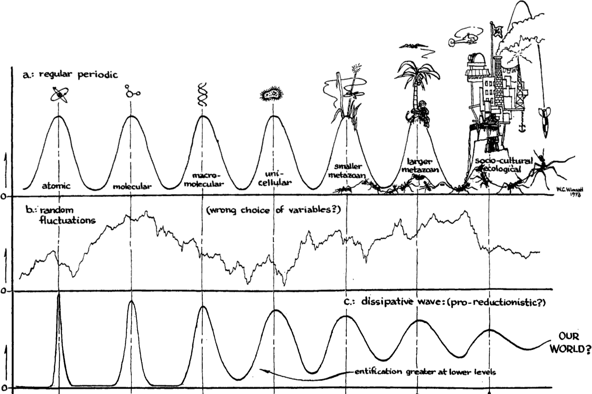

# Levels of Organization in Biology
**First published Mon Feb 5, 2018; substantive revision Thu Nov 9, 2023**

*Eronen, Markus I., Brooks, Daniel Stephen*

Levels of organization are structures in nature, frequently identified by part-whole relationships, with things at higher levels being composed of things at the next lower level. Typical levels of organization that one finds in the literature include the atomic, molecular, cellular, tissue, organ, organismal, group, population, community, ecosystem, landscape, and biosphere levels. References to levels of organization and related leveled depictions of nature are prominent in the life sciences and their philosophical study, and appear not only in introductory textbooks and lectures, but also in cutting-edge research articles and reviews. In philosophy, perennial debates such as reduction, emergence, mechanistic explanation, interdisciplinary relations, natural selection, and many other topics, also rely substantially on the notion.

Yet, in spite of the ubiquity of the notion, levels of organization have received little explicit attention in biology or its philosophy. Usually the concept appears in the background as an implicit conceptual framework that is associated with vague intuitions. Attempts at providing general and broadly applicable definitions of levels of organization have not met wide acceptance. In recent years, several authors have put forward localized accounts of levels, and others have raised doubts about the usefulness of the notion as a whole.

Though there are many phrases that qualify ‘levels’ in philosophy, science, and everyday life, such as levels of abstraction, realization, being, analysis, processing, theory, science, or complexity, in this article we will focus only on levels of organization and debates associated with this concept. Other level-phrases will only be discussed insofar as they are relevant to this main topic.

## 1. The historical origins of the concept

When levels of organization are understood as belonging to the broader category of hierarchical depictions of nature, their history can be traced back to the early days of western science and philosophy. Aristotle suggested that living things could be arranged in a graded scale, starting from plants at the bottom and ending with humans at the top. This idea was further developed in Neoplatonism, and in Medieval times, it transformed into the idea of “the Great Chain of Being” (Lovejoy 1936)[^lovejoy-1936]. This *Scala Naturae* conveyed a hierarchical conception of the world: at the top, there is God, and at lower rungs, angels, humans, animals, plants, and so on. After the scientific revolution, more scientific hierarchical classifications of nature started to appear, the most famous ones being Linneaus’ taxonomical system and Auguste Comte’s hierarchy of the sciences (Comte 1830–1842 [1853])[^comte-1830].

At the beginning of the twentieth century, several notions of “levels” began to circulate in the philosophical and scientific literature. Prominent among these was the idea of “levels of existence” (alternatively: “being”; “complexity”) developed by philosophers Samuel Alexander (1920: 3, 45) and Charles Dunbar Broad (1925)[^broad-1925], which figured prominently in the emergentist and emergent evolution literature of the 1920’s (Sellars 1926; McLaughlin 1992; Stephan 1999)[^sellars-1926][^stephan-1999]. This introduced a number of themes that have become germane to general levels-language. These themes include level-specific laws (Broad 1925: 77; cf. Woodger 1929)[^broad-1925][^woodger-1929] and the idea that ‘levels’ exhibit a tendency in nature towards increasing complexity (Sellars 1917: 224; cf. Needham 1937)[^needham-1937][^sellars-1917]. Although most of these themes were severely underdeveloped and divorced from the cutting-edge work in the life sciences happening at the time (Needham 1937: 242 ff. 4)[^needham-1937], this tradition has been an influential historical source for explicating levels language in philosophy of mind (see the entries on emergent properties and supervenience; McLaughlin 1992; Beckermann, Flohr, & Kim 1992; Kim 1999, 2002)[^beckermann-1992][^kim-1992][^kim-1999][^kim-2002].

The roots of the contemporary notion of levels of organization and the associated hierarchical thinking are best linked to the efforts of organicist biologists of the early-mid twentieth century (for primers on the organicist movement, see Peterson 2014; Nicholson & Gawne 2015)[^nicholson-2015][^peterson-2014]. Particularly important to the introduction and development of the levels concept were Joseph Woodger (1929; 1930)[^woodger-1929][^woodger-1930], Ludwig von Bertalanffy (1928 [1933]; 1932), and Joseph Needham (1936b; 1937)[^needham-1936b][^needham-1937]. These individuals were in turn influenced by Alfred North Whitehead’s philosophy (see, e.g., Whitehead 1929; Needham 1941)[^needham-1941][^whitehead-1929].

Organicism (alternatively “organismal” or “organismic” biology) did not designate a clearly-defined group or movement, but rather a loosely-threaded confluence of scientists and philosophers distributed among many disciplines and across Europe and the Americas. The organicists (like the emergentists) were in part responding to the dispute between the mechanists and the neovitalists of the early twentieth century. The mechanists held that biological phenomena were “nothing over and above” their physico-chemical components, meaning that biological phenomena can in principle, and eventually will, be exhaustively accounted for in chemical or physical terms (Loeb 1912; 1916)[^loeb-1912]. They also argued that biological phenomena, though seemingly complex, are fundamentally similar to machines (Loeb 1912; 1916; see also G. Allen 2005: 264; Bechtel & Richardson 1993 [2010: 17]; Nicholson 2012: 160)[^allen-2005][^bechtel-1993][^loeb-1912][^nicholson-2012]. Neovitalists such as Hans Driesch and Henri Bergson rejected these ideas, arguing that living things cannot be explained solely based on their physico-chemical components, and that biological phenomena therefore must involve non-physical forces or entities. The organicists sought to offer a “third way” into the mechanist-vitalist dispute that served as a middle ground between the austerity of the mechanists and the extravagance of the neovitalists (Peterson 2014: 286; Nicholson & Gawne 2015: 358)[^nicholson-2015][^peterson-2014].

Three major tenets of organicism were particularly congenial to the development of the levels concept. Firstly, the central preoccupation of organicist thought with *organization* laid down a foundation for levels thinking (cf. Nicholson & Gawne 2015: 364)[^nicholson-2015]. For the organicists, organization marked the decisive feature for demarcating living phenomena from non-living physico-chemical phenomena (e.g., Woodger 1929: 290–1; von Bertalanffy 1928 [1933: 48]; Needham 1936b: ch. 1)[^bertalanffy-1928][^needham-1936b][^woodger-1929]. Unlike the neovitalists, however, the organicists did not hold organization to be inscrutable, but rather an important explanandum of biological study (Nicholson & Gawne 2015: 365)[^nicholson-2015]. Moreover, living organisms exhibited a *hierarchical ordering* among their distinct parts (Woodger 1930: 8; von Bertalanffy 1932: 83; Needham 1936b: ch. 5; see also Nicholson & Gawne 2015: 366)[^bertalanffy-1932][^needham-1936b][^nicholson-2015][^woodger-1930]. This combined nicely with the focus on organization as the major explanandum of biology in that the series of elements that compose different organisms required specific and contextualized treatment. This in turn complemented another main tenet of the organicists, namely *the autonomy of biology* as a natural science (cf. Nicholson & Gawne 2015: 366–7)[^nicholson-2015].

The levels concept proved to be a linchpin of these main tenets. Joseph Woodger, combining these features, thus expresses the basic thinking behind levels of organization:

> Two principal factors appear to have been responsible for the failure to take organization seriously in biology. First there is the vague belief that only atoms and molecules are ‘real’, and secondly the incautious use of the notion of chemical composition. Also the biological entities are found to be composite in the same sense, and moreover, some of the relata in the relation of composition in the physico-chemical objects are also relata in the biological objects. *But* the analysis of organisms as carried out by biologists reveal *other* relata in mutual relation of composition *in a different sense*, i.e., not in *chemical* composition, e.g., *the organism is analysable into organ-systems, organs, tissues, cells and cell-parts. There is a hierarchy of composing parts or relata in a hierarchy of organizing relations.* These relations and relata can only be studied at their own *levels* (cf. the quartz crystal) and not simply in terms of the *lower levels*. (Woodger 1929: 292–293, emphasis modified; see also Bertalanffy 1932: 100–101; Needham 1937 [1943: 234])[^bertalanffy-1932][^needham-1937][^woodger-1929]

Unlike the emergentists’ “levels of existence”, the hierarchical view expounded by the organicists emphasized differentiating the many distinct classes of matter’s possible forms to accommodate the diversity in biological entities. This in turn led them to posit many more levels in the world than the four ‘super levels’ of the emergentists (the physical the chemical, the vital, and the mental), and also implied an increase in complexity as more levels of organization were brought to bear on treating living systems. Woodger again remarks:

> If the parts [of an organism] were homogeneous then we should be able to call them units and there would only be one level of organization. But if each part were itself composed of parts forming in each an organized system, then clearly we should have two levels of organization and if the composing sub-parts of the first organization were intrinsically only numerically different we could speak of two homogeneous levels of organization. If, however, the sub-parts were intrinsically different then the first-order parts would be different and we should have a heterogeneous type of organization. By carrying out this process of subdivision further we could obtain very complex types of organization exhibiting a hierarchy of successive levels. And if now we consider one of the higher living organisms it is evident at once that its organization will belong to one of these heterogeneous hierarchical types. (Woodger 1929: 298)[^woodger-1929]

This idea that levels of organization of organization form “nested” compositional hierarchies where there are wholes at higher levels and their components at lower levels, and the components themselves can be further decomposed into parts, remains one of the core features of the notion of levels of organization up to this day.

In the aftermath of organicism, development of the levels concept splintered into different intellectual trajectories, with little overall theoretical or conceptual coherence. One direction of development flowed through the framework of general systems theory (von Bertalanffy 1950, 1968)[^bertalanffy-1950][^bertalanffy-1968], and particularly through so-called hierarchy theory (Whyte, Wilson, & Wilson 1969; Weiss 1971; Pattee 1973)[^pattee-1973][^weiss-1971][^whyte-1969]. General systems theory sought to construct isomorphisms between laws of different scientific fields based on their generic system properties (von Bertalanffy 1950: 136)[^bertalanffy-1950], but nonetheless continued to emphasize the hierarchical part-whole structure of systems (von Bertalanffy 1968)[^bertalanffy-1968]. ‘Levels of organization’ in this tradition was ultimately given secondary consideration to the articulation of system-generic properties and laws. Similarly, in hierarchy theory, ‘levels’ tended to be treated as derivative of the more general notion of a hierarchy, or the ordering of a system into nested subsystems (Simon 1962 [1996: 184–5]; see also Weiss 1971)[^simon-1962][^weiss-1971]. Hierarchy and levels alike continued to be treated as generic structures of systems of all stripes (see also T. Allen & Starr 1982; O’Neill et al. 1986)[^allen-1982][^o’neill-1986]. However, one important distinction to come out of this tradition was the distinction between levels of composition and levels of control (Simon 1962; Pattee 1973)[^pattee-1973][^simon-1962]. The former speaks to the nested compositionality typically identified with levels of organization, while the latter refers to the idea that higher levels impose constraints on the processes at lower levels, for example by limiting the degrees of freedom of the system at a lower level (Pattee 1973: 85; see also Umerez 2021)[^pattee-1973][^umerez-2021].

Other early attempts at clarifying the concept of levels were carried out by individual researchers working alone on similar or related issues, such as reduction or multilevel selection. Mario Bunge (1960; 1977)[^bunge-1960][^bunge-1977], Marjorie Grene (1969; 1987)[^grene-1969][^grene-1987], and William Wimsatt (1976a; 1981; 1994)[^wimsatt-1976a][^wimsatt-1981][^wimsatt-1994] each developed several ground-laying observations concerning levels. Bunge (1960)[^bunge-1960] remarks on the plethora of meanings the term can possess, then offers a long taxonomy of nine different meanings of the term “levels”, ranging from the innocuous (levels as degrees or quantity, as in ‘levels of stress’) to the sense of nature being ordered into an evolutionary series, with several corollary senses of levels falling between (such as degrees of complexity). In his 1977 paper, Bunge goes further, offering a set-theoretic treatment of levels, and claiming that the leveled structure of the natural world is what renders natural phenomena intelligible to us (Bunge 1977: R82)[^bunge-1977]. Grene (1969)[^grene-1969] also discusses the polysemic nature of the term “hierarchy”, and later (1987) distinguishes between two notions of hierarchy, one falling under a mixed notion of levels as composition and control, and the other exemplifying phylogenetic ranks. Wimsatt’s work will be considered in more detail below in section 2.3.

## 2. Philosophical accounts of levels of organization

A recurring motif in the literature on levels of organization is to lament the haphazard or unreflective way in which terms such as ‘hierarchy’ or ‘levels’ are applied, and to call for more precise analyses (e.g., Beckner 1974; Bunge 1977; Grene 1987; Korn 2002; Valentine & May 1996)[^beckner-1974][^bunge-1977][^grene-1987][^korn-2002][^valentine-1996]. However, until recently, developing substantial theories or accounts of levels of organization has only occurred sparingly in the literature. In this section, we first discuss three major accounts put forward in philosophy of science to clarify or posit what exactly levels of organization are. These are Paul Oppenheim and Hilary Putnam’s “layer-cake” account, the mechanist account developed and advocated by Carl Craver (2007: ch. 5; 2015) and William Bechtel (2008: ch. 4), and William Wimsatt’s “local maxima” account (1976a; 1994). After these, we also go through recent skeptical approaches to the idea of levels of organization.

### 2.1 The layer-cake account

In the classic paper “The Unity of Science as a Working Hypothesis” (1958; see also the entry The Unity of Science), Oppenheim and Putnam (hereafter O&P) put forward a system of levels that became very influential, and is still implicitly present in many references to levels. This “layer-cake” model comprises three components. First, their conception of levels was *comprehensive*, meaning they wished to subsume all instances of where one could talk of ‘levels’ into their account. Second, O&P posited that levels are related via compositional relations that are structured in a *stepwise* fashion. That is, all constituents of the objects of study of one branch of science, or, the branch’s “universe of discourse”, are exhaustively related as wholes to the parts located at the next adjacent lower level, and as themselves parts to the constituents occurring at the next adjacent higher level. This component is probably most responsible for the “layer-cake” moniker. Finally, O&P presumed a strict *correspondence* between the constituents comprising a level and the predicates and theories linked with these constituents, meaning that levels of science neatly map onto levels of nature, so that for each level in nature there is corresponding science or theory and vice versa (Craver 2007: 174–175; Brigandt 2010: 304–305)[^brigandt-2010][^craver-2007][^craver-2007-2].

O&P’s usage of ‘levels’ can be broken down into two roles within their framework. The first concerns their use of ‘levels’ in their explication of reduction, i.e., microreduction, which in turn aided in articulating their thesis of unity of science (1958: 5–6). In this framework, O&P suggest ordering the branches of sciences so that the major potential reductions standing between the current situation and unified science can be identified. For this purpose, they propose six “reductive levels” (1958: 9): Social groups; (Multicellular) living things; Cells; Molecules; Atoms; Elementary particles. The branch of science with the things of a given level as its universe of discourse is a potential “microreducer” of a branch with the things of the next higher level as its universe of discourse (O&P 1958: 9).

O&P’s second use of levels is to capture a natural epistemic ordering of the sciences:

> The idea of reductive levels employed in our discussion suggests what may plausibly be regarded as a *natural order of sciences*. For this purpose, it suffices to take as ‘fundamental disciplines’ the branches corresponding to our levels. It is understandable that many of the well-known orderings of things have a rough similarity to our reductive levels, and that corresponding orderings of sciences are more or less similar to our order of 6 ‘fundamental disciplines’. (O&P 1958: 28, emphasis added)

This shows that O&P assumed that the structure of the sciences follows the structure of nature. Though they acknowledge the numerous precedents to this hierarchical ordering of the sciences (e.g., Comte’s pyramid of the sciences, 1958: 28), O&P considered their layer-cake account to be superior to these other “intuitive” senses of the order of sciences, since the existence of levels themselves are grounded in the stepwise, compositional continuity of nature.

The problems with the layer-cake account have been well-documented (Craver 2007: 172–6; Kim 2002; Potochnik & McGill 2012; Rueger & McGivern 2010)[^craver-2007][^craver-2007-2][^kim-2002][^potochnik-2012][^rueger-2010]. For one thing, if we look at contemporary science, the strict correspondence between levels and scientific fields breaks down immediately: Fields such as cognitive neuroscience span multiple levels, and the level of multicellular organisms is studied by a plethora of different scientific disciplines (Craver 2005; Bechtel 2008: 145)[^bechtel-2008][^craver-2005]. Likewise, the exhaustive stepwise condition on compositional relations between natural constituents, requiring that entities at one level are composed of only entities at the next lower level, is largely a caricature (e.g., Kim 2002)[^kim-2002]: think of blood, nominally a tissue-level phenomenon, which is directly composed by molecular constituents such as vitamins and water without adjacent-level constituents, e.g., cells, playing any intermediary role. Finally, and most importantly, the layer-cake account aspires to a comprehensive notion of ‘levels’ that is wildly at odds with the way that ‘levels’ is actually used in science. Scientists often operate with a much more limited definition of the levels concept that either (a) is restricted to a specific and local context (see section 2.2) or (b) makes room for exceptions to what ‘levels’ expresses (see section 3). Many biological sources in fact are completely aware that levels do not capture a completely uniform reality, and sometimes remark on important exceptions to the rules that are laid down by the levels concept. This is most prominently seen when referring to “organisms” in a piecemeal way so as to capture both multicellular and unicellular forms of life (Mader 2010: 2)[^mader-2010].

### 2.2 Levels of mechanisms

The account of “levels of mechanisms” introduced by Bill Bechtel (2008)[^bechtel-2008] and Carl Craver (2007)[^craver-2007][^craver-2007-2] has in recent years become a standard view of levels in philosophy of neuroscience. The context of this account is the more general paradigm of “new mechanism” (see the entry Mechanisms in Science). In levels of mechanisms, there are mechanisms at higher levels and their components at lower levels. The mechanistic account proposes a contextualized conception (as opposed to the comprehensive conception of the layer-cake) that articulates levels in terms of constitutive parthood within a mechanism (Craver 2007: 188–189; Kaplan 2015: 20; see also Cummins 1975 for an early expression of this idea)[^craver-2007][^craver-2007-2][^cummins-1975][^kaplan-2015]. This approach offers several advantages over the layer-cake account: For one thing, it abandons the goal of providing a global or comprehensive understanding of levels that applies homogeneously to all systems in nature. Instead, the aim is to construe levels in a scientifically informed manner whereby level demarcations only make sense on case-based grounds (see also Love 2012 for a local approach to levels that is not explicitly tied to the notion of a mechanism)[^love-2012]. The mechanistic account also completely eschews any tidy correspondence between the structure of the natural world and the structure of the natural sciences: Levels of mechanisms are *levels in nature*, and there is no straightforward mapping from these levels to theories or fields of science (Craver 2007: 176)[^craver-2007][^craver-2007-2]. Finally, the mechanistic account of levels supports a positive account of pluralistic, multilevel explanation that emerges as an alternative to accounts of reductionism in biology (Craver 2005; cf. Brigandt 2010: 297)[^brigandt-2010][^craver-2005].

More specifically, levels of mechanisms have been defined as follows:

> In levels of mechanisms, the relata are behaving mechanisms at higher levels and their components at lower levels. … The interlevel relationship is as follows: *X*’s Φ-ing is at a lower mechanistic level than Ψ-ing if and only if *X*’s Φ-ing is a component in the mechanism for S’s Ψ-ing. Lower level components are organized together to form higher-level components. (Craver 2007: 189)[^craver-2007][^craver-2007-2]
>
> Within a mechanism, the relevant parts are … working parts—the parts that perform the operations that enable the mechanism to realize the phenomenon of interest. These may be of different sizes, but they are distinguished by the fact that they figure in the functioning of the mechanism. It is the set of working parts that are organized and whose operations are coordinated to realize the phenomenon of interest that constitute a level. (Bechtel 2008: 146)[^bechtel-2008]

So far, these characterizations suggest that there are just two levels, the level of the mechanism and the level of its components. However, when we take into account that a component can also be mechanism in itself, this picture is expanded into a multilevel hierarchy: The components of that nested mechanism then form a third level, which is two levels lower than the overall mechanism (Bechtel 2008: 147)[^bechtel-2008]. This mechanistic decomposition can be repeated as many times as necessary; there is no a priori limit to the number of levels in a mechanism.

The standard example of levels of mechanisms is the case of spatial memory and long-term potentiation (LTP; Craver 2007: 165–170)[^craver-2007][^craver-2007-2]. In the spatial memory mechanism, four levels of mechanism can be identified: the level of spatial memory, the level of spatial map formation, the cellular-electrophysiological level, and finally the molecular level. Entities at each lower level are components in the higher-level mechanism. For example, an NMDA receptor at the molecular level is a component of the LTP mechanism at the cellular level, and the LTP mechanism is in turn a component of the hippocampal mechanism of memory consolidation (at the level of spatial map formation). The hippocampal mechanism of memory consolidation then contributes to the overall mechanism at the level of spatial memory, which is the highest level and involves, for example, behavioral tasks (e.g., navigating a maze).

Levels of mechanisms share some key features with the traditional idea of levels of organization: They are by definition compositional, entities at higher levels are typically larger than entities at lower levels, and levels of mechanisms can potentially amount to local peaks of regularity and predictability (Craver 2007: 190; see next section)[^craver-2007][^craver-2007-2]. However, levels of mechanisms are far more limited and minimalistic than any other extant approaches to levels of organization. First of all, as already mentioned, levels of mechanisms can only be identified on a case-by-case basis, and different mechanisms can have entirely different levels. For example, the set of levels in the mechanism of protein folding is very different from the levels in the spatial memory mechanism.

Moreover, even within one mechanism, the question whether two items are at the same or different levels often has no well-defined answer. This is due to the fact that levels are defined solely in terms of direct part-whole (or component-mechanism) relationships. For example, NMDA receptors and synaptic vesicles are components of the cellular LTP mechanisms, and thus can be said to be at the same level. The components of NMDA receptors in turn include things such as glutamate binding sites and glutamate ions, whereas the components of synaptic vesicles include things such as transport proteins. However, as glutamate binding sites and transport proteins are neither components of one another nor direct components in the same (sub)mechanism, they are neither at the same level nor at different levels (Bechtel 2008: 147)[^bechtel-2008]. The question how they are related levels-wise has no answer in the mechanistic framework. What this means is that even within a specific mechanism, levels of mechanisms do not form horizontal layers that span across the mechanism, but rather small islands formed by the working parts of a (sub)mechanism. Another implication is that even identical things (e.g., NMDA molecules) within the same overall mechanism are often not at the same level (Eronen 2013)[^eronen-2013]. Craver (2015)[^craver-2015] has suggested that the whole idea of being “at the same level” is in fact unimportant or even meaningless in the context of levels of mechanisms; it is sufficient that there is a clear sense in which mechanisms are at a higher level relative to their components (and the components are at a lower level relative to the mechanism as a whole), and this does not require that the components or mechanisms also form horizontal levels.

A further problem that the mechanistic account shares with the layer-cake account is that it is embedded within a conceptual framework where ‘levels’ are defined in terms of other technical terms that are more foundational in that framework (Brooks 2017)[^brooks-2017]. The layer-cake account was originally embedded in Oppenheim and Putnam’s overarching project of arguing for the unity of science, and their understanding of ‘levels’ was in part conceived to explicate how microreduction works. The mechanistic account for its part is embedded within the New Mechanism’s program of explicating mechanistic explanation and mechanisms; since “levels of mechanisms” largely overlap with technical terms that define what a mechanism is, it is a legitimate question what distinct notion of ‘levels’ results at all that is not directly derivable from the notion of a mechanism (cf. Eronen 2013)[^eronen-2013].

In this light, it is clear that levels of mechanisms are only distantly related to earlier attempts at elucidating levels in the life sciences, and have many features that we intuitively would not associate with the idea of levels (Eronen 2015)[^eronen-2015]. However, this is compatible with the idea that the relationships of mechanistic composition that levels of mechanisms track are as such crucially important for understanding and explaining biological organization.

Several authors have recently defended a “flat” view of the levels in mechanisms (Bechtel 2017; Bickle, De Sousa, & Silva 2022; Craver, Glennan & Povich 2021; Fazekas 2022)[^bechtel-2017][^bickle-2022][^craver-2021][^fazekas-2022]. For example, Peter Fazekas (2022)[^fazekas-2022] suggests that what we call mechanistic “levels” just identify modules, or sets of interacting units, within a causal network. In this view, there are no ontologically distinct levels in mechanisms at all, mechanisms are just extremely complex systems of interacting parts all at one “level”. Bechtel (2017)[^bechtel-2017] and Craver et al. (2021) put forward a similar flat interpretation of mechanistic levels, but argue that this is compatible with the original non-reductive commitments of the mechanistic approach (see also section 4). For further attempts at expanding or developing the notion of levels of mechanisms, see Bertolaso & Buzzoni (2017), Harbecke (2015)[^harbecke-2015] and Kaiser (2015)[^kaiser-2015].

### 2.3 Wimsatt’s “local maxima” account

Both the layer-cake and the mechanistic approach to levels aim at defining levels in the sense of giving at least necessary conditions for what constitutes a level. William Wimsatt (1976a; 1994)[^wimsatt-1976a][^wimsatt-1994] takes a different approach and sets out to characterize the key features that levels of organization typically (but not necessarily) exhibit across different instances. Originally, an important background motivation for Wimsatt was to understand and characterize claims about “higher-level” entities and phenomena that are ubiquitous in biology and social sciences (Wimsatt 2021)[^wimsatt-2021]. The philosophical discussions in the 1970s were focused on strong reductionism or eliminativism (see the entry on Reductionism in Biology), which seemed inadequate to capture the way many scientists perceived the organization of nature (Wimsatt 2021)[^wimsatt-2021]. Inspired by the work of Simon (1962 [1996]), Wimsatt set out to develop a “tropical rainforest ontology” in contrast to a Quinean “desert ontology”, and levels played a central role in this account. First, according to Wimsatt, levels are compositional and form nested hierarchical structures, so that wholes at lower levels function as parts at higher levels. Second, levels of organization are a

> *deep, non-arbitrary, and extremely important feature of the ontological architecture of our natural world, and almost certainly of any world which could produce, and be inhabited or understood by, intelligent beings*. (Wimsatt 1994 [2007: 203])[^wimsatt-1994]

A further feature of levels of organization is that they are

> *constituted by families of entities usually of comparable size and dynamical properties, which characteristically interact primarily with one another*. (Wimsatt 1994 [2007: 204])[^wimsatt-1994]

A helpful metaphor that Wimsatt uses to illustrate this is that we can think of theories or models of specific levels as sieves of different sizes that sift out things with the appropriate size and dynamical properties (Wimsatt 1976a: 237)[^wimsatt-1976a]. Thus, theories at the level of organisms sift out roughly organism-sized things that are capable of reproduction and primarily interact with each other.

Finally, and perhaps most importantly,

> *[l]evels of organization can be thought of as local maxima of regularity and predictability in the phase space of alternative modes of organization of matter*. (1976a: 209; see also 1976a: 238)

This point is “the closest that [Wimsatt] will come to a definition” (1976a: 209), and requires some explanation. The idea is roughly that patterns and regularities that can be used as a basis for prediction and explanation are found clustered around certain scales, and such clusters indicate levels of organization. Thus, if we plot regularity and predictability against (size) scale, then levels of organization will appear as peaks in the plot (see Figure). The entities that we find at these “local maxima” will exhibit stable regularities in virtue of the criteria (size, rate, dynamic properties, etc.) with which they are grouped into levels, and these regularities can also serve as the basis for reliable predictability. Moreover, levels of organization comprise “the *most probable* states of matter” (1976a: 239), meaning that if we could vary the initial conditions, under a range of conditions natural selection or other selection processes would result in the same levels (Wimsatt 1976a: 238–239)[^wimsatt-1976a]. For example, if the level of molecules is a level of organization in Wimsatt’s sense, then there should be a peak in regularity and predictability at the scale(s) where molecules are located, and molecules should be the most probable mode of organization of matter under a range of conditions.

*Figure 1.* Wimsatt's levels of organization. Based on Wimsatt (1976a: 240)[^wimsatt-1976a], created in 1973; used with permission. [An extended description of figure 1 is in the supplement.]

Wimsatt points out many other features that levels may have: For example, processes at higher levels tend to happen at slower rates than processes at lower levels, higher level properties are typically multiply realized by lower level properties, and higher-level causal relationships are dynamically autonomous in the sense of being largely independent of what happens at lower-levels. What differentiates levels will also vary between instances, and may include part-whole distinctions, the magnitudes of forces by which things interact, or, pragmatically, considerations of size of different constituents.

Importantly, Wimsatt also argues that in contexts where part-whole relationships become too complex, such as in many biological systems, levels of organization break down, and in these cases a more appropriate organizational notion is *perspective* (Wimsatt 1994 [2007, 227])[^wimsatt-1994]. Perspectives are (incomplete) accounts of systems based on a set of variables, and in contrast to levels, need not have any part-whole structure. For example, we can approach organisms from anatomical, physiological or genetic perspectives, each perspective coming with a proprietary set of variables. When even the boundaries of perspectives start to break down, and it is no longer clear to which perspective a problem belongs to, we are facing what Wimsatt calls a *causal thicket*. According to Wimsatt,

> neurophysiological, psychological, and social realms are mostly thickets, which are only occasionally well-ordered enough for local problems to be treated as perspectival or level-relative problems. (Wimsatt 1994 [2007: 239])[^wimsatt-1994]

Griesemer (2021)[^griesemer-2021] presents a more epistemic reading of these notions: When scientists first approach a complex system, they encounter it as a causal thicket, but they then proceed to “prune” it, first to perspectives and then (possibly) to levels.

By including so many caveats and possible but not necessary characteristics of levels, Wimsatt makes his account extremely versatile and wide in scope, but at the same time open to charges of vagueness or inconsistency (cf. Craver 2007: 182–183)[^craver-2007][^craver-2007-2]. It contains a multitude of criteria that levels could but do not necessarily have to satisfy, so that almost any set of entities that are in some respect similar to one another could be said to form a level. Moreover, the individual criteria as such also raise many questions. For example, how should we understand the “local maxima of regularity and predictability”? What kinds of regularities should we include—only causal generalizations, or also regularities describing associational or compositional relations (Craver 2007: 182–183)[^craver-2007][^craver-2007-2]? How do we count or estimate the number of regularities on a given scale? How do these peaks match with the other proposed criteria, such as the part-whole organization of levels?

These worries are to some extent alleviated by taking into account an important background idea in Wimsatt’s approach: Levels of organization and the entities that occupy them should be *robust*, meaning that they should be detectable, measurable, derivable, definable, and so on, in a variety of *independent* ways (1981 [2007: 63–4]; 1994 [2007: 210]). In other words, they should exhibit redundancy between independent means of accessing, detecting or defining them, and therefore should not depend on any single criterion or defining feature. Thus, if levels of organization are robust, the choice of criteria, or the problems of some individual criterion, will not be crucial. However, the extent to which there are such robust levels of organization in nature remains an open question. What is clear is that Wimsatt’s account of levels of organization is still highly relevant and continues to serve as the backdrop for informed discussions of levels (see, e.g., the articles in the collection Brooks, DiFrisco & Wimsatt 2021b; and DiFrisco 2021 for a process-based account of levels that is explicitly Wimsattian in character)[^brooks-2021b][^brooks-2021b-2][^difrisco-2021].

### 2.4 Levels skepticism and deflationary accounts

Despite the familiarity of scientists and philosophers with the levels concept, calls for its dismissal or de-emphasis in the scientific lexicon are increasingly common (Eronen 2013; Guttman 1976; Ladyman & Ross 2007; Potochnik 2017; 2021; Potochnik & McGill 2012; Rueger & McGivern 2010; Thalos 2013)[^eronen-2013][^guttman-1976][^ladyman-2007][^potochnik-2017][^potochnik-2012][^rueger-2010][^thalos-2013]. For one thing, nature may simply be too messy to fit any layer-cake style picture. Consider as an illustration the putative level of “organisms”. Blue whales and yeast cells are both clearly organisms and thus should nominally be located at this level, but each comprises radically different kinds of entities with radically different properties (Potochnik & McGill 2012)[^potochnik-2012]. Moreover, but when we consider the next lower level, namely the one indicated by the components of these organisms, the picture of levels as neat horizontal layers breaks down completely. The components of blue whales include things such as organs, tissues and cells, whereas yeast cells are composed of things like the cell membrane, nucleus and mitochondria (cf. Potochnik & McGill 2012)[^potochnik-2012]. Furthermore, the whale is in part composed of various symbionts, including gut bacteria which are at the same time components of the whale and organisms in themselves. Thus, the components of different kinds of organisms do not form any homogeneous “level”.

These problems are not just due to the difficulties of defining what an organism is. Similar issues arise when we consider the components of cells, such as the cell membrane and mitochondria, and especially their subcomponents (e.g, lipid molecules and the outer mitochondrial membrane respectively): they exhibit too much heterogeneity to form neat levels (Eronen 2021)[^eronen-2021]. Moreover, the same kinds of things can be parts in very different higher-level wholes: For example, hydrogen ions are components of the lipid molecules that make up cell membranes, but they can also be free-standing components in the oxidative phosphorylation mechanism that involves the cell membrane as another component (Bechtel 2008: 147)[^bechtel-2008].

More generally, Potochnik and McGill (2012; see also Potochnik 2021)[^potochnik-2021] argue that ‘levels’ imposes a radically false, rigid uniformity onto nature, and identify these problems with the basic idea of the levels concept itself:

> Indeed, the very notion of stratified levels depends on not only the ubiquity, but also the uniformity, of part-whole composition. For strata to emerge, atoms must always compose molecules, populations must always compose communities, and so forth. But the uniformity of composition needed for stratified levels *simply does not exist*. (2012: 126; emphasis added; see also Guttman 1976: 113; Thalos 2013: 10)[^guttman-1976][^thalos-2013]

This comprehensive, uniform rigidity in turn undermines other features attributed to levels of organization. One of these features is the supposed epistemic merit (or fault) inherently exhibited by natural constituents due to their position at a particular level (Potochnik & McGill 2012: 129–30; Potochnik 2021)[^potochnik-2021][^potochnik-2012]. For instance, reductionists frequently argue that molecular-level explanations are generally more secure, more fundamental, or otherwise superior to explanations citing higher-level structures like chromosomes or cells (and conversely, anti-reductionists claim that higher-level constituents are often necessary for producing adequate explanations). However, as has been pointed out by many authors, blanket attributions of significance like these are deeply misleading (see section 4). One reason for this is that particular levels exhibit epistemic merit only in regard to what is being investigated. As such, what is taken to be the relevant level will shift depending on what structures or processes comprise the focus of scientists’ investigative tasks, and hence no level will have inherent or principled epistemic superiority. Moreover, epistemic products like explanations and theories in biology rarely exhibit a monolevel structure, but rather include multiple levels simultaneously (e.g., Schaffner 1993: 97–8, 387; Mitchell 2003: 147; Craver 2007)[^craver-2007][^craver-2007-2][^mitchell-2003][^schaffner-1993].

The basic conclusion that Potochnik and other levels skeptics draw from this is the following. The levels concept precludes a sophisticated discussion of philosophical and scientific issues by imposing an overly simplistic representation of science and nature. So, although perhaps no one would deny the attractiveness of ‘levels’ in seeking to make complex natural systems tractable to analysis, depicting these systems using the concept seems to do far more harm than good. Burton S. Guttman is very clear on this, arguing that “if it is stated in any but the sloppiest and most general terms, [the concept of levels] is a useless and even misleading concept” (Guttman 1976: 112)[^guttman-1976]. Similarly, Miriam Thalos colorfully names “the conceit of levels” before stating that “the notion of levels provides no useful philosophical ideas whatsoever” (Thalos 2013: 13)[^thalos-2013].

This levels-skepticism also possesses a more constructive side. Several authors have suggested replacing or reinterpreting levels talk in terms of other concepts (Eronen 2015; Noble 2012; Potochnik & McGill 2012; see also P.S. Churchland & Sejnowski 1992; McCauley 2009; Rueger & McGivern 2010)[^churchland-1992][^eronen-2015][^mccauley-2009][^noble-2012][^potochnik-2012][^rueger-2010]. The motivation behind this “deflationary” approach (Eronen 2013)[^eronen-2013] is that the problems associated with levels of organization can be avoided if more well-defined notions are applied instead. For instance, the notion of *scale* arguably does not lead to the same kinds of problems as the notion of levels of organization. All that is needed for arranging things on a scale is measuring some quantitative property of those things. Scales also have the advantage of being entirely continuous, while levels require placing things at distinct and discrete positions in the hierarchy (Potochnik & McGill 2012)[^potochnik-2012]. The scale that is the most obviously relevant one in this context is the size scale, which is based on how big things are: Organisms are usually (though not always) bigger than cells, which are bigger than molecules, which are bigger than atoms, and so on.

However, the time scale is also crucially important for understanding biological organization (Simon 1962; DiFrisco 2017)[^difrisco-2017][^simon-1962]. Time scale can refer to the rate at which a process occurs, but also to the frequency of a process, or to the rate of interactions between processes or entities, all of which are relevant scales in the context of biology (Baedke 2021). For example, interactions between organisms (e.g., sexual reproduction) take place at much slower rates than interactions between cells (e.g., synaptic communication), which again are slower than interactions between molecules (e.g., receptor binding). The idea of ordering biological processes based on time scale has a long history, going back at least to organicism (see section 1; Baedke 2021). Understanding levels in terms of scales is also consistent with the idea that at some scales we may find peaks of regularity or predictability (Wimsatt 1994 [2007])[^wimsatt-1994], or clusters of causal relationships (Potochnik & McGill 2012)[^potochnik-2012]. Besides scales, also other notions have been proposed to replace levels, such as networks (Potochnik 2021; see also Bechtel 2017)[^bechtel-2017][^potochnik-2021] or explanatory styles (Potochnik & Sanches Oliveira 2020)[^potochnik-2020].

Although these skeptical and deflationary approaches, where the notion of levels is reduced or deflated to more well-defined concepts, ostensibly increase conceptual clarity, they may not be sufficient for accounting for the role of levels of organization in biological theory and practice (see also section 6). For example, the cellular level is a canonical level organization, but cells come in many different sizes, and it is hard to identify a size (or time) scale that would play a similar role as the notion of a cellular level. Moreover, skepticism regarding specific philosophical conceptions of levels, such as layer-cake-style levels or levels of mechanisms, leaves open the possibility that more piecemeal or context-specific approaches to levels may still be useful.

## 3. Levels as a fragmentary and heuristic notion

In the wake of skeptical arguments against the levels concept, recent work on the notion has sought to address the pessimistic appraisals outlined in the previous section by rejuvenating the discussion surrounding levels. One key component in reestablishing the potential of levels for philosophical insight has been to address the gap between philosophical expectations placed upon the concept in skeptical treatments, and the usage dynamics informing scientific applications of the concept (Brooks 2021b; see also DiFrisco 2017 and Brooks, DiFrisco & Wimsatt 2021a)[^brooks-2021a][^brooks-2021b][^brooks-2021a-2][^brooks-2021b-2][^difrisco-2017].

In particular, philosophical expectations placed upon accounts of levels tend to depart from scientific applications of the concept both in characterizing how the levels concept is used and in the motivations behind applying the concept in scientific contexts. This is especially visible in the way that levels are conceptualized by critics. For instance, Potochnik characterizes the objectionable consequences of the levels concept as stemming from “the very idea” of levels (2017: 170), where this “very idea” takes the concept to impose (i) universality of composition, (ii) uniform relations between putative levels, and (iii) total discreteness of level-bound units (2017: 170; see also Potochnik & McGill 2012: 126)[^potochnik-2012]. Similarly, Thalos claims that to even postulate a leveled ontology is to be committed to a reductionist “master ontology” grounded in physics from which all other higher levels derive (2013: 7).

Both of these characterizations rest on attributions to the levels concept stemming from philosophical sources rather than scientific usage of the concept. For one thing, Potochnik’s idea of levels seems to presume a layer-cake conception, an account that has few contemporary advocates and whose fidelity to science has arguably always at least been questionable. Likewise, the commitment to a reductionist ontology purported by Thalos rests decidedly on the further postulation of reductionist physicalism, a stance to which the levels concept is at best neutral (see section 6). Though these sources for making levels intelligible as an object of criticism may enjoy intuitive appeal widely in play in general philosophy of science and philosophy of mind, it is plausible that assessing the merits (and demerits) of the concept requires extraction from base intuition and exposure to further scientific-philosophical scrutiny (Brooks, DiFrisco, & Wimsatt 2021a)[^brooks-2021a][^brooks-2021a-2].

For these reasons, efforts to rejuvenate levels and their significance have turned to different sources to enable scientific input into the conceptualization of levels. One important consequence of this has been the rejection of any neat and tidy definition or unitary account of levels, instead treating the concept within multiple facets of reconstruction that scientific usage engenders. That is, engaging with the notion is seen as a widely open-ended endeavor (Brooks 2021a)[^brooks-2021a][^brooks-2021a-2].

One such front of approaches to levels focuses on the roles of the concept in scientific reasoning. For instance, Brooks and Eronen (2018) locate a heuristic element within usage of levels of organization. In this approach, instead of focusing primarily on what levels are ontologically speaking, or attempting to give a unitary definition of levels, the focus is to recover first the significance attributed to levels when applied in science (and parts of philosophy of biology). In particular, depicting biological systems requires emphasizing some details over others, as incorporating all details of an investigated system is not possible due to the cognitive and physical constraints placed on human agents (in line with the focus on heuristic reasoning). Thus, scientific uses of levels involve descriptive abstractions figuring into the decisions researchers make in selecting features of a system intended for the attending analysis. A second use Brooks and Eronen identify concerns the postulation of levels as guiding scientific inquiry in that different putative levels, though perhaps not well-characterized at the outset, serve as points of departure for new fields of inquiry in laying out landscapes of problems and questions that lie in front of these fields (such as systems biology in the 2000s). Eronen (2021)[^eronen-2021] identifies a further heuristic in the basic idea that in levels of organization “similar things are composed of things that are similar to one another”, which may often work as an abstraction. For example, both proteins and genes (at a higher level), which are similar in important ways, are composed of monomers such amino acids and nucleotides (at a lower level), which are again similar to one another in important ways.

This being said, the heuristic approach offers an incomplete account of levels, an intentional feature meant to invite further work on the notion. The heuristic approach thus seeks to capture some minimal features that a more committed body of work should account for. A core motivation of this approach is to construct a rapprochement between advocates of the levels concept and more skeptical theorists (see, however, Potochnik 2021 for criticism of the heuristic approach)[^potochnik-2021]. Particularly, supporters of the heuristic approach argue that a more nuanced appraisal of the levels concept aids to reveal its flexibility and usefulness in science. Most especially, it emphasizes that, like other heuristics, the concept may work in some contexts but not in others. Such scattered records of success, failure, and neutral accomplishments are in turn “mundane to scientific concepts in general” (Brooks & Eronen 2018: 41)[^brooks-2018].

Using the heuristic appraisal of levels as a springboard, a more systematic reconstruction of the levels concept in scientific reasoning points to a “fragmentary approach” whereby more overarching usage profiles begin to take shape. Brooks (2021a)[^brooks-2021a][^brooks-2021a-2] for instance articulates two such profiles associated with the levels concept in scientific usage. One of these profiles identifies the levels concept as a tool (*sensu* Griffiths & Stotz 2008; Feest 2010)[^feest-2010][^griffiths-2008] that scientists use to, for example, construct material inferences in specific experimental systems and to aid in providing projectibility to these inferences by conferring generality to the structures and processes involved. This profile of usage arguably captures practical scientific work operative in research articles published for specialist researchers. A second usage profile associated with levels appears as a kind of “doctrinal” notion in the vein of cell theory or the germ theory of disease. This profile draws its inspiration from the notion of doctrine, in the sense of something that is widely taught or adhered to, and is visible in scientific textbooks (see section 6.7) and in broad statements of position by grant-funding agencies and major theoretical works in biology. That is, the notion of levels of organization comprises a core theoretical component in the edifice of biology in serving to introduce or advocate for a basic view of biological science. Both of these usage profiles, seen as tool and doctrine, complement each other in conferring (i) fine-grained content to the concept in specific instances (tool) and (ii) general warrant to the notion as an established confluence of insights acquired throughout history (doctrine). Moreover, both suggest a unifying rationale to the notion, identified in its potential ability to structure scientific problems (Brooks 2021b)[^brooks-2021b][^brooks-2021b-2].

## 4. Reductionism, pluralism, and levels

As we saw above, Oppenheim and Putnam introduced their highly influential view of levels in the context of the reductive unity of science, and Wimsatt’s account was partly motivated by the need to respond to reductionism. Up to this day, levels have continued to play an important role in debates on reductionism (see the entry Reductionism in Biology). Questions of reductionism are often explicitly formulated in terms of levels: Do higher level properties, theories, or explanations reduce to lower level ones?

In the classical Nagelian account (Nagel 1961)[^nagel-1961], reduction amounts to deriving a theory that is to be reduced from a more fundamental theory on the basis of two conditions: deducibility and connectability (see the entry Scientific Reduction). The standard example is the reduction of thermodynamics to statistical mechanics. Nagel thought that from the laws of statistical mechanics one an derive the laws of thermodynamics (deducibility), with the help of “bridge principles” that connect the terms of these two theories (connectability; Nagel 1961: ch. 11; Schaffner 1967)[^nagel-1961][^schaffner-1967].

Nagel’s original approach to reduction has been criticized from many angles, but in the present context, the most relevant criticism is that the classical model ignores the distinction between *interlevel* and *intralevel* reductions in science (Wimsatt 1976a; 1976b; McCauley 1996)[^mccauley-1996][^wimsatt-1976a]. Intralevel (or successional) settings involve competing theories within a particular science and within a particular level, for example the phlogiston theory and the caloric theory of heat. Interlevel settings, on the other hand, involve theories at different levels of organization that thereby have differing explananda, terminology and methodology: for example, cognitive psychology and molecular neuroscience. Nagel’s model in its classic form treats these different contexts equally. For this and many other reasons (see, e.g., Walter & Eronen 2011)[^walter-2011], it is widely agreed that the Nagelian model fails to reconstruct reductive relations as they appear in actual science (Wimsatt 1976b; 1979)[^wimsatt-1976b], and that the model in its original form is inapplicable to actual biological cases (Kaiser 2012)[^kaiser-2012].

Problems of the Nagelian model led to the development of alternative accounts based on the same basic idea, which actively incorporated the idea of levels into their framework (Hooker 1981; P.S. Churchland 1986; Schaffner 1993; Bickle 1998; 2003)[^bickle-1998][^churchland-1986][^hooker-1981][^schaffner-1993]. This culminated in the “New Wave” model of reduction, where intertheoretic relations form a continuum ranging from complete elimination to retentive Nagel-style reduction (Bickle 1998)[^bickle-1998]. For a summary of this model, see the entry Scientific Reduction §2.6.

Other accounts of reduction also countenance the levels concept, albeit in different ways. In his “ruthless” account of reductionism, Bickle (2003)[^bickle-2003] abandons the idea of reduction progressing stepwise from level to level, and argues that cellular and molecular neuroscience can directly replace psychology (see also Barwich 2021)[^barwich-2021]. If one can intervene onto the molecular level to change variables at the behavioral level, then, Bickle contends, one has discovered the “genuine” causal mechanism for those variables (Bickle 2003)[^bickle-2003]. Here ‘levels’ figure into ruthless reductionism as useful fictions, where intermediary levels such as tissues, organs, and the like provide a scaffolding for emerging molecular-level explanations. These intermediary levels exhibit “merely” heuristic value, only in the service of constructing behavior-to-molecules reductions (Bickle 2003: 130)[^bickle-2003]. Recently, Bickle has defended an even stronger and explicitly “levels-less” version of reductionism, where levels no longer have even a heuristic role (Bickle et al., 2022)[^bickle-2022].

A different reconceptualization of reduction is offered by Hüttemann and Love (2011), who note that part-whole reduction in particular has become a widely-endorsed alternative to the Nagelian framework (see also Brigandt 2013: 77)[^brigandt-2013]. They put forward *compositionality* and *causality* as two aspects of reductive explanation (Hüttemann & Love 2011: 4)[^hüttemann-2011], which are both expressed in levels-laden language. Compositionality, for instance, is couched in ‘levels’ in that the very notions of part and whole in biological contexts correspond to respectively lower- and higher-level status (cf. Kaiser 2015, 192; Winther 2006)[^kaiser-2015][^winther-2006]. Kaiser (2015)[^kaiser-2015] goes further than this approach in claiming that a “lower-level character” is a necessary condition for an explanation to even be considered reductive (2015: 188).

The idea of levels has also figured prominently into arguments for antireductionism and pluralism. In his classic treatise, Philip Kitcher (1984)[^kitcher-1984] elevates the level concept to a centerpiece of the antireductionist position. According to Kitcher, the reductionist aspiration of reducing classical Mendelian to molecular genetics will not pan out because molecular constituents do not capture the causal relations between Mendelian constituents (e.g., chromosomes) and heritable traits. Importantly, Kitcher grounds this in the structure of the world as captured by the levels concept:

> Anti-reductionism construes the current division of biology not simply as a temporary feature of our science stemming from our cognitive imperfections *but as the reflection of levels of organization in nature*. (1984: 371, emphasis modified; Rosenberg [1985: 119] makes a similar statement)

Elevating the levels concept even further, Kitcher makes levels (of the layer-cake variety) part of the conception of antireductionism itself, concluding that

> to the extent that we can make sense of the present explanatory structure within biology—that division of the field into subfields corresponding to levels of organization in nature—we can also understand the antireductionist doctrine. (Kitcher 1984: 373)[^kitcher-1984]

In a more recent defense of antireductionism, Robert McCauley (1996; 2007)[^mccauley-1996][^mccauley-2007] expands on the intra-interlevel distinction to plead for a multilevel explanatory pluralism between higher- and lower-level theories. McCauley targets the New Wave model where intertheory relations result in a spectrum of consequences, ranging from identity to elimination, for higher-level theories (P.M. Churchland 1979; P.M. Churchland and P.S. Churchland 1990; Bickle 1998)[^bickle-1998][^churchland-1979][^churchland-1990]. He argues that a single spectrum of reductive consequences misrepresents the nature of intertheory coevolution. Intralevel reductions, focusing on reduction in terms of replacement, do not capture the historical dynamics involved in evaluating interlevel cases, and elimination is virtually nonexistent in interlevel cases. Moreover, eliminating or reducing higher-level theories would also undermine the status of the higher-level’s scientific institutions (McCauley 1996)[^mccauley-1996]. As this rarely happens, and attributing epistemic, ontological, or methodological superiority to the lower levels is at best a claim that needs to be substantiated, the New Wave model appears to be wildly at odds with actual scientific practice. According to McCauley, we observe intertheoretical coevolution instead, where higher-level theories can offer lower-level theories criteria for external coherency, evidential constraints, and novel problem solving strategies (McCauley 1996)[^mccauley-1996].

Other arguments for pluralism also take their start from levels of organization. Sandra Mitchell (2003)[^mitchell-2003], for instance, argues for *integrative pluralism* that is suggested by the multilevel and multicomponential “ontology of complex systems” (2009: 109). The basic idea of integrative pluralism falls out of the fact that biological systems evolve in a contingent manner, thus setting the stage for multilevel evolutionary scenarios (Mitchell 2003)[^mitchell-2003]. This in turn highlights the preponderance of ‘emergent properties’ in biological systems, which appear at novel levels of organization out of the interactions of simpler components. Both of these factors inflate the overall number of explanatory sources that could contribute to explaining a given phenomenon (2003; 2009). Consequently, discovering unilateral causes for complex phenomena will not be forthcoming (2003, 160). Likewise, Ingo Brigandt (2010; 2013)[^brigandt-2010][^brigandt-2013] emphasizes the pursuance of investigation at multiple levels of organization as a fact about scientific practice, but also as cause to articulate the localized significance of explanatory contributions to particular problems, as in the case of evo-devo explanations.

This kind of multilevel pluralism is also defended by the supporters of the New Mechanism (Bechtel 2008; Craver 2005, 2007; Brigandt 2010: 297; see also Mechanisms in Science)[^bechtel-2008][^brigandt-2010][^craver-2005][^craver-2007][^craver-2007-2]. As McCauley (2007)[^mccauley-2007] points out, mechanistic explanation can be seen as explanatory pluralism “writ small”: In each localized mechanistic context, several levels (understood as levels of mechanisms) are needed to fully explain the phenomenon. However, authors such as Fazekas (2022)[^fazekas-2022], Fazekas and Kertész (2011), and Soom (2012)[^soom-2012] argue that the commitments of New Mechanism are in fact incompatible with robust antireductionism.

## 5. Levels and downward causation

Levels of organization have traditionally provided the framework for the debate on downward causation, where the question is whether higher-level entities or properties can exert causal influence on lower-level ones (e.g., Bechtel 2008; Campbell 1974; Emmeche et al. 1997; 2000; Kim 1992; 1999; Craver & Bechtel 2007)[^bechtel-2008][^campbell-1974][^craver-2007][^craver-2007-2][^emmeche-1997][^kim-1992]. The idea of downward causation is closely connected to emergentism, and is often seen as one of its core tenets (Emmeche et al. 1997; 2000; Kim 1999; see also the entry Emergent Properties)[^emmeche-1997][^kim-1999]. Examples of putative downward causation include psychological states causing physical behavior, the activity of an organism causing changes in the tissues and cells of that organism, and cell-level processes such as synaptic communication causing molecular changes. On the one hand, downward causation seems *prima facie* to be common or even ubiquitous in experiments and explanations in the life sciences, and many scientists and philosophers consider it to be an important feature of nature (Campbell 1974; Ellis 2008; Love 2012; Noble 2012)[^campbell-1974][^ellis-2008][^love-2012][^noble-2012]. On the other hand, in philosophy downward causation has often been approached with skepticism (e.g., McLaughlin 1992; Kim 1992; 1999; 2005; Craver & Bechtel 2007)[^craver-2007][^craver-2007-2][^kim-1992].

Although the discussion on downward causation relies heavily on the notion of levels, this notion itself has not received much explicit attention in this context. However, to what extent downward causation is possible or plausible crucially depends on what notion of levels is assumed (Eronen 2021)[^eronen-2021]. Most of the critics of downward causation have in mind causation across *compositional* levels, where a whole exerts causal influence on its own parts. This is also what is at stake in the influential discussion of Craver and Bechtel, who apply the framework of levels of mechanisms to analyze top-down causation (Bechtel 2008; Craver & Bechtel 2007; Craver 2015)[^bechtel-2008][^craver-2007][^craver-2015][^craver-2007-2].

Craver and Bechtel argue that genuine top-down or downward causation does not exist; there are just normal same-level causal relationships that sometimes have “mechanistically mediated” effects downward in the mechanism. What is meant by “mechanistically mediated” is that changes in the higher levels of the mechanism immediately result in changes in the lower levels of the mechanisms due to the constitutive relationship between the higher-level mechanism and its lower-level components. Mechanistically mediated effects may have the initial appearance of downward causation, but the relationship between the mechanism and its components is constitutive, not causal, and therefore mechanistically mediated effects are not causal.

To clarify this, consider the example of Hal’s glucose metabolism (Craver & Bechtel 2007: 559–560)[^craver-2007][^craver-2007-2]. Hal is playing tennis, and as he keeps running around and swinging the racket, the cells in Hal’s body start taking in and using more glucose. It seems that the cause of the increase in Hal’s glucose metabolism at the cellular level is Hal playing tennis, which suggests causation from a higher level (the level of the whole organism playing tennis) to a lower level (the cellular level). However, according to Craver and Bechtel, this would violate one central assumption regarding causation, namely that causes must be distinct from their effects, and must occur prior to the effects. Instead, they see this as just regular same-level causal relationships at the cellular level: Nerve signals to the muscle cells cause a cascade of events that results in increased glucose metabolism. Hal’s tennis playing activity is partly *constituted* by these cellular mechanisms, and this constitutive relationship is responsible for the appearance of downward causation. As Hal starts to play, there are changes in these mechanisms, but only in virtue of them partly making up the tennis playing activity.

This approach is appealing, but faces several challenges. First, it has been argued that there are no clear methods of distinguishing between causal and constitutive relationships in mechanisms (e.g., Leuridan 2011)[^leuridan-2011]; if this is correct, there seems to be no reason to posit that “mechanistically mediated” effects are non-causal. Second, the idea of “normal” intralevel causation is problematic in the framework of levels of mechanisms. As we have seen in section 2.2, the idea of “being at the same level” has little if any significance in this framework, so same-level causation cannot be the default or normal type of causation. The idea seems to be rather that there is no causation from a mechanism as a whole to the components of that same mechanism, but this is just one very specific form of downward causation, and how other forms should be treated is left open in this account (Eronen 2013)[^eronen-2013]. Third, it is not clear whether higher-level causal processes in mechanisms can be distinct from causal processes at lower levels of the mechanism—if not, there are no higher-level causal processes that could have mechanistically mediated effects downwards in the mechanism to begin with (Fazekas & Kertész 2011; see also Fazekas 2022; Craver et al. 2021)[^craver-2021][^fazekas-2022][^fazekas-2011].

Although levels of mechanisms have been prominent in recent philosophical discussions, a far more common way of approaching downward causation in the biological literature has been to explicate it in terms of higher-level *constraints* or boundary conditions. The idea is that the behavior of lower-level things is constrained by the higher-level whole that they are a part of, and therefore explaining the behavior of these lower-level things is not possible exclusively at the lower level, but requires appealing to higher-level factors (e.g., Bishop 2008; Campbell 1974; Ellis 2008; Emmeche et al. 1997; 2000; Green 2018; 2021; Kistler 2009; Noble 2012; Pattee 1973; Sperry 1969)[^bishop-2008][^campbell-1974][^ellis-2008][^emmeche-1997][^green-2018][^kistler-2009][^noble-2012][^pattee-1973][^sperry-1969]. In a classic article, Donald Campbell expressed this idea as follows: “processes at the lower levels of a hierarchy are restrained by and act in conformity to the laws of the higher level” (Campbell 1974: 180)[^campbell-1974]. For example, according to Noble (2012)[^noble-2012], the higher-level cellular property of membrane potential constrains the activity of ion channels at a lower level, and this amounts to downward causation. Similarly, Green (2018; 2021)[^green-2018][^green-2021] argues that properties of tissue structure (e.g., resistance) set boundary conditions for the propagation of action potentials, resulting in a form of downward causation.

These cases do not seem to involve causation across compositional levels, that is, causation from a whole to its own parts: for instance, the membrane potential and the ion channels do not stand in a part-whole relationship (Woodward 2021)[^woodward-2021]. Instead, the underlying notion of levels seems more akin to scales (as is also explicitly stated by Noble 2012 and Green 2021)[^green-2021][^noble-2012]. More generally, Woodward (2021)[^woodward-2021] has argued that (downward) causation should not be seen as involving things (such as wholes and their parts) as relata, but rather variables, such as a variable representing the membrane potential, and a variable representing whether an ion channel is open or closed. When downward causation and levels are understood in this way, the worry that the causes are not sufficiently distinct from their effects in downward causation seems to dissolve, as the higher-level variables (e.g., membrane potential at a higher scale) are clearly distinct from the lower-level effect variables (e.g., the ion channels at a lower scale; see Woodward 2021 for more)[^woodward-2021].

One unsettled question is whether all putative cases of downward causation involve *causation* in a substantial sense, or whether it would be more appropriate to designate, for example, constraints or boundary conditions as some form of downward determination or explanation (see, e.g., Hulswit 2005)[^hulswit-2005]. Another remaining problem is how to reconcile downward causation with the much-debated *causal exclusion argument* (e.g., Kim 1992; 1999; 2005)[^kim-1992]. To put it very roughly, the core of this argument is that if we accept the plausible assumption that all physical occurrences must have sufficient physical causes, it is not clear how there could be room for additional higher-level causes of lower-level physical effects. Some philosophers have argued that this problem arises even for the relatively weak and minimalist interventionist theory of causation that is often assumed in debates on downward causation (Baumgartner 2013; Gebharter 2017)[^baumgartner-2013][^gebharter-2017], whereas others have defended the coherence of downward causation (Eronen & Brooks 2014; Raatikainen 2010; Woodward 2015; 2021)[^eronen-2014][^raatikainen-2010][^woodward-2015].

## 6. Levels in biological theory and usage

Besides the more philosophical debates discussed above, levels of organization also play an important conceptual role in biological research and theory. Interestingly, this growing body of literature on levels in biology has (until recently) been almost entirely disconnected from the debates on levels in philosophy of science discussed above.

### 6.1 Levels and units of selection

In the debate on levels of selection (Lewontin 1970; Brandon 1982)[^brandon-1982][^lewontin-1970], the hierarchical organization of nature into levels is an important background assumption, as the aim is to find out at which level(s) of the biological hierarchy natural selection is taking place (Griesemer 2001; Okasha 2006)[^griesemer-2001][^okasha-2006]. Although Darwin’s original account was focused on evolution at the level of organisms, the conditions for natural selection can be formulated abstractly without referring to any specific kinds of entities, which allows for natural selection to operate at any level where the conditions are satisfied (Griesemer 2001; Lewontin 1970)[^griesemer-2001][^lewontin-1970]. Since the 1970s, the debate on levels of selection has kept on growing and extending to different areas, though no precise consensus has been reached. Positions range from the gene-centered view, where natural selection is taken to operate almost exclusively at the level of genes (e.g., Dawkins 1976; Williams 1966)[^dawkins-1976][^williams-1966], to the pluralistic multilevel selection theory, which allows for natural selection to operate on any level of the biological hierarchy where we find the right kind of units (e.g., Sober & Wilson 1998; Wilson & Wilson 2008)[^sober-1998][^wilson-2008]. For more on the levels of selection debate, see Okasha (2006)[^okasha-2006] and the entry Units and Levels of Selection.

In this debate, the notion of levels of organization is typically used as a background notion, the exact meaning of which is left implicit, or illustrated with just a list of standard levels (Eronen & Ramsey forthcoming; Griesemer 2005)[^griesemer-2005]. A notable exception is Okasha (2006)[^okasha-2006], who puts forward a proposal for understanding levels of organization in natural selection. Okasha considers the hierarchical organization of nature to be one of the key factors that give rise to the levels-of-selection problem, and takes as a starting point the traditional picture where cells are nested within organs and tissues, which in turn are nested within organisms, and at yet higher levels we find groups, colonies, and so on (Okasha 2006: 10)[^okasha-2006]. However, Okasha observes that this standard picture is inadequate, as it is not clear which levels should be included in the context of levels of selection. Therefore, following McShea (2001)[^mcshea-2001] and Sober and Wilson (1998), Okasha argues that the entities at a level should interact in a way that affects their individual fitness (usually defined in terms of the number of offspring an individual produces). In other words, *fitness-affecting interactions* among parts is taken as a defining feature that distinguishes genuine levels from arbitrary or nonrelevant sets of parts. In addition, according to Okasha we need to rule out entities such as tissues and organs from genuine levels (of selection). To this end, he proposes (referring to McShea 2001)[^mcshea-2001] that entities at a level should be *homologous* with organisms in a free-living state, either extant or extinct. For example, the cells that compose organisms interact with each other and are homologous to free-living unicellular organisms, and therefore constitute a level in this account.

This proposal has been criticized for being too restrictive: (Eronen & Ramsey forthcoming): Most importantly, if we include the homology requirement, it is not clear how things like genes or groups of organisms could be seen as levels of selection, as they do not seem to be homologous with extant or extinct organisms. As an alternative, Eronen and Ramsey propose to characterize levels of selection directly in terms of fitness-affecting interactions (or some notion that plays a similar role, such as evolutionary individuality): A level is formed by any entities that are sufficiently similar and engage in fitness-affecting interactions. This results in a very deflationary, case-specific and localized conception of levels of selection, and conceptually detaches levels of selection from the broader idea of levels of organization. In general, the relationship between levels of selection and levels of organization remains a topic that requires further philosophical attention (see also section 6.5).

### 6.2 The Hierarchy Theory of Evolution

A different approach to the interplay of levels and evolution is provided by the “hierarchy theory of evolution” developed by Niles Eldredge and colleagues (Eldredge 1985; Eldredge & Salthe, 1984; Eldredge et al. 2016; Salthe 1985; Vrba & Eldredge 1984; see also Eldredge et al. 2016)[^eldredge-1985][^eldredge-2016][^eldredge-1984][^salthe-1985][^vrba-1984]. In this theoretical framework, levels and hierarchies are taken synonymously to be fundamentally important ontological features of nature:

> Biological evolutionary theory is ontologically committed to the existence of nested hierarchies in nature and attempts to explain natural phenomena as a product of complex dynamics of real hierarchical systems. (Tëmkin & Eldredge 2015: 184)[^tëmkin-2015]

In the hierarchy theory of evolution, a distinction is made between two types of hierarchies and the corresponding levels (Eldredge 1996; Vrba & Eldredge 1984)[^eldredge-1996][^eldredge-1984][^vrba-1984]: The *ecological* and the *genealogical* hierarchy. In both kinds of hierarchies, higher-level things are formed through specific interactions among lower-level things. In the ecological hierarchy, these interactions are exchanges of matter and energy, such as consuming and gathering resources, and in this hierarchy, we find things such as cells, organisms, and ecosystems. In the genealogical hierarchy, the defining activity through which levels are formed is the transmission of information through replication, and the hierarchy includes things such as cells, organisms, demes and species. (Note that cells and organisms appear in both hierarchies, but in the ecological hierarchy they are seen as interactors, whereas in the genealogical hierarchy they are seen as replicators.) Work on this hierarchy theory of evolution is ongoing (see, e.g., Eldredge et al. 2016; Tëmkin 2021)[^eldredge-2016][^tëmkin-2021].

### 6.3 Evolutionary transitions

The issue of evolutionary transitions is closely connected to the debates on levels of selection and levels of organization. Here the focus is on the emergence of *new* levels of organization through evolutionary processes (Buss 1987: ch. 5; Griesemer 2001; Maynard Smith and Szathmáry 1995; Okasha 2006)[^buss-1987][^griesemer-2001][^maynard-1995][^okasha-2006]. The background idea is that the complex hierarchical organization of nature that we observe today must itself be a result of evolution, and therefore requires an evolutionary explanation. For example, somehow prokaryotes evolved to eukaryotic cells, single-celled organisms evolved to multicellular organisms, individual animals evolved to colonies, and so on (see also section 6.5). In their highly influential book, Maynard Smith and Szathmáry (1995) proposed that the characteristic feature of major evolutionary transitions is that entities that were capable of replicating independently before the transitions are only capable of replicating as parts of higher-level wholes after the transitions (see also Buss 1987)[^buss-1987]. For example, after a single-celled organism has evolved into a multicellular organism, the cells of the organism can no longer replicate independently of the organism as a whole.

Detailed models of these processes of evolutionary transitions have been developed, such as the evolutionary transitions of individuality (ETI) account of Michod (1999; 2005)[^michod-1999][^michod-2005]. The basic idea of this model is that evolutionary transitions involve a decline in the fitness of individuals (e.g., cells as they engage in cooperative behavior) and a corresponding increase in the fitness of the collectives that they form (e.g., multicellular organisms). This eventually results in fitness being completely transferred to the collectives, which thereby form a new level of organization (see also Bourrat 2015 for criticism and discussion)[^bourrat-2015].

### 6.4 The evolution of complexity

Levels of organization are also invariably tied to discussions of complexity in biology. One of the most prominent appearances of levels in the investigation of complexity occurs in observations of the apparent increase in structural hierarchies in organisms over evolutionary time. This increase of “nestedness”, where parts become located within other systems, appears to be a clear trend in the history of life (McShea 1996; 2001)[^mcshea-1996]. Daniel McShea (2001)[^mcshea-2001] points to three examples of this trend, including the origin of eukaryotic cells from prokaryotes via endosymbiosis, the emergence of multicellular organisms, and the appearance of colonies formed by multicellular individuals. Yet it is not clear what precise relationship exists between levels of organization and complexity, and the explication of complexity remains an important task in its own right. On this point, though there exists no consensus among biologists, the two clearly inform each other.

Beginning with complexity, several measures for complexity have been proposed, many of which are intimately tied with the idea of levels. For instance, John Tyler Bonner (1988: 220)[^bonner-1988] draws attention to the relations of size and complexity, identifying a trend in the upper limit of body size and an increase in complexity. This overall trend accompanies both actual increases as well as decreases in body sizes over evolutionary time. Bonner entertains two measures of complexity, including (1) the correlation of body size and number of cell types, and (2) the relation between genome size and number of cell types. Although he (and later researchers) concluded that there is no clear pattern indicating that the increase in the number of genes in a genome is accompanied by an increase in cell types, the former correlation appears to recover robust inference patterns, and has become a mainstay of informing uses of complexity (Valentine, Collins, & Meyer 1994; Valentine 2002; McShea 2021)[^mcshea-2021][^valentine-2002][^valentine-1994]. Another proposed measure of complexity, offered by Hinegardner, and Engleberg (1983), characterizes the notion in terms of the minimal description necessary to capture the system’s behavior. These two approaches are related (Valentine, Collins, & Meyer 1994)[^valentine-1994], though have not been systematically integrated. Finally, McShea (2021)[^mcshea-2021] summarizes and contrasts “horizontal” complexity, understood approximately as the number of cell types, and “vertical” complexity, which refers to the number of hierarchical partitionings (understood as nestedness) that are found within a system.

These characterizations of complexity and their relations to levels, like many discussions concerning the latter, leave much room for continued discussion and further scholarship. For one thing, though it appears clear that complexity and levels remain intimately related, the authors summarized above are not without discrepancies regarding the importance, or even place, of levels of organization in talking about complexity. For example, Bonner (1988)[^bonner-1988] sets out his investigation by noting that it is not levels *per se* that is of interest but rather how levels themselves come into existence. Relatedly, McShea (2001)[^mcshea-2001] notes that levels of organization are a “secondary theme” (ibid., 406) to notions of nested hierarchies in biology and measuring complexity.

### 6.5 Levels and experimental biological research

Although the levels concept may at first glance appear an abstract idea poised orthogonally to empirical matters (or interpretations thereof), the constituents of nature that the concept orders also comprise targets of experimental investigation. In this way, the levels concept can be conceptualized not only as local maxima of regularity and predictability, but also as local maxima of observability and manipulability. Here we describe several experimental practices where levels play an important role, focusing on observation and manipulation.

Tracking the various objects and processes occurring at different scales of nature is a centerpiece to conducting observations and observational studies in biology. That these constituents then also frequently make up central units of study for biology (molecules, cells, tissues, organs, and so on) is one notable element of the levels concept’s basic expression (Wimsatt 1994; 2021)[^wimsatt-1994]. The systematicity of these constituents’ relationships is an especially noteworthy consequence of reasoning with the levels concept: When we shift between scale resolutions (be it temporal or spatial), different units of study can be identified and investigated. Oftentimes, the units generically involved in an area of research (molecules, cells, tissues) are basically known, but their specific dynamics comprise targets for further study and characterization (Brooks 2021b)[^brooks-2021b][^brooks-2021b-2].

In addition to observational techniques, experimental manipulation of different scale-bound units is another hallmark of daily practices in biological research. Here the levels concept contributes to our basic reasoning of these practices by aiding our efforts in testing hypotheses and building explanations. In this vein, Alan Love (2021)[^love-2021] argues that applying the levels concept is not merely a matter of abstract representation, but also of articulating well-defined experimental targets in laboratory settings. Love considers examples such as mixed cell aggregates, a well-established and classical experimental technique where tissues are first physically separated into their constituent cells, mixed together in a medium, and then segregate and regrow into tissue aggregates of similar cell-type (see especially Moscona 1959)[^moscona-1959]. Such targets of manipulation, Love reasons, align with the explicit aims of researching biologists to describe, predict, and explain biological phenomena such as morphogenesis (and biological development in general; see Love 2021: 139)[^love-2021].

As the example of mixed cell aggregates implies, observation and manipulation co-occur in experimental settings: Tissues (higher level) are physically separated into individual cells (lower level) and placed in a medium (that is, are manipulated), and their subsequent behavior is observed and measured. Such transitions to and from higher and lower levels demonstrate the structuring capacities of the levels concept for interpreting the significance of experimental efforts. Consider another example from experimental evolution (for a primer see, e.g., Kawecki et al. 2012)[^kawecki-2012], where the transition from cellular to multicellular individuals is experimentally induced in different species of unicellular life. In one experiment, Ratcliff, Denison, et al. (2012) induced multicellular snowflake-like clusters in the yeast *Saccharomyces cerevisiae* using a simple selection regime (i.e., gravity; multicellular clusters sink more quickly in a medium, and were collected after various intervals and placed in a new medium). These clusters began reproducing via post-division adhesion (rather than aggregation) across several generations, thus creating its own novel life history (reproducing uniclonal clusters rather than aggregates containing individual cell genomes), developing a division of labor among cell constituents (see also Simpson 2012)[^simpson-2012], and even exhibiting regulation of cluster phenotype behavior, seen in the emergence of programmed cell death in individual cells unable to contribute to the supracellular individual (see also Ratcliff, Fankhauser, et al. 2015; Herron et al. 2019)[^herron-2019][^ratcliff-2015].

Focusing on the practical and experimental significance of levels of organization also stands to contribute to the philosophical discourse on levels more generally. Love (2021)[^love-2021], for instance, argues that the practices of working biologists in manipulating levels warrant an inference from successful practice to scientific metaphysics, thereby supporting a “modest realism” regarding levels of organization.

### 6.6 Levels and theory building in biology

The insights and hypotheses based on leveled thinking, in combination with manipulations and observations performed in the lab, provide one instance of synthesis between conceptual and practical matters of investigation. This synthesis often results in conceptually guided and empirically driven theory. Explicitly attending to different levels and the distinct scale-relative dynamics supports hypothesis and theory building by making intelligible the scale-bound practices of observation and motivating manipulation of well-defined targets in manifestly complex systems.

Instances of such synthesis are widely available in contemporary and twentieth century biological science. For example, conceptualizing cancer as primarily a tissue-level disease (albeit with multiple levels playing roles) has long been closely connected to interpreting and reinterpreting laboratory findings based on a leveled conceptual landscape. Already in the 1930s, organicist biologists were hypothesizing that cancer be understood as deviations in tissue competence that disrupt maintenance of healthy tissue, enabling uncontrolled growth (Waddington 1935; Needham 1936a; see also Abercrombie, Heaysman, & Karthauser 1957; Sonnenschein & Soto 1998)[^abercrombie-1957][^needham-1936a][^sonnenschein-1998][^waddington-1935]. More recent conceptually guided work on cancer has reiterated this insight, with many postulating that cancerous growth comprises a reversal from the multicellular state to the unicellular state, amounting essentially to a dissolution of a tissue by disrupting tissue-level forces (Chen et al. 2015; see also Trigos et al. 2018)[^chen-2015][^trigos-2018]. This transition from multicellular to unicellular directly mirrors the experimentally induced emergence of multicellular individuals described in the previous section, a pattern noted by the authors above in the case of the snowflake yeast clusters (Ratcliff, Denison, et al. 2012)[^ratcliff-2012].

Another example of synthetic theory involving levels more generally concerns the dynamics of collective behaviors in tissue. Busby and Steventon (2021) argue that “tissue tectonics”, that is, tissue-level mechanical forces and associated timing, provide a mechanism for coordinating morphogenetic events across multiple levels of organization (see also Xi et al. 2019; Zinner, Lukonin, & Liberali, 2020)[^zinner-2020]. One striking example of tissue tectonics concerns the sliding of tissue sheets containing populations of cells within the respective sheets, which allows intercellular signaling to occur between these populations, thus enabling a crucial timing event to induce changes in cell states. One key feature of such examples is the preponderance of claims that causality free moves between levels via concrete interactions, both in “upward” and “downward” fashions (Busby & Steventon 2021; Zinner, Lukonin, & Liberali 2020; see also section 5)[^busby-2021][^zinner-2020].

### 6.7 Usage of levels in the education of biology

The concept of levels of organization plays a prominent role as a pedagogical resource in the education of biology. Beginning with the notion’s ubiquitous presence in textbooks and other introductory statements in biology (see Schneeweiß & Gropengießer 2019 for a review; examples include, e.g., Begon, Townshend & Harper 2006; Lobo 2008; Mader 2010; Urry et al. 2016; O’Neill et al. 1986)[^begon-2006][^lobo-2008][^mader-2010][^o’neill-1986][^schneeweiß-2019][^urry-2016], depictions of levels often dominate the first few pages of major biology textbooks with large centerfold illustrations stretching across whole pages. In this capacity, the levels concept serves as an organizational principle that communicates basic themes of the study of biology to aspiring scientists early in their training (Brooks 2023)[^brooks-2023].

![Box with blue onion cells labelled: Organelles: The nucleus, dyed blue in these onion cells, is an example of an organell; arrow to box with b/w pic of toroidal shapes labelled: Cells: Human blood cells; arrow to box with cut-away pic of human skin showing many layers labelled: Tissues: Human skin tissue; arrow to box with cut-away pic of cartoon human with orange line from mouth to stomach, yellow stomach, orange small intestines, green colon labelled: Organs and Organ Systems: Organs, such as the stomach and intestine, make up the human digestive system; arrow to box with pic of forest labelled: Organisms, Populations, and Communities: In a forest, each pine tree is an organism. Together all the pine trees make up a population. All the plant and animal species in the forsest comprise a community; arrow to box with pic of forest by the shore of a body of water labelled: Ecosystems: This coastal ecosystem in the southeastern United States includes living organisms and the environment in which they live; arrow to box with world map in an oval labelled: The Biosphere: Encompasses all the ecosystems on Earth.](../assets/levels-org-biology/bio-levels-org.png)

*Figure 2.* Diagram of levels of organization from *General Biology* (Boundless), [§1.8](https://bio.libretexts.org/Bookshelves/Introductory_and_General_Biology/Book%3A_General_Biology_(Boundless)/01%3A_The_Study_of_Life/1.08%3A__Themes_and_Concepts_of_Biology_-_Levels_of_Organization_of_Living_Things); CC BY-SA 4.0

Some of the usage patterns one finds in support of these basic themes within contemporary textbooks include, e.g., (i) the apparent preponderance of emergence in living systems, (ii) the need to be aware of the relative success of reductive and non-reductive, “systemic” approaches to analyzing biological phenomena, and (iii) the need to actively embed choices of investigation within appropriate methods that are more-or-less useful at different scale resolutions. These uses, present already in early historical textbook references to levels, in turn has been offered as a partial explanation for the rapid uptake of the concept in the textbook literature in the mid-twentieth century.

The efforts of Eugene P. Odum (see especially Odum 1959; 1963; cf. Odum 1953)[^odum-1953][^odum-1959] in particular imbued the levels concept with a fundamental character attached to the study of the life sciences. In his two successful series of textbooks *Fundamentals of Ecology* (five editions) and *Ecology* (two editions), the levels concept was foundational to the structure of the books themselves, following the different scale-bound units of ecology. This “levels approach” in turn was applied as a means of teaching students to search for “distributive adequacy” in the investigative practices of scientists (Brooks 2023)[^brooks-2023]. That is, Odum presented one core lesson of the levels concept to be that no one level was privileged over others in delivering the “right” answer to a given scientific question. Instead, investigating multiple levels would be needed to adequately gather results that would satisfactorily answer scientific questions.

![Rectangle with 'matter' inside on the left and 'energy' inside on the right, connected by wavy lines; from left to right, outside the box, there are the following labels connected to the rectangle: 'genes'/'genetic systems', 'cells'/'cell systems', 'organs'/'organ systems', 'organisms'/'organismic systems', 'populations'/'population systems', 'communities'/'ecosystems'; all of this is labelled 'Biosphere' and there is an underbracket covering organismic systems, population systems, and ecosystems that is labelled 'area of major ecological concern'](../assets/levels-org-biology/odum-levels-spectrum.svg)

*Figure 3.* Levels of organization diagram redrawn from Odum 1971, 5.

To be sure, while scientific textbooks often only allude to cutting-edge science, preferring to display established knowledge accessible to novices, this already enables viewing the levels concept as exhibiting usefulness for later stages of scientific training, particularly when seen as a scientific doctrine (see Brooks 2021a: 47–50, for a discussion)[^brooks-2021a][^brooks-2021a-2]. Specifically, and especially when viewed with the motivation to teach students “how to think like a biologist” (Urry et al. 2016)[^urry-2016], the centrality of the levels concept in textbooks can be seen as representative of the expressive power of the concept in reconstructing scientific reasoning.

In addition to active usage as an organizing principle in textbooks, the levels concept has also attracted increasing attention from scientific educators for improving and innovating new learning and teaching strategies in biology. Noting the concept “as central to the study and practice of science” (1999: 3), Wilensky and Resnik argue that focusing on the levels concept as a pedagogical device is “critically important to the understanding of many scientific phenomena and many foundational philosophical questions” (1999: 17; see also Jördens et al. 2016)[^jördens-2016]. More recently, Knippels and Waarlo (2018) have reviewed the implementation of the so-called “yo-yo strategy” in biology classrooms as one explicit means of applying the levels concept to introduce and “promote coherent conceptual understanding of various biological phenomena” (Knippels & Waarlo 2018: 1)[^knippels-2018]. The yo-yo strategy, characterized as a “heuristic of systems thinking” (ibid.), was explicitly developed to aid grasping complicated biological phenomena (such as Mendelian genetics or biological issues associated with understanding sickle cell anemia), for which more linear forms of learning face difficulties in securing student comprehension (see Knippels & Waarlo 2018 for a discussion)[^knippels-2018]. This strategy works by first localizing the contributions of different leveled components to primary units of the system (e.g., organism, cell, molecule), and then shifting “up and down” between these units to gather insight into the specific contributions that each unit expresses for more general biological lessons. A related approach to implementing levels into active learning strategies has been developed by Schneeweiß and Gropengießer (2022; see also Schneeweiß, Mölgen, & Gropengießer 2022)[^schneeweiß-2022][^schneeweiß-2022-2]. Their “zoom map” encourages students to not only explore different levels of organization in the construction of explanations, they also place a marked emphasis on interacting with the units perched at various levels to encourage learning how different levels contribute to answering different questions posed of the same phenomenon.

## 7. Concluding remarks

Although ‘levels of organization’ has been a key concept in biology and its philosophy since the early twentieth century, there is still no consensus on the nature and significance of the concept. In different areas of philosophy and biology, we find strongly varying ideas of levels, and none of the accounts put forward has received wide acceptance. However, emerging work on levels of organization suggests that the insights garnered from the concept are far from exhausted.

## References（引用注释）

> 原文参考文献已转为脚注引用：文内“作者-年份”引用组后附 [^key] 标记，完整条目见本文末脚注定义。

## Academic Tools

> |   | [How to cite this entry](https://plato.stanford.edu/cgi-bin/encyclopedia/archinfo.cgi?entry=levels-org-biology). |
> | --- | --- |
> |   | [Preview the PDF version of this entry](https://leibniz.stanford.edu/friends/preview/levels-org-biology/) at the [Friends of the SEP Society](https://leibniz.stanford.edu/friends/). |
> |   | [Look up topics and thinkers related to this entry](https://www.inphoproject.org/entity?sep=levels-org-biology&redirect=True) at the Internet Philosophy Ontology Project (InPhO). |
> |   | [Enhanced bibliography for this entry](https://philpapers.org/sep/levels-org-biology/) at [PhilPapers](https://philpapers.org/), with links to its database. |

## Other Internet Resources

- [A Summary Of The Principles of Hierarchy Theory](http://lefur.jean.free.fr/1jean/thesauru/complexite/hierarchy%20theory.htm), by Timothy F. Allen (Botany, University of Wisconsin Madison) at International Society for the Systems Sciences

## Related Entries

emergent properties | mechanism in science | mental causation | natural selection: units and levels of | reduction, scientific | reduction, scientific: in biology | science: unity of | supervenience

### Acknowledgments

Contributions by the second author, Daniel S. Brooks, were funded by the German Research Foundation (DFG, project number: BR 6487/1-1).

[^abercrombie-1957]: Abercrombie, M., J.E.M. Heaysman, and H.M. Karthauser, 1957, “Social Behaviour of Cells in Tissue Culture: III. Mutual Influence of Sarcoma Cells and Fibroblasts”, *Experimental Cell Research*, 13(2): 276–291. doi:10.1016/0014-4827(57)90007-1

[^alexander-1920]: Alexander, Samuel, 1920, *Space, Time and Deity: The Gifford lectures at Glasgow, 1916–1918*, 2nd edition, London: McMillan.

[^allen-2005]: Allen, Garland E., 2005, “Mechanism, Vitalism and Organicism in Late Nineteenth and Twentieth-Century Biology: The Importance of Historical Context”, *Studies in History and Philosophy of Science Part C: Studies in History and Philosophy of Biological and Biomedical Sciences*, 36(2): 261–283. doi:10.1016/j.shpsc.2005.03.003

[^allen-1982]: Allen, Timothy F. H. and Thomas B. Starr, 1982, *Hierarchy: Perspectives for Ecological Complexity*, Chicago: University of Chicago Press.

[^ayala-1974]: Ayala, Francisco Jose and Theodosius Dobzhansky (eds), 1974, *Studies in the Philosophy of Biology: Reduction and Related Problems*, London: MacMillan.

[^baedke-2021a]: Baedke, Jan, 2021a, “The origin of new levels of organization”, in Brooks, DiFrisco, and Wimsatt 2021b: 153–173 (ch. 2).

[^barwich-2021]: Barwich, Ann-Sophie, 2021, “Imaging the Living Brain: An Argument for Ruthless Reductionism from Olfactory Neurobiology”, *Journal of Theoretical Biology*, 512: 110560. doi:10.1016/j.jtbi.2020.110560

[^baumgartner-2013]: Baumgartner, Michael, 2013, “Rendering Interventionism and Non-Reductive Physicalism Compatible”, *Dialectica*, 67(1): 1–27. doi:10.1111/1746-8361.12008

[^bechtel-2008]: Bechtel, William, 2008, *Mental Mechanisms: Philosophical Perspectives on Cognitive Neuroscience*, New York: Routledge. doi:10.4324/9780203810095

[^bechtel-2017]: –––, 2017, “Explicating Top-Down Causation Using Networks and Dynamics”, *Philosophy of Science*, 84(2): 253–274. doi:10.1086/690718

[^bechtel-1993]: Bechtel, William and Robert C. Richardson, 1993 [2010], *Discovering Complexity: Decomposition and Localization as Strategies in Scientific Research*, Princeton, NJ: Princeton University Press. Reprinted Cambridge, MA: The MIT Press, 2010. doi:10.7551/mitpress/8328.001.0001

[^beckermann-1992]: Beckermann, Ansgar, Hans Flohr, and Jaegwon Kim (eds), 1992, *Emergence or Reduction? Essays on the Prospects of Nonreductive Physicalism*, Berlin: Walter de Gruyter. doi:10.1515/9783110870084

[^beckner-1974]: Beckner, Morton, 1974, “Reduction, Hierarchies and Organicism”, in Ayala and Dobzhansky 1974: 163–78.

[^begon-2006]: Begon, Michael, Colin R. Townsend, and John L. Harper, 2006, *Ecology. From Individuals to Ecosystems*, 4ᵗʰ edition, Malden, MA: Blackwell.

[^bertalanffy-1928]: Bertalanffy, Ludwig von, 1928 [1933], *Kritische Theorie der Formbildung. Abhandlungen zur theoretischen Biologie*, Berlin: Gebrüder Borntraeger. Translated by J. H. Woodger as: *Modern Theories of Development—An Introduction to Theoretical Biology*, Oxford: Clarendon Press, 1933.

[^bertalanffy-1932]: –––, 1932, *Theoretische Biologie, Band I: Allgemeine Theorie, Physikochemie, Aufbau und Entwicklung des Organismus*, Berlin: Gebrüder Borntraeger

[^bertalanffy-1950]: –––, 1950, “An Outline of General System Theory”, *British Journal for the Philosophy of Science*, 1(2): 114–129. doi:10.1093/bjps/I.2.134

[^bertalanffy-1968]: –––, 1968, *General System Theory—Foundations, Development, Applications*, New York: George Braziller

[^bertolaso-2017]: Bertolaso, Marta and Marco Buzzoni, 2017, “Causality and Levels of Explanation in Biology”, in Michele Paolini Paoletti and Francesco Orilia (eds), *Philosophical and Scientific Perspectives on Downward Causation*, London: Routledge, 164–179.

[^bickle-1998]: Bickle, John, 1998, *Psychoneural Reduction: The New Wave*, Cambridge, MA: MIT Press. doi:10.7551/mitpress/5682.001.0001

[^bickle-2003]: –––, 2003, *Philosophy of Neuroscience: A Ruthlessly Reductive Approach*, Dordrecht: Kluwer Academic Publishers.

[^bickle-2022]: Bickle, John, André F. De Sousa, and Alcino J. Silva, 2022, “New Research Tools Suggest a ‘Levels-Less’ Image of the Behaving Organism and Dissolution of the Reduction vs. Anti-Reduction Dispute”, *Frontiers in Psychology*, 13: 990316. doi:10.3389/fpsyg.2022.990316

[^bishop-2008]: Bishop, Robert C., 2008, “Downward Causation in Fluid Convection”, *Synthese*, 160(2): 229–248. doi:10.1007/s11229-006-9112-2

[^bonner-1988]: Bonner, John Tyler, 1988, *The Evolution of Complexity by Means of Natural Selection*, Princeton, NJ: Princeton University Press.

[^bourrat-2015]: Bourrat, Pierrick, 2015, “Levels, Time and Fitness in Evolutionary Transitions in Individuality”, *Philosophy and Theory in Biology*, 7: article 1. doi:10.3998/ptb.6959004.0007.001

[^brandon-1982]: Brandon, Robert, 1982, “The Levels of Selection”, *PSA: Proceedings of the Biennial Meeting of the Philosophy of Science Association*, 1982(1): 315–323.

[^brigandt-2010]: Brigandt, Ingo, 2010, “Beyond Reduction and Pluralism: Toward An Epistemology of Explanatory Integration in Biology”, *Erkenntnis*, 73(3): 295–311. doi:10.1007/s10670-010-9233-3

[^brigandt-2013]: –––, 2013, “Explanation in Biology: Reduction, Pluralism, and Explanatory Aims”, *Science and Education*, 22(1): 69–91. doi:10.1007/s11191-011-9350-7

[^broad-1925]: Broad, Charles Dunbar, 1925, *The Mind and Its Place in Nature*, (International library of psychology, philosophy, and scientific method), London: Paul, Trench, Trubner.

[^brooks-2017]: Brooks, Daniel S., 2017, “In Defense of Levels: Layer Cakes and Guilt by Association”, *Biological Theory*, 12(3): 142–156. doi:10.1007/s13752-017-0272-8

[^brooks-2021a]: –––, 2021a, “Levels of Organization as Tool and Doctrine in Biology”, in Brooks, DiFrisco, and Wimsatt 2021b: 39–60 (ch. 2). doi:10.7551/mitpress/12389.003.0006

[^brooks-2021b]: –––, 2021b, “A New Look at ‘Levels of Organization’ in Biology”, *Erkenntnis*, 86(6): 1483–1508. doi:10.1007/s10670-019-00166-7

[^brooks-2023]: –––, 2023, “Themes of Consolidation in Eugene P. Odum’s Publicization of the Levels Concept in Ecology Textbooks, 1953–1975”, *Perspectives on Science*, 31(4): 437–464. doi:10.1162/posc_a_00570

[^brooks-2021a-2]: Brooks, Daniel S., James DiFrisco, and William C. Wimsatt, 2021a, “Introduction: Levels of Organization: The Architecture of the Scientific Image”, in Brooks, DiFrisco, and Wimsatt 2021b: 1–20. doi:10.7551/mitpress/12389.003.0004

[^brooks-2021b-2]: ––– (eds), 2021b, *Levels of Organization in the Biological Sciences*, (Vienna Series in Theoretical Biology), Cambridge, MA: The MIT Press. doi:10.7551/mitpress/12389.001.0001

[^brooks-2018]: Brooks, Daniel S. and Markus I. Eronen, 2018, “The Significance of Levels of Organization for Scientific Research: A Heuristic Approach 1”, *Studies in History and Philosophy of Science Part C: Studies in History and Philosophy of Biological and Biomedical Sciences*, 68–69: 34–41. doi:10.1016/j.shpsc.2018.04.003

[^bunge-1960]: Bunge, Mario, 1960, “Levels: A Semantical Preliminary”, *The Review of Metaphysics*, 13(3): 396–406.

[^bunge-1977]: –––, 1977, “Levels and Reduction”, *American Journal of Physiology: Regulatory, Integrative and Comparative Physiology*, 233(3): R75–82. doi:10.1152/ajpregu.1977.233.3.R75

[^busby-2021]: Busby, Lara and Benjamin Steventon, 2021, “Tissue Tectonics and the Multi-Scale Regulation of Developmental Timing”, *Interface Focus*, 11(3): 20200057. doi:10.1098/rsfs.2020.0057

[^buss-1987]: Buss, Leo W., 1987, *The Evolution of Individuality*, Princeton: Princeton University Press.

[^campbell-1974]: Campbell, Donald T., 1974, “Downward Causation in Hierarchically Organised Biological Systems”, in Ayala and Dobzhansky 1974: 179–186.

[^chen-2015]: Chen, Han, Fangqin Lin, Ke Xing, and Xionglei He, 2015, “The Reverse Evolution from Multicellularity to Unicellularity during Carcinogenesis”, *Nature Communications*, 6: article 6367. doi:10.1038/ncomms7367

[^churchland-1986]: Churchland, Patricia Smith, 1986, *Neurophilosophy: Toward a Unified Science of the Mind-Brain*, (Computational Models of Cognition and Perception), Cambridge, MA: MIT Press. doi:10.7551/mitpress/4952.001.0001

[^churchland-1992]: Churchland, Patricia Smith and Terrence J. Sejnowski, 1992, *The Computational Brain*, (Computational Neuroscience), Cambridge, MA: MIT Press. doi:10.7551/mitpress/2010.001.0001

[^churchland-1979]: Churchland, Paul M., 1979, *Scientific Realism and the Plasticity of Mind*, (Cambridge Studies in Philosophy), Cambridge/New York: Cambridge University Press. doi:10.1017/CBO9780511625435

[^churchland-1990]: Churchland, Paul M. and Patricia Smith Churchland, 1990, “Intertheoretic Reduction: A Neuroscientist’s Field Guide”, *Seminars in the Neurosciences*, 2: 249–256.

[^comte-1830]: Comte, Auguste, 1830–1842 [1853], *Cours de philosophie positive*, Paris: Rouen. Freely translated and condensed by Harriet Martineau: *The Positive Philosophy of Auguste Comte*, London: J. Chapman, 1853.

[^craver-2005]: Craver, Carl F., 2005, “Beyond Reduction: Mechanisms, Multifield Integration and the Unity of Neuroscience”, *Studies in History and Philosophy of Science Part C: Studies in History and Philosophy of Biological and Biomedical Sciences*, 36(2): 373–39. doi:10.1016/j.shpsc.2005.03.008

[^craver-2007]: –––, 2007, *Explaining the Brain: Mechanisms and the Mosaic Unity of Neuroscience*, Oxford: Clarendon Press. doi:10.1093/acprof:oso/9780199299317.001.0001

[^craver-2015]: –––, 2015, “Levels”, in Thomas Metzinger & Jennifer M. Windt (eds) *Open MIND*, Frankfurt am Main: MIND Group. doi:10.15502/9783958570498 [[Craver 2015 available online](https://open-mind.net/papers/levels)]

[^craver-2007-2]: Craver, Carl F., and William Bechtel, 2007, “Top-Down Causation Without Top-Down Causes”, *Biology and Philosophy*, 22(4): 547–563. doi:10.1007/s10539-006-9028-8

[^craver-2021]: Craver, Carl F., Stuart Glennan, and Mark Povich, 2021, “Constitutive relevance & mutual manipulability revisited”, *Synthese* 199, 8807–8828

[^cummins-1975]: Cummins, Robert, 1975, “Functional Analysis”, *Journal of Philosophy*, 72(20): 741–64. doi:10.2307/2024640

[^dawkins-1976]: Dawkins, Richard, 1976, *The Selfish Gene*, Oxford: Oxford University Press.

[^difrisco-2017]: DiFrisco, James, 2017, “Time Scales and Levels of Organization” *Erkenntnis*, 82(4): 795–818. doi:10.1007/s10670-016-9844-4

[^difrisco-2021]: –––, 2021, “Integrating Composition and Process in Levels of Developmental Evolution”, in Brooks, DiFrisco, and Wimsatt 2021b: 111–134 (ch. 6). doi:10.7551/mitpress/12389.003.0010

[^eldredge-1985]: Eldredge, Niles, 1985, *Unfinished Synthesis: Biological Hierarchies and Modern Evolutionary Thought*, New York: Oxford University Press. doi:10.1093/oso/9780195036336.001.0001

[^eldredge-1996]: –––, 1996, “Hierarchies in Macroevolution”, in David Jablonski, Douglas H. Erwin and Jere H. Lipps (eds), *Evolutionary Palaeobiology*, Chicago: University of Chicago Press, 42–61.

[^eldredge-2016]: Eldredge, Niles, Telmo Pievani, Emanuele Serrelli, and Ilya Temkin (eds), 2016, *Evolutionary Theory. A Hierarchical Perspective*, Chicago: University of Chicago Press.

[^eldredge-1984]: Eldredge, Niles and Stanley Salthe 1984, “Hierarchy and Evolution”, in R. Dawkins and M. Ridley (eds), *Oxford Surveys in Evolutionary Biology 1*, Oxford: Oxford University Press, 182–206.

[^ellis-2008]: Ellis, George F.R., 2008, “On the Nature of Causation in Complex Systems”, *Transactions of the Royal Society of South Africa*, 63(1): 69–84. doi:10.1080/00359190809519211

[^emmeche-1997]: Emmeche, Claus, Simo Køppe, and Frederik Stjernfelt, 1997, “Explaining Emergence: Towards an Ontology of Levels”, *Journal for General Philosophy of Science*, 28(1): 83–117. doi:10.1023/A:1008216127933

[^emmeche-2000]: –––, 2000, “Levels, Emergence, and Three Versions of Downward Causation”, in Peter Bøgh Andersen, Claus Emmeche, Nïels Ole Finnemann, and Peder Voetmann Christiansen (eds), *Downward Causation: Minds, Bodies and Matter*, Aarhus: Aarhus University Press, 13–34.

[^eronen-2013]: Eronen, Markus I., 2013, “No Levels, No Problems: Downward Causation in Neuroscience”, *Philosophy of Science*, 80(5): 1042–1052. doi:10.1086/673898

[^eronen-2015]: –––, 2015, “Levels of Organization: A Deflationary Account”, *Biology and Philosophy*, 30(1): 39–58. doi:10.1007/s10539-014-9461-z

[^eronen-2021]: –––, 2021, “Levels, Nests, and Branches: Compositional Organization and Downward Causation in Biology”, in Brooks, DiFrisco, and Wimsatt 2021b: 77–88 (ch. 4). doi:10.7551/mitpress/12389.003.0008

[^eronen-2014]: Eronen, Markus I. and Daniel S. Brooks, 2014, “Interventionism and Supervenience: A New Problem and Provisional Solution”, *International Studies in the Philosophy of Science*, 28(2): 185–202. doi:10.1080/02698595.2014.932529

[^eronen-2022]: Eronen, Markus I., and Grant Ramsey, forthcoming, “What are the ‘Levels’ in Levels of Selection?”, *British Journal for the Philosophy of Science*, first online: 18 January 2022. doi:10.1086/718990

[^fazekas-2022]: Fazekas, Peter, 2022, “Flat Mechanisms: A Reductionist Approach to Levels in Mechanistic Explanations”, *Philosophical Studies*, 179(7): 2303–2321. doi:10.1007/s11098-021-01764-4

[^fazekas-2011]: Fazekas, Peter and Gergely Kertész, 2011, “Causation at Different Levels: Tracking the Commitments of Mechanistic Explanations”, *Biology & Philosophy*, 26(3): 365–383. doi:10.1007/s10539-011-9247-5

[^feest-2010]: Feest, Uljana, 2010, “Concepts as Tools in the Experimental Generation of Knowledge in Cognitive Neuropsychology”, *Spontaneous Generations: A Journal for the History and Philosophy of Science*, 4(1): 173–190. doi:10.4245/sponge.v4i1.11938

[^gebharter-2017]: Gebharter, Alexander, 2017, “Causal Exclusion and Causal Bayes Nets”, *Philosophy and Phenomenological Research*, 95(2): 353–375. doi:10.1111/phpr.12247

[^griffiths-2008]: Griffiths, Paul E. and Karola Stotz, 2008, “Experimental Philosophy of Science”, *Philosophy Compass*, 3(3): 507–521. doi:10.1111/j.1747-9991.2008.00133.x

[^green-2018]: Green, Sara, 2018, “Scale Dependency and Downward Causation in Biology”, *Philosophy of Science*, 85(5): 998–1011. doi:10.1086/699758

[^green-2021]: –––, 2021, “Cancer beyond Genetics: On the Practical Implications of Downward Causation”, in Brooks, DiFrisco, and Wimsatt 2021b: 195–214 (ch. 10). doi:10.7551/mitpress/12389.003.0014

[^grene-1969]: Grene, Marjorie, 1969, “Hierarchy: One Word, Many Uses?”, in Whyte, Wilson, and Wilson 1979: 56–58.

[^grene-1987]: –––, 1987, “Hierarchies in Biology”, *American Scientist*, 75(5): 504–510.

[^griesemer-2001]: Griesemer, James, 2001, “The Units of Evolutionary Transition”, *Selection*, 1(1–3): 67–80. doi:10.1556/Select.1.2000.1-3.7

[^griesemer-2005]: –––, 2005, “The Informational Gene and the Substantial Body: On the Generalization of Evolutionary Theory by Abstraction”, in *Idealization XII: Correcting the Model*, (Poznan Studies in the Philosophy of the Sciences and the Humanities, 86), Martin R. Jones and Nancy Cartwright (eds), Amsterdam: Brill, 59–116. doi:10.1163/9789401202732_007

[^griesemer-2021]: –––, 2021, “Levels, Perspectives, and Thickets: Toward an Ontology of Complex Scaffolded Living Systems”, in Brooks, DiFrisco, and Wimsatt 2021b: 89–110 (ch. 5). doi:10.7551/mitpress/12389.003.0009

[^guttman-1976]: Guttman, Burton S., 1976, “Is ‘Levels of Organization’ a Useful Concept?” *BioScience*, 26(2): 112–113. doi:10.2307/1297326

[^harbecke-2015]: Harbecke, Jens, 2015, “Regularity Constitution and the Location of Mechanistic Levels”, *Foundations of Science*, 20(3): 323–338. doi:10.1007/s10699-014-9371-1

[^herron-2019]: Herron, Matthew D., Joshua M. Borin, Jacob C. Boswell, Jillian Walker, I-Chen Kimberly Chen, Charles A. Knox, Margrethe Boyd, Frank Rosenzweig, and William C. Ratcliff, 2019, “*De Novo* Origins of Multicellularity in Response to Predation”, *Scientific Reports*, 9(1): 2328. doi:10.1038/s41598-019-39558-8

[^hinegardner-1983]: Hinegardner, Ralph and Joseph Engelberg, 1983, “Biological Complexity”, *Journal of Theoretical Biology*, 104(1): 7–20. doi:10.1016/0022-5193(83)90398-3

[^hooker-1981]: Hooker, C.A., 1981, “Towards a General Theory of Reduction. Part I: Historical and Scientific Setting. Part III: Cross-Categorial Reduction”, *Dialogue*, 20(1): 38–59 & 20(3): 496–529. doi:10.1017/S0012217300023088 & doi:10.1017/S0012217300023593

[^hulswit-2005]: Hulswit, Menno, 2005, “How Causal Is Downward Causation?”, *Journal for General Philosophy of Science*, 36(2): 261–287. doi:10.1007/s10838-006-7153-3

[^hüttemann-2011]: Hüttemann, Andreas and Alan C. Love, 2011, “Aspects of Reductive Explanation in Biological Science: Intrinsicality, Fundamentality, and Temporality”, *The British Journal for the Philosophy of Science*, 62(3): 519–549. doi:10.1093/bjps/axr006

[^jördens-2016]: Jördens, Janina, Roman Asshoff, Harald Kullmann, and Marcus Hammann, 2016, “Providing Vertical Coherence in Explanations and Promoting Reasoning across Levels of Biological Organization When Teaching Evolution”, *International Journal of Science Education*, 38(6): 960–992. doi:10.1080/09500693.2016.1174790

[^kaiser-2012]: Kaiser, Marie I., 2012, “Why It Is Time to Move Beyond Nagelian Reduction”, in *Probabilities, Laws, and Structures*, Dennis Dieks, Wenceslao J. Gonzalez, Stephan Hartmann, Michael Stöltzner, and Marcel Weber (eds), (The Philosophy of Science in a European Perspective 3), Dordrecht: Springer Netherlands, 245–262. doi:10.1007/978-94-007-3030-4_18

[^kaiser-2015]: –––, 2015, *Reductive Explanation in the Biological Sciences*, (History, Philosophy and Theory of the Life Sciences, 16), Utrecht: Springer. doi:10.1007/978-3-319-25310-7

[^kaplan-2015]: Kaplan, David Michael, 2015, “Explanation and Levels of Organization”, in Jens Clausen and Neil Levy (eds), *Handbook of Neuroethics*, Dordrecht: Springer Netherlands, 9–29. doi:10.1007/978-94-007-4707-4_4

[^kawecki-2012]: Kawecki, Tadeusz J., Richard E. Lenski, Dieter Ebert, Brian Hollis, Isabelle Olivieri, and Michael C. Whitlock, 2012, “Experimental Evolution”, *Trends in Ecology & Evolution*, 27(10): 547–560. doi:10.1016/j.tree.2012.06.001

[^kim-1992]: Kim, Jaegwon, 1992, “‘Downward Causation’ in Emergentism and Nonreductive Physicalism”, in Beckermann, Flohr, and Kim 1992: 119–138. doi:10.1515/9783110870084.119

[^kim-1999]: –––, 1999, “Making Sense of Emergence”, *Philosophical Studies*, 95(1–2): 3–36. doi:10.1023/A:1004563122154

[^kim-2002]: –––, 2002, “The Layered Model: Metaphysical Considerations”, *Philosophical Explorations*, 5(1): 2–20. doi:10.1080/10002002018538719

[^kim-2005]: –––, 2005, *Physicalism, or Something Near Enough*, Princeton, NJ: Princeton University Press.

[^kistler-2009]: Kistler, Max, 2009, “Mechanisms and Downward Causation”, *Philosophical Psychology*, 22(5): 595–609. doi:10.1080/09515080903238914

[^kitcher-1984]: Kitcher, Philip, 1984, “1953 and all That: A Tale of Two Sciences”, *The Philosophical Review*, 93(3): 335–73. doi:10.2307/2184541

[^knippels-2018]: Knippels, Marie-Christine and Arend Jan Waarlo, 2018, “Development, Uptake, and Wider Applicability of the Yo-Yo Strategy in Biology Education Research: A Reappraisal”, *Education Sciences*, 8(3): article 129. doi:10.3390/educsci8030129

[^korn-2002]: Korn, Robert W., 2002, “Biological Hierarchies, Their Birth, Death and Evolution by Natural Selection”, *Biology and Philosophy*, 17(2): 199–22. doi:10.1023/A:1015271707591

[^ladyman-2007]: Ladyman, James and Don Ross, 2007, *Every Thing Must Go: Metaphysics Naturalized*, Oxford/New York: Oxford University Press. doi:10.1093/acprof:oso/9780199276196.001.0001

[^leuridan-2011]: Leuridan, Bert, 2011, “Three Problems for the Mutual Manipulability Account of Constitutive Relevance in Mechanisms”, *The British Journal for the Philosophy of Science*, 63(2): 399–427. doi:10.1093/bjps/axr036

[^lewontin-1970]: Lewontin, Richard C., 1970, “The Units of Selection”, *Annual Review of Ecology and Systematics*, 1(1): 1–18. doi:10.1146/annurev.es.01.110170.000245

[^lobo-2008]: Lobo, Ingrid, 2008, “Biological Complexity and Integrative Levels of Organization”, *Nature Education*, 1(1): 141.

[^loeb-1912]: Loeb, Jacques, 1912, *The Mechanistic Conception of Life: Biological Essays*, Chicago: Chicago University Press.

[^loeb-1916]: –––, 1916, *The Organism as a Whole, from a Physicochemical Viewpoint*, New York: Putnam.

[^love-2012]: Love, Alan C., 2012, “Hierarchy, Causation and Explanation: Ubiquity, Locality and Pluralism”, *Interface Focus*, 2(1): 115–125. doi:10.1098/rsfs.2011.0064

[^love-2021]: –––, 2021, “Manipulating Levels of Organization”, in Brooks, DiFrisco, and Wimsatt 2021b: 135–152 (ch. 7). doi:10.7551/mitpress/12389.003.0011

[^lovejoy-1936]: Lovejoy, Arthur O., 1936, *Great Chain of Being: A Study of the History of an Idea*, Cambridge, MA: Harvard University Press.

[^mader-2010]: Mader, Sylvia S., 2010, *Biology*, 10ᵗʰ edition, Boston: McGraw Higher Education.

[^maynard-1995]: Maynard Smith, John and Eörs Szathmáry, 1995, *The Major Transitions in Evolution*, Oxford/New York: Oxford University Press. doi:10.1093/oso/9780198502944.001.0001

[^mccauley-1996]: McCauley, Robert N., 1996, “Explanatory Pluralism and the Coevolution of Theories in Science”, in R.N. McCauley (ed.), *The Churchlands and Their Critics*, Oxford: Blackwell, 17–47.

[^mccauley-2007]: –––, 2007, “Reduction: Models of Cross-Scientific Relations and Their Implications for the Psychology-Neuroscience Interface”, in *Philosophy of Psychology and Cognitive Science*, Paul Thagard (ed.), (Handbook of the Philosophy of Science), Amsterdam/Boston: North-Holland, 105–158. doi:10.1016/B978-044451540-7/50021-9

[^mccauley-2009]: –––, 2009, “Time is of the Essence: Explanatory Pluralism and Accommodating Theories About Long-Term Processes”, *Philosophical Psychology*, 22(5): 611–635. doi:10.1080/09515080903238906

[^mclaughlin-1992]: Mclaughlin, Brian P., 1992, “The Rise and Fall of British Emergentism”, in Beckermann, Flohr, and Kim 1992: 49–93. doi:10.1515/9783110870084.49

[^mcshea-1996]: McShea, Daniel W., 1996, “Perspective Metazoan Complexity and Evolution: Is There a Trend?”, *Evolution*, 50(2): 477–492. doi:10.1111/j.1558-5646.1996.tb03861.x

[^mcshea-2001]: –––, 2001, “The Hierarchical Structure of Organisms: A Scale and Documentation of a Trend in the Maximum”, *Paleobiology*, 27(2): 405–423. doi:10.1666/0094-8373(2001)027<0405:THSOOA>2.0.CO;2

[^mcshea-2021]: –––, 2021, “Evolution of Complexity”, in *Evolutionary Developmental Biology: A Reference Guide*, Laura Nuño De La Rosa and Gerd B. Müller (eds), Cham: Springer International Publishing, 169–179. doi:10.1007/978-3-319-32979-6_123

[^michod-1999]: Michod, Richard E., 1999, *Darwinian Dynamics: Evolutionary Transitions in Fitness and Individuality*, Princeton, NJ: Princeton University Press.

[^michod-2005]: –––, 2005, “On the Transfer of Fitness from the Cell to the Multicellular Organism”, *Biology & Philosophy*, 20(5): 967–987. doi:10.1007/s10539-005-9018-2

[^mitchell-2003]: Mitchell, Sandra D., 2003, *Biological Complexity and Integrative Pluralism*, New York: Cambridge University Press. doi:10.1017/CBO9780511802683

[^mitchell-2009]: –––, 2009, *Unsimple Truths: Science, Complexity, and Policy*, Chicago: University of Chicago Press.

[^moscona-1959]: Moscona, A. A., 1959, “Tissues from Dissociated Cells”, *Scientific American*, 200(5): 132–144. doi:10.1038/scientificamerican0559-132

[^nagel-1961]: Nagel, Earnest, 1961, *The Structure of Science: Problems in the Logic of Scientific Explanation*, New York: Harcourt, Brace & World.

[^needham-1936a]: Needham, Joseph, 1936a, “New Advances in the Chemistry and Biology of Organized Growth”, *Proceedings of the Royal Society of Medicine*, 29(12): 1577–1626. doi:10.1177/003591573602901209

[^needham-1936b]: –––, 1936b, *Order and Life*, New Haven, CT: Yale University Press.

[^needham-1937]: –––, 1937 [1943], *Integrative Levels: A Revaluation of the Idea of Progress*, Oxford: Clarendon Press. The Herbert Spencer lecture delivered at Oxford, 27 May 1937; reprinted in Needham 1943: 233–272.

[^needham-1941]: –––, 1941 [1943], “A Biologist’s View of Whitehead’s Philosophy”, in *The Philosophy of Alfred North Whitehead*, volume 3, Paul Arthur Schilpp (ed.), Chicago: Northwestern University, chapter 5; reprinted in Needham 1943: 178–206.

[^needham-1943]: –––, 1943, *Time the Refreshing River (essays and addresses, 1932–1942)*, London: G. Allen & Unwin.

[^nicholson-2012]: Nicholson, Daniel J., 2012, “The Concept of Mechanism in Biology”, *Studies in History and Philosophy of Science Part C: Studies in History and Philosophy of Biological and Biomedical Sciences*, 43(1): 152–163. doi:10.1016/j.shpsc.2011.05.014

[^nicholson-2015]: Nicholson, Daniel J. and Richard Gawne, 2015, “Neither Logical Empiricism Nor Vitalism, But Organicism: What the Philosophy of Biology Was”, *History and Philosophy of the Life Sciences.*, 37(4): 345–381. doi:10.1007/s40656-015-0085-7

[^noble-2012]: Noble, Denis, 2012, “A Theory of Biological Relativity: No Privileged Level of Causation”, *Interface Focus*, 2(1): 55–64. doi:10.1098/rsfs.2011.0067

[^odum-1953]: Odum, Eugene P., 1953, *Fundamentals of Ecology*, Philadelphia, PA: W.B. Saunders, first edition.

[^odum-1959]: –––, 1959, *Fundamentals of Ecology*, Philadelphia, PA: W. B. Saunders, second edition.

[^odum-1963]: –––, 1963, *Ecology*, New York: Holt, Rinehart and Winston, first edition.

[^okasha-2006]: Okasha, Samir, 2006, *Evolution and the Levels of Selection*, Oxford: Oxford University Press. doi:10.1093/acprof:oso/9780199267972.001.0001

[^o’neill-1986]: O’Neill, Robert V., Donald L. DeAngelis, J. B. Waide, and Timothy F. H. Allen, 1986, *A Hierarchical Concept of Ecosystems*, Princeton, NJ: Princeton University Press.

[^oppenheim-1958]: [O&P] Oppenheim, Paul and Hilary Putnam, 1958, “Unity of Science as a Working Hypothesis”, in Herbert Feigl, Michael Scriven and Grover Maxwell (eds), *Concepts, Theories, and the Mind-Body Problem*, (Minnesota Studies in the Philosophy of Science, 2), Minneapolis: University of Minnesota Press, 3–36. [[Oppenheim and Putnam 1958 available online](https://hdl.handle.net/11299/184622)]

[^pattee-1973]: Pattee, Howard Hunt, 1973, “The Physical Basis and Origin of Hierarchical Control”, in Howard Hunt Pattee (ed.), *Hierarchy Theory: The Challenge of Complex Systems*, New York: G. Braziller, 71–108.

[^peterson-2014]: Peterson, Erik, 2014, “The Conquest of Vitalism or the Eclipse of Organicism?: the 1930s Cambridge Organizer Project and the Social Network of Mid-Twentieth-Century Biology”, *British Journal for the History of Science*, 47(2): 281–304. doi:10.1017/S0007087413000435

[^potochnik-2017]: Potochnik, Angela, 2017, *Idealization and the Aims of Science*, Chicago: University of Chicago Press.

[^potochnik-2021]: –––, 2021, “Our World Isn’t Organized into Levels”, in Brooks, DiFrisco, and Wimsatt 2021b: 61–76 (ch. 3). doi:10.7551/mitpress/12389.003.0007

[^potochnik-2012]: Potochnik, Angela and Brian McGill, 2012, “The Limitations of Hierarchical Organization”, *Philosophy of Science*, 79(1): 120–140. doi:10.1086/663237

[^potochnik-2020]: Potochnik, Angela and Guilherme Sanches De Oliveira, 2020, “Patterns in Cognitive Phenomena and Pluralism of Explanatory Styles”, *Topics in Cognitive Science*, 12(4): 1306–1320. doi:10.1111/tops.12481

[^raatikainen-2010]: Raatikainen, Panu, 2010, “Causation, Exclusion, and the Special Sciences”, *Erkenntnis*, 73(3): 349–363. doi:10.1007/s10670-010-9236-0

[^rosenberg-1985]: Rosenberg, Alexander, 1985, *The Structure of Biological Science*, Cambridge/New York: Cambridge University Press. doi:10.1017/CBO9781139171724

[^ratcliff-2012]: Ratcliff, William C., R. Ford Denison, Mark Borrello, and Michael Travisano, 2012, “Experimental Evolution of Multicellularity”, *Proceedings of the National Academy of Sciences*, 109(5): 1595–1600. doi:10.1073/pnas.1115323109

[^ratcliff-2015]: Ratcliff, William C., Johnathon D. Fankhauser, David W. Rogers, Duncan Greig, and Michael Travisano, 2015, “Origins of Multicellular Evolvability in Snowflake Yeast”, *Nature Communications*, 6(1): 6102. doi:10.1038/ncomms7102

[^rueger-2010]: Rueger, Alexander and Patrick McGivern, 2010, “Hierarchies and Levels of Reality”, *Synthese*, 176(3): 379–97. doi:10.1007/s11229-009-9572-2

[^salthe-1985]: Salthe, Stanley N., 1985, *Evolving Hierarchical Systems: Their Structure and Representation*, New York: Columbia University Press.

[^schaffner-1967]: Schaffner, Kenneth F., 1967, “Approaches to Reduction”, *Philosophy of Science*, 34(2): 137–147. doi:10.1086/288137

[^schaffner-1993]: –––, 1993, *Discovery and Explanation in Biology and Medicine*, Chicago: Chicago University Press.

[^schneeweiß-2019]: Schneeweiß, Niklas and Harald Gropengießer, 2019, “Organising Levels of Organisation for Biology Education: A Systematic Review of Literature”, *Education Sciences*, 9(3): article 207. doi:10.3390/educsci9030207

[^schneeweiß-2022]: –––, 2022, “The Zoom Map: Explaining Complex Biological Phenomena by Drawing Connections Between and in Levels of Organization”, in *Fostering Understanding of Complex Systems in Biology Education: Pedagogies, Guidelines and Insights from Classroom-Based Research*, Orit Ben Zvi Assaraf and Marie-Christine P. J. Knippels (eds), (Contributions from Biology Education Research), Cham: Springer International Publishing, 123–149. doi:10.1007/978-3-030-98144-0_7

[^schneeweiß-2022-2]: Schneeweiß, Niklas, Leona Mölgen, and Harald Gropengießer, 2022, “Guiding Students’ Explanations across Levels of Biological Organisation: The Case of Wilted Plants”, *Journal of Biological Education*, first online: 27 October 2022. doi:10.1080/00219266.2022.2134174

[^sellars-1917]: Sellars, Roy Wood, 1917, *The Essentials of Philosophy*, New York: Macmillan.

[^sellars-1926]: –––, 1926, *The Principles and Problems of Philosophy*, New York: Macmillan.

[^simon-1962]: Simon, Herbert A., 1962 [1996], “The Architecture of Complexity: Hierarchic Systems”, *Proceedings of the American Philosophical Society*, 106(6): 467–482; reprinted in his *The Sciences of the Artificial*, 3rd edition, Cambridge: MIT Press, 1996, 183–216.

[^simpson-2012]: Simpson, Carl, 2012, “The Evolutionary History of Division of Labour”, *Proceedings of the Royal Society B: Biological Sciences*, 279(1726): 116–121. doi:10.1098/rspb.2011.0766

[^sober-1998]: Sober, Elliott and David Sloan Wilson, 1998, *Unto Others: The Evolution and Psychology of Unselfish Behavior*, Cambridge, MA: Harvard University Press.

[^sonnenschein-1998]: Sonnenschein, Carlos and Ana Soto, 1998, *The Society of Cells: Cancer and Control of Cell Proliferation*, Oxford: BIOS Scientific.

[^soom-2012]: Soom, Patrice, 2012, “Mechanisms, determination and the metaphysics of neuroscience”, *Studies in History and Philosophy of Science Part C: Studies in History and Philosophy of Biological and Biomedical Sciences*, 43(3): 655–664. doi:10.1016/j.shpsc.2012.06.001

[^sperry-1969]: Sperry, R. W., 1969, “A Modified Concept of Consciousness”, *Psychological Review*, 76(6): 532–536. doi:10.1037/h0028156

[^stephan-1999]: Stephan, Achim, 1999, *Emergenz: von der Unvorhersagbarkeit zur Selbstorganisation*, Dresden: Dresden University Press.

[^tëmkin-2021]: Tëmkin, Ilya, 2021, “Phenomenological Levels in Biological and Cultural Evolution”, in Brooks, DiFrisco, and Wimsatt 2021b: 297–316 (ch. 15). doi:10.7551/mitpress/12389.003.0019

[^tëmkin-2015]: Tëmkin, Ilya and Niles Eldredge, 2015, “Networks and Hierarchies: Approaching Complexity in Evolutionary Theory”, in Emanuele Serrelli and Nathalie Gontier (eds) *Macroevolution*, (Interdisciplinary Evolution Research, 2), Dordrecht: Springer, 183–226. doi:10.1007/978-3-319-15045-1_6

[^thalos-2013]: Thalos, Mariam, 2013, *Without Hierarchy: The Scale Freedom of the Universe*, Oxford: Oxford University Press. doi:10.1093/acprof:oso/9780199917648.001.0001

[^trigos-2018]: Trigos, Anna S, Richard B Pearson, Anthony T Papenfuss, and David L Goode, 2018, “How the Evolution of Multicellularity Set the Stage for Cancer”, *British Journal of Cancer*, 118(2): 145–152. doi:10.1038/bjc.2017.398

[^umerez-2021]: Umerez, Jon, 2021, “Control Hierarchies: Pattee’s Approach to Function and Control as Time-Dependent Constraints”, in Brooks, DiFrisco, and Wimsatt 2021b: 279–296 (ch. 14). doi:10.7551/mitpress/12389.003.0018

[^urry-2016]: Urry, Lisa A., Michael Cain, Steven Wasserman, Peter Minorsky, and Jane Reece, 2016, *Biology: A Global Approach*, New York, NY: Pearson. 11th Edition.

[^valentine-2002]: Valentine, James W. 2002, “Cell Type Number and Complexity”, in M. Pagel (ed.), *Encyclopedia of Evolution* (Volume 2), Oxford: Oxford University Press, 144–146.

[^valentine-1994]: Valentine, James W., Allen G. Collins, and C. Porter Meyer, 1994, “Morphological Complexity Increase in Metazoans”, *Paleobiology*, 20(2): 131–142. doi:10.1017/S0094837300012641

[^valentine-1996]: Valentine, James W. and Cathleen L. May, 1996, “Hierarchies in Biology and Paleontology”, *Paleobiology*, 22(1): 23–33. doi:10.1017/S0094837300015992

[^vrba-1984]: Vrba, Elisabeth S. and Niles Eldredge, 1984, “Individuals, Hierarchies, and Processes: Towards a More Complete Evolutionary Theory”, *Paleobiology*, 10(2): 146–171. doi:10.1017/S0094837300008149

[^waddington-1935]: Waddington, C. H., 1935, “Cancer and the Theory of Organisers”, *Nature*, 135(3416): 606–608. doi:10.1038/135606a0

[^walter-2011]: Walter, Sven and Markus I. Eronen, 2011, “Reduction, Multiple Realizability and Levels of Reality”, in Steven French and Juha Saatsi (eds), *The Continuum Companion to the Philosophy of Science*, London: Continuum Press, 138–156.

[^weiss-1971]: Weiss, Paul A., 1971. *Hierarchically Organized Systems in Theory and Practice*, New York: Hafner.

[^whitehead-1929]: Whitehead, Alfred North, 1929, *Process and Reality: An Essay in Cosmology*, Gifford Lectures Delivered in the University of Edinburgh During the Session 1927–1928, Cambridge: Cambridge University Press.

[^whyte-1969]: Whyte, Lancelot Law, Albert G. Wilson, and Donna M. Wilson (eds), 1969, *Hierarchical Structures: Proceedings of the Symposium Held November 18-19, 1968 at Douglas Advanced Research Laboratories, Huntington Beach, California*, New York: American Elsevier.

[^wilensky-1999]: Wilensky, Uri and Mitchel Resnick, 1999, “Thinking in Levels: A Dynamic Systems Approach to Making Sense of the World”, *Journal of Science Education and Technology*, 8(1): 3–19. doi:10.1023/A:1009421303064

[^williams-1966]: Williams, George C., 1966, *Adaptation and Natural Selection: A Critique of Some Current Evolutionary Thought*, Princeton:, NJ Princeton University Press.

[^wilson-2008]: Wilson, David Sloan and Edward O. Wilson, 2008, “Evolution ‘for the Good of the Group’”, *American Scientist*, 96(5): 380–389.

[^wimsatt-1976a]: Wimsatt, William C., 1976a, “Reductionism, Levels of Organization, and the Mind-Body Problem”, in Gordon G. Globus, Grover Maxwell, and Irwin Savodnik (eds), *Consciousness and the Brain*, New York: Plenum Publishing, 205–267. doi:10.1007/978-1-4684-2196-5_9

[^wimsatt-1976b]: –––, 1976b [2007], “Reductive Explanation: A Functional Account”, *PSA: Proceedings of the Biennial Meeting of the Philosophy of Science Association*, 1974(January): 671–710; reprinted in Wimsatt 2007: 241–273. doi:10.1086/psaprocbienmeetp.1974.495833

[^wimsatt-1979]: –––, 1979, “Reductionism and Reduction”, in Peter D. Asquith and Henry E. Kyburg (eds), *Current Research in Philosophy of Science: Proceedings of the PSA Critical Research Problems Conference*, East Lansing, MI: Philosophy of Science Association, 352–377.

[^wimsatt-1981]: –––, 1981 [2007], “Robustness, Reliability, and Overdetermination”, in *Scientific Inquiry and the Social Sciences*, M. Brewer and B. Collins (eds), San Francisco: Jossey-Bass, 124–163; reprinted in Wimsatt 2007: 43–74.

[^wimsatt-1994]: –––, 1994 [2007], “The Ontology of Complex Systems: Levels of Organization, Perspectives, and Causal Thickets”, *Biology and Society: Reflections on Methodology*, Mohan Matthen and Robert Ware (eds), *Canadian Journal of Philosophy Supplementary Volume 20*, 207–274. Reprinted in Wimsatt 2007: 193–240. doi:10.1080/00455091.1994.10717400

[^wimsatt-2007]: –––, 2007, *Re-engineering Philosophy for Limited Beings: Piecewise Approximations to Reality*, Cambridge, MA: Harvard University Press.

[^wimsatt-2021]: –––, 2021, “Levels, Robustness, Emergence, and Heterogeneous Dynamics: Finding Partial Organization in Causal Thickets”, in Brooks, DiFrisco, and Wimsatt 2021b: 21–38 (ch. 1). doi:10.7551/mitpress/12389.003.0005

[^winther-2006]: Winther, Rasmus Grønfeldt, 2006, “Parts and Theories in Compositional Biology”, *Biology and Philosophy*, 21(4): 471–499. doi:10.1007/s10539-005-9002-x

[^woodger-1929]: Woodger, Joseph H., 1929, *Biological Principles: A Critical Study*, New York: Harcourt.

[^woodger-1930]: –––, 1930, “The ‘Concept of Organism’ and the Relation Between Embryology and Genetics, Part I”, *The Quarterly Review of Biology*, 5(1): 1–22. doi:10.1086/394349

[^woodward-2015]: Woodward, James, 2015, “Interventionism and Causal Exclusion”, *Philosophy and Phenomenological Research*, 91(2): 303–347. doi:10.1111/phpr.12095

[^woodward-2021]: –––, 2021, “Downward Causation and Levels”, in Brooks, DiFrisco, and Wimsatt 2021b: 175–194 (ch. 9). doi:10.7551/mitpress/12389.003.0013

[^xi-2019]: Xi, Wang, Thuan Beng Saw, Delphine Delacour, Chwee Teck Lim, and Benoit Ladoux, 2019, “Material Approaches to Active Tissue Mechanics”, *Nature Reviews Materials*, 4: 23–44. doi:10.1038/s41578-018-0066-z

[^zinner-2020]: Zinner, Marietta, Ilya Lukonin, and Prisca Liberali, 2020, “Design Principles of Tissue Organisation: How Single Cells Coordinate across Scales”, *Current Opinion in Cell Biology*, 67: 37–45. doi:10.1016/j.ceb.2020.07.004
