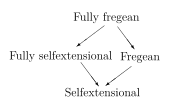

# Algebraic Propositional Logic
**First published Mon Dec 12, 2016; substantive revision Fri May 20, 2022**

*Jansana, Ramon*

George Boole was the first to present logic as a mathematical theory in algebraic style. In his work, and in that of the other algebraists of the algebraic tradition of logic of the nineteenth century, the distinction between a formal language and a mathematically rigorous semantics for it was still not drawn. What the algebraists in this tradition did was to build algebraic theories (of Boolean algebras, and relation algebras) with among other interpretations a logical one.

The works of Frege and Russell introduced a different perspective on the way to approach logic. In those works, a logic system was given by a formal language and a deductive calculus, namely a set of axioms and a set of inference rules. Let us (for this entry) call such a pair a *logical deduction system*, and the formulas derivable in the calculus its *theorems* (nowadays it is common practice in algebraic logic to refer to this type of calculi as Hilbert-style and in proof complexity theory as Frege systems). In Frege and Russell’s approach, a formal (mathematical) semantics of whatever kind (algebraic, model-theoretic, etc.) for the formal languages they used was lacking. The only semantics present was of an intuitive, informal kind.

The systems introduced by Frege and Russell were systems of classical logic, but soon after systems of non-classical logics were considered by other logicians. The first influential attempts to introduce logics different from classical logic remained within the Frege-Russell tradition of presenting a logical deduction system without any formal semantics. These attempts lead to the first modal systems of C.I. Lewis (1918, 1932)[^lewis-1918][^lewis-1932] and to the axiomatization of intuitionistic logic by Heyting (1930)[^heyting-1930].

The idea underlying the design of Frege and Russell’s logical deduction systems is that the theorems should be the formulas that correspond (intuitively) to the logical truths or logical validities. The concept of logical consequence was not central to the development, and this was also the case in the many systems of non-classical logics that were to be designed following in the footsteps of the first modal systems of C.I. Lewis. This situation influenced the way in which the research on some non-classical logics has usually been presented and sometimes also its real evolution. However, the concept of logical consequence has been the one that logic has traditionally dealt with. Tarski put it once again into the center of modern logic, both semantically and syntactically. Nowadays, a general theory of the algebraization of logics around the concept of logical consequence has grown from the different algebraic treatments of the different logics obtained during the last century.

The concept of logical consequence has proved much more fruitful than those of theorem and of logical validity for the development of such a general theory. The first attempts in the process of building the general theory of the algebraization of logics can be found in the study of the class of implicative logics by Rasiowa (1974)[^rasiowa-1974] and in the systematic presentation by Wójcicki (1988)[^wójcicki-1988] of the investigations of a general nature on propositional logics as consequence operations carried out mainly by Polish logicians, following the studies of Tarski, Lindenbaum, Łukasiewicz and others in the first part of the twentieth century.

It was only in the 1920s that algebras and logical matrices (an algebra together with a set of designated elements) started to be taken as models of logical deduction systems, that is, as providing a formal semantics for formal languages of logic. Moreover, they were also used to define sets of formulas with similar properties to the ones the sets of theorems of the known logical deduction systems have, in particular the property of being closed under substitution instances; soon after logical matrices were also used to define logics as consequence relations.

Algebraic logic can be described in very general terms as the discipline that studies logics by associating with them classes of algebras, classes of logical matrices and other algebra related mathematical structures and that relates the properties that the logics may have with properties of the associated algebras (or algebra related structures) with the purpose that the understanding of these algebras can be used to better understand the logic at hand.

From the algebraic study of particular logics, a general theory of the algebraization of logics slowly emerged during the last century with the aim, more or less explicitly stated during the process, of obtaining general and informative results relating the properties a logic may have with the algebraic properties the class of algebras (or algebra related structures) associated with it might enjoy. Those algebraic studies assumed somehow an implicit conception of what is the process by which to associate with any given logic a class of algebras as its natural algebraic counterpart. The development of that general theory speeded up and consolidated at the beginning of the 1980s with the introduction of the notion of algebraizable logic, and at that time also the assumptions about the class of algebras that deserves to be taken as the natural one to associate with a given logic started to be made more and more explicit.

In this entry we concentrate on the general theory of the algebraization of propositional logics taken as consequence relations. This theory has evolved into the field known as Abstract Algebraic Logic (AAL). The entry can be taken as a mild introduction to this field.

## 1. Abstract consequence relations

Tarski’s work (1930a, 1930b, 1935, 1936) on the methodology of the deductive sciences of the 1920s and 1930s studies the axiomatic method abstractly and introduces for the first time the abstract concept of consequence operation. Tarski had mainly in mind the different mathematical axiomatic theories. On these theories, the sentences that are proved from the axioms are consequences of them but (of course) almost all of them are not logical truths; under a suitable formalization of these theories, a logical calculus like Frege’s or Russell’s can be used to derive the consequences of the axioms. Tarski set the framework to study the most general properties of the operation that assigns to a set of axioms its consequences.

Given a logical deduction system $H$ and an arbitrary set of formulas $X$, a formula $a$ is *deducible* in $H$ from $X$ if there is a finite sequence of formulas any one of which belongs to $X$ or is an axiom of $H$ or is obtained from previous formulas in the sequence by one of the inference rules of $H$. Such a sequence is a deduction (or proof) in $H$ of $a$ with premises or hypotheses in $X$. Let $Cn(X)$ be the set of formulas deducible in $H$ from the formulas in $X$ taken as premises or hypothesis. This set is called the set of consequences of $X$ (relative to the logical deduction system $H$). $Cn$ is then an operation that is applied to sets of formulas to obtain new sets of formulas. It has the following properties: For every set of formulas $X$

1. $X \subseteq Cn(X)$
2. $Cn(Cn(X)) = Cn(X)$
3. $Cn(X) = \bigcup\{Cn(Y): Y \subseteq X, Y \textrm{ finite}\}$

The third condition stipulates that $Cn(X)$ is equal to the union of the set of formulas derivable from finite subsets of $X$. Tarski took these properties to define the notion of consequence operation axiomatically. In fact, he added that there is a formula $x$ such that $Cn(\{x\})$ is the set $A$ of all the formulas and that this set must be finite or of the cardinality of the set of the natural numbers. Condition (3) implies the weaker, and important, condition of monotonicity

1. if $X \subseteq Y \subseteq A$, then $Cn(X) \subseteq Cn(Y)$.

To encompass the whole class of logic systems one finds in the literature, a slightly more general definition than Tarski’s is required. We will say that an *abstract consequence operation* $C$ on an arbitrary set $A$ is an operation that applied to subsets of $A$ gives subsets of $A$ and for all $X, Y \subseteq A$ satisfies the conditions (1), (2) and (4) above. If in addition $C$ satisfies (3) we say that it is a *finitary consequence operation*.

Consequence operations are present not only in logic but in many areas of mathematics. Abstract consequence operations are known as closure operators in universal algebra and lattice theory, for instance. In topology the operation that sends a subset of a topological space to its topological closure is a closure operator. In fact, the topologies on a set $A$ can be identified with the closure operators on $A$ that satisfy the additional conditions that $C(\varnothing) = \varnothing$ and $C(X \cup Y) = C(X) \cup C(Y)$ for all $X, Y \subseteq A$.

Given a consequence operation $C$ on a set $A$, a subset $X$ of $A$ is said to be $C$-*closed*, or a *closed* set of $C$, if $C(X) = X$.

A different, but mathematically equivalent, (formal) approach is to consider consequence relations on a set of formulas instead of consequence operations. A(n) (abstract) *consequence relation* on the set of formulas of a formal language is a relation $\vdash$ between sets of formulas and formulas that satisfies the following conditions:

1. if $a \in X$, then $X \vdash a$
2. if $X \vdash a$ and $X \subseteq Y$, then $Y \vdash a$
3. if $X \vdash a$ and for every $b \in X, Y \vdash b$, then $Y \vdash a$.

It is *finitary* if in addition it satisfies

1. if $X \vdash a$, then there is a finite set $Y \subseteq X$ such that $Y \vdash a$.

Given a logical deduction system $H$, the relation $\vdash$ defined by $X \vdash a$ if $a$ is deducible from $X$ in $H$ is (according to all we have already seen) a finitary consequence relation. Nonetheless, we are used not only to syntactic definitions of consequence relations but also to semantic definitions. For example, we define classical propositional consequence using truth valuations, first-order consequence relation using structures, intuitionistic consequence relation using Kripke models, etc. Sometimes these model-theoretic definitions of consequence relations define non-finitary consequence relations, for example, the consequence relations for infinitary formal languages and the consequence relation of second-order logic with the so-called standard semantics.

In general, an *abstract consequence relation* on a set $A$ (not necessarily the set of formulas of some formal language) is a relation $\vdash$ between subsets of $A$ and elements of $A$ that satisfies conditions (1)–(3) above. If it also satisfies (4) it is said to be finitary. If $\vdash$ is an abstract consequence relation and $X \vdash a$, then we can say that $X$ is a set of premises or hypothesis with conclusion $a$ according to $\vdash$ and that $a$ follows from $X$, or is entailed by $X$ (according to $\vdash)$. The abstract consequence relations correspond to Koslow’s implication structures; see Koslow 1992 for the closely related but different approach to logics (in a broad sense) as consequence relations introduced by that author.

The consequence operations on a set $A$ are in one-to-one correspondence with the abstract consequence relations on $A$. The move from a consequence operation $C$ to a consequence relation $\vdash_C$ and, conversely, from a consequence relation $\vdash$ to a consequence operation $C_{\vdash}$ is easy and given by the definitions:

$$ X \vdash_C a \txtiff a \in C(X) \hspace{3mm} \textrm{ and } \hspace{3mm} a \in C_{\vdash}(X) \txtiff X \vdash a. $$

Moreover, if $C$ is finitary, so is $\vdash_C$ and if $\vdash$ is finitary, so is $C_{\vdash}$.

For a general discussion on logical consequence see the entry Logical Consequence.

## 2. Logics as consequence relations

In this section we define what propositional logics are and explain the basic concepts relating to them. We will call the propositional logics (as defined below) simply *logic systems*.

One of the main traits of the consequence relations we study in logic is their formal character. This roughly means that if a sentence $a$ follows from a set of sentences $X$ and we have another sentence $b$ and another set of sentences $Y$ that share the same form with $a$ and $X$ respectively, then $b$ also follows from $Y$. In propositional logics this boils down to saying that if we uniformly replace basic sub-sentences of the sentences in $X \cup \{a\}$ by other sentences obtaining $Y$ and $b$, then $b$ follows from $Y$. (The reader can find more information on the idea of formality in the entry Logical Consequence.)

To turn the idea of the formal character of logics into a rigorous definition we need to introduce the concept of propositional language and the concept of substitution.

A *propositional language* (a language, for short) $L$ is a set of connectives, that is, a set of symbols each one of which has an arity $n$ that tells us in case that $n = 0$ that the symbol is a propositional constant, and in case that $n \gt 0$ whether the connective is unary, binary, ternary, etc. For example $\{\wedge , \vee , \rightarrow , \bot , \top \}$ is (or can be) the language of several logics, like classical and intuitionistic, $(\bot$ and $\top$ are 0-ary and the other connectives are binary), $\{\neg , \wedge , \vee \rightarrow , \Box , \Diamond \}$ is the language of several modal logics, $(\neg , \Box , \Diamond$ are unary and the other connectives binary) and $\{ \wedge , \vee , \rightarrow , * , \top , \bot , 1, 0\}$ is the language of many-valued logics and also of a fragment of linear logic $(\bot , \top , 1$, and 0 are propositional constants and the other symbols binary connectives).

Given a language $L$ and a set of propositional variables $V$ (which is disjoint from $L)$, the *formulas* of $L$, or $L$-*formulas*, are defined inductively as follows:

1. Every variable is a formula.
2. Every 0-ary symbol is a formula.
3. If $*$ is a connective and $n \gt 0$ is its arity, then for all formulas $\phi_1 ,\ldots ,\phi_n, * \phi_1 \ldots \phi_n$ is also a formula.

A *substitution* *σ* for $L$ is a map from the set of variables $V$ to the set of formulas of $L$. It tells us which formula must replace which variable when we perform the substitution. If $p$ is a variable, then $\sigma(p)$ denotes the formula that the substitution *σ* assigns to $p$. The result of applying a substitution *σ* to a formula *φ* is the formula $\bsigma(\phi)$ obtained from *φ* by simultaneously replacing the variables in *φ*, say $p_1 , \ldots ,p_k$, by, respectively, the formulas $\sigma(p_1), \ldots ,\sigma(p_k)$. In this way, a substitution *σ* gives a unique map $\bsigma$ from the set of formulas to itself that satisfies

1. $\bsigma(p) = \sigma(p)$, for every variable $p$,
2. $\bsigma(\dagger) = \dagger$, for every 0-ary connective $\dagger$,
3. $\bsigma(* \phi_1 \ldots \phi_n) = * \bsigma(\phi_1)\ldots \bsigma(\phi_n)$, for every connective $*$ of arity $n \gt 0$ and formulas $\phi_1 , \ldots ,\phi_n$.

A formula *ψ* is a *substitution instance* of a formula *φ* if there is a substitution *σ* such that when applied to *φ* gives *ψ*, that is, if $\bsigma(\phi) = \psi$.

In order to avoid unnecessary complications we will assume in the sequel that all the logics use the same denumerable set $V$ of variables, so that the definition of formula of $L$ depends only on $L$. A *logic system* (or *logic* for short) is given by a language $L$ and a consequence relation $\vdash$ on the set of formulas of $L$ that is *formal* in the sense that for every substitution *σ*, every set of formulas *Γ* and every formula *φ*,

$$ \textrm{if } \Gamma \vdash \phi, \textrm{ then } \bsigma[\Gamma] \vdash\bsigma(\phi) $$

where $\bsigma[\Gamma]$ is the set of the formulas obtained by applying the substitution *σ* to the formulas in *Γ*. The consequence relations on the set of formulas of a language that satisfy this property are called *structural* and also *substitution-invariant* in the literature. They were considered for the first time in Łoś & Suszko 1958. Tarski only explicitly considered closed sets also closed under substitution instances for some consequence relations; he never considered (at least explicitly) the substitution invariance condition for consequence relations.

We will refer to logic systems by the letter $\bL$ with possible subindices, and we set $\bL = \langle L, \vdash_{\bL } \rangle$ and $\bL_n = \langle L_n, \vdash_{\bL_n } \rangle$ with the understanding that $L \; (L_n)$ is the language of $\bL \;(\bL_n)$ and $\vdash_{\bL }\; (\vdash_{\bL_n })$ its consequence relation. A logic system $\bL$ is *finitary* if $\vdash_{\bL}$ is a finitary consequence relation.

The consequence relation of a logic system can be given in several ways, some using proof-theoretic tools, others semantic means. A substitution-invariant consequence relation can be defined using a proof system like a Hilbert-style axiom system, a Gentzen-style sequent calculus or a natural deduction style calculus, etc. One can also define a substitution-invariant consequence relation semantically using a class of mathematical objects (algebras, Kripke models, topological models, etc.) and a satisfaction relation.

If $\bL_1 = \langle L,\vdash_{\bL_1 } \rangle$ is a logic system with $\vdash_{\bL_1}$ defined by a proof-system and $\bL_2 = \langle L, \vdash_{\bL_2 } \rangle$ is a logic system over the same language with $\vdash_{\bL_2}$ defined semantically, we say that the proof-system used to define $\vdash_{\bL_1}$ is *sound* for the semantics used to define $\vdash_{\bL_2}$ if $\vdash_{\bL_1}$ is included in $\vdash_{\bL_2}$, namely if $\Gamma \vdash_{\bL_1 } \phi$ implies $\Gamma \vdash_{\bL_2 } \phi$. If the other inclusion holds the proof-system is said to be *complete* with respect to the semantics that defines $\vdash_{\bL_2}$, that is, when $\Gamma \vdash_{\bL_2 } \phi$ implies $\Gamma \vdash_{\bL_1 } \phi$.

A set of $L$-formulas *Γ* is called a *theory* of a logic system $\bL$, or $\bL$-theory, if it is closed under the relation $\vdash_{\bL}$, that is, if whenever $\Gamma \vdash_{\bL } \phi$ it also holds that $\phi \in \Gamma$. In other words, the theories of $\bL$ are the closed sets of the consequence operation $C_{\vdash_{ \bL}}$ on the set of $L$-formulas. In order to simplify the notation we denote this consequence operation by $C_{\bL}$. A formula *φ* is a *theorem* (or validity) of $\bL$ if $\varnothing \vdash_{\bL } \phi$. Then $C_{\bL }(\varnothing)$ is the set of theorems of $\bL$ and is the least theory of $\bL$. The set of all theories of $\bL$ will be denoted by $\tTH(\bL)$.

Given a logic system $\bL$, the consequence operation $C_{\bL}$ is substitution-invariant, which means that for every set of $L$-formulas *Γ* and every substitution $\sigma, \bsigma[C_{\bL}(\Gamma)] \subseteq C_{\bL}(\bsigma[\Gamma]$). Moreover, for every theory $T$ of $\bL$ we have a new consequence $C_{\bL }^T$ operation defined as follows: $$C_{\bL }^T (\Gamma) = C_{\bL }(T \cup \Gamma)$$ that is, $C_{\bL }^T (\Gamma)$ is the set of formulas that follow from *Γ* and $T$ according to $\bL$. It turns out that $T$ is closed under substitutions if and only if $C_{\bL }^T$ is substitution-invariant.

If $\bL$ is a logic system and $\Gamma , \Delta$ are sets of $L$-formulas, we will use the notation $\Gamma \vdash_{\bL } \Delta$ to state that for every $\psi \in \Delta , \Gamma \vdash_{\bL } \psi$. Thus $\Gamma \vdash_{\bL } \Delta$ if and only if $\Delta \subseteq C_{\bL }(\Gamma)$.

If $\bL = \langle L, \vdash_{\bL } \rangle$ and $\bL' = \langle L', \vdash_{\bL' } \rangle$ are logic systems whose languages satisfy that $L'\subseteq L$ (hence all the $L'$-formulas are $L$-formulas) and $$\Gamma \vdash_{\bL' } \phi \txtiff \Gamma \vdash_{\bL } \phi,$$ for every set of $L'$-formulas *Γ* and every $L'$-formula *φ* we say that $\bL'$ is a *fragment* $\bL$ (in fact, the $\bL'$-fragment) and that $\bL$ is an *expansion* of $\bL'$.

## 3. Some examples of logics

We present some examples of logic systems that we will refer to in the course of this essay, that are assembled here for the reader’s convenience. Whenever possible we refer to the corresponding entries.

We use the standard convention of writing $(\phi * \psi)$ instead of $* \phi \psi$ for binary connectives and omit the external parenthesis in the formulas.

### 3.1 Classical propositional logic

We take the language of Classical propositional logic $\bCPL$ to be the set $L_c = \{\wedge , \vee , \rightarrow , \top , \bot \},$ where $\wedge , \vee , \rightarrow$ are binary connectives and $\top , \bot$ propositional constants. We assume that the consequence relation is defined by the usual truth-table method $(\top$ is interpreted as true and $\bot$ as false) as follows,

$\Gamma \vdash_{\bCPL } \phi\txtiff$ every truth valuation that assigns true to all $\psi \in \Gamma$ assigns true to *φ*.

The formulas *φ* such that $\varnothing \vdash_{\bCPL } \phi$ are the *tautologies*. Note that using the language $L_c$, the negation of a formula *φ* is defined as $\phi \rightarrow \bot$. For more information, see the entry on classical logic.

### 3.2 Intuitionistic propositional logic

We take the language of Intuitionistic propositional logic to be the same as that of classical propositional logic, namely the set $\{\wedge , \vee , \rightarrow , \top , \bot \}$. The consequence relation is defined by the following Hilbert-style calculus.

#### Axioms:

All the formulas of the forms

**C0.**

$\top$

**C1.**

**$\phi \rightarrow(\psi \rightarrow \phi)$**

**C2.**

$\phi \rightarrow(\psi \rightarrow(\phi \wedge \psi))$

**C3.**

$(\phi \wedge \psi) \rightarrow \phi$

**C4.**

$(\phi \wedge \psi) \rightarrow \psi$

**C5.**

$\phi \rightarrow(\phi \vee \psi)$

**C6.**

$\psi \rightarrow(\phi \vee \psi)$

**C7.**

$(\phi \vee \psi) \rightarrow((\phi \rightarrow \delta) \rightarrow((\psi \rightarrow \delta) \rightarrow \delta))$

**C8.**

$(\phi \rightarrow \psi) \rightarrow((\phi \rightarrow(\psi \rightarrow \delta)) \rightarrow(\phi \rightarrow \delta))$

**C9.**

$\bot \rightarrow \phi$

#### Rule of inference

$$\phi , \phi \rightarrow \psi / \psi \tag{Modus Ponens}$$

For more information, see the entry on intuitionistic logic.

### 3.3 Local Normal Modal logics

The language of modal logic we consider here is the set $L_m = \{\wedge , \vee , \rightarrow , \neg , \Box , \top , \bot \}$ that expands $L_c$ by adding the unary connective $\Box$. In the standard literature on modal logic a normal modal logic is defined not as a consequence relation but as a set of formulas with certain properties. A *normal modal logic* is a set $\Lambda$ of formulas of $L_m$ that contains all the tautologies of the language of classical logic, the formulas of the form $$\Box(\phi \rightarrow \psi) \rightarrow(\Box \phi \rightarrow \Box \psi)$$ and is closed under the rules

$$ \begin{align*} \phi , \phi \rightarrow \psi / \psi \tag{Modus Ponens}\\ \phi / \Box \phi \tag{Modal Generalization}\\ \phi/ \bsigma(\phi), \textrm{ for every substitution } \sigma \tag{Substitution}\\ \end{align*} $$

Note that the set $\Lambda$ is closed under substitution instances, namely for every substitution *σ*, if $\phi \in L_m$, then $\bsigma(\phi) \in L_m$.

The least normal modal logic is called $K$ and can be axiomatized by the Hilbert-style calculus with axioms the tautologies of classical logic and the formulas $\Box(\phi \rightarrow \psi) \rightarrow(\Box \phi \rightarrow \Box \psi)$, and with rules of inference Modus Ponens and Modal Generalization. Note that since we use schemas in the presentation of the axioms, the set of derivable formulas is closed under the Substitution rule.

With a normal modal logic $\Lambda$ it is associated the consequence relation defined by the calculus that takes as axioms all the formulas in $\Lambda$ and as the only rule of inference Modus Ponens. The logic system given by this consequence relation is called the *local consequence* of $\Lambda$. We denote it by $\blLambda$. Its theorems are the elements of $\Lambda$ and it holds that

$\Gamma \vdash_{\blLambda} \phi\txtiff\phi \in \Lambda$ or there are $\phi_1 , \ldots ,\phi_n \in \Gamma$ such that $(\phi_1 \wedge \ldots \wedge \phi_n) \rightarrow \phi \in \Lambda$.

### 3.4 Global Normal Modal logics

Another consequence relation is associated naturally with each normal modal logic $\Lambda$, defined by the calculus that has as axioms the formulas of $\Lambda$ and as rules of inference Modus Ponens and Modal Generalization. The logic system given by this consequence relation is called the *global consequence* of $\Lambda$ and will be denoted by $\bgLambda$. It has the same theorems as the local $\blLambda$, namely the elements of $\Lambda$. The difference between $\blLambda$ and $\bgLambda$ lies in the consequences they allow to draw from nonempty sets of premises. For example we have $p \vdash_{\bgK} \Box p$ but $p \not\vdash_{\blK} \Box p$. This difference has an enormous effect on their algebraic behavior.

For more information on modal logic, see the entry on modal logic. The reader can find specific information on modal logics as consequence relations in Kracht 2006.

### 3.5 Intuitionistic Linear Logic without exponentials

We take as the language of Intuitionistic Linear Logic without exponentials the set $\{\wedge , \vee , \rightarrow , * , 0, 1, \top , \bot \}$, where $\wedge , \vee , \rightarrow, *$ are binary connectives and $0, 1,\top , \bot$ propositional constants. We denote the logic by $\bILL$. The axioms and rule of inference below provide a Hilbert-style axiomatization of this logic.

#### Axioms:

**L1.**

1

**L2.**

$(\phi \rightarrow \psi) \rightarrow((\psi \rightarrow \delta) \rightarrow(\phi \rightarrow \delta))$

**L3.**

$(\phi \rightarrow(\psi \rightarrow \delta)) \rightarrow(\psi \rightarrow(\phi \rightarrow \delta))$

**L4.**

$\phi \rightarrow(\psi \rightarrow(\phi * \psi))$

**L5.**

$(\phi \rightarrow(\psi \rightarrow \delta)) \rightarrow((\phi * \psi) \rightarrow \delta)$

**L6.**

$1 \rightarrow(\phi \rightarrow \phi)$

**L7.**

$(\phi \wedge \psi) \rightarrow \phi$

**L8.**

$(\phi \wedge \psi) \rightarrow \psi$

**L9.**

$\psi \rightarrow(\phi \vee \psi)$

**L10.**

$\phi \rightarrow(\phi \vee \psi)$

**L11.**

$((\phi \rightarrow \psi) \wedge(\phi \rightarrow \delta)) \rightarrow(\phi \rightarrow(\psi \wedge \delta))$

**L12.**

$((\phi \rightarrow \delta) \wedge(\psi \rightarrow \delta)) \rightarrow((\phi \vee \psi) \rightarrow \delta)$

**L13.**

$\phi \rightarrow \top$

**L14.**

$\bot \rightarrow \psi$

#### Rules of inference:

$$ \begin{align*} \phi , \phi \rightarrow \psi / \psi \tag{Modus Ponens}\\ \phi , \psi / \phi \wedge \psi \tag{Adjunction}\\ \end{align*} $$

The 0-ary connective 0 is used to define a negation by $\neg \phi := \phi \rightarrow 0$. No specific axiom schema deals with 0.

For more information, see the entry on linear logic.

### 3.6 The system $\bR$ of Relevance Logic

The language we consider is the set $\{\wedge , \vee , \rightarrow , \neg \}$, where $\wedge , \vee , \rightarrow$ are binary connectives and $\neg$ a unary connective. A Hilbert style axiomatization for $\bR$ can be given by the rules of Intuitionistic Linear Logic without exponentials and the axioms L2, L3, L7-L12 of this logic together with the axioms

1. $(\phi \rightarrow(\phi \rightarrow \psi)) \rightarrow(\phi \rightarrow \psi)$
2. $(\phi \rightarrow \neg \psi) \rightarrow(\psi \rightarrow \neg \psi)$
3. $(\phi \wedge(\psi \vee \delta)) \rightarrow((\phi \wedge \psi) \vee \phi \wedge \delta))$
4. $\neg \neg \phi \rightarrow \phi$

For more information, see the entry on relevance logic.

## 4. Algebras

The algebraic study of a particular logic has to provide first of all its formal language with an algebraic semantics using a class of algebras whose properties are exploited to understand which properties the logic has. In this section, we present how the formal languages of propositional logics are given an algebraic interpretation. In the next section, we address the question of what is an algebraic semantics for a logic system.

We start by describing the first two steps involved in the algebraic study of propositional logics. Both are needed in order to endow propositional languages with algebraic interpretations. To expound them we will assume knowledge of first-order logic (see the entries on classical logic and first-order model theory) and we will call *algebraic first-order languages*, or simply *algebraic languages*, the first-order languages with equality and without any relational symbols, so that these languages have only operation symbols (also called function symbols), if any, in the set of their non-logical symbols.

The two steps we are about to expound can be summarized in the slogan:

Propositional formulas are terms.

The *first step* consist in looking at the formulas of any propositional language $L$ as the terms of the algebraic first-order language with $L$ as its set of operation symbols. This means that (i) every connective of $L$ of arity $n$ is taken as an operation symbol of arity $n$ (thus every 0-ary symbol of $L$ is taken as an individual constant) and that (ii) the propositional formulas of $L$ are taken as the terms of this first-order language; in particular the propositional variables are the variables of the first-order language. From this point of view the definition of $L$-formula is exactly the definition of $L$-term. We will refer to the algebraic language with $L$ as its set of operation symbols as the $L$-*algebraic language*.

The *second step* is to interpret the propositional formulas in the same manner in which terms of a first-order language are interpreted in a structure. In this way the concept of $L$-algebra comes into play. On a given set $A$, an $n$-ary connective is interpreted by an $n$-ary function on $A$ (a map that assigns an element of $A$ to every sequence $\langle a_1 , \ldots ,a_n\rangle$ of elements of $A)$. This procedure is a generalization of the truth-table interpretations of the languages of logic systems like classical logic and Łukasiewicz and Post’s finite-valued logics. In those cases, given the set of truth-values at play the function that interprets a connective is given by its truth-table.

A way to introduce algebras is as the models of some algebraic first-order language. We follow an equivalent route and give the definition of algebra using the setting of propositional languages. Let $L$ be a propositional language. An *algebra* $\bA$ of type $L$, or $L$-algebra for short, is a set $A$, called the carrier or the universe of $\bA$, together with a function $* ^{\bA}$ on $A$ of the arity of $*$, for every connective $*$ in $L$ (if $*$ is 0-ary, $* ^{\bA}$ is an element of $A)$. An algebra $\bA$ is *trivial* if its carrier is a one element set.

A *valuation* on an $L$-algebra $\bA$ is a map $v$ from the set of variables into its carrier $A$. Algebras together with valuations are used to interpret in a compositional way the formulas of $L$, assuming that a connective $*$ of $L$ is interpreted in an $L$-algebra $\bA$ by the function $* ^{\bA}$. Let $\bA$ be an algebra of type $L$ and $v$ a valuation on $\bA$. The value of a compound formula $* \phi_1 \ldots \phi_n$ is computed by applying the function $* ^{\bA}$ that interprets $*$ in $\bA$ to the previously computed values $\bv(\phi_1), \ldots,\bv(\phi_n)$ of the formulas $\phi_1,\ldots,\phi_n$. Precisely speaking, the value $\bv(\phi)$ of a formula *φ* is defined inductively as follows:

1. $\bv(p) = v(p)$, for each variable $p$,
2. $\bv(\dagger) = \dagger^{\bA}$, if $\dagger$ is a 0-ary connective
3. $\bv(* \phi_1 \ldots \phi_n) = * ^{\bA }(\bv(\phi_1), \ldots ,\bv(\phi_n))$, if $*$ is a $n$-ary $(n \gt 0)$ connective.

Note that in this way we have obtained a map $\bv$ from the set of $L$-formulas to the carrier of $\bA$. It is important to notice that the value of a formula under a valuation depends only on the propositional variables that actually appear in the formula. Accordingly, if *φ* is a formula, then we use the notation $\phi(p_1 , \ldots ,p_n)$ to indicate that the variables that appear in *φ* are in the list $p_1 , \ldots ,p_n$, and given elements $a_1 , \ldots ,a_n$ of an algebra $\bA$ we refer by $\phi^{\bA }[a_1 , \ldots ,a_n]$ to the value of $\phi(p_1 , \ldots ,p_n)$ under any valuation $v$ on $\bA$ such that $v(p_1) = a_1 , \ldots ,v(p_n) = a_n$.

A *third* and fundamental *step* in the algebraic study of logics is to turn the set of formulas of a language $L$ into an algebra, the *algebra of formulas* of $L$, denoted by $\bFm_L$. This algebra has the set of $L$-formulas as carrier and the operations are defined as follows. For every $n$-ary connective $*$ with $n \gt 0$, the function $* ^{\bFm_L}$ is the map that sends each tuple of formulas $(\phi_1 , \ldots ,\phi_n)$ (where $n$ is the arity of $*$) to the formula $* \phi_1 \ldots \phi_n$, and for every 0-ary connective $\dagger , \dagger^{\bFm_L}$ is $\dagger$. If no confusion is likely we suppress the subindex in $\bFm_L$ and write $\bFm$ instead.

### 4.1 Some concepts of universal algebra and model theory

Algebras are a particular type of structure or model. An $L$-algebra is a structure or model for the $L$-algebraic first-order language. Therefore the concepts of model theory for the first-order languages apply to them (see the entries on classical logic and first-order model theory). We need some of these concepts. They are also used in universal algebra, a field that to some extent can be considered the model theory of the algebraic languages. We introduce the definitions of the concepts we need.

Given an algebra $\bA$ of type $L$, a *congruence* of $\bA$ is an equivalence relation *θ* on the carrier of $\bA$ that satisfies for every $n$-ary connective $* \in L$ the following compatibility property: for every $a_1 , \ldots ,a_n, b_1 , \ldots ,b_n \in A$,

$$ \textrm{if } a_1\theta b_1 , \ldots ,a_n \theta b_1, \textrm{ then } *^{\bA}(a_1 ,\ldots ,a_n)\ \theta *^{\bA}(b_1 ,\ldots ,b_n). $$

Given a congruence *θ* of $\bA$ we can reduce the algebra by identifying the elements which are related by *θ*. The algebra obtained is the *quotient algebra* of $\bA$ modulo *θ*. It is denoted by $\bA/\theta$, its carrier is the set $A/\theta$ of equivalence classes $[a]$ of the elements $a$ of $A$ modulo the equivalence relation *θ*, and the operations are defined as follows:

1. $\dagger^{\bA/\theta} = [\dagger^{\bA}]$, for every 0-ary connective $\dagger$,
2. $* ^{\bA/\theta}([a_1], \ldots, [a_n]) = [* ^{\bA }(a_1 ,\ldots ,a_n)]$, for every connective $*$ whose arity is $n$ and $n \gt 0$.

The compatibility property ensures that the definition is sound.

Let $\bA$ and $\bB$ be $L$-algebras. A *homomorphism* $h$ from $\bA$ to $\bB$ is a map $h$ from $A$ to $B$ such that for every 0-ary symbol $\dagger \in L$ and every $n$-ary connective $* \in L$

1. $h(\dagger^{\bA }) = \dagger^{\bB}$
2. $h(* ^{\bA }(a_1 ,\ldots ,a_n)) = * ^{\bB }(h(b_1),\ldots ,h(b_n))$, for all $a_1 , \ldots ,a_n \in A$.

We say that $\bB$ is a *homomorphic image* of $\bA$ if there is a homomorphism from $\bA$ to $\bB$ which is an onto map from $A$ to $B$. An homomorphism from $\bA$ to $\bB$ is an *isomorphism* if it is a one-to-one and onto map from $A$ to $B$. If an isomorphism from $\bA$ to $\bB$ exists, we say that $\bA$ and $\bB$ are *isomorphic* and that $\bB$ is an *isomorphic image* (or a copy) of $\bA$.

Let $\bA$ and $\bB$ be $L$-algebras. $\bA$ is a *subalgebra* of $\bB$ if (1) $A \subseteq B$, (2) the interpretations of the 0-ary symbols of $L$ in $\bB$ belong to $A$ and $A$ is closed under the functions of $\bB$ that interpret the non 0-ary symbols, and (3) the interpretations of the 0-ary symbols in $\bA$ coincide with their interpretations in $\bB$ and the interpretations on $\bA$ of the other symbols in $L$ are the restrictions to $\bA$ of their interpretations in $\bB$.

We refer the reader to the entry on first-order model theory for the notions of direct product (called product there) and ultraproduct.

### 4.2 Varieties and quasivarieties

The majority of classes of algebras that provide semantics for propositional logics are quasivarieties and in most cases varieties. The theory of varieties and quasivarieties is one of the main subjects of universal algebra.

An equational class of $L$-algebras is a class of $L$-algebras that is definable in a very simple way (by equations) using the $L$-algebraic language. An $L$-*equation* is a formula $\phi \approx \psi$ where *φ* and *ψ* are terms of the $L$-algebraic language (that is, $L$-formulas if we take the propositional logic's point of view) and '$\approx$' is the formal symbol for the equality (always to be interpreted as the identity relation). An equation $\phi \approx \psi$ is *valid* in an algebra $\bA$, or $\bA$ is a *model* of $\phi \approx \psi$, if for every valuation $v$ on $\bA, \bv(\phi) = \bv(\psi)$. This is exactly the same as to saying that the universal closure of $\phi \approx \psi$ is a sentence true in $\bA$ according to the usual semantics for first-order logic with equality. An *equational class* of $L$-algebras is a class of $L$-algebras which is the class of all the models of a given set of $L$-equations.

A quasi-equational class of $L$-algebras is a class of $L$-algebras definable using the $L$-algebraic language in a slightly more complex way than in equational.classes. A *proper $L$-quasiequation* is a formula of the form $$\bigwedge_{i \le n} \phi_i \approx \psi_i \rightarrow \phi \approx \psi.$$ An $L$-*quasiequation* is a formula of the above form but possibly with an empty antecedent, in which case it is just the equation $\phi \approx \psi$. Hence, the $L$-quasiequations are the proper $L$-quasiequations and the $L$-equations. An $L$-quasiequation is *valid* in an $L$-algebra $\bA$, or the algebra is a model of it, if the universal closure of the quasiequation is sentence true in $\bA$. A *quasi-equational class* of $L$-algebras is a class of algebras that is the class of the models of a given set of $L$-quasiequations. Since equations are quasiequations, every equational class is quasi-equational. The converse is false. Moreover, since in the trivial algebras all the equations and all the quasiequations of the appropriate algebraic language are valid, equational and quasi-equational classes are nonempty.

Equational and quasi-equational classes of algebras can be characterized by the closure properties they enjoy. A nonempty class of $L$-algebras is a *variety* if it is closed under subalgebras, direct products, and homomorphic images. It is a *quasivariety* if it is closed under subalgebras, direct products, ultraproducts, isomorphic images, and contains a trivial algebra. It is easily seen that equational classes are varieties and that quasi-equational classes are quasiviarities. Birkhoff's theorem states that all varieties are equational classes and Malcev's theorem that all quasivarieties are quasi-equational classes.

The variety generated by a nonempty class $\bK$ of $L$-algebras is the least class of $L$-algebras that includes $\bK$ and is closed under subalgebras, direct products and homomorphic images. It is also the class of the algebras that are models of the equations valid in $\bK$. For example, the variety generated by the algebra of the two truth-values for classical logic is the class of Boolean algebras. If we restrict that algebra to the operations for conjunction and disjunction only, it generates the variety of distributive lattices and if we restrict it to the operations for conjunction and disjunction and the interpretations of $\top$ and $\bot$, it generates the variety of bounded distributive lattices.

The quasivariety generated by a class $\bK$ of $L$-algebras is the least class of $L$-algebras that includes $\bK$, the trivial algebras and is closed under subalgebras, direct products, ultraproducts, and isomorphic images.

An SP-*class* of $L$-algebras is a class of $L$-algebras that contains a trivial algebra and is closed under isomorphic images, subalgebras, and direct products. Thus quasivarieties and varieties are all SP-classes. The SP-class generated by a class $\bK$ of $L$-algebras is the least class of $L$-algebras that includes $\bK$, the trivial algebras and is closed under subalgebras, direct products and isomorphic images.

## 5. Algebraic semantics

The term ‘algebraic semantics’ was (and many times still is) used in the literature in a loose way. To provide a logic with an algebraic semantics was to interpret its language in a class of algebras, define a notion of satisfaction of a formula (under a valuation) in an algebra of the class and prove a soundness and completeness theorem, usually for the theorems of the logic only. Nowadays there is a precise concept of algebraic semantics for a logic system. It was introduced by Blok and Pigozzi in Blok & Pigozzi 1989. In this concept we find a general way to state in mathematically precise terms what is common to the many cases of purported algebraic semantics for specific logic systems found in the literature. We expose the notion in this section. To motivate the definition we discuss several examples first, stressing the relevant properties that they share. The reader does not need to know about the classes of algebras that provide algebraic semantics we refer to in the examples. Its existence is what is important.

The prototypical examples of algebraic semantics for propositional logics are the class **BA** of Boolean algebras, which is the algebraic semantics for classical logic, and the class **HA** of Heyting algebras, which is the algebraic semantics for intuitionistic logic. Every Boolean algebra and every Heyting algebra $\bA$ has a greatest element according to their natural order; this element is denoted usually by $1^{\bA}$ and interprets the propositional constant symbol $\top$. It is taken as the distinguished element relative to which the algebraic semantics is given. The algebraic semantics of these two logics works as follows:

Let $\bL$ be classical or intuitionistic logic and let $\bK(\bL)$ be the corresponding class of algebras **BA** or **HA**. It holds that

$\Gamma \vdash_{\bL } \phi \txtiff$ for every $\bA \in \bK(\bL)$ and every valuation $v$ on $\bA$, if $\bv(\psi) = 1^{\bA}$ for all $\psi \in \Gamma $, then $\bv(\phi) = 1^{\bA}$.

This is the precise content of the statement that **BA** and **HA** are an algebraic semantics for classical logic and for intuitionistic logic, respectively. The implication from left to right in the expression above is an algebraic soundness theorem and the implication from right to left an algebraic completeness theorem.

There are logics for which an algebraic semantics is provided in the literature in a slightly different way from the one given by the schema above. Let us consider the example in Section 3.5 of Intuitionistic Linear Logic without exponentials. We denote by $\bILsubZ$ the class of IL-algebras with zero defined in Troelstra 1992 (but adapted to the language of $\bILL)$. Each $\bA \in \bILsubZ$ is a lattice with extra operations and thus has its lattice order $\le^{\bA}$. This lattice order has a greatest element which we take as the interpretation of $\top$. On each one of these algebras $\bA$ there is a designated element $1^{\bA}$ (the interpretation of the constant 1) that may be different from the greatest element. It holds:

$\Gamma \vdash_{\bILL } \phi \txtiff$ for every $\bA \in \bILsubZ$ and every valuation $v$ on $\bA$, if $1^{\bA } \le^{\bA } \bv(\psi)$ for all $\psi \in \Gamma $, then $1^{\bA } \le^{\bA } \bv(\phi)$.

In this case one does not consider only a designated element in every algebra $\bA$ but a set of designated elements, namely the elements of $\bA$ greater than or equal to $1^{\bA}$, to provide the definition. Let us denote this set by $\tD (\bA)$, and notice that $\tD (\bA) = \{a \in A: 1^{\bA } \wedge^{\bA} a = 1^{\bA }\}$. Hence,

$\Gamma \vdash_{\bILL } \phi \txtiff$ for every $\bA \in \bILsubZ$ if $\bv[\Gamma] \subseteq \tD (\bA)$, then $\bv(\phi) \in \tD (\bA)$.

Still there are even more complex situations. One of them is the system $\bR$ of relevance logic. Consider the class of algebras $\bRal$ defined in Font & Rodríguez 1990 (see also Font & Rodríguez 1994)[^font-1994] and denoted there by ‘$\bR$’. Let us consider for every $\bA \in \bRal$ the set $$\tE(\bA) := \{a \in A: a \wedge^{\bA }(a \rightarrow^{\bA } a) = a \rightarrow^{\bA } a\}.$$ Then $\bRal$ is said to be an algebraic semantics for $\bR$ because the following holds:

$\Gamma \vdash_{\bR } \phi\txtiff$ for every $\bA \in \bRal$ and every valuation $v$ on $\bA$, if $\bv[\Gamma] \subseteq \tE (\bA)$, then $\bv(\phi) \in \tE (\bA)$.

The common pattern in the examples above is that the algebraic semantics is given by

1. a class of algebras $\bK$,
2. in each algebra in $\bK$ a set of designated elements that plays the role $1^{\bA}$ (more precisely the set $\{1^{\bA }\})$ plays in the cases of classical and intuitionistic logic, and
3. this set of designated elements is definable (in the same manner on every algebra) by an equation in the sense that it is the set of elements of the algebra that satisfy the equation (i.e., its solutions). For **BA** and **HA** the equation is $p \approx \top$. For $\bRal$ it is $p \rightarrow(p \wedge p) \approx p \rightarrow p$, and for $\bILsubZ$ it is $1 \wedge p \approx 1$.

The main point in Blok and Pigozzi’s concept of algebraic semantics comes from the realization, mentioned in (3) above, that the set of designated elements considered in the algebraic semantics of known logics is in fact the set of solutions of an equation, and that what practice forced researchers to look for when they tried to obtain algebraic semantics for new logics was in fact, although not explicitly formulated in these terms, an equational way to define uniformly in every algebra a set of designated elements in order to obtain an algebraic soundness and completeness theorem.

We are now in a position to expose the mathematically precise concept of algebraic semantics. To develop a fruitful and general theory of the algebraization of logics some generalizations beyond the well-known concrete examples have to be made. In the definition of algebraic semantics, one takes the move from a single equation to a set of them in the definability condition for the set of designated elements.

Before stating Blok and Pigozzi’s definition we need to introduce a notational convention. Given an algebra $\bA$ and a set of equations $\iEq$ in one variable, we denote by $\tEq(\bA)$ the set of elements of $\bA$ that satisfy all the equations in $\iEq$. Then a logic $\bL$ is said to have an *algebraic semantics* if there is a class of algebras $\bK$ and a set of equations $\iEq$ in one variable such that

(\*\*)

$ \Gamma \vdash_{\bL } \phi \txtiff$ for every $\bA \in \bK$ and every valuation $v$ on $\bA$, if $\bv[\Gamma] \subseteq \iEq(\bA)$, then $\bv(\phi) \in \tEq(\bA)$.

In this situation we say that the class of algebras $\bK$ is an $\iEq$-*algebraic semantics* for $\bL$, or that the pair $(\bK, \iEq)$ is an *algebraic semantics* for $\bL$. If $\iEq$ consists of a single equation $\delta(p) \approx \varepsilon(p)$ we will simply say that $\bK$ is a $\delta(p) \approx \varepsilon(p)$-algebraic semantics for $\bL$. In fact, Blok and Pigozzi required that $\iEq$ should be finite in their definition of algebraic semantics. But it is better to be more general. The definition clearly encompasses the situations encountered in the examples.

If $\bK$ is an $\iEq$-algebraic semantics for a finitary logic $\bL$ and $\iEq$ is finite, then the quasivariety generated by $\bK$ is also an $\iEq$-algebraic semantics. The same does not hold in general if we consider the generated variety. For this reason, it is customary and useful when developing the theory of the algebraization of finitary logics to consider quasivarieties of algebras as algebraic semantics instead of arbitrary subclasses that generate them. Conversely, if a quasivariety is an $\iEq$-algebraic semantics for a finitary $\bL$ and $\iEq$ is finite, then so is any subclass of the quasivariety that generates it.

In the best-behaved cases, the typical algebraic semantics of a logic is a variety, for instance in all the examples discussed above. But there are cases in which it is not (see Blok & Pigozzi 1989)[^blok-1989].

A quasivariety can be an $\iEq$-algebraic semantics for a logic and an $\iEq'$-algebraic semantics for another logic (with $\iEq$ and $\iEq'$ different). For example, due to Glivenko’s theorem (see the entry on intuitionistic logic) the class of Heyting algebras is a $\{\neg \neg p \approx 1\}$-algebraic semantics for classical logic and it is the standard $\{p \approx 1\}$-algebraic semantics for intuitionistic logic. Moreover, different quasivarieties of algebras can be an $\iEq$-algebraic semantics for the same logic. It is known that there is a quasivariety that properly includes the variety of Boolean algebras that is also a $\{p \approx 1\}$-algebraic semantics for classical propositional logic. It is also known that for some logics with an algebraic semantics (relative to some set of equations), the natural class of algebras that corresponds to the logic is not an algebraic semantics (for any set of equations) of it. One example where this situation holds is in the local normal modal logic $\blK$. Finally, there are logics that do not have any algebraic semantics.

These facts highlight the need for some criteria of the goodness of a pair $(\bK, \iEq)$ to provide a natural algebraic semantics for a logic $\bL$ when some exists. One such criterion would be that $\bL$ is an algebraizable logic with $(\bK, \iEq)$ as an algebraic semantics. Another that $\bK$ is the natural class of algebras associated with the logic $\bL$. The notion of the natural class of algebras of a logic system will be discussed in Section 8 and the concept of algebraizable logic in Section 9.

The interested reader can examine Blok & Rebagliato 2003 for a study devoted to algebraic semantics of logics and Moraschini forthcoming for the most recent results on the topic (in this paper there is a proof of the fact that the natural class of algebras of the local normal modal logic $\blK$, namely the class of modal algebras, is not an algebraic semantics (for any set of equations) for it).

There is a particular, and important, kind of logics with an algebraic semantics that includes classical and intuitionistic logics. It is the class of the so-called assertional logics.

Let $\bK$ be a class of algebras in an algebraic language with a constant term for $\bK$, i.e., a formula $\phi(p_1 , \ldots ,p_n)$ such that for every algebra $\bA\in \bK$ and elements $a_1 , \ldots ,a_n, b_1, \ldots, b_n$ of $\bA$, $\phi^{\bA }[a_1 , \ldots ,a_n] = \phi^{\bA }[b_1 , \ldots ,b_n]$, that is, in every algebra in $\bK$, *φ* takes the same value whatever is the way we interpret the variable in *φ* on $\bA$. We denote this value by $\phi^{\bA}$. Thus *φ* acts as a constant (relative to the algebras in $\bK$) and $\phi^{\bA}$ (for $\bA\in \bK$) can be taken as a designated element.

Given a class of algebras $\bK$ in an algebraic language with a constant term *φ* for $\bK$, the *assertional logic* $\bL_{\bK}^{\phi}$ *of* ($\bK, \phi$) is defined by

$\Gamma \vdash_{\bL_{\bK}^{\phi} } \phi \txtiff$ for every $\bA \in \bK(\bL)$ and every valuation v on $\bA$, if $\bv(\psi) = \phi^{\bA}$ for all $\psi \in \Gamma $, then $\bv(\phi) = \phi^{\bA}$.

A logic system $\bL$ is *assertional* when there exists a class of algebras $\bK$ in the algebraic language of $\bL$ and a constant term *φ* for $\bK$ such that $\bL$ = $\bL_{\bK}^{\phi}$.

The most recent study of assertional logics is Albuquerque et al. 2018. We address the reader to this paper where the classification of the assertional logics in the Leibniz and Frege hierarchies of logic systems that we present in later sections is addressed and several examples are discussed.

## 6. Logical matrices

In the last section, we saw that to provide a logic with an algebraic semantics we need in many cases to consider in every algebra a set of designated elements instead of a single designated one. In the examples we discussed, the set of designated elements was definable in the algebras by one equation. This motivated the definition of algebraic semantics in Section 5. For many logics, to obtain a semantics similar to an algebraic semantics using the class of algebras naturally associated with them one needs for every algebra a set of designated elements that cannot be defined using only the equations of the algebraic language or is not even definable by using this language only. As we already mentioned, one example where this happens is the local consequence of the normal modal logic $K$. Also, recall that there are logics with no algebraic semantics at all.

To endow *every* logic with a semantics of an algebraic kind one has to consider, at least, algebras together with a set of designated elements, without any requirement about its definability using the corresponding algebraic language. These pairs are the logical matrices. Tarski defined the general concept of logical matrix in the 1920s but the concept was already implicit in previous work by Łukasiewicz, Bernays, Post and others, who used truth-tables, either in independence proofs or to define logics different from classical logic. A *logical matrix* is a pair $\langle \bA, D \rangle$ where $\bA$ is an algebra and $D$ a subset of the universe $A$ of $\bA$; the elements of $D$ are called the *designated elements* of the matrix and accordingly $D$ is called *the set of designated elements* (and some authors call it the *truth set* of the matrix). Logical matrices were first used as models of the theorems of specific logic systems, for instance in the work of McKinsey and Tarski, and also to define sets of formulas with similar properties to those of the set of theorems of a logic system, namely closure under substitution instances. This was the case of the $n$-valued logics of Łukasiewicz and of his infinite-valued logic. And it was Tarski who first considered logical matrices as a general tool to define this kind of sets.

The general theory of logical matrices explained in this entry is due mainly to Polish logicians, starting with Łoś 1949 and continuing in Łoś & Suszko 1958, building on previous work by Lindenbaum. In Łoś and Suszko’s paper matrices are used for the first time both as models of logic systems (in our sense) and to define systems of these kind.

In the rest of the section, we present the relevant concepts of the theory of logical matrices using modern terminology.

Given a logic $\bL$, a logical matrix $\langle \bA, D \rangle$ is said to be a *model* of $\bL$ if wherever $\Gamma \vdash_{\bL } \phi$, then every valuation $v$ on $\bA$ that maps the elements of *Γ* to some designated value (i.e., an element of $D)$ also maps *φ* to a designated value. When $\langle \bA, D \rangle$ is a model of $\bL$ it is said that $D$ is an $\bL$-*filter* of the algebra $\bA$. The set of $\bL$-filters of an algebra $\bA$ plays a crucial role in the theory of the algebraization of logic systems. We will come to this point later.

A class $\bM$ of logical matrices is said to be a *matrix semantics* for a logic $\bL$ if

(\*)

$ \Gamma \vdash_{\bL } \phi\txtiff$ for every $\langle \bA, \tD \rangle \in \bM$ and every valuation $v$ on $\bA$, if $\bv[\Gamma] \subseteq D$, then $\bv(\phi) \in D$.

The implication from left to right says that $\bL$ is sound relative to $\bM$, and the other implication says that it is complete. In other words, $\bM$ is a matrix semantics for $\bL$ if and only if every matrix in $\bM$ is a model of $\bL$ and moreover for every *Γ* and *φ* such that $\Gamma \not\vdash_{\bL } \phi$ there is a model $\langle \bA, \tD \rangle$ of $\bL$ in $\bM$ that witnesses the fact, namely there is a valuation on the model that sends the formulas in *Γ* to designated elements and *φ* to a non-designated one.

Logical matrices are also used to define logics semantically. If $\cM = \langle \bA, D \rangle$ is a logical matrix, the relation defined by

$\Gamma \vdash_{\cM } \phi\txtiff$ for every valuation $v$ on $\bA$ if $\bv(\psi) \in D$ for all $\psi \in \Gamma$, then $\bv(\phi) \in D$

is a consequence relation which is substitution-invariant; therefore $\langle L, \vdash_{\cM } \rangle$ is a logic system. Similarly, we can define the logic of a class of matrices $\bM$ by taking condition (\*) as a definition of a consequence relation. In the entry on many-valued logic the reader can find several logics defined in this way.

Every logic (independently of how it is defined) has a matrix semantics. Moreover, every logic has a matrix semantics whose elements have the property of being reduced in the following sense: A matrix $\langle \bA, D \rangle$ is *reduced* if there are no two different elements of $A$ that behave in the same way. We say that $a, b \in A$ *behave in the same way* in $\langle \bA, D \rangle$ if for every formula $\phi (q, p_1 , \ldots ,p_n)$ and all elements $d_1 , \ldots ,d_n \in A$ $$\phi^{\bA }[a, d_1 , \ldots ,d_n] \in D \txtiff \phi^{\bA }[b, d_1 , \ldots ,d_n] \in D.$$ Thus $a, b \in A$ behave differently if there is a formula $\phi(q, p_1 , \ldots ,p_n)$ and elements $d_1 , \ldots ,d_n \in A$ such that one of $\phi^{\bA }[a, d_1 , \ldots ,d_n]$ and $\phi^{\bA }[b, d_1 , \ldots ,d_n]$ belongs to $D$ but not both. The relation of behaving in the same way in $\langle \bA, D \rangle$ is a congruence relation of $\bA$. This relation is known after Blok & Pigozzi 1986, 1989 as the *Leibniz congruence* of the matrix $\langle \bA, D \rangle$ and is denoted by $\bOmega_{\bA }(D)$. It can be characterized as the greatest congruence relation of $\bA$ that is *compatible* with $D$, that is, that does not relate elements in $D$ with elements not in $D$. The concept of Leibniz congruence plays a fundamental role in the general theory of the algebraization of the logic systems developed during the 1980s by Blok and Pigozzi. The reader is referred to Font, Jansana, & Pigozzi 2003 and Czelakowski 2001 for extensive information on the developments around the concept of Leibniz congruence during this period.

Every matrix $\cM$ can be turned into a reduced matrix by identifying the elements related by its Leibniz congruence. This matrix is called the *reduction* of $\cM$ and is usually denoted by $\cM^*$. A matrix and its reduction are models of the same logic systems, and since reduced matrices have no redundant elements, the classes of reduced matrices that are matrix semantics for logic systems are usually taken as the classes of matrices that deserve study; they are better suited to encoding in algebraic-like terms the properties of the logics that have them as their matrix semantics.

The proof that every logic system has a reduced matrix semantics (i.e., a matrix semantics consisting of reduced matrices) is as follows. Let $\bL$ be a logic system. Consider the matrices $\langle \bFm_L, T \rangle$ over the formula algebra, where $T$ is a theory of $\bL$. These matrices are known as the *Lindenbaum matrices* of $\bL$. It is not difficult to see that the class of those matrices is a matrix semantics for $\bL$. Since a matrix and its reduction are models of the same logics, the reductions of the Lindenbaum matrices of $\bL$ constitute a matrix semantics for $\bL$ too, and indeed a reduced one. Moreover, any class of reduced matrix models of $\bL$ that includes the reduced Lindenbaum matrices of $\bL$ is automatically a complete matrix semantics for $\bL$. In particular, the class of all reduced matrix models of $\bL$ is a complete matrix semantics for $\bL$. We denote this class by $\bRMatr(\bL)$.

The above proof can be seen as a generalization of the Lindenbaum-Tarski method for proving algebraic completeness theorems that we will discuss in the next section.

The class of the algebras of the matrices in $\bRMatr(\bL)$ plays a prominent role in the theory of the algebraization of logics and it is denoted by $\bAlg^*\bL$. It has been considered for a long time the natural class of algebras that has to be associated with a given logic $\bL$ as its algebraic counterpart. For instance, in the examples considered above the classes of algebras that were given as algebraic semantics of the different logics (Boolean algebras, Heyting algebras, etc.) are exactly the class $\bAlg^*\bL$ of the corresponding logic $\bL$. And in fact, the class $\bAlg^*\bL$ coincides with what was taken to be the natural class of algebras for all the logics $\bL$ studied up to the 1990s. In the 1990s, due to the knowledge acquired of several logics not studied before, some authors proposed another way to define the class of algebras that has to be counted as the algebraic counterpart to be associated with a given logic $\bL$. For many logics $\bL$, it leads exactly to the class $\bAlg^*\bL$ but for others it gives a class that extends it properly. We will discuss it in Section 8.

## 7. The Lindenbaum-Tarski method for proving algebraic completeness theorems

We now discuss the method that is most commonly used to prove that a class of algebras $\bK$ is a $\delta(p) \approx \varepsilon(p)$-algebraic semantics for a logic $\bL$, namely the Lindenbaum-Tarski method. It is the standard method used to prove that the classes of algebras of the examples mentioned in Section 5 are algebraic semantics for the corresponding logics.

The Lindenbaum-Tarski method contributed in two respects to the elaboration of important notions in the theory of the algebraization of logics. It underlies Blok and Pigozzi’s notion of algebraizable logic and reflecting on it some ways to define for each logic a class of algebras can be justified as providing a natural class. We will consider this issue in Section 8.

The Lindenbaum-Tarski method can be outlined as follows. To prove that a class of algebras $\bK$ is a $\delta(p) \approx \varepsilon(p)$-algebraic semantics for a logic $\bL$ first it is shown that $\bK$ gives a sound $\delta(p) \approx \varepsilon(p)$-semantics for $\bL$, namely that if $\Gamma \vdash_{\bL } \phi$, then for every $\bA \in \bK$ and every valuation $v$ in $\bA$ if the values of the formulas in *Γ* satisfy $\delta(p) \approx \varepsilon(p)$, then the value of *φ* does too. Secondly, the other direction, that is, the completeness part, is proved by what is properly known as the Lindenbaum-Tarski method. This method uses the theories of $\bL$ to obtain matrices on the algebra of formulas and then reduces these matrices in order to get for each one a matrix whose algebra is in $\bK$ and whose set of designated elements is the set of elements of the algebra that satisfy $\delta(p) \approx \varepsilon(p)$. We proceed to describe the method step by step.

Let $\bL$ be one of the logics discussed in the examples in Section 5. Let $\bK$ be the corresponding class of algebras we considered there and let $\delta(p) \approx \varepsilon(p)$ be the equation in one variable involved in the soundness and completeness theorem. To prove the completeness theorem one proceeds as follows. Given any set of formulas *Γ*:

1. The theory $C_{\bL }(\Gamma) = \{\phi : \Gamma \vdash_{\bL } \phi \}$ of *Γ*, which we denote by $T$, is considered and the binary relation $\theta(T)$ on the set of formulas is defined using the formula $p \leftrightarrow q$ as follows: $$\langle \phi , \psi \rangle \in \theta(T) \txtiff \phi \leftrightarrow \psi \in T.$$
2. It is shown that $\theta(T)$ is a congruence relation on $\bFm_L$. The set $[\phi]$ of the formulas related to the formula *φ* by $\theta(T)$ is called the equivalence class of *φ*.
3. A new matrix $\langle \bFm/\theta(T), T/\theta(T) \rangle$ is obtained by identifying the formulas related by $\theta(T)$, that is, $\bFm/\theta(T)$ is the quotient algebra of $\bFm$ modulo $\theta(T)$ and $T/\theta(T)$ is the set of equivalence classes of the elements of $T$. Recall that the algebraic operations of the quotient algebra are defined by: $$* ^{\bFm/\theta(T) }([\phi_1],\ldots ,[\phi_n]) = [* \phi_1 \ldots \phi_n ] \;\;\; \text{and} \;\;\; \dagger^{\bFm/\theta(T) } = [\dagger]$$
4. It is shown that $\theta(T)$ is a relation compatible with $T$, i.e., that if $\langle \phi , \psi \rangle \in \theta(T)$ and $\phi \in T$, then $\psi \in T$. This implies that $$\phi \in T \txtiff [\phi] \subseteq T \txtiff [\phi] \in T/\theta(T).$$
5. It is proved that the matrix $\langle \bFm/\theta(T), T/\theta(T) \rangle$ is reduced, that $\bFm/\theta(T)$ belongs to $\bK$ and that $T/\theta(T)$ is the set of elements of $\bFm/\theta(T)$ that satisfy the equation $\delta(p) \approx \varepsilon(p)$ in $\bFm/\theta(T)$.

The proof of the completeness theorem then proceeds as follows. (4) and (5) imply that for every formula $\psi , \Gamma \vdash_{\bL } \psi$ if and only if $[\psi]$ satisfies the equation $\delta(p) \approx \varepsilon(p)$ in the algebra $\bFm/\theta(T)$. Thus, considering the valuation $id$ mapping every variable $p$ to its equivalence class $[p]$, whose extension $\boldsymbol{id}$ to the set of all formulas is such that $\boldsymbol{id}(\phi) = [\phi]$ for every formula *φ*, we have for every formula *ψ*,

$\Gamma \vdash_{\bL } \psi \txtiff\boldsymbol{id}(\psi)$ satisfies the equation $\delta(p) \approx \varepsilon(p)$ in $\bFm/\theta(T)$.

Hence, since by (5), $\bFm/\theta(T) \in \bK$, it follows that if $\Gamma \not\vdash_{\bL }\phi$, then there is an algebra $\bA \in \bK$ (namely $\bFm/\theta(T))$ and a valuation $v$ (namely $id)$ such that the elements of $\bv[\Gamma]$ satisfy the equation on $\bA$ but $\bv(\phi)$ does not.

The Lindenbaum-Tarski method, when successful, shows that the class of algebras $\{\bFm/\theta(T): T$ is a theory of $\bL\}$ is a $\delta(p) \approx \varepsilon(p)$-algebraic semantics for $\bL$. Therefore it also shows that every class of algebras $\bK$ which is $\delta(p) \approx \varepsilon(p)$-sound for $\bL$ and includes the set $\{\bFm/\theta(T): T$ is a theory of $\bL\}$ is also a $\delta(p) \approx \varepsilon(p)$-algebraic semantics for $\bL$.

Let us make some remarks on the Lindenbaum-Tarski method just described. The first is important for the generalizations leading to the classes of algebras associated with a logic. The others, to obtain the conditions in the definition of the concept of algebraizable logic.

1. Conditions (4) and (5) imply that $\theta(T)$ is in fact the Leibniz congruence of $\langle \bFm_L, T \rangle$.
2. When the Lindenbaum-Tarski method succeeds, it usually holds that in every algebra $\bA \in \bK$, the relation defined by the equation $$\delta(p \leftrightarrow q) \approx \varepsilon(p \leftrightarrow q),$$ which is the result of replacing in $\delta(p) \approx \varepsilon(p)$ the letter $p$ by the formula $p \leftrightarrow q$ that defines the congruence relation of a theory, is the identity relation on $A$.
3. For every formula *φ*, the formulas $\delta(p/\phi) \leftrightarrow \varepsilon(p/\phi)$ and *φ* are interderivable in $\bL$ (i.e., $\phi \vdash_{\bL } \delta(p/\phi) \leftrightarrow \varepsilon(p/\phi)$ and $\delta(p/\phi) \leftrightarrow \varepsilon(p/\phi) \vdash_{\bL } \phi)$.

The concept of algebraizable logic introduced by Blok and Pigozzi, which we will discuss in Section 9, can be described roughly by saying that a logic $\bL$ is algebraizable if it has an algebraic semantics $(\bK, \iEq)$ such that (1) $\bK$ is included in the natural class of algebras $\bAlg^*\bL$ associated with $\bL$ and (2) the fact that $(\bK, \iEq)$ is an algebraic semantics can be proved by using the Lindenbaum-Tarski method slightly generalized.

## 8. The natural class of algebras of a logic system

We shall now discuss the two definitions that have been considered as providing natural classes of algebras associated with a logic $\bL$. Both definitions can be seen as arising from an abstraction of the Lindenbaum-Tarski method and we follow this path in introducing them. The common feature of these abstractions is that in them the specific way in which the relation $\theta(T)$ is defined in the Lindenbaum-Tarski method is disregarded.

It has to be remarked that, nonetheless, for many logics both definitions lead to the same class. The classes obtained from both definitions have been taken in the algebraic studies of many particular logics (for some logics one, for others the other) as the natural class that deserves to be studied.

We already encountered the first generalization in Section 6 when we showed that every logic has a reduced matrix semantics. It leads to the class of algebras $\bAlg^*\bL$. That its definition is a generalization of the Lindenbaum-Tarski method comes from the realization that the relation $\theta(T)$, associated with an $\bL$-theory, defined in the different completeness proofs in the literature that use the Lindenbaum-Tarski method is in fact the Leibniz congruence of the matrix $\langle \bFm_L, T \rangle$ and that therefore the matrix $\langle \bFm/\theta(T), T/\theta(T) \rangle$ is its reduction. As we mentioned in Section 6, for every logic $\bL$, every $\bL$-sound class of matrices $\bM$ that contains all the matrices $\langle \bFm/\bOmega_{\bFm_L }(T), T/ \bOmega_{\bFm_L }(T) \rangle$, where $T$ is a theory of $\bL$, is a complete reduced matrix semantics for $\bL$. From this perspective the notion of the Leibniz congruence of a matrix can be taken as a generalization to arbitrary matrices of the idea that comes from the Lindenbaum-Tarski procedure of proving completeness. Following this course of reasoning, the class $\bAlg^*\bL$ of the algebras of the reduced matrix models of a logic $\bL$ is a very natural class of algebras to associate with $\bL$. It is the class

$\{\bA/\bOmega_{\bA }(F): \bA$ is an $\bL$-algebra and $F$ is a $\bL$-filter of $\bA\}$.

The second way of generalizing the Lindenbaum-Tarski method uses a different fact, namely that in the examples discussed in Section 3 the relation $\theta(T)$ is also the relation $\bOmega^{\sim}_{\bFm_L }(T)$ defined by the condition

$$\begin{align*} \langle \phi , \psi \rangle \in \bOmega^{\sim}_{\bFm_L }(T)\txtiff & \forall T' \in \tTH(\bL),\\ & \forall p \in V, \\ &\forall \gamma(p) \in \bFm_L (T \subseteq T' \Rightarrow (\gamma(p/\phi) \in T' \Leftrightarrow \gamma(p/\psi) \in T')). \end{align*}$$

For every logic $\bL$ and every $\bL$-theory $T$ the relation $\bOmega^{\sim}_{\bFm_L }(T)$ defined in this way is the greatest congruence compatible with all the $\bL$-theories that extend $T$. Therefore, it holds that $$\bOmega^{\sim}_{\bFm_L }(T) = \bigcap_{T' \in \tTH(\bL)^T} \bOmega_{\bFm_L }(T'),$$ where $\tTH(\bL)^T = \{T' \in \tTH(\bL): T \subseteq T'\}$. The relation $\bOmega^{\sim}_{\bFm_L }(T)$ is known as the *Suszko congruence* of $T$ (w.r.t. $\bL)$. Suszko defined it —in an equivalent way— in 1977.

For every logic $\bL$, the notion of the Suszko congruence can be extended to its matrix models. The *Suszko congruence* of a matrix model $\langle \bA, D \rangle$ of $\bL$ (w.r.t. $\bL)$ is the greatest congruence of $\bA$ compatible with every $\bL$-filter of $\bA$ that includes $D$, that is, it is the relation given by $${\bOmega^{\sim}_{\bA}}^{\bL}(D) = \bigcap_{D' \in \tFi_{\bL}(\bA)^D} \bOmega_{\bA}(D')$$ where $\tFi_{\bL}(\bA)^D = \{D': D'$ is a $\bL$-filter of $\bA$ and $D \subseteq D'\}$. Notice that unlike the intrinsic notion of Leibniz congruence, the Suszko congruence of a matrix model of $\bL$ is not intrinsic to the matrix: it depends in an essential way on the logic under consideration. The theory of the Suszko congruence of matrices has been developed in Czelakowski 2003 and continued in Albuquerque & Font & Jansana 2016.

In the same manner that the concept of Leibniz congruence leads to the concept of reduced matrix, the notion of Suszko congruence leads to the notion of Suszko-reduced matrix. A matrix model of $\bL$ is *Suszko-reduced* if its Suszko congruence is the identity. Then the class of algebras of the Suszko-reduced matrix models of a logic $\bL$ is another class of algebras that is taken as a natural class of algebras to associate with $\bL$. It is the class

$\bAlg\bL = \{\bA / {\bOmega^{\sim}_{\bA}}^{\bL}(F): \bA$ is an $\bL$-algebra and $F$ is a $\bL$-filter of $\bA\}$.

This class is nowadays taken in abstract algebraic logic as *the* natural class of algebras to be associated with $\bL$ and it called its *algebraic counterpart*.

For an arbitrary logic $\bL$, the relation between the classes $\bAlg\bL$ and $\bAlg^*\bL$ is that $\bAlg\bL$ is the closure of $\bAlg^*\bL$ under subdirect products, in particular $\bAlg^*\bL \subseteq \bAlg\bL$. In general, the two classes may be different. For example, if $\bL$ is the $(\wedge , \vee)$-fragment of classical propositional logic, $\bAlg\bL$ is the variety of distributive lattices (the class that has been always taken to be the natural class of algebras associated with $\bL)$ while $\bAlg^*\bL$ is properly included in it —in fact $\bAlg^*\bL$ is not a quasivariety. Nonetheless, for many logics $\bL$, in particular for the algebraizable and the protoalgebraic ones to be discussed in the next sections, and also when $\bAlg^*\bL$ is a variety, the classes $\bAlg\bL$ and $\bAlg^*\bL$ are equal. This fact can explain why in the 1980s, before the algebraic study of non-protoalgebraic logics was considered worth to be pursued, the conceptual difference between the two definitions was not needed and, accordingly, it was not considered (or even discovered).

## 9. When a logic is algebraizable and what does this mean?

The algebraizable logics are purported to be the logics with the strongest possible link with their algebraic counterpart. This requirement demands that the algebraic counterpart of the logic should be an algebraic semantics but requires a more robust connection between the logic and the algebraic counterpart than that. This more robust connection is present in the best behaved particular logics known. The mathematically precise concept of algebraizable logic characterizes this type of link. Blok and Pigozzi introduced that fundamental concept in Blok & Pigozzi 1989 and its introduction can be considered the starting point of the unification and growth of the field of abstract algebraic logic in the 1980s. Blok and Pigozzi defined the notion of algebraizable logic only for finitary logics. Later, Czelakowski and Herrmann generalized it to arbitrary logics and also weakened some conditions in the definition. We present here the generalized concept.

We said in Section 7 that, roughly speaking, a logic $\bL$ is algebraizable when 1) it has an algebraic semantics, i.e., a class of algebras $\bK$ and a set of equations $\iEq(p)$ such that $\bK$ is a $\iEq$-algebraic semantics for $\bL$, 2) this fact can be proved by using the Lindenbaum-Tarski method slightly generalized and, moreover, 3) $\bK \subseteq \bAlg^*\bL$. The generalization of the Lindenbaum-Tarski method (as we described it in Section 7) consists in allowing in step (5) (as already done in the definition of algebraic semantics) a set of equations $\iEq(p)$ in one variable instead of a single equation $\delta(p) \approx \varepsilon(p)$ and in allowing in a similar manner a set of formulas $\Delta(p, q)$ in at most two variables to play the role of the formula $p \leftrightarrow q$ in the definition of the congruence of a theory. Then, given a theory $T$, the relation $\theta(T)$, which has to be the greatest congruence on the formula algebra compatible with $T$ (i.e., the Leibniz congruence of $T)$, is defined by

$$\langle \phi , \psi \rangle \in \theta(T) \txtiff \Delta(p/\phi , q/\psi) \subseteq T.$$

We need some notational conventions before engaging in the precise definition of algebraizable logic. Given a set of equations $\iEq(p)$ in one variable and a formula *φ*, let $\iEq(\phi)$ be the set of equations obtained by replacing in all the equations in $\iEq$ the variable $p$ by *φ*. If *Γ* is a set of formulas, let

$$\iEq(\Gamma) := \bigcup_{\phi \in \Gamma}\iEq(\phi).$$

Similarly, given a set of formulas in two variables $\Delta(p, q)$ and an equation $\delta \approx \varepsilon$, let $\Delta(\delta , \varepsilon)$ denote the set of formulas obtained by replacing $p$ by *δ* and $q$ by *ε* in all the formulas in $\Delta$. Moreover, if $\iEq$ is a set of equations, let

$$\Delta(\iEq) = \bigcup_{\delta \approx \varepsilon \in \iEq} \Delta(\delta , \varepsilon).$$

Given a set of equations $\iEq(p, q)$ in two variables, this set defines on every algebra $\bA$ a binary relation, namely the set of pairs $\langle a, b\rangle$ of elements of $A$ that satisfy in $\bA$ all the equations in $\iEq(p, q)$. In standard model-theoretic notation, this set is the relation

$$\{\langle a, b \rangle : a, b \in A \textrm{ and } \bA \vDash \iEq(p, q)[a, b]\}.$$

The formal definition of algebraizable logic is as follows. A logic $\bL$ is *algebraizable* if there is a class of algebras $\bK$, a set of equations $\iEq(p)$ in one variable and a set of formulas $\Delta(p, q)$ in two variables such that

1. $\bK$ is an $\iEq$-algebraic semantics for $\bL$, namely $\Gamma \vdash_{\bL } \phi\txtiff$ for every $\bA \in \bK$ and every valuation $v$ on $\bA$, if $\bv[\Gamma] \subseteq \tEq(\bA)$, then $\bv(\phi) \in \tEq(\bA)$.
2. For every $\bA \in \bK$, the relation defined by the set of equations in two variables $\iEq(\Delta(p, q))$ is the identity relation on $A$.

A class of algebras $\bK$ for which there are sets $\iEq(p)$ and $\Delta(p, q)$ with these two properties is said to be an *equivalent algebraic semantics* for $\bL$. The set of formulas $\Delta$ is called a *set of equivalence formulas* and the set of equations $\iEq$ a *set of defining equations*.

The conditions of the definition imply:

1. $p$ is inter-derivable in $\bL$ with the set of formulas $\Delta(\iEq)$, that is $$\Delta(\iEq) \vdash_{\bL } p \textrm{ and } p \vdash_{\bL } \Delta(\iEq).$$
2. For every $\bL$-theory $T$, the Leibniz congruence of $\langle \bFm_L, T\rangle$ is the relation defined by $\Delta(p, q)$, namely $$\langle \phi , \psi \rangle \in \bOmega_{\bFm }(T)\txtiff\Delta(p/\phi , q/\psi) \subseteq T.$$
3. If $\Delta$ and $\Delta '$ are two sets of equivalence formulas, $\Delta \vdash_{\bL } \Delta '$ and $\Delta ' \vdash_{\bL } \Delta$. Similarly, if $\iEq(p)$ and $\iEq'(p)$ are two sets of defining equations, for every algebra $\bA \in \bK, \iEq(\bA) = \iEq'(\bA)$.
4. The class of algebras $\bAlg^*\bL$ also satisfies conditions (1) and (2), and hence it is an equivalent algebraic semantics for $\bL$. Moreover, it is an SP-class and includes every other class of algebras that is an equivalent algebraic semantics for $\bL$. Accordingly, it is called *the greatest equivalent algebraic semantics* of $\bL$.
5. For every $\bA \in \bAlg^*\bL$ there is exactly one $\bL$-filter $F$ such that the matrix $\langle \bA, F\rangle$ is reduced, and this filter is the set $\iEq(\bA)$. Or, to put it in other terms, the class of reduced matrix models of $\bL$ is $\{\langle \bA, \iEq(\bA) \rangle : \bA \in \bAlg^*\bL\}$.

Blok and Pigozzi’s definition of algebraizable logic in Blok & Pigozzi 1989 was given only for finitary logics and, moreover, they imposed that the sets of defining equations and of equivalence formulas should be finite. Today we say that an algebraizable logic is *finitely algebraizable* if the sets of equivalence formulas $\Delta$ and of defining equations $\iEq$ can both be taken finite. And we say that a logic is Blok-Pigozzi algebraizable (BP-algebraizable) if it is finitary and finitely algebraizable.

If $\bL$ is finitary and finitely algebraizable, then $\bAlg^*\bL$ is not only an SP-class, but a quasivariety and it is the quasivariety generated by any class of algebras $\bK$ which is an equivalent algebraic semantics for $\bL$.

We have just seen that in algebraizable logics the class of algebras $\bAlg^*\bL$ plays a prominent role. Moreover, in these logics the classes of algebras obtained by the two ways of generalizing the Lindenbaum-Tarski method coincide, that is, $\bAlg^*\bL = \bAlg\bL$ —this is due to the fact that for any algebraizable logic $\bL$, $\bAlg^*\bL$ is closed under subdirect products. Hence, for every algebraizable logic $\bL$ its algebraic counterpart $\bAlg\bL$ is its greatest equivalent algebraic semantics, whatever perspective is taken on the generalization of the Lindenbaum-Tarski method.

Conditions (1) and (2) of the definition of algebraizable logic (instantiated to $\bAlg^*\bL$) encode the fact that there is a very strong link between an algebraizable logic $\bL$ and its class of algebras $\bAlg\bL$, so that this class of algebras reflects the metalogical properties of $\bL$ by algebraic properties of $\bAlg\bL$ and conversely.

The definition of algebraizable logic can be stated, equivalently, in terms of translations between the logic and an equational consequence relation $\vDash_{\bK}$ associated with any equivalent algebraic semantics $\bK$ for it —that turns to be the same relation no matter what equivalent algebraic semantics we choose.

The equational consequence $\vDash_{\bK}$ of a class of algebras $\bK$ is defined as follows.

$\{\phi_i \approx \psi_i: i \in I\} \vDash_{\bK } \phi \approx \psi \txtiff$for every $\bA \in \bK$ and every valuation $v$ on $\bA$, if $\bv(\phi_i) = \bv(\psi_i)$, for all $i \in I$, then $\bv(\phi) = \bv(\psi)$.

The translations needed are given by the set of defining equations and the set of equivalence formulas. A set of equations $\iEq(p)$ in one variable defines a *translation from formulas to sets of equations*: each formula is translated into the set of equations $\iEq(\phi).$ Similarly, a set of formulas $\Delta(p, q)$ in two variables defines a *translation from equations to sets of formulas*: each equation $\phi \approx \psi$ is translated into the set of formulas $\Delta(\phi , \psi)$.

Condition (1) in the definition of algebraizable logic can be reformulated as $$\Gamma \vdash_{\bL } \phi\txtiff \iEq(\Gamma) \vDash_{\bK } \iEq(\phi)$$ and condition (2) as $$p \approx q \vDash_{\bK } \iEq(\Delta(p, q)) \textrm{ and } \iEq(\Delta(p, q)) \vDash_{\bK } p \approx q.$$

These two conditions imply

1. $\{\phi_i \approx \psi_i : i \in I \} \vDash_{\bK } \phi \approx \psi \txtiff \Delta(\{\phi_i \approx \psi_i : i \in I\}) \vdash_{\bL } \Delta(\phi , \psi)$

and condition (3) above is

$$p \vdash_{\bL } \Delta(\iEq(p)) \textrm{ and } \Delta(\iEq(p)) \vdash_{\bL } p.$$

Thus, an algebraizable logic $\bL$ is faithfully interpreted in the equational logic of its equivalent algebraic semantics (condition (1)) by means of the translation of formulas into sets of equations given by a set of defining equations, and the equational logic of its equivalent algebraic semantics is faithfully interpreted in the logic $\bL$ (condition (9)) by means of the translation of equations into sets of formulas given by an equivalence set of formulas. Moreover, both translations are inverses of each other (conditions (2) and (3)) modulo logical equivalence. In this way we see that the link between $\bL$ and its greatest equivalent algebraic semantics is very strong and that the properties of $\bL$ should translate into properties of the associated equational consequence relation. The properties that this relation actually has of course depend on the properties of the class of algebras $\bAlg\bL$.

Given an algebraic semantics $(\bK, \iEq)$ for a logic $\bL$, a way to stress the difference between it being merely an algebraic semantics and being an algebraic semantics that makes $\bL$ algebraizable is that the translation of formulas into equations given by the set of equations $\iEq$ is invertible in the sense that there is a translation, say $\Delta$, of equations into formulas given by a set of formulas in two variables that satisfies condition (9) above, and such that $\iEq$ and $\Delta$ provide mutually inverses translations (i.e., conditions (2) and (3) hold).

The link between an algebraizable logic $\bL$ and its greatest equivalent algebraic semantics given by the set of defining equations and the set of equivalence formulas allows us to prove a series of general theorems that relate the properties of $\bL$ with the properties of $\bAlg\bL$. These kinds of theorems are called frequently bridge theorems. We will mention as a sample three of them.

The first concerns the deduction theorem. To prove a general theorem relating the existence of a deduction theorem with an algebraic property requires first that a concept of deduction theorem applicable to any logic has to be defined. A logic $\bL$ has the *deduction-detachment property* if there is a finite set of formulas $\Sigma(p, q)$ such that for every set of formulas *Γ* and all formulas $\phi , \psi$

$$\Gamma \cup \{\phi \} \vdash_{\bL } \psi\txtiff\Gamma \vdash_{\bL } \Sigma(\phi , \psi).$$

Note that this is a generalization of the standard deduction theorem (the direction from left to right in the above expression) and Modus Ponens (equivalent to the implication from right to left) that several logics have for a connective $\rightarrow$. In those cases $\Sigma(p, q) = \{p \rightarrow q\}$.

**Theorem 1.** A finitary and finitely algebraizable logic $\bL$ has the deduction-detachment property if and only if the principal relative congruences of the algebras in $\bAlg\bL$ are equationally definable.

The second theorem refers to Craig interpolation. Several notions of interpolation are applicable to arbitrary logics. We consider only one of them. A logic $\bL$ has the *Craig interpolation property* for the consequence relation if whenever $\Gamma \vdash_{\bL } \phi$ and the set of variables of *φ* has nonempty intersection with the set of variables of formulas in *Γ*, there is a finite set of formulas $\Gamma '$ whose set of variables is included in the set of variables shared by *φ* and the formulas in *Γ* such that $\Gamma \vdash_{\bL } \Gamma '$ and $\Gamma ' \vdash_{\bL } \phi$.

**Theorem 2.** Let $\bL$ be a finitary and finitely algebraizable logic with the deduction-detachment property. Then $\bL$ has the Craig interpolation property if and only if $\bAlg\bL$ has the amalgamation property.

Finally, the third theorem concerns the Beth definability property. The interested reader can find the definition in Font, Jansana & Pigozzi 2003. In the general setting we are in, the property is too involved to state it here.

**Theorem 3.** A finitary and finitely algebraizable logic has the Beth property if and only if all the epimorphisms of the category with objects the algebras in $\bAlg\bL$ and morphisms the algebraic homomorphisms are surjective homomorphisms.

Other results relating properties of an algebraizable logic with a property of its natural class of algebras can be found in Raftery 2011, 2013. They concern respectively a generalization of the property of having the deduction-detachment property and the property that generalize the inconsistency lemmas of classical and intuitionistic logic. Also an abstract notion of having a theorem like Glivenko’s theorem relating classical and intuitionistic logic has been proposed and related to an algebraic property in the case of algebraizable logics in Torrens 2008. More recently Raftery 2016 presents bridge theorems related to admissible rules and to structural completeness and Lávička et al. 2021 studies bridge theorems for the property of the weak excluded middle.

For several classes of algebras that are the equivalent algebraic semantics of some algebraizable logic it has been known for a long time that for every algebra in the class there is an isomorphism between the lattice of congruences of the algebra and a lattice of subsets of the algebra with important algebraic meaning. For example, in Boolean algebras and Heyting algebras these subsets are the lattice filters and in modal algebras they are the lattice filters that are closed under the operation that interprets $\Box$. In all those cases, the sets are exactly the $\bL$-filters of the corresponding algebraizable logic $\bL$.

Algebraizable logics can be characterized by the existence of this kind of isomorphism between congruences and logic filters on the algebras of their algebraic counterpart. To spell out this characterization we need a couple of definitions. Let $\bL$ be a logic. The *Leibniz operator* on an algebra $\bA$ (relative to $\bL)$ is the map from the $\bL$-filters of $\bA$ to the set of congruences of $\bA$ that sends every $\bL$-filter $D$ of $\bA$ to its Leibniz congruence $\bOmega_{\bA }(D)$. We say that the Leibniz operator of a logic $\bL$ *commutes with the inverses of homomorphisms* between algebras in a class $\bK$ if for every homomorphism $h$ from an algebra $\bA \in \bK$ to an algebra $\bB \in \bK$ and every $\bL$-filter $D$ of $\bB, h^{-1}[\bOmega_{\bB }(D)] = \bOmega_{\bA }(h^{-1}[D]$).

**Theorem 4.** A logic $\bL$ is algebraizable if and only if for every algebra $\bA \in \bAlg\bL$ the Leibniz operator commutes with the inverses of homomorphisms between algebras in $\bAlg\bL$ and is an isomorphism between the set of all $\bL$-filters of $\bA$, ordered by inclusion, and the set of congruences *θ* of $\bA$ such that $\bA/\theta \in \bAlg\bL$, ordered also by inclusion.

The theorem provides a logical explanation of the known isomorphisms mentioned above and similar ones for other classes of algebras. For example, the isomorphism between the congruences and the normal subgroups of a group can be explained by the existence of an algebraizable logic $\bL$ of which the class of groups is its greatest equivalent algebraic semantics and the normal subgroups of a group are its $\bL$-filters.

A different but related characterization of algebraizable logics is this:

**Theorem 5.** A logic $\bL$ is algebraizable if and only if on the algebra of formulas $\bFm_L$, the map that sends every theory $T$ to its Leibniz congruence commutes with the inverses of homomorphisms from $\bFm_L$ to $\bFm_L$ and it is an isomorphism between the set $\tTH(\bL)$ of theories of $\bL$, ordered by inclusion, and the set of congruences *θ* of $\bFm_L$ such that $\bFm_L /\theta \in \bAlg\bL$, also ordered by inclusion.

## 10. A classification of logics

Unfortunately, not every logic is algebraizable. A typical example of a non-algebraizable logic is the local consequence of the normal modal logic $K$. Let us discuss this example.

The local modal logic $\blK$ and the corresponding global one $\bgK$ are not only different, but their metalogical properties differ. For example, $\blK$ has the deduction-detachment property for $\rightarrow$:

$$\Gamma \cup \{\phi \} \vdash_{\blK } \psi\txtiff \Gamma \vdash_{\blK } \phi \rightarrow \psi.$$

But $\bgK$ does not have the deduction-detachment property (at all).

The logic $\bgK$ is algebraizable and $\blK$ is not. The equivalent algebraic semantics of $\bgK$ is the variety $\bMA$ of modal algebras, the set of equivalence formulas is the set $\{p \leftrightarrow q\}$ and the set of defining equations is $\{p \approx \top \}$. Interestingly, $\blK$ and $\bgK$ have the same algebraic counterpart (i.e., $\bAlg \blK = \bAlg \bgK)$, namely, the variety of modal algebras.

A lesson to draw from this example is that the algebraic counterpart $\bAlg\bL$ of a logic $\bL$ does not necessarily fully encode the properties of $\bL$. The class of modal algebras encodes the properties of $\bgK$ because this logic is algebraizable and therefore the link between $\bgK$ and $\bAlg \bgK$ is as strong as possible. But $\bAlg \blK$, the class of modal algebras, cannot by itself completely encode the properties of $\blK$.

What causes this difference between $\bgK$ and $\blK$ is that the class of reduced matrix models of $\bgK$ is $$\{\langle \bA, \{1^{\bA }\}\rangle : \bA \in \bMA\},$$ but the class of reduced matrix models of $\blK$ properly includes this class so that for some algebras $\bA \in \bMA$, in addition to $\{1^{\bA }\}$ there is some other $\blK$-filter $F$ with $\langle \bA, F \rangle$ reduced. This fact provides a way to show that $\blK$ can not be algebraizable by showing that the $\blK$-filters of the reduced matrices are not equationally definable from the algebras; if they where, then for every $\bA \in \bAlg \blK$ there would exist exactly one $\blK$-filter $F$ of $\bA$ such that $\langle \bA, F \rangle$ is reduced.

Nonetheless, we can perform some of the steps of the Lindenbaum-Tarski method in the logic $\blK$. We can define the Leibniz congruence of every $\blK$-theory in a uniform way by using formulas in two variables. But in this particular case the set of formulas has to be infinite. Let $\Delta(p, q) = \{\Box^n (p \leftrightarrow q): n$ a natural number$\}$, where for every formula $\phi , \Box^0\phi$ is *φ* and $\Box^n\phi$ for $n \gt 0$ is the formula *φ* with a sequence of $n$ boxes in front $(\Box \ldots \Box \phi)$. Then, for every $\blK$-theory $T$ the relation $\theta(T)$ defined by

$$\langle \phi , \psi \rangle \in \theta(T)\txtiff \{\Box^n (\phi \leftrightarrow \psi): n \textrm{ a natural number}\} \subseteq T$$

is the Leibniz congruence of $T$. In this case, it happens though that there are two different $\blK$-theories with the same Leibniz congruence, something that does not hold for $\bgK$.

The logics $\bL$ with the property that there is a set of formulas (possibly infinite) $\Delta(p, q)$ in two variables that defines in every $\bL$-theory $T$ its Leibniz congruence, that is, that for all $L$-formulas $\phi , \psi$ it holds $$\langle \phi , \psi \rangle \in \bOmega_{\bFm }(T)\txtiff \Delta(\phi , \psi) \subseteq T,$$ are known as the *equivalential logics*. If $\Delta(p, q)$ is finite, the logic is said to be *finitely equivalential*. A set $\Delta(p, q)$ that defines in every $\bL$-theory its Leibniz congruence is called a *set of equivalence formulas* for $\bL$. It is clear that every algebraizable logic is equivalential and that every finitely algebraizable logic is finitely equivalential.

The logic $\blK$ is, according to the definition, equivalential, and it can be shown that it is not finitely equivalential. The local modal logic **lS**4 is an example of a non-algebraizable logic that is finitely equivalential. A set of equivalence formulas for **lS**4 is $\{\Box(p\leftrightarrow q)\}$.

A set of equivalence formulas for a logic $\bL$ should be considered as a generalized biconditional, in the sense that collectively the formulas in the set have the relevant properties of the biconditional, for example in classical logic, that makes it suitable to define the Leibniz congruences of its theories. This comes out very clearly from the following syntactic characterization of the sets of equivalence formulas.

**Theorem 6.** A set $\Delta(p, q)$ of $L$-formulas is a set of equivalence formulas for a logic $\bL$ if and only if

**$(\tR_{\Delta})$**

$\vdash_{\bL } \Delta(p, p)$

**$(\tMP_{\Delta})$**

$p, \Delta(p, q) \vdash_{\bL } q$

**$(\tS_{\Delta})$**

$\Delta(p, q) \vdash_{\bL } \Delta(q, p)$

**$(\tT_{\Delta})$**

$\Delta(p, q) \cup \Delta(q, r) \vdash_{\bL } \Delta(p, r)$

**$(\tRe_{\Delta})$**

$\Delta(p_1, q_1) \cup \ldots \cup \Delta(p_n, q_n) \vdash_{\bL } \Delta(* p_1 \ldots p_n, * q_1 \ldots q_n)$, for every connective $*$ of $L$ of arity $n$ greater that 0.

There is some redundancy in the theorem. Conditions $(\tS_{\Delta})$ and $(\tT_{\Delta})$ follow from $(\tR_{\Delta}),(\tMP_{\Delta})$ and $(\tRe_{\Delta})$.

Equivalential logics were first considered as a class of logics deserving to be studied in Prucnal & Wroński 1974, and they were studied extensively in Czelakowski 1981; see also Czelakowski 2001.

We already mentioned that the algebraizable logics are equivalential. The difference between an equivalential logic and an algebraizable one can be seen in the following syntactic characterization of algebraizable logics:

**Theorem 7.** A logic $\bL$ is algebraizable if and only if there exists a set $\Delta(p, q)$ of $L$-formulas and a set $\iEq(p)$ of $L$-equations such that the conditions $(\tR_{\Delta})$–$(\tRe_{\Delta})$ above hold for $\Delta(p, q)$ and $$p \vdash_{\bL } \Delta(\iEq(p)) \textrm{ and } \Delta(\iEq(p)) \vdash_{\bL } p.$$

The set $\Delta(p, q)$ in the theorem is then an equivalence set of formulas for $\bL$ and the set $\iEq(p)$ a set of defining equations.

There are logics that are not equivalential but have the property of having a set of formulas $[p \Rightarrow q]$ which collectively behave in a very weak sense as the implication $\rightarrow$ does in many logics. Namely, that has the properties $(\tR_{\Delta})$ and $(\tMP_{\Delta})$ in the syntactic characterization of a set of equivalence formulas, i.e.,

**$(\tR_{\Rightarrow})$**

$\vdash_{\bL } [p \Rightarrow p]$

**$(\tMP_{\Rightarrow})$**

$p, [p \Rightarrow q] \vdash_{\bL } q$

If a logic is finitary and has a set of formulas with these properties, there is always a finite subset with the same properties. The logics with a set of formulas (finite or not) with properties (1) and (2) above are called *protoalgebraic*. Thus, every equivalential logic and every algebraizable logic are protoalgebraic.

Protoalgebraic logics were first studied by Czelakowski, who called them non-pathological, and slightly later by Blok and Pigozzi in Blok & Pigozzi 1986. The label ‘protoalgebraic logic’ is due to these last two authors.

The class of protoalgebraic logics turned out to be the class of logics for which the theory of logical matrices works really well in the sense that many results of universal algebra have counterparts for the classes of reduced matrix models of these logics and many methods of universal algebra can be adapted to its study; consequently the algebraic study of protoalgebraic logics using their matrix semantics has been extensively and very fruitfully pursued. But, as we will see, some interesting logics are not protoalgebraic.

An important characterization of protoalgebraic logics is via the behavior of the Leibniz operator. The following conditions are equivalent:

1. $\bL$ is protoalgebraic.
2. The Leibniz operator $\bOmega_{\bFm_L}$ is monotone on the set of $\bL$-theories with respect to the inclusion relation, that is, if $T \subseteq T'$ are $\bL$-theories, then $\bOmega_{\bFm_L }(T) \subseteq \bOmega_{\bFm_L }(T')$.
3. For every algebra $\bA$, the Leibniz operator $\bOmega_{\bA}$ is monotone on the set of $\bL$-filters of $\bA$ with respect to the inclusion relation.

Due to the monotonicity property of the Leibniz operator, for every protoalgebraic logic $\bL$ the class of algebras $\bAlg^*\bL$ is closed under subdirect products and therefore it is equal to $\bAlg\bL$. Hence, for protoalgebraic logics the two ways we encountered to associate a class of algebras with a logic produce, as we already mentioned, the same result.

There are also characterizations of equivalential and finitely equivalential logics by the behavior of the Leibniz operator. The reader is referred to Czelakowski 2001 and Font & Jansana & Pigozzi 2003.

In his Raftery 2006b, Raftery studies Condition 7 in the list of properties of an algebraizable logic we gave just after the definition. The condition says:

For every $\bA \in \bAlg^*\bL$ the class of reduced matrix models of $\bL$ is $\{\langle \bA, \iEq(\bA) \rangle : \bA \in \bAlg^*\bL\}$, where $\iEq(p)$ is the set of defining equations for $\bL$.

The logics with a set of equations $\iEq(p)$ with this property, namely such that for every $\bA \in \bAlg^*\bL$ the class of reduced matrix models of $\bL$ is $\{\langle \bA, \iEq(\bA) \rangle : \bA \in \bAlg^*\bL\}$, are called *truth-equational*, a name introduced in Raftery 2006b. Some truth-equational logics are protoalgebraic but others are not. We will see later an example of the last ones.

The protoalgebraic logics that are truth-equational are in fact the *weakly algebraizable logics* studied already in Czelakowski & Jansana 2000. Every algebraizable logic is weakly algebraizable. In fact, the algebraizable logics are the equivalential logics that are truth-equational. But not every weakly algebraizable logic is equivalential. An example is the logic determined by the ortholattices, namely by the class of the matrices $\langle \bA, \{1\} \rangle$ where $\bA$ is an ortholattice and 1 is its greatest element (see Czelakowski & Jansana 2000 and Malinowski 1990)[^czelakowski-2000][^malinowski-1990].

The classes of logics we have considered so far are the main classes in what has come to be known as the *Leibniz hierarchy* because its members are classes of logics that can be characterized by the behavior of the Leibniz operator. We described only the most important classes of logics in the hierarchy. The reader is referred to Czelakowski 2001, Font, Jansana & Pigozzi 2003, Font 2016 and 2022, for more information. In particular, Czelakowski 2001 gathers extensively the information on the different classes of the Leibniz hierarchy known at the time of its publication and Font 2016 is an introduction to abstract algebraic logic very well suited to learn the most important facts about the Leibniz hierarchy and of abstract algebraic logic in general.

The relations between the classes of the Leibniz hierarchy considered in this entry are summarized in the following diagram:

*Figure.* The Leibniz Hierarchy

Recently, the Leibniz hierarchy has been refined in Cintula & Noguera 2010, 2016. The idea is to consider instead of a set of equivalence formulas $\Delta$ (that corresponds to the biconditional) a set of formulas $[p\Rightarrow q]$ that has several properties of the usual conditional $(\rightarrow)$. Among these properties we have $(\tR_{\Rightarrow})$ and $(\tMP_{\Rightarrow})$ in the definition of protoalgebraic logic. The set $[p\Rightarrow q]$ should be such that its symetrization $[p\Rightarrow q] \cup[q\Rightarrow p]$ is a set of equivalence formulas. New classes arise when the set $[p\Rightarrow q]$ has a single element. Extensive information can be found in the recent book Cintula & Noguera 2021. This book can also be taken as an introduction to abstract algebraic logic written from the perspective of the implication.

## 11. Replacement principles

Two classes of logics that are not classes of the Leibniz hierarchy have been extensively studied in abstract algebraic logic. They are defined from a completely different perspective from the one provided by the behavior of the Leibniz operator, namely from the perspective given by the replacement principles a logic might enjoy.

The strongest replacement principle that a logic system $\bL$ might have, shared for example by classical logic, intuitionistic logic and all its axiomatic extensions, says that for any set of formulas *Γ*, any formulas $\phi , \psi , \delta$ and any variable $p$

if $\Gamma , \phi \vdash_{\bL } \psi$ and $\Gamma , \psi \vdash_{\bL } \phi$, then $\Gamma , \delta(p/\phi) \vdash_{\bL } \delta(p/\psi)$ and $\Gamma , \delta(p/\psi) \vdash_{\bL } \delta(p/\phi)$,

where $\delta(p/\phi)$ and $\delta(p/\psi)$ are the formulas obtained by substituting respectively *φ* and *ψ* for $p$ in *δ*. This replacement property is taken by some authors as the formal counterpart of Frege’s principle of compositionality for truth. Logics satisfying this strong replacement property are called *Fregean* in Font & Jansana 1996 and are thoroughly studied in Czelakowski & Pigozzi 2004a, 2004b.

Many important logics do not satisfy the strong replacement property, for instance almost all the logics (local or global) of the modal family, but some, like the local consequence relation of a normal modal logic, satisfy a weaker replacement principle: for all formulas $\phi , \psi , \delta$,

if $\phi \vdash_{\bL }\psi$ and $\psi \vdash_{\bL }\phi$, then $\delta(p/\phi) \vdash_{\bL } \delta(p/\psi)$ and $\delta(p/\psi) \vdash_{\bL } \delta(p/\phi)$.

A logic satisfying this weaker replacement property is called *selfextensional* by Wójcicki (e.g., in Wójcicki 1969, 1988)[^wójcicki-1969][^wójcicki-1988] and *congruential* in Humberstone 2005. We will use the first terminology because it seems more common —at least in the abstract algebraic logic literature. It has to be mentioned that all fragments of a selfextensional logic are selfextensional and that the analogous fact also holds for Fregean logics. Moreover, the difference between being selfextensional and being Fregean is not only encountered among protoalgebraic logics like the mentioned local consequence relations of normal modal logics, it is also encountered among non protoalgebraic logics. The four-valued logic of Belnap and Dunn (see Font 1997 for information)[^font-1997] is selfextensional, non-protoalgebraic, and non-Fregean.

Selfextensional logics have a very good behavior from several points of view. Their systematic study started in Wójcicki 1969 and has been continued in the context of abstract algebraic logic in Font & Jansana 1996; Jansana 2005, 2006; and Jansana & Palmigiano 2006.

There are selfextensional and non-selfextensional logics in any one of the classes of the Leibniz hierarchy and also in the class of non-protoalgebraic logics. These facts show that the perspective that leads to the consideration of the classes in the Leibniz hierarchy and the perspective that leads to the definition of the selfextensional and the Fregean logics as classes of logics worthy of study as a whole are to a large extent different. Nonetheless, one of the trends of today’s research in abstract algebraic logic is to determine the interplay between the two perspectives and study the classes of logics that arise when crossing both classifications. In fact, there is a connection between the replacement principles and the Suszko congruence (and thus with the Leibniz congruence). A logic $\bL$ satisfies the strong replacement principle if and only if for every $\bL$-theory $T$ its Suszko congruence is the interderivability relation relative to $T$, namely the relation $\{\langle \phi , \psi \rangle : T, \phi \vdash_{\bL } \psi$ and $T, \psi \vdash_{\bL } \phi \}$. And a logic $\bL$ satisfies the weak replacement principle if and only if the Suszko congruence of the set of theorems of $\bL$ is the interderivability relation $\{\langle \phi , \psi \rangle : \phi \vdash_{\bL } \psi$ and $\psi \vdash_{\bL } \phi \}$.

The study of logic systems from the perspective of the replacement principles lead to the so called Frege hierarchy we expound in Section 14.

## 12. Beyond protoalgebraic logics

Not all interesting logics are protoalgebraic. In this section we will briefly discuss four examples of non-protoalgebraic logics: the logic of conjunction and disjunction, positive modal logic, the strict implication fragment of $\blK$ and Visser’s subintuitionistic logic. All of them are selfextensional. In the next section, we will expound the semantics of abstract logics and generalized matrices that serves to develop a really general theory of the algebraization of logic systems. As we will see, the perspective changes in an important respect from the perspective taken in logical matrix model theory.

### 12.1 The logic of conjunction and disjunction

This logic is the $\{\wedge , \vee , \bot , \top \}$-fragment of Classical Propositional Logic. Hence its language is the set $\{\wedge , \vee , \top , \bot \}$ and its consequence relation is given by

$$\Gamma \vdash \phi\txtiff\Gamma \vdash_{\bCPL} \phi.$$

It turns out that it is also the $\{\wedge , \vee , \bot , \top \}$-fragment of Intuitionistic Propositional Logic. Let us denote it by $\bL^{\{\wedge , \vee \}}$.

The logic $\bL^{ \{\wedge , \vee \}}$ is not protoalgebraic but it is Fregean. The class of algebras $\bAlg\bL^{\{\wedge , \vee \}}$ is the variety of bounded distributive lattices, which is the class of algebras naturally expected to be the associated with $\bL^{ \{\wedge , \vee \}}$, but the class $\bAlg^*\bL^{ \{\wedge , \vee \}}$ is strictly included in it. In fact, this last class of algebras is not a quasivariety, but still it is good enough to be first-order definable.

The logic $\bL^{\{\wedge , \vee \}}$ is thus a natural example of a logic where the class of algebras of its reduced matrix models is not the right class of algebras expected to correspond to it (see Font & Verdú 1991 where the logic is studied at length)[^font-1991]. The properties of this example and its treatment in Font & Verdú 1991 motivated the systematic study in Font & Jansana 1996 of the kind of models for sentential logics considered in Brown & Suszko 1973, namely, abstract logics.

### 12.2 Positive Modal Logic

Positive Modal Logic is the $\{\wedge , \vee , \Box , \Diamond , \bot , \top \}$-fragment of the local normal modal logic $\blK$. We denote it by $\bPML$. This logic has some interest in Computer Science.

The logic $\bPML$ is not protoalgebraic, it is not truth-equational, it is selfextensional and it is not Fregean. Its algebraic counterpart $\bAlg \bPML$ is the class of positive modal algebras introduced by Dunn in Dunn 1995. The logic is studied in Jansana 2002 from the perspective of abstract algebraic logic. The class of algebras $\bAlg\bPML$ is different from $\bAlg^*\bPML$.

### 12.3 Visser’s subintuitionistic logic

This logic is the logic in the language of intuitionistic logic that has to the least normal modal logic $K$ the same relation that intuitionistic logic has to the normal modal logic $S4$. It was introduced in Visser 1981 (under the name Basic Propositional Logic) and has been studied by several authors, such as Ardeshir, Alizadeh, and Ruitenburg. It is not protoalgebraic, it is truth-equational and it is Fregean (hence also selfextensional).

### 12.4 The strict implication fragment of the local modal logic **lK**

The strict implication of the language of modal logic is defined using the $\Box$ operator and the material implication $\rightarrow$. We will use $\Rightarrow$ for the strict implication. Its definition is $\phi \Rightarrow \psi := \Box(\phi \rightarrow \psi)$. The language of the logic $\bSilK$, that we call the strict implication fragment of the local modal logic $\blK$, is the language $L = \{\wedge , \vee , \bot , \top , \Rightarrow \}$. We can translate the formulas of $L$ to formulas of the modal language by systematically replacing in an $L$-formula *φ* every subformula of the form $\psi \Rightarrow \delta$ by $\Box(\psi \rightarrow \delta)$ and repeating the process until no appearance of $\Rightarrow$ is left. Let us denote by $\phi^*$ the translation of *φ* and by $\Gamma^*$ the set of the translations of the formulas in *Γ*. Then the definition of the consequence relation of $\bSilK$ is:

$$\Gamma \vdash_{\bSilK } \phi\txtiff\Gamma^* \vdash_{\blK } \phi^*.$$

The logic $\bSilK$ is not protoalgebraic and is not truth-equational. It is selfextensional but it is not Fregean. Its algebraic counterpart $\bAlg \bSilK$ is the class of bounded distributive lattices with a binary operation with the properties of the strict implication of $\blK$. This class of algebras is introduced and studied in Celani & Jansana 2005, where its members are called Weakly Heyting algebras. $\bAlg \bSilK$ does not coincide with $\bAlg^* \bSilK$.

The logic $\bSilK$ belongs, as Visser’s logic, to the family of so-called subintuitionistic logics. A reference to look at for information on these logics is Celani & Jansana 2003.

The reader can find more information on interesting non-protoalgebaric logics in Albuquerque et alt. 2017.

## 13. Abstract logics and generalized matrices

The logical matrix models of a given logic can be thought of as algebraic generalizations of its theories, more precisely, of its Lindenbaum matrices. They come from taking a local perspective centered around the theories of the logic considered one by one and its analogs the logic filters (also taken one by one). But, as we will see, the properties of a logic depend in general on the global behavior of the set of its theories taken together as a bunch; or —to put it otherwise— on its consequence relation. The consideration of this global behavior introduces a global perspective on the design of semantics for logic systems. The abstract logics that we are going to define can be seen, in contrast to logical matrices, as algebraic generalizations of the logic itself and its extensions. They are the natural objects to consider when one takes the global perspective seriously.

Let $L$ be a propositional language. An $L$-*abstract logic* is a pair $\cA = \langle \bA$, C $\rangle$ where $\bA$ is an $L$-algebra and $C$ an abstract consequence operation on $A$.

Given a logic system $\bL$, an $L$-abstract logic $\cA = \langle \bA, C \rangle$ is a *model* of $\bL$ if for every set of formulas *Γ* and every formula *φ*

$\Gamma \vdash_{\bL } \phi\txtiff$ for every valuation $v$ on $\bA, \bv(\phi) \in C(\bv[\Gamma])$.

This definition has an equivalent in terms of the closed sets of $C$: an abstract logic $\cA = \langle \bA, C \rangle$ is a model of $\bL$ if and only if for every $C$-closed set $X$ the matrix $\langle \bA, X \rangle$ is a model of $\bL$ (i.e., $X$ is an $\bL$-filter).

This observation leads to another point of view on abstract logics as models of a logic system. It transforms them into a collection of logical matrices (given by the closed sets) over the same algebra, or, to put it more simply, into a pair $\langle \bA, \cB \rangle$ where $\cB$ is a collection of subsets of $A$. A structure of this type is called in the literature a *generalized matrix* (Wójcicki 1973)[^wójcicki-1973] and more recently it has been called an *atlas* in Dunn & Hardegree 2001. It is said to be a model of a logic system $\bL$ if for every $X \in \cB, \langle \bA, X \rangle$ is a matrix model of $\bL$.

A logic system $\bL = \langle L, \vdash_{\bL } \rangle$ straightforwardly provides us with an equivalent abstract logic $\langle \bFm_L, C_{\vdash_{ \bL} } \rangle$ and an equivalent generalized matrix $\langle \bFm_L,\tTH(\bL) \rangle$, where $\tTH(\bL)$ is the set of $C_{\vdash_{ \bL}}$-closed sets of formulas (i.e., the $\bL$-theories). We will move freely from one to the other.

The generalized matrices $\langle \bA, \cB \rangle$ that correspond to abstract logics have the following two properties: $A \in \cB$ and $\cB$ is closed under intersections of arbitrary nonempty families. A family $\cB$ of subsets of a set $A$ with these two properties is known as a *closed-set system* and also as a *closure system*. There is a dual correspondence between abstract consequence operations on a set $A$ and closed-set systems on $A$. Given an abstract consequence operation $C$ on $A$, the set $\cC_C$ of $C$-closed sets is a closed-set system and given a closed-set system $\cC$ the operation $C_{\cC}$ defined by $C_{\cC }(X) = \bigcap \{Y \in \cC: X \subseteq Y\}$, for every $X \subseteq A$, is an abstract consequence operation. In general, every generalized matrix $\langle \bA, \cB \rangle$ can be turned into a closed-set system by adding to $\cB \cup \{A\}$ the intersections of arbitrary nonempty subfamilies, and therefore into an abstract logic, which we denote by $\langle \bA, C_{\cB }\rangle$. In that situation we say that $\cB$ is a *base* for $C_{\cB}$. It is obvious that an abstract logic can have more than one base. Any family of closed sets with the property that every closed set is an intersection of elements of the family is a base. The study of bases for the closed set system of the theories of a logic usually plays an important role in its study. For example, in classical logic an important base for the family of its theories is the family of maximal consistent theories and in intuitionistic logic the family of prime theories. In a similar way, the systematic study of bases for generalized matrix models of a logic becomes important.

In order to make the exposition smooth we will now move from abstract logics to generalized matrices. Let $\cA = \langle \bA, \cB \rangle$ be a generalized matrix. There exists the greatest congruence of $\bA$ compatible with all the sets in $\cB$; it is known as the *Tarski congruence* of $\cA$. We denote it by $\bOmega^{\sim}_{\bA }(\cB)$ and has the following characterization using the Leibniz operator

$$\bOmega^{\sim}_{\bA }(\cB) = \bigcap_{X \in \cB} \bOmega_{\bA }(X).$$

It can also be characterized by the condition:

$\langle a, b \rangle \in \bOmega^{\sim}_{\bA }(\cB)\txtiff$ for every $\phi(p, q_1 , \ldots ,q_n)$, every $c_1 , \ldots ,c_n \in A$ and all $X \in \cB$

$$\phi^{\bA }[a, c_1 , \ldots ,c_n] \in X \Leftrightarrow \phi^{\bA }[b, c_1 , \ldots ,c_n] \in X$$

or equivalently by

$\langle a, b \rangle \in \bOmega^{\sim}_{\bA }(\cB)\txtiff$ for every $\phi(p, q_1 , \ldots ,q_n)$ and every $c_1 , \ldots ,c_n \in A, C_{\cB }(\phi^{\bA }[a, c_1 , \ldots ,c_n]) = C_{\cB }(\phi^{\bA }[b, c_1 , \ldots ,c_n])$.

A generalized matrix is *reduced* if its Tarski congruence is the identity. Every generalized matrix $\langle \bA, \cB \rangle$ can be turned into an equivalent reduced one by identifying the elements related by its Tarski congruence. The result is the quotient generalized matrix $\langle \bA / \bOmega^{\sim}_{\bA }(\cB), \cB/\bOmega^{\sim}_{\bA }(\cB) \rangle$, where $\cB/\bOmega^{\sim}_{\bA }(\cB) = \{X/\bOmega^{\sim}_{\bA }(\cB): X \in \cB\}$ and for $X \in \cB$, the set $X/\bOmega^{\sim}_{\bA }(\cB)$ is that of the equivalence classes of the elements of $X$.

The properties of a logic $\bL$ depend in general, as we already said, on the global behavior of the family of its theories. In some logics, this behavior is reflected in the behavior of its set of theorems, as in classical and intuitionistic logic due to the deduction-detachment property, but this is by no means the most general situation, as it is witnessed by the example of the local and global modal logics of the normal modal logic $K$. The two have the same theorems but do not share the same properties. Recall that the local logic has the deduction-detachment property but the global one does not. In a similar way, the properties of a logic are *in general* better encoded in an algebraic setting if we consider families of $\bL$-filters on the algebras than if we consider a single $\bL$-filter as it is done in logical matrices model theory.

The generalized matrix models that have naturally attracted most of the attention in the research on the algebraization of logics are the generalized matrices of the form $\langle \bA, \tFi_{\bL }\bA \rangle$ where $\tFi_{\bL }\bA$ is the set of all the $\bL$-filters of $\bA$. An example of a property of logics encoded in the structure of the lattices of $\bL$-filters of the $L$-algebras is that for every finitary protoalgebraic logic $\bL, \bL$ has the deduction-detachment property if and only if for every algebra $\bA$ the join-subsemilattice of the lattice of all $\bL$-filters of $\bA$ that consists of the finitely generated $\bL$-filters is dually residuated; see Czelakowski 2001.

The generalized matrices of the form $\langle \bA, \tFi_{\bL }\bA \rangle$ are called the *basic full g-models* of $\bL$ (the letter ‘g’ stands for generalized matrix). The interest in these models lead to the consideration of the class of generalized matrix models of a logic $\bL$ with the property that their quotient by their Tarski congruence is a basic full g-model. These generalized matrices (and their corresponding abstract logics) are called *full g-models*. The theory of the full g-models of an arbitrary logic is developed in Font & Jansana 1996, where the notions of full g-model and basic full g-model are introduced. We will mention some of the main results obtained there.

Let $\bL$ be a logic system.

1. $\bL$ is protoalgebraic if and only if for every full g-model $\langle \bA, \cC \rangle$ there exists an $\bL$-filter $F$ of $\bA$ such that $\cC = \{G \in \tFi_{\bL }\bA: F \subseteq G\}$.
2. If $\bL$ is finitary, $\bL$ is finitely algebraizable if and only if for every algebra $\bA$ and every $\bL$-filter $F$ of $\bA$, the generalized matrix $\langle \bA, \{G \in \tFi_{\bL }\bA: F \subseteq G\} \rangle$ is a full g-model and $\bAlg\bL$ is a quasivariety.
3. The class $\bAlg\bL$ is both the class of algebras of the reduced generalized matrix models of $\bL$ and the class $\{\bA: \langle \bA, \tFi_{\bL }\bA \rangle$ is reduced$\}$.
4. For every algebra $\bA$ there is an isomorphism between the family of closed-set systems $\cC$ on $A$ such that $\langle\bA, \cC\rangle$ is a full g-model of $\bL$ and the family of congruences *θ* of $\bA$ such that $\bA/\theta \in \bAlg\bL$. The isomorphism is given by the Tarski operator that sends a generalized matrix to its Tarski congruence.

The isomorphism theorem (4) above is a generalization of the isomorphism theorems we encountered earlier for algebraizable logics. What is interesting here is that the theorem holds for every logic system. Using (2) above, theorem (4) entails the isomorphism theorem for finitary and finitely algebraizable logics. Thus theorem (4) can be seen as the most general formulation of the mathematical logical phenomena that underlies the isomorphism theorems between the congruences of the algebras in a certain class and some kind of subsets of them we mentioned in Section 9.

The use of generalized matrices and abstract logics as models for logic systems has proved very useful for the study of selfextensional logics in general and more in particular for the study of the selfextensional logics that are not protoalgebraic such as the logics discussed in Section 12. In particular, they have proved very useful for the study of the class of finitary selfextensional logics with a conjunction and the class of finitary selfextensional logics with the deduction-detachment property for a single term, say $p \rightarrow q$; the logics in this last class are nevertheless protoalgebraic. A logic $\bL$ has a *conjunction* if there is a formula in two variables $\phi(p, q)$ such that

$$\phi(p, q) \vdash_{\bL } p,\;\;\; \phi(p, q)\vdash_{\bL } q, \;\;\; p, q \vdash_{\bL } \phi(p, q).$$

The logics in those two classes have the following property: the Tarski relation of every full g-model $\langle \bA, C \rangle$ is $\{\langle a, b \rangle \in A \times A: C(a) = C(b)\}$. A way of saying it is to say that for these logics the property that defines selfextensionality, namely that the interderivability condition is a congruence, lifts or transfers to every full g-model. The selfextensional logics with this property are called *fully selfextensional*. This notion was introduced in Font & Jansana 1996 under the name ‘strongly selfextensional’. All the natural selfextensional logics considered up to 1996 are fully selfextensional, in particular the logics discussed in Section 12, but Babyonyshev showed (Babyonyshev 2003)[^babyonyshev-2003] an *ad hoc* example of a selfextensional logic that is not fully selfextensional. A much more natural example discovered later of a selfextensional logic that is not fully selfextensional is the fragment of only the negation and the constant $\top$ of classical logic.

An interesting result on the finitary logics which are fully selfextensional logics with a conjunction or with the deduction-detachment property for a single term is that their class of algebras $\bAlg\bL$ is always a variety. It looks surprising that many finitary and finitely algebraizable logics have a variety as its equivalent algebraic semantics, when the theory of algebraizable logics allows in general to prove only that the equivalent algebraic semantics of a finitary and finitely algebraizable logic is a quasivariety. The result explains this phenomenon for the finitary and finitely algebraizable logics to which it applies. For many other finitary and finitely algebraizable logics to find a convincing explanation is still an open area of research.

Every abstract logic $\cA = \langle \bA, C \rangle$ determines a quasi-order (a reflexive and transitive relation) on $A$. It is the relation defined by $$a \le_{\cA } b\txtiff C(b) \subseteq C(a)\txtiff b \in C(a).$$

Thus, $a \le_{\cA } b$ if and only if $b$ belongs to every $C$-closed set to which $A$ belongs. For a fully selfextensional logic $\bL$, this quasi-order turns into a partial order in the reduced full g-models, which are in fact the reduced basic full g-models, namely, the abstract logics $\langle \bA, \tFi_{\bL }\bA \rangle$ with $\bA \in \bAlg\bL$. Consequently, in a fully selfextensional logic $\bL$ every algebra $\bA \in \bAlg\bL$ carries a partial order definable in terms of the family of the $\bL$-filters. If the logic is fully selfextensional with a conjunction this partial order is definable by an equation of the $L$-algebraic language because in this case for every algebra $\bA \in \bAlg\bL$ we have: $$a \le b\txtiff C(b) \subseteq C(a)\txtiff C(a \wedge^{\bA } b) = C(a)\txtiff a \wedge^{\bA } b = a,$$ where $C$ is the abstract consequence operation that corresponds to the closed-set system $\tFi_{\bL }\bA$, and $\wedge^{\bA}$ is the operation defined on $\bA$ by the formula that is a conjunction for the logic $\bL$.

A similar situation holds for fully selfextensional logics with the deduction-detachment property for a single term, say $p \rightarrow q$, for then for every algebra $\bA \in \bAlg\bL$

$$a \le b\txtiff C(b) \subseteq C(a)\txtiff C(a \rightarrow^{\bA } b) = C(\varnothing) = C(a \rightarrow^{\bA } a) \txtiff \\ a \rightarrow^{\bA } b = a \rightarrow^{\bA } a.$$

These observations lead us to view the finitary fully selfextensional logics $\bL$ with a conjunction and those with the deduction-detachment property for a single term as logics definable by an order which is definable in the algebras in $\bAlg\bL$ by using an equation of the $\bL$-algebraic language. Related to this, the following result is known.

**Theorem 8.** A finitary logic $\bL$ with a conjunction is fully selfextensional if and only if there is a class of algebras $\bK$ such that for every $\bA \in \bK$ the reduct $\langle A, \wedge^{\bA }\rangle$ is a meet-semilattice and if $\le$ is the order of the semilattice, then

$\phi_1 , \ldots ,\phi_n\vdash_{\bL } \phi\txtiff$ for all $\bA \in \bK$ and every valuation $v$ on $\bA \; \bv(\phi_1) \wedge^{\bA }\ldots \wedge^{\bA } \bv(\phi_n) \le \bv(\phi)$

and

$\vdash_{\bL } \phi\txtiff$ for all $\bA \in \bK$ and every valuation $v$ on $\bA \; a \le \bv(\phi)$, for every $a \in A$.

Moreover, in this case the class of algebras $\bAlg\bL$ is the variety generated by $\bK$.

Similar results can be obtained for the selfextensional logics with the deduction-detachment property for a single term. The reader is referred to Jansana 2006 for a study of the selfextensional logics with conjunction, and to Jansana 2005 for a study of the selfextensional logics with the deduction-detachment property for a single term.

The class of selfextensional logics with a conjunction includes the so-called logics preserving degrees of truth studied in the fields of substructural logics and of many-valued logics. The reader can look at Bou et al. 2009 and the references therein.

## 14. The Frege hierarchy

A hierarchy of logic systems grounded on the replacement principles discussed in Section 11 instead of on the behaviour of the Leibniz congruences is also considered in abstract algebraic logic. It is known as the *Frege hierarchy*. Its classes are those of selfextensional logics, fully selfextensional logics, Fregean logics and the class of fully Fregean logics that we define now.

In the same way as the fully selfextensional logics are the selfextensional logic systems that enjoy the property that in every one of their full g-models the abstract version of the characteristic property defining selfextensionally holds, the fully Fregean logics are the Fregean logics that in every one of their full g-models the abstract version of the characteristic property defining being Fregean holds. The next can be taken as the best understandable definition.

A logic system $\bL$ is *fully Fregean* when in every one of its basic full g-models $\langle \bA, \tFi_{\bL }\bA \rangle$, for every $F \in \tFi_{\bL }\bA$, the Suszko congruence ${\bOmega^{\sim}_{\bA}}^{\bL}(F)$ coincides with the relation of belonging to the same elements of $\tFi_{\bL }\bA$ that extend $F$. It is easy to see that the fully Fregean logics are Fregean and that they are fully selfextensional.

Examples of fully Fregean logics are classical and intuitionistic logic an also the logic of conjunction and disjunction discussed in 12.1. The fragment of just the negation and a constant for true of classical logic mentioned before is a Fregean logic that is not fully Fregean.

We address the reader to Chapter 7 of Font 2016a for an introduction to the main facts of the Frege hierarchy and for examples of logic systems in the families of the Frege hierarchy. A discussion of the Frege and Leibniz hierarchies related to assertional logics can be found in Albuquerque et al. 2018 where also several examples of logic systems are discussed and classified.

*Figure.* The Frege Hierarchy

The reader can find a discussion of several natural examples of logics classified in the Leibniz and Frege hierarchies in Albuquerque et alt. 2017.

## 15. Extending the setting

The research on logic systems described in the previous sections has been extended to encompass other consequence relations that go beyond propositional logics, like equational logics and the consequence relations between sequents built from the formulas of a propositional language definable using sequent calculi. The interested reader can consult the excellent paper Raftery 2006a.

This research arose the need for an even more abstract way of developing the theory of consequence relations. It has lead to a reformulation (in a category-theoretic setting) of the theory of logic systems as explained in this entry. The work has been done mainly by G. Voutsadakis in a series of papers, e.g., Voutsadakis 2002. Voutsadakis’s approach uses the notion of a pi-institution, introduced by Fiadeiro and Sernadas, as the analog of the logic systems in his category-theoretic setting. Some work in this direction is also found in Gil-Férez 2006. A different approach to a generalization of the studies encompassing the work done for logic systems and for sequent calculi is found in Galatos & Tsinakis 2009; Gil-Férez 2011 is also in this line. The work presented in these two papers originates in Blok & Jónsson 2006. The Galatos-Tsinakis approach has been recently extended in a way that also encompasses the setting of Voutsadakis in Galatos & Gil-Férez 2017.

Another recent line of research that extends the framework described in this entry develops a theory of algebraization of many-sorted logic systems using instead of the equational consequence relation of the natural class of algebras a many-sorted behavioral equational consequence (a notion coming from computer science) and a weaker concept than algebraizable logic: behaviorally algebraizable logic. See Caleiro, Gonçalves & Martins 2009.

## References（引用注释）

> 原文参考文献已转为脚注引用：文内“作者-年份”引用组后附 [^key] 标记，完整条目见本文末脚注定义。

## Academic Tools

> |   | [How to cite this entry](https://plato.stanford.edu/cgi-bin/encyclopedia/archinfo.cgi?entry=logic-algebraic-propositional). |
> | --- | --- |
> |   | [Preview the PDF version of this entry](https://leibniz.stanford.edu/friends/preview/logic-algebraic-propositional/) at the [Friends of the SEP Society](https://leibniz.stanford.edu/friends/). |
> |   | [Look up topics and thinkers related to this entry](https://www.inphoproject.org/entity?sep=logic-algebraic-propositional&redirect=True) at the Internet Philosophy Ontology Project (InPhO). |
> |   | [Enhanced bibliography for this entry](https://philpapers.org/sep/logic-algebraic-propositional/) at [PhilPapers](https://philpapers.org/), with links to its database. |

## Other Internet Resources

- Blok, Willem and Don Pigozzi, 1997, “[Abstract algebraic logic and the deduction theorem](http://orion.math.iastate.edu/dpigozzi/papers/aaldedth.pdf),” (in PDF), unpublished manuscript.

## Related Entries

algebra | Boole, George | Boolean algebra: the mathematics of | logic: classical | logic: intuitionistic | logic: linear | logic: many-valued | logic: modal | logic: relevance | logical consequence | model theory: first-order | Tarski, Alfred

[^albuquerque-2016]: Albuquerque, Hugo, Josep Maria Font, and Ramon Jansana, 2016, “Compatibility operators in abstract algebraic logic”, *The Journal of Symbolic Logic*, 81(2): 417–462. doi:10.1017/jsl.2015.39

[^albuquerque-2017]: –––, 2017, “The strong version of a sentential logic”, *Studia Logica*, 105: 703–760. doi: 10.1007/s11225-017-9709-0

[^albuquerque-2018]: Albuquerque, Hugo, Josep Maria Font, Ramon Jansana and Tommaso Moraschini, 2018, “Assertional logics, truth-equational logics and the hierarchies of abstract algebraic logic”, in *Don Pigozzi on Abstract Algebraic Logic, Universal Algebra, and Computer Science* (Outstanding Contributions to Logic: Volume 16), Janusz Czelakowski (ed.), Dordrecht: Springer: 53–79. doi: 10.1007/978-3-319-74772-9

[^babyonyshev-2003]: Babyonyshev, Sergei V., 2003, “Strongly Fregean logics”, *Reports on Mathematical Logic*, 37: 59–77. [[Babyonyshev 2003 available online](http://rml.tcs.uj.edu.pl/rml-37/cont-37.htm)]

[^blackburn-2006]: Blackburn, Patrick, Johan van Benthem, and Frank Wolter (eds.), 2006, *Handbook of Modal Logic*, Amsterdam: Elsevier.

[^blok-2006]: Blok, W.J. and Eva Hoogland, 2006, “The Beth property in algebraic logic”, *Studia Logica* (Special Issue in memory of Willem Johannes Blok), 83: 49–90. doi:10.1007/s11225-006-8298-0

[^blok-2006-2]: Blok, W.J. and Bjarni Jónsson, 2006, “Equivalence of consequence operations”, *Studia Logica*, 83: 91–110. doi:10.1007/s11225-006-8299-z

[^blok-1986]: Blok, W.J. and Don Pigozzi, 1986, “Protoalgebraic logics”, *Studia Logica*, 45(4): 337–369. doi:10.1007/BF00370269

[^blok-1989]: –––, 1989, *Algebraizable logics*, (Mem. Amer. Math. Soc., Volume 396), Providence: A.M.S.

[^blok-1991]: –––, 1991, “Local deduction theorems in algebraic logic”, in *Algebraic Logic* (Colloquia Mathematica Societatis János Bolyai: Volume 54), H. Andréka, J.D. Monk, and I. Németi (eds.), Amsterdam: North Holland, 75–109.

[^blok-1992]: –––, 1992, “Algebraic semantics for universal Horn logic without equality”, in *Universal Algebra and Quasigroup Theory*, Anna B. Romanowska and Jonathan D.H. Smith (eds.). Berlin: Heldermann, 1–56.

[^blok-2003]: Blok, W.J. and Jordi Rebagliato, 2003, “Algebraic semantics for deductive systems, ” *Studia Logica, Special Issue on Abstract Algebraic Logic,* Part II, 74(5): 153–180. doi:10.1023/A:1024626023417

[^bloom-1975]: Bloom, Stephen L., 1975, “Some theorems on structural consequence operations”, *Studia Logica*, 34(1): 1–9. doi:10.1007/BF02314419

[^bou-2009]: Bou, Félix, Francesc Esteva, Josep Maria Font, Àngel J. Gil, Lluís Godo, Antoni Torrens, and Ventura Verdú, 2009, “Logics preserving degrees of truth from varieties of residuated lattices”, *Journal of Logic and Computation*, 19(6): 1031–1069. doi:10.1093/logcom/exp030

[^brown-1973]: Brown, Donald J. and Roman Suszko, 1973, “Abstract logics”, *Dissertationes Mathematicae: Rozprawy Matematyczne*, 102: 9–42.

[^caleiro-2009]: Caleiro, Carlos, Ricardo Gonçalves, and Manuel Martins, 2009, “Behavioral algebraization of logics”, *Studia Logica*, 91(1): 63–111. doi:10.1007/s11225-009-9163-8

[^celani-2003]: Celani, Sergio and Ramon Jansana, 2003, “A closer look at some subintuitionistic logics”, *Notre Dame Journal of Formal Logic*, 42(4): 225–255. doi:10.1305/ndjfl/1063372244

[^celani-2005]: –––, 2005, “Bounded distributive lattices with strict implication”, *Mathematical Logic Quarterly*, 51: 219–246. doi:10.1002/malq.200410022

[^cintula-2010]: Cintula, Petr and Carles Noguera, 2010 “Implicational (semilinear) logics I: a new hierarchy”, *Archive for Mathematical Logic*, 49(4): 417–446. doi:10.1007/s00153-010-0178-7

[^cintula-2016]: –––, 2016 “Implicational (semilinear) logics II: additional connectives and characterizations of semilinearity”, *Archive for Mathematical Logic*, 55(3): 353–372. doi:10.1007/s00153-015-0452-9

[^cintula-2021]: –––, 2021 *Logic and Implication. An Introduction to the General Algebraic Study of Non-classical Logics* (Trends in Logic: Volume 51), Cham: Springer.

[^czelakowski-1980]: Czelakowski, Janusz, 1980, “Reduced products of logical matrices”, *Studia Logica*, 39(1): 19–43. doi:10.1007/BF00373095

[^czelakowski-1981]: –––, 1981, “Equivalential logics, I and II”, *Studia Logica*, 40(3): 227–236 and 40(4): 355–372. doi:10.1007/BF02584057 and doi:10.1007/BF00401654

[^czelakowski-2001]: –––, 2001, *Protoalgebraic Logics* (Trends in Logic, Studia Logica Library, Volume 10), Dordrecht: Kluwer Academic Publishers.

[^czelakowski-2003]: –––, 2003, “The Suszko operator. Part I”, *Studia Logica*, 74(1): 181–231. doi:10.1023/A:1024678007488

[^czelakowski-2000]: Czelakowski, Janusz and Ramon Jansana, 2000, “Weakly algebraizable logics”, *The Journal of Symbolic Logic*, 65(2): 641–668. doi:10.2307/2586559

[^czelakowski-2004a]: Czelakowski, Janusz and Don Pigozzi, 2004a, “Fregean logics”, *Annals of Pure and Applied Logic*, 127: 17–76. doi:10.1016/j.apal.2003.11.008

[^czelakowski-2004b]: –––, 2004b, “Fregean logics with the multiterm deduction theorem and their algebraization”, *Studia Logica*, 78: 171–212. doi:10.1007/s11225-005-1212-3

[^dunn-1995]: Dunn, J. Michael, 1995, “Positive Modal Logic”, *Studia Logica*, 55(2): 301–317. doi:10.1007/BF01061239

[^dunn-2001]: Dunn, J. Michael and Gary M. Hardegree, 2001, *Algebraic methods in philosophical logic* (Oxford Logic Guides, Oxford Science Publications, Volume 41), New York: Oxford University Press.

[^font-1997]: Font, Josep Maria, 1997, “Belnap’s four-valued logic and De Morgan lattices”, *Logic Journal of the I.G.P.L*, 5: 413–440.

[^font-2016]: –––, 2016, *Abstract Algebraic Logic. An Introductory Textbook*, volume 60 of *Studies in Logic*, London: College Publications.

[^font-2022]: –––, 2022, “Abstract Algebraic Logic.”, in *Hiroakira Ono on Residuated Lattices and Substructural Logics*, Nikolaos Galatos and K. Terui (eds), series *Outstanding Contributions to Logic* 23, Springer. 72pp. doi: 10.1007/978-3-030-76920-8

[^font-1996]: Font, Josep Maria and Ramon Jansana, 1996, *A general algebraic semantics for sentential logics* (Lecture Notes in Logic: Volume 7), Dordrecht: Springer; 2nd revised edition, Cambridge: Cambridge University Press, 2016 (for the Association for Symbolic Logic).

[^font-2003]: Font, Josep Maria, Ramon Jansana, and Don Pigozzi 2003, “A Survey of Abstract Algebraic Logic”, *Studia Logica*, 74 (Special Issue on Abstract Algebraic Logic—Part II): 13–97. doi:10.1023/A:1024621922509

[^font-1990]: Font, Josep Maria and Gonzalo Rodríguez, 1990, “Note on algebraic models for relevance logic”, *Mathematical Logic Quarterly*, 36(6): 535–540. doi:10.1002/malq.19900360606

[^font-1994]: –––, 1994, “Algebraic study of two deductive systems of relevance logic”, *Notre Dame Journal of Formal Logic*, 35: 369–397. doi:10.1305/ndjfl/1040511344

[^font-1991]: Font, Josep Maria and V. Verdú, 1991, “Algebraic logic for classical conjunction and disjunction”, *Studia Logica*, 65 (Special Issue on Abstract Algebraic Logic): 391–419. doi:10.1007/BF01053070

[^galatos-2009]: Galatos, Nikolaos and Constantine Tsinakis, 2009, “Equivalence of consequence relations: an order-theoretic and categorical perspective”, *The Journal of Symbolic Logic*, 74(3): 780–810. doi:10.2178/jsl/1245158085

[^galatos-2017]: Galatos, Nikolaos and José Gil-Férez, 2017, “Modules over quataloids: Applications to the isomorphism problem in algebraic logic and *π*-institutions”, *Journal of Pure and Applied Algebra*, 221(1): 1–24. doi:10.1016/j.jpaa.2016.05.012

[^gil-férez-2006]: Gil-Férez, José, 2006, “Multi-term *π*-institutions and their equivalence”, *Mathematical Logic Quarterly*, 52(5): 505–526. doi:10.1002/malq.200610010

[^gil-férez-2011]: –––, 2011, “Representations of structural closure operators”, *Archive for Mathematical Logic*, 50:45–73. doi:10.1007/s00153-010-0201-z

[^herrmann-1996]: Herrmann, Bughard, 1996, “Equivalential and algebraizable logics”, *Studia Logica*, 57(2): 419–436. doi:10.1007/BF00370843

[^herrmann-1997]: –––, 1997, “Characterizing equivalential and algebraizable logics by the Leibniz operator”, *Studia Logica*, 58(2): 305–323. doi:10.1023/A:1004979825733

[^heyting-1930]: Heyting, Arend, 1930, “Die formalen Reglen der Intuitionionischen Logik” (in 3 parts), *Sitzungsberichte der preussischen Akademie von Wissenschaften*, 42–56, 57–71, 158–169.

[^hoogland-2000]: Hoogland, Eva, 2000, “Algebraic characterizations of various Beth definability properties”, *Studia Logica*, 65 (Special Issue on Abstract Algebraic Logic. Part I): 91–112. doi:10.1023/A:1005295109904

[^humberstone-2005]: Humberstone, Lloyd, 2005, “Logical Discrimination”, in J.-Y. Béziau (ed.), *Logica Universalis*, Basel: Birkhäuser. doi:10.1007/3-7643-7304-0_12

[^jansana-2002]: Jansana, Ramon, 2002, “Full models for positive modal logic”, *Mathematical Logic Quarterly*, 48(3): 427–445. doi:10.1002/1521-3870(200204)48:3<427::AID-MALQ427>3.0.CO;2-T

[^jansana-2005]: –––, 2005, “Selfextensional logics with implication”, in J.-Y. Béziau (ed.), *Logica Universalis*, Basel: Birkhäuser. doi:10.1007/3-7643-7304-0_4

[^jansana-2006]: –––, 2006, “Selfextensional logics with conjunction”, *Studia Logica*, 84(1): 63–104. doi:10.1007/s11225-006-9003-z

[^jansana-2006-2]: Jansana, Ramon and Alessandra Palmigiano, 2006, “Referential algebras: duality and applications”, *Reports on Mathematical Logic* (Special issue in memory of Willem Blok), 41: 63–93. [[Jansana and Palmigiano 2006 available online](http://rml.tcs.uj.edu.pl/rml-41/cont-41.htm)]

[^koslow-1992]: Koslow, Arnold, 1992, *A structuralist theory of logic*, Cambridge: Cambridge University Press. doi:10.1017/CBO9780511609206

[^kracht-2006]: Kracht, Marcus, 2006, “Modal Consequence Relations”, in Blackburn, van Benthem, and Wolter 2006: 497–549.

[^lávička-2021]: Lávička, Tomáš, Tommaso Moraschini and James Raftery, 2021, “The algebraic significance of weak excluded middle laws”, *Mathematical Logic Quarterly*, 68(1): 79–94.

[^lewis-1918]: Lewis, Clarence Irving, 1918, *A Survey of Symbolic Logic*, Berkeley: University of California Press; second edition, New York Dover Publications, 1960.

[^lewis-1932]: Lewis, Clarence Irving and Langford, Cooper H., 1932 *Symbolic Logic*, second edition, New York: Dover Publications, 1959.

[^jerzy-1949]: Łoś, Jerzy, 1949, *O matrycach logicznych*, Ser. B. Prace Wrocławskiego Towarzystwa Naukowege (Travaux de la Société et des Lettres de Wrocław), Volume 19.

[^jerzy-1958]: Łoś, Jerzy and Roman Suszko, 1958, “Remarks on sentential logics”, *Indagationes Mathematicae (Proceedings)*, 61: 177–183. doi:10.1016/S1385-7258(58)50024-9

[^alfred-1930]: Łukasiewicz, J. and Alfred Tarski, 1930, “Untersuchungen über den Aussagenkalkül”, *Comptes Rendus des Séances de la Société des Sciences et des Lettres de Varsovie*, Cl.III 23: 30–50. English translation in Tarski 1983: “Investigations into the sentential calculus”.

[^malinowski-1990]: Malinowski, Jacek, 1990, “The deduction theorem for quantum logic, some negative results”, *The Journal of Symbolic Logic*, 55(2): 615–625. doi:10.2307/2274651

[^mckinsey-1941]: McKinsey, J.C.C., 1941, “A solution of the decision problem for the Lewis systems S2 and S4, with an application to topology”, *The Journal of Symbolic Logic*, 6(4): 117–134. doi:10.2307/2267105

[^mckinsey-1948]: McKinsey, J.C.C. and Alfred Tarski, 1948, “Some theorems about the sentential calculi of Lewis and Heyting”, *The Journal of Symbolic Logic*, 13(1): 1–15. doi:10.2307/2268135

[^moraschini-2021]: Moraschini, T., forthcoming, “On equational completeness theorems ”, *The Journal of Symbolic Logic*, first online 13 September 2021. doi:10.1017/jsl.2021.67

[^pigozzi-1991]: Pigozzi, Don, 1991, “Fregean algebraic logic”, in H. Andréka, J.D. Monk, and I. Németi (eds.), *Algebraic Logic* (Colloq. Math. Soc. János Bolyai, Volume 54), Amsterdam: North-Holland, 473-502.

[^prucnal-1974]: Prucnal, Tadeusz and Andrzej Wroński, 1974, “An algebraic characterization of the notion of structural completeness”, *Bulletin of the Section of Logic*, 3(1): 30–33.

[^raftery-2006a]: Raftery, James G., 2006a, “Correspondence between Gentzen and Hilbert systems”, *The Journal of Symbolic Logic*, 71(3): 903–957. doi:10.2178/jsl/1154698583

[^raftery-2006b]: –––, 2006b, “On the equational definability of truth predicates”, *Reports on Mathematical Logic* (Special issue in memory of Willem Blok), 41: 95–149. [[Raftery 2006b available online](http://rml.tcs.uj.edu.pl/rml-41/cont-41.htm)]

[^raftery-2011]: –––, 2011, “Contextual deduction theorems”, *Studia Logica* (Special issue in honor of Ryszard Wójcicki), 99: 279–319. doi:10.1007/s11225-011-9353-z

[^raftery-2013]: –––, 2013, “Inconsistency lemmas in algebraic logic”, *Mathematical Logic Quarterly*, 59(6): 393–406. doi:10.1002/malq.201200020

[^raftery-2016]: –––, 2016, “Admissible rules and the Leibniz Hierarchy”, *Notre Dame Journal of Formal Logic*, 57: 569–606.

[^rasiowa-1974]: Rasiowa, H., 1974, *An algebraic approach to non-classical logics* (Studies in Logic and the Foundations of Mathematics, Volume 78), Amsterdam: North-Holland.

[^schroeder-heister-1993]: Schroeder-Heister, Peter and Kosta Dośen (eds), 1993, *Substructural Logics* (Studies in Logic and Computation: Volume 2), Oxford: Oxford University Press.

[^suszko-1977]: Suszko, Roman, 1977, “Congruences in sentential calculus”, in *A report from the Autumn School of Logic* (Miedzygorze, Poland, November 21–29, 1977). Mimeographed notes, edited and compiled by J. Zygmunt and G. Malinowski. Restricted distribution.

[^tarski-1930a]: Tarski, Alfred, 1930a, “Über einige fundamentale Begriffe der Metamathematik”, *C. R. Soc. Sci. Lettr. Varsovie*, Cl. III 23: 22–29. English translation in Tarski 1983: “On some fundamental concepts of metamathematics”, 30–37.

[^tarski-1930b]: –––, 1930b, “Fundamentale Begriffe der Methodologie der deduktiven Wissenschaften I”, *Monatfshefte für Mathematik und Physik*, 37: 361–404. English translation in Tarski 1983: “Fundamental concepts of the methodology of the deductive sciences”, 60–109.

[^tarski-1935]: –––, 1935, “Grundzüge der Systemenkalküls. Erster Teil”, *Fundamenta Mathematicae*, 25: 503–526, 1935. English translation in Tarski 1983: “Foundations of the calculus of systems”, 342–383.

[^tarski-1936]: –––, 1936, “Grundzüge der Systemenkalküls. Zweiter Teil”, *Fundamenta Mathematicae*, 26: 283–301, 1936. English translation in Tarski 1983: “Foundations of the calculus of systems”, 342–383.

[^tarski-1983]: –––, 1983, *Logic, Semantics, Metamathematics. Papers from 1923 to 1938*, J. Corcoran (ed.), Indianapolis: Hackett, second edition.

[^torrens-2008]: Torrens, Antoni, 2008, “An Approach to Glivenko’s Theorems in Algebraizable Logics”, *Studia Logica*, 88(3): 349–383. doi:10.1007/s11225-008-9109-6

[^troelstra-1992]: Troelstra, A.S., 1992, *Lectures on Linear Logic* (CSLI Lecture Notes 29), Stanford, CA: CSLI Publications.

[^visser-1981]: Visser, Albert, 1981, “A Propositional Logic with Explicit Fixed Points”, *Studia Logica*, 40(2): 155–175. A Propositional Logic with Explicit Fixed Points

[^voutsadakis-2002]: Voutsadakis, George, 2002, “Categorical Abstract Algebraic Logic: Algebraizable Institutions”, *Applied Categorical Structures*, 10: 531–568. doi:10.1023/A:1020990419514

[^wójcicki-1969]: Wójcicki, Ryszard, 1969, “Logical matrices strongly adequate for structural sentential calculi”, *Bulletin de l’Académie Polonaise des Sciences*, Classe III XVII: 333–335.

[^wójcicki-1973]: –––, 1973, “Matrix approach in the methodology of sentential calculi”, *Studia Logica*, 32(1): 7–37. doi:10.1007/BF02123806

[^wójcicki-1988]: –––, 1988, *Theory of logical calculi. Basic theory of consequence operations* (Synthese Library, Volum 199), Dordrecht: D. Reidel.
