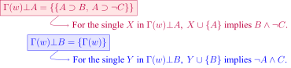
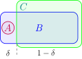
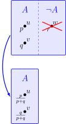
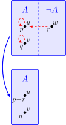

# The Logic of Conditionals
**First published Sat Jul 3, 2021**

*Egré, Paul, Rott, Hans*

This article provides a survey of classic and recent work in conditional logic. We review the problems of a two-valued analysis and examine logics based on richer semantic frameworks that have been proposed to deal with conditional sentences of the form “if *A*, *B*,” including trivalent semantics, possible-world semantics, premise semantics, and probabilistic semantics. We go on to examine theories of conditionals involving belief revision, and highlight recent approaches based on the idea that a conditional is assertable provided the truth of its antecedent makes a relevant difference to that of its consequent. We close with a brief discussion of systems accounting for the interaction of conditionals with modalities and speech act operators.

## 1. Introduction

Logics of conditionals deal with inferences involving sentences of the form “if *A*, (then) *B*” of natural language. Despite the overwhelming presence of such sentences in everyday discourse and reasoning, there is surprisingly little agreement about what the right logic of conditionals might be, or even about whether a unified theory can be given for all kinds of conditionals. The problem is not new, but can be traced back to debates between Megarian and Stoic logicians (see Sextus Empiricus, *Outlines of Scepticism* II, 110–112; Kneale & Kneale 1962; Sanford 1989; Weiss 2019)[^kneale-1962][^sanford-1989][^weiss-2019]. Famously, Philo of Megara proposed that a conditional of the form “if *A* then *B*” is true exactly when it is not the case that *A* is true and *B* is false. The same definition is at the core of the modern treatment of the conditional as so-called “material implication” in the two-valued propositional framework of Frege (1879)[^frege-1879] and Whitehead and Russell (1910).

|   | $B$ |   |   |
| --- | --- | --- | --- |
| $A \supset B$ | 1 | 0 |   |
| $A$ | 1 | 1 | 0 |
| 0 | 1 | 1 |   |

*Table 1:* The material conditional

This understanding of the conditional has considerable virtues of simplicity, and in that regard the material conditional analysis provides a benchmark for other theories. Probably its main virtue is that it lends itself to a truth-functional treatment (the truth value of a conditional is a function of the truth values of antecedent and consequent). A related one is that it makes the conditional interdefinable with Boolean negation, disjunction, and conjunction. A third, among the driving motivations for Frege, Russell and Whitehead, is that it appears adequate to regiment mathematical proofs involving conditional sentences. Despite that, as granted by Frege himself in the *Begriffsschrift*, it fails to do justice to some of the ways in which conditionals are ordinarily understood and used in natural language.

An oddity pointed out early by MacColl (1908)[^maccoll-1908] is the observation that of any two sentences of the form “not *A* or *B*” and “not *B* or *A*”, at least one must be true. Assuming the equivalence with the material conditional, this implies that either “if John is a physician, then he is red-haired” or “if John is red-haired, then he is a physician” must be true. Intuitively, however, one may be inclined to reject both conditionals. Similar complications, known as the *paradoxes of material implication*, concern the fact that for any sentences *A* and *B*, “if *A* then *B*” follows from “not *A*”, but also from “*B*”, thereby allowing true and false sentences to create true conditionals irrespective of their content (C. I. Lewis 1912)[^lewis-1912]. Another peculiarity looms large: the negation of “if *A* then *B*” is predicted to be “*A* and not *B*”, but intuitively one may deny that “if God exists, all criminals will go to heaven” without committing oneself to the existence of God (cited in Lycan 2001)[^lycan-2001].

A fourth complication is that conditional sentences in natural language are not limited to indicative conditionals (“if I strike this match, it will light”), but also include subjunctive conditionals used to express counterfactual hypotheses (“if I had struck this match, it would have lit”). All counterfactual conditionals would be vacuously true if analyzed as material conditionals with a false antecedent, as pointed out by Quine (1950)[^quine-1950], an obviously inadequate result, suggesting that the interplay of grammatical tense and grammatical mood should also be of concern to understand the logic of conditionals.

To a large extent, the development of conditional logics over the past century has thus been driven by the quest for a more sophisticated account of the connection between antecedent and consequent in conditionals. A number of conditional logics have thus been developed within the framework of *modal logic*, to capture the idea that conditional sentences express a necessary connection of sort between antecedent and consequent, whether metaphysical, epistemic, or deontic (see C. I. Lewis 1912; Stalnaker 1968; D. Lewis 1973; Kratzer 2012)[^kratzer-2012][^lewis-1912][^lewis-1973][^stalnaker-1968]. A related wave of work encompasses the so-called cotenability theories of conditionals, in which the idea is that a conditional is assertable if its antecedent, together with suitable (co-tenable) premises, entails its consequent (see Chisholm 1946; Goodman 1955; Rescher 1964)[^chisholm-1946][^goodman-1955][^rescher-1964].

Another strand of influential logics has been motivated by the idea that conditionals have probabilities or express a probabilistic dependence between their antecedents and their consequents (Ramsey 1931; de Finetti 1936; Adams 1965; Edgington 1995; Douven 2016)[^adams-1965][^douven-2016][^edgington-1995][^finetti-1936][^ramsey-1931]. A very influential source of this is a passage by Ramsey (1931)[^ramsey-1931], in which he writes:

> If two people are arguing “If $p$, then $q$?” and are both in doubt as to $p$, they are adding $p$ hypothetically to their stock of knowledge and arguing on that basis about $q$; so that in a sense “If $p$, $q$” and “If $p$, $\neg q$” are contradictories. We can say that they are fixing their degree of belief in $q$ given $p$. If $p$ turns out false, these degrees of belief are rendered *void*. If either party believes *not $p$* for certain, the question ceases to mean anything to him except as a question about what follows from certain laws or hypothesis. [Notation adapted]

Importantly, the so-called Ramsey Test (adding the antecedent hypothetically to one’s beliefs) has inspired a number of approaches that stand as some of the cornerstones of conditional logics. This includes Stalnaker’s modal logic of conditionals based on the idea that the antecedent of a conditional selects a hypothetical possible world (Stalnaker 1968)[^stalnaker-1968]. It also includes Adams’s approach based on studying formally the idea that the probability of (non-nested) conditionals is given by the corresponding conditional probability (Adams 1965, 1975)[^adams-1965][^adams-1975], as well as more qualitative theories of the acceptability of conditionals in terms of (non-probabilistic) belief revision policies (Gärdenfors 1986)[^gärdenfors-1986]. Finally, Ramsey’s idea that conditionals with a false antecedent are void underlies the main motivation behind three-valued accounts of conditionals, developed independently by various authors (in particular by de Finetti 1936)[^finetti-1936].

In this entry, our presentation of conditional logics will be structured by the centrality of those various frameworks. Our goal in particular will be to allow readers to orient themselves easily between those frameworks, and also to show how they communicate. We start with a presentation of three-valued logics of conditionals in section 2. Section 3 surveys the main analyses of the conditional in modal logics (possible worlds semantics). In section 4, we discuss so-called premise semantics, which formalize the co-tenability idea, and which shed a different light on standard modal analyses. Section 5 moves on to probabilistic logics of conditionals, and section 6 to qualitative approaches in terms of belief revision. Section 7 and section 8, finally, will present more recent developments or refinements: first, logics based on the idea that the antecedent ought to make a relevant difference to the consequent, then some extensions of propositional logics of conditionals addressing the interaction of conditionals with modalities as well as with questions and commands.

One caveat is that in this entry we will try to keep a unified perspective on both indicative and subjunctive conditionals. Although some authors, notably David Lewis, have insisted on treating them differently, differences can be handled parametrically relative to a common semantic core (viz., Stalnaker 1975 or Pearl 2009)[^pearl-2009][^stalnaker-1975]. We will point to differences when relevant, but refer the reader to Starr’s (2019)[^starr-2019] SEP entry on counterfactuals that deals with the topic rather extensively. On some aspects our entry also overlaps with Edgington’s (2020)[^edgington-2020] SEP entry on indicative conditionals, and readers are invited to consult both of those entries for complements.

In what follows, we will represent the conditional operator by the symbol $>$. We distinguish three main layers of syntactic complexity. Let $L_0$ be a propositional language capable of building *factual* sentences from atoms with the help of the usual Boolean connectives ($\neg$, $\wedge$, $\vee$, $\supset$ and $\equiv$ for negation, conjunction, disjunction, material conditional and material equivalence, respectively). Then $L_1$ is the extension of $L_0$ with *flat conditionals*, such that if $A$ and $B$ are in $L_0$ then $A>B$ is in $L_1$. And $L_2$ is the extension of $L_0$ and $L_1$ allowing free combinations of all connectives, including arbitrary nestings of conditionals.

## 2. Three-Valued Conditionals

### 2.1 Motivations

Logics of indicative conditionals, in so far as they are based on truth evaluations, all agree that a conditional is false if its antecedent is true and its consequent is false. This is captured by the two-valued analysis. Less obvious is the assumption that a conditional is true when both antecedent and consequent are true, for this predicts that $A\wedge B$ entails $A >B$. And even more controversial is the proviso that a conditional is true whenever its antecedent is false, which indeed is one of the paradoxes of the material conditional.

C. I. Lewis’s (1912)[^lewis-1912] response to the paradoxes of the material conditional is his proposal of a strict conditional (aka “strict implication”, section 3). The strict conditional is no longer truth-functional, however. A closer kin to standard two-valued logic in this regard is the family of three-valued logics originating from the work of Łukasiewicz (1920), which retain truth-functionality. Łukasiewicz’s main motivation was not to deal specifically with conditionals, however, but with the notion of possibility. Łukasiewicz’s conditional is shown in Table 2. Łukasiewicz defines validity to be the preservation of the value 1 from premises to conclusion, as in two-valued logic. His operator retains the law of Identity $A>A$ and various classic schemata (such as Modus Ponens), but it also fails some classical properties (it is non-contractive, for example, failing the inference from $A>(A>B)$ to $A>B$). It agrees with the two-valued conditional on classical input, and it does not block the paradoxes of the material conditional.

|   | $B$ |   |   |   |
| --- | --- | --- | --- | --- |
| $A > B$ | 1 | ½ | 0 |   |
|   | 1 | 1 | ½ | 0 |
| $A$ | ½ | 1 | 1 | ½ |
|   | 0 | 1 | 1 | 1 |

*Table 2:* Łukasiewicz’s conditional

Łukasiewicz’s work was a source of inspiration to Reichenbach, and subsequently to de Finetti, both of whom put forward the idea expressed earlier by Ramsey that a conditional must be indeterminate when its antecedent is false (see Reichenbach 1935, 1944; de Finetti 1936)[^finetti-1936][^reichenbach-1935][^reichenbach-1944]. Reichenbach deems *meaningless* the evaluation of a conditional $A>B$ when $A$ concerns some measurement rendered impossible by some other measurement (as predicted in quantum physics). For de Finetti, the idea is that a conditional sentence is like a bet. When someone bets that the card will be a king if it is a club, the bet should simply be called off if the card turns out to be of a different suit. On that basis, de Finetti proposed a table (sometimes called the “defective” conditional, see Baratgin et al. 2013, Over & Baratgin 2017)[^baratgin-2013][^over-2017] for what he calls the logic of tri-events, where a tri-event refers to “the event $B$ conditional upon event $A$”. The tri-event is true when both events are true, false when $A$ is true and $B$ false, and *null* otherwise (e.g., when $A$ is false).

|   | $B$ |   |   |   |
| --- | --- | --- | --- | --- |
| $A > B$ | 1 | ½ | 0 |   |
|   | 1 | 1 | ½ | 0 |
| $A$ | ½ | ½ | ½ | ½ |
|   | 0 | ½ | ½ | ½ |

*Table 3:* De Finetti’s conditional

As Table 3 shows, there is now a third truth value ½ (for “null” or “void” or “indeterminate”) beyond the classical values 1 (for “true”) and 0 (for “false”). This is why these logics are called *trivalent*. The conditional is no longer classically valued for classical input. Although Reichenbach and de Finetti considered the interplay of this conditional with other trivalent connectives, they did not investigate the logics resulting from that choice. Investigations of logics resulting from de Finetti’s table spread in a scattered way, often oblivious of the work of Reichenbach and de Finetti. One path was paved by remarks due to Quine (1950)[^quine-1950], crediting the work of Ph. Rhinelander on the idea that the assertion of a sentence of the form “if $A$ then $C$” is commonly felt “less as the assertion of a conditional than as a conditional assertion of the consequent” (see Jeffrey 1963; Cooper 1968; Belnap 1970, 1973; Manor 1975; Farrell 1979, 1986; Olkhovikov 2002; Huitink 2008)[^belnap-1970][^belnap-1973][^cooper-1968][^farrell-1979][^farrell-1986][^huitink-2008][^jeffrey-1963][^manor-1975][^olkhovikov-2002]. This view is known more broadly as the suppositional view (Adams 1975; Edgington 1995)[^adams-1975][^edgington-1995]. Another line of work was pursued in connection with algebraic treatments of probability, much in the spirit of de Finetti’s original work, who viewed trivalence as a way of representing the notion of conditional probability more qualitatively (see Schay 1968; Calabrese 1991; Dubois & Prade 1994; McDermott 1996; Milne 1997; Cantwell 2008; Rothschild 2014; Lassiter 2020)[^calabrese-1991][^cantwell-2008][^dubois-1994][^lassiter-2020][^mcdermott-1996][^milne-1997][^rothschild-2014][^schay-1968].

### 2.2 Some trivalent logics

Amongst trivalent logics based on variations of de Finetti’s table, some systems stand out. First, there is Cooper’s logic **OL** and a close variant of it, Cantwell’s logic **CC/TT** (as named in Égré, Rossi, & Sprenger 2021, after Cooper and Cantwell)[^égré-2021], itself a fragment of the logic **LImp** of Olkhovikov (2002)[^olkhovikov-2002], which also incorporates a modal necessity operator. **OL** and **CC/TT** are defined for $L_2$, the full language allowing nested conditionals. Like de Finetti, Cooper (1968)[^cooper-1968] handles the conditional as indeterminate when the antecedent is false (0). However, the conditional takes the value of the consequent when the antecedent is *not false* (either 1 or ½). Hence, instead of grouping ½ with 0, as de Finetti does, it groups ½ with 1. Table 4 was rediscovered independently by Olkhovikov (2002)[^olkhovikov-2002] and by Cantwell (2008)[^cantwell-2008], with very similar motivations in mind. It was also proposed by Belnap (1973)[^belnap-1973], who presents it as a suitable modification from Belnap (1970)[^belnap-1970], who first used the same table as De Finetti’s.

|   | $B$ |   |   |   |
| --- | --- | --- | --- | --- |
| $A > B$ | 1 | ½ | 0 |   |
|   | 1 | 1 | ½ | 0 |
| $A$ | ½ | 1 | ½ | 0 |
|   | 0 | ½ | ½ | ½ |

*Table 4:* Cooper’s conditional

Cooper, Olkhovikov, and Cantwell define an inference to be valid if the conclusion is not false whenever all the premises are not false, for all trivalent valuations of the language. A central feature of their systems is that the full deduction theorem holds (a feature also stressed by Jeffrey 1963 and Belnap 1973)[^belnap-1973][^jeffrey-1963]:

$$\tag{DT} \Gamma, A\vDash B \tiff \Gamma\vDash A>B.$$

One difference between their systems is that Cooper defines validity relative to trivalent valuations that are atom-classical; another is that Cooper uses so-called quasi-conjunction and disjunction (see below), whereas Olkhovikov and Cantwell use the common min and max rules for conjunction and disjunction, respectively. For Cooper and Cantwell, in particular, and similarly for Belnap (1973)[^belnap-1973], a central motivation for this conditional is the validation of the principle of Negation Commutation for the conditional, namely the conjunction of:

$$\tag{EX} A>\neg B \;\vDash\; \neg (A>B). $$ $$\tag{IN} \neg (A>B) \;\vDash\; A>\neg B.$$

Principle EX in particular is characteristic of connexive logics (see Section 7 below). Another important feature of the resulting logics is that whereas Modus Ponens is a valid argument schema, Modus Tollens and Contraposition fail in general (though they remain valid over atomic variants of the schemata in Cooper’s **OL**):

$$\tag{MP} A,\ A>B \;\vDash\; B.$$ $$\tag{MT} \neg B,\ A>B \;\not\vDash\; \neg A.$$ $$\tag{CP} A>B \;\not\vDash\; \neg B >\neg A.$$

Since $A\not \vDash \neg A >B$, the Cooper conditional blocks one of the paradoxes of the material conditional, but it retains another one, namely $A\vdash B>A$. Relatedly, although Cooper and Cantwell or Olkhovikov use different semantics for conjunction, on their approaches, conjunction entails the conditional. This principle is called *Conjunctive Sufficiency*:

$$\tag{CS} A \wedge B \;\vDash\; A>B.$$

Cooper provides a complete axiomatization for his logic, using a system of inference rules close to a natural deduction system (system **OL**). Using tableaux and sequent calculi, Égré, Rossi, and Sprenger (2021) compare the Cooper-Cantwell logic **CC/TT** with the logic **DF/TT** that results from de Finetti’s table and the same notion of validity (preservation of non-zero values). The logic **DF/TT** is connexive, too, and supports Negation Commutation. A central difference, however, is that de Finetti’s table fails to support MP.

Another system worthy of consideration is the trivalent logic of “conditional objects” investigated by Dubois and Prade (1994). This system is itself closely related to a three-valued treatment of conditionals presented in Adams (1986)[^adams-1986]. The system rests on de Finetti’s original table, but only formulae from the flat fragment $L_1$ are admitted. Validity in Dubois and Prade’s approach is defined as follows. Assume *Γ* is a set of flat conditionals of the form $A_i>B_i$. Then define $\Gamma \models A>B$ iff *either* $A$ classically entails $B$ *or* for every trivalent valuation the value of the quasi-conjunction of some subset of conditionals in *Γ* is less than or equal to the value of $A>B$ (for the usual ordering of truth-values: $0<½<1$). Quasi-conjunction—a connective proposed by Cooper (1968: 305)[^cooper-1968] and in a different guise by Adams (1966: 306)[^adams-1966], also proposed by Belnap (1973:60)[^belnap-1973], and earlier by Sobociński 1952 in relation to a different trivalent conditional —differs from min conjunction in that the conjunction of classical values is classical, and the conjunction of ½ with a classical value is that classical value. Quite remarkably, this relation of logical consequence can be axiomatized by the system **P** of preferential entailment of Kraus, Lehmann and Magidor, which is discussed in detail below. Thus, the associated notion of consequence does not support Monotonicity, Transitivity, and Contraposition of the conditional (see section 3.2).

### 2.3 Open issues

Despite its simplicity, the use of trivalence raises several issues. One open problem is how to deal with counterfactual conditionals—the problem is not without options, but trivalence so far has been used mostly to deal with indicative conditionals. A related issue is how to make three-valued conditionals interact with modalities and other operators more generally.

Another problem concerns the expressiveness of a finitely-valued truth-functional account. McGee (1981)[^mcgee-1981] shows that the common “flat” $L_1$-fragment of the logics of conditionals of Adams, Stalnaker and Lewis, i.e., the system **P**, cannot be characterized in terms of the preservation of a designated set of truth-values in a finite-valued logic. Prima facie, this results appears in tension with Adams’s as well as Dubois and Prade’s trivalent characterization of **P**. As pointed out by M. Schulz (2009)[^schulz-2009], however, the trivalent characterization proposed by Adams—or indeed Dubois and Prade—differs from the one entertained by McGee (it asks for more than the preservation of a fixed set of designated values, and allows quantification over subsets of the premises).[^note-1] As discussed by Schulz, whether a similar characterization can be given for the non-flat logics of Stalnaker and Lewis is an open question.

## 3. Possible Worlds Models

Trivalent accounts suppose that the truth value of a conditional depends only on the truth values of its parts. However, this assumption does not account for a connection of the contents of the antecedent and the consequent, a point granted by Frege (1879)[^frege-1879] himself. In this section we review accounts that preserve the idea that conditionals are truth-evaluable, but assume that their truth value cannot be settled just by the truth values of the antecedent and the consequent at the actual world. Instead, the antecedent has a certain modal force, it makes its consequent in some sense necessary. Possible-worlds models give an explication of the necessity involved.

### 3.1 Strict conditionals

The first step toward an intensional treatment of conditionals was made with C. I. Lewis’s introduction of the strict conditional. Although Lewis’s treatment was axiomatic, its semantic content can be made transparent using possible worlds semantics. On Lewis’s approach, “If $A$, then $C$” means that the material conditional is not just true, but necessarily true:

$$\tag{SI} (A >B ) \equiv \Box (A\supset B).$$

From a semantic view point, reference is made here not just to the actual world, but also to other possible worlds, in fact to all “accessible” worlds. Thus, the meaning of this conditional cannot be explained by a simple truth table.

In modal logic, a *Kripke frame* is a pair $\langle W, R\rangle$ where $W$ is a non-empty set of *possible worlds* (possible states, possible situations or possible ways the world might be) and $R$ is a binary relation on $W$. $R$ is called the *accessibility relation* of the model, and intuitively $Rwv$ means that world $v$ is (in some sense) possible from the point of view of $w$. A *model* is a triple $\langle W, R, V\rangle$ such that $\langle W, R\rangle$ is a frame and $V$ is a valuation function assigning truth values to all propositional variables of the language at all possible worlds in $W$. We write $M, w \Vdash A$ for “$A$ is true at world $w$ in model $M$” and let $\lvert A\rvert^M$ denote the set $\{w\in W: M, w \Vdash A\}$ of possible worlds at which $A$ is true. Let $R(w) := \{v\in W: Rwv\}$. The truth conditions for the Boolean connectives are the usual ones for propositional logic, extending $V$ to complex sentences. Those for the strict conditional are as follows:

$$\tag{SC } \begin{align} M, w \Vdash A >B & \quad\text{iff}\quad \text{for all } v \text{ such that } Rwv,\quad M, v \Vdash A \supset B\\ & \quad\text{iff}\quad R(w) \cap \lvert A\rvert^M \subseteq \lvert B\rvert^M.\\ \end{align} $$

Validity (relative to a class of frames) is defined as truth-preservation at all worlds of all models (based on any frame in the class). It is easy to see that the strict conditional invalidates the paradoxes of the material conditional, relative to models built on arbitrary Kripke frames. The strict conditional retains Modus Ponens and a number of classic properties, such as Monotonicity, Transitivity, and Contraposition (see below). Starting with Goodman (1955)[^goodman-1955], however, such inferences have been regarded with suspicion, both for indicative conditionals (see Adams 1965)[^adams-1965] and for counterfactuals conditionals (see Stalnaker 1968, Lewis 1973)[^lewis-1973][^stalnaker-1968]. For instance, in the case of Transitivity, we have the following counterexamples:

**(1)**

If Brown wins the election, Smith will retire to private life. If Smith dies before the election, Brown will win it. #Therefore, if Smith dies before the election, then he will retire to private life. (Adams 1965, p. 166)[^adams-1965]

**(2)**

If J. Edgar Hoover were today a communist, then he would be a traitor. If J. Edgar Hoover had been born a Russian, then he would today be a communist. #Therefore, if J. Edgar Hoover had been born a Russian, he would be a traitor. (Stalnaker 1968, p. 106)[^stalnaker-1968]

Such examples inspired Adams to propose a probabilistic treatment of conditionals. They inspired Stalnaker, Lewis, Nute, and a number of others to weaken the strict conditional analysis. But recently there has been a revival of the strict conditional analysis, based on the idea that many phenomena can be accounted for pragmatically by construing the accessibility relation that determines which possible worlds are relevant as massively context-dependent (Daniels & Freeman 1980; von Fintel 2001; Gillies 2007; Starr 2014a, and Starr’s entry on counterfactuals)[^daniels-1980][^fintel-2001][^gillies-2007][^starr-2014a].

### 3.2 Variably strict conditionals

The basic idea behind “variably strict conditionals” (an expression due to D. Lewis 1973)[^lewis-1973] is that the standard of necessity relevant to evaluate a conditional sentence depends on the antecedent. Roughly speaking, in order to evaluate a conditional $A>B$, one has to extend the reach of the accessibility relation to the “closest” or “most similar” worlds in which the antecedent is true. In what follows we present three related ways of stating the truth conditions of the variably strict conditional.

#### 3.2.1 Main semantics

##### Relative modalities

Though not historically the first, arguably the simplest way of expressing the idea of a strict conditional whose necessity varies depending on the antecedent can be found in Chellas (1975)[^chellas-1975] and Segerberg (1989)[^segerberg-1989], who describe a conditional $A>B$ as a relative modality, namely a sententially indexed modality $\Box_{A}B$, with the corresponding accessibility relation $R_{\lvert A\rvert^{M}}$ for every sentence $A$. A relative-modality frame or *rm-frame* can be defined as a pair $\langle W, R\rangle$ where $R$ is a ternary relation on $W\times W\times \cP(W)$. In practice we can write $R_Uvw$ instead of $RvwU$, and see $R$ as assigning a binary relation over worlds relative to a proposition $U$. An *rm-model* is a triple $M = \langle W, R, V\rangle$ such that $\langle W, R\rangle$ is an rm-frame and $V$ a valuation function. Given an rm-model $M$, the truth condition for the conditional is this:

$$\tag*{(VSC)-rm } \begin{align} \ M, w \Vdash A >B & \quad\text{iff}\ \text{for all } v \text{ such that } R_{\lvert A\rvert^{M}} wv, \ M, v \Vdash B\\ & \quad\text{iff}\ R_{\lvert A\rvert^{M}}(w) \subseteq \lvert B\rvert^M.\\ \end{align} $$

Note that $R$ could be defined on $W\times W\times L_2$, letting $R_A(w)$ depend on the syntactic form of $A$ (instead of the proposition $\lvert A\rvert^M$ expressed by $A$). The main effect of this modification is to block the substitution of equivalent antecedents, a feature called for by several theorists on separate grounds (see section 3.5).

##### Selection functions

An equivalent definition is in terms of selection functions (Stalnaker 1968; Nute 1980)[^nute-1980][^stalnaker-1968]. An *sf-frame* is a pair $\langle W, f\rangle$ where $W$ is a non-empty set of *possible worlds* and $f: W \times \cP(W) \to \cP(W)$ is a function taking a world and a proposition (i.e., a set of worlds) and yielding a proposition. $f$ is called the *selection function* of the model, and intuitively $v \in f(w,U)$, where $U\subseteq W$, means that world $v$ is a world in $U$ that is (in some sense) *closest* or *most similar* to $w$, as compared to all the other worlds in $U$. The correspondence with the previous approach is straightforward, if we let $f(w,\lvert A\rvert^M)$ coincide with $R_{\lvert A\rvert^M}(w)$. An *sf-model* is a triple $M = \langle W, f, V\rangle$ such that $\langle W, f\rangle$ is an sf-frame and $V$ is a valuation function. The truth condition for the variably strict conditional becomes:

$$\tag*{(VSC)-sf} \begin{align} \ M, w \Vdash A >B & \quad\text{iff}\ \text{for all } v \in f(w,\lvert A\rvert^M), \ M, v \Vdash B\\ & \quad\text{iff}\ f(w,\lvert A\rvert^M) \subseteq \lvert B\rvert^M.\\ \end{align} $$

As with rm-frames, the definition of an sf-frame can be modified to let $f$ depend on $w$ and $A$, instead of $\lvert A\rvert^M$.

##### Similarity orderings

There is a closely related alternative to this set-up which uses comparative similarity orderings in place of selection functions (D. Lewis 1973; Burgess 1981)[^burgess-1981][^lewis-1973]. Here, an *o-frame* is a pair $\langle W, \prec \rangle$ where $W$ is a non-empty set of *possible worlds* and $\prec$ is a ternary relation on the set of worlds, assumed to be transitive and irreflexive relative to its first argument. The relation $u \prec_w v$ is supposed to mean that world $u$ is (in some sense) *more similar* or *closer* to $w$ than world $v$. Let $R(w) := \{y\in W: \exists z \in W(y\prec_wz)\}$. This corresponds to the set of accessible worlds from $w$. An *o-model* is a triple $\langle W, \prec, V\rangle$ such that $\langle W, \prec\rangle$ is an o-frame, and $V$ is a valuation function. We use the abbreviation $\lvert A\rvert^M_w := \lvert A\rvert^M \cap R(w)$, and let $min_{\prec_{w}}(U)$ denote the $U$-worlds most similar to $w$ (such that no $U$-world is strictly more similar to $w$). A simple form of the truth-condition for the variably strict conditional reads as follows:

$$\tag*{(VSC)-o-L } \begin{align} \ M, w \Vdash A >B & \quad\text{iff}\ \text{for all } v \in \min_{\prec_w} (\lvert A\rvert^M_w), \ M, v \Vdash B\\ & \quad\text{iff}\ \min_{\prec_w} (\lvert A\rvert^M_w) \subseteq \lvert B\rvert^M. \end{align} $$

These truth-conditions, however, make sense only if $\lvert A\rvert^M_w$ possesses minimal elements under $\prec_w$, that is, only if we can assume (L), in which we write $v \preceq_w u$ for $v \prec_w u$ or $v = u$:

$$\tag{L } \forall w \in W \;\forall u \in \lvert A\rvert^M_w \;\exists v \in \lvert A\rvert^M_w ((v\preceq_w u) \amp \neg\exists v' \in \lvert A\rvert^M_w (v'\prec_w v)).$$

(L) is a slight generalization of the *Limit Assumption* of Lewis (1973, 1981)[^lewis-1973][^lewis-1981]. While most researchers are ready to endorse the Limit Assumption, Lewis rejects it. According to him, for a counterfactual such as “If Fred was taller than 2 meters, he would be in the university basketball team” there is no closest world that would make the antecedent true. Ordering semantics can deal with failures of (L) by stating more complex truth conditions.

**(VSC)-o**

$M, w \Vdash A >B\quad $ iff for all $v \in \lvert A\rvert^M_w$ there is a $u\in \lvert A\rvert^M_w$ such that $u \preceq_w v$ and for all $u'\in \lvert A\rvert^M_w$ such that $u' \preceq_w u,\ M, u' \Vdash B$.

This intuitively means that the $A\wedge \neg B$ worlds are more remote from $w$ than the $A\wedge B$-worlds.

##### Comparisons

First of all, it is easy to see how all three semantics can invalidate inferences like (1) and (2), which assume Transitivity. In an o-model, for example, from

$$\min_{\prec_w} (\lvert A\rvert^M_w)\subseteq \lvert B\rvert^M$$

and

$$\min_{\prec_w} (\lvert B\rvert^M_w)\subseteq \lvert C\rvert^M,$$

it need not follow that

$$\min_{\prec_w} (\lvert A\rvert^M_w)\subseteq \lvert C\rvert^M.$$

See the three-world model in Fig. 1, where the arrows represent $\prec_w$ so that $x\!\leftarrow\!y$ means the same thing as $x\prec_w y$.

Figure 1: Counterexample against Transitivity in an o-model [An extended description of Figure 1 is in the supplement.]

Similar counterexamples to Monotonicity and Contraposition are easy to come by.

The correspondence between selection function models and relative modality models is very direct. The correspondence between selection function models and ordering models is less obvious. How can we explain it? If we interpret similarity relations as preference relations, we can import the insights gained in rational choice theory to the analysis of conditionals (Sen 1970; Suzumura 1983; Aleskerov, Bouyssou, & Monjardet 2007; applications to nonmonotonic reasoning are in Lindström 1994 and Rott 2001)[^aleskerov-2007][^lindström-1994][^rott-2001][^sen-1970][^suzumura-1983]. If the Limit Assumption is satisfied, then we can simply identify $f(w,U)$ with $\min_{\prec_w} (U)$, for all $U\subseteq W$. For the converse direction, we can use the revealed preferences, defined by

$$u\prec_w v \ \textrm{ iff for all } U \subseteq W \text{ such that } u,v \in U, v\notin f(w,U)$$

or, if $f$ can take propositions with two elements,

$$u\prec_w v \tiff v\notin f(w,\{u,v\}).$$

These preferences “rationalize” the selections made by $f$. This, however, works only under certain constraints. In this respect sf-models are more general than o-models. They are also easier to work with, and giving up the Limit Assumption is generally viewed as inadequate from a linguistic point of view (see Stalnaker 1980; Schlenker 2004; S. Kaufmann 2017 for more on (L)).

#### 3.2.2 Frame correspondence properties

For each semantics, specific conditions can be imposed on frames in order to secure the validity of particular axioms or argument schemata. Their effects on the logic of conditionals have been studied in detail. For illustration we give the examples of two specific axioms and their correspondence properties in the three frameworks. Identity requires that every $A$-closest world be indeed an $A$-world. Conditional excluded middle corresponds to a uniqueness condition: there is at most one closest $A$-world.

|   | $A>A$ | $(A>B) \vee (A >\neg B)$ |
| --- | --- | --- |
| rm | $R_Avw \supset w\in A$ | $wR_Aw_1 \wedge wR_Aw_2 \supset w_1=w_2$ |
| sf | $f(w,A)\subseteq A$ | $card(f(w,A))\leq 1$ |
| o | $\forall x\,\forall y\,(\exists z(x\preceq_y z) \supset x\preceq_y x)$ | $\forall y\,\forall y'\,\forall w\,((y\in \lvert A\rvert^M_w \wedge \forall z(z\prec_{w}y \supset z\notin \lvert A\rvert^M_w))\supset {}$ $((y'\in \lvert A\rvert^M_w \wedge \forall z(z\prec_{w}y' \supset z\notin \lvert A\rvert^M_w))\supset y=y'))$ |

*Table 5:* Some frame correspondence properties

We refer to Unterhuber and Schurz (2014) for a systematic presentation of frame correspondence properties for rm-frames, to Nute (1980)[^nute-1980], Girard (2007)[^girard-2007], and Raidl (2021)[^raidl-2021] on the correspondence properties of sf-frames, and to Friedman and Halpern (1994) and Herzig (1996)[^herzig-1996] on the correspondence properties of o-frames.

### 3.3 Logics for conditionals

In order to present some central logics of conditionals based on the possible-worlds framework, we adopt a Frege-Hilbert axiomatic perspective and introduce a list of axioms and rules of inference. Our presentation and choice of terminology relies on Nute (1980)[^nute-1980] as well as Herzig (1996)[^herzig-1996], Unterhuber and Schurz (2014), and Crupi and Iacona (forthcoming-b).

- As a first layer for all systems, we let **PC** consist of all tautologies of the classical propositional calculus.
- We also assume the systems below to be closed under material Modus Ponens, but distinguish moreover the following inference rules (Left Logical Equivalence, Right Weakening, and Rule of Conditional K). Those mean that if the premises are theorems, then so is the conclusion. $$\tag*{LLE} \frac{B \equiv C}{(B >A) \equiv(C >A)} $$ $$\tag*{RW} \frac{B \supset C}{(A >B) \supset(A >C)} $$ $$\tag*{RCK} \frac{(B_1 \wedge \ldots \wedge B_n) \supset C} {(A >B_1) \wedge \ldots (A >B_n) \supset(A >C)\quad (n\geq 0)} $$
- Axioms

  | LT | (Logical Truth) $A>\top$ |
  | --- | --- |
  | ID | (Identity) $A>A$ |
  | AND | (And) $((A>B)\wedge (A>C))\supset(A>(B\wedge C))$ |
  | OR | (Or) $((A>C)\wedge (B>C))\supset((A\vee B)>C)$ |
  | CCut | (Cautious Transitivity) $((A>B)\wedge ((A\wedge B)>C))\supset(A>C)$ |
  | CMon | (Cautious Monotonicity) $((A>B)\wedge (A>C))\supset((A\wedge B)>C)$ |
  | Rec | (Reciprocity) $((A>B)\wedge (B>A)) \supset((A>C) \equiv(B>C))$ |
  | SM | (Stronger-than-Material) $(B>C)\supset(B\supset C)$ |
  | CS | (Conjunctive Sufficiency) $(B\wedge C)\supset(B>C)$ |
  | RMon | (Rational Monotonicity) $((A>B)\wedge \neg(A>\neg C))\supset((A\wedge C)>B)$ |
  | CEM | (Conditional Excluded Middle) $(A>B)\vee (A>\neg B)$ |

| Rules and axioms | Systems |   |   |   |   |   |   |   |   |
| --- | --- | --- | --- | --- | --- | --- | --- | --- | --- |
| Ck | CK | B | SS | NP | V | VW | VC | C2 |   |
| LLE |   | ✓ | ✓ | ✓ | ✓ | ✓ | ✓ | ✓ | ✓ |
| RW | ✓ | ✓ | ✓ | ✓ | ✓ | ✓ | ✓ | ✓ | ✓ |
| RCK | ✓ | ✓ | ✓ | ✓ | ✓ | ✓ | ✓ | ✓ | ✓ |
| LT | ✓ | ✓ | ✓ | ✓ | ✓ | ✓ | ✓ | ✓ | ✓ |
| ID |   |   | ✓ | ✓ | ✓ | ✓ | ✓ | ✓ | ✓ |
| AND | ✓ | ✓ | ✓ | ✓ | ✓ | ✓ | ✓ | ✓ | ✓ |
| OR |   |   | ✓ | ✓ | ✓ | ✓ | ✓ | ✓ | ✓ |
| CCut |   |   | ✓ | ✓ | ✓ | ✓ | ✓ | ✓ | ✓ |
| CMon |   |   | ✓ | ✓ |   | ✓ | ✓ | ✓ | ✓ |
| Rec |   |   | ✓ | ✓ |   | ✓ | ✓ | ✓ | ✓ |
| RMon |   |   |   |   | ✓ | ✓ | ✓ | ✓ | ✓ |
| SM |   |   |   | ✓ |   |   | ✓ | ✓ | ✓ |
| CS |   |   |   | ✓ |   |   |   | ✓ | ✓ |
| CEM |   |   |   | ✓ |   |   |   |   | ✓ |

*Table 6:* Salient logics of conditionals. **Ck** and **CK** correspond to basic conditional logics; System **B** is due to Burgess; system **SS** to Pollock; system **NP** to Delgrande; systems **V**, **VW** and **VC** to D. Lewis; system **C2** to Stalnaker.

We highlight nine systems of conditional logic that have drawn particular attention.

System **CK** axiomatizes the truth-conditions laid out in (VSC)-rm. **CK** has been called the basic conditional logic by Chellas (1980)[^chellas-1980], as it is meant to be the counterpart to the basic system **K** of modal logic. In particular it yields the same theorems as system **K** relative to a fixed modality $\Box_{A}$. Thus, it satisfies conditional analogues of the axiom K of standard modal logic (viz., the axiom CK: $(A>B) \supset((A > (B\supset C)) \supset(A > C))$) and of the rule of Necessitation (viz., the rule CNec: from $C$ infer $A>C$). It can be described as the smallest logic closed under LLE and RCK (the latter entailing LT, RW and AND), and is also called a normal conditional logic because of that. The logic **Ck** corresponds to its hyperintensional variant, in which LLE is dropped.

System **B**, proposed by Burgess, is the smallest extension of **CK** containing ID, OR and CMon. System **B** axiomatizes the truth conditions stated under (VSC)-o assuming $\preceq$ is a preorder (reflexive and transitive). Another specific interest of system **B** is that its flat fragment corresponds to the system **P** of nonmonotonic logic due to Kraus, Lehmann and Magidor (see section 3.4). System **P** is also sound and complete for Adams’ probabilistic semantics of conditionals (see section 5), and a three-valued characterization can be given for it too, as mentioned above, see Dubois and Prade (1994). In that sense, system **P** is quite central amongst logic of conditionals.

Particularly noteworthy is the fact that none of these logics validates Monotonicity (also known as Strengthening the Antecedent), Transitivity or Contraposition for conditionals:

| Monotonicity | $(A>C)\supset ((A\wedge B) >C)$ |
| --- | --- |
| Transitivity | $(A>B) \supset ((B>C) \supset (A>C))$ |
| Contraposition | $(A>C)\supset (\neg C>\neg A)$ |

These principles have in many contexts been considered as paradigmatic invalidities of conditional logic.

If we add RMon to **B** we get the system **V** of David Lewis. John Pollock (1976)[^pollock-1976] proposed the system **SS** obtained by adding SM and CS to **B**. Lewis’ “official” axiomatization of the logic of counterfactuals is the system **VC** that is obtained by adding SM and C to **V**. The extension of **V** with just SM is the system **VW**. Finally, system **C2** with the incorporation of CEM into **VC** is Stalnaker’s logic of conditionals. As Table 6 makes clear, principles like CS, CMon, RMon, and CEM in particular are controversial, they have all been subject to philosophical discussions.

James Delgrande (1987)[^delgrande-1987] proposed the system **NP** as a different extension of **CK**. The main difference is that **B** satisfies Cautious Monotonicity, whereas **NP** satisfies Rational Monotonicity. In Delgrande’s interpretation, an instance of Rational Monotonicity is the inference from the premises “ravens normally fly” and “it is not the case that normally ravens are not black” to “black ravens normally fly”. Note that Cautious Monotonicity predicts the inference from “ravens normally fly” and “ravens normally are black” to “black ravens normally fly”. The existence of systems **B** and **NP** makes clear that strictly speaking, RMon and CMon are logically independent. But it is fair to say that RMon is *essentially* stronger than CMon, because in most environments one can infer $\neg(A>\neg C)$ from $A>C$. In the ordering semantics, RMon needs weak orders which satisfy Modularity (for all worlds $t, u, v, w \in W$, if $t\prec_w u$, then $t\prec_w v$ or $v\prec_w u$), while CMon needs only transitive relations. But RMon may be satisfied without CMon being satisfied if one has a weak order over an infinite set without anything like the limit assumption and uses a selection function or a minimal models approach. This is the case in Delgrande (1987)[^delgrande-1987].[^note-2]

Beside the systems mentioned, other intermediate systems between **CK** and **C2** have been studied, in particular by proof theorists. Olivetti, Pozzato, and Schwind (2007) and Poggiolesi (2016)[^poggiolesi-2016] present sequent calculi for the systems **CK**, **CK**+ID, **CK**+SM and **CK**+SM+ID. Poggiolesi also investigates systems of natural deduction for the same systems.

### 3.4 Nonmonotonic logic and preferential models

Earlier we mentioned that system **P** corresponds to the flat fragment of system **B**. Given the centrality of system **P**, here we say more about the way Kraus, Lehmann and Magidor defined it as a system of nonmonotonic logic. KLM do not aim at characterizing which formulae are logically valid, but at specifying closure conditions for rational sets of conditionals. They read the conditional $A>C$ (actually they use the notation $A\pipsim C$), with $A$ and $B$ only from $L_0$, as expressing a default of the form “if $A$ then normally $C$” or “$C$ is a plausible consequence of $A$”. They start with models right away, but their models are slightly different from the ones we have seen so far. Importantly, KLM have no use for a truth value of a conditional at a single world, but only look at the “consequence relation” determined by a full model. What KLM call “states” are more like information states than like possible worlds, what they call “worlds” are valuations, i.e., assignments of truth values to the propositional variables of the language. KLM’s preferential models are similar to the o-models discussed above, except there is only one binary relation for the full model rather than one for each world in the model.

A *cumulative model* $M$ for a universe $W$ is a triple $\langle S, l, < \rangle$ where $S$ is a set of states, $l: S \rightarrow \cP(W)$ is a labeling function assigning to each state a non-empty set of worlds from the universe $W$, and $<$ is a binary relation on $S$ satisfying the *smoothness condition*: for all $A\in L_0$ and all $s$ such that $s\mathrel|\mathrel{\mkern-3mu}\equiv A$ either $s$ is minimal in $\hat{A} = \{s \in S: s\mathrel|\mathrel{\mkern-3mu}\equiv A\}$ or there is an $s' < s$ that is minimal in $\hat{A}$. Here $s\mathrel|\mathrel{\mkern-3mu}\equiv A$ (read: $s$ satisfies $A$) means that for every world $w$ in $l(s)$, $w \Vdash A$.

The smoothness condition is almost the same as condition (L) of section 3.2.1 above. This notion of a model allows for a modification of the classical definition of entailment in such a way that it becomes compatible with the idea of defeasibility or nonmonotonicity:

Given a cumulative model $M = \langle S, l, < \rangle$, the entailment relation $\pipsim _M$ defined by $M$ is given by: $A \pipsim _{M} B$ iff for all states $s$ minimal in $\hat{A}$, $s\mathrel|\mathrel{\mkern-3mu}\equiv B$.

Thus every single cumulative model defines a preferential entaliment relation—one with respect to which a sentence *A* typically entails much more than just its classical logical consequences.

Kraus, Lehmann, and Magidor (1990) focused on a particular class of cumulative models, the so-called preferential models. They require the binary relation to be a strict partial order and the labeling function to assign just one world to each state. A *preferential model* for a universe $W$ is a triple $\langle S, l, < \rangle$ where $S$ is a set of states, $l: S \rightarrow W$ is a labeling function assigning to each state a single world from the universe $W$, and $<$ is a strict partial order on $S$ (irreflexive, transitive) satisfying the *smoothness condition*.

Lehmann and Magidor (1992) focused on a subfamily of preferential models, the so-called ranked models. A *ranked model* $R$ is a preferential model $\langle S, l, < \rangle$ where the strict partial order $<$ satisfies Modularity: for all $s, t, u \in S$, if $s<t$, then $u<t$ or $s<u$.

These modes are called “ranked” because the property of Modularity of the strict partial order < is equivalent to there being a totally ordered set $\Omega$ (the strict order on $\Omega$ will be denoted by $\bangle$) and a ranking function $r : S \rightarrow \Omega$ such that $s < t$ iff $r(s) \bangle r(t)$. Intuitively, a state of smaller rank is “more normal” than a state of higher rank.

The main representation theorem of Kraus, Lehmann, and Magidor concerns the system **P** in terms of preferential models. Below we repeat the rules of the system, except that here axioms come in argument form (the entailment symbol “$\pipsim$” is not part of the object language), and inference rules in meta-argument form. The rules in the systems they consider are not thought of as validity preserving. They are rather taken to be closure conditions: any reasonable nonnomotonic inference relation $\pipsim $ is such that when it includes the premises (sometimes, though, the premises are *exclusion* conditions, see RMon, DRat and NRat below), then it includes the conclusion, too. Kraus, Lehmann and Magidor’s representation results then state that an inference relations $\pipsim $ is reasonable in this syntactically specified sense just in case it can be defined by a model with certain properties.

$$\tag*{ID\(_{\pipsim}\)} A \pipsim A $$ $$\tag*{LLE\(_{\pipsim}\)} \frac{\models A \equiv B \qquad A \pipsim C}{B \pipsim C}$$ $$\tag*{RW\(_{\pipsim}\)} \frac{\models A \supset B \qquad C \pipsim A}{C \pipsim B}$$ $$\tag*{CCut\(_{\pipsim}\)} \frac{A \pipsim B \qquad A \wedge B \pipsim C}{A \pipsim C}$$ $$\tag*{CMon\(_{\pipsim}\)} \frac{A \pipsim B \qquad A \pipsim C}{A \wedge B \pipsim C}$$ $$\tag*{AND\(_{\pipsim}\)} \frac{A \pipsim B \qquad A \pipsim C}{A \pipsim B \wedge C}$$ $$\tag*{OR\(_{\pipsim}\)} \frac{A \pipsim C \qquad B \pipsim C}{A \vee B \pipsim C}$$

In Kraus, Lehmann, and Magidor (1990), rules ID$_{\pipsim}$, LLE$_{\pipsim}$, RW$_{\pipsim}$, CCut$_{\pipsim}$ and CMon$_{\pipsim}$ together define the system **C** of *cumulative reasoning*; AND$_{\pipsim}$ is a derived rule of **C**. If OR$_{\pipsim}$ is added, one gets system **P** of *preferential reasoning*; if one keeps AND$_{\pipsim}$, CCut$_{\pipsim}$ can be derived from the other rules of **P**.

Lehmann and Magidor (1992) prove that the system **R** of *rational reasoning* that is obtained by adding the following rule of Rational Monotonicity to the above set of rules is complete with respect to ranked models.

$$\tag*{RMon\(_{\pipsim}\)} \frac{A \pipsim C \qquad A \npipsim \neg B} {A \wedge B \pipsim C} $$

This rule has an untypical form in that one of its premises is the denial of a nonmonotonic implication; such rules are called “non-Horn”. If RMon$_{\pipsim}$ is added to **P**, then CM$_{\pipsim}$ can be replaced by the rule that infers $A\wedge B\pipsim \bot$ from $A\pipsim \bot$. Arló-Costa and Shapiro (1992) proved that the system obtained by dropping CMon$_{\pipsim}$ from **R** is sound and complete with respect to “rough” ranked models in which the ordering of the states is no longer subject to the smoothness condition.

Other important non-Horn rules in the literature are “Disjunctive Rationality” and “Negation Rationality”:

$$\tag*{DRat\(_{\pipsim}\)} \frac{A\vee B \pipsim C \qquad A \npipsim C} {B \pipsim C} $$ $$\tag*{NRat\(_{\pipsim}\)} \frac{A \pipsim C \qquad A\wedge B \npipsim C}{A \wedge \neg B \pipsim C} $$

Negation Rationality is weaker than Disjunctive Rationality, which in turn is weaker than Rational Monotonicity (see Lehmann & Magidor 1992)[^lehmann-1992].

### 3.5 Or-to-if, import-export, simplification of disjunctive antecedents

To conclude this section we point out three axioms that are valid for the material conditional but which fail in the extensions of **CK** mentioned earlier, even in the strong logics **C2** and **VC** of Stalnaker and Lewis.[^note-3] These principles concern the interaction of conditionals with disjunction and conjunction. They are:

| OI | $(A\vee B) \supset(\neg A >B)$ | (Or to If) |
| --- | --- | --- |
| IE | $(A >(B >C)) \equiv (A\wedge B >C)$ | (Import-Export) |
| SDA | $((A \vee B) >C) \supset((A >C) \wedge (B >C))$ | (Simplification of Disjunctive Antecedents) |

The principle OI is intuitively plausible, but as noted by C. I. Lewis, assuming it leads to one of the paradoxes of the material conditional. For assuming that $A$ entails $A\vee B$ (disjunction introduction), and that the latter entails $\neg A>B$, by transitivity it should follow that $A$ entails $\neg A>B$. Various options exist in the face of the paradox: to deny disjunction introduction, to deny transitivity, or indeed to deny the validity of OI. Stalnaker (1975)[^stalnaker-1975] for one defends the invalidity of OI, arguing that OI is a *pragmatically reasonable* principle, but that the inference is context-sensitive.

A similar collapse result concerns the principle IE. Gibbard (1980)[^gibbard-1980] shows that provided we have Modus Ponens, IE, LLE, and the principle of Supraclassicality—whereby $A>C$ must hold if $A$ classically entails $C$—, then if the conditional entails the material conditional, the reciprocal also holds. McGee (1989)[^mcgee-1989] modified Stalnaker’s semantics in such a way that IE is valid, but MP is no longer valid. McGee’s rejection of MP is independently motivated by natural language examples, in particular by the famous example of the 1980 US elections, in which Reagan was ahead of the polls as a Republican, Carter second as a Democrat, and then Anderson as a distant third, but also a Republican. In this context, McGee argues that the following instance of MP is problematic:

**(3)**

A Republican will win. If a Republican wins, then if Reagan does not win, Anderson will win. Therefore if Reagan does not win, Anderson will win.

Here the conclusion is problematic, because intuitively, if Reagan does not win, Carter appears as the more likely winner. Recently Mandelkern (2020)[^mandelkern-2020] has argued that IE should not be viewed as unrestrictedly valid. Mandelkern’s argument is in part based on logical considerations and in part based on natural language examples. Mandelkern points out that in a situation (adapted from McGee’s counterexample) in which Reagan is ahead of Carter and Anderson, but the relative situation of Anderson and Carter is not known, there is a contrast between:

**(4)**

If a Republican will win the election, and Anderson will win if Reagan doesn’t win, then both Republicans are currently in a stronger position to win than Carter.

**(5)**

If a Republican will win the election, then if Anderson will win if Reagan doesn’t, then both Republicans are currently in a stronger position to win than Carter.

According to Mandelkern, the latter is less acceptable than the former, because the second conditional antecedent “Anderson will win if Reagan doesn’t” is contextually equivalent to “a Republican will win”. Mandelkern does find IE acceptable if the nested antecedent is restricted to a non-conditional sentence, however.

Another argument against IE, put forward in Adams (1975)[^adams-1975], concerns the equivalence of $A>(B >A)$ and $(A\wedge B) >A$. Whereas the latter is a clear logical truth, the former is not. S. Kaufmann (2005)[^kaufmann-2005] thus argues that the validity or invalidity of IE depends on specific causal assumptions linking the consequent and the antecedents.

The case of SDA is also a bone of contention between theorists. Chellas (1975)[^chellas-1975] and Fine (1975)[^fine-1975] first pointed out that SDA seems intuitively valid, against Lewis’s and Stalnaker’s theories. However, as pointed out by Ellis, Jackson, and Pargetter (1977), SDA and LLE together imply Monotonicity: from $A>C$, it follows that $((A\wedge B) \vee (A\wedge \neg B)) >C$ by LLE, and thus by SDA, $(A\wedge B) >C$.

Since then, various theorists have proposed to abandon LLE (viz., Nute 1980; Fine 2012; Ciardelli, Zhang, & Champollion 2018; Santorio 2018)[^ciardelli-2018][^ciardelli-2018-2][^fine-2012][^nute-1980][^santorio-2018] in order to endorse SDA without Monotonicity. Santorio (2018)[^santorio-2018] in particular provides a systematic comparison between pragmatic accounts based on the idea that SDA might be based on a mechanism akin to scalar implictures (see Klinedinst 2009)[^klinedinst-2009], and semantic accounts based on the idea that logically equivalent antecedents can directly generate different alternatives. Santorio’s proposal, in a nutshell, is that $A>C$ is true iff the alternative propositions $A_1,\dots,A_n$ that are ways for $A$ to be true are such that the closest worlds in them are $C$-worlds.

Importantly, Santorio’s account drops LLE but nevertheless makes SDA only optionally valid. Lassiter (2018)[^lassiter-2018] recently suggested that some classic counterexamples put forward against SDA by McKay and Inwagen (1977), and originally judged inconclusive, can be strengthened. For example, assuming Jim likes odd numbers but is indifferent between them, and actually bet on 5, one can accept:

**(6)**

If Jim had bet on 1 or 3, there is an exactly 50% probability that he would have bet on 3.

SDA would predict:

**(7)**

a. If Jim had bet on 1 there is an exactly 50% probability that he would have bet on 3.

**b.**

If Jim had bet on 3 there is an exactly 50% probability that he would have bet on 3.

Both conclusions are problematic under at least one reading. However, we note that there is also a reading that would make them fine, if the evaluation of chance is prior to Jim’s betting.

In summary, we see that although OI, IE and SDA appear intuitively valid, to accept them involves substantive trade-offs regarding other basic principles.

## 4. Premise Semantics

### 4.1 Motivations

Some early theories of conditionals said that a counterfactual is true, or assertable, if and only if its antecedent, together with further “co-tenable” premises, implies its consequent (Ramsey 1931 commenting on Mill; Chisholm 1946; Goodman 1947, 1955; Mackie 1962)[^chisholm-1946][^goodman-1947][^goodman-1955][^mackie-1962][^ramsey-1931]. D. Lewis called such theories metalinguistic, the idea being that “if $A$, $C$” is true provided there is an argument leading from the sentence $A$ and additional premises to $C$. On these accounts, the counterfactual is either a sentence meaning that some suitable argument backing it exists, or—as in Mackie’s version—it is itself an elliptical presentation of such an argument. The principal problem of any such theory is to specify which “additional premises” are suitable to be conjoined to a given antecedent and which are not. Goodman (1955)[^goodman-1955] views the additional premises as general laws, supplemented by relevant factual conditions, but the problem is to determine which facts are to be assumed, and which facts are to be retracted. Rescher (1964)[^rescher-1964] treats additional potential premises as ordered according to their position in a system of “modal categories”.

An account of the co-tenability idea based on possible worlds was further elaborated in the work of Veltman (1976)[^veltman-1976] and Kratzer (1979)[^kratzer-1979], in what has come to be known as *premise semantics* (an expression coined by D. Lewis 1981)[^lewis-1981]. Premise semantics can be presented either as providing acceptance conditions or as providing truth conditions. It is compatible with an epistemic as well as with an ontic interpretation of conditionals. The former builds on the idea that the premises represent essentially an agent’s basic beliefs; this is the approach of Veltman (1976)[^veltman-1976] who took inspiration from Ramsey. The latter takes the premises to represent the basic facts of a possible world; this is the approach of Kratzer (1979, 1981)[^kratzer-1979][^kratzer-1981], who was inspired by Rescher and Lewis (D. Lewis 1981)[^lewis-1981] and has functions assigning a premise set to every possible world. In any case, the idea of premise semantics is this. Relative to a given set *Γ* of premises (assigned to a possible world $w$), a conditional $A>B$ is accepted (or true at $w$) if and only if for every maximal subset of $\Gamma'$ of *Γ* that is consistent with $A$ it holds that $\Gamma' \cup \{A\}$ implies $B$.

### 4.2 Premise frames

More formally, a *premise frame* is a pair $\langle W, \Gamma\rangle$ where $W$ is a non-empty set of possible worlds and $\Gamma: W \to \cP(\cP(W))$ is as a function assigning to any world $w$ a set of propositions—the premises for $w$. One may, but need not stipulate that $w$ does, and all other worlds do not, belong to every proposition in $\Gamma(w)$ (Centering). For the sake of simplicity, we assume that $W$ is finite. A *premise model* is a triple $M = \langle W, \Gamma, V\rangle$ such that $\langle W, \Gamma\rangle$ is a premise frame and $V$ a valuation function. For any proposition $F$, let $\Gamma(w)\bot F$ denote the set of all subsets of $\Gamma(w)$ that are consistent with $F$ but have no proper supersets in $\Gamma(w)$ that are also consistent with $F$. That is, $\Gamma(w)\bot F$ is the set of subsets of $\Gamma(w)$ that are maximally consistent with $F$. The truth conditions for conditionals are:

$$\tag{PS} M, w \Vdash A >C \text{ iff for each } X \in \Gamma(w)\bot\lvert A\rvert^M, \\ \bigcap (X\cup \lvert A\rvert^M) \subseteq \lvert C\rvert^M. $$

This means that a (counterfactual) conditional is true at a world $w$ if each set of basic beliefs or facts associated with this world that is maximally consistent with $A$, taken together with $A$, implies $C$.

Kratzer shows how this definition gives the flexibility to either “lump” some facts together, or to keep facts separate from each other relative to a conditional antecedent. One of her illustrative examples is the following.[^note-4] Angelika and Regina must pass a bridge one after the other. Angelika takes one minute to pass the bridge, and Regina is waiting one minute before passing. Assuming Angelika had passed the bridge in 40 seconds, would Regina still be waiting for one minute? Let $B$ represent “Angelika passes in one minute”, $C$ “Regina waits one minute” and $A$ represent “Angelika passes in 40 seconds”, with the proviso that $A$ and $B$ are inconsistent. The issue is whether the conditional $A>C$, “if Angelika had passed in 40 seconds, Regina would have waited one minute”, is true or false. One option is to let $\Gamma(w)=\{B,C\}$.[^note-5] $\Gamma(w)\cup \{A\}$ is inconsistent, but contains as maximal $A$-consistent set only $\{A,C\}$ and the intersection of this set entails $C$. This predicts that Regina would have waited one minute indeed under the assumption that Angelika had passed faster. Another option is to let $\Gamma(w)=\{B\cap C\}$. This time, $\Gamma(w)\cup \{A\}$ contains $\{A\}$ as sole maximal $A$-consistent set, and this set fails to entail $C$. Although the two premise sets have the same intersection, the lumping of premises in the second set leads one to retract more facts when making the counterfactual assumption. This flexibility, as emphasized by Kratzer, accounts for the context-sensitivity of conditionals.

It is easy to see how premise semantics invalidates Transitivity. For example, if

$$\Gamma(w) = \{A\supset B,\, A\supset\neg C,\, \neg A\wedge(B\supset C)\},$$

then we get that both $A>B$ and $B>C$ are true, but $A>C$ is false at $w$ (in fact, $A>\neg C$ is true; see Fig. 2). There are similar counterexamples to Monotonicity and Contraposition.

*Figure 2:* Counterexample against Transitivity in a premise model [An extended description of figure 2 is in the supplement.]

### 4.3 Correspondence with ordering semantics

David Lewis (1981)[^lewis-1981] proved that the truth conditions of premise semantics and ordering semantics fundamentally correspond to each other. One can start with a premise model and define a strict partial ordering for an o-model that gives the same results: define $u \prec_w v$ iff the set of all premises in $\Gamma(w)$ true at world $u$ is a proper superset of the set of premises true at world $v$. And conversely, one can start with an o-model based on a strict partial ordering and define a premise model that gives the same results: define $\Gamma(w)$ as the set of all propositions of the form

$$X_v := \{u\in W: u\prec_w v \text{ or } u=v\},$$

for every $v\in W$.

Lewis in his paper discusses several refinements of the correspondence, depending on which conditions are imposed on ordering frames, and further results can be found in Chemla (2011)[^chemla-2011]. From a philosophical and foundational perspective, the correspondence may be taken to suggest that the choice between an ordering-first approach and a premise-first approach doesn’t matter. Arguably, however, a premise semantics may be judged more explanatory than one in which the ordering comes first, for two reasons. First of all, from a cognitive perspective, it may be argued that premise semantics is closer to implementing the Ramsey test idea, since an ordering semantics only implicitly refers to the idea of making adjustments to one’s belief set. Secondly, in an o-semantics the question is indeed moot what determines similarity between worlds. Of course, which facts to admit or not in premise semantics is also problematic, but using propositions as an ordering source makes clearer that similarity between worlds is a relative rather than an absolute matter. In recent years, several authors have proposed to further clarify the problem of premise selection in counterfactuals by looking at causal models of reasoning (K. Schulz 2007; Briggs 2012; S. Kaufmann 2013; Santorio 2019)[^briggs-2012][^kaufmann-2013][^santorio-2019][^schulz-2007].

Based on the correspondence between ordering semantics and premise semantics, Kratzer (1979)[^kratzer-1979] mentions that Burgess’s system **B** is sound and complete for the latter. Veltman (1985: 108–132)[^veltman-1985] proved that flat conditionals interpreted by premise semantics can be characterized by the axioms of system **P**. Results obtained in the 1990s show that such conditionals have an additional special property that cannot, however, be expressed as an axiom of conditional logic:[^note-6]

$(*)$

If $(A\vee B) >C$ is accepted (or true at $w$), then there are $D$ and $E$ such that $D\wedge E$ entails $C$, and $A >D$ and $B >E$ are both accepted (or true at $w$).

Among the recent modifications of premise semantics with causal models, Santorio’s (2019)[^santorio-2019] filtering semantics ends up giving up OR.

## 5. Probabilistic Logics

The idea that the right semantics for conditionals may be probabilistic is appealing for at least three reasons. First of all, as pointed out by Adams (1965)[^adams-1965], it is unclear whether it makes sense to declare either true or false conditionals with false antecedents. Adams thus prefers to think of conditionals as having assertability conditions, rather than truth conditions, and justified assertability is naturally handled in terms of probability. Adams’s scepticism about truth conditions for conditionals is shared by several authors, in particular Gibbard (1980)[^gibbard-1980] and Edgington (1995)[^edgington-1995], and it was further fueled by Lewis’s (1976)[^lewis-1976] triviality results. Secondly, many conditional sentences appear to express only a relation of probable inference between antecedent and consequent. Thus, whereas “if $a=b$, then $a+1=b+1$” expresses a purely deductive relation, “if you boil this egg, it will become hard” expresses an inductive relation, and “if the light does not turn on, then the lamp must be broken” expresses an abductive relation (Douven & Verbrugge 2010; Krzyżanowska, Wenmackers, & Douven 2013; Douven 2016)[^douven-2016][^douven-2010][^krzyżanowska-2013]. But in the same way in which inductive and abductive inferences express that a conclusion may be inferred from given premises with only a reasonable probability, putting these inferences into a conditional appears to demand the assignment of a degree of probability to the corresponding sentences. Thirdly, as stressed by Stalnaker (1970)[^stalnaker-1970],

> [a]lthough the interpretation of probability is controversial, the abstract calculus is a relatively well defined and well established mathematical theory.

Indeed, based on its mathematical simplicity, the theory offers a universal framework in the psychology of reasoning, where conditionals occupy central stage (Over, Hadjichristidis, Evans, Handley, & Sloman 2007)[^over-2007]. We open this section with Adams’s logic for conditionals. We then explain Lewis’s triviality results and the problem they raise for the assignment of probabilities to compounds of conditionals.

### 5.1 Adams’s logic

Central to probabilistic treatments of conditionals is the notion of conditional probability. Given a Boolean formula $A$ of $L_0$, and a set $W$ of possible worlds over which they are interpreted, we let $\Pr(A)$ denote $\Pr(\lvert A\rvert)$, namely the probability assigned to the worlds in which $A$ is true. For $A$ and $C$ two Boolean formulae, the conditional probability $\Pr(C\mkern2mu|\mkern2muA)$ is definable by the Ratio Formula:

- **(Ratio Formula)** $\Pr(C\mkern2mu|\mkern2muA)=\displaystyle\frac{\Pr(A\wedge C)}{\Pr(A)}$, provided $\Pr(A)>0$.

Now consider the problem of determining the probability that if a fair die lands even, it will land on six. The probability of the material conditional “either it is not even, or it is a six” is

$$\Pr(1\vee 3\vee 5\vee 6)=\nicefrac{2}{3}.$$

This clearly exceeds the probability sought, which is instead captured in terms of the conditional probability of getting a six assuming it is an even number,

$$\Pr(6 \mid 2\vee 4 \vee 6)=\nicefrac{1}{3}.$$

More generally, the probability $\Pr(A\supset C)$ of any material conditional is never less than the conditional probability $\Pr(C\mkern2mu|\mkern2muA)$, a point apparently first stressed by Reichenbach (1949, p. 437).

Adams’s central assumption is that for every conditional sentence $A>C$ in which $A$ and $C$ are Boolean sentences, and for every probability function $\Pr$, the probability of the conditional equals the corresponding conditional probability:

- **(Adams’s Thesis)** For every Boolean sentences $A$, $C$, and every probability function $\Pr$, $\Pr(A>C)=\Pr(C\mkern2mu|\mkern2muA)$, provided $\Pr(A)>0$.

Adams’s Thesis has two sides. From the inner standpoint of Adams’ logic of conditionals, it may be viewed as a *definition*: the conditional probability defines the degree of probability assigned to a simple conditional. From the outer standpoint of ordinary English, Adams’s Thesis makes an empirical claim: namely, that the *assertability* of a simple conditional is a function of the conditional probability of the consequent given the antecedent.

Stipulating that $\Pr(A>C)=1$ when $\Pr(A)=0$, Adams investigates several notions of validity for the language $L_1$ of flat conditionals. His original definition is the following:

- **(Probabilistic Validity)** An inference is *probabilistically valid* if and only if, for any positive *ε*, there exists a positive *δ* such that under any probability assignment under which each of the premises has a probability greater than $1 - \delta$, the conclusion will have a probability of at least $1 - \varepsilon$.

One way of understanding this definition is by contraposing it: an argument is invalid when an arbitrarily high probability can be assigned to the premises, but such that the conclusion falls short of a high probability.

Adams contrasts this definition with an alternative criterion for validity that is perhaps more intuitive:

- **(Strict Validity)** An inference is *strictly valid* if and only if its conclusion has probability 1 under any probability assignment under which its premises each have probability 1.

Every probabilistically valid inference is strictly valid, but not vice versa. Strict validity coincides with classical validity. In later work, Adams uses an alternative definition of probabilistic validity, based on the notion of uncertainty. Given a probability function $\Pr$, the uncertainty U$(A)$ of a sentence $A$ is defined as $1-\Pr(A)$:

- **(p-Validity)** An inference is *p-valid* if and only if for every probability assignment, the uncertainty of the conclusion is no greater than the sum of the uncertainty of the premises.

Probabilistic validity and $p$-validity can be shown to coincide (Adams 1975: Thm. 3.1)[^adams-1975]. For Boolean formulae, moreover, Adams shows that the three definitions of validity coincide with classical validity. For conditional sentences, however, the resulting logic is weaker, and corresponds in fact to system **P**.

As in the semantics considered in sections 3 and 4, Monotonicity, Transitivity, and Contraposition fail in Adams’ semantics. Consider Transitivity: it is easy to construct models in which $\Pr(B\mkern2mu|\mkern2muA)=1$, $\Pr(C\mkern2mu|\mkern2muB)>1-\delta$ for positive, but arbitrarily small *δ*, and yet $\Pr(C\mkern2mu|\mkern2muA)=0$ (see Fig. 3).

*Figure 3:* Counterexample against Transitivity in an Adams model [An extended description of Figure 3 is in the supplement.]

This yields a counterexample according to either definition of probabilistic validity. Similar examples can be constructed for Monotonicity, Contraposition, and the paradoxes of the material conditional.

### 5.2 Lewis’s triviality theorem

Viewed as logics that tell us which conditionals are consequences of a given set of conditionals, Adams’s logic coincides, over their common language, with Stalnaker’s and Lewis’s logics. That is, for every argument with a finite set of premises *Γ* and conclusion $A$ of $L_1$, $A$ is a $p$-consequence of *Γ* iff $A$ is a consequence of *Γ* according to Stalnaker’s semantics (see Gibbard 1980 for a proof)[^gibbard-1980].[^note-7] However, the main limit of Adams’s logic is that it does not account for embeddings of conditionals (negated conditionals, disjunctions of conditionals, right-nested and left-nested conditionals). Nevertheless, the coincidence of the logics generated by possible worlds and probabilistic semantics suggests that Adams’ Thesis could be extended to the language $L_2$ of arbitrarily complex conditionals. This hypothesis is known as Stalnaker’s Hypothesis, who formulates it in his 1970 article.[^note-8]

- **(Stalnaker’s Hypothesis)** For every probability function $\Pr$ and for every conditional $A>C$, possibly complex: $\Pr(A>C)=\Pr(C\mkern2mu|\mkern2muA)$, provided that $\Pr(A)>0$.

The empirical adequacy of Stalnaker’s Hypothesis depends on the treatment of nested conditionals. However, Lewis (1976)[^lewis-1976] shows that under rather uncontroversial assumptions on the probability of nested conditionals, the thesis leads to triviality. Lewis assumes the following Factorization Hypothesis (Fitelson 2015)[^fitelson-2015]:

- **(Factorization Hypothesis)** For every probability function $\Pr$ and for all sentences $A$ and $B$ such that $\Pr(A\wedge B)>0$:
- $$\Pr(B >C\mid A)=\Pr(C\mid A\wedge B).$$

Given Stalnaker’s Hypothesis, the Factorization Hypothesis is equivalent to the Law of Import-Export, namely $\Pr(A > (B > C))=\Pr((A\wedge B) > C).$

From Factorization, Lewis derives the following result, which basically expresses that the probability of the conditional collapses to the unconditional probability of its consequent:

- **Triviality Theorem (Lewis)** If $A$ is probabilistically compatible with both $C$ and $\neg C$, that is, if $\Pr(A\wedge C)>0$ and $\Pr(A\wedge \neg C)>0$, then $\Pr(A>C)=\Pr(C)$.

The proof goes as follows:

$$\begin{align} \Pr(A> C)&=\Pr(A>C\mid C)\Pr(C) + \Pr(A>C\mid \neg C)\Pr(\neg C) \\ & \hspace{4cm} {\scriptsize\text{(Expansion)}}\\ \Pr(A>C\mid C)&=\Pr(C\mid A\wedge C) = 1 \\ & \hspace{4cm} {\scriptsize\text{(by Factorization)}}\\ \Pr(A>C\mid \neg C)&=\Pr(C\mid A\wedge \neg C) = 0 \\ & \hspace{4cm} {\scriptsize\text{(by Factorization)}}\\ \Pr(A>C)&=1\cdot \Pr(C)+0\cdot \Pr(\neg C) = \Pr(C) \end{align}$$

Lewis himself states further variants, and several generalizations have been proposed since (Hájek & Hall 1994; Bradley 2000; Milne 2003; Fitelson 2015)[^bradley-2000][^fitelson-2015][^hájek-1994][^milne-2003]. Bradley (2000)[^bradley-2000] in particular shows that the following Preservation Condition inspired by Belief Revision theory also leads to triviality.

- **Preservation Condition (Bradley):** For every probability function $\Pr$ and all sentences $A$ and $C$, if $\Pr(A)>0$ and $\Pr(C)=0$, then $\Pr(A>C)=0$.

The condition is weaker than Stalnaker’s Thesis, and therefore it extends triviality to an even wider class of conditionals.

### 5.3 Cardinality and imaging

Lewis’s triviality results expose a mismatch between $\Pr(C\mkern2mu|\mkern2muA)$ and $\Pr(A>C)$. To clarify the phenomenon, we ask what each quantity represents in light of Lewis’s result, already for simple conditionals.

#### 5.3.1 Cardinality

Let us start with $\Pr(C\mkern2mu|\mkern2muA)$. Even with a fixed probability assignment over a finite set of worlds, the conditional probability may not correspond to the probability of any set of worlds. Let $W=\{a,b,c\}$ and let

$$\Pr(a)=\Pr(b)=\Pr(c)=⅓.$$

Clearly,

$$\Pr(a\mid a\vee b)=½.$$

However, in the Boolean algebra generated from $W$, no possible-worlds proposition gets a probability of ½ under $\Pr$. Hájek (1989)[^hájek-1989] in fact showed that there are more distinct conditional probability values than distinct unconditional probability values, for any finite set of possible worlds $W$ that has at least three worlds with non-zero probability. As pointed out in Égré and Cozic (2011), this result offers a structural analogy with undefinability results in generalized quantifier theory. “Most $A$s are $C$s” is not definable by applying the unrestricted “most” to first-order definable propositions. Similarly here, we may view the result as showing that in a sentence like “there is a probability of ½ that if $A$ then $C$”, the embedded conditional does not express any proposition.

This result, however, is compatible with the idea that if-clauses fundamentally act as restrictors of overt or covert operators (see Lewis 1975; Kratzer 2012; and section 8.1 below)[^kratzer-2012][^lewis-1975]. Égré and Cozic (2011) use the result to vindicate that view, though Charlow (2016)[^charlow-2016] argues that the restrictor view is not in itself immune to triviality. Another take on it concerns three-valued approaches. In the three-valued case, the assertability of a proposition is naturally viewed as the probability of that proposition being true given it has a determinate truth value (McDermott 1996)[^mcdermott-1996]. Assuming De Finetti’s scheme for the conditional, the assertability of $A>C$ is then equal to the probability that $A\wedge C$ is true, given that $A$ is true, and so to the conditional probability. This derives Adams’ Thesis for simple conditionals. That fact notwithstanding, note that with $a, b,c$ as atoms and $\Pr$ as equiprobable on them, again there is no three-valued proposition whose probability is ½ for the conditional $a\vee b > a$, if we define a possible world by an assignment of one of the three values to atomic propositions (and handle disjunction Strong Kleene style). Rather, if three-valued conditionals do express propositions, those propositions then need to be viewed as relations between those worlds where the sentence is true and those where it is defined, so again as more complex objects than set of worlds (cf. Dubois & Prade 1994 who represent them as pairs)[^dubois-1994].

#### 5.3.2 Imaging

Consider now $\Pr(A>C)$. Assume Stalnaker’s semantics for $A>C$; what does the probability of that conditional correspond to, if not the conditional probability? D. Lewis (1976)[^lewis-1976] identifies a revision rule he calls *imaging*. Given $\Pr$, he defines $\Pr\mkern.1mu'_A$ to be the imaging under the antecedent, where $\Pr\mkern.1mu'_A(w)=0$ if $w$ is not an $A$-world; and if $w$ is an $A$-world, then $\Pr\mkern.1mu'_A(w)$ equals $\Pr(w)$ augmented by the sum of the non-$A$ worlds to which $w$ comes closest according to Stalnaker’s selection function. Lewis shows that the probability of Stalnaker’s conditional is the probability of the consequent under imaging by the antecedent. Whereas conditioning upon $A$ kills off the non-$A$ worlds and spreads their mass uniformly over the $A$-worlds, imaging upon $A$ is a different operation, which shifts the weight of non-$A$ worlds non-uniformly to the $A$-worlds depending on the selection function (see Fig. 4).

(a) Conditionalization on $A$ results in posterior probabilities $\Pr'(u)=\frac{p}{p+q}$, $\Pr'(v)=\frac{q}{p+q}$ and $\Pr'(w)=0$.

(b) Imaging on $A$ results in posterior probabilities $\Pr'(u)=p+r$, $\Pr'(v)=q$ and $\Pr'(w)=0$.

*Figure 4:* Example with $W=\{u,v,w\}$ and prior probabilities $\Pr(u)=p$, $\Pr(v)=q$ and $\Pr(w)=r$. In the figure a red dashed arrow from $x$ to $y$ represents that $y$ is the closest $A$-world to $x$ [An extended description of Figure 4 is in the supplement.]

An example from Edgington (2020)[^edgington-2020] can help to figure out the difference. Assume a stack of 100 straws, out of which 90 are 10 cm long, 1 is 11 cm long, and 9 are 20 cm long. Consider the conditional “if the straw is longer than 10 cm, then it is shorter than 15 cm”. Assume similarity between worlds is set by the closeness in lengths between straws. The probability of the set of worlds in which Stalnaker’s conditional is true is $\nicefrac{91}{100}$, since the 10-cm-straw worlds and the 11-cm-straw world are such that the closest world in which the straw is longer than 10 cm is indeed a world where it is less than 15 cm. But the conditional probability for the conditional is $\nicefrac{1}{10}$, since only one of the straws that are 11 cm or 20 cm long is less than 15 cm.

The upshot of these considerations is that starting from Stalnaker’s conditional, we can see that its probability is not the conditional probability, but the imaging probability (for more on imaging, we refer to Günther 2018)[^günther-2018]. Conversely, starting from the conditional probability of $C$ given $A$, we have seen that it is not in general equal to the probability of any possible world proposition. Importantly, Adams’s Thesis remains coherent for simple conditionals *qua* definition, because it stipulates that the probability of a conditional sentence is a certain conditional probability. However, as an empirical thesis, Stalnaker’s Hypothesis states a substantive identity between quantities defined separately, and we now see better why it should fail. Whether Adams’ Thesis holds as a matter of empirical fact and even for simple conditionals is still debated. Recent findings, to which we return in section 7, suggest that relevance considerations also come into play (Douven 2016; Skovgaard-Olsen, Singmann, & Klauer 2016)[^douven-2016][^skovgaard-olsen-2016].

### 5.4 Probabilities for compound conditionals

Stalnaker’s Thesis is consistent for simple conditionals, but fails for conditionals of arbitrary complexity. A challenge is to extend Stalnaker’s Thesis to more or less extended classes of compound conditionals. Several proposals have been made toward that goal. The associated literature is quite technical, however, and we give only a few landmarks here. Important is that all the resulting systems mentioned here conservatively extend Adams’s basic logic, namely system **P** (i.e., they preserve the same axioms for simple conditionals, though not necessarily for compound conditionals).

Van Fraassen (1976)[^fraassen-1976] extends Stalnaker’s Thesis to right-nested conditionals of the form $A> (B>C)$ in which $A, B,C$ are Boolean, and to left-nested conditionals $(A>B)>C$ with the same restriction, and he can also deal with specific conjunctions and disjunctions of conditionals. Van Fraassen’s proposal involves a product space construction, relying on so-called Stalnaker-Bernoulli models, allowing him to assign probabilities to infinite sequences of worlds based on standard Stalnaker models. The construction is used in Stalnaker and Jeffrey (1994) and extended in S. Kaufmann (2009)[^kaufmann-2009]. One noteworthy aspect of the construction is that the probability of right-nested conditionals of the form $A>(B>C)$ is not in all cases identical to the probability of $(A\wedge B) > C$. McGee (1989)[^mcgee-1989] on the other hand proposes a distinct construction that does not permit left-nested conditionals, but which is intended to secure the law of import-export for right-nested conditionals (famously, by giving up Modus Ponens for nested conditionals). Both approaches have some probabilistic principles in common, however, for instance

$$\Pr(A\wedge (A>B))=\Pr(A\wedge B)$$

holds in both theories. For both approaches, moreover, the associated logics are semantically interpretable starting from Stalnaker’s possible world semantics. Bradley (2012)[^bradley-2012] builds on the Jeffrey-Stalnaker and McGee approaches to show that for simple conditionals Adams Thesis can be derived by assigning probabilities to pairs of worlds, instead of just worlds. The probability of a pair $(w_0,w_1)$ represents the probability that $w_0$ is the actual world, and that $w_1$ is its selected alternative given the antecedent under discussion (note that one needs such probabilities for all potential antecedents). A generalization of this property to nested conditionals is outlined, with philosophical emphasis on the idea that the probability of a conditional does not depend on a single world, but also on the nonfactual relations of counterfactual dependence between worlds.

A related approach to iterated conditionals is based on the so-called coherence approach to probability, coming from de Finetti’s betting view of probability (see Coletti & Scozzafava 1999; Gilio 2002; Gilio & Sanfilippo 2014; and Pfeifer 2014 for an introduction)[^coletti-1999][^gilio-2002][^gilio-2014][^pfeifer-2014]. The idea is that probability degrees can be attached to conditional events so long as they do not violate certain coherence constraints on those bets (no sure losses or “Dutch books”). In this framework the probability of an event is defined in terms of the technical notion of prevision. The prevision $x$ attached to $A>C$ corresponds to the fact that

> for every real number $s$, you are willing to pay (resp., to receive) an amount $sx$ and to receive (resp., to pay) $s$, or $0$, or $sx$, according to whether $A\wedge C$ is true, or $A\wedge\neg C$ is true, or $\neg A$ is true (bet called off), respectively. (Sanfilippo, Gilio, Over, & Pfeifer (2020 notation adapted))

Depending on independence assumptions concerning basic propositions, previsions can be defined not only for conjunctions of conditionals, but also for various nested conditionals. A recent overview of results in that domain appears in Sanfilippo et al. (2020).

## 6. Belief Revision Approaches

While Stalnaker rendered Ramsey’s suggestion about the role of “if $A$” in terms of closest antecedent world, and Adams focused on the probabilistic interpretation of it, Peter Gärdenfors (1978)[^gärdenfors-1978] introduced a semantics of conditionals that uses the Ramsey idea in a direct and purely qualitative way. His approach is resolutely epistemic—or more precisely, doxastic— and it is based on the notion of belief or acceptance. Precursors of this approach were William Harper (1976)[^harper-1976][^harper-1976-2] and Isaac Levi (1977)[^levi-1977].

### 6.1 Belief revision models and the Ramsey test

A *belief set* over a language $L$ is a set of sentences that is closed under a given background logic $\iCn$ (i.e., a *theory* in the logician’s sense). A *belief revision model* (BRM) is a pair $M = \langle \cK, *\rangle$, where $\cK$ is a set of belief sets over $L$ and \*: $\cK \times L \to \cK$ is a belief revision function assigning to every belief set $K$ and every sentence $A$ a revised belief set $K*A$. The acceptance condition for conditionals at a belief set in a belief revision model is a straightforward formalization of Ramsey’s test:

$$\tag{RT} M, K \Vdash_{acc} A >B \text{ if and only if } B \in K*A.$$

Gärdenfors’s (1978, 1988: sects. 7.1–7.2) initial idea was to take conditionals that are accepted at a belief set as *beliefs*, i.e., as elements of this very belief set. Let us call this Gärdenfors’s Ramsey test:

$$\tag{GRT} A >B \in K (\text{in } M) \text{ if and only if } B \in K*A.$$

Principles for the logic of conditionals then fall out directly of the following rationality postulates for belief revision introduced by Gärdenfors (1978)[^gärdenfors-1978] and Alchourrón, Gärdenfors, and Makinson (“AGM”, 1985). Using the abbreviation $K+A$ for $\iCn(K\cup\{A\})$, the eight AGM-postulates read as follows: For all belief sets $K$ (in all BRMs $M$) and all sentences $A$ and $B$,

| ($*$1) | $K*A$ is a belief set. | (Closure) |
| --- | --- | --- |
| ($*$2) | $A\in K*A.$ | (Success) |
| ($*$3) | $K*A\subseteq K+A.$ | (Inclusion) |
| ($*$4) | If $\neg A\not\in K$, then $K+A \subseteq K*A$. | (Vacuity) |
| ($*$5) | $K*A = K_{\bot}$ only if $\vdash \neg A$. | (Consistency) |
| ($*$6) | If $\vdash A\equiv B$, then $K*A = K*B$. | (Extensionality) |
| ($*$7) | $K*(A\wedge B) \subseteq(K*A)+B$. | (Superexpansion) |
| ($*$8) | If $\neg B \notin K*A$, then $(K*A)+B \subseteq K*(A\wedge B)$ | (Subexpansion, Rational Monotonicity) |

The numbering is AGM’s, the names are due to Hansson (1999)[^hansson-1999]. Postulates ($*$3) and ($*$4) taken together say that if the input $A$ is consistent with the belief set $K$, then the background logic alone is sufficient to guide belief revision. When ($*$1) and ($*$2) are present and $\iCn$ is a monotonic consequence operation, ($*$4) is equivalent to the *Preservation Principle* stating that if $A$ is consistent with $K$, then all elements of $K$ are preserved in $K*A$:

**(Pres)**

If $\neg A\not\in K$, then $K \subseteq K*A$. (Preservation)

AGM called ($*$1)–($*$6) the *basic* set of postulates. The *supplementary* postulates ($*$7) and ($*$8) concern composite belief revisions of the form $K*(A\wedge B)$. The idea is that, if $K$ is to be changed minimally so as to include two sentences $A$ and $B$, such a change should be possible by first revising $K$ with respect to $A$ and then expanding $K*A$ by $B$—provided that $B$ does not contradict the beliefs in $K*A$.

The logic of conditionals then mirrors the logic of belief revision: ($*$1) corresponds to RCK, ($*$2) to ID, ($*$3) to SM, a weakened version of ($*$4) (viz., if $A \in K$ and $K$ is consistent, then $K \subseteq K*A$) to CS, ($*$6) corresponds to LLE, ($*$7) to OR and ($*$8) to RMon. In establishing this logic, Gärdenfors used the following notion of validity: a sentence $A$ is valid in a BRM $M$ if there is no consistent $K\in \cK$ with $\neg A\in K$. A sentence $A$ is valid iff it is valid in every BRM. Arló-Costa and Levi (1996)[^levi-1996] call this notion *negative validity* and contrast it with a notion of *positive validity* that they argue is preferable: $A$ is positively valid in a BRM $M$ if $A\in K$ for every $K\in \cK$.

### 6.2 Gärdenfors’s triviality theorem

Gärdenfors (1986; 1988 sects. 7.4–7.7) soon noticed that coupling the Ramsey test with the AGM theory of belief revision leads to a trivialization, which is in many respects similar to Lewis’s trivialization (see section 5.2).

- **Triviality Theorem (Gärdenfors):**A belief revision model satisfies the AGM postulates ($*$4) and ($*$5) and Gärdenfors’s Ramsey Test only if it is trivial in the sense that it does not contain any belief set that is logically compatible with three sentences $A$, $B$ and $C$ that are pairwise inconsistent with each other.

A quick and simple proof goes as follows: Suppose for reductio that we have a BRM $M = \langle \cK, *\rangle$ with a belief set $K\in \cK$ that is logically compatible with three pairwise inconsistent sentences $A$, $B$ and $C$. First notice that

$$B\in K+(\neg A\wedge B) = (K+(A\vee B))+\neg A \subseteq(K+(A\vee B))*\neg A,$$

by ($*$4), and similarly $C\in (K+(A\vee C))*\neg A$. So by GRT,

$$\neg A > B \in K+(A\vee B)$$

and

$$\neg A > C \in K+(A\vee C).$$

Since $A$ is logically stronger than both $A\vee B$ and $A\vee C$, we have

$$K+(A\vee B)\subseteq K+A$$

and

$$K+(A\vee C)\subseteq K+A.$$

But since $A$ is compatible with $K$, $K+A \subseteq K*A$, by ($*$4). So both $\neg A > B$ and $\neg A > C$ are in $K*A$. This implies, by GRT again, that both $B$ and $C$ are in $(K*A)*\neg A$. Since $B$ and $C$ are inconsistent with each other, the latter belief set is inconsistent, contradicting ($*$5). So the supposition is impossible.

Gärdenfors’s triviality theorem was widely perceived as an unexpected and somewhat shocking result. Postulate ($*$5) can hardly been seen as the culprit, so the triviality theorem was interpreted by Gärdenfors basically as a conflict between ($*$4) or the Preservation Principle on the one hand, and the Ramsey Test on the other. But the reactions to his result were mixed, and no consensus has emerged so far.

A first position, taken by Levi and very much in line with those denying that conditionals have truth values, was that conditionals do not express propositions, but epistemic appraisals, and thus should not be objects of belief and elements of belief sets, but rather sentences that can only be accepted. This amounts to rejecting GRT.

Another group of researchers suggested to modify or restrict the Ramsey test. Solutions of this kind were discussed, amongst others, by Rott (1986)[^rott-1986], Gärdenfors (1987, 1988)[^gärdenfors-1987][^gärdenfors-1988], Levi (1996: Chapter 2), Lindström and Rabinowicz (1998) and Nute and Cross (2001). Arguably, none of these adaptations of the Ramsey test has retained the intuitive appeal of the original idea.

Others think that the Ramsey test is perfectly all right. Some authors argue that the right reaction is to say that conditionals should not be analyzed by AGM-style *revisions*, but rather by *updates* in the style of Katsuno and Mendelzon (1992). Members of this party include Ryan and Schobbens (1997), Grahne (1998)[^grahne-1998] and Crocco and Herzig (2002). Updates in this sense are closely related to Lewis’s (1976)[^lewis-1976] imaging (see section 5.3.2 above). These operations violate the AGM-postulate ($*$4) and the Principle of Preservation, but satisfy the following Monotonicity condition which is immediately entailed by GRT:

$$\tag{MON} \text{If } K_1\subseteq K_2 \text{ then } K_1*A \subseteq K_2*A.$$

Rott (2011)[^rott-2011] defends Gärdenfors’s Ramsey test by showing that it does not create a specific problem for the Preservation Principle. Its consequence is rather that both preservation of factual beliefs and preservation of flat conditionals entail that there is no preservation of right-nested conditionals of depth 2. GRT allows for right-nested conditionals if a model for iterated belief revision is available (other compounds of conditionals are more difficult to make sense of). It can be shown, for instance, that supposing there is an atom $p$ on which the believer suspends judgment, the conditional

$$(\neg A\vee p)>((\neg A\vee \neg p)>\neg A)$$

functions exactly like the epistemic modal “might $\neg A$”: it is believed (or accepted) if and only if $A$ is not believed. Thus, if our language includes right-nested conditionals, there are no two belief sets $K$ and $K'$ such that $K$ is a strict subset of $K'$. Rott argues that it has simply been a mistake to take it for granted that Preservation can and should be transferred from factual language to languages containing nested conditionals.

Detailed analyses of the dialectics of the situation emerging from Gärdenfors’s triviality theorem can be found in Lindström and Rabinowicz (1998), Nute and Cross (2001), and Arló-Costa (2007)[^arló-costa-2007]. An up-to-date discussion of related problems is Boylan & Schultheis (forthcoming).

## 7. Relevance and Difference-Making

Since MacColl’s and C. I. Lewis’s strictures against material implication, there has been an increasing number of voices arguing that some notion of relevant connection between antecedent and consequent is part of the meaning of conditionals. In the area of conditionals, the notion of relevance is claimed by distinct traditions, however, and means slightly different things.[^note-9]

One tradition concerns so-called relevant logics, designed to formulate a more demanding notion of implication than Lewis’s strict implication (cf. Meyer & Routley 1973)[^meyer-1973]. The idea of relevant implication is based in large part on the idea that the antecedent and the consequent of an acceptable conditional $A>B$ must be connected *in terms of topics*. For example, a conditional of the form $(p \wedge \neg p) > q$ need not be valid, despite having an impossible antecedent, since the consequent shares no content with the antecedent. Various constraints can be imposed on the idea of content-sharing, leading to various non-classical logics of so-called relevant implication (see Mares’s 2020 SEP entry on relevant logics for an overview, and Weiss 2019 on the use of analytic entailment to deal with Sextus’ so-called fourth conditional)[^mares-2020][^weiss-2019].

Another approach to the notion of relevance is in terms of the idea that the antecedent of a conditional should make a difference to the truth, assertability or probability of the consequent. Consider a conditional like “if London is in England, then Aristotle was a Greek philosopher”. The conditional sounds odd because the truth of the antecedent does not matter to the truth of the consequent. While relevant logics capture the idea of relevance in terms of topic-sharing, here the idea of relevance is captured in terms of the difference that the antecedent makes for the consequent.

The idea of *difference-making* itself can be formulated in several ways. One way is proposed by Douven, in what he calls the “Evidential support thesis” (“EST”, Douven [2008, 2016: 108]). Basically, the EST says that a conditional $A>C$ is relevantly assertable provided $\Pr(C|A)$ exceeds a sufficiently high threshold and $\Pr(C|A)>\Pr(C)$. Douven’s main argument in support of the latter condition—which is a relevance criterion—is that high probability is not enough for assertion. He gives the example of the following minimal pair:

**(8)**

a. If there is at least 1 Head in the first 10 tosses of this coin, then there is at least 1 Head in the first 100,000 tosses.

**b.**

If Chelsea wins the Champion’s league, then there is at least 1 Head in the first 100,000 tosses.

Both statements are such that the probability of the consequent given the antecedent is high. However, in (8)-b the antecedent does not increase the probability of the consequent, it is irrelevant in that sense, and the conditional may be called a “non-interference conditional”. Douven (2016)[^douven-2016] defines validity in terms of acceptability-preservation according to the EST criterion, for all thresholds $t\in [0.5, 1)$. The resulting logic is weak, in particular it violates Modus Ponens, RW, AND, CMon, Cut, OR and Contraposition. Douven establishes the validity and invalidity of specific principles (see Douven 2016: Theorem 5.2.1)[^douven-2016], but a sound and complete axiomatization of his logic is still an open problem.

More recently, an alternative approach was proposed by Crupi and Iacona (forthcoming-b), yielding a stronger logic. Crupi and Iacona use the Rips measure of confirmation and associate to a conditional $A>C$ a score defined as

$$\frac{P(C|A)-P(C)}{1-P(C)}$$

when $P(C|A)>P(C)$, and defined to be equal to $0$ otherwise. This yields a modified score of “uncertainty” for a conditional, which they substitute for the standard notion of uncertainty in Adams’s definition of $p$-validity. The logic they identify violates RW and Cut, but it validates AND, CMon, OR, Modus Ponens, restricted forms of Aristotle’s and Abelard’s theses (principles of connexive logic), and even Contraposition. Crupi and Iacona (forthcoming-a) present a possible-worlds semantics for what appears to be the same logic, in which contraposition plays a central role.

Ahead of this recent wave of work, Rott (1986)[^rott-1986] pioneered another measure of relevance in a belief revision framework, a measure picked up by Spohn (2013)[^spohn-2013], and proposed independently in various accounts of causality. Arguing against Conjunctive Sufficiency (see sections 2.2), Rott’ suggests that a “difference-making” conditional $A>C$ is accepted provided $C\in K*A$ and $C\notin K*\neg A$. This is a relevantized variant of the Ramsey Test, ruling that the conditional is accepted provided the revision by $A$ results in the belief that $C$, but the revision by $\neg A$ does not result in the belief that $C$. Using the terminology of “difference-making conditionals”, Rott (forthcoming) calls the violation of RW the hallmark of conditionals that encode the idea that the antecedent is positively relevant to the consequent. This yields a logic that also invalidates CMon, Cut, Or and Contraposition, but it validates And, Aristotle’s theses, a restricted form of Abelard’s thesis as well as conditions such as

**($>$1)**

If $A >B\wedge C$, then $A>B$ or $A>C$.

**($>$2a)**

$A>C \tiff (A >A\wedge C \text{ and }A >A\vee C)$.

In general conditionals with a relevance reading tend to behave in rather unusual and unruly ways. Raidl (2021)[^raidl-2021] develops a general technique of transferring completeness results for more “well-behaved” suppositional conditionals $>$ to relevance-expressing conditionals definable in terms of $>$. He is thus able to cover the proposal of Crupi and Iacona as well as that of Rott in a unified manner.

Rott’s proposal turns out to be related to what is known as the “difference measure” or as the “score of contingency”

$$\Delta(p)=P(C\mkern2mu|\mkern2muA)-P(C|\neg A)$$

in the psychology of causality (Shanks 1995; Cheng 1997)[^cheng-1997][^shanks-1995]. In particular, (Skovgaard-Olsen et al. 2016)[^skovgaard-olsen-2016] found that depending on whether this measure is positive, negative, or null, the probability of a conditional may or may not equal the conditional probability. In other words, relevance considerations appear to interact with assignments of probabilities to conditionals, the main finding being that Adams’ Thesis appears to hold good only when $\Delta(p)$ is positive. The equation breaks down, on the other hand, when $\Delta(p)$ is null, so precisely in the case of non-interference conditionals. Furthermore, Rooij and Schulz (2019) argue that an even better predictor of the acceptability of conditionals is given by a normalized measure of contingency, that is, by the measure

$$\Delta^*(p) = \frac{P(C|A)-P(C|\neg A)}{1-P(C|\neg A)}.$$

Whether in logic or in the psychology of reasoning, the investigation of relevance measures and of the resulting inferences is currently a very active field in the study of conditionals.

## 8. Modals and Speech Acts

The previous sections have looked at propositional logics of conditionals, which extend Boolean logic with a distinguished conditional operator. To wrap up, we look briefly at some richer languages, in particular at the interplay of conditionals with modalities, and at the interplay of conditionals with other speech acts than assertions.

### 8.1 Modalities

Possible-worlds analyses of conditionals make it possible to define modalities from conditionals as follows (Stalnaker 1968; Nute 1980)[^nute-1980][^stalnaker-1968]:

$$\begin{align} \Diamond A & \equiv \neg (A > \neg A)\\ \Box A &\equiv (\neg A > A)\end{align}$$

Conversely, we saw how strict conditional analyses treat the conditional as definable from modalities. Those facts may seem to suggest that modals and conditionals are interdefinable. However, the interaction between them is actually more complex.

Linguistic facts about conditionals suggest that across a wide range of languages, modal operators commute with conditional antecedents.

**(9)**

If $A$ then necessarily $C \equiv$ Necessarily if $A$ then $C$.

**(10)**

If $A$ then possibly $C \equiv$ Possibly if $A$ then $C$.

Such facts centrally motivate Kratzer’s account of conditionals as restrictors of modal operators (Kratzer (2012)[^kratzer-2012], inspired by D. Lewis 1975). As Kratzer (1991, pp. 468–469) puts it, “there is a very close relationship between *if*-clauses and operators like *must*”, and more specifically “for each world, the *if*-clause has the function of restricting the set of worlds which are accessible from that world”.

Kratzer formulates the restrictor view of conditionals by relativizing the semantics of modals to two premise sets, a so-called modal base (“hard” facts known or believed by the speaker) and an ordering source (“soft” facts taken to be revisable). Consider a model $\langle W, \Gamma, \Delta\rangle$ where *Γ* is a premise function for the ordering source, and $\Delta$ the premise function for the modal base. Let us assume the Limit assumption and let $\max_{\Gamma(w)}(F)$ be the set of worlds in a proposition $F$ that satisfy a maximal set of propositions in $\Gamma(w)$. Kratzer’s semantics for $\Box$ is:

**(Kratzer’s *Must*)**

$$ M, w,\Gamma, \Delta\Vdash \Box C \tiff \max_{\Gamma(w)}\left(\bigcap \Delta(w)\right)\subseteq \lvert C\rvert^{M,w,\Gamma, \Delta}$$

The conditional “if $A$ then $C$” can be treated as a binary modality $\Box(A,C)$, with the following truth conditions, where $(\Delta+A)(w)$ equals $\Delta(w) \cup \{\lvert A\rvert^{M,w,\Gamma, \Delta}\}$:

**(Restricted *Must*)** $$M, w,\Gamma, \Delta\Vdash \Box (A,C) \tiff M, w, \Gamma, (\Delta+A) \Vdash \Box C$$

For bare conditionals, Kratzer postulates that the antecedent also restricts a covert modal. This particular assumption is a source of controversy. Several authors point out that while *if*-clauses may restrict operators, modal operators and conditional operators can also have separate contributions (von Fintel 1994; M. Kaufmann & S. Kaufmann 2015)[^fintel-1994][^kaufmann-2015].

An important issue is whether the interaction of modals and conditionals can be accounted for when both types of operators are logically represented in the language. We highlight two recent accounts along those lines. Both take inspiration from Yalcin’s (2007)[^yalcin-2007] conception of modal operators as expressive devices, and also from Veltman’s (1996)[^veltman-1996] and Gillies’s (2004)[^gillies-2004] emphasis on the idea that utterances involving epistemic modals update informational states.

Ciardelli (forthcoming) states truth conditions for a language with modal operators and a conditional operator. He defines the semantic value of sentences relative to two parameters, a state parameter $s$ (set of worlds), and an attitude parameter $a$. In Ciardelli’s approach, *if*-clauses restrict the state $s$, as in Kratzer’s approach, but modals basically act on the attitude parameter $a$, which can express various modal forces (universal, existential, or probabilistic). The framework allows him to derive as equivalences the facts (9) and (10), in the following guise:

$$\begin{align} A > \Box C & \equiv \Box(A > C)\\ A > \Diamond C & \equiv \Diamond (A > C) \end{align}$$

Bare conditionals of the form $A>B$ turn out equivalent to conditionals $A>\Box B$, but only under the default attitude coming with universal force. Ciardelli (forthcoming) also derives the incompatibility of the conditional $A>C$ with the might-conditional $A>{\Diamond \neg C}$ (If-Might Contradiction, henceforth IMC). The same incompatibility is at the heart of Santorio’s (forthcoming) so-called path semantics for conditionals. Santorio exposes a contradiction between this principle and two other principles of conditional logic, namely CEM and the Duality principle whereby $A>\Diamond C\,\equiv\, \neg (A >\neg C)$ (endorsed by D. Lewis 1973, though rejected by Stalnaker 1968)[^lewis-1973][^stalnaker-1968]. His semantics validates IMC and preserves CEM, but drops Duality. A number of further predictions follow from Santorio’s semantics, in particular OI becomes valid, as well as restricted versions of IE. Like Ciardelli, Santorio does not have to treat bare conditionals as implicitly modalized, and like Ciardelli he can derive commutation facts about modalities.

Beside those proposals, Omori (2019)[^omori-2019] focuses also on the interplay of negation, modals, and conditionals in the framework of connexive logics. Omori uses Odintsov and Wansing’s (2010) four-valued framework for modal logic, to show that conditional negations of varying strength for $A>B$ can be derived from the outer negation of a conditional (building on distinctions made in Égré & Politzer 2013)[^égré-2013], in particular $A>{\Diamond\neg B}$ instead of $A >\neg B$. He gives sound and complete axiomatizations for the resulting conditional logics. An earlier connexive system is Olkhovikov (2002)[^olkhovikov-2002]’s logic **LImp**, effectively combining Cooper’s conditional with a trivalent necessity operator of determinate truth (mapping 1 to 1 and ½ and 0 to 0).

### 8.2 Beyond assertion

Conditionals do not only appear in declarative sentences, but also in questions and in commands, as in:

**(11)**

If John visits, will Mary visit too?

**(12)**

If John visits, make sure to bring cheese!

The semantics of imperatives and interrogatives lies beyond the scope of this entry. However, we mention such constructions because they too may be seen as supporting Kratzer’s restrictor analysis. In particular, S. Kaufmann and Schwager (2011) treat imperatives as involving a covert modal operator, which can have a deontic, or bouletic meaning, but basically acting like “must”. In the case of questions, Isaacs and Rawlins (2008) treat questions as prefixed with a covert speech act operator, coming with a modal domain restricted by the *if*-clause. In a related way, Ciardelli, Groenendijk, and Roelofsen (2018) point out that the semantics of a question can be specified by resolution conditions relative to an information state. Again, conditional questions can be viewed as appropriately restricting the information state to the antecedent worlds, so as to resolve the question relative to those (see Ciardelli, forthcoming). For a polar question of form $?M$ (“will Mary visit?”) the information state $s$ resolves it if either $s$ supports $M$ or $s$ supports $\neg M$. In the case of a conditional polar question like (11), the semantics of Ciardelli, Groenendijk, and Roelofsen (2018) predicts that a state $s$ will resolve a question of the form $J >{?M}$ provided either $s$ supports $J >M$ or $s$ supports $J >\neg M$.

Further connections have been explored between the semantics of interrogatives and the very structure of conditional sentences. Starr (2014b)[^starr-2014b] in particular argues that all conditionals have a topic-comment structure, allowing to treat the antecedent as a covert question itself. Finally, more aspects of the interaction of conditional phrases with speech acts deserve to be mentioned, including so-called *biscuit*-conditionals (“if you want some biscuits, there are some in the cupboard”, Austin 1956, Lycan 2001)[^austin-1956][^lycan-2001], as well as concessives (“even if A, B” sentences, see Lycan 2001, Guerzoni and Lim 2007)[^guerzoni-2007][^lycan-2001]. For both kinds, permitted inferences differ significantly from those found in regular conditionals (in particular, both entail the truth of the consequent). This is evidence that the diversity found in logics of conditionals also depends on the variety of uses and linguistic environments in which *if*-clauses occur.

## References（引用注释）

> 原文参考文献已转为脚注引用：文内“作者-年份”引用组后附 [^key] 标记，完整条目见本文末脚注定义。

## Academic Tools

> |   | [How to cite this entry](https://plato.stanford.edu/cgi-bin/encyclopedia/archinfo.cgi?entry=logic-conditionals). |
> | --- | --- |
> |   | [Preview the PDF version of this entry](https://leibniz.stanford.edu/friends/preview/logic-conditionals/) at the [Friends of the SEP Society](https://leibniz.stanford.edu/friends/). |
> |   | [Look up topics and thinkers related to this entry](https://www.inphoproject.org/entity?sep=logic-conditionals&redirect=True) at the Internet Philosophy Ontology Project (InPhO). |
> |   | [Enhanced bibliography for this entry](https://philpapers.org/sep/logic-conditionals/) at [PhilPapers](https://philpapers.org/), with links to its database. |

## Other Internet Resources

- Arlo-Costa, Horacio, “The Logic of Conditionals”, *Stanford Encyclopedia of Philosophy* (Summer 2021 Edition), Edward N. Zalta (ed.), URL = <[https://plato.stanford.edu/archives/sum2021/entries/logic-conditionals/](https://plato.stanford.edu/archives/sum2021/entries/logic-conditionals/)>. [This was the previous entry on this topic in the *Stanford Encyclopedia of Philosophy* — see the [version history](https://plato.stanford.edu/cgi-bin/encyclopedia/archinfo.cgi?entry=logic-conditionals).]

## Related Entries

conditionals | conditionals: counterfactual | Lewis, Clarence Irving | logic: connexive | logic: relevance | probability, interpretations of

### Acknowledgments

We dedicate our work to the memory of Horacio Arló-Costa. We are grateful to Vincenzo Crupi, Hitoshi Omori, and Paolo Santorio for helpful comments, and to participants of the Dagstuhl Seminar 19032 “Conditional Logics and Conditional Reasoning: New Joint Perspectives” held in Dagstuhl in 2019 for helpful discussions. Thanks to grants ANR-19-CE28-0004-01 (Probasem) and ANR-17-EURE-0017 (FrontCog) for support.

## Notes（原文脚注）

[^note-1]: See for example Chemla, Égré, and Spector (2017) for a proof that order-theoretic validity in $n$-valued logic (i.e. $A$ follows from *Γ* provided $A$ is designated when all the *Γ*s are designated, for all upsets of designated truth values) is not definable in terms of the preservation of a fixed designated set of truth values when $n>2$.

[^note-2]: See the comments on **NP** by Lehmann and Magidor (1992: 23–24) and Arló-Costa and Shapiro (1992). D. Lewis (1973)[^lewis-1973] rejects the Limit Assumption, but his principal truth condition is formulated in terms of systems of spheres, not in terms of selection functions or minimal models. Thus his logic satisfies CMon, as can be proved it from his axiom system R1–R3 and A1–A5 (Lewis 1973: 132)[^lewis-1973].

[^note-3]: SDA still holds for the strict conditional, but OI and IE also fail for it.

[^note-4]: See also Veltman 2005.

[^note-5]: For ease of notation, we write $A$ instead of $\lvert A\rvert$ for the proposition expressed by $A$.

[^note-6]: Condition $(*)$ is a counterpart to condition (R8) of Katsuno and Mendelzon (1991) the relevance of which was highlighted by del Val (1994)[^val-1994], to condition $(\dot- 8r)/(\dot- 8vwd)$ of Rott (1993, 2001)[^rott-1993][^rott-2001], to condition $(**)$ of Freund (1993: 243)[^freund-1993], and to condition (Gamma)/(BC7) of Lindström (1994)[^lindström-1994]. A direct proof of $(*)$ in the context of premise semantics is given in a [supplement](logic-conditionals.supplement.md) to this entry.

[^note-7]: A related result is proved by Lehmann and Magidor (1992: 25).

[^note-8]: Stalnaker’s Hypothesis is often called “Adams’s Thesis” in the literature, or sometimes “the Equation”, see for instance Bradley (2000)[^bradley-2000] and Égré and Cozic (2011). The name “Stalnaker’s Thesis” was first introduced by van Fraassen (1976)[^fraassen-1976], but we prefer to use “Hypothesis” in order to stress the fact that it is not meant to be a stipulation. The literature also sometimes calls “Adams’s thesis” the idea that the acceptability of conditionals goes by their conditional probability, see Douven (2016)[^douven-2016].

[^note-9]: We set aside a discussion of “biscuit conditionals”, so-called after J.L. Austin’s example “there are biscuits on the sideboard if you want them” (1956). Those were occasionally called “relevance conditionals” in the semantics literature.

[^adams-1965]: Adams, Ernest, 1965, “The Logic of Conditionals”, *Inquiry*, 8(1–4): 166–197. doi:10.1080/00201746508601430

[^adams-1966]: –––, 1966, “Probability and the Logic of Conditionals”, in *Aspects of Inductive Logic*, Jaakko Hintikka and Patrick Suppes (eds.), Amsterdam: North-Holland, 265–316.

[^adams-1975]: –––, 1975, *The Logic of Conditionals*, Dordrecht: Reidel.

[^adams-1986]: –––, 1986, “On the Logic of High Probability”, *Journal of Philosophical Logic*, 15(3): 255–279. doi:10.1007/BF00248572

[^alchourrón-1985]: Alchourrón, Carlos E., Peter Gärdenfors, and David Makinson, 1985, “On the Logic of Theory Change: Partial Meet Contraction and Revision Functions”, *Journal of Symbolic Logic*, 50(2): 510–530. doi:10.2307/2274239

[^aleskerov-2007]: Aleskerov, Fuad, Denis Bouyssou, and Bernard Monjardet, 2007, *Utility Maximization, Choice and Preference*, second edition, Berlin: Springer. doi:10.1007/978-3-540-34183-3

[^arló-costa-2007]: Arló-Costa, Horacio, 2007, “The Logic of Conditionals”, in *The Stanford Encyclopedia of Philosophy* (Fall 2007 edition), Edward N. Zalta (ed.), URL = <[https://plato.stanford.edu/archives/fall2007/entries/logic-conditionals/](https://plato.stanford.edu/archives/fall2007/entries/logic-conditionals/)>.

[^arló-1996]: Arló Costa, Horacio and Isaac Levi, 1996, “Two Notions of Epistemic Validity: Epistemic Models for Ramsey’s Conditionals”, *Synthese*, 109(2): 217–262. doi:10.1007/BF00413768

[^arló-costa-1992]: Arló-Costa, Horacio and Scott J. Shapiro, 1992, “Maps between Conditional Logic and Non-Monotonic Logic”, in *Principles of Knowledge Representation and Reasoning: Proceedings of the Third International Conference*, Bernhard Nebel, Charles Rich, and William R. Swartout (eds.), San Mateo, CA: Morgan Kaufmann, 553–565.

[^austin-1956]: Austin, J. L., 1956, “Ifs and Cans”, *Proceedings of the British Academy*, 42: 109–132.

[^baratgin-2013]: Baratgin, Jean, David Over, and Guy Politzer, 2013, “Uncertainty and the de Finetti tables”, *Thinking & Reasoning* 19, 308–328. doi:10.1080/13546783.2013.809018

[^belnap-1970]: Belnap, Nuel D., 1970, “Conditional Assertion and Restricted Quantification”, *Noûs*, 4(1): 1–12. doi:10.2307/2214285

[^belnap-1973]: Belnap, Nuel D., 1973, “Restricted Quantification and Conditional Assertion”, in *Truth, Syntax, and Modality*, Hughes Leblanc (ed.), Studies in Logic and the Foundations of Mathematics, vol. 68, Elsevier, 48–75. doi:10.1016/S0049-237X(08)71533-7

[^boylan-nd]: Boylan, David and Ginger Schultheis, forthcoming, “The Qualitative Thesis”, *The Journal of Philosophy*.

[^bradley-2000]: Bradley, Richard, 2000, “A Preservation Condition for Conditionals”, *Analysis*, 60(3): 219–222. doi:10.1093/analys/60.3.219

[^bradley-2012]: –––, 2012, “Multidimensional Possible-World Semantics for Conditionals”, *Philosophical Review*, 121(4): 539–571. doi:10.1215/00318108-1630921

[^briggs-2012]: Briggs, Rachael, 2012, “Interventionist Counterfactuals”, *Philosophical Studies*, 160(1): 139–166. doi:10.1007/s11098-012-9908-5

[^burgess-1981]: Burgess, John P., 1981, “Quick Completeness Proofs for Some Logics of Conditionals”, *Notre Dame Journal of Formal Logic*, 22(1): 76–84. doi:10.1305/ndjfl/1093883341

[^calabrese-1991]: Calabrese, Philip, 1991, *Deduction and Inference Using Conditional Logic and Probability*, San Diego, CA: Naval Ocean Systems Center.

[^cantwell-2008]: Cantwell, John, 2008, “The Logic of Conditional Negation”, *Notre Dame Journal of Formal Logic*, 49(3): 245–260. doi:10.1215/00294527-2008-010

[^charlow-2016]: Charlow, Nate, 2016, “Triviality for Restrictor Conditionals”, *Noûs*, 50(3): 533–564. doi:10.1111/nous.12111

[^chellas-1975]: Chellas, Brian F., 1975, “Basic Conditional Logic”, *Journal of Philosophical Logic*, 4(2): 133–153. doi:10.1007/BF00693270

[^chellas-1980]: –––, 1980, *Modal Logic: an Introduction*, Cambridge: Cambridge University Press.

[^chemla-2011]: Chemla, Emmanuel, 2011, “Expressible Semantics for Expressible Counterfactuals”, *Review of Symbolic Logic*, 4(1): 63–80. doi:10.1017/S175502031000016X

[^chemla-2017]: Chemla, Emmanuel, Paul Égré, and Benjamin Spector, 2017, “Characterizing Logical Consequence in Many-Valued Logic”, *Journal of Logic and Computation*, 27(7): 2193–2226.

[^cheng-1997]: Cheng, Patricia W., 1997, “From Covariation to Causation: A Causal Power Theory”, *Psychological Review*, 104(2): 367–405. doi:10.1037/0033-295X.104.2.367

[^chisholm-1946]: Chisholm, Roderick M., 1946, “The Contrary-to-Fact Conditional”, *Mind*, 55(220): 289–307. doi:10.1093/mind/LV.219.289

[^ciardelli-2021]: Ciardelli, Ivano, forthcoming, “The Restrictor View, Without Covert Modals”, *Linguistics and Philosophy*, first online: 31 May 2021. doi:10.1007/s10988-021-09332-z.

[^ciardelli-2018]: Ciardelli, Ivano, Jeroen Groenendijk, and Floris Roelofsen, 2018, *Inquisitive Semantics*, Oxford: Oxford University Press. doi:10.1093/oso/9780198814788.001.0001

[^ciardelli-2018-2]: Ciardelli, Ivano, Linmin Zhang, and Lucas Champollion, 2018, “Two Switches in the Theory of Counterfactuals: A Study of Truth Conditionality and Minimal Change”, *Linguistics and Philosophy*, 41(6): 577–621. doi:10.1007/s10988-018-9232-4

[^coletti-1999]: Coletti, Giulianella and Romano Scozzafava, 1999, “Conditioning and Inference in Intelligent Systems”, *Soft Computing*, 3(3): 118–130. doi:10.1007/s005000050060

[^cooper-1968]: Cooper, William S., 1968, “The Propositional Logic of Ordinary Discourse”, *Inquiry*, 11(1–4): 295–320. doi:10.1080/00201746808601531

[^crocco-2002]: Crocco, Gabriella and Andreas Herzig, 2002, “Les Opérations de Changement Basées sur le Test de Ramsey”, in *Révision Des Croyances*, Pierre Livet (ed.), Paris: Hermes Science Publications, 21–41.

[^crupi-2020]: Crupi, Vincenzo and Andrea Iacona, forthcoming-a, “The Evidential Conditional”, *Erkenntnis*, first online: 31 December 2020. doi:10.1007/s10670-020-00332-2

[^crupi-2021]: –––, forthcoming-b, “Three Ways of Being Non-Material”, *Studia Logica*, first online: 30 May 2021, 1–47. doi:10.1007/s11225-021-09949-y

[^daniels-1980]: Daniels, Charles B. and James B. Freeman, 1980, “An Analysis of the Subjunctive Conditional”, *Notre Dame Journal of Formal Logic*, 21(4): 639–655. doi:10.1305/ndjfl/1093883247

[^delgrande-1987]: Delgrande, James P., 1987, “A First-Order Conditional Logic for Prototypical Properties”, *Artificial Intelligence*, 33(1): 105–130. doi:10.1016/0004-3702(87)90053-1

[^douven-2008]: Douven, Igor, 2008, “The Evidential Support Theory of Conditionals”, *Synthese*, 164(1): 19–44. doi:10.1007/s11229-007-9214-5

[^douven-2016]: –––, 2016, *The Epistemology of Indicative Conditionals: Formal and Empirical Approaches*, Cambridge: Cambridge University Press. doi:10.1017/CBO9781316275962

[^douven-2010]: Douven, Igor and Sara Verbrugge, 2010, “The Adams Family”, *Cognition*, 117(3): 302–318. doi:10.1016/j.cognition.2010.08.015

[^dubois-1994]: Dubois, Didier and Henri Prade, 1994, “Conditional Objects as Nonmonotonic Consequence Relationships”, *IEEE Transactions on Systems, Man, and Cybernetics*, 24(12): 1724–1740. doi:10.1109/21.328930

[^eells-1994]: Eells, Ellery and Brian Skyrms (eds.), 1994, *Probability and Conditionals: Belief Revision and Rational Decision*, (Cambridge Studies in Probability, Induction, and Decision Theory), Cambridge: Cambridge University Press.

[^edgington-1995]: Edgington, Dorothy, 1995, “On Conditionals”, *Mind*, 104(414): 235–329. doi:10.1093/mind/104.414.235

[^edgington-2020]: –––, 2020, “Indicative Conditionals”, in *The Stanford Encyclopedia of Philosophy* (Fall 2020 edition), Edward N. Zalta (ed.), URL = <[https://plato.stanford.edu/archives/fall2020/entries/conditionals/](https://plato.stanford.edu/archives/fall2020/entries/conditionals/)>

[^ellis-1977]: Ellis, Brian, Frank Jackson, and Robert Pargetter, 1977, “An Objection to Possible-World Semantics for Counterfactual Logics”, *Journal of Philosophical Logic*, 6(1): 355–357. doi:10.1007/BF00262069

[^égré-2011]: Égré, Paul and Mikaël Cozic, 2011, “If-Clauses and Probability Operators”, *Topoi*, 30(1): 17–29. doi:10.1007/s11245-010-9087-y

[^égré-2013]: Égré, Paul and Guy Politzer, 2013, “On the Negation of Indicative Conditionals”, in *Proceedings of the 19th Amsterdam Colloquium*, Maria Aloni, Michael Franke, and Floris Roelofsen (eds.), Amsterdam: ILLC, University of Amsterdam, 10–18.

[^égré-2021]: Égré, Paul, Lorenzo Rossi, and Jan Sprenger, 2021, “De Finettian Logics of Indicative Conditionals Part I: Trivalent Semantics and Validity”, *Journal of Philosophical Logic*, 50(2): 187–213. doi:10.1007/s10992-020-09549-6

[^farrell-1979]: Farrell, Robert J., 1979, “Material Implication, Confirmation, and Counterfactuals”, *Notre Dame Journal of Formal Logic*, 20(2): 383–394. doi:10.1305/ndjfl/1093882546

[^farrell-1986]: –––, 1986, “Implication and Presupposition”, *Notre Dame Journal of Formal Logic*, 27(1): 51–61. doi:10.1305/ndjfl/1093636522

[^fine-1975]: Fine, Kit, 1975, “Vagueness, Truth and Logic”, *Synthese*, 30(3–4): 265–300. doi:10.1007/BF00485047

[^fine-2012]: –––, 2012, “Counterfactuals Without Possible Worlds”, *Journal of Philosophy*, 109(3): 221–246.

[^finetti-1936]: Finetti, Bruno de, 1936, “La Logique de La Probabilité”, in *Actes Du Congrès International de Philosophie Scientifique, Paris 1935*, Vol. IV: Induction et Probabilité, Paris: Hermann, 31–39.

[^fintel-1994]: von Fintel, Kai, 1994, *Restrictions on Quantifier Domains*, PhD Thesis, University of Massachusetts, Amherst.

[^fintel-2001]: –––, 2001, “Counterfactuals in a Dynamic Context”, in *Ken Hale: A Life in Language*, Michael Kenstowicz (ed.), Cambridge, MA: MIT Press, 123–152.

[^fitelson-2015]: Fitelson, Branden, 2015, “The Strongest Possible Lewisian Triviality Result”, *Thought*, 4(2): 69–74. doi:10.1002/tht3.159

[^fraassen-1976]: van Fraassen, Bas C., 1976, “Probabilities of Conditionals”, in Harper and Hooker 1976: 261–308. doi:10.1007/978-94-010-1853-1_10

[^frege-1879]: Frege, Gottlob, 1879, *Begriffsschrift*, Halle: Nebert.

[^freund-1993]: Freund, Michael, 1993, “Injective Models and Disjunctive Relations”, *Journal of Logic and Computation*, 3(3): 231–247. doi:10.1093/logcom/3.3.231

[^friedman-1994]: Friedman, Nir and Joseph Y. Halpern, 1994, “On the Complexity of Conditional Logics”, in *Principles of Knowledge Representation and Reasoning: Proceedings of the Fourth International Conference (KR’94)*, Jon Doyle, Erik Sandewall, and Pietro Torasso (eds.), San Francisco, CA: Morgan Kaufmann, 202–213.

[^gärdenfors-1978]: Gärdenfors, Peter, 1978, “Conditionals and Changes of Belief”, in *The Logic and Epistemology of Scientific Change*, Illkka Niiniluoto and Raimo Tuomela (eds.), (Acta Philosophica Fennica), Amsterdam: North Holland, 381–404.

[^gärdenfors-1986]: –––, 1986, “Belief Revisions and the Ramsey Test for Conditionals”, *Philosophical Review*, 95(1): 81–93. doi:10.2307/2185133

[^gärdenfors-1987]: –––, 1987, “Variations on the Ramsey Test: More Triviality Results”, *Studia Logica*, 46(4): 321–327. doi:10.1007/BF00370643

[^gärdenfors-1988]: –––, 1988, *Knowledge in Flux: Modeling the Dynamics of Epistemic States*, Cambridge, MA: Bradford Books, MIT Press.

[^gibbard-1980]: Gibbard, Allan, 1980, “Two Recent Theories of Conditionals”, in Harper, Stalnaker, and Pearce 1980: 211–247. doi:10.1007/978-94-009-9117-0_10

[^gilio-2002]: Gilio, Angelo, 2002, “Probabilistic Reasoning under Coherence in System P”, *Annals of Mathematics and Artificial Intelligence*, 34(1–3): 5–34. doi:10.1023/A:1014422615720

[^gilio-2014]: Gilio, Angelo and Giuseppe Sanfilippo, 2014, “Conditional Random Quantities and Compounds of Conditionals”, *Studia Logica*, 102(4): 709–729. doi:10.1007/s11225-013-9511-6

[^gillies-2004]: Gillies, Anthony S., 2004, “Epistemic Conditionals and Conditional Epistemics”, *Noûs*, 38(4): 585–616. doi:10.1111/j.0029-4624.2004.00485.x

[^gillies-2007]: –––, 2007, “Counterfactual Scorekeeping”, *Linguistics and Philosophy*, 30(3): 329–360. doi:10.1007/s10988-007-9018-6

[^girard-2007]: Girard, Patrick, 2007, “From Onions to Broccoli: Generalizing Lewis’ Counterfactual Logic”, *Journal of Applied Non-Classical Logics*, 17(2): 213–229. doi:10.3166/jancl.17.213-229

[^goodman-1947]: Goodman, Nelson, 1947, “The Problem of Counterfactual Conditionals”, *Journal of Philosophy*, 44(5): 113–128. doi:10.2307/2019988

[^goodman-1955]: –––, 1955, *Fact, Fiction and Forecast*, Cambridge, MA: Harvard University Press.

[^grahne-1998]: Grahne, Gösta, 1998, “Updates and Counterfactuals”, *Journal of Logic and Computation*, 8(1): 87–117. doi:10.1093/logcom/8.1.87

[^guerzoni-2007]: Guerzoni, Elena, & Lim, Dongsik (2007). “Even if, factivity and focus”, in *Proceedings of Sinn und Bedeutung,* vol. 11: 276–290. doi:10.18148/sub/2007.v11i0.645

[^günther-2018]: Günther, Mario, 2018, “Learning conditional information by Jeffrey imaging on Stalnaker conditionals”, *Journal of Philosophical Logic*, 47(5), 851–876. doi:10.1007/s10992-017-9452-z

[^hansson-1999]: Hansson, Sven Ove, 1999, *A Textbook on Belief Dynamics*, Dordrecht: Kluwer.

[^harper-1976]: Harper, William L., 1976, “Ramsey Test Conditionals and Iterated Belief Change (A Response to Stalnaker)”, in Harper and Hooker 1976: 117–135. doi:10.1007/978-94-010-1853-1_6

[^harper-1976-2]: Harper, William L. and Clifford Alan Hooker (eds.), 1976, *Foundations of Probability Theory, Statistical Inference, and Statistical Theories of Science*, Vol. 1, Dordrecht: Springer Netherlands. doi:10.1007/978-94-010-1853-1

[^harper-1980]: Harper, William L., Robert Stalnaker, and Glenn Pearce (eds.), 1980, *IFS: Conditionals, Belief, Decision, Chance and Time*, Dordrecht: Springer Netherlands. doi:10.1007/978-94-009-9117-0

[^hájek-1989]: Hájek, Alan, 1989, “Probabilities of Conditionals – Revisited”, *Journal of Philosophical Logic*, 18(4): 423–428. doi:10.1007/BF00262944

[^hájek-1994]: Hájek, Alan, and Hall, Ned, 1994, “The Hypothesis of the Conditional Construal of Conditional Probability”, in Eells and Skyrms 1994: 75–111.

[^herzig-1996]: Herzig, Andreas, 1996, *SCAN and Systems of Conditional Logic* (No. MPI-I-1996-2-007), Saarbrücken: Max-Planck-Institut für Informatik.

[^huitink-2008]: Huitink, Janneke, 2008, *Modals, Conditionals and Compositionality*, PhD Thesis, Radboud University, Nijmegen.

[^isaacs-2008]: Isaacs, James and Kyle Rawlins, 2008, “Conditional Questions”, *Journal of Semantics*, 25(3): 269–319. doi:10.1093/jos/ffn003

[^jeffrey-1963]: Jeffrey, Richard C., 1963, “On Indeterminate Conditionals”, *Philosophical Studies*, 14(3): 37–43. doi:10.1007/BF00427948

[^katsuno-1991]: Katsuno, Hirofumi and Alberto O. Mendelzon, 1991, “Propositional Knowledge Base Revision and Minimal Change”, *Artificial Intelligence*, 52(3): 263–294. doi:10.1016/0004-3702(91)90069-V

[^katsuno-1992]: –––, 1992, “On the Difference between Updating a Knowledge Base and Revising It”, in *Belief Revision*, Peter Gärdenfors (ed.), Cambridge: Cambridge University Press, 183–203. doi:10.1017/CBO9780511526664.007

[^kaufmann-2015]: Kaufmann, Magdalena and Stefan Kaufmann, 2015, “Conditionals and Modality”, in *The Handbook of Contemporary Semantic Theory*, Shalom Lappin and Chris Fox (eds.), 2nd ed., Chichester, UK: John Wiley & Sons, 237–270. doi:10.1002/9781118882139.ch8

[^kaufmann-2005]: Kaufmann, Stefan, 2005, “Conditional Predictions: A Probabilistic Account”, *Linguistics and Philosophy*, 28(2): 181–231. doi:10.1007/s10988-005-3731-9

[^kaufmann-2009]: –––, 2009, “Conditionals Right and Left: Probabilities for the Whole Family”, *Journal of Philosophical Logic*, 38(1): 1–53. doi:10.1007/s10992-008-9088-0

[^kaufmann-2013]: –––, 2013, “Causal Premise Semantics”, *Cognitive Science*, 37(6): 1136–1170. doi:10.1111/cogs.12063

[^kaufmann-2017]: –––, 2017, “The Limit Assumption”, *Semantics and Pragmatics*, 10: art. 18. doi:10.3765/sp.10.18

[^kaufmann-2011]: Kaufmann, Stefan and Magdalena Schwager, 2011, “A Unified Analysis of Conditional Imperatives”, in *Proceedings of Semantics and Linguistic Theory (SALT) 19, 2009*, Ed Cormany, Satoshi Ito, and David Lutz (eds.), 239–256. doi:10.3765/salt.v19i0.2545

[^klinedinst-2009]: Klinedinst, Nathan, 2009, “(Simplification of)² Disjunctive Antecedents”, in *Presuppositions and Implicatures: Proceedings of the MIT-Paris Workshop*, Paul Égré and Giorgio Magri (eds.), Cambridge, MA: MIT Working Papers in Linguistics, 135–151.

[^kneale-1962]: Kneale, William and Martha Kneale, 1962, *The Development of Logic*, Oxford: Oxford University Press.

[^kratzer-1979]: Kratzer, Angelika, 1979, “Conditional Necessity and Possibility”, in *Semantics from Different Points of View*, Rainer Bäuerle, Urs Egli, and Arnim von Stechow (eds.), Berlin: Springer, 117–147.

[^kratzer-1981]: –––, 1981, “Partition and Revision: The Semantics of Counterfactuals”, *Journal of Philosophical Logic*, 10(2). doi:10.1007/BF00248849

[^kratzer-1991]: –––, 1991, “Modality”, in *Semantics: An International Handbook of Contemporary Research*, Arnim von Stechow and Dieter Wunderlich (eds.), Berlin: de Gruyter, 639–650.

[^kratzer-2012]: –––, 2012, *Modals and Conditionals: New and Revised Perspectives*, Oxford: Oxford University Press.

[^kraus-1990]: Kraus, Sarit, Daniel Lehmann, and Menachem Magidor, 1990, “Nonmonotonic Reasoning, Preferential Models and Cumulative Logics”, *Artificial Intelligence*, 44(1–2): 167–207. doi:10.1016/0004-3702(90)90101-5

[^krzyżanowska-2013]: Krzyżanowska, Karolina, Sylvia Wenmackers, and Igor Douven, 2013, “Inferential Conditionals and Evidentiality”, *Journal of Logic, Language and Information*, 22(3): 315–334. doi:10.1007/s10849-013-9178-4

[^lassiter-2018]: Lassiter, Daniel, 2018, “Complex Sentential Operators Refute Unrestricted Simplification of Disjunctive Antecedents”, *Semantics and Pragmatics*, 11: art. 9. doi:10.3765/sp.11.9

[^lassiter-2020]: –––, 2020, “What We Can Learn from How Trivalent Conditionals Avoid Triviality”, *Inquiry*, 63(9–10): 1087–1114. doi:10.1080/0020174X.2019.1698457

[^lehmann-1992]: Lehmann, Daniel and Menachem Magidor, 1992, “What Does a Conditional Knowledge Base Entail?”, *Artificial Intelligence*, 55(1): 1–60. doi:10.1016/0004-3702(92)90041-U

[^levi-1977]: Levi, Isaac, 1977, “Subjunctives, Dispositions and Chances”, *Synthese*, 34(4): 423–455. doi:10.1007/BF00485649

[^levi-1996]: –––, 1996, *For the Sake of the Argument: Ramsey Test Conditionals, Inductive Inference and Nonmonotonic Reasoning*, Cambridge: Cambridge University Press. doi:10.1017/CBO9780511720161

[^lewis-1912]: Lewis, Clarence Irving, 1912, “Implication and the Algebra of Logic”, *Mind*, 21(84): 522–531. doi:10.1093/mind/XXI.84.522

[^lewis-1973]: Lewis, David, 1973, *Counterfactuals*, Oxford: Basil Blackwell.

[^lewis-1975]: –––, 1975, “Adverbs of Quantification”, in *Formal Semantics of Natural Language*, Edward L. Keenan (ed.), Cambridge: Cambridge University Press, 178–188.

[^lewis-1976]: –––, 1976, “Probabilities of Conditionals and Conditional Probabilities”, *Philosophical Review*, 85(3): 297–315. doi:10.2307/2184045

[^lewis-1981]: –––, 1981, “Ordering Semantics and Premise Semantics for Counterfactuals”, *Journal of Philosophical Logic*, 10(2): 217–234. doi:10.1007/BF00248850

[^lindström-1994]: Lindström, Sten, 1994, *A Semantic Approach to Nonmonotonic Reasoning: Inference Operations and Choice* (Uppsala Prints and Preprints in Philosophy, 1994, 10), University of Uppsala: Department of Philosophy.

[^lindström-1998]: Lindström, Sten and Wlodek Rabinowicz, 1998, “Conditionals and the Ramsey Test”, in *Belief Change*, Didier Dubois and Henri Prade (eds.), (Handbook of Defeasible Reasoning and Uncertainty Management Systems 3), Dordrecht: Kluwer, 147–188. doi:10.1007/978-94-011-5054-5_4

[^jan-1920]: Łukasiewicz, Jan, 1920, “O logice trójwartościowej” (“On Three-Valued Logic”), *Ruch Filosoficzny*, 5: 170–171.

[^lycan-2001]: Lycan, William G., 2001, *Real Conditionals*, Oxford: Clarendon Press.

[^maccoll-1908]: MacColl, Hugh, 1908, “`If’and `Imply’”, *Mind*, 17(67): 453–455. doi:10.1093/mind/XVII.3.453

[^mackie-1962]: Mackie, John Leslie, 1962, “Counterfactuals and Causal Laws”, in *Analytical Philosophy*, R. J. Butler (ed.), Oxford: Blackwell, 66–80.

[^mandelkern-2020]: Mandelkern, Matthew, 2020, “Import‐Export and ‘And’”, *Philosophy and Phenomenological Research*, 100(1): 118–135. doi:10.1111/phpr.12513

[^manor-1975]: Manor, Ruth, 1975, “Propositional Commitment and Presuppositions”, *American Philosophical Quarterly*, 12(2): 141–149.

[^mares-2020]: Mares, Edwin, 2020, “Relevance Logic”, in *The Stanford Encyclopedia of Philosophy* (Summer 2020 edition), Edward N. Zalta (ed.), URL = <[https://plato.stanford.edu/archives/sum2020/entries/logic-relevance/](https://plato.stanford.edu/archives/sum2020/entries/logic-relevance/)>

[^mcdermott-1996]: McDermott, Michael, 1996, “On the Truth Conditions of Certain ’If’-Sentences”, *Philosophical Review*, 105(1): 1–37. doi:10.2307/2185762

[^mcgee-1981]: McGee, Vann, 1981, “Finite Matrices and the Logic of Conditionals”, *Journal of Philosophical Logic*, 10(3): 349–351. doi:10.1007/BF00293426

[^mcgee-1989]: –––, 1989, “Conditional Probabilities and Compounds of Conditionals”, *Philosophical Review*, 98(4): 485–541. doi:10.2307/2185116

[^mckay-1977]: Mckay, Thomas and Peter Van Inwagen, 1977, “Counterfactuals with Disjunctive Antecedents”, *Philosophical Studies*, 31(5): 353–356. doi:10.1007/BF01873862

[^meyer-1973]: Meyer, Robert K. and Richard Routley, 1973, “Classical Relevant Logics. I”, *Studia Logica*, 32(1): 51–66. doi:10.1007/BF02123812

[^milne-1997]: Milne, Peter, 1997, “Bruno de Finetti and the Logic of Conditional Events”, *British Journal for the Philosophy of Science*, 48(2): 195–232. doi:10.1093/bjps/48.2.195

[^milne-2003]: –––, 2003, “The Simplest Lewis-Style Triviality Proof Yet?”, *Analysis*, 63(4): 300–303. doi:10.1093/analys/63.4.300

[^nute-1980]: Nute, Donald, 1980, *Topics in Conditional Logic*, Dordrecht: Reidel. doi:10.1007/978-94-009-8966-5

[^nute-2001]: Nute, Donald and Charles B. Cross, 2001, “Conditional Logic”, in *Handbook of Philosophical Logic*, volume 4, Dov M. Gabbay and Franz Guenthner (eds.), 2nd ed., Dordrecht: Kluwer, 1–98. doi:10.1007/978-94-017-0456-4_1

[^odintsov-2010]: Odintsov, Sergei P. and Heinrich Wansing, 2010, “Modal Logics with Belnapian Truth Values”, *Journal of Applied Non-Classical Logics*, 20(3): 279–301.

[^olivetti-2007]: Olivetti, Nicola, Gian Luca Pozzato, and Camilla B. Schwind, 2007, “A Sequent Calculus and a Theorem Prover for Standard Conditional Logics”, *ACM Transactions on Computational Logic*, 8(4): art. 22. doi:10.1145/1276920.1276924

[^olkhovikov-2002]: Olkhovikov, Grigory, 2002, “On a new three-valued paraconsistent logic”, T. Ferguson (trans.), *IFCoLog Journal of Logic and Applications*, 3 (2016): 317–334; originaly published in Russian, *Logic of Law and Tolerance*, Yekaterinburg: Ural State University Press, 2002, pp. 96–113.

[^omori-2019]: Omori, Hitoshi, 2019, “Towards a Bridge over Two Approaches in Connexive Logic”, *Logic and Logical Philosophy*, 28(3): 553–566. doi:10.12775/LLP.2019.005

[^over-2017]: Over, David and Jean Baratgin, 2017, “The ‘Defective’ Truth Table: Its Past, Present, and Future”, in *The Thinking Mind: A Festschrift for Ken Manktelow*, Niall Galbraith, Erica Lucas, and David Over (eds.), London: Routledge, 15–28.

[^over-2007]: Over, David E., Constantinos Hadjichristidis, Jonathan St. B.T. Evans, Simon J. Handley, and Steven A. Sloman, 2007, “The Probability of Causal Conditionals”, *Cognitive Psychology*, 54(1): 62–97. doi:10.1016/j.cogpsych.2006.05.002

[^pearl-2009]: Pearl, Judea, 2009, *Causality: Models, Reasoning, and Inference*, second edition, Cambridge: Cambridge University Press. doi:10.1017/CBO9780511803161

[^pfeifer-2014]: Pfeifer, Niki, 2014, “Reasoning About Uncertain Conditionals”, *Studia Logica*, 102(4): 849–866. doi:10.1007/s11225-013-9505-4

[^poggiolesi-2016]: Poggiolesi, Francesca, 2016, “Natural Deduction Calculi and Sequent Calculi for Counterfactual Logics”, *Studia Logica*, 104(5): 1003–1036. doi:10.1007/s11225-016-9662-3

[^pollock-1976]: Pollock, John L., 1976, *Subjunctive Reasoning*, Dordrecht: Reidel. doi:10.1007/978-94-010-1500-4

[^quine-1950]: Quine, W. V. O., 1950, *Methods of Logic*, New York: Holt.

[^raidl-2021]: Raidl, Eric, 2021, “Definable Conditionals”, *Topoi*, 40(1): 87–105. doi:10.1007/s11245-020-09704-3

[^ramsey-1931]: Ramsey, Frank P., 1931, “General Propositions and Causality”, in *The Foundations of Mathematics and Other Logical Essays*, Joseph B. Braithwaite (ed.), London: Kegan Paul, 237–255.

[^reichenbach-1935]: Reichenbach, Hans, 1935, *Wahrscheinlichkeitslehre*, Leiden: Sijthoff.

[^reichenbach-1944]: –––, 1944, *Philosophic Foundations of Quantum Mechanics*, Berkeley, CA: University of California Press.

[^reichenbach-1949]: –––, 1949, *The Theory of Probability*, Berkeley: University of California Press.

[^rescher-1964]: Rescher, Nicholas, 1964, *Hypothetical Reasoning*, Amsterdam: North-Holland.

[^rooij-2019]: Rooij, Robert van and Katrin Schulz, 2019, “Conditionals, Causality and Conditional Probability”, *Journal of Logic, Language and Information*, 28(1): 55–71. doi:10.1007/s10849-018-9275-5

[^rothschild-2014]: Rothschild, D., 2014, “Capturing the relationship between conditionals and conditional probability with a trivalent semantics”, *Journal of Applied Non-Classical Logics*, 24(1–2), 144–152. doi:10.1080/11663081.2014.911535

[^rott-1986]: Rott, Hans, 1986, “Ifs, Though, and Because”, *Erkenntnis*, 25(3): 345–370. doi:10.1007/BF00175348

[^rott-1993]: –––, 1993, “Belief Contraction in the Context of the General Theory of Rational Choice”, *Journal of Symbolic Logic*, 58(4): 1426–1450. doi:10.2307/2275152

[^rott-2001]: –––, 2001, *Change, Choice and Inference: A Study in Belief Revision and Nonmonotonic Reasoning*, Oxford: Oxford University Press.

[^rott-2011]: –––, 2011, “Reapproaching Ramsey: Conditionals and Iterated Belief Change in the Spirit of AGM”, *Journal of Philosophical Logic*, 40(2): 155–191. doi:10.1007/s10992-011-9177-3

[^rott-2019]: –––, forthcoming, “Difference-Making Conditionals and the Relevant Ramsey Test”, *Review of Symbolic Logic*, first online: 12 December 2019, 1–32. doi:10.1017/S1755020319000674

[^ryan-1997]: Ryan, Mark D. and Pierre-Yves Schobbens, 1997, “Counterfactuals and Updates as Inverse Modalities”, *Journal of Logic, Language and Information*, 6(2): 123–146. doi:10.1023/A:1008218502162

[^sanfilippo-2020]: Sanfilippo, Giuseppe, Angelo Gilio, David E. Over, and Niki Pfeifer, 2020, “Probabilities of Conditionals and Previsions of Iterated Conditionals”, *International Journal of Approximate Reasoning*, 121: 150–173. doi:10.1016/j.ijar.2020.03.001

[^sanford-1989]: Sanford, David, 1989, *If P, Then Q: Conditionals and the Foundations of Reasoning*, London: Routledge.

[^santorio-2018]: Santorio, Paolo, 2018, “Alternatives and Truthmakers in Conditional Semantics”, *Journal of Philosophy*, 115(10): 513–549. doi:10.5840/jphil20181151030

[^santorio-2019]: –––, 2019, “Interventions in Premise Semantics”, *Philosopher’s Imprint*, 19: art. 1. [[Santorio 2019 available online](http://hdl.handle.net/2027/spo.3521354.0019.001)]

[^santorio-nd]: –––, forthcoming, “Path Semantics for Conditionals”, *Mind*.

[^schay-1968]: Schay, Geza, 1968, “An Algebra of Conditional Events”, *Journal of Mathematical Analysis and Applications*, 24(2): 334–344. doi:10.1016/0022-247X(68)90035-8

[^schlenker-2004]: Schlenker, Philippe, 2004, “Conditionals as Definite Descriptions”, *Research on Language and Computation*, 2(3): 417–462. doi:10.1007/s11168-004-0908-2

[^schulz-2007]: Schulz, Katrin, 2007, *Minimal Models in Semantics and Pragmatics: Free Choice, Exhaustivity, and Conditionals*, PhD Thesis, Institute for Logic, Language; Computation, Amsterdam.

[^schulz-2009]: Schulz, Moritz, 2009, “A Note on Two Theorems by Adams and McGee”, *Review of Symbolic Logic*, 2(3): 509–516. doi:10.1017/S1755020309990189

[^segerberg-1989]: Segerberg, Krister, 1989, “Notes on Conditional Logic”, *Studia Logica*, 48(2): 157–168. doi:10.1007/BF02770509

[^sen-1970]: Sen, Amartya K., 1970, *Collective Choice Social Welfare*, San Francisco: Holden-Day.

[^sextus-2000]: Sextus Empiricus, 2000, *Outlines of Skepticism*, J. Annas and J. Barnes (eds.), Cambridge: Cambridge University Press.

[^shanks-1995]: Shanks, David R., 1995, *The Psychology of Associative Learning*, Cambridge: Cambridge University Press. doi:10.1017/CBO9780511623288

[^skovgaard-olsen-2016]: Skovgaard-Olsen, Niels, Henrik Singmann, and Karl Christoph Klauer, 2016, “The Relevance Effect and Conditionals”, *Cognition*, 150(1): 26–36. doi:10.1016/j.cognition.2015.12.017

[^sobociński-1952]: Sobociński, Bolesław, 1952. Axiomatization of a partial system of three-value calculus of propositions. *Journal of Computing Systems* 1, 23–55.

[^spohn-2013]: Spohn, Wolfgang, 2013, “A Ranking-Theoretic Approach to Conditionals”, *Cognitive Science*, 37(6): 1074–1106. doi:10.1111/cogs.12057

[^stalnaker-1968]: Stalnaker, Robert C., 1968, “A Theory of Conditionals”, in *Studies in Logical Theory*, Nicholas Rescher (ed.), Oxford: Blackwell, 98–112.

[^stalnaker-1970]: –––, 1970, “Probability and Conditionals”, *Philosophy of Science*, 37(1): 64–80. doi:10.1086/288280

[^stalnaker-1975]: –––, 1975, “Indicative Conditionals”, *Philosophia*, 5(3): 269–286. doi:10.1007/BF02379021

[^stalnaker-1980]: –––, 1980, “A Defense of Conditional Excluded Middle”, in Harper, Stalnaker, and Pearce 1980: 87–104. doi:10.1007/978-94-009-9117-0_4

[^stalnaker-1994]: Stalnaker, Robert C. and Richard Jeffrey, 1994, “Conditionals as Random Variables”, in Eells and Skyrms 1994: 31–46.

[^starr-2014a]: Starr, William B., 2014a, “A Uniform Theory of Conditionals”, *Journal of Philosophical Logic*, 43(6): 1019–1064. doi:10.1007/s10992-013-9300-8

[^starr-2014b]: –––, 2014b, “What ‘If’?”, *Philosopher’s Imprint*, 14: art. 10. [[Starr 2014 available online](http://hdl.handle.net/2027/spo.3521354.0014.010)]

[^starr-2019]: –––, 2019, “Counterfactuals”, in *The Stanford Encyclopedia of Philosophy* (Fall 2019 edition), Edward N. Zalta (ed.), URL = <[https://plato.stanford.edu/archives/fall2019/entries/counterfactuals/](https://plato.stanford.edu/archives/fall2019/entries/counterfactuals/)>

[^suzumura-1983]: Suzumura, Kotaro, 1983, *Rational Choice, Collective Decisions, and Social Welfare*, Cambridge: Cambridge University Press. doi:10.1017/CBO9780511897993

[^unterhuber-2014]: Unterhuber, Matthias and Gerhard Schurz, 2014, “Completeness and Correspondence in Chellas–Segerberg Semantics”, *Studia Logica*, 102(4): 891–911. doi:10.1007/s11225-013-9504-5

[^val-1994]: del Val, Alvaro, 1994, “On the Relation Between the Coherence and Foundations Theories of Belief Revision”, in *Proceedings of the Twelfth National Conference of the American Association on Artificial Intelligence (AAAI’94)*, Barbara Hayes-Roth and Richard E. Korf (eds.), Menlo Park, CA: AAAI Press, 909–914.

[^veltman-1976]: Veltman, Frank, 1976, “Prejudices, Presuppositions and the Theory of Counterfactuals”, in *Amsterdam Papers of Formal Grammar*, volume 1, Jeroen Groenendijk and Martin Stokhof (eds.), Centrale Interfaculteit, Universiteit van Amsterdam, 248–281.

[^veltman-1985]: –––, 1985, *Logics for Conditionals*, PhD Thesis, University of Amsterdam, Amsterdam.

[^veltman-1996]: –––, 1996, “Defaults in Update Semantics”, *Journal of Philosophical Logic*, 25(3): 221–261. doi:10.1007/BF00248150

[^veltman-2005]: –––, 2005, “Making Counterfactual Assumptions”, *Journal of Semantics*, 22(2): 159–180. doi:10.1093/jos/ffh022

[^weiss-2019]: Weiss, Yale, 2019, “Sextus Empiricus’ Fourth Conditional and Containment Logic”, *History and Philosophy of Logic*, 40(4), 307–322. doi:10.1080/01445340.2019.1647083

[^whitehead-1910]: Whitehead, Alfred North, and Bertrand Russell, 1910, *Principia Mathematica*, Vol. 1, Cambridge: Cambridge University Press.

[^yalcin-2007]: Yalcin, Seth, 2007, “Epistemic Modals”, *Mind*, 116(464): 983–1026. doi:10.1093/mind/fzm983
