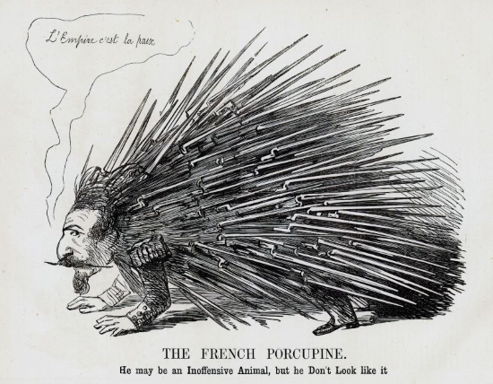
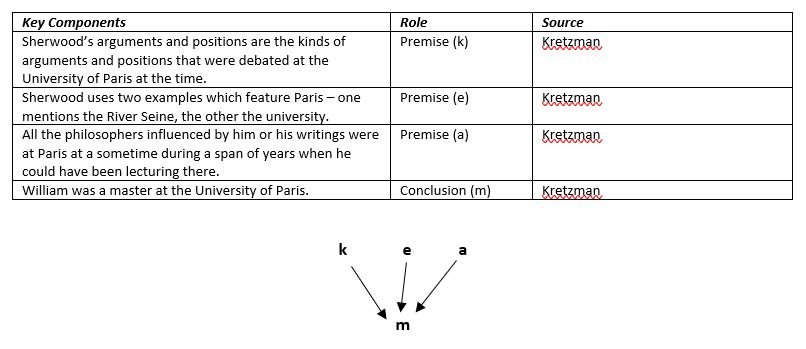
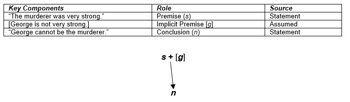
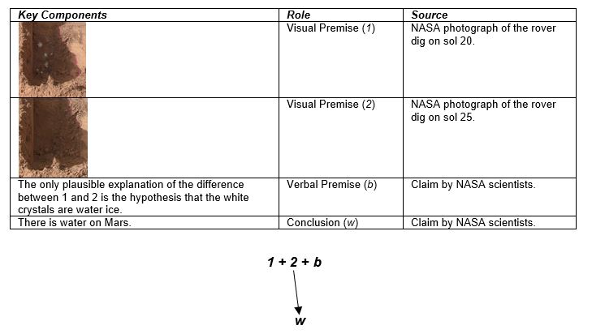

# Informal Logic
**First published Mon Nov 25, 1996; substantive revision Wed Jan 28, 2026**

*Groarke, Leo*

Informal logic (“IL”) is the study of reasoning and inference as they occur in public discussion and debate, educational and intellectual pursuits, interpersonal exchanges, and law, medicine and other “real-life” contexts. IL understands the aim of argument to be the “epistemic betterment” that accompanies belief, understanding, and claims to knowledge that are made more credible by argument. Different informal logics support this aim by providing varying (sometimes competing) accounts of argument, evidence, proof, and justification. The development of these accounts is grounded in an instrumental outlook that emphasizes their usefulness in the evaluation of everyday arguments.

Blair 2015 identifies two key methodological tasks for informal logic: (i) the development of ways to identify (and “extract”) ordinary arguments from the real life exchanges in which they occur; and (ii) the development of methods and tools that can be used to assess their strength and cogency.

Contributions to IL logic include many studies of specific kinds of arguing. The overriding goal is a normative framework that can be applied to ordinary arguments. In pursuit of this goal, IL addresses topics which include: the nature and definition of arguing, argument, and argumentation; criteria for argument evaluation; argumentation schemes; fallacies; notions of validity; the ethics of arguing; the argumentative use of definitions (Hitchcock 2021)[^hitchcock-2021]; argument diagramming (“mapping”); cognitive biases; the history of logic and argument analysis; artificial intelligence (AI); feminist accounts of argument; the extent to which arguing as a practice is inherently collaborative or adversarial (see Stevens and Cohen 2019, Battersby and Bailin 2021; and Govier 2021)[^battersby-2021][^govier-2021][^stevens-2019]; and the different norms associated with arguing in different kinds of contexts.

[Puppo 2019](http://windsor.scholarsportal.info/omp/index.php/wsia/catalog/book/123) provides a series of articles that discuss the roots and the nature of informal logic, and many of the key issues it addresses.

## 1. History

The term “informal logic” was popularized in the 1970s, most notably by Johnson and Blair, who established the *Informal Logic Newsletter* and then the journal *Informal Logic*. The roots of informal logic are much older, making it a sophisticated version of historical attempts to create and disseminate a logic that can be used to explain, systematize, assess, and teach the use of argument for practical purposes.

The roots of informal logic as it is now understood are tied to the history of Western Philosophy, though it is increasingly evident that other philosophical traditions have much to contribute to the study of the issues that are the focus of IL. Five prominent traditions from the past: ancient Greek, classical Indian, classical Chinese, medieval Latin, and medieval Islamicate philosophy are discussed in the “historical supplement” to the article on argument and argumentation in this encyclopedia.

In the 5th century B.C.E., the First Sophistic is a relevant movement motivated by the notion that one can teach the art of *logos* in a way that can be effectively employed in public argument and debate (see Tindale 2010)[^tindale-2010]. In the century that follows, Aristotle’s logical and rhetorical works — most notably the *Prior Analytics* and the *Rhetoric* — provide a systematic account of logic and argument which can be applied to an impressively broad range of real-life arguments. Groarke (2021) suggests that Aristotle is the “forefather” of today’s informal logic.

In modern times, *The Port Royal Logic* (Arnauld and Nicole 1662, originally titled *Logic or the Art of Thinking*)[^arnauld-1662] is an attempt to outline a logic that can guide everyday reasoning. It is a celebrated (but also disdained) introduction to the art of arguing that has been published in more than fifty French editions and five popular English translations. It understands “logic” to be “the art of directing reason aright, in obtaining the knowledge of things, for the instruction both of ourselves and others” (25). It provides a practical account of good and poor argument, discussing fallacies, syllogisms, definitions, and deductive and probable reasoning, emphasizing real rather than concocted examples of argument (for a good account of it that highlights its relevance to informal logic, see Finocchiaro 1997)[^finocchiaro-1997].

One finds other analogues of contemporary attempts to study and teach informal reasoning in nineteenth century textbooks on logic and on rhetoric. Richard Whately’s work is of special note in this regard. His began his educational career as professor of political economy at Oxford; was subsequently appointed the Archbishop of Dublin; and attempted to establish a non-sectarian system of education in Ireland. In support of the latter, he published texts on reasoning. In many ways, his [*Elements of Logic*](https://babel.hathitrust.org/cgi/pt?id=mdp.39015063020500&view;=image&seq;=) and *Elements of Rhetoric* (1826, 1830) are early analogues of today’s informal logic textbooks.

Another important nineteenth century text, critical of Whately, but also published to promote good arguing in real-life contexts, is Mill’s *A System of Logic* (1882) (see Godden 2014)[^godden-2014]. According to Mill’s account, logic is the “art and science of reasoning,” and “to reason is simply to infer any assertion from assertions already admitted.” The end result is a broad account of inference designed to inform real-life instances of argument.

The term “informal logic” first occurs in the last chapter of Gilbert Ryle’s book *Dilemmas* (1954). It suggests that philosophy needs an informal logic to address arguments that are more varied, less strict, and less clearly defined than those that can be analyzed by applying formal logic.

In North America, the rise of informal logic is tied to a similar dissatisfaction with logic’s then prevalent focus on the ‘formal’ aspects of argumentation. It reflected aspirations to mathematize’ logic in a context strongly influenced by the study of mathematical logic in the work of Frege, Russell, Hilbert etc.

The informal turn was tied to educational trends of the 1960s — a time of social upheaval and protest (most notably, against the War in Vietnam). In universities and colleges, this fueled calls for courses that were more relevant to the issues of the day. In the case of logic, some pushed for an emphasis on the study of real-life arguing that expanded the discussions in the introductory textbooks of the day – books like Copi’s popular *Introduction to Logic* (first published in 1953 and still in use in later variants that have extended its account of informal arguments).

In *Logic and Contemporary Rhetoric: The Use of Reason in Everyday Life* (1971), Kahane fully embraces real life arguing, discussing a wide range of arguments from newspapers, mass media, advertisements, books, and political campaigns. Other attempts to provide a general introduction to logic — by Carney and Scheer (1964), Munson (1976)[^munson-1976], and Fogelin (1978)[^fogelin-1978] — used the term “informal logic” to distinguish between formal logic and other methods of argument analysis.

The idea that informal logic should be developed as a distinct field of inquiry was championed by Johnson and Blair at the University of Windsor. They published a popular textbook, *Logical Self-Defense* (1977); organized, hosted, and published the proceedings of “The First International Symposium on Informal Logic” (Blair and Johnson, 1980)[^blair-1980]; established the *Informal Logic Newsletter* (1978–1983); and ultimately turned the latter into the journal *Informal Logic* (subtitled “Reasoning and Argumentation in Theory and Practice”). In this and other ways, they established informal logic as a distinct field for study, research and development. Their contributions (and those of colleagues at Windsor, in Ontario, and in Canada) is reflected in suggestions that informal logic is a Canadian (or, more narrowly, Windsor) school of argument (see Puppo 2019)[^puppo-2019].

The discussion that has shaped IL as a field of inquiry has included articles in a number of other journals that have played a major role in its development. They include *Argumentation*, *Philosophy and Rhetoric*, *Argumentation and Advocacy* (formerly the *Journal of the American Forensic Association*), *Teaching Philosophy*, *Cogency* and (more recently) *Argument and Computation*.

A key catalyst that continues to promote the development of informal logic is the Critical Thinking Movement (“CT”) within education (see Ennis 2011 and Blair 2021)[^blair-2021][^ennis-2011]. It aims to make the critical scrutiny of our beliefs and assumptions a fundamental goal of education at all levels, underscoring the significance of reasoning, inference, argument and critical assessment skills.

In 1980, a California State University Executive Order promoted the teaching of critical thinking and informal logic, requiring formal instruction in critical thinking in post secondary institutions. According to the order: “Instruction in critical thinking is to be designed to achieve an understanding of the relationship of language to logic, which should lead to the ability to analyze, criticize, and advocate ideas, to reason inductively and deductively and to reach factual or judgmental conclusions based on sound inferences drawn from unambiguous statements of knowledge or belief” (Dumke 1980, Executive Order 338)[^dumke-1980].

The accounts of argument that informal logic and the Critical Thinking movement emphasize are widely used in attempts to teach students and learners how to reason well (and are a staple in the “Philosophy for Children” movement). One result has been hundreds (perhaps thousands) of introductory textbooks used to teach logic, critical thinking, and argumentation skills to university and college students in Canada, the United States, the United Kingdom, Italy, Poland, Chile, and other countries.

The educational issues raised by informal logic are manifest in the development of critical thinking tests which attempt to measure argumentation skills. Critical thinking (or, even more so, creative thinking) skills are not easily assessed using standardized tests which are designed for large scale use, and typically rely on multiple choice question and answers (see Sobocan 2021)[^sobocan-2021].

In real life contexts, what counts as good arguing (and thinking) is open ended and unpredictable, dialectical, and influenced by pragmatic and contextual considerations which are difficult to incorporate within standardized tests. The California Critical Thinking Test reflects the view of critical thinking elaborated in “The Delphi Report,” commissioned by the American Philosophical Association in 1987, a report that focuses on a narrow range of critical thinking skills which tends to oversimplify the competencies required for good informal argument. Ennis 2013 provides a comprehensive proposal for dealing with the issues raised by critical thinking tests, and with other challenges raised by attempts to teach critical thinking.

IL textbooks (in English) offer a number of theoretical and pedagogical innovations. Established texts include Battersby 2016 (*Is That a Fact? A Field Guide for Evaluating Statistical and Scientific Information*, 2nd ed.); Bowell, Cowan, Kemp 2019 (*Critical Thinking: A Concise Guide*, 5th ed.); Browne and Keeley 2018 (*Asking the Right Questions*, 12th ed.); Govier 2019 (*A Practical Study of Argument*, 7th ed.); Groarke, Tindale and Carozza 2025 (*Good Reasoning Matters!*, 6th ed.); Hughes, Lavery and Doran 2014 (*Critical Thinking: An Introduction to the Basic Skills*, 7th ed.); Seay and Nuccetelli 2012 (*How to Think Logically*, 2nd ed.); Weston 2018 (*A Rulebook for Arguments*, 5th ed.); and Wilson 2020 (*A Guide to Good Reasoning: Cultivating Intellectual Virtues*, 2nd ed.).

In Poland, Ajdukiewicz’s *Pragmatic Logic* (1974) is an introductory account of an independently developed “pragmatic logic” which is comparable to informal logic, promoting tools of logic as a central element of general education. It aims to ensure that students think clearly and consistently, express their thoughts and ideas systematically and precisely, and justify their claims with proper inferences (see Koszowy 2010)[^koszowy-2010].

In part because reasoning and argument are ubiquitous and of broad interest, the evolution of informal logic has been influenced by cognate fields which analyze argumentation in some way. The latter include formal logic, speech communication, rhetoric, linguistics, Artificial Intelligence (AI), discourse analysis, feminism, semiotics, cognitive psychology, and computational modelling. Considered in this broader context, informal logic is a subfield of a broader multi-disciplinary attempt to develop a comprehensive account of real life arguing (commonly called “argumentation theory”).

The development of informal logic and argumentation theory have been spurred by numerous international conferences hosted by organizations committed to the study of argument. Key conferences include ten Amsterdam conferences hosted by the International Society for the Study of Argumentation (ISSA); thirteen Windsor conferences hosted by the Ontario Society for the Study of Argumentation (OSSA); six Tokyo Conferences on Argumentation hosted by the Japanese Debate Association (JDA); five meetings of the European Conference on Argumentation (ECA); ten meetings of the International Conference on Computational Models of Argument (hosted by COMMA), and numerous events and workshops on issues ofa rgumentation, dialogue, and persuasion organized by the Polish group ARGDIAP.

One of the early driving forces behind the development of informal logic as a discipline was a desire for a logic that contained tools for argument analysis and assessment above and beyond the standard formal logics of the day (propositional logic, truth tables, syllogisms, the predicate calculus, modal logic, etc.). In his account of the rise of informal logic, Johnson emphasizes a “dissatisfaction with formal logic as the vehicle for teaching skill in argument evaluation and argument formation” and a “desire to provide a complete theory of reasoning that goes beyond formal deductive and inductive logic” (2014, p. 11). Ryle never developed a system of “informal logic,” but his remarks on the need for one point in the same direction.

Philosophers and logicians who teach introductory courses on argument and critical thinking have managed the issues this raises in a number of ways. In many cases, by mixing formal and informal methods of analysis. The artificial examples of argument that characterize early editions of Copi have been roundly criticized (see Johnson 1996 and Blair 2015)[^blair-2015][^johnson-1996], but other early textbook authors more successfully melded classical logic and real instances of argument. Harrison 1969 is an example; as are texts by Pospesel, who firmly anchors his discussion in real-life cases of reasoning (Pospesel and Marans 1978; Rodes and Pospesel 1991; and Pospesel 2002)[^pospesel-2002][^pospesel-1978][^rodes-1991]. Little 1980 developed a general approach to critical thinking and decision making that integrated propositional and syllogistic reasoning. The most recent editions of Copi’s famous text are now notable for the extent to which they emphasize real-life arguments (see Copi et. al. 2019)[^copi-2019].

Some informal logicians have responded to the formal/informal divide by moving in the opposite direction, developing versions of informal logic that do not utilize formal tools, borrowing alternative accounts of argument from philosophical reflection or other fields that study argument (notably, rhetoric, dialectics, and speech communication). Toulmin’s *The Uses of Argument* (1958/2003) and Hamblin’s *Fallacies* (1970) have become theoretical touchstones for those looking to root informal logic rooted outside of classical formal logic.

In a number of ways, variants of informal logic share some foundational notions with their formal cousins. Most significantly, both formal and informal logic share:

- a premise, inference, and conclusion conception of argument;
- the notion that a good argument has premises which are true (or epistemically acceptable in some way) and a conclusion which follows from them (making the inference the argument depends on “valid” in some way); and
- tools of argument assessment that recognize many arguments as instances of more generalized “schemes of argument” (which include standard deductive patterns of reasoning).

IL is informal rather than formal in two ways. First, because it focuses on arguments as they occur in natural language discourse rather than formal languages of the sort that characterize formal logic. The latter are notable for rigorously defined syntax, semantics, and grammar, and argumentation governed by precise proof procedures. In contrast, the arguments informal logic studies are notable for their use of everyday language; for the many complex norms that govern them in different contexts; and for diverse ways of making meaning (with pictures, facial expressions, non-verbal sounds, music, etc.) that they constantly employ. Today, the advent of AI is bridging the gap between these two kinds of language by creating formal models of argument that can more fully capture, replicate, and present arguing in ways that mimic natural language discourse.

IL is informal rather than formal in a second way in its theoretical and pedagogical discussions. In a way that is in keeping with the social and pedagogical goals that motivate its development, they tend toward an easily understood, broadly disseminated, account of the difference between strong and weak instances of real life reasoning that can be understood by everyday arguers. Formal methods (Venn diagrams; probability theory — see Zenker 2013; different kinds of formal logic; etc.)[^zenker-2013] may be usefully invoked in support of this ideal, but the overriding aim is doing so in ways that can be readily employed by ordinary arguers.

Within argumentation theory, informal logic is tied to studies of particular aspects of arguing (e.g., onus, burden of proof, or the norms that govern arguments in specific contexts); the analysis of arguments from historical, social, political or feminist points of view; the study of particular kinds of argument (e.g., those expressed in political works of art, those that arise in specific legal contexts); and the discussion of the assumptions, conditions (philosophical, epistemological, social, political, institutional, psychological, educational, etc.) which give rise to disagreement and argumentation in the first place.

Theoretically, argumentation theory unites three approaches to argument that have been associated with logic, rhetoric, and dialectics since ancient times. Logic treats an argument as an attempt to justify a conclusion, focusing on its epistemic merit. Rhetoric understands arguing as an attempt to persuade an audience, emphasizing its persuasive force. Dialectics understands an argument as an attempt to make a move in an exchange between interlocutors with opposing points of view, tying it to an interaction between argumentative opponents who argue back and forth.

Though informal logic emphasizes the epistemic merit of an argument, its development has been influenced by rhetorical and dialectical considerations, in view of the role that arguments play in public discussion and debate. For successful public arguments must convince some intended audience (the public, ornithologists, Members of Parliament, the readers of a particular magazine, etc.) of a point of view and convincing arguments must (as Johnson 2000 emphasizes)[^johnson-2000] provide answers to reasonable objections made by interlocutors who have opposing points of view. Bermejo Luque 2011 proposes a relevant theory of argument which aims to accommodate logical, rhetorical and dialectical points of view.

A comprehensive series of essays that introduce to the issues that matter to informal logic and argumentation theory can be found in Aikin, Casey and Stevens, 2025 (and the Bondy 2025 contribution to that anthology)[^bondy-2025].

## 2. Systems of IL

As Hansen (2012)[^hansen-2012] emphasizes, there are many different tools and methods informal logicians use to analyze and assess instances of argument. It would be a mistake to write as though there was *one* informal logic. As a field, IL is characterized by a shared goal (a logic of everyday argument) that is pursued in many different ways by commentators who propose and apply different systems of informal logic. In view of this, there are many different informal logic***s*** (as there are many different formal logics).

I will take an informal logic *system* to be a collection of principles and methods designed to serve the (epistemic) assessment of real-life arguments. Considered from this point of view, informal logic is a field devoted to the creation, study and application of systems of informal logic.

The first textbook that describes itself as an informal logic text is Munson’s *The Way of Words: An Informal Logic* (1976). As the title emphasizes, it aims to teach a system of informal logic that can be used to analyze and assess real-life arguments. Other approaches that imply other systems of informal logic are developed in other textbooks and in scholarly discussion.

Different informal logics vary in ways outlined in this article.

### 2.1 Defining “Argument”

The most basic notion in a system of IL is a concept of argument. In ordinary language, the word “argue” may mean “to disagree,” often with the implication that someone does so aggressively and with acrimony. Informal logic assumes a narrower conception of argument (sometimes called “argument-1”), understanding an argument as an attempt to resolve disagreement (or potential disagreement) by providing *reasons* in support of some point of view.

This notion of argument is “evidentiary” in the sense that it understands an argument as an attempt to provide evidence in favor of some conclusion. The *premises* in an argument convey the evidence it provides. As Hitchcock 2007 puts it, an argument is “a claim-reason complex” consisting of (1) premises, (2) a conclusion, and (3) an inference from the premises to the conclusion (establishing it as true, likely true, plausible, acceptable, or in some other way probative).

The following sentence, taken from an article in the *Houston Chronicle* (Devra Gartenstein 28/01/19) is an argument in this sense.

> EXAMPLE 1: Small businesses are important because they provide opportunities for entrepreneurs and create meaningful jobs with greater job satisfaction than positions with larger, traditional companies.

In this example, the word “because” functions as an inference indicator, telling us that the initial statement in the sentence (“Small businesses are important”) is a conclusion backed by a premise (that small businesses “provide opportunities for entrepreneurs and create meaningful jobs with greater job satisfaction than positions with larger, traditional companies”) providing reasons for believing that it is true.

EXAMPLE 2 is taken from an opinion piece (in the *Western Courier* 25/10/08) which criticizes conservative groups opposed to research using human embryos.

> EXAMPLE 2: This [opposition to embryonic research] is shortsighted and stubborn. The fact is, fetuses are being aborted whether conservatives like it or not. Post-abortion, the embryos are literally being thrown away when they could be used in lifesaving medical research.... Lives could be saved and vastly improved if only scientists were allowed to use embryos that are otherwise being tossed in the garbage.

This is an argument that can be summarized as follows.

> *Premise*: Fetuses are being aborted anyway (whether conservatives like it or not).
> *Premise*: Lives could be saved and vastly improved if scientists were allowed to use embryos that are otherwise being tossed in the garbage.
> *Conclusion*: The conservative opposition to embryonic research is shortsighted and stubborn.

Like EXAMPLE 1, this is a simple argument. In real life arguing, complex arguments may contain tens (or hundreds) of premises, and usually consist of layers of inference that proceed from initial premises to intermediate conclusions which are premises for further conclusions, culminating in some “main” or “principal” conclusion.

All systems of IL are attempts to understand and assess arguments in the premise/conclusion sense, but there are many variations of this basic concept. Sometimes it is expanded by defining an argument as a premise-conclusion complex which is directed at an *audience*, or backed by a *warrant*, or provided as an answer to a questioning *opponent*. Moves in these directions make an audience, warrant, and/or dialectical context an essential part of argument.

### 2.2 Theories of Argument

Different theoretical backgrounds often inform different systems of informal logic. The theoretical grounding for a particular IL may be located in a philosophical point of view, a theory of speech communication, or new or novel ways of evaluating real-life arguments (in Aristotle, in feminism, in rhetoric, in dialogue theory, in cognitive psychology, in formal logic, or in some combination of these and/or other points of view).

Theoretical underpinnings may demarcate a specific system of IL or, more commonly, a family of systems that share core theoretical commitments. Following Hamblin, some informal logicians have, to take one example, embraced fallacy theory as a way to build a logic of real-life arguing. In doing so they build systems of informal logic (as in the case of Paul and Elder 2019, or Bennett 2018)[^bennett-2018] but are at the same time, members of a broader family of informal logics that adopt the fallacy approach (but vary their definitions and lists of fallacies, or their accounts of other aspects of argument analysis).

### 2.3 The Language of Argument (**NL** and **NL+**)

A key element of informal logic is its focus on arguments as they occur within natural rather than formal languages.

Initially, most informal logic textbooks focused their attention on printed verbal arguments: arguments expressed and conveyed in printed words (in some established natural language). This emphasis reflects both the nature of these texts (qua books in print) and the extent to which arguments of this sort are the clearest example of the kinds of argument informal logic emphasizes — in letters to the editor; in parliamentary debate; in court proceedings; and in essays and books written in defense of some point of view (that humans could colonize Mars, that President Trump was mistaken, that socialism is the best political system, and so on).

When a system of informal logic is designed to analyze and assess verbal arguments of this sort, the language of argument they assume consists of the printed words and sentences (and the rules governing them) associated with the corresponding natural language (“NL”). This implies a complex and nuanced system of meaning that expands the possibilities of argument beyond the “informative” statements of fact that authors like Copi took to be the (only) legitimate realm of argument. One feature of this expanded realm is the extent to which metaphors and other figures of speech (traditionally understood as rhetorical figures) are used to support conclusions — something that must in some way be accounted for in a comprehensive account of real-life reasoning.

As informal logic has evolved, systems of IL have expanded to make room for real-life arguments which are not wholly defined by printed words. Oral arguments are verbal, but their meanings often depend on non-verbal elements like tone of voice and an arguer’s facial expressions. “Visual” arguments invoke photographs, illustrations, drawings, videos, etc. that provide evidence in support of some conclusion–as when a photograph or video is used to establish someone’s identity or show (and thereby “prove”) that they were present at the scene of a crime. As Hitchcock (2002)[^hitchcock-2002] notes, “a poster with a giant photograph of a starving emaciated child and the words ‘make poverty history’ can reasonably be construed as an argument.”

In most cases, they have verbal as well as visual elements and are, in view of this, an amalgam of verbal and non-verbal (visual) elements. The two photographs in EXAMPLE 3 (below), taken by the NASA Mars rover Phoenix, were key components of a visual argument proposed by NASA scientists. The first provides an initial view of a dig made by Phoenix; the second a view of the same dig four Martian days (sols) later. When one visually examines at the bottom left hand corners of the photographs, one sees white crust in the first but not the second image. According to the NASA scientists, the only way to plausibly explain the difference one sees is by understanding the crust as water ice that evaporated when the dig exposed it to the sun. In this way, the photographs provide evidence that there is water on the planet Mars.

*EXAMPLE 3*

We can summarize the argument as follows.

> EXAMPLE 3:
> *(Visual) Premise*: What we see in the bottom left hand corner of the first photograph of the dig.
> *(Visual) Premise*: What we see in the bottom left hand corner of the second photograph of the dig.
> *(Verbal) Premise*: The most plausible way to explain the changes we see (the disappearance of the white crust) is by understanding it as water ice.
> *Conclusion*: There is water on the planet Mars.

This argument depends on visual and verbal premises. Visual premises because our *seeing* of the difference between the photographs is a non-verbal way of providing evidence that supports the conclusion. The argument combines this visual element with a key verbal component provided by the scientists’ explanation of this seeing. The conclusion is established by combining these visual and verbal components.

When a system of IL recognizes visual arguments of this sort, the language it assumes can be understood as NL+, where the + sign indicates that the language of argument includes words *and* non-verbal elements like images and non-verbal sounds.

One might compare the expansion of IL’s scope to account for visual arguments to the attempt to expand the language of formal logic (and, some argue, the notion of argument it embraces) to allow visual deductions (see Barwise and Etchemendy 1998)[^barwise-1998]. Visual premises are often used in geometric proofs, in legal arguments (to prove that the murder was heinous, etc.), in reasoning about geology, biology, planets, stars and black holes, and in aesthetic criticism and evaluation. In ornithology, a well authenticated, clear photograph of a species like the Ivory Billed Woodpecker is widely accepted as the proper proof that it is not extinct.

In other cases, a visual image may serve as a conclusion which is backed by visual and/or verbal premises. A forensic artist concludes that their drawing of a suspect depicts what they look like by inferring this from verbal and visual evidence which is provided by the witnesses they interview.

[Kjeldsen 2015](https://link.springer.com/article/10.1007/s10503-015-9348-4/fulltext.html) has provided a comprehensive overview of the early study of visual arguments (for more recent discussions, see Dove 2025, Liao 2025, and Groarke 2025b)[^groarke-2025b][^liao-2025]. Informal logics that recognize visual arguments do so for the same reason that they recognize verbal arguments: to account for the kinds of arging that occur in real- life discourse and exchange. The use of images in arguments is increasingly significant at a time when advances in digital communication facilitate the creation and distribution of visual images, increasing the use of photographs, videos, art, political cartoons, virtual reality, 3D modeling and other kinds of images in arguments (see Godden, Palczewski, and Groarke, 2016)[^godden-2016].

As is the case with words, the images used in visual arguments may not be literal depictions of something they represent, but function instead as visual metaphors which characterize some situation in an argumentatively charged way.

The cartoon of Napoleon III below (EXAMPLE 4) appeared in *Punch* on Feb. 19, 1859.

*EXAMPLE 4*

This is a clever caricature, something more than a simple caricature, for the cartoonist uses a drawing of Napoleon-as-porcupine to convey a *reason* to doubt his profession of peace. We might summarize the point as the suggestion that Napoleon’s actions– his amassing of the armaments which encircle him like quills on a porcupine–are not the actions of someone committed to peace. The picture invites the viewer to respond to him as one would respond to an actual porcupine–with caution, concern and suspicion, wary of what he might do with his weapons (even though he has an “inoffensive” posture and professes peace).

The argument we can extract from the cartoon can be understood as follows.

> *Premise*: Napoleon declares that “The Empire embodies peace” (“L’Empire c’est la paix”).
> *Premise*: Napoleon has surrounded himself with many armaments (like a porcupine surrounds itself with quills).
> *Conclusion*: Napoleon seems inoffensive when he says that “The Empire embodies peace,” but his build up of him armaments shows that we should be wary of the empire he has built.

This is a visual argument because it depends on visual meanings (conveyed with an NL+ rather than a mere NL). The verbal paraphrase summarizes the apparent logic of the argument, though the non-verbal visual elements leave open the possibility of further interpretation. Notably, the Napoleon-III-as-porcupine caricature may be an allusion to a different “Louis” King of France–to Louis XII, who ruled from 1498 to 1515. On this interpretation, the argument claims that Napoleon III is acting like Louis XII, who rebuilt the French army (and harnessed its power in military campaigns), suggesting that this provides another reason to be wary of him. The reference makes visual sense given that Louis XII was known as the “porcupine” King of France, having adopted the animal as his royal emblem–an emblem he favoured because it was popularly believed that a porcupine could shoot its quills, symbolizing an army’s ability to shoot.

In many circumstances, as in this one, the visual elements of an argument (like many words in arguments) are open to multiple interpretations. In the practical evaluation of arguments, the simplest way to mange this is by identifying, distinguishing, and evaluating all the plausible interpretations of an argument.

### 2.4 Multimodal Arguing

Informal logicians who advocate for systems of IL that broaden the language of argument from NL to NL+ sometimes expand the standard notion of argument still further, beyond verbal and visual arguments, to make room for other ways of arguing.

This reflects the role of non-verbal carriers of meaning in real-life discourse, something that allows many different semiotic modes to play a role in arguments. In view of this, some argue that a fully comprehensive account of real-life argument must include a “multimodal” account of meaning which recognizes many different *modes of arguing* (see Kišiček 2025, Tseronis and Forceville 2017, and [Groarke 2015](https://link.springer.com/article/10.1007/s10503-014-9336-0)). The modes in question are intended as a way to make room for the role that gestures, facial expressions, sounds of different sorts, prosodic speech, tastes, smells, musical notes, and a host of other non-verbal phenomena play in arguing.

The “auditory” (or “acoustic”) modes of arguing is employed when reasoning depends on non-verbal sounds (see Groarke 2018 and Kišiček 2014)[^groarke-2018][^kišiček-2014]–when a siren is taken as evidence that the police are on their way, the sound of an automobile engine (or an irregular heart) is the basis of an inference to the conclusion that it has a leaky valve, and so on.

Other modes of arguing invoke the senses in other ways. p> Here is an example from a wine tasting.

> EXAMPLE 5:
>
> A wine steward attempts to convince a customer that Napa Valley “Frogs Leap PS 2015” is an exceptional Petite Syrah by quoting high praise in a wine guide, and by handing them a glass, inviting them to taste it.

In this case, the steward provides evidence for the claim that Frogs Leap PS 2015 is an exceptional Petite Syrah in two ways: (i) via a verbal premise that cites the authority of a wine guide, and (ii) via a taste test that aims to support this conclusion. In the first case, the result is a verbal appeal to authority, in the second an argument from taste.

In 2019, Space Cargo Unlimited and the University of Bordeaux’s wine institute (the ISVV) shipped fourteen bottles of Château Petrus to the International Space Station to determine how a year in space would affect their taste and character. A year later, the wine returned to earth, where it was analyzed. The methods of analysis included a blind tasting by 12 sommeliers who compared the wine from space to bottles of the same vintages that had remained on earth. They concluded that the wine that had been in space had a different, distinct (“more evolved”) taste. The conclusion that this is true depends on an argument from authority, but the conclusions of the sommeliers themselves are based on an argument from taste (the tastings they compared functioning as ‘taste premises’).

In real life arguments different modes are often mixed. In the case of verbal arguments, the meaning of oral arguments often depends on the prosodic features of an arguer’s voice — features that can convey meanings beyond those inherent in the words they utter. As Gilbert (1997) says, uttering the sentence “Fine, fine, you’re right, I’m wrong, we’ll do it your way,” “can indicate agreement with what has been said if presented flatly and intended sincerely, or, if accompanied by an expression of anger, can mean that the respondent does not agree at all, but is capitulating.” (pp. 2–3) Kišiček 2014 highlights the important role that the paralinguistic features of oral arguments play in many instances of verbal argument.

### 2.5 Emotional (Visceral, and Kisceral) Modes of Arguing

Michael Gilbert was the first informal logician to suggest that there are different “modes of arguing.” His “multi-modal” theory (with an emphasis on the hyphen) understands arguing as an attempt to resolve disagreements that arise when interlocutors have conflicting attitudes, beliefs, feelings and intuitions. Successful arguments bring about the “coalescence” of competing points of view.

Gilbert 1997 provides a book length exposition of his theory. It suggests that traditional logical and philosophical ideals promote a “classical logical” mode of argument. Arguing in this mode is dispassionate and unemotional, aiming at truth that is established via sequences of verbally defined propositions that abide by strict, linear notions of proof. Gilbert believes that arguments of this sort play a role in attempts to resolve real-life disagreements but maintains that such attempts frequently employ other modes of arguing.

In his discussion, Gilbert identifies three alternative modes tied to “emotional,” “visceral” (physical) and “kisceral” (intuitive) arguments. Arguing in these modes invokes emotions and attitudes, physical demonstrations and difficult to define intuitions. In many cases they are communicated via non-verbal semiotic modes. This means that a forlorn look or tears may count as premises in an argument when they are used to promote coalescence (and inference in this broad sense). One example is “an argument friends had about whether a woman could be a police officer. The man said, ‘Women can’t be cops’ and the woman replied by flipping him over her shoulder. This was an argument, and it was visceral in nature.” (Gilbert and Carozza, 2024)

Like multimodal, semiotic modes, Gilbert’s account of modes radically expands what counts as argument beyond the printed language emphasized in early versions of IL (moving from L to a very broad L+). In an account of the “anthropology” of argument, Tindale 2021 defends the alternative “logics” that Gilbert’s views make possible.

### 2.6 Narratives as Argument

The expansion of IL in ways designed to recognize for an ever-broader range of ways in which arguments can be conveyed is evident in discussions of the use of stories in argument. One finds an illustrative example in Plato’s *Republic*, where Glaucon uses the mythical story of “The Ring of Gyges” to prove that humans are inherently selfish. In this and many other situations, different kinds of stories (anecdotes, accounts of some historical event, biographies, fables, parables, morality plays, etc) are designed to “prove” some point of view. It has often been said that a novel is an argument for socialism, freedom of expression, or some other value.

The argumentative use of narratives can be understood in a variety of ways: as rhetorical embellishment, as a form of generalization (the characters in a story functioning as variables), as argument by analogy, or as reasoning that requires the development of unique standards of argument assessment. According to Fisher 1987, argument itself is best understood as narrative. According to Nussbaum 1990, literature is a way to better understand, and argue about, complex moral situations. Within informal logic, Walton, Reed, and Macagno 2008 identify narrative-based schemes of argument while others continue to debate the role that narratives play in ordinary argument (see Govier and Ayer 2013, Olmos 2014, Plumer 2015)[^olmos-2014][^plumer-2015].

### 2.7 Comparing Systems of IL

The study of IL still focuses on the study of particular systems of informal logic and the ways and their application to specific kinds of argument. One key question is the extent to which they can be said to be “complete”–insofar as they provide a logic that can account for all arguments within their scope or, more broadly, the extent to which they can provide a comprehensive account of the many different forms of argument that occur in real-life reasoning. Other meta issues include questions that might be asked about the relationship between different informal logics.

Groarke 2020 has outlined a “BLAST” approach to the identification and definition of systems of IL. It defines a specific informal logic system IL, as I = {B,L,A,S,T} where:

- B = the theoretical background that informs IL,
- L = the language used to express arguments,
- A = a concept of argument,
- S = a way to “standardize” arguments, and
- T = tools and methods for testing the strength of arguments.

A particular IL can be defined by outlining and explaining each of its five BLAST elements. Once defined, different systems of informal logic and the elements they contain can be compared, contrasted, and evaluated. Historical precursors of IL, formal logics, and other systems of reasoning can be included in a review of systems of this sort.

Systems of informal logic that adopt a fallacy approach can be summarized as instances of IL in which IL = {B,L,A,S,T}, where: B = Fallacy Theory, and T = a set of fallacies used to judge instances of argument. An even narrower set of (“Hamblin”) systems, rooted in Hamblin 1970, can be defined as systems in which B = Hamblin 1970.

In a deductivist system of informal logic, the V in the AV criteria for good arguments is this classical notion of validity. Different sets of argument schemes (or the elementary forms of argument in the Periodic Table of Arguments) can function as general AV criteria that define a corresponding informal logic.

Popular versions of IL tend to combine different ways of evaluating arguments. In view of this, T in a system tends to be some combination of tools that can be used in this endeavor. In most cases, T = {F, AV, AS}, where F is some list of fallacies; AV provides criteria for judging premise acceptability and validity (deductively, inductively, conductively, and/or abductively, etc.); and AS is some set of argumentation schemes. That said, systems of informal logic can accommodate other, less common criteria for deciding whether arguments are good or bad, strong or weak–criteria founded on a virtue-based approach to argument (see [Virtues and Arguments)](https://www.academia.edu/5620761/Virtues_and_Arguments), on feminist principles, or on notions derived from rhetoric, theories of communication, or other cognate fields.

The issues raised by the different kinds of standards that govern arguing in different kinds of dialogue can be be accommodated by formulating complex testing systems that include different criteria which apply to different kinds of dialogue. An over-arching system that aggregates these different criteria may be the best way to build a truly comprehensive account of real life reasoning.

## 3. Standardizing Arguments

The ultimate aim of informal logic is normative: i.e. logics that provide us with tools that can be used to evaluate real life arguments and the key elements they contain. Because there are many contexts in which the latter are unclear or not explicit, a first step in the analysis of a real-life argument is an attempt to “standardize” the argument by identifying its premises, conclusions, and inferences.

This can be a complex process that must untangle issues that obscure the structure and content of a real-life argument. Standardizing clarifies the structure of an argument in ordinary discourse by:

- discarding irrelevant and distracting digressions, repetition, and remarks (“noise”) which do not play a role in the reasoning the argument contains;
- restating the content of rhetorical questions (“Can anyone seriously believe...?” “Could the defendant have been in two places at once?”)and other stylistic devices that may obscure the meaning of the argument’s components;
- clarifying incomplete, vague or ambiguous claims and utterances; and/or
- recognizing components of the argument which are not explicitly expressed.

Different systems of IL may standardize arguments in different ways. In its simplest form, a standardized argument is a list of premises and a conclusion (the argument’s inference is the implied move from the premises to the conclusion). EXAMPLE 6 can be standardized as follows.

> EXAMPLE 6:
>
> - The weather report indicates heavy rain this afternoon, so you should take an umbrella to work.
>
> EXAMPLE 6 STANDARDIZED:
>
> - *Premise*: The weather report indicates heavy rain this afternoon.
> - *Conclusion*: You should take an umbrella to work.

In EXAMPLE 6, the word “so” functions as an “inference indicator”. It tells us that the claim that follows is a premise offered in support of the conclusion which precedes it. In other cases, words like “for,” “given that,” “since,” are ways of introducing premises, while words like “so,” “hence,” “thus,” “therefore,” are used to introduce conclusions. Verbal inference indicators are a helpful, but not necessary or sufficient, sign of argument. For indicator words can be used in other ways (“because” may indicate an explanation rather than an argument, a causal connection, emphasis of some sort, a temporal order, etc.), and everyday arguers tend to treat them as unnecessary when a context makes it clear that they are providing reasons for a conclusion.

### 3.1 Implicit Premises and Conclusions

One issue that frequently arises in standardization is an argument’s dependence on premises and conclusions which are not explicitly stated.

The following report from the New Hampshire *Rockingham News* (30/8/2002) comments on a court case which sent the organizer of dog fights to jail for cruelty to animals.

> EXAMPLE 7:
>
> A co-ordinator for the Humane Society supported a prison sentence, claiming that the minor penalties normally associated with misdemeanor convictions are not a sufficient deterrent in this case.

We can standardize the co-ordinator’s argument as follows.

> *Premise*: The minor penalties normally associated with misdemeanor convictions are not a sufficient deterrent in this case.
> *Implicit Premise 1* Penalties for crimes should have a deterrent effect.
> *Implicit Premise 2*: Prison will have a more sufficient deterrent effect.
> *Conclusion*: A prison sentence, but not the minor penalties normally associated with misdemeanor convictions, is appropriate.

In an analysis of the argument it is important to recognize the assumptions rendered as *Implicit Premise 1* and *Implicit Premise 2* (which provide a “warrant” for the inference). For these are claims the argument depends on. If it is not true that penalties for crimes should have a deterrent effect, or not true that prison has such an effect, then the premises of the argument do not establish its conclusion.

Recognizing an argument’s implicit premises prepares the way for argument evaluation, for these premises, like an argument’s explicit premises, need to be evaluated when the argument is assessed. If we reject the implicit premises (in the present case, by arguing that the goal of criminal penalties should be restitution, not deterrence), then the argument fails to provide convincing evidence for the conclusion it proposes.

Arguments with implicit premises or conclusions are recognized in traditional discussions of *enthymemes*: syllogisms with unstated premises. A contemporary example is the American Vice-President Dick Cheney’s defense of the Bush administration’s decision not to try foreigners charged with terrorism offenses as prisoners of war (to avoid granting those accused of terrorism the same legal protections).

> EXAMPLE 8 (from a report in the *New York Times*, 15/11/2001):
>
> “The basic proposition here is that somebody who comes into the United States of America illegally ... is not a lawful combatant.... They don’t [therefore] deserve to be treated as a prisoner of war.”

We can standardize the argument as:

> EXAMPLE 8:
> *Premise*: Anyone who comes into the United States of America illegally ... is not a lawful combatant.
> *Implicit Premise*: All people who deserve to be treated as prisoners of war are people who are lawful combatants.
> *Conclusion*: Anyone who comes into the United States of America illegally doesn’t deserve to be treated as a prisoner of war.
>

As in many other cases, this argument’s implicit premise identifies the link that ties the explicit premise to the conclusion. In other enthymemes, the conclusion of an argument may be implicit. In a debate over the question whether witnesses to a particular crime can be trusted, an arguer might state: “*They* are friends of the accused, and no friends of the accused can be trusted.” In this context, such claims clearly imply that the witnesses cannot be trusted. This is a claim that needs to be recognized as an implicit conclusion in an attempt to standardize this argument.

As in the case of verbal arguments, implicit premises and conclusions play a role in visual and multimodal arguments. In EXAMPLE 9 (below), the title “Just Add Vodka” is superimposed over a gigantic bottle of vodka splashing its contents onto the scene below. Outside the resultant vodka splash, we see a sleepy rural hamlet. Inside the splash, the hamlet is transformed into a bustling cityscape complete with skyscrapers, a nightlife, search lights, people, nightclubs, bars, and restaurants.

*EXAMPLE 9*

The image in the advertisement is an obvious visual metaphor which suggests that vodka can transform one’s life in the way that it transforms the scene in the advertisement, turning the (dreary) life one lives in a sleepy hamlet into the kind of exciting nightlife one finds in a cosmopolitan urban center. Insofar as it is featured in an advertisement, we can plausibly understand this message as a *reason* why one should “Just add Vodka.”

We might standardize this visual argument as follows.

> EXAMPLE 9:
> *(Visual) Premise*: The image [which conveys the message that adding vodka can transform your sleepy night life, as it transforms the quiet village in the image into an exciting urban landscape]
> *Implicit Premise*: An exciting urban nightlife is preferable to a quiet night in a village.
> *Conclusion*: You should “Just Add Vodka” to your life.

I have treated the image in the advertisement as the first premise in this argument because it is the metaphorical transformation it visually depicts that is the core claim that it depends on. The implicit premise in the argument is not explicitly stated (verbally or visually) but it is a key assumption that allows the move from the visual premise to the verbal conclusion.

So understood, we can critique the argument in poster, for this analysis reveals it as an argument with a dubious visual premise (that vodka can transform your sleepy life into one of urban excitement); a questionable implicit premise (for one might in many ways argue that life in a quiet village is a better life than one in the middle of a bustling metropolis), and an inference which is an instance of the fallacy “Affirming the Consequent”(for there are better ways to secure an exciting nightlife, if that is what one is after).

The attempt to identify implicit premises or conclusions in an argument raises some significant theoretical questions, for all arguments rely on (many) assumptions, and unstated premises or a conclusion can often be interpreted in different ways. One principle often used in choosing between alternative interpretations of an implicit argument component is the “Principle of Charity.” It favors an interpretation of an argument which makes the argument as credible as possible. In many situations, this can best be accomplished by assigning the argument a “logically minimum” implicit premise, understood as the weakest component needed to successfully connect the argument’s premises to its conclusion.

### 3.2 Key Component Tables and Diagrams

Standardizing arguments by listing their premises and conclusions is one way to delineate the content of an argument and prepare it for evaluation. But standardizing of this sort does not distinguish between different kinds of inferences an argument may contain. One way to address the issues that this raises is by standardizing an argument with a table that catalogues an argument’s premises and conclusions (with a Key Component or “KC” table), combining it with an argument diagram (a “mapping”) that depicts the inferences it depends upon.

In EXAMPLE 10 (below), I have used this method to standardize an argument that Kretzmann uses in his account of the medieval philosopher William of Sherwood, whn he concludes that it is likely that William was a Master at the University of Paris. The first column of the KC table lists the premises and conclusion of the argument; the second assigns them their role as premise or conclusion; the third lists the source from which they are derived. The diagram that follows depicts the relationships between the argument’s key components, using arrows to indicate the inferences it includes.

*EXAMPLE 10*

This form of standardization depicts the Sherwood argument as one that is supported by three independent “convergent” premises that provide three separate reasons for thinking that the argument’s conclusion is true.

In other instances of argument, two or more “linked” premises combine to support a conclusion with a single inference. The argument “The murderer was very strong, so George cannot be the murderer.” (EXAMPLE 11) is an enthymeme which assumes that “George is not very strong.” Using square brackets ([ ]) to indicate this implicit component, we can standardize the argument with the following KC table and diagram. In this case, the linked premises are indicated with a plus sign (“+”) that indicates that they support the argument’s conclusion (only) when combined.

*EXAMPLE 11*

When arguments have non-verbal key components, visual and multimodal premises and conclusions can be recognized in a key component table by ostension, or by reproducing them in some way. Once they are identified in a KC table, the inferences such arguments depend on can be mapped in standard ways. The following table and diagram standardizes EXAMPLE 3 (above). It shows that it contains an inference from three linked premises (two visual and one verbal) to the conclusion that there is water on the planet Mars.

KC tables and diagrams are not the only way to diagram the structure of real life arguments. Diagramming (“mapping”) has its own history, which incorporates a great many ways of diagramming the inferences in arguments. The utility of diagramming is already recognized in Whately 1826 and, in the early twentieth century, in Wigmore 1913. The latter develops a form of mapping (“evidence charts”) specifically designed to portray and analyze complex chains of judicial reasoning.

The development of AI has kindled a renewed interest in forms of IL diagrams supported by the development of associated software (Rationale, Reason!Able, Araucaria, Athena, Compendium, Theseus) and online aids (Debate Mapper, TruthMapping.Com, Argunet, Agora).

### 3.3 “Supplemented” Standardizations

Standardizing prepares the way for argument evaluation by clarifying the inference structure and the content of an argument. Other features of an argument that are relevant to its assessment can be included in a “supplemented” standardization that includes a description of the context in which an argument is embedded. Three aspects of arguments merit note in this regard.

Rhetoric emphasizes the *audience* to which an argument is addressed. Rhetorical effectiveness is a secondary interest when one evaluates an argument from a logical point of view. But successful arguments used in an attempt to convince a specific audience of some point of view must be logically and rhetorically successful. A convincing argument for the conclusion that the United Nations cannot be trusted must, in view of this, address different issues when it is directed at a Chinese, Norwegian, Kenyan, Israeli, Swiss, Palestinian, etc. audience. As rhetoric emphasizes, this means that successful arguers must construct their arguments in ways that respond to the beliefs, attitudes and values of their intended audience (and in this sense ‘speak’ to them–see Tindale 2010, 2025)[^tindale-2025][^tindale-2010].

The goals of arguers are a second contextual factor that is may be pertinent to note when one supplements the standardization of an argument. As Hitchcock 2002 points out, acts of arguing may make a declaration (“The evidence shows that you committed an assault, so I find you guilty as charged.”); command or make a request (“You were there, so you must tell us what happened.” “The children are shivering, please close the door.”); make a promise (“I know it matters to you, so I promise to go tomorrow.”); express a sentiment (“What we did was inexcusable, so we beg your forgiveness”); or function in some other way.

As Pinto and Gilbert emphasize, this means that the traditional aim of arguments as logic understands them–to establish the truth or plausible truth of some proposition–is not the only goal of real-life argument. As Hoffman 2016 claims, an arguer may not argue to prove some point of view, but to promote reflection and the raising of important questions. In other contexts, an argument that accomplishes the arguer’s purpose in presenting it may produce: a suspension of judgment; an emotional state like fear or hope; or some kind of behavior.

Walton and Krabbe 1995 and Walton 2007 accommodate some of the central goals associated with real life arguments by distinguishing between different kinds of *dialogues* in which arguing occurs. The nature of a dialogue determines the types of argumentative moves allowed within it, what kinds of questions and responses are permitted, and what norms arguments must adhere to.

The seven basic types of dialogue Walton and Krabbe distinguish can be summarized as follows.

| **Type** | **Situation** | **Arguers’ Goal** | **Dialogue Goal** |
| --- | --- | --- | --- |
| Persuasion | Conflict of Opinion | Persuade Other Party | Resolve Issue |
| Inquiry | Need to Have Proof | Verify Evidence | Prove Hypothesis |
| Discovery | Need for Explanation | Find a Hypothesis | Support Hypothesis |
| Negotiation | Conflict of Interests | Secure Interests | Settle Issue |
| Information | Need Information | Acquire Information | Exchange Information |
| Deliberation | Practical Choice | Fit Goals and Actions | Decide What to Do |
| Eristic | Personal Conflict | Attack an Opponent | Reveal Deep Conflict |

In dialogues of inquiry, arguments are used as tools in an attempt to establish what is true. So understood, arguments must adhere to strict standards that determine what counts as evidence and counter-evidence for some point of view. In bargaining, one engages in negotiation dialogue, where the principle goal is an agreement that serves one’s interests.

It is difficult to reconcile the norms of some dialogues with the epistemic ideals that are the basis of arguing as IL understands it. In eristic dialogue, arguing is combat and the aim is to vanquish one’s opponent (and humiliate them, ideally by wowing one’s audience with one’s mental gymnastics). In doing so, ultimatums, exaggerations, threats and insults are a permissible element of arguing if they serve this end.

Walton’s dialogue typology leaves room for more narrowly defined kinds of dialogue. Collective bargaining is a specific kind of negotiation dialogue which is governed by legal rules and well established practices that very precisely delineate what is and is not allowed in bargaining. Different subdialogues are associated with different norms, rules and practices.

A third contextual factor that may warrant comment in a supplemented standardization is the dialectical situation in which an argument occurs. In his account of argument, Johnson 2000 distinguishes between the “illative” core of an argument and the argument’s “dialectical tier,”. He understands the former as a “proto-argument” which consists of a set of premises offered in support of some conclusion. It is a foundational kernel of the argument, but becomes an argument in the full sense only when it engages the dialectical tier, weighing alternative points of view, addressing the objections to the conclusion they suggest.

## 4. Testing Arguments

The fundamental goal of informal logic is normative: an account of argument that can be used to determine when and whether real life arguments are (from an epistemic point of view) strong or weak, good or bad, convincing or unconvincing. Standardizing prepares arguments for such assessment.

Almost all systems of informal logics understand a good (strong) argument to be an argument with “acceptable” premises and a “valid” inference (i.e. a conclusion that follows from the premises. Hansen 2012 has argued that informal logic should follow classical logic, and not concern itself with premise acceptability, but its engagement with the use of real life arguments (and a desire to evaluate them in a fulsome way) has produced a field that includes this within argument evaluation.

### 4.1 AV Criteria

In classical logic, an argument is (deductively) valid if it is impossible for its premises to be true and its conclusion false. On this account, the ultimate aim of arguing is a “sound” argument: i.e. a valid argument with true premises.

Within informal logic, the simplest criterion for good arguments is an informal analogue of soundness. It understands a good argument to be an argument that justifies its conclusion by providing good (strong, credible, etc.) reasons for believing it. Within the argument, this implies premises which are “acceptable” and a conclusion that follows from them. Following Johnson and Blair (1977, 1994), many systems of informal logic adopt an **ARS** version of these **AV** criteria, making “Acceptability, Relevance and Sufficiency” the requirements for good argument. On this account, premises are acceptable when they are true or acceptable in some other way; relevant when they provide some (i.e. any) support for the conclusion of the argument; and sufficient when they provide enough support to warrant its acceptance — as likely, true, plausible, etc.

> *Premise Acceptability*

Within informal arguments, premises may be acceptable in different ways. In the most obvious case, they are acceptable if they are (likely) true and unacceptable if false.

The truth criterion can be expanded to apply to visual premises, for an image may be evaluated as a “true” or “false” depiction of what it represents. A documentary photograph or image is, for example, unacceptable when it represents a situation in a misleading way. In an age of photo-shopping, ‘doctored’ images that misrepresent a subject they are claimed to replicate make the distinction between true and false documentary images an important one when one evaluates many visual arguments.

In cases in which truth is a criterion for acceptability, there may be other criteria that must be satisfied as well. Even when a premise is true, it may be unacceptable because it violates the rules of interaction that govern the kind of dialogue in which it is embedded. In a legal proceeding or a formal hearing, premises and arguments must not entertain premises that violate their rules of procedure.

In persuasion dialogues, an acceptable premise may need to be true, but also acceptable to the members of this audience. As Aristotle says in his *Rhetoric*, successful arguments in such situations need to have premises that resonate with the *pathos* of an audience (and do so in a way that does not undermine the character — the *ethos* — of the arguer).

The limits of the truth criterion of acceptability are evident in the many circumstances in which real-life arguing takes place in conditions of uncertainty--in which premises are (at best) plausible, exploratory hypotheses, or points of view that are generally accepted or assumed. Deeper philosophical issues are tied to questions about the nature of truth. Moral and aesthetic claims, imperatives, and emotions and expressions of emotion often play an important role in real-life arguments, though they are not straightforwardly propositional and it is unclear whether they can be called true or false.

The criterion of acceptability and unacceptability that can (and in practice is) applied to premises which cannot easily be ascribed truth values judges a premise to be acceptable to the extent to which it is reasonable. In view of this, judgments of acceptability ultimately rest on some account of the situations in which moral and aesthetic judgments, emotions, and imperatives can be said to be reasonable.

The VR production “Kiya,”, produced by the Emblematic Group and Al Jazeera America, virtually recreates an incidence of domestic abuse in support of the claim that the issues raised by such abuse must be addressed. It is an argument, the visual and verbal account of the story providing evidence designed to convince viewers of this conclusion. A key element of the story-telling is its emotional impact, the producer describing the production as an attempt to use “the immersive power of virtual reality: its ability to generate intense empathy on the part of the viewer; to wring from the audience the intense emotional connection that these stories deserve” (NYT, Jan 21, 2016).

In such a situation, an attempt to assess an argument raises the question whether the account of the circumstances in question is acceptable in two ways: by providing (i) a true and (ii) an emotionally fair and unbiased (i.e. reasonable) account of what happened. In defense of a yes answer in both cases, it can be said that the account of what happened is scrupulously founded on court records and 911 calls recorded at the time, and presented in a balanced way that provokes the feelings of empathy it elicits.

> *Inference Validity*

In an attempt to account for a broad range of real life arguing, IL has expanded traditional notions of premise acceptability. It has moved in a similar way in the case of inference validity, expanding both elements in the **AV** criteria for good argument.

In the case of inference validity, this expansion has been accomplished by treating deductive validity as traditionally construed as one variant of inference validity. Alternatives are deductive validity understood in a “defeasible” way (making a judgment of validity tentative, and open to reversal if some “defeater” undermines it), and a variety of non-deductive ways in which premises may entail a conclusion.

Many informal logics emphasize a distinction between deductive and inductive validity. Sometimes inductive arguments are defined narrowly–as inductive generalizations, and sometimes more broadly–to include any argument that has premises which imply that a conclusion is (only) probable or plausible. Govier 1987 dubs the deductive/inductive distinction “the great divide” and questions it, suggesting that there are other kinds of validity that need to be recognized.

“Conductive” arguments support their conclusions by accumulating non-decisive reasons in their favor. They are valid when they collect enough reasons to warrant but not decisively prove their conclusions (see Johnson and Blair 2011, and Possin 2016, for a sceptical rejoinder)[^johnson-2011][^johnson-2011-2][^possin-2016]. In a particular case, different elements of evidence may suggest but not prove that someone charged with murder is guilty but make the conclusion likely if enough evidence of this sort is accumulated (a witness claims he pulled the trigger, the ballistics report shows that the bullet came from a gun he owned, he wrote an e-mail saying he would “get” the victim, etc.).

Strong “abductive” arguments are convincing instances of “inference to the best explanation” (see Harman 1965)[^harman-1965]. They recognize some facts, point out that they are entailed by some hypothesis, and conclude that the hypothesis is true. Taken at face value, abductive arguments appear to be instances of the deductive fallacy “affirming the consequent,” but play an important role to play in medical, scientific and legal inquiry (see Walton 2004)[^walton-2004].

### 4.2 Fallacy Theory

**AV** criteria are in many ways an extension of classical logic’s notion of good argument. In their search for ways to deal with real life arguments, some informal logicians have looked elsewhere for a normative account of real-life arguments, reviving fallacy theory as an alternative way to judge argument. Hamblin 1970 is a touchstone for moves in this direction.

Systems of informal logic that rely on fallacies test arguments by asking whether their proponents are guilty of fallacious reasoning. While there is no agreed-upon taxonomy of fallacies, many standard fallacies play a role in systems of IL. They include formal fallacies like affirming the consequent and denying the antecedent (but see Burke 1994)[^burke-1994]; and informal fallacies like *ad hominem* (“against the person”), slippery slope, *ad baculum* (“appeal to threat or force”), *ad misericordiam* (“appeal to pity”), “hasty generalization,” and “two wrongs” reasoning (as in the maxim: “two wrongs don’t make a right”). Textbooks often elaborate fallacies in ways that add more specialized variants of the standard list of fallacies (“misleading vividness” designating the misuse of vivid anecdotal evidence in a hasty generalizations, and so on.)

Woods and Walton 1982, Hansen and Pinto 1995, and the entry on fallacies provide detaileds accounts of fallacies. In argumentation theory more broadly, van Eemeren and Grootendorst 1992 understand fallacies as violations of the pragma-dialectical rules that govern critical discussions. In an attempt to explain why ordinary arguers are attracted to fallacies, Battersby and Bailin 2011 view them as patterns of argument that have more persuasive (rhetorical) power than their probative value merits.

Some fallacies — e.g., equivocation and begging the question (circular reasoning) — highlight important logical issues that arise in real-life arguing, but fallacy theory raises a number of issues when it is adopted as a general account of argument. They include its unsystematic nature, disagreements about the definition and nature of specific fallacies, and the emphasis that it places on faulty reasoning rather than good argument. Hitchcock (1995, 324)[^hitchcock-1995] writes that the idea that we should teach reasoning by fallacies is “like saying that the best way to teach somebody to play tennis without making the common mistakes is to demonstrate these faults in action and get him to label and respond to them” (see Feldman 2009).

The theoretical issues raised by fallacy theory are compounded by instances of traditional fallacies which are legitimate arguments in real-life arguing. Appeals to pity and other emotions have, to take one example, a legitimate role to play in moral, political and aesthetic debate. The following examples highlight other circumstances in which arguments which fit the definition of a traditional fallacy cannot be so readily dismissed.

> EXAMPLE 12: A remark from a Danish television debate over the question whether the Danish church should be separated from the Danish state (Jorgensen 1995, 369): “You should not listen to my opponent. He wants to sever the Danish church from the state for his own personal sake.”

This is a classic example of *ad hominem*, Kahane 1995 (p. 65), describing the fallacy as one that occurs when an arguer attacks “his opponent rather than his opponent’s evidence and arguments.” But this is a case in which an attack against an opponent cannot be off handedly dismissed as a fallacy. It charges an opponent with a conflict of interest, and this raises legitimate questions about the extent to which their arguments should be entertained.

> EXAMPLE 13: Martin Luther King Jr., influenced by Gandhi, argued that one can justifiably break the law in a struggle for social justice.

Arguments of this sort (which promote civil disobedience) play a central role in civil rights movements. They respond to one wrong with another, but cannot be summarily dismissed as instances of the fallacy “two wrongs make a right.”

> EXAMPLE 14: Early in World War II, Winston Churchill argued against the Munich Agreement (which ceded part of Czechoslovakia to Germany) arguing that it would embolden Nazi Germany, produce more German aggression, and ultimately endanger Britan’s security and independence.

This is a “slippery slope argument” that argues that something should not be done because it will precipitate a chain of causes that ultimately produce some undesirable end. One might debate whether it was convincing argument at the time, but it cannot be summarily dismissed as fallacious (many viewing it as a sound argument that should have been heeded at the time).

Examples of this sort have forced careful accounts of fallacies to make room for reasonable arguments which have the form of traditional fallacies. In doing so, one can distinguish between fallacies which do and do not have non-fallacious instances. Equivocation, *post hoc ergo propter hoc*, *non sequitor* and hasty generalization are, for example, forms of argument that seem inherently mistaken. In contrast, traditional fallacies like *ad hominem*, two wrongs reasoning, guilt by association, and appeal to pity define patterns of reasoning which can play a legitimate logical role within real life reasoning (and are, in view of this, sometimes treated as argument “schemes” rather than fallacies).

### 4.3 Natural Language Deductivism

Natural Language Deductivism (“NLD”) is an approach to informal reasoning that retains classical logic’s focus on deductive validity (see Groarke 2025a)[^groarke-2025a]. It interprets informal arguments as deductively valid inferences that rely, in situations in which this is not obvious, on assumptions that make the argument implicitly deductive.

The discussion of NLD has been muddled by the notion that deductive validity as a form of inference that is tied to certain conclusions. This is a misconception that founded on deductive validity’s historical connections to formal logic and mathematics (and the idea that the proofs they propose have certain conclusions). But there is no necessary connection between deductive reasoning and certainty, deductive validity ensuring only that the conclusion of an argument is *as* likely true (and certain) as its premises. In real-life arguing, which tends to be characterized by uncertainty, this means that deductive arguments usually produce conclusions that are likely, plausible, or probable (not certain).

EXAMPLE 15 is taken from a radio commentary on population growth.

> EXAMPLE 15: The population of the world will grow from 6 to 9 billion in the next fifteen years so we will, if we are to provide sufficient food for everyone, need to find a way to provide food for an additional 3 billion people.

This is a deductively valid argument with a premise that is reasonably judged to be true (but not certain), yielding a conclusion that is similarly reasonable (but uncertain). Deductively valid arguments yield certain conclusions only when their premises are certain and this is rarely the case within informal arguments of the sort that IL emphasizes.

NLD’s plausibility (or implausibility) as a system of IL turns on its account of arguments which are not prima facie deductive. In the analysis of arguments of this sort, it preserves the deductivist approach by attributing an implicit premise (essentially, a deductive warrant) to such arguments in a way that deductively entails an argument’s conclusion. Typically, this implicit premise is an “associated” conditional of the form “If P, then C” where P is the argument’s premises and C is its conclusion.

A 2015 blog by a professional dietician (Dr. Cristina Sutter) criticizes arguments that justify the claim that garcinia cambogia is a miracle weight loss pill by appealing to the authority of the popular television personality “Dr. Oz.” — an appeal that is an instance of the reasoning “Dr. Oz Says It, So It Must Be True.” We can standardize the argument and the pattern of argument she criticizes as:

> EXAMPLE 16:
> *Premise*: Dr. Oz says: that gracinia cambogia is a miracle weight loss pill.
> *Conclusion*: This must be true.

If one judges by the explicit premise in this argument (“Dr. Oz says...”), this is not a deductively valid argument, for it is obvious that the premise could be true and the conclusion false: Dr. Oz could say gracinia cambogia is a miracle weight loss pill and (obviously) be wrong. The deductivist can still treat this as a deductive argument by recognizing its associated conditional as an implicit premise, allowing us to standardize the argument as:

> *Premise*: Dr. Oz says [that gracinia cambogia is a miracle weight loss pill].
> *Implicit Premise*: If Dr. Oz says this, it must be true.
> *Conclusion*: This must be true.

So understood, the Dr. Oz argument is deductively valid, but still an unsound argument, for this makes it a valid argument with a problematic implicit premise.

NLD deals with inductive generalizations in a similar way. Consider the following example from a conversation about French men.

> EXAMPLE 17:
> “French men are fastidious about their appearance. I have worked with many and this was what I found.”

In this example, the move from the premise to the conclusion of the argument assumes that the sample of French men the arguer is familiar with are a representative sample of French men. If this is not likely, then the sample does not provide a good reason for concluding that French men are, in general, as fastidious if they are. If we recognize this assumption as an implicit premise when we standardize the argument, then the argument is deductively valid, for a representative sample is a subset of a population that has traits which are the traits of the larger group.

In this way, NLD turns the uncertainty that characterizes inductive generalizations (and other forms of informal validity) into uncertainty that is tied to the associated conditional which warrants the move from an argument’s premises to its conclusion. This does not eliminate such uncertainty, but maintains it as a key consideration in argument evaluation, for it makes the status of this warrant an essential element of premise acceptability.

In favor of NLD, it has been argued that reconstruction of many arguments it proposes is a dialectically useful way to make explicit the key assumptions that arguments depend on, and frees us from the need to distinguish between different kinds of validity in ways that can be problematic when they are applied to real life arguing. The pragma-dialectical account of indirect speech acts (Eemeren and Grootendorst 2002, Groarke 1999)[^eemeren-2002] provides a way to reconstruct arguments as deductive arguments when NLD requires it, though Johnson 2000 and Godden 2004 have argued that NLD is an artificial theory which forces informal arguments to adhere to an overly restrictive model of inference.

### 4.4 Argument(ation) Schemes

Argument (or “argumentation”) schemes are recurring patterns of reasoning. Once identified they can be used to evaluate an argument which is instance of a scheme, or as a template or recipe arguers can use when they construct an argument which is an instance of a scheme. Walton, Reed and Macagno 2008 provide a compendium of 96 schemes. Wageman has developed a [Periodic Table of Arguments](https://periodic-table-of-arguments.org/) which provides a systematized account of elementary forms of argument that can be understood as basic schemes.

Rules of inference like *modus ponens* and *modus tollens* can be understood as deductive schemes. Other schemes that play a prominent role in real-life arguing include Argument by Sign, Argument by Analogy, Argument by Example, and Slippery Slope Reasoning. Dove 2016 and Groarke 2019 suggested that visual arguments with non-verbal visual elements may be instances of common schemes, and are in some cases instances of schemes that are inherently visual.

The most common approach to argument schemes combines a pattern of argument with a set of “critical questions” with which it is associated. The scheme *Argument from Authority* (“Appeal to Authority,” “Appeal to Expert Opinion”) and the critical questions it raises can be formally defined as follows.

> *Argument from Authority Scheme:*
> A is an authority in domain D.
> A says that T is true.
> T is within D.
> (Therefore) T is true.

> *Critical questions*:
> 1. How credible is A?
> 2. Is A an authority in domain D?
> 3. What did A assert that implies T?
> 4. Is A someone who can be trusted?
> 5. Is T consistent with what other experts assert?
> 6. Is A’s assertion of T based on evidence?
>

Prakken 2010b understands argument schemes as inference rules. On this account, some critical questions ensuring the truth of an argument’s premises, others ensuring that the context of the inference is appropriate. Another approach to schemes builds the answers to critical questions into a ‘full’ definition of the scheme, treating them as required premises in convincing instances of the scheme. Taking this approach, the scheme *Argument from Authority* can be defined as follows.

> A is a credible authority in the domain D.
> A asserted X, which implies T.
> A can be trusted and T is within domain D.
> T is consistent with what other experts in domain D assert.
> A’s assertion of T is based on evidence.
> (Therefore) T is true.

The critical question approach to schemes suggests that a credible argument from authority must include acceptable premises of the form outlined in the definition of the scheme, and is valid if it can be backed by answers to the scheme’s critical questions. Taking the ‘full’ approach, a valid argument from authority must include the premises that define it as as a good argument as explicit (or possibly implicit) premises. In both cases, the result is an account of premise acceptability and validity tailored to arguments from authority.

When a student essay claims that “we should not stockpile nuclear weapons” because Einstein told us that this would lead “to destruction even more terrible than the present destruction of life” (EXAMPLE 18), they appeal to Einstein as an authority. In order for it to be a convincing argument from authority, it would need to fully satisfy the conditions outlined in our definition of the scheme *Argument from Authority*.

The attempt to satisfy the requirements this implies produces a version of the argument which can be summarized as follows.

> EXAMPLE 18 *expanded to satisfy the criteria for a convincing argument from authority*:
> 1. Einstein (A) is a credible authority on nuclear weapons (D).
> 2. Einstein (A) asserted that the stockpiling of nuclear weapons would precipitate “destruction even more terrible than the present destruction of life” (X), which implies that we should not stockpile nuclear weapons (T).
> 3. Einstein (A) can be trusted and questions about stockpiling nuclear weapons (T) are questions about nuclear weapons (D).
> 4. The claim that we should not stockpile nuclear weapons (T) is consistent with what other experts on nuclear weapons (D) assert.
> 5. Einstein’s (A’s) assertion that we should not stockpile nuclear weapons (T) is based on evidence.
> 6. (Therefore) We should not stockpile nuclear weapons (T).

This analysis shows that EXAMPLE 18 fails to satisfy the conditions for a good instance of argument from authority, for that requires assent to the six claims in our list, and a number of them are problematic. The latter include 4, for other experts on military matters disagree with Einstein. More fundamentally, 1 is questionable and is founded on too loose an account of nuclear weapons as a domain of expertise. Einstein can be said to be a renowned expert on nuclear physics, but this does not make him an expert on *the social and political issues* raised by nuclear weapons.

The scheme approach to argument assessment can rectify some of the problems with the fallacy approach to argument evaluation. For those traditional fallacies that have non-fallacious instances can be understood, not as fallacies, but as argumentation schemes which define legitimate forms of reasoning if they are properly employed. Definitions of the fallacies in question can be turned into scheme definitions in a relatively simple way: by identifying a list of critical questions (or required premises) that specify what would make the forms of argument in question valid.

*Ad hominem* is a case in point, for there are many instances in which criticisms of an arguer (rather than their position) are a reasonable way to cast doubt on their views. We can specify when this is so by listing critical questions that determine whether this is so in a particular case of argument. The basic question that must be asked is whether there is a good reason why the arguer’s views should not be taken seriously — a question that subsumes the more specific questions whether they have repeatedly shown poor judgment, are biased, lack expertise in the area in question, or are for some other reason an arguer who should not be listened to.

Treated in this way, *ad hominem* becomes a logically legitimate scheme of argument. This does not change the fact that there are (as there are in the case of all schemes) many instances of the scheme that are instances of poor reasoning. These instances can on this account be explained by a lack of adequate answers to the critical questions that it raises. In this and many other cases, the problems with traditional fallacies can be explained as deviations from an inherently correct scheme of reasoning.

Within argumentation theory, informal logic is tied to studies of particular aspects of arguing (e.g., onus, burden of proof, or the norms that govern arguments in specific contexts); the analysis of arguments from historical, social, political or feminist points of view; the study of particular kinds of argument (e.g., those expressed in political works of art, those that arise in specific legal contexts); and the discussion of the assumptions, conditions (philosophical, epistemological, social, political, institutional, psychological, educational, etc.) which give rise to disagreement and argumentation in the first place.

Theoretically, argumentation theory unites three approaches to argument that have been associated with logic, rhetoric, and dialectics since ancient times. Logic treats an argument as an attempt to justify a conclusion, focusing on its epistemic merit. Rhetoric understands arguing as an attempt to persuade an audience, emphasizing its persuasive force. Dialectics understands an argument as an attempt to make a move in an exchange between interlocutors with opposing points of view, tying it to an interaction between argumentative opponents who argue back and forth.

Though informal logic emphasizes the epistemic merit of an argument, its development has been influenced by rhetorical and dialectical considerations, in view of the role that arguments play in public discussion and debate. For successful public arguments must convince some intended audience (the public, ornithologists, Members of Parliament, the readers of a particular magazine, etc.) of a point of view and convincing arguments must (as Johnson 2000 emphasizes)[^johnson-2000] provide answers to reasonable objections made by interlocutors who have opposing points of view. Bermejo Luque 2011 proposes a relevant theory of argument which aims to accommodate logical, rhetorical and dialectical points of view.

A comprehensive series of essays that introduce to the issues that matter to informal logic and argumentation theory can be found in Aikin, Casey and Stevens, 2025 (and the Bondy 2025 contribution to that anthology)[^bondy-2025].

## 5. IL in its Contexts

Informal logic’s attempt to understand and assess argument as it occurs in a broad range of real-life situations continues to evolve. Its evolution is likely to integrate further investigations of alternative argumentative traditions (notably, outside of Western philosophy as it is usually understood), its international growth (in, for example, China: see Chen 2023)[^chen-2023]; and its ties to related field and a broader “argumentation theory.”

### 5.1 IL and “Argumentation Theory”

Today’s informal logic is part of a broader “argumentation theory” that embraces the interdisciplinary study of real-life arguing. The issues and approaches it includes are well outlined in the argument and argumentation entry in this encyclopedia. In many ways, it consolidates the insights of formal and informal logic, pragma-dialectics (developed by van Eemeren and Grootendorst), the Critical Thinking Movement, American speech communication, rhetoric, pragmatics, AI and computational modeling, and the Polish School of Argument (which has published a relevant [manifesto](https://link.springer.com/article/10.1007/s10503-014-9320-8) that reflects the goals of argumentation theory). In attempts to understand argument, argumentation theorists do not hesitate to include the findings of other related disciplines–among them, cognitive psychology, semiotics, linguistics, marketing, discourse analysis, the history of art, and so on.

Within argumentation theory, informal logic is tied to studies of particular aspects of arguing (e.g., onus, burden of proof, or the norms that govern arguments in specific contexts); the analysis of arguments from historical, social, political or feminist points of view; the study of particular kinds of argument (e.g., those expressed in political works of art, those that arise in specific legal contexts); and the discussion of the assumptions, conditions (philosophical, epistemological, social, political, institutional, psychological, educational, etc.) which give rise to disagreement and argumentation in the first place.

Theoretically, argumentation theory unites three approaches to argument that have been associated with logic, rhetoric, and dialectics since ancient times. Logic treats an argument as an attempt to justify a conclusion, focusing on its epistemic merit. Rhetoric understands arguing as an attempt to persuade an audience, emphasizing its persuasive force. Dialectics understands an argument as an attempt to make a move in an exchange between interlocutors with opposing points of view, tying it to an interaction between argumentative opponents who argue back and forth.

Though informal logic emphasizes the epistemic merit of an argument, its development has been influenced by rhetorical and dialectical considerations, in view of the role that arguments play in public discussion and debate. For successful public arguments must convince some intended audience (the public, ornithologists, Members of Parliament, the readers of a particular magazine, etc.) of a point of view and convincing arguments must (as Johnson 2000 emphasizes)[^johnson-2000] provide answers to reasonable objections made by interlocutors who have opposing points of view. Bermejo Luque 2011 proposes a relevant theory of argument which aims to accommodate logical, rhetorical and dialectical points of view.

### 5.2 IL and Cognate Fields

Artificial Intelligence (AI) has emerged as an important cognate field. It relies on an understanding of informal reasoning as it occurs in a wide array of contexts. Informal logic has influenced its attempts to model argumentation between agents in multi-agent systems which mimic or assist human reasoning. Computational models have been applied to large-scale collections (‘webs’) of inter-connected arguments, and to reasoning about medical decisions, legal issues, chemical properties and other complex systems. Automated argument assistance functions as a computational aid that can assist in the construction of an argument. Verheij 2014 provides an overview of the issues that this raises.

Connected developments in the empirical study of real life reasoning support the study of argument “corpora” — large collections of argument drawn from natural language discourse. In an early study of this sort, Jorgenson, Kock and Rorbech 1991 analyzed a series of 37 one-hour televised debates from Danish public TV. The debates featured well-known public figures arguing for and against policy proposals. A representative audience of 100 voters voted before and after the debate. Their conclusions were compared with standard notions of “proper” and “valid” argumentation. Other studies consider corpora made up of large databases of selected written texts (see, e.g., Goodwin and Cortes 2010, and Mochales and Ieven 2009)[^goodwin-2010][^mochales-2009].

Argument mining is a subfield of data mining, or text mining (and computational linguistics) that uses software and algorithms that automatically process texts looking for argument structures — for premises, conclusions, argumentation schemes, and extended webs of argument. The texts studied include legal documents, on-line debates, product reviews, academic literature, user comments on proposed regulations, newspaper articles and court cases, as well as dialogical domains. [ARG-tech](https://www.arg.tech/), the Centre for Argument Technology, has played a key role in studies of this sort.

As IL has broadened its account of argument beyond its traditional emphasis on purely verbal arguments, Semiotics and Multimodal Rhetoric have emerged as two other cognate fields of interest. They bring to the discussion an in depth, well developed, understanding of non-verbal meaning. Informal logic contributes the tools and concepts it has developed in it in depth account of the nature of argument and inference. The end result promises to be a much deeper understanding of the role that semiotic modes play in ordinary argument, and the ways in which they may be analyzed and judged from an IL point of view (see Stöckl, Tseronis, and Wildfeuer 2025; Stöckl and Tseronis 2024, and Tseronis and Forceville 2017)[^stöckl-2025][^tseronis-2017].

Other research relevant to informal logic highlights the many ways in which the success of real-life arguments depends on aspects of argumentation which are not clearly integrated into systems of informal logic. The latter include an arguer’s personal credibility or standing (their *ethos*); their ability to situate their argument within a context of debate; and their success drawing attention to their argument (using, e.g., “argument flags” that attract attention). The study of these and other pragmatic, social, dialectical, semiotic and rhetorical features of arguing will play a role in the continued development of IL.

### 5.3 IL and Philosophy

Informal logic, like its historical precursors, is rooted in philosophy. In the Western philosophical tradition, an interest in accounts of argument that can be used, taught, and applied to everyday arguments begins with the sophists’ fifth century boast that they could teach others how to be successful arguers (see Tindale 2010)[^tindale-2010]. The logical tradition that such attempts give rise to is more securely rooted in Aristotle’s systematic account of reasoning. As I noted at the start of this article, the history of ideas contains numerous philosophically informed attempts to formulate a logic of everyday argument that can be used to explain, evaluate, and teach real life reasoning.

The connections between IL and philosophy run in both directions. Philosophy needs and relies upon some account of reasoning that is invoked, sometimes implicitly and sometimes explicitly, in its arguments for different philosophical perspectives. Like any arguments, these arguments can be analyzed and understood using the tools and concepts of informal logic. Not surprisingly in view of this, philosophy and informal logic share an interest in many of the core epistemological raised by questions about evidence, knowledge, and the extent to which any views can be justified.

At the same time, the most notable feature of the development of informal logic has been an ever broadening account of real-life arguing. It shows that the richness of real-life arguments cannot be adequately captured by classical logic so long as it clings to the once assumed suggestion that arguments are collections of propositions (“bearers of truth value”) that are correlates of statements of fact. For real-life arguing constantly invokes moral, aesthetic, and political claims, commands and imperatives, emotions, gestures, facial expressions, images, sounds, and other non-verbal carriers of meaning that cannot be reduced to propositions of this sort. This is not a problem so much as an opportunity that invites a broader epistemology that can inform the development of IL in a way that recognizes the full complexity of truth, justification, reasoning and argument as they occur in real-life contexts.

Discussions of informal logic have influenced the discussion of core philosophical issues, most notably in the case of epistemology and philosophy of mind (evident in the work of Goldman 1999, Crosswhite 2013, Thagard 2011, Preyer and Mans 1999, and others)[^crosswhite-2013][^goldman-1999][^preyer-1999][^thagard-2011]. Recent discussions emphasize the epistemic significance of arguments and their use as epistemic tools (see the essays in Aikin, Casey and Stevens, 2025, and the Bondy contribution in particular)[^aikin-2025]. Another locus of discussion within informal logic addresses the social aspects of argument and their relationship to issues of justice (epistemic and otherwise) and power. Feminist responses to these issues are discussed in another entry in this encyclopedia (feminist perspectives on argumenation).

In 2000 Woods speculated on the reasons why IL has not played a larger role in contemporary philosophy. In part, its position within philosophy reflects the broader fragmentation of philosophy within North America, Rescher 2005 (p. 4) writing that: “The most striking aspect of contemporary American philosophy is its fragmentation. The scale and complexity of the enterprise is such that if one seeks in contemporary American philosophy for a consensus on the problem agenda, let alone for agreement on the substantive issues, then one is predestined to look in vain. ”

Both philosophy and informal logic share an interest in foundational accounts of argument. Mercier and Sperber (2011) have claimed that reasoning is a practice which has evolved from, and needs to be understood in terms of, the social practice of argumentation. Johnson 2000 pushes in the opposite direction, arguing that a comprehensive account of the practice of argument must be built upon a philosophical account of rationality. Goldman 1999 situates knowledge in the social interactions that take place within interpersonal exchange and knowledge institutions, emphasizing informal argument and the constraints which make it a valuable practice. A 2002 volume of *Philosophica* on Hilary Putnam’s philosophy suggests pragmatism as an epistemology that best fits informal logic as a discipline.

In its current state of development, informal logic has become a field that underscores the significance of philosophy at a time characterized by doubts about its importance (and the importance of the humanities more generally). In North America and elsewhere, informal logic is a field in which philosophers apply theories of argument (rationality, knowledge, etc.) to everyday arguments. In keeping with this, philosophers continue to be the core contributors to IL, and philosophy departments in colleges and universities continue to be the core departments that teach the courses that teach argumentation skills.

The influence of informal logic courses on the hundreds of thousands of students that enroll in them require that we at least qualify Rescher’s remark (2005, p. 22) that: “The fact is that philosophy has little or no place in American popular (as opposed to academic) culture... philosophy nowadays makes virtually no impact on the wider culture of North America.” The extent to which informal logic’s attempt to broadly instill good reasoning habits within public education and public discussion and debate is difficult to judge.

In this context, it can best be said that informal logic, like applied ethics, has become a standard offering that helps sustain philosophy departments in North America by contributing to what Rescher describes as “The rapid growth of ‘applied philosophy’ ...[that] is a striking structural feature of contemporary North American philosophy.” (p. 9). The goal of applied philosophy is philosophically informed and nuanced reasoning that is applied to complex real life situations. IL is a field that continues to make valuable contributions to this goal.

## References（引用注释）

> 原文参考文献已转为脚注引用：文内“作者-年份”引用组后附 [^key] 标记，完整条目见本文末脚注定义。

## Academic Tools

> |   | [How to cite this entry](https://plato.stanford.edu/cgi-bin/encyclopedia/archinfo.cgi?entry=logic-informal). |
> | --- | --- |
> |   | [Preview the PDF version of this entry](https://leibniz.stanford.edu/friends/preview/logic-informal/) at the [Friends of the SEP Society](https://leibniz.stanford.edu/friends/). |
> |   | [Look up topics and thinkers related to this entry](https://www.inphoproject.org/entity?sep=logic-informal&redirect=True) at the Internet Philosophy Ontology Project (InPhO). |
> |   | [Enhanced bibliography for this entry](https://philpapers.org/sep/logic-informal/) at [PhilPapers](https://philpapers.org/), with links to its database. |

## Other Internet Resources

- [ARGDIAP: A Polish initiative dedicated to the issues of argumentation, dialogue and persuasion](https://argdiap.pl/)
- [ARG-tech: Centre for Argument Technology](http://arg.tech/)
- [*Argument and Computation*](http://www.tandfonline.com/toc/tarc20/current)
- [Argument Technology Centre](https://arg-tech.org/)
- [ The listserv ARGTHRY: Argument Theory](http://www.yorku.ca/gilbert/argthry/argthry/listserv.html)
- [*The Arguer’s Lexicon*, A lexicon of the names of informal logicians and other argumentation theorists.](http://web.colby.edu/arguerslexicon/)
- [*Argumentation et Analyse du Discours*](http://aad.revues.org/)
- [Argumentation Network of the Americas](https://www.argnet.org/)
- [Automated Argument Assistance](http://www.ai.rug.nl/~verheij/aaa/index.htm)
- [Association for Informal Logic and Critical Thinking: AILACT](http://ailact.mcmaster.ca)
- [Centre for Research in Reasoning, Argumentation & Rhetoric](http://www.uwindsor.ca/crrar)
- [*Cogency: Journal of Reasoning and Argumentation*](http://cogency.udp.cl/index.php/cogency)
- [COMMA: Computational Models of Argument](http://comma.csc.liv.ac.uk/)
- [Critical Thinking and Citizen Engagement Lab, University of Lethbridge](https://sites.ulethbridge.ca/ctce-lab/network/)
- [ECA (European Conference on Argumentation)](https://ecargument.org/)
- [Fallacies, *Internet Encyclopedia of Philosophy*, J. Fieser (ed.)](https://www.iep.utm.edu/fallacy/)
- [Fallacies: The Nizkor Project](http://www.nizkor.org/features/fallacies/)
- [Foundation for Critical Thinking](http://www.criticalthinking.org/)
- [*Informal Logic*](http://informallogic.ca/index.php/informal_logic)
- [Ontario Society for the Study of Argumentation (OSSA)](http://scholar.uwindsor.ca/ossaarchive/)
- [The Periodic Table of Arguments ](http://periodic-table-of-arguments.org)
- [Silva Rhetoricae: The Forest of Rhetoric](http://rhetoric.byu.edu/)
- [Studies in Logic, Grammar and Rhetoric](http://content.sciendo.com/view/journals/slgr/slgr-overview.xml?language=en)
- [Virtues and Arguments: A Bibliography](http://philarchive.org/archive/ABEVAA-2)
- [Windsor Studies in Argumentation](http://windsor.scholarsportal.info/omp/index.php/wsia/index)

## Related Entries

abduction | argument and argumentation | Aristotle, General Topics: rhetoric | children, philosophy for | fallacies | feminist philosophy, topics: perspectives on argumentation | logic: and games | logic: classical | logic: inductive | logical consequence | Port Royal Logic | science: and pseudo-science

### Acknowledgments

The author would like to acknowledge and thank the members of ARGTHRY, Tony Blair, and the SEP reviewer for many corrections and suggestions.

[^aikin-2025]: Aikin, Scott, John Casey, and Katharina Stevens, eds. 2025. *The Routledge Handbook of Argumentation Theory*. New York: Routledge.

[^ajdukiewicz-1974]: Ajdukiewicz, K., 1974. *Pragmatic Logic*, O. Wojtasiewicz (trans.), Dordrecht/Boston/Warsaw: D. Reidel Publishing Company & PWN – Polish Scientific Publishers. (English translation of *Logika pragmatyczna*, originally published 1965.)

[^arnauld-1662]: Arnauld, Antoine, and Pierre Nicole, 1662. *Logic, or, The Art of Thinking*, Thomas Spencer Baynes (trans.), Edinburgh: Sutherland and Knox, 1850. [[Arnauld and Nicole 1662 [1850] available online](https://archive.org/details/artofthinking00arnauoft)]

[^barwise-1998]: Barwise, Jon and John Etchemendy, 1998. “Computers, Visualization, and the Nature of Reasoning,” in T. W. Bynum and James H. Moor (eds.), *The Digital Phoenix: How Computers are Changing Philosophy*, pp. 93–116, London: Blackwell.

[^battersby-2021]: Battersby, Mark and Sharon Bailin, 2021. “Is There a Role for Adversariality in Teaching Critical Thinking?” *Topoi*, 40(3): 951–961.

[^battersby-2011]: –––, 2011. [“Fallacy identification in a dialectical approach to teaching critical thinking”](https://doi.org/10.5840/inquiryct20153013), *OSSA Conference Archive*, Windsor: University of Windsor.

[^battersby-2016]: Battersby, Mark, 2016. *Is That a Fact? A Field Guide for Evaluating Statistical and Scientific Information*, 2nd ed. Peterborough: Broadview Press.

[^bennett-2018]: Bennett, Bo, 2018. *Logically … Fallacious: The Ultimate Collection of over 300 Logical Fallacies*, Sudbury, MA: ArchieBoy LLC.

[^bermejo-2011]: Bermejo Luque, Lilian, 2011. *Giving Reasons: A Linguistic-Pragmatic Approach to Argumentation Theory*, Dordrecht: Springer.

[^blair-2021]: Blair, J. Anthony (ed.), 2021. [*Studies in Critical Thinking*](https://windsor.scholarsportal.info/omp/index.php/wsia/catalog/book/106) Windsor: Windsor Studies in Argumentation (Volume 8).

[^blair-2020]: ––– and Christopher W. Tindale (eds.), 2020. [*Rigour and Reason: Essays in Honour of Hans Vilhelm Hansen*](https://windsor.scholarsportal.info/omp/index.php/wsia/catalog/book/180) Windsor: Windsor Studies in Argumentation (Volume 10).

[^blair-2015]: –––, 2015. “What Is Informal Logic?” *Reflections on Theoretical Issues in Argumentation* (Argumentation Library, Volume 28), Frans H. van Eemeren and Bart Garssen (eds.), Dordrecht: Springer.

[^blair-2012]: –––, 2012. *Groundwork in the Theory of Argumentation: Selected Papers of J. Anthony Blair*, Dordrecht: Springer.

[^blair-1996]: –––, 1996. “The Possibility and Actuality of Visual Arguments,” *Argumentation and Advocacy*, 33(1): 23–39.

[^blair-1980]: Blair, J. Anthony and Ralph H. Johnson, 1980. *Informal logic: the first international symposium*, Inverness, CA : Edgepress.

[^bondy-2025]: Bondy, Pat, 2025. “Informal Logic,” In Aikin, Casey, and Stevens, eds. *The Routledge Handbook of Argumentation*. New York: Routledge.

[^bowell-2019]: Bowell, Tracy Robert Cowan, Gary Kemp, 2019. *Critical Thinking: A Concise Guide*, 5th ed., Routledge: London.

[^budzynska-2014]: Budzynska, Katarzyna, Michal Araszkiewicz, Barbara Bogołȩbska, Piotr Cap, Tadeusz Ciecierski,Kamila Debowska-Kozlowska, Barbara Dunin-Kȩplicz, Marcin Dziubiński, Michał Federowicz, Anna Gomolińska, Andrzej Grabowski, Teresa Hołówka, Łukasz Jochemczyk, Magdalena Kacprzak,Paweł Kawalec, Maciej Kielar, Andrzej Kisielewicz, Marcin Koszowy, Robert Kublikowski, Piotr Kulicki, Anna Kuzio, Piotr Lewiński, Jakub Z. Lichański, Jacek Malinowski, Witold Marciszewski, Edward Nieznański, Janina Pietrzak, Jerzy Pogonowski, Tomasz A. Puczyłowski, Jolanta Rytel, Anna Sawicka, Marcin Selinger, Andrzej Skowron, Joanna Skulska, Marek Smolak, Małgorzata Sokół, Agnieszka Sowińska, Piotr Stalmaszczyk, Tomasz Stawecki, Jarosław Stepaniuk, Alina Strachocka, Wojciech Suchoń, Krzysztof Szymanek, Justyna Tomczyk, Robert Trypuz, Kazimierz Trzȩsicki, Mariusz Urbański, Ewa Wasilewska-Kamińska, Krzysztof A. Wieczorek, Maciej Witek, Urszula Wybraniec-Skardowska, · Olena Yaskorska, Maria Załȩska, Konrad Zdanowski, Tomasz Żurek, 2014. [“The Polish School of Argumentation: A Manifesto,”](https://link.springer.com/article/10.1007/s10503-014-9320-8/fulltext.html) *Argumentation*, 28(3): 267–282. .

[^browne-2018]: Browne, M. Neil and Stuart M. Keeley, 2018. *Asking the Right Questions: A Guide to Critical Thinking*, 12th ed., Englewood Cliffs: Prentice Hall.

[^burke-1994]: Burke, Michael B., 1994. “Denying the Antecedent: A Common Fallacy?” *Informal Logic*, 16(1): 23–30.

[^carney-1964]: Carney, James D. and Richard K. Scheer, 1964. *Fundamentals of Logic*, New York: Macmillan.

[^chen-2023]: Chen, Lei, 2023. “Reflections on informal logic in China,” *Educational Philosophy and Theory*, DOI: 10.1080/00131857.2022.2162387.

[^copi-1953]: Copi, Irving, 1953. *Introduction to Logic*, New York: Macmillan.

[^copi-2019]: –––, Carl Cohen, Victor Rodych, 2019. *Introduction to Logic*. 15th edition. New York: Routledge.

[^crosswhite-2013]: Crosswhite, James, 2013. *Deep Rhetoric: Philosophy, Reason, Violence, Justice, Wisdom.* Chicago: University of Chicago Press.

[^crosswhite-2016]: –––, 2016. “Visual Scheming: Assessing Visual Arguments,” *Argumentation and Advocacy* (Special Issue: Twenty Years of Visual Argument), D. Godden, Catherine H. Palczewski, and Leo Groarke (eds.), 52(4): 254–264.

[^dumke-1980]: Dumke, G., 1980. *Chancellor’s Executive Order 338*, Chancellor’s Office, Long Beach: California State University.

[^eemeren-2014]: Eemeren, Frans H. van, B. Garssen, E.C.W. Krabbe, F.A. Snoeck Henkemans, B. Verheij, and J.H.M. Wagemans, 2014, *Handbook of Argumentation Theory*, Dordrecht: Springer.

[^eemeren-2002]: Eemeren, Frans H. van (ed.), 2002. *Advances In Pragma-Dialectics*, Amsterdam: SicSat.

[^eemeren-1992]: Eemeren, Frans H. van and Rob Grootendorst, 1992. *Argumentation, Communication, and Fallacies: A Pragma-Dialectical Perspective*, Hillsdale, NJ: Lawrence Erlbaum Associates.

[^ennis-2013]: Ennis, R.H., 2013. “Critical Thinking Across the Curriculum.” D. Mohammed & M. Lewiński (eds.), *Virtues of Argumentation: Proceedings of the 10th International Conference of the Ontario Society for the Study of Argumentation* (OSSA), Windsor, ON: OSSA, pp. 1–16.

[^ennis-2011]: –––, 2011. “Critical Thinking: Reflection and Perspective” (Part I), *Inquiry*, 26(1): 4–18.

[^feteris-2011]: Feteris, Eveline, Bart Garssen and Francisca Snoeck Henkemans, 2011. *Keeping in Touch with Pragma-Dialectics*, Amsterdam: John Benjamins.

[^finocchiaro-1997]: Finocchiaro, Maurice A., 1997. “*The Port-Royal Logic*’s Theory of Argument,” *Argumentation*, 11: 393–410.

[^fisher-1987]: Fisher, Walter R. 1987. *Human Communication as Narration. Toward a Philosophy of Reason, Value, and Action*, Columbia: University of South Carolina Press.

[^fogelin-1978]: Fogelin, Robert J. 1978. *Understanding Arguments: An Introduction to Informal Logic*, New York: Harcourt, Brace, Jovanovich.

[^michael-2024]: Michael A. Gilbert and Linda Carozza, 2024. “Michael A. Gilbert: Not arguing logically is not illogical: Other ways of communicating arguments”, *Argumentation et Analyse du Discours*, 32: 15 April. DOI: https://doi.org/10.4000/aad.8119

[^michael-2014]: –––, 2014. *Arguing with people*. Peterborough: Broadview Press.

[^michael-2001]: –––, 2001. *How to Win an Argument*, New York: MJF Books.

[^michael-1997]: –––, 1997. *Coalescent Argumentation*, Mahwah, NJ: Lawrence Erlbaum Associates.

[^godden-2016]: Godden, David, Catherine H. Palczewski, Leo Groarke (eds.), 2016. Twenty Years of Visual Argument: Special Issue, *Argumentation and Advocacy*, Vol. 52, No. 4, Spring.

[^godden-2014]: Godden, David M., 2014. “Mill’s System of Logic” in *The Oxford Handbook of British Philosophy in the Nineteenth Century*, W.J. Mander (ed.), Oxford: Oxford University Press, pp. 44–70.

[^godden-2005]: –––, 2005. “Deductivism as an Interpretive Strategy: A Reply to Groarke’s Recent Defense of Reconstructive Deductivism,” *Argumentation and Advocacy*, 41(3): 168–83.

[^goldman-1999]: Goldman, Alvin I., 1999. *Knowledge in a Social World*, Oxford: Clarendon Press.

[^goodwin-2010]: Goodwin, Jean and Viviana Cortes, 2010. “Theorists’ and practitioners’ spatial metaphors for argumentation: A corpus-based approach,” *Verbum*, 23: 163–78.

[^govier-2021]: Govier, Trudy, 2021. “Reflections on Minimal Adversariality,” *Informal Logic*, 41(4): 523–537.

[^govier-2019]: –––, 2019. *A Practical Study of Argument*, Enhanced 7th ed., Boston: Wadsworth.

[^govier-1999]: –––, 1999. *The Philosophy of Argument*, Newport News: Vale Press.

[^govier-1987]: –––, 1987. [*Problems in Argument Analysis and Evaluation*](https://windsor.scholarsportal.info/omp/index.php/wsia/catalog/view/43/66/347-1), Amsterdam: Mouton de Gruyter/Foris (reprinted as Volume 6 in Windsor Studies in Argumentation).

[^govier-2012]: Govier, T. & L. Ayers, 2012. “Logic, Parables, and Argument,” *Informal Logic*, 32(2): 161–189.

[^grennan-1997]: Grennan, Wayne, 1997. *Informal Logic: Issues and Techniques: A proposal for a new system of argument evaluation*, Montreal: McGill-Queen’s University Press.

[^groarke-2025]: Groarke, Leo A., Christopher W. Tindale, and Linda Carozza, 2025. *Good Reasoning Matters!*, 6th edition, Peterborough: Broadview Press.

[^groarke-2025a]: Groarke, Leo, 2025a. “The Deductivist Approach to Argument Evaluation,” in Aikin, Casey and Stevens, eds. The Routledge Handbook of Argumentation. London: Routledge.

[^groarke-2025b]: –––, 2025b. “Logic and Multimodality,” in Stöckl, Hartmut, Tseronis, Assimakis, and Wildfeuer, Janina (eds.) (2025): Arguing with Multiple Semiotic Modes. Berlin/Boston: de Gruyter.

[^groarke-2020]: –––, 2020. “How to Define an Informal Logic,” in Blair and Tindale (eds.), *Rigour and Reason*, pp. 231–251.

[^groarke-2018]: –––, 2018. “[Auditory Arguments: The Logic of ‘Sound’ Arguments](https://doi.org/10.22329/il.v38i3.4954)”, *Informal Logic*, 38:3, 312–340.

[^groarke-2015]: –––, 2015. “[Going Multimodal: What is a Mode of Arguing and Why Does it Matter?](https://link.springer.com/article/10.1007/s10503-014-9336-0)”, *Argumentation*, 29(2): 133–155.

[^groarke-nd]: Groarke, Louis. “Is Aristotle the Forefather of Informal Logic?” *Dialogue*, 61(1): 139–159.

[^hamblin-1970]: Hamblin, Charles Leonard, 1970. *Fallacies*, London: Methuen.

[^hansen-2012]: Hansen, Hans V., 2012. “Are there methods of informal logic?” in F. Zenker (ed.), *Argumentation: Community and Cognition, Proceedings of the 9th Conference of the Ontario Society for the Study of Argumentation*, pp. 1–13, Windsor: Centre for Research on Reasoning, Argumentation, and Rhetoric.

[^hansen-2002]: –––, 2002. “The Straw Thing of Fallacy Theory: The Standard Definition of ‘Fallacy’,” *Argumentation*, 16(2): 133–155.

[^hansen-1995]: Hansen, Hans V. and Robert C. Pinto (eds.), 1995. *Fallacies: Classical and Contemporary Readings*, University Park, PA: Pennsylvania State University Press.

[^harman-1965]: Harman, Gilbert H., 1965. “The Inference to the Best Explanation,” *The Philosophical Review*, 74(1): 88–95.

[^harrison-1969]: Harrison, Frank R. III, 1969. *Deductive Logic and Descriptive Language*, London: Prentice Hall.

[^hitchcock-2021]: Hitchcock, David, 2021. “[*Definition: A Practical Guide to Constructing and Evaluating Definitions of Terms.* ](https://windsor.scholarsportal.info/omp/index.php/wsia/catalog/book/165)” Windsor: Windsor Studies in Argumentation, Volume 11.

[^hitchcock-2007]: –––, 2007. “Informal logic and the concept of argument,” in Dale Jacquette (ed.), *Philosophy of Logic (Volume 5, Handbook of the Philosophy of Science)*, Amsterdam: Elsevier, pp. 101–129.

[^hitchcock-2002]: –––, 2002. “The Practice of Argumentative Discussion,” *Argumentation*, 16(3): 287–298.

[^hitchcock-1995]: –––, 1995. “Do Fallacies Have a Place in the Teaching of Reasoning Skills or Critical Thinking?” in Hans V. Hansen and Robert C. Pinto (eds.), *Fallacies: Classical and Contemporary Readings*, pp. 319–327, University Park, PA: Pennsylvania State University Press.

[^hoffman-2016]: Hoffman, Michael H.G., 2016. “Reflective Argumentation: A Cognitive Function of Arguing,” *Argumentation*, 30: 1–33.

[^hughes-2014]: Hughes, William, Jonathan Lavery and Katheryn Doran, 2014. *Critical Thinking: An Introduction to the Basic Skills*, 7th ed., Peterborough: Broadview.

[^johnson-2011]: Johnson, Ralph H., 2011. “Informal Logic and Deductivism,” *Studies in Logic*, 4(1): 17–37.

[^johnson-2007]: –––, 2007. “Making Sense of ‘Informal Logic’,” *Informal Logic*, 26(3): 231–58.

[^johnson-2000]: –––, 2000. *Manifest Rationality: A Pragmatic Theory of Argument*, Mahwah, NJ: Lawrence Erlbaum Associates.

[^johnson-1996]: –––, 1996 [2014]. *The Rise of Informal Logic*, Newport News, VA: Vale Press; University of Windsor: Windsor Studies in Argumentation (Volume 2, 2014).

[^johnson-2011-2]: Johnson, Ralph H. and J. Anthony Blair, 2011. *Conductive Argument: An Overlooked Type of Defeasible Reasoning*. London: College Publications.

[^johnson-1997]: –––, 1997. “Informal Logic in the Twentieth Century,” in Douglas Walton and Alan Brinton (eds.), *Historical Foundations of Informal Logic*, pp. 158–177. Aldershot, England: Ashgate.

[^johnson-1994]: –––, 1994. “Informal Logic: Past and Present,” in Ralph H. Johnson and J. Anthony Blair (eds.), *New Essays in Informal Logic*, pp. 1–19, Windsor: Informal Logic Enterprizes.

[^johnson-1985]: –––, 1985. “Informal Logic: The Past Five Years 1978–1983,” *American Philosophical Quarterly*, 22(3): 181–196.

[^johnson-1977]: –––, 1977 [1994]. *Logical Self-Defense*, 1st edition (1977), 3rd edition (1994), Toronto: McGraw Hill-Ryerson.

[^jørgensen-1995]: Jørgensen, Charlotte, Christian Kock and Lone Rørbech, 1995. “Hostility in Public Debate,” in Frans H. van Eemeren, Rob Grootendorst, J. Anthony Blair and Charles Willard (eds.), *Special Fields and Case Studies* (Proceedings of the Third ISSA Conference on Argumentation, Vol. IV), pp. 365–73, Amsterdam: International Centre for the Study of Argumentation.

[^jørgensen-1991]: –––, 1991. “Rhetoric That Shifts Votes: A Large-Scale Exploratory Study of Persuasion in Issue-Oriented Public Debates,” *Political Communication*, 15: 283–299.

[^kahane-1971]: Kahane, Howard, 1971 [1995]. *Logic and Contemporary Rhetoric: The Use of Reason in Everyday Life*, 1st edition (1971), 7th edition (1995), Belmont: Wadsworth.

[^kahane-2002]: Kahane, Howard and Nancy M. Cavender, 2002. *Logic and Contemporary Rhetoric: The Use of Reason in Everyday Life*, 9th Edition, Belmont: Wadsworth.

[^kišiček-2025]: Kišiček, Gabrijela, 2025. “Multimodal Argumentation,” in Aikin, Casey, and Stevens, eds. *The Routledge Handbook of Argumentation*.

[^kišiček-2014]: –––, 2014. “The role of paralinguistic features in the analysis of multimodal argumentation,” in *Proceedings of the 8th international conference on argumentation*, University of Amsterdam: International Society for the Study of Argumentation (ISSA).

[^kjeldsen-2015]: Kjeldsen, Jens, 2015. “[ The Study of Visual and Multimodal Argumentation,](https://link.springer.com/article/10.1007/s10503-015-9348-4/fulltext.html)” *Argumentation*, 29(2): 115–132.

[^koszowy-2010]: Koszowy, Marcin. 2010. “Pragmatic Logic and the Study of Argumentation,” *Studies in Logic, Grammar and Rhetoric*, 22(35): 29–44.

[^liao-2025]: Liao, Y., and Niu, Z. (2025). A Moderate Defense for Visual Arguments: Dynamic Existentialism and the Expansion of Argumentation Theory. Informal Logic, 45(1), 1–34. doi:10.22329/il.v45i1.8965

[^little-1980]: Little, J. Frederick, 1980. *Critical Thinking and Decision Making: A Methodology of Analysis, Evaluation and Review*, Toronto: Butterworths.

[^mill-1882]: Mill, John Stuart, 1882. *A System of Logic, Rationinative and Inductive, Being a Connected View of the Principles of Evidence, and the Methods of Scientific Investigation*, 8th edition, New York: Harper & Brothers.

[^mercier-2011]: Mercier, Hugo and Dan Sperber, 2011. “Why do humans reason? Arguments for an argumentative theory,” *Behavioral and Brain Sciences*, 34: 57–111.

[^mochales-2009]: Mochales, Raquel and Aagje Ieven, 2009. “Creating an Argumentation Corpus: Do Theories Apply to Real Arguments? A Case Study on the Legal Argumentation,” *Proceedings of the 12th International Conference on Artificial Intelligence and Law*, New York: Association for Computing Machinery.

[^munson-1976]: Munson, Ronald, 1976. *The Way of Words: An Informal Logic*, Boston: Houghton Mifflin.

[^nussbaum-1990]: Nussbaum, Martha C., 1990. *Love’s Knowledge: Essays on Philosophy and Literature*, Oxford: Oxford University Press.

[^olmos-2014]: Olmos, Paula, 2014. “Classical Fables as Arguments: Narration and Analogy,” in Henrique Jales Ribeiro (ed.), *Systematic Approaches to Argument by Analogy* (Argumentation Library, Volume 25), pp. 189–208, Dordrecht: Springer.

[^paul-2012]: Paul, Richard and Linda Elder, 2012. *Fallacies: The Art of Mental Trickery*, Tomales, CA: Foundation for Critical Thinking.

[^plumer-2015]: Plumer, Gilbert, 2015. “On Novels as Arguments,” *Informal Logic*, 35: 488–507.

[^pinto-2001]: Pinto, Robert C., 2001. *Argument, Inference and Dialectic: Collected Papers on Informal Logic*, Dordrecht: Kluwer.

[^possin-2016]: Possin, Kevin, 2016. “Conductive Arguments: Why is This Still a Thing?” *Informal Logic*, 36(4): pp. 563–593.

[^pospesel-2002]: Pospesel, Howard, 2002. *Introduction to Logic: Predicate Logic*, 2nd edition, Saddle River: Pearson Education.

[^pospesel-1978]: Pospesel, Howard and David Marans, 1978. *Arguments: Deductive Logic Exercises*, Saddle River: Pearson Education.

[^prakken-2010a]: Prakken, H. 2010a. “An abstract framework for argumentation with structured arguments,” *Argument and Computation*, 1: 93–124.

[^prakken-2010b]: –––, 2010b. “On the nature of argument schemes,” in C.A. Reed & C. Tindale (eds.) *Dialectics, Dialogue and Argumentation. An Examination of Douglas Walton’s Theories of Reasoning and Argument*, pp. pp 167–185. London: College Publications.

[^preyer-1999]: Preyer, Gerhard and Dieter Mans (eds.), 1999. *Reasoning and Argumentation*, Special Issue, *Protosociology*, 13.

[^puppo-2019]: Puppo, Federico (ed.), 2019. *Informal Logic: A ‘Canadian’ Approach to Argument* (Windsor Studies in Argumentation: Volume 9), Windsor: University of Windsor Press. [[Puppo 2019 available online](https://windsor.scholarsportal.info/omp/index.php/wsia/catalog/book/123)]

[^rahwana-2007]: Rahwana, Iyad, Fouad Zablitha, and Chris Reed, 2007. “Laying the foundations for a World Wide Argument Web,” *Artificial Intelligence*, 171 (July–October): 897–921.

[^reed-2004]: Reed, C.A. and T.J. Norman, 2004. *Argumentation Machines: New Frontiers in Argument and Computation*, Dordrecht: Kluwer Academic Publishers.

[^reed-2002]: Reed, C.A. and D.N. Walton, 2002. “Applications of Argumentation Schemes” in Hansen, H.V., C. W. Tindale, J.A. Blair, and R.H. Johnson (eds.), *Argumentation and Its Applications: Proceedings of the 4th Conference of the Ontario Society for the Study of Argument*, pp. 1–12, Windsor: Ontario Society for the Study of Argumentation.

[^rescher-2005]: Rescher, Nicholas, 2005. *Studies in Twentieth Century Philosophy*, Frankfurt: Ontos.

[^rodes-1991]: Rodes, Robert E. and Howard Pospesel, 1991. *Premises and Conclusions: Symbolic Logic for Legal Analysis*, Notre Dame: University of Notre Dame Press.

[^ryle-1954]: Ryle, Gilbert, 1954. *Dilemmas: The Tarner Lectures*, Cambridge: Cambridge University Press.

[^seay-2012]: Seay, Gary and Susana Nuccetelli, 2012. *How to Think Logically*, 2nd. ed., Boston: Pearson.

[^shelley-2003]: Shelley, Cameron, 2003. “Aspects of visual argument: A study of the ‘March of Progress’,” *Informal Logic*, 21(2): 92–112.

[^sobocan-2021]: Sobocan, Jan (ed.), 2021. *Critical Thinking, Education and Assessment: Can Critical Thinking Be Tested?*, 2nd ed. Windsor: Windsor Studies in Argument.

[^stevens-2019]: Stevens, Katharina and Daniel Cohen, 2019. “The attraction of the ideal has no traction on the real: on adversariality and roles in argument,” *Argumentation and Advocacy*, 55(1): 1–23.

[^stöckl-2025]: Stöckl, Hartmut, Assimakis Tseronis, and Janina Wildfeuer, eds. 2025. *Arguing with Multiple Semiotic Modes*. Theoretical Issues and Empirical Advances in Multimodal Argumentation Studies (Pathways to Multimodality 3). Berlin/Boston: de Gruyter.

[^stöckl-2023]: Stöckl, Hartmut and Assimakis Tseroni, 2023. “[Multimodal rhetoric and argumentation](https://doi.org/10.1075/jaic.00026.tse),” *Journal of Argumentation in Context*, 13(2): 167–176.

[^thagard-2011]: Thagard, Paul, 2011. “[Critical Thinking and Informal Logic: Neuropsychological Perspectives,](https://doi.org/10.22329/il.v31i3.3398)” *Informal Logic*, 31(3): 152–70.

[^tindale-2025]: Tindale, Christopher W., 2025. “The Rhetorical Perspective on Argumentation,” in Aiken, Casey, and Stevens, *The Routledge Handbook of Argumentation*. London: Routledge.

[^tindale-2021]: –––, 2021. *The Anthropology of Argument: Cultural Foundations of Rhetoric and Reason*, New York: Routledge.

[^tindale-2010]: –––, 2010. *Reason’s Dark Champions: Constructive Strategies of Sophistic Argument*, Columbia: South Carolina Press.

[^toulmin-1958]: Toulmin, Stephen, 1958 [2n ed., 2003]. *The Uses of Argument*, Cambridge: Cambridge University Press; revised edition, 2003.

[^tseronis-2017]: Tseronis, Assimakis and Charles Forceville, eds. 2017. *Multimodal Argumentation and Rhetoric in Media Genres,* (Argumentation in Context, Volume 14), Amsterdam: John Benjamins.

[^verheij-2014]: Verheij, Bart, 2014. “Argumentation and Artificial Intelligence,” Chapter 11 in Eemeren et al., 2014.

[^verheij-1999]: –––, 1999. “Automated Argument Assistance for Lawyers,” *Proceedings of the Seventh International Conference on Artificial Intelligence and Law*, New York: Association of Computing Machinery, pp. 43–52.

[^walton-2012]: Walton, Douglas N., 2012. “Story similarity in arguments from analogy,” *Informal Logic*, 32: 190–221.

[^walton-2007]: –––, 2007. *Dialog Theory for Critical Argumentation*, Amsterdam: John Benjamins Publishing Company.

[^walton-2004]: –––, 2004. *Abductive Reasoning*, Tuscaloosa, University of Alabama Press.

[^walton-2000]: –––, 2000. *Scare Tactics: Arguments that Appeal to Fear and Threats* (Argumentation Library: Volume 3), Berlin: Springer.

[^walton-1989]: –––, 1989. *Informal Logic: A Handbook for Critical Argumentation*, New York: Cambridge University Press.

[^walton-1995]: Walton, Douglas and Erik C.W. Krabbe, 1995. *Commitment in Dialogue: Basic Concepts of Interpersonal Reasoning*. Albany: State University of New York Press.

[^walton-2008]: Walton, Douglas, Christopher Reed, Fabrizio Macagno, 2008. *Argumentation Schemes*, Cambridge: Cambridge University Press.

[^weston-2018]: Weston, Anthony, 2018. *A Rulebook for Arguments*, 5th ed., Indianapolis: Hackett.

[^whately-1826]: Whately, Richard, 1826. *Elements of logic*, London: B. Fellowes.

[^whately-1830]: –––, 1830. *Elements of rhetoric*, 3rd edition, Oxford: W. Baxter.

[^wigmore-1913]: Wigmore, John Henry, 1913. *The principles of judicial proof: as given by logic, psychology, and general experience, and illustrated in judicial trials*, Boston: Little Brown.

[^wilson-2020]: Wilson, David Carl, 2020. *A Guide to Good Reasoning: Cultivating Intellectual Virtues*, 2nd edition, Twin Cities: University of Minesota Libraries.

[^woods-1982]: Woods, John and Douglas Walton 1982. *Argument: The Logic of the Fallacies*, Roronto: McGraw-Hill Ryerson.

[^woods-2000]: Woods, John, 2000. “How Philosophical is Informal Logic? ” *Informal Logic*, 20(2): 139–167.

[^woods-1995]: –––, 1995. “Appeal to Force,” in Hansen and Pinto 1995, pp. 240–250.

[^zenker-2013]: Zenker, F. 2013. *Bayesian Argumentation: The practical side of probability* (Synthese Library 362), Dordrecht: Springer.
