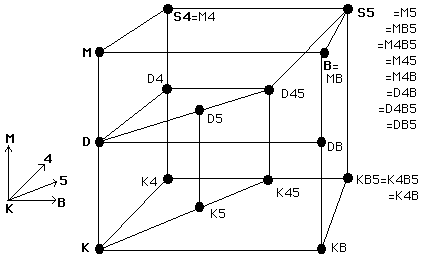

# Modal Logic
**First published Tue Feb 29, 2000; substantive revision Mon Jan 23, 2023**

*Garson, James*

A modal is an expression (like ‘necessarily’ or ‘possibly’) that is used to qualify the truth of a judgement. Modal logic is, strictly speaking, the study of the deductive behavior of the expressions ‘it is necessary that’ and ‘it is possible that’. However, the term ‘modal logic’ may be used more broadly for a family of related systems. These include logics for belief, for tense and other temporal expressions, for the deontic (moral) expressions such as ‘it is obligatory that’ and ‘it is permitted that’, and many others. An understanding of modal logic is particularly valuable in the formal analysis of philosophical argument, where expressions from the modal family are both common and confusing. Modal logic also has important applications in computer science.

## 1. What is Modal Logic?

Narrowly construed, modal logic studies reasoning that involves the use of the expressions ‘necessarily’ and ‘possibly’. However, the term ‘modal logic’ is used more broadly to cover a family of logics with similar rules and a variety of different symbols.

A list describing the best known of these logics follows.

| **Logic** | **Symbols** | **Expressions Symbolized** |
| --- | --- | --- |
| Modal Logic | $\Box$ | It is necessary that … |
|   | $\Diamond$ | It is possible that … |
| Deontic Logic | $O$ | It is obligatory that … |
|   | $P$ | It is permitted that … |
|   | $F$ | It is forbidden that … |
| Temporal Logic | $G$ | It will always be the case that … |
|   | $F$ | It will be the case that … |
|   | $H$ | It has always been the case that … |
|   | $P$ | It was the case that … |
| Doxastic Logic | $Bx$ | $x$ believes that … |
| Epistemic Logic | $Kx$ | $x$ knows that … |

## 2. Modal Logics

The most familiar logics in the modal family are constructed from a weak logic called $\bK$ (after Saul Kripke). Under the narrow reading, modal logic concerns necessity and possibility. A variety of different systems may be developed for such logics using $\bK$ as a foundation. The symbols of $\bK$ include ‘${\sim}$’ for ‘not’, ‘$\rightarrow$’ for ‘if…then’, and ‘$\Box$’ for the modal operator ‘it is necessary that’. (The connectives ‘$\amp$’, ‘$\vee$’, and ‘$\leftrightarrow$’ may be defined from ‘${\sim}$’ and ‘$\rightarrow$’ as is done in propositional logic.) $\bK$ results from adding the following to the principles of propositional logic.

Necessitation Rule:   If $A$ is a theorem of $\bK$, then so is $\Box A$.

Distribution Axiom: $\Box(A\rightarrow B) \rightarrow (\Box A\rightarrow \Box B)$.

(In these principles we use ‘$A$’ and ‘$B$’ as metavariables ranging over formulas of the language.) According to the Necessitation Rule, any theorem of logic is necessary. The Distribution Axiom says that if it is necessary that if $A$ then $B$, then if necessarily $A$, then necessarily $B$.

The operator $\Diamond$ (for ‘possibly’) can be defined from $\Box$ by letting $\Diamond A = {\sim}\Box{\sim}A$. In $\bK$, the operators $\Box$ and $\Diamond$ behave very much like the quantifiers $\forall$ (all) and $\exists$ (some). For example, the definition of $\Diamond$ from $\Box$ mirrors the equivalence of $\forall xA$ with ${\sim}\exists x{\sim}A$ in predicate logic. Furthermore, $\Box(A \amp B)$ entails $\Box A \amp \Box B$ and vice versa; while $\Box A\vee \Box B$ entails $\Box (A\vee B)$, but *not* vice versa. This reflects the patterns exhibited by the universal quantifier: $\forall x(A \amp B)$ entails $\forall xA \amp \forall xB$ and vice versa, while $\forall xA \vee \forall xB$ entails $\forall x(A \vee B)$ but not vice versa. Similar parallels between $\Diamond$ and $\exists$ can be drawn. The basis for this correspondence between the modal operators and the quantifiers will emerge more clearly in the section on Possible Worlds Semantics.

The system $\bK$ is too weak to provide an adequate account of necessity. The following axiom is not provable in $\bK$, but it is clearly desirable.

$$\tag{\(M\)} \Box A\rightarrow A $$

$(M)$ claims that whatever is necessary is the case. Notice that $(M)$ would be incorrect were $\Box$ to be read ‘it ought to be that’, or ‘it was the case that’. So the presence of axiom $(M)$ distinguishes logics for necessity from other logics in the modal family. A basic modal logic $M$ results from adding $(M)$ to $\bK$. (Some authors call this system $\mathbf{T}$.)

Many logicians believe that $M$ is still too weak to correctly formalize the logic of necessity and possibility. They recommend further axioms to govern the iteration or repetition of modal operators. Here are two of the most famous iteration axioms:

$$\tag{4} \Box A\rightarrow \Box \Box A $$ $$\tag{5} \Diamond A\rightarrow \Box \Diamond A $$

$\mathbf{S4}$ is the system that results from adding (4) to $M$. Similarly $\mathbf{S5}$ is $M$ plus (5). In $\mathbf{S4}$, the sentence $\Box \Box A$ is equivalent to $\Box A$. As a result, any string of boxes may be replaced by a single box, and the same goes for strings of diamonds. This amounts to the idea that iteration of the same modal operator is superfluous. Saying that $A$ is necessarily necessary is considered a uselessly long-winded way of saying that $A$ is necessary. The system $\mathbf{S5}$ has even stronger principles for simplifying strings of modal operators. In $\mathbf{S4}$, a string of operators of *the same kind* can be replaced by that operator; in $\mathbf{S5}$, strings containing both boxes and diamonds are equivalent to the last operator in the string. So, for example, saying that it is possible that $A$ is necessary is the same as saying that $A$ is necessary. A summary of these features of $\mathbf{S4}$ and $\mathbf{S5}$ follows.

$$\tag{\(\mathbf{S4}\)} \Box \Box \ldots \Box = \Box \text{ and } \Diamond \Diamond \ldots \Diamond = \Diamond $$ $$\begin{align*} \tag{\(\mathbf{S5}\)} 00\ldots \Box &= \Box \text{ and } 00\ldots \Diamond = \Diamond, \\ &\text{ where each } 0 \text{ is either } \Box \text{ or } \Diamond \end{align*}$$

One could engage in endless argument over the correctness or incorrectness of these and other iteration principles for $\Box$ and $\Diamond$. The controversy can be partly resolved by recognizing that the words ‘necessarily’ and ‘possibly’ have many different uses. So the acceptability of axioms for modal logic depends on which of these uses we have in mind. For this reason, there is no one modal logic, but rather a whole family of systems built around $M$. The relationship between these systems is diagrammed in Section 8, and their application to different uses of ‘necessarily’ and ‘possibly’ can be more deeply understood by studying their possible world semantics in Section 6.

The system $\mathbf{B}$ (for the logician Brouwer) is formed by adding axiom $(B)$ to $M$.

$$\tag{\(B\)} A\rightarrow \Box \Diamond A $$

It is interesting to note that $\mathbf{S5}$ can be formulated equivalently by adding $(B)$ to $\mathbf{S4}$. The axiom $(B)$ raises an important point about the interpretation of modal formulas. $(B)$ says that if $A$ is the case, then $A$ is necessarily possible. One might argue that $(B)$ should always be adopted in any modal logic, for surely if $A$ is the case, then it is necessary that $A$ is possible. However, there is a problem with this claim that can be exposed by noting that $\Diamond \Box A\rightarrow A$ is provable from $(B)$. So $\Diamond \Box A\rightarrow A$ should be acceptable if $(B)$ is. However, $\Diamond \Box A\rightarrow A$ says that if $A$ is possibly necessary, then $A$ is the case, and this is far from obvious. Why does $(B)$ seem obvious, while one of the things it entails seems not obvious at all? The answer is that there is a dangerous ambiguity in the English interpretation of $A\rightarrow \Box \Diamond A$. We often use the expression ‘If $A$ then necessarily $B$’ to express that the conditional ‘if $A$ then $B$’ is necessary. This interpretation corresponds to $\Box(A\rightarrow B)$. On other occasions, we mean that if $A$, then $B$ is necessary: $A\rightarrow \Box B$. In English, ‘necessarily’ is an adverb, and since adverbs are usually placed near verbs, we have no natural way to indicate whether the modal operator applies to the whole conditional or to its consequent. For these reasons, there is a tendency to confuse $(B): A\rightarrow \Box \Diamond A$ with $\Box(A\rightarrow \Diamond A)$. But $\Box(A\rightarrow \Diamond A)$ is not the same as $(B)$, for $\Box(A\rightarrow \Diamond A)$ is already a theorem of $M$, and $(B)$ is not. One must take special care that our positive reaction to $\Box(A\rightarrow \Diamond A)$ does not infect our evaluation of $(B)$. One simple way to protect ourselves is to formulate $B$ in an equivalent way using the axiom $\Diamond \Box A\rightarrow A$, where these ambiguities of scope do not arise.

## 3. Deontic Logics

Deontic logics introduce the primitive symbol $O$ for ‘it is obligatory that’, from which symbols $P$ for ‘it is permitted that’ and $F$ for ‘it is forbidden that’ are defined: $PA = {\sim}O{\sim}A$ and $FA = O{\sim}A$. The deontic analog of the modal axiom $(M): OA\rightarrow A$ is clearly not appropriate for deontic logic. (Unfortunately, what ought to be is not always the case.) However, a basic system $\mathbf{D}$ of deontic logic can be constructed by adding the weaker axiom $(D)$ to $\bK$.

$$\tag{\(D\)} OA\rightarrow PA $$

Axiom $(D)$ guarantees the consistency of the system of obligations by insisting that when $A$ is obligatory, $A$ is permissible. A system which obligates us to bring about $A$, but doesn’t permit us to do so, puts us in an inescapable bind. Although some will argue that such conflicts of obligation are at least possible, most deontic logicians accept $(D)$.

$O(OA\rightarrow A)$ is another deontic axiom that seems desirable. Although it is wrong to say that if $A$ is obligatory then $A$ is the case $(OA\rightarrow A)$, still, this conditional *ought* to be the case. So some deontic logicians believe that $D$ needs to be supplemented with $O(OA\rightarrow A)$ as well.

Controversy about iteration (repetition) of operators arises again in deontic logic. In some conceptions of obligation, $OOA$ just amounts to $OA$. ‘It ought to be that it ought to be’ is treated as a sort of stuttering; the extra ‘ought’s do not add anything new. So axioms are added to guarantee the equivalence of $OOA$ and $OA$. The more general iteration policy embodied in $\mathbf{S5}$ may also be adopted. However, there are conceptions of obligation where distinction between $OA$ and $OOA$ is preserved. The idea is that there are genuine differences between the obligations we *actually* have and the obligations we *should* adopt. So, for example, ‘it ought to be that it ought to be that $A$’ commands adoption of some obligation which may not actually be in place, with the result that $OOA$ can be true even when $OA$ is false.

For a more detailed discussion, see the entry on deontic logic.

## 4. Temporal Logics

In temporal logic (also known as tense logic), there are two basic operators, $G$ for the future, and $H$ for the past. $G$ is read ‘it always will be that’ and the defined operator $F$ (read ‘it will be the case that’) can be introduced by $FA = {\sim}G{\sim}A$. Similarly $H$ is read ‘it always was that’ and $P$ (for ‘it was the case that’) is defined by $PA={\sim}H{\sim}A$. A basic system of temporal logic called $\mathbf{Kt}$ results from adopting the principles of $\bK$ for both $G$ and $H$, along with two axioms to govern the interaction between the past and future operators:

Necessitation Rules: If $A$ is a theorem then so are $GA$ and $HA$.

Distribution Axioms: $G(A\rightarrow B) \rightarrow(GA\rightarrow GB)$ and $H(A\rightarrow B) \rightarrow (HA\rightarrow HB)$

Interaction Axioms: $A\rightarrow GPA$ and $A\rightarrow HFA$

The interaction axioms raise questions concerning asymmetries between the past and the future. A standard intuition is that the past is fixed, while the future is still open. The first interaction axiom $(A\rightarrow GPA)$ conforms to this intuition in reporting that what is the case $(A)$ will at all future times be in the past $(GPA)$. However $A\rightarrow HFA$ may appear to have unacceptably deterministic overtones, for it claims, apparently, that what is true now $(A)$ has always been such that it will occur in the future $(HFA)$. However, possible world semantics for temporal logic reveals that this worry results from a simple confusion and that the two interaction axioms are equally acceptable.

Note that the characteristic axiom of modal logic, $(M): \Box A\rightarrow A$, is not acceptable for either $H$ or $G$, since $A$ does not follow from ‘it always was the case that $A$’, nor from ‘it always will be the case that $A$’. However, it is acceptable in a closely related temporal logic where $G$ is read ‘it is and always will be’, and $H$ is read ‘it is and always was’.

Depending on which assumptions one makes about the structure of time, further axioms must be added to temporal logics. A list of axioms commonly adopted in temporal logics follows. An account of how they depend on the structure of time will be found in the section Possible Worlds Semantics.

$$\begin{align*} GA\rightarrow GGA &\text{ and } HA\rightarrow HHA \\ GGA\rightarrow GA &\text{ and } HHA\rightarrow HA \\ GA\rightarrow FA &\text{ and } HA\rightarrow PA \end{align*}$$

It is interesting to note that certain combinations of past tense and future tense operators may be used to express complex tenses in English. For example, $FPA$, corresponds to sentence $A$ in the future perfect tense (as in ‘20 seconds from now the light will have changed’). Similarly, $PPA$ expresses the past perfect tense.

For a more detailed discussion, see the entry on temporal logic.

## 5. Conditional and Relevance Logics

The founder of modal logic, C. I. Lewis, defined a series of modal logics which did not have $\Box$ as a primitive symbol. Lewis was concerned to develop a logic of conditionals that was free of the so called Paradoxes of Material Implication, namely the classical theorems $A\rightarrow({\sim}A\rightarrow B)$ and $B\rightarrow(A\rightarrow B)$. He introduced the symbol $\fishhook$ for “strict implication” and developed logics where neither $A\fishhook ({\sim}A\fishhook B)$ nor $B\fishhook (A\fishhook B)$ is provable. The modern practice has been to define $A\fishhook B$ by $\Box(A\rightarrow B)$ and use modal logics governing $\Box$ to obtain similar results. However, the provability of such formulas as $(A \amp{\sim}A)\fishhook B$ in such logics seems at odds with concern for the paradoxes. Anderson and Belnap (1975) have developed systems $\mathbf{R}$ (for Relevance Logic) and $\mathbf{E}$ (for Entailment) which are designed to overcome such difficulties. These systems require revision of the standard systems of propositional logic. (See Mares (2004)[^mares-2004] and the entry on relevance logic.)

David Lewis (1973)[^lewis-1973], Robert Stalnaker (1968)[^stalnaker-1968], and others have developed conditional logics to handle counterfactual expressions, that is, expressions of the form ‘if $A$ *were* to happen then $B$ *would* happen’. (Kvart (1980) is another good source on the topic.) Counterfactual logics differ from those based on strict implication because the former reject while the latter accept contraposition.

## 6. Possible Worlds Semantics

The purpose of logic is to characterize the difference between valid and invalid arguments. A logical system for a language is a set of axioms and rules designed to prove *exactly* the valid arguments statable in the language. Creating such a logic may be a difficult task. The logician must make sure that the system is *sound*, i.e. that every argument proven using the rules and axioms is in fact valid. Furthermore, the system should be *complete*, meaning that every valid argument has a proof in the system. Demonstrating soundness and completeness of formal systems is one of a logician’s central concern.

Such a demonstration cannot get underway until the concept of validity is defined rigorously. Formal semantics for a logic provides a definition of validity by characterizing the truth behavior of the sentences of the system. In propositional logic, validity can be defined using truth tables. A valid argument is simply one where every truth table row that makes its premises true also makes its conclusion true. However, truth tables cannot be used to provide an account of validity in modal logics because there are no truth tables for expressions such as ‘it is necessary that’, ‘it is obligatory that’, and the like. (The problem is that the truth value of $A$ does not determine the truth value for $\Box A$. For example, when $A$ is ‘Dogs are dogs’, $\Box A$ is true, but when $A$ is ‘Dogs are pets’, $\Box A$ is false.) Nevertheless, semantics for modal logics can be defined by introducing possible worlds. We will illustrate possible worlds semantics for a logic of necessity containing the symbols ${\sim}, \rightarrow$, and $\Box$. Then we will explain how the same strategy may be adapted to other logics in the modal family.

In propositional logic, a valuation of the atomic sentences (or row of a truth table) assigns a truth value $(T$ or $F)$ to each propositional variable $p$. Then the truth values of the complex sentences are calculated with truth tables. In modal semantics, a set $W$ of possible worlds is introduced. A valuation then gives a truth value to each propositional variable *for each of the possible worlds* in $W$. This means the value assigned to $p$ for world $w$ may differ from the value assigned to $p$ for another world $w'$.

The truth value of the atomic sentence $p$ at world $w$ given by the valuation $v$ may be written $v(p, w)$. Given this notation, the truth values $(T$ for true, $F$ for false) of complex sentences of modal logic for a given valuation $v$ (and member $w$ of the set of worlds $W)$ may be defined by the following truth clauses. (‘iff’ abbreviates ‘if and only if’.)

$$\tag{\(\sim\)} v({\sim}A, w)=T \text{ iff } v(A, w)=F. $$ $$\tag{\(\rightarrow\)} v(A\rightarrow B, w)=T \text{ iff } v(A, w)=F \text{ or } v(B, w)=T. $$ $$\tag{5} v(\Box A, w)=T \text{ iff for every world } w' \text{ in } W, v(A, w')=T. $$

Clauses $({\sim})$ and $(\rightarrow)$ simply describe the standard truth table behavior for negation and material implication respectively. According to (5), $\Box A$ is true (at a world $w)$ exactly when $A$ is true in *all* possible worlds. Given the definition of $\Diamond$ (namely $\Diamond A = {\sim}\Box{\sim}A)$, the truth condition (5) insures that $\Diamond A$ is true just in case $A$ is true in *some* possible world. Since the truth clauses for $\Box$ and $\Diamond$ involve the quantifiers ‘all’ and ‘some’ (respectively), the parallels in logical behavior between $\Box$ and $\forall x$ and between $\Diamond$ and $\exists x$ noted in Section 2 will be expected.

Clauses $({\sim}), (\rightarrow)$, and (5) allow us to calculate the truth value of any sentence at any world on a given valuation. A definition of validity is now just around the corner. An argument is *5-valid for a given set W* (of possible worlds) if and only if every valuation of the atomic sentences that assigns the premises $T$ at a world in $W$ also assigns the conclusion $T$ at the same world. An argument is said to be *5-valid* iff it is valid for every non-empty set $W$ of possible worlds.

It has been shown that $\mathbf{S5}$ is sound and complete for 5-validity (hence our use of the symbol ‘5’). The 5-valid arguments are exactly the arguments provable in $\mathbf{S5}$. This result suggests that $\mathbf{S5}$ is the correct way to formulate a logic of necessity.

However, $\mathbf{S5}$ is not a reasonable logic for all members of the modal family. In deontic logic, temporal logic, and others, the analog of the truth condition (5) is clearly not appropriate; furthermore there are even conceptions of necessity where (5) should be rejected as well. The point is easiest to see in the case of temporal logic. Here, the members of $W$ are moments of time, or worlds “frozen”, as it were, at an instant. For simplicity let us consider a *future* temporal logic, a logic where $\Box A$ reads: ‘it *will* always be the case that’. (We formulate the system using $\Box$ rather than the traditional $G$ so that the connections with other modal logics will be easier to appreciate.) The correct clause for $\Box$ should say that $\Box A$ is true at time $w$ iff $A$ is true at all times *in the future of* $w$. To restrict attention to the future, the relation $R$ (for ‘earlier than’) needs to be introduced. Then the correct clause can be formulated as follows.

$$\tag{\(K\)} v(\Box A, w)=T \text{ iff for every } w', \text{ if } wRw', \text{ then } v(A, w')=T. $$

This says that $\Box A$ is true at $w$ just in case $A$ is true at all times *after* $w$.

Validity for this brand of temporal logic can now be defined. A *frame* $\langle W, R\rangle$ is a pair consisting of a non-empty set $W$ (of worlds) and a binary relation $R$ on $W$. A *model* $\langle F, v\rangle$ consists of a frame $F$ and a valuation $v$ that assigns truth values to each atomic sentence at each world in $W$. Given a model, the values of all complex sentences can be determined using $({\sim}), (\rightarrow)$, and $(K)$. An argument is $\bK$-valid just in case any model whose valuation assigns the premises $T$ at a world also assigns the conclusion $T$ at the same world. As the reader may have guessed from our use of ‘$\bK$’, it has been shown that the simplest modal logic $\bK$ is both sound and complete for $\bK$-validity.

## 7. Modal Axioms and Conditions on Frames

One might assume from this discussion that $\bK$ is the correct logic when $\Box$ is read ‘it will always be the case that’. However, there are reasons for thinking that $\bK$ is too weak. One obvious logical feature of the relation $R$ (earlier than) is transitivity. If $wRv$ ($w$ is earlier than $v)$ and $vRu$ ($v$ is earlier than $u)$, then it follows that $wRu$ ($w$ is earlier than $u)$. So let us define a new kind of validity that corresponds to this condition on $R$. Let a 4-model be any model whose frame $\langle W, R\rangle$ is such that $R$ is a transitive relation on $W$. Then an argument is 4-valid iff any 4-model whose valuation assigns $T$ to the premises at a world also assigns $T$ to the conclusion at the same world. We use ‘4’ to describe such a transitive model because the logic which is adequate (both sound and complete) for 4-validity is $\mathbf{K4}$, the logic which results from adding the axiom (4): $\Box A\rightarrow \Box \Box A$ to $\bK$.

Transitivity is not the only property which we might want to require of the frame $\langle W, R\rangle$ if $R$ is to be read ‘earlier than’ and $W$ is a set of moments. One condition (which is only mildly controversial) is that there is no last moment of time, i.e. that for every world $w$ there is some world $v$ such that $wRv$. This condition on frames is called *seriality.* Seriality corresponds to the axiom $(D): \Box A\rightarrow \Diamond A$, in the same way that transitivity corresponds to (4). A $\mathbf{D}$-model is a $\bK$-model with a serial frame. From the concept of a $\mathbf{D}$-model the corresponding notion of $\mathbf{D}$-validity can be defined just as we did in the case of 4-validity. As you probably guessed, the system that is adequate with respect to $\mathbf{D}$-validity is $\mathbf{KD}$, or $\bK$ plus $(D)$. Not only that, but the system $\mathbf{KD4}$ (that is $\bK$ plus (4) and $(D))$ is adequate with respect to $\mathbf{D4}$-validity, where a $\mathbf{D4}$-model is one where $\langle W, R\rangle$ is *both* serial and transitive.

Another property which we might want for the relation ‘earlier than’ is density, the condition which says that between any two times we can always find another. Density would be false if time were atomic, i.e. if there were intervals of time which could not be broken down into any smaller parts. Density corresponds to the axiom $(C4): \Box \Box A\rightarrow \Box A$, the converse of (4), so for example, the system $\mathbf{KC4}$, which is $\bK$ plus $(C4)$ is adequate with respect to models where the frame $\langle W, R\rangle$ is dense, and $\mathbf{KDC4}$ is adequate with respect to models whose frames are serial and dense, and so on.

Each of the modal logic axioms we have discussed corresponds to a condition on frames in the same way. The relationship between conditions on frames and corresponding axioms is one of the central topics in the study of modal logics. Once an interpretation of the intensional operator $\Box$ has been decided on, the appropriate conditions on $R$ can be determined to fix the corresponding notion of validity. This, in turn, allows us to select the right set of axioms for that logic.

For example, consider a deontic logic, where $\Box$ is read ‘it is obligatory that’. Here the truth of $\Box A$ does not demand the truth of $A$ in *every* possible world, but only in a subset of those worlds where people do what they ought. So we will want to introduce a relation $R$ for this kind of logic as well, and use the truth clause $(K)$ to evaluate $\Box A$ at a world. However, in this case, $R$ is not earlier than. Instead $wRw'$ holds just in case world $w'$ is a morally acceptable variant of $w$, i.e. a world that our actions can bring about which satisfies what is morally correct, or right, or just. Under such a reading, it should be clear that the relevant frames should obey seriality, the condition that requires that each possible world have a morally acceptable variant. The analysis of the properties desired for $R$ makes it clear that a basic deontic logic can be formulated by adding the axiom $(D)$ and to $\bK$.

Even in modal logic, one may wish to restrict the range of possible worlds which are relevant in determining whether $\Box A$ is true at a given world. For example, I might say that it is necessary that I pay my bills, even though I know full well that there is a possible world where I fail to pay them. In ordinary speech, the claim that $A$ is necessary does not require the truth of $A$ in *all* possible worlds, but rather only in a certain class of worlds which I have in mind (for example, worlds where I avoid penalties for failure to pay). In order to provide a generic treatment of necessity, we must say that $\Box A$ is true in $w$ iff $A$ is true in all worlds *that are related* to $w$ in the right way. So for an operator $\Box$ interpreted as necessity, we introduce a corresponding relation $R$ on the set of possible worlds $W$, traditionally called the accessibility relation. The accessibility relation $R$ holds between worlds $w$ and $w'$ iff $w'$ is possible given the facts of $w$. Under this reading for $R$, it should be clear that frames for modal logic should be reflexive. It follows that modal logics should be founded on $M$, the system that results from adding $(M)$ to $\bK$. Depending on exactly how the accessibility relation is understood, symmetry and transitivity may also be desired.

A list of some of the more commonly discussed conditions on frames and their corresponding axioms along with a map showing the relationship between the various modal logics can be found in the next section.

## 8. Map of the Relationships Between Modal Logics

The following diagram shows the relationships between the best known modal logics, namely logics that can be formed by adding a selection of the axioms $(D), (M)$, (4), $(B)$ and (5) to $\bK$. A list of these (and other) axioms along with their corresponding frame conditions can be found below the diagram.

*Diagram of Modal Logics*

In this chart, systems are given by the list of their axioms. So, for example $\mathbf{M4B}$ is the result of adding $(M)$, (4) and $(B)$ to $\bK$. In boldface, we have indicated traditional names of some systems. When system $\mathbf{S}$ appears below and/or to the left of $\mathbf{S}'$ connected by a line, then $\mathbf{S}'$ is an extension of $\mathbf{S}$. This means that every argument provable in $\mathbf{S}$ is provable in $\mathbf{S}'$, but $\mathbf{S}$ is weaker than $\mathbf{S}'$, i.e. not all arguments provable in $\mathbf{S}'$ are provable in $\mathbf{S}$.

The following list indicates axioms, their names, and the corresponding conditions on the accessibility relation $R$, for axioms so far discussed in this encyclopedia entry.

| **Name** | **Axiom** | **Condition on Frames** | **R is…** |
| --- | --- | --- | --- |
| $(D)$ | $\Box A\rightarrow \Diamond A$ | $\exists u wRu$ | Serial |
| $(M)$ | $\Box A\rightarrow A$ | $wRw$ | Reflexive |
| (4) | $\Box A\rightarrow \Box \Box A$ | $(wRv \amp vRu) \Rightarrow wRu$ | Transitive |
| $(B)$ | $A\rightarrow \Box \Diamond A$ | $wRv \Rightarrow vRw$ | Symmetric |
| (5) | $\Diamond A\rightarrow \Box \Diamond A$ | $(wRv \amp wRu) \Rightarrow vRu$ | Euclidean |
| $(CD)$ | $\Diamond A\rightarrow \Box A$ | $(wRv \amp wRu) \Rightarrow v=u$ | Functional |
| $(\Box M)$ | $\Box(\Box A\rightarrow A)$ | $wRv \Rightarrow vRv$ | Shift Reflexive |
| $(C4)$ | $\Box \Box A\rightarrow \Box A$ | $wRv \Rightarrow \exists u(wRu \amp uRv)$ | Dense |
| $(C)$ | $\Diamond \Box A \rightarrow \Box \Diamond A$ | $wRv \amp wRx \Rightarrow \exists u(vRu \amp xRu)$ | Convergent |

In the list of conditions on frames, and in the rest of this article, the variables ‘$w$’, ‘$v$’, ‘$u$’, ‘$x$’ and the quantifier ‘$\exists u$’ are understood to range over $W$. ‘&’ abbreviates ‘and’ and ‘$\Rightarrow$’ abbreviates ‘if…then’.

The notion of correspondence between axioms and frame conditions that is at issue here was illustrated in the previous section. The idea is that when S is a list of axioms and F(S) is the corresponding set of frame conditions, then S corresponds to F(S) exactly when the system K+S is adequate (sound and complete) for F(S)-validity, that is, an argument is provable in K+S iff it is F(S)-valid. However, a stronger notion of the correspondence between axioms and frame conditions has emerged in research on modal logic. (See Section 14 below.)

## 9. The General Axiom

The correspondence between axioms and conditions on frames may seem something of a mystery. A beautiful result of Lemmon and Scott (1977) goes a long way towards explaining those relationships. Their theorem concerned axioms which have the following form:

$$\tag{\(G\)} \Diamond^h \Box^i A \rightarrow \Box^j\Diamond^k A $$

We use the notation ‘$\Diamond^n$’ to represent $n$ diamonds in a row, so, for example, ‘$\Diamond^3$’ abbreviates a string of three diamonds: ‘$\Diamond \Diamond \Diamond$’. Similarly ‘$\Box^n$’ represents a string of $n$ boxes. When the values of $h, i, j$, and $k$ are all 1, we have axiom $(C)$:

$$\tag{\(C\)} \Diamond \Box A \rightarrow \Box \Diamond A = \Diamond^1\Box^1 A \rightarrow \Box^1\Diamond^1 A $$

The axiom $(B)$ results from setting $h$ and $i$ to 0, and letting $j$ and $k$ be 1:

$$\tag{\(B\)} A \rightarrow \Box \Diamond A = \Diamond^0\Box^0 A \rightarrow \Box^1\Diamond^1 A $$

To obtain (4), we may set $h$ and $k$ to 0, set $i$ to 1 and $j$ to 2:

$$\tag{4} \Box A \rightarrow \Box \Box A = \Diamond^0\Box^1 A \rightarrow \Box^2\Diamond^0 A $$

Many (but not all) axioms of modal logic can be obtained by setting the right values for the parameters in $(G).$

Our next task will be to give the condition on frames which corresponds to $(G)$ for a given selection of values for $h, i, j$, and $k$. In order to do so, we will need a definition. The composition of two relations $R$ and $R'$ is a new relation $R \circ R'$ which is defined as follows:

$$ wR \circ R'v \text{ iff for some } u, wRu \text{ and } uR'v. $$

For example, if $R$ is the relation of being a brother and $R'$ is the relation of being a parent then $R \circ R'$ is the relation of being an uncle (because $w$ is the uncle of $v$ iff for some person $u$, both $w$ is the brother of $u$ and $u$ is the parent of $v)$. A relation may be composed with itself. For example, when $R$ is the relation of being a parent, then $R \circ R$ is the relation of being a grandparent, and $R \circ R \circ R$ is the relation of being a great-grandparent. It will be useful to write ‘$R^n$’, for the result of composing $R$ with itself $n$ times. So $R^2$ is $R \circ R$, and $R^4$ is $R \circ R \circ R \circ R$. We will let $R^1$ be $R$, and $R^0$ will be the identity relation, i.e. $wR^0 v$ iff $w=v$.

We may now state the Scott-Lemmon result. It is that the condition on frames which corresponds exactly to any axiom of the shape $(G)$ is the following:

$$\tag{\(hijk\)-Convergence} wR^h v \amp wR^j u \Rightarrow \exists x (vR^i x \amp uR^k x). $$

It is interesting to see how the familiar conditions on $R$ result from setting the values for $h$, $i$, $j$, and $k$ according to the values in the corresponding axiom. For example, consider (5). In this case $i=0$, and $h=j=k=1$. So the corresponding condition is

$$ wRv \amp wRu \Rightarrow \exists x (vR^0 x \amp uRx). $$

We have explained that $R^0$ is the identity relation. So if $vR^0 x$ then $v=x$. But $\exists x (v=x \amp uRx)$ is equivalent to $uRv$, and so the Euclidean condition is obtained:

$$ (wRv \amp wRu) \Rightarrow uRv. $$

In the case of axiom (4), $h=0, i=1, j=2$ and $k=0$. So the corresponding condition on frames is

$$ (w=v \amp wR^2 u) \Rightarrow \exists x (vRx \amp u=x). $$

Resolving the identities, this amounts to:

$$ vR^2 u \Rightarrow vRu. $$

By the definition of $R^2, vR^2 u$ iff $\exists x(vRx \amp xRu)$, so this comes to:

$$ \exists x(vRx \amp xRu) \Rightarrow vRu, $$

which by predicate logic, is equivalent to transitivity:

$$ vRx \amp xRu \Rightarrow vRu. $$

The reader may find it a pleasant exercise to see how the corresponding conditions fall out of hijk-Convergence when the values of the parameters $h$, $i$, $j$, and $k$ are set by other axioms.

The Scott-Lemmon results provides a quick method for establishing results about the relationship between axioms and their corresponding frame conditions. Since they showed the adequacy of any logic that extends $\bK$ with a selection of axioms of the form $(G)$ with respect to models that satisfy the corresponding set of frame conditions, they provided “wholesale” adequacy proofs for the majority of systems in the modal family. Sahlqvist (1975)[^sahlqvist-1975] has discovered important generalizations of the Scott-Lemmon result covering a much wider range of axiom types.

## 10. Two Dimensional Semantics

Two-dimensional semantics is a variant of possible world semantics that uses two (or more) kinds of parameters in truth evaluation, rather than possible worlds alone. For example, a logic of indexical expressions, such as ‘I’, ‘here’, ‘now’, and the like, needs to bring in the linguistic context (or context for short). Given a context $c = \langle s, p, t\rangle$ where $s$ is the speaker, $p$ the place, and $t$ the time of utterance, then ‘I’ refers to $s$, ‘here’ to $p$, and ‘now’ to $t$. So in the context $c = \langle$Jim Garson, Houston, 3:00 P.M. CST on 4/3/$2014\rangle$ ‘I am here now’ is T iff Jim Garson is in Houston, at 3:00 P.M. CST on 4/3/2014.

In possible worlds semantics, a sentence’s truth-value depended on the world at which it is evaluated. However, indexicals bring in a second dimension – so we need to generalize again. Kaplan (1989)[^kaplan-1989] defines the *character* of a sentence $B$ to be a function from the set of (linguistic) contexts to the content of $B$, where the content, in turn, is simply the intension of $B$, that is, a function from possible worlds to truth-values. Here, truth evaluation is doubly dependent – on both linguistic contexts and possible worlds.

One of Kaplan’s most interesting observations is that some indexical sentences are contingent but at the same time analytically true. An example is (1).

- (1) I am here now.

Just from the meaning of the words, you can see that (1) must be true in any context $c = \langle s, p, t\rangle$. After all, $c$ counts as a linguistic context just in case $s$ is a speaker who is at place $p$ at time $t$. Therefore (1) is true at $c$, and that means that the pattern of truth-values (1) has along the context dimension must be all Ts (given the possible world is held fixed). This suggests that the context dimension is apt for tracking analytic knowledge obtained from the mastery of our language. On the other hand, the possible-worlds dimension keeps track of what is necessary. Holding the context fixed, there there are possible worlds where (1) is false. For example, when $c = \langle$Jim Garson, Houston, 3:00 P.M. CST on 4/3/$2014\rangle$, (1) fails at $c$ in a possible world where Jim Garson is in Boston at 3:00 P.M. CST on 4/3/2014. It follows that ‘I am here now’ is a contingent analytic truth. Therefore, two-dimensional semantics can handle situations where necessity and analyticity come apart.

Another example where bringing in two dimension is useful is in the logic for an open future (Thomason, 1984; Belnap, et al., 2001)[^belnap-2001][^thomason-1984]. Here one employs a temporal structure where many possible future histories extend from a given time. Consider (2).

- (2) Joe will order a sea battle tomorrow.

If (2) is contingent, then there is a possible history where the battle occurs the day after the time of evaluation and another one where it does not occur then. So to evaluate (2) you need to know two things: what is the time $t$ of evaluation, and which of the histories $h$ that run through $t$ is the one to be considered. So a sentence in such a logic is evaluated at a pair $\langle t, h\rangle$.

Another problem resolved by two-dimensional semantics is the interaction between ‘now’ and other temporal expressions like the future tense ‘it will be the case that’. It is plausible to think that ‘now’ refers to the time of evaluation. So we would have the following truth condition:

$$\tag{Now} v(\text{Now} B, t)=\mathrm{T} \text{ iff } v(B, t)=\mathrm{T}. $$

However this will not work for sentences like (3).

- (3) At some point in the future, everyone now living will be unknown.

With $\mathrm{F}$ as the future tense operator, (3) might be translated:

$$\tag{\(3'\)} \mathrm{F}\forall x(\text{Now} Lx \rightarrow Ux). $$

(The correct translation cannot be $\forall x(\text{Now} Lx \rightarrow \mathrm{F}Ux)$, with $\mathrm{F}$ taking narrow scope, because (3) says there is a future time when all things now living are unknown together, not that each living thing will be unknown in some future time of its own.) When the truth conditions for (3)$'$ are calculated, using (Now) and the truth condition ($\mathrm{F}$) for $\mathrm{F}$, it turns out that (3)$'$ is true at time $u$ iff there is a time $t$ after $u$ such that everything that is living at $t$ (not $u$!) is unknown at $t$.

$$\tag{F} v(\mathrm{F}B, t)=\mathrm{T} \text{ iff for some time } u \text{ later than } t, v(B, u)=\mathrm{T}. $$

To evaluate (3)$'$ correctly, so that it matches what we mean by (3), we must make sure that ‘now’ always refers back to the original time of utterance when ‘now’ lies in the scope of other temporal operators such as F. Therefore we need to keep track of which time is the time of utterance $(u)$ as well as which time is the time of evaluation $(t)$. So our indices take the form of a pair $\langle u, e\rangle$, where $u$ is the time of utterance, and $e$ is the time of evaluation. Then the truth condition (Now) is revised to (2DNow).

$$\tag{2DNow} v(\text{Now} B, \langle u, e\rangle)=\mathrm{T} \text{ iff } v(B, \langle u, u\rangle)=\mathrm{T}. $$

This has it that the Now$B$ is true at a time $u$ of utterance and time $e$ of evaluation provided that $B$ is true when $u$ is taken to be the time of evaluation. When the truth conditions for F, $\forall$, and $\rightarrow$ are revised in the obvious way (just ignore the $u$ in the pair), (3)$'$ is true at $\langle u, e\rangle$ provided that there is a time $e'$ later than $e$ such that everything that is living at $u$ is unknown at $e'$. By carrying along a record of what $u$ is during the truth calculation, we can always fix the value for ‘now’ to the original time of utterance, even when ‘now’ is deeply embedded in other temporal operators.

A similar phenomenon arises in modal logics with an actuality operator A (read ‘it is actually the case that’). To properly evaluate (4) we need to keep track of which world is taken to be the actual (or real) world as well as which one is taken to be the world of evaluation.

- (4) It is possible that everyone actually living be unknown.

The idea of distinguishing different possible world dimensions in semantics has had useful applications in philosophy. For example, Chalmers (1996)[^chalmers-1996] has presented arguments from the conceivability of (say) zombies to dualist conclusions in the philosophy of mind. Chalmers (2006)[^chalmers-2006] has deployed two-dimensional semantics to help identify an a priori aspect of meaning that would support such conclusions.

The idea has also been deployed in the philosophy of language. Kripke (1980)[^kripke-1980] famously argued that ‘Water is H2O’ is a posteriori but nevertheless a necessary truth, for given that water just is H20, there is no possible world where THAT stuff is (say) a basic element as the Greeks thought. On the other hand, there is a strong intuition that had the real world been somewhat different from what it is, the odorless liquid that falls from the sky as rain, fills our lakes and rivers, etc. might perfectly well have been an element. So in some sense it is conceivable that water is not H20. Two dimensional semantics makes room for these intuitions by providing a separate dimension that tracks a conception of water that lays aside the chemical nature of what water actually is. Such a ‘narrow content’ account of the meaning of ‘water’ can explain how one may display semantical competence in the use of that term and still be ignorant about the chemistry of water (Chalmers, 2002)[^chalmers-2002].

For a more detailed discussion, see the entry on two-dimensional semantics.

## 11. Provability Logics

Modal logic has been useful in clarifying our understanding of central results concerning provability in the foundations of mathematics (Boolos, 1993)[^boolos-1993]. Provability logics are systems where the propositional variables $p, q, r$, etc. range over formulas of some mathematical system, for example Peano’s system $\mathbf{PA}$ for arithmetic. (The system chosen for mathematics might vary, but assume it is $\mathbf{PA}$ for this discussion.) Gödel showed that arithmetic has strong expressive powers. Using code numbers for arithmetic sentences, he was able to demonstrate a correspondence between sentences of mathematics and facts about which sentences are and are not provable in $\mathbf{PA}$. For example, he showed there there is a sentence $C$ that is true just in case no contradiction is provable in $\mathbf{PA}$ and there is a sentence $G$ (the famous Gödel sentence) that is true just in case it is not provable in $\mathbf{PA}$.

In provability logics, $\Box p$ is interpreted as a formula (of arithmetic) that expresses that what $p$ denotes is provable in $\mathbf{PA}$. Using this notation, sentences of provability logic express facts about provability. Suppose that $\bot$ is a constant of provability logic denoting a contradiction. Then ${\sim}\Box \bot$ says that $\mathbf{PA}$ is consistent and $\Box A\rightarrow A$ says that $\mathbf{PA}$ is sound in the sense that when it proves $A, A$ is indeed true. Furthermore, the box may be iterated. So, for example, $\Box{\sim}\Box \bot$ makes the dubious claim that $\mathbf{PA}$ is able to prove its own consistency, and ${\sim}\Box \bot \rightarrow{\sim}\Box{\sim}\Box \bot$ asserts (correctly as Gödel proved) that if $\mathbf{PA}$ is consistent then $\mathbf{PA}$ is unable to prove its own consistency.

Although provability logics form a family of related systems, the system $\mathbf{GL}$ is by far the best known. It results from adding the following axiom to $\bK$:

$$\tag{\(GL\)} \Box(\Box A\rightarrow A)\rightarrow \Box A. $$

The axiom (4): $\Box A\rightarrow \Box \Box A$ is provable in $\mathbf{GL}$, so $\mathbf{GL}$ is actually a strengthening of $\mathbf{K4}$. However, axioms such as $(M): \Box A\rightarrow A$, and even the weaker $(D): \Box A\rightarrow \Diamond A$ are not available (nor desirable) in $\mathbf{GL}$. In provability logic, provability is not to be treated as a brand of necessity. The reason is that when $p$ is provable in an arbitrary system $\mathbf{S}$ for mathematics, it does not follow that $p$ is true, since $\mathbf{S}$ may be unsound. Furthermore, if $p$ is provable in $\mathbf{S} (\Box p)$ it need not even follow that ${\sim}p$ lacks a proof $({\sim}\Box{\sim}p = \Diamond p). \mathbf{S}$ might be inconsistent and so prove both $p$ and ${\sim}p$.

Axiom $(GL)$ captures the content of Loeb’s Theorem, an important result in the foundations of arithmetic. $\Box A\rightarrow A$ says that $\mathbf{PA}$ is sound for $A$, i.e. that if $A$ were proven, A would be true. (Such a claim might not be secure for an arbitrarily selected system $\mathbf{S}$, since $A$ might be provable in $\mathbf{S}$ and false.) $(GL)$ claims that if $\mathbf{PA}$ manages to prove the sentence that claims soundness for a given sentence $A$, then $A$ is already provable in $\mathbf{PA}$. Loeb’s Theorem reports a kind of modesty on $\mathbf{PA}$’s part (Boolos, 1993, p. 55)[^boolos-1993]. $\mathbf{PA}$ never insists (proves) that a proof of $A$ entails $A$’s truth, unless it already has a proof of $A$ to back up that claim.

It has been shown that $\mathbf{GL}$ is adequate for provability in the following sense. Let a sentence of $\mathbf{GL}$ be *always provable* exactly when the sentence of arithmetic it denotes is provable no matter how its variables are assigned values to sentences of $\mathbf{PA}$. Then the provable sentences of $\mathbf{GL}$ are exactly the sentences that are always provable. This adequacy result has been extremely useful, since general questions concerning provability in $\mathbf{PA}$ can be transformed into easier questions about what can be demonstrated in $\mathbf{GL}$.

$\mathbf{GL}$ can also be outfitted with a possible world semantics for which it is sound and complete. A corresponding condition on frames for $\mathbf{GL}$-validity is that the frame be transitive, finite and irreflexive.

For a more detailed discussion, see the entry on provability logic.

## 12. Advanced Modal Logic

The applications of modal logic to mathematics and computer science have become increasingly important. Provability logic is only one example of this trend. The term “advanced modal logic” refers to a tradition in modal logic research that is particularly well represented in departments of mathematics and computer science. This tradition has been woven into the history of modal logic right from its beginnings (Goldblatt, 2006)[^goldblatt-2006]. Research into relationships with topology and algebras represents some of the very first technical work on modal logic. However the term ‘advanced modal logic’ generally refers to a second wave of work done since the mid 1970s. Some examples of the many interesting topics dealt with include results on decidability (whether it is possible to compute whether a formula of a given modal logic is a theorem) and complexity (the costs in time and memory needed to compute such facts about modal logics). The next two sections describe examples of research in this tradition.

## 13. Bisimulation

Bisimulation provides a good example of the fruitful interactions that have been developed between modal logic and computer science. In computer science, labeled transition systems (LTSs) are commonly used to represent possible computation pathways during execution of a program. LTSs are generalizations of Kripke frames, consisting of a set $W$ of states and a collection of $i$-accessibility relations $R_i$, one for each computer process $i$. Intuitively, $wR_i w'$ holds exactly when $w'$ is a state that results from applying the process $i$ to state $w$.

The language of poly-modal or dynamic logic introduces a collection of modal operators $\Box_i$, one for each program $i$ (Harel, 1984)[^harel-1984]. Then $\Box_i A$ states that sentence $A$ holds in every result of applying $i$. So ideas like the correctness and successful termination of programs can be expressed in this language. Models for such a language are like Kripke models save that LTSs are used in place of frames. A *bisimulation* is a counterpart relation between states of two such models such that exactly the same propositional variables are true in counterpart states, and whenever world $v$ is $i$-accessible from one of two counterpart states, then the other counterpart bears the $i$-accessibility relation to some counterpart of $v$. In short, the $i$-accessibility structure one can “see” from a given state mimics what one sees from a counterpart. Bisimulation is a weaker notion than isomorphism (a bisimulation relation need not be 1-1), but it is sufficient to guarantee equivalence in processing.

In the 70s, bisimulation had already been developed by modal logicians to help better understand the relationship between modal logic axioms and their corresponding conditions on Kripke frames. Kripke’s semantics provides a basis for translating modal formulas into sentences of first-order logic with quantification over possible worlds. Replace metavariables $A$ in an axiom with open sentences $Ax$, and translate $\Box Ax$ to $\forall y(Rxy \rightarrow Ay)$, in the result. (The translation for $\Diamond Ax$ is given by $ \exists y(Rxy \amp Ay)$.) For example, the translation of the axiom schema $\Diamond \Box A\rightarrow A$ comes to $\exists y (Rxy \amp \forall z(Ryz \rightarrow Az)) \rightarrow Ax$. This open formula with a free variable ‘$x$’ reflects what $\Diamond \Box A\rightarrow A$ “says” in the language of first-order logic. Obviously the translations of modal formulas are special; most first-order formulas are not equivalent to the result of translating modal formulas in this way. The modal translations form a special subset of the predicate logic language, which delimits what modal logic formulas can express.

Is there any interesting way to characterize the expressive power of the modal translations? The answer is that bisimulation serves exactly that purpose. Van Benthem showed (Blackburn et al., 2001, p. 103)[^blackburn-2001] that a first-order formula is equivalent to a modal translation exactly when its holding in a model entails that it holds in any bisimular model, and the idea easily generalizes to the poly-modal case. This suggests that poly-modal logic lies at exactly the right level of abstraction to describe, and reason about, computation and other processes. (After all, what really matters there is the preservation of truth values of formulas in models, rather than the finer details of the frame structures.) Furthermore, the implicit translation of modal logics into well-understood fragments of predicate logic provides a wealth of information of interest to computer scientists. As a result, a fruitful area of research in computer science has developed with bisimulation as its core idea (Ponse *et al.* 1995)[^ponse-1995].

## 14. Frame Validity and Incompleteness

Work on modal logic in the 60s was primarily concerned with obtaining completeness results with respect to various conditions on the accessibility relation. However as research progressed into the 70s, deeper connections were discovered concerning what modal axioms express about frames. A central idea in this work is the notion of frame validity, which differs from the kind of validity which was laid out in Section 6 above. There an argument was considered valid for a set of conditions $C$ on frames exactly when for every model $\langle W, R, v\rangle$ whose frame obeys $C$, and every world $w$ in $W$, the truth of the premises at $w$ entails the truth of the conclusion at $w$. In short, model validity amounts to preservation of truth on every model. Frame validity, on the other hand, focuses more clearly on the frames of the model. A sentence is said to be *valid on a frame* $\langle W, R\rangle$ iff it is true in every world in any model with frame $\langle W, R\rangle$. Then an argument is ruled *frame valid* for a set of conditions $C$ on frames iff it preserves frame validity, that is, for every frame that obeys $C$, if the premises are valid on that frame, then so is the conclusion.

Frame validity appears a better way to understand what a modal axiom expresses about frames. There are models that assign the axiom (M): $\Box A\rightarrow A$ true, even though its frame does not satisfy reflexivity - the corresponding frame condition for (M). That is because the valuation function for a model can be specially crafted so that it does the work of ensuring that $\Box A\rightarrow A$ is true. However, as we will soon see, if $\Box A\rightarrow A$ is valid for frame $\langle W, R\rangle$, then it follows that $\langle W, R\rangle$ is reflexive. By abstracting away from details about the valuation function, one obtains better insight into the relationship between axioms and frame conditions.

The concept of frame validity provides a basis for translating what modal axioms express into sentences of a second-order language where quantification is allowed over one-place predicate letters $P$. Replace metavariables $A$ with open sentences $Px$, translate $\Box Px$ to $\forall y(Rxy \rightarrow Py)$, and close free variables $x$ and predicate letters $P$ with universal quantifiers. For example, the predicate logic translation of the axiom schema $\Box A\rightarrow A$ comes to $\forall P \forall x[\forall y(Rxy\rightarrow Py) \rightarrow Px$]. (The basis for the quantification over the predicate letters P is that frame validity quantifies over all valuations of the propositional variables p, but valuations over p are functions from the set of possible worlds to truth values, and these can be likened to properties of worlds expressed by p, namely the property that world w has when p is true there.)

Given this translation for $\Box A\rightarrow A$, one may instantiate the variable $P$ to an arbitrary one-place predicate, for example to the predicate $Rx$ whose extension is the set of all worlds w such that $Rxw$ for a given value of $x$. Then one obtains $\forall x[\forall y(Rxy\rightarrow Rxy) \rightarrow Rxx$], which reduces to $\forall xRxx$, since $\forall y(Rxy\rightarrow Rxy)$ is a tautology. This illuminates the correspondence between $\Box A\rightarrow A$ and reflexivity of frames $(\forall xRxx)$. Similar results hold for many other axioms and frame conditions. The “collapse” of second-order axiom conditions to first-order frame conditions is very helpful in locating how axioms correspond to frame conditions, and in obtaining completeness results for various modal logics. For example, this is the core idea behind the elegant results of Sahlqvist (1975)[^sahlqvist-1975], which are described in (Blackburn et al., 2001, Ch. 3, especially section 3.6)[^blackburn-2001].

The striking successes along these lines suggests that every modal logic can be shown to be sound and complete with respect to the frame conditions that its axioms express. Unfortunately, this is not the case. Some logics are incomplete for their frame conditions as is illustrated by the following example (Boolos, 1993 pp. 148ff)[^boolos-1993]. The provability logic GL results from adding the axiom $\Box(\Box A\rightarrow A) \rightarrow \Box A$ to the basic modal logic K. System H results from adding the weaker axiom: $\Box(\Box A \leftrightarrow A) \rightarrow \Box A$ to K. GL is stronger than H as it is able to prove the standard axiom for S4: $\Box A \rightarrow \Box\Box A$, but H is not. The problem is that GL and H express equivalent second-order conditions. That means in turn that H is incomplete, for it cannot prove a formula $\Box A \rightarrow \Box\Box A$ which is in fact valid for the frames it expresses.

So from the frame validity perspective, there is no way to always convert the second-order translation of an axiom into a first-order frame condition for which a given system is both sound and complete. The reason is that if there were, both GL and H would have to be sound and complete with respect to the same first order condition C. But that means (by soundness of GL) that $\Box A \rightarrow \Box\Box A$ would be frame valid for C, but not provable in H. The upshot is that in general, what modal logics express in the frame-validity paradigm may be more powerful than what can be said in a first-order language.

## 15. Modal Logic and Games

The interaction between the theory of games and modal logic is a flourishing new area of research (van der Hoek and Pauly, 2007; van Benthem, 2011, Ch. 10, and 2014)[^benthem-2011][^benthem-2014][^hoek-2007]. This work has interesting applications to understanding cooperation and competition among agents as information available to them evolves.

The Prisoner’s Dilemma illustrates some of the concepts in game theory that can be analyzed using modal logics. Imagine two players that choose to either cooperate or defect. If both cooperate, they both achieve a reward of 3 points, if they both defect, they both get 1 point, and if one cooperates and the other defects, the defector makes off with 5 points and the cooperator gets nothing. If both players are altruistic and motivated to maximize the sum of their rewards, they will both cooperate, as this is the best they can do together. However, they are both tempted to defect to increase their own reward from 3 to 5, leaving their opponent with nothing. On the other hand, if they are both rational, they may recognize that if defection is the best strategy, their opponent will choose this as well, leaving them with only 1 point. So unless there is enough trust between the players to motivate cooperation, they will be doomed to receiving 1 point apiece. However, if each thinks the other realizes this, they may be willing to risk cooperating anyway.

An extended (or iterated) version of this game gives the players multiple moves, that is, repeated opportunities to play and collect rewards. If players have information about the history of the moves and their outcomes, new concerns come into play, as success in the game depends on knowing their opponent’s strategy and determining (for example) when he/she can be trusted not to defect. In multi-player versions of the game, where players are drawn in pairs from a larger pool at each move, one’s own best strategy may well depend on whether one can recognize one’s opponents and the strategies they have adopted. (See Grim et. al., 1998 for fascinating research on Interated Prisoner’s Dilemmas.)[^grim-1998]

In games like Chess, players take turns making their moves and their opponents can see the moves made. If we adopt the convention that the players in a game take turns making their moves, then the Iterated Prisoner’s Dilemma is a game with missing information about the state of play – the player with the second turn lacks information about what the other player’s last move was. This illustrates the interest of games with imperfect information.

The application of games to logic has a long history. One influential application with important implications for linguistics is Game Theoretic Semantics (GTS) (Hintikka et. al. 1983)[^hintikka-1983], where validity is defined by the outcome of a game between two players, one trying to verify and the other trying to falsify a given formula. GTS has significantly stronger resources that standard Tarski-style semantics, as it can be used (for example) to explain how meaning evolves in a discourse (a sequence of sentences).

However, the work on games and modal logic to be described here is somewhat different. Instead of using games to analyze the semantics of a logic, the modal logics at issue are used to analyze games. The structure of games and their play is very rich, as it involves the nature of the game itself (the allowed moves and the rewards for the outcomes), the strategies (which are sequences of moves through time), and the flow of information available to the players as the game progresses. Therefore, the development of modal logic for games draws on features found in logics involving concepts like time, agency, preference, goals, knowledge, belief, and cooperation.

To provide some hint at this variety, here is a limited description of some of the modal operators that turn up in the analysis of games and some of the things that can be expressed with them. The basic idea in the semantics is that a game consists of a set of players 1, 2, 3, …, and a set of W of game states. For each player $i$, there is an accessibility relation $R_i$ understood so that $sR_i t$ holds for states $s$ and $t$ iff when the game has come to state $s$ player $i$ has the option of making a move that results in $t$. This collection of relations defines a tree whose branches define every possible sequence of moves in the game. The semantics also assigns truth-values to atoms that keep track of the payoffs. So, for example in a game like Chess, there could be an atom $\win_i$ such that $v(\win_i, s)=T$ iff state $s$ is a win for player $i$. Model operators $\Box_i$ and $\Diamond_i$ for each player $i$ may then be given truth conditions as follows.

$$\begin{align*} v(\Box_i A, s) &=T \text{ iff for all } t \text{ in } W, \text{ if } sR_i t, \text{ then } v(A, t)=T. \\ v(\Diamond_i A, s) &=T \text{ iff for some } t \text{ in } W, sR_i t \text{ and }v(A, t)=T. \end{align*}$$

So $\Box_i A$ $(\Diamond_i A)$ is true in s provided that sentence $A$ holds true in every (some) state that $i$ can chose from state $s$. Given that $\bot$ is a contradiction (so ${\sim}\bot$ is a tautology), $\Diamond_i {\sim}\bot$ is true at a state when it is $i$’s turn to move. For a two-player game $\Box_1\bot$ & $\Box_2\bot$ is true of a state that ends the game, because neither 1 nor 2 can move. $\Box_1\Diamond_2$win$_2$ asserts that player 1 has a loss because whatever 1 does from the present state, 2 can win in the following move.

For a more general account of the player’s payoffs, ordering relations $\leq_i$ can be defined over the states so that $s\leq_i t$ means that $i$’s payoff for $t$ is at least as good as that for $s$. Another generalization is to express facts about sequences $q$ of moves, by introducing operators interpreted by relations $sR_q t$ indicating that the sequence $q$ starting from s eventually arrives at $t$. With these and related resources, it is possible to express (for example) that $q$ is $i$’s best strategy given the present state.

It is crucial to the analysis of games to have a way to express the information available to the players. One way to accomplish this is to borrow ideas from epistemic logic. Here we may introduce an accessibility relation ${\sim}_i$ for each player such that $s{\sim}_i t$ holds iff $i$ cannot distinguish between states $s$ and $t$. Then knowledge operators $\rK_i$ for the players can be defined so that $\rK_i A$ says at $s$ that $A$ holds in all worlds that $i$ cannot distinguish from $s$; that is, despite $i$’s ignorance about the state of play, he/she can still be confident that $A$. $\rK$ operators may be used to say that player 1 is in a position to resign, for he knows that 2 sees she has a win: $\rK_1 \rK_2\Box_1\Diamond_2\win_2$.

Since player’s information varies as the game progresses, it is useful to think of moves of the game as indexed by times, and to introduce operators $O$ and $U$ from tense logic for ‘next’ and ‘until’. Then $K_i OA \rightarrow OK_i A$ expresses that player $i$ has “perfect recall”, that is, that when $i$ knows that $A$ happens next, then at the next moment $i$ has not forgotten that $A$ has happened. This illustrates how modal logics for games can reflect cognitive idealizations and a player’s success (or failure) at living up to them.

The technical side of the modal logics for games is challenging. The project of identifying systems of rules that are sound and complete for a language containing a large collection of operators may be guided by past research, but the interactions between the variety of accessibility relations leads to new concerns. Furthermore, the computational complexity of various systems and their fragments is a large landscape largely unexplored.

Game theoretic concepts can be applied in a surprising variety of ways – from checking an argument for validity to succeeding in the political arena. So there are strong motivations for formulating logics that can handle games. What is striking about this research is the power one obtains by weaving together logics of time, agency, knowledge, belief, and preference in a unified setting. The lessons learned from that integration have value well beyond what they contribute to understanding games.

## 16. Quantifiers in Modal Logic

It would seem to be a simple matter to outfit a modal logic with the quantifiers $\forall$ (all) and $\exists$ (some). One would simply add the standard (or classical) rules for quantifiers to the principles of whichever propositional modal logic one chooses. However, adding quantifiers to modal logic involves a number of difficulties. Some of these are philosophical. For example, Quine (1953)[^quine-1953] has famously argued that quantifying into modal contexts is simply incoherent, a view that has spawned a gigantic literature. Quine’s complaints do not carry the weight they once did. See Barcan (1990)[^barcan-1990] for a good summary, and note Kripke’s (2017)[^kripke-2017] (written in the 60’s for a class with Quine) which provides a strong formal argument that there can be nothing wrong with “quantifying in”.

A second kind of complication is technical. There is a wide variety in the choices one can make in the semantics for quantified modal logic, and the proof that a system of rules is correct for a given choice can be difficult. The work of Corsi (2002)[^corsi-2002] and Garson (2005)[^garson-2005] goes some way towards bringing unity to this terrain, and Johannesson (2018)[^johannesson-2018] introduces constraints that help reduce the number of options; nevertheless the situation still remains challenging.

Another complication is that some logicians believe that modality requires abandoning classical quantifier rules in favor of the weaker rules of free logic (Garson 2001)[^garson-2001]. The main points of disagreement concerning the quantifier rules can be traced back to decisions about how to handle the domain of quantification. The simplest alternative, the fixed-domain (sometimes called the possibilist) approach, assumes a single domain of quantification that contains all the possible objects. On the other hand, the world-relative (or actualist) interpretation, assumes that the domain of quantification changes from world to world, and contains only the objects that actually exist in a given world.

The fixed-domain approach requires no major adjustments to the classical machinery for the quantifiers. Modal logics that are adequate for fixed domain semantics can usually be axiomatized by adding principles of a propositional modal logic to classical quantifier rules together with the Barcan Formula $(BF)$ (Barcan 1946). (For an account of some interesting exceptions see Cresswell (1995)[^cresswell-1995].)

$$\tag{\(BF\)} \forall x\Box A\rightarrow \Box \forall xA. $$

The fixed-domain interpretation has advantages of simplicity and familiarity, but it does not provide a direct account of the semantics of certain quantifier expressions of natural language. We do not think that ‘Some man exists who signed the Declaration of Independence’ is true, at least not if we read ‘exists’ in the present tense. Nevertheless, this sentence was true in 1777, which shows that the domain for the natural language expression ‘some man exists who’ changes to reflect which men exist at different times. A related problem is that on the fixed-domain interpretation, the sentence $\forall y\Box \exists x(x=y)$ is valid. Assuming that $\exists x(x=y)$ is read: $y$ exists, $\forall y\Box \exists x(x=y)$ says that everything exists necessarily. However, it seems a fundamental feature of common ideas about modality that the existence of many things is contingent and that different objects exist in different possible worlds.

The defender of the fixed-domain interpretation may respond to these objections by insisting that on his (her) reading of the quantifiers, the domain of quantification contains *all* possible objects, not just the objects that happen to exist at a given world. So the theorem $\forall y\Box \exists x(x=y)$ makes the innocuous claim that every *possible* object is necessarily found in the domain of all possible objects. Furthermore, those quantifier expressions of natural language whose domain is world (or time) dependent can be expressed using the fixed-domain quantifier $\exists x$ and a predicate letter $E$ with the reading ‘actually exists’. For example, instead of translating ‘Some $M$an exists who $S$igned the Declaration of Independence’ by

$$ \exists x(Mx \amp Sx), $$

the defender of fixed domains may write:

$$ \exists x(Ex \amp Mx \amp Sx), $$

thus ensuring the translation is counted false at the present time. Cresswell (1991)[^cresswell-1991] makes the interesting observation that world-relative quantification has limited expressive power relative to fixed-domain quantification. World-relative quantification can be defined with fixed-domain quantifiers and $E$, but there is no way to fully express fixed-domain quantifiers with world-relative ones. Although this argues in favor of the classical approach to quantified modal logic, the translation tactic also amounts to something of a concession in favor of free logic, for the world-relative quantifiers so defined obey exactly the free logic rules.

A problem with the translation strategy used by defenders of fixed-domain quantification is that rendering the English into logic is less direct, since $E$ must be added to all translations of all sentences whose quantifier expressions have domains that are context dependent. A more serious objection to fixed-domain quantification is that it strips the quantifier of a role which Quine recommended for it, namely to record robust ontological commitment. On this view, the domain of $\exists x$ must contain only entities that are ontologically respectable, and possible objects are too abstract to qualify. Actualists of this stripe will want to develop the logic of a quantifier $\exists x$ which reflects commitment to what is actual in a given world rather than to what is merely possible.

However, some work on actualism tends to undermine this objection. For example, Linsky and Zalta (1994) and Williamson (2013)[^williamson-2013] argue that the fixed-domain quantifier can be given an interpretation that is perfectly acceptable to actualists. Pavone (2018)[^pavone-2018] even contends that on the haecceitist interpretation, which quantifies over individual essences, fixed domains are required. Actualists who employ possible worlds semantics routinely quantify over possible worlds in their semantical theory of language. So it would seem that possible worlds are actual by these actualist’s lights. By populating the domain with abstract entities no more objectionable than possible worlds, actualists may vindicate the Barcan Formula and classical principles.

However, recent work suggests that the fixed domain option may not be as actualist as originally thought; see Menzel 2020 and the entry on the possibilism-actualism debate. And some actualists might respond that they need not be committed to the actuality of possible worlds so long as it is understood that quantifiers used in their theory of language lack strong ontological import. Furthermore, Hayaki (2006)[^hayaki-2006] argues that quantifying over abstract entities is actually incompatible with any serious form of actualism. In any case, it is open to actualists (and non-actualists as well) to investigate the logic of quantifiers with more robust domains, for example domains excluding possible worlds and other such abstract entities, and containing only the spatio-temporal particulars found in a given world. For quantifiers of this kind, world-relative domains are appropriate.

Such considerations motivate interest in systems that acknowledge the context dependence of quantification by introducing world-relative domains. Here each possible world has its own domain of quantification (the set of objects that actually exist in that world), and the domains vary from one world to the next. When this decision is made, a difficulty arises for classical quantification theory. Notice that the sentence $\exists x(x=t)$ is a theorem of classical logic, and so $\Box \exists x(x=t)$ is a theorem of $\bK$ by the Necessitation Rule. Let the term $t$ stand for Saul Kripke. Then this theorem says that it is necessary that Saul Kripke exists, so that he is in the domain of every possible world. The whole motivation for the world-relative approach was to reflect the idea that objects in one world may fail to exist in another. If standard quantifier rulers are used, however, every term $t$ must refer to something that exists in all the possible worlds. This seems incompatible with our ordinary practice of using terms to refer to things that only exist contingently.

One response to this difficulty is simply to eliminate terms. Kripke (1963)[^kripke-1963] gives an example of a system that uses the world-relative interpretation and preserves the classical rules. However, the costs are severe. First, his language is artificially impoverished, and second, the rules for the propositional modal logic must be weakened.

Presuming that we would like a language that includes terms, and that classical rules are to be added to standard systems of propositional modal logic, a new problem arises. In such a system, it is possible to prove $(CBF)$, the converse of the Barcan Formula.

$$\tag{\(CBF\)} \Box \forall xA\rightarrow \forall x\Box A. $$

This fact has serious consequences for the system’s semantics. It is not difficult to show that every world-relative model of $(CBF)$ must meet condition $(ND)$ (for ‘nested domains’).

- $(ND)$ If $wRv$ then the domain of $w$ is a subset of the domain of $v$.

However $(ND)$ conflicts with the point of introducing world-relative domains. The whole idea was that existence of objects is contingent so that there are accessible possible worlds where one of the things in our world fails to exist.

A straightforward solution to these problems is to abandon classical rules for the quantifiers and to adopt rules for free logic $(\mathbf{FL})$ instead. The rules of $\mathbf{FL}$ are the same as the classical rules, except that inferences from $\forall xRx$ (everything is real) to $Rp$ (Pegasus is real) are blocked. This is done by introducing a predicate ‘$E$’ (for ‘actually exists’) and modifying the rule of universal instantiation. From $\forall xRx$ one is allowed to obtain $Rp$ only if one also has obtained $Ep$. Assuming that the universal quantifier $\forall x$ is primitive, and the existential quantifier $\exists x$ is defined by $\exists xA =_{df} {\sim}\forall x{\sim}A$, then $\mathbf{FL}$ may be constructed by adding the following two principles to the rules of propositional logic.

Free Universal Generalization. If $B\rightarrow(Ey\rightarrow A(y))$ is a theorem, so is $B\rightarrow \forall xA(x)$.

Free Universal Instantiation. $\forall xA(x)\rightarrow(Et\rightarrow A(t))$

(Here it is assumed that $A(x)$ is any well-formed formula of predicate logic and that $A(y)$ and $A(t)$ result from replacing $y$ and $t$ properly for each occurrence of $x$ in $A(x)$.) Note that the instantiation axiom is restricted by mention of $Et$ in the antecedent. The rule of Free Universial Generalization is modified in the same way. In $\mathbf{FL}$, proofs of formulas like $\exists x\Box(x=t)$, $\forall y\Box \exists x(x=y)$, $(CBF)$, and $(BF)$, which seem incompatible with the world-relative interpretation, are blocked.

One philosophical objection to $\mathbf{FL}$ is that $E$ appears to be an existence predicate, and many would argue that existence is not a legitimate property like being green or weighing more than four pounds. So philosophers who reject the idea that existence is a predicate may object to $\mathbf{FL}$. However in most (but not all) quantified modal logics that include identity $(=)$ these worries may be skirted by defining $E$ as follows.

$$ Et =_{df} \exists x(x=t). $$

The most general way to formulate quantified modal logic is to create $\mathbf{FS}$ by adding the rules of $\mathbf{FL}$ to a given propositional modal logic $\mathbf{S}$. In situations where classical quantification is desired, one may simply add $Et$ as an axiom to $\mathbf{FS}$, so that the classical principles become derivable rules. Adequacy results for such systems can be obtained for most choices of the modal logic $\mathbf{S}$, but there are exceptions (Cresswell (1995)[^cresswell-1995].

There is another way to formulate quantified modal logics for world-relative domains that avoids the non-standard quantifier rules of free logic and allows term constants in the language. Deutsch (1990)[^deutsch-1990] shows how to define such a semantics, where the classical principle $\exists x(x=t)$ comes out valid. His strategy is inspired by Kaplan’s (1989)[^kaplan-1989] idea that validity and necessity may part company. (See the discussion of two-dimensional semantics in Section 10 above.) Kaplan showed that there are sentences such as ‘I am here now’ that qualify as logically valid, because they are true in any context of their assertion, but which are not necessary. That suggests a reply to anyone who objects to the classical theorem $\exists x(x=t)$ on the grounds that ‘$t$ exists’ is not necessary. One need only point out that the validity of $\exists x(x=t)$ is in fact compatible with its contingency.

Special adjustments to the formal semantics are needed to flesh out this idea. Deutsch introduces what he calls ‘contexts of origin’ as sequences of possible worlds. (These are not to be confused with Kaplan’s linguistic contexts.) However, Stephanou (2002)[^stephanou-2002] shows how to streamline the definition of a model so that this extra machinery is avoided. Deutsch’s main idea is that a model distinguishes one of the possible worlds $w^*$ as actual, and the term constants are directly assigned referents in the domain for $w^*$. That ensures that $\exists x(x=t)$ is true in $w^*$. Although $\exists x(x=t)$ is false in other worlds where the referent of $t$ does not exist, the definition of validity for this semantics rates a sentence true provided it is true at the actual world $w^*$ for each model. The result is that $\exists x(x=t)$ and all classical quantifier principles are rated valid, even though $\Box\exists x(x=t)$ is not.

Stephanou (2002)[^stephanou-2002] provides a set of axioms and rules that exactly capture this notion of validity. Classical laws of quantification are preserved in the sense that the provable formulas lacking any modal operator are the classical ones. However, restrictions must be placed on the rules of propositional modal logic. The Necessitation Rule (If $A$ is a theorem, then so is $\Box A$) cannot be accepted because $\exists x(x=t)$ is valid, while $\Box\exists x(x=t)$ is not. Furthermore, the rules for quantification are more complex. Two axioms of Universal Instantiation are needed. One is restricted: $\forall xA(x)\rightarrow(Ft\rightarrow A(t))$, where $Ft$ is any atomic sentence containing term $t$. Since the semantics requires all predicate letters to have extensions for a world in the domain of that world, $Ft$ ensures that $t$ refers to something that exists. So this restricted axiom reminds one of Free Universal Instantiation. The second axiom is an unrestricted form of Instantiation: $\forall xA(x)\rightarrow A(t)$. However, this principle comes with the proviso that once it is used in a proof, no axioms or rules may be used other than it and Modus Ponens. This has the effect of blocking the use of Necessitation to obtain $\Box\exists x(x=t)$ from $\exists x(x=t)$.

Note that this strategy cannot treat all proper names in English as terms of the formal language, since those terms refer to what exists in the actual world. Therefore names for fictional entities (‘Pegasus’) must be dealt with in another way, perhaps with Russell’s theory of descriptions. An alternative treatment would also be need in a temporal logic for names of those who are deceased (‘Benjamin Franklin’).

A final complication in the semantics for quantified modal logic is worth mentioning. It arises when non-rigid expressions such as ‘the inventor of bifocals’ are introduced to the language. A term is non-rigid when it picks out different objects in different possible worlds. The semantical value of such a term can be given by what Carnap (1947)[^carnap-1947] called an individual concept, a function that picks out the denotation of the term for each possible world. One approach to dealing with non-rigid terms is to employ Russell’s theory of descriptions. However, in a language that treats non rigid expressions as genuine terms, it turns out that neither the classical nor the free logic rules for the quantifiers are acceptable. (The problem cannot be resolved by weakening the rule of substitution for identity.) A solution to this problem is to employ a more general treatment of the quantifiers, where the domain of quantification contains individual concepts rather than objects. This more general interpretation provides a better match between the treatment of terms and the treatment of quantifiers and results in systems that are adequate for classical or free logic rules (depending on whether the fixed domains or world-relative domains are chosen). It also provides a language with strong and much needed expressive powers (Bressan, 1973, Belnap and Müller, 2013a, 2013b)[^belnap-2013a][^belnap-2013b][^bressan-1973]. (See also Aloni (2005)[^aloni-2005] who explores the pros and cons of quantifying over individual concepts in epistemic logic.)

## References（引用注释）

> 原文参考文献已转为脚注引用：文内“作者-年份”引用组后附 [^key] 标记，完整条目见本文末脚注定义。

## Academic Tools

> |   | [How to cite this entry](https://plato.stanford.edu/cgi-bin/encyclopedia/archinfo.cgi?entry=logic-modal). |
> | --- | --- |
> |   | [Preview the PDF version of this entry](https://leibniz.stanford.edu/friends/preview/logic-modal/) at the [Friends of the SEP Society](https://leibniz.stanford.edu/friends/). |
> |   | [Look up topics and thinkers related to this entry](https://www.inphoproject.org/entity?sep=logic-modal&redirect=True) at the Internet Philosophy Ontology Project (InPhO). |
> |   | [Enhanced bibliography for this entry](https://philpapers.org/sep/logic-modal/) at [PhilPapers](https://philpapers.org/), with links to its database. |

## Other Internet Resources

- [Advances in Modal Logic](http://www.aiml.net/)
- [List of Resources from Wikipedia ](http://en.wikipedia.org/wiki/Modal_logic#References)
- [Modal Logic Handbook by Blackburn, Bentham, and Wolter](http://www.csc.liv.ac.uk/~frank/MLHandbook//)
- [John McCarthy’s Modal Logic Page](http://www-formal.stanford.edu/jmc/mcchay69/node22.html)

## Related Entries

logic, history of: modal logic | logic: classical | logic: deontic | logic: free | logic: provability | logic: relevance | logic: temporal | possibilism-actualism debate | possible worlds

[^texts-1968]: Texts on modal logic with philosophers in mind include Hughes and Cresswell (1968, 1984, 1996), Chellas (1980), Fitting and Mendelsohn (1998), Garson (2013), Girle (2009), and Humberstone (2015).

[^humberstone-2015]: Humberstone (2015) provides a superb guide to the literature on modal logics and their applications to philosophy. The bibliography (of over a thousand entries) provides an invaluable resource for all the major topics, including logics of tense, obligation, belief, knowledge, agency and nomic necessity.

[^gabbay-2001]: Gabbay and Guenthner (2001) provides useful summary articles on major topics, while Blackburn et. al. (2007) is an invaluable resource from a more advanced perspective.

[^an-1968]: An excellent bibliography of historical sources can be found in Hughes and Cresswell (1968).

[^aloni-2005]: Aloni, M., 2005, “Individual Concepts in Modal Predicate Logic,” *Journal of Philosophical Logic*, 34: 1–64.

[^anderson-1975]: Anderson, A. and N. Belnap, 1975, 1992, *Entailment: The Logic of Relevance and Necessity*, vol. 1 (1975), vol. 2 (1992), Princeton: Princeton University Press.

[^barcan-1947]: Barcan (Marcus), R., 1947, “A Functional Calculus of First Order Based on Strict Implication,” *Journal of Symbolic Logic*, 11: 1–16.

[^barcan-1967]: –––, 1967, “Essentialism in Modal Logic,” *Noûs*, 1: 91–96.

[^barcan-1990]: –––, 1990, “A Backwards Look at Quine’s Animadversions on Modalities,” in R. Bartrett and R. Gibson (eds.), *Perspectives on Quine*, Cambridge: Blackwell.

[^belnap-2001]: Belnap, N., M. Perloff, and M. Xu, 2001, *Facing the Future*, New York: Oxford University Press.

[^belnap-2013a]: Belnap, N. and T. Müller, 2013a, “CIFOL: A Case Intensional First Order Logic (I): Toward a Logic of Sorts,” *Journal of Philosophical Logic*, doi: 10.1007/s10992-012-9267-x

[^belnap-2013b]: –––, 2013b, “BH-CIFOL: A Case Intensional First Order Logic (II): Branching Histories,” *Journal of Philosophical Logic*, doi:10.1007/s10992-013-9292-4

[^bencivenga-1986]: Bencivenga, E., 1986, “Free Logics,” in D. Gabbay and F. Guenthner (eds.), *Handbook of Philosophical Logic*, III.6, Dordrecht: D. Reidel, 373–426.

[^benthem-1982]: Benthem, J. F. van, 1982, *The Logic of Time*, Dordrecht: D. Reidel.

[^benthem-1983]: –––, 1983, *Modal Logic and Classical Logic*, Naples: Bibliopolis.

[^benthem-2010]: –––, 2010, *Modal Logic for Open Minds*, Stanford: CSLI Publications.

[^benthem-2011]: –––, 2011, *Logical Dynamics of Information and Interaction*, Cambridge: Cambridge University Press.

[^benthem-2014]: –––, 2014, *Logic in Games*, Cambridge, Mass: MIT Press.

[^blackburn-2001]: Blackburn, P., with M. de Rijke and Y. Venema, 2001, *Modal Logic*, Cambridge: Cambridge University Press.

[^blackburn-2007]: Blackburn, P., with J. van Bentham and F. Wolter, 2007, *Handbook of Modal Logic*, Amsterdam: Elsevier.

[^bonevac-1987]: Bonevac, D., 1987, *Deduction*, Part II, Palo Alto: Mayfield Publishing Company.

[^boolos-1993]: Boolos, G., 1993, *The Logic of Provability*, Cambridge: Cambridge University Press.

[^bressan-1973]: Bressan, A., 1973, *A General Interpreted Modal Calculus*, New Haven: Yale University Press.

[^bull-1984]: Bull, R. and K. Segerberg, 1984, “Basic Modal Logic,” in D. Gabbay and F. Guenthner (eds.), *Handbook of Philosophical Logic*, II.1, Dordrecht: D. Reidel, 1–88.

[^carnap-1947]: Carnap, R., 1947, *Meaning and Necessity*, Chicago: U. Chicago Press.

[^carnielli-2008]: Carnielli, W. and C. Pizzi, 2008, *Modalities and Multimodalities*, Heidelberg: Springer-Verlag.

[^chagrov-1997]: Chagrov, A. and M. Zakharyaschev, 1997, *Modal Logic*, Oxford: Oxford University Press.

[^chalmers-1996]: Chalmers, D., 1996, *The Conscious Mind*, New York: Oxford University Press.

[^chalmers-2002]: –––, 2002, “The Components of Content”, in D. Chalmers (ed.), *Philosophy of Mind: Classical and Contemporary Readings*, Oxford: Oxford University Press, 608–633.

[^chalmers-2006]: –––, 2006, “The Foundations of Two-Dimensional Semantics”, in M. Garcia-Carpintero and J. Macia, *Two-Dimensional Semantics: Foundations and Applications*, Oxford: Oxford University Press, 55–140.

[^chellas-1980]: Chellas, B., 1980, *Modal Logic: An Introduction*, Cambridge: Cambridge University Press.

[^cresswell-2001]: Cresswell, M. J., 2001, “Modal Logic”, in L. Goble (ed.), *The Blackwell Guide to Philosophical Logic*, Oxford: Blackwell, 136–158.

[^cresswell-1991]: –––, 1991, “In Defence of the Barcan Formula,” *Logique et Analyse*, 135–136: 271–282.

[^cresswell-1995]: –––, 1995, “Incompleteness and the Barcan formula”, *Journal of Philosophical Logic*, 24: 379–403.

[^cocchiarella-2008]: Cocchiarella, N. and M. Freund, 2008, *Modal Logic An Introduction to its Syntax and Semantics*, New York: Oxford.

[^corsi-2002]: Corsi, G., 2002, “A Unified Completeness Theorem for Quantified Modal Logics,” *Journal of Symbolic Logic*, 67: 1483–1510.

[^crossley-1977]: Crossley, J and L. Humberstone, 1977, “The Logic of ‘Actuality’”, *Reports on Mathematical Logic*, 8: 11–29.

[^deutsch-1990]: Deutsch, H., 1990, “Contingency and Modal Logic,” *Philosophical Studies*, 60: 89–102.

[^fitting-1998]: Fitting, M. and R. Mendelsohn, 1998, *First Order Modal Logic*, Dordrecht: Kluwer.

[^gabbay-1976]: Gabbay, D., 1976, *Investigations in Modal and Tense Logics*, Dordrecht: D. Reidel.

[^gabbay-1994]: –––, 1994, *Temporal Logic: Mathematical Foundations and Computational Aspects*, New York: Oxford University Press.

[^gabbay-2001-2]: Gabbay, D. and F. Guenthner, F. (eds.), 2001, *Handbook of Philosophical Logic*, second edition, volume 3, Dordrecht: D. Reidel,

[^garson-2001]: Garson, J., 2001, “Quantification in Modal Logic,” in Gabbay and Guenthner (2001), 267–323.

[^garson-2005]: –––, 2005, “Unifying Quantified Modal Logic,” *Journal of Philosophical Logic*, 34: 621–649.

[^garson-2013]: –––, 2013, *Modal Logic for Philosophers, Second Edition*, Cambridge: Cambridge University Press.

[^girle-2009]: Girle, R., 2009, *Modal Logics and Philosophy (2nd Edition)*, Routledge, New York, New York.

[^grim-1998]: Grim, P., Mar, G, and St. Denis, P., 1998, *The Philosophical Computer*, Cambridge, Mass.: MIT Press.

[^goldblatt-1993]: Goldblatt, R., 1993, *Mathematics of Modality*, CSLI Lecture Notes #43, Chicago: University of Chicago Press.

[^goldblatt-2006]: –––, 2006, “Mathematical Modal Logic: a View of its Evolution,” in D. Gabbay and J. Woods (eds.), *Handbook of the History of Logic*, vol. 6, Amsterdam: Elsevier.

[^harel-1984]: Harel, D., 1984, “Dynamic Logic,” in D. Gabbay and F. Guenthner (eds.), *Handbook of Philosophical Logic*, II.10, Dordrecht: D. Reidel, 497–604.

[^hayaki-2006]: Hayaki, R., 2006, “Contingent Objects and the Barcan Formula,” *Erkenntnis*, 64: 75–83.

[^hintikka-1962]: Hintikka, J., 1962, *Knowledge and Belief: An Introduction to the Logic of the Two Notions*, Ithaca, NY: Cornell University Press.

[^hintikka-1983]: –––, 1983, *The Game of Language*, Dordrecht: D. Reidel.

[^hilpinen-1971]: Hilpinen, R., 1971, *Deontic Logic: Introductory and Systematic Readings*, Dordrecht: D. Reidel.

[^hoek-2007]: van der Hoek, W. and Pauly, M., 2007, “Model Logics for Games and Information,” Chapter 20 of Blackburn et. al., 2007.

[^hughes-1968]: Hughes, G. and M. Cresswell, 1968, *An Introduction to Modal Logic*, London: Methuen.

[^hughes-1984]: –––, 1984, *A Companion to Modal Logic*, London: Methuen.

[^hughes-1996]: –––, 1996, *A New Introduction to Modal Logic*, London: Routledge.

[^humberstone-2015-2]: Humberstone, L. 2015, *Philosophical Applications of Modal Logic*, College Publications, London.

[^johannesson-2018]: Johannesson, E., 2018, “Partial Semantics for Quantified Modal Logics,” *Journal of Philosophical Logic*, 1–12.

[^kaplan-1989]: Kaplan, D., 1989, “Demonstratives”, in *Themes from Kaplan*, Oxford: Oxford University Press.

[^kripke-1963]: Kripke, S., 1963, “Semantical Considerations on Modal Logic,” *Acta Philosophica Fennica*, 16: 83–94.

[^kripke-1980]: –––, 1980, *Naming and Necessity*, Cambridge, Mass.: Harvard University Press.

[^kripke-2017]: –––, 2017, “Quantified Modality and Essentialism,” *Nous*, 51, #2: 221–234.

[^konyndik-1986]: Konyndik, K., 1986, *Introductory Modal Logic*, Notre Dame: University of Notre Dame Press.

[^kvart-1986]: Kvart, I., 1986, *A Theory of Counterfactuals*, Indianapolis: Hackett Publishing Company.

[^lemmon-1977]: Lemmon, E. and D. Scott, 1977, *An Introduction to Modal Logic*, Oxford: Blackwell.

[^lewis-1959]: Lewis, C.I. and C.H. Langford, 1959 (1932), *Symbolic Logic*, New York: Dover Publications.

[^lewis-1973]: Lewis, D., 1973, *Counterfactuals*, Cambridge, Mass.: Harvard University Press.

[^linsky-1994]: Linsky, B. and E. Zalta, 1994, “In Defense of the Simplest Quantified Modal Logic,” *Philosophical Perspectives*, (Logic and Language), 8: 431–458.

[^mares-2004]: Mares, E., 2004, *Relevant Logic: A Philosophical Interpretation*, Cambridge: Cambridge University Press.

[^menzel-2020]: Menzel, C., 2020, “In Defense of the Possibilism–Actualism Distinction,” *Philosophical Studies*, 177(7): 1971–1997. doi:10.1007/s11098-019-01294-0

[^mints-1992]: Mints, G. 1992, *A Short Introduction to Modal Logic*, Chicago: University of Chicago Press.

[^ponse-1995]: Ponse, A., with M. de Rijke, and Y. Venema, 1995, *Modal Logic and Process Algebra, A Bisimulation Perspective*, Stanford: CSLI Publications.

[^pavone-2018]: Pavone, L., 2018, “Plantinga’s Haecceitism and Simplest Quantified Modal Logic,” *Logic and Logical Philosophy*, 27: 151–160.

[^popkorn-1995]: Popkorn, S., 1995, *First Steps in Modal Logic*, Cambridge: Cambridge University Press.

[^prior-1957]: Prior, A. N., 1957, *Time and Modality*, Oxford: Clarendon Press.

[^prior-1967]: –––, 1967, *Past, Present and Future*, Oxford: Clarendon Press.

[^quine-1953]: Quine, W. V. O., 1953, “Reference and Modality”, in *From a Logical Point of View*, Cambridge, Mass.: Harvard University Press. 139–159.

[^rescher-1971]: Rescher, N, and A. Urquhart, 1971, *Temporal Logic*, New York: Springer Verlag.

[^sahlqvist-1975]: Sahlqvist, H., 1975, “Completeness and Correspondence in First and Second Order Semantics for Modal Logic,” in S. Kanger (ed.), *Proceedings of the Third Scandinavian Logic Symposium*, Amsterdam: North Holland, 110–143.

[^stalnaker-1968]: Stalnaker, R., 1968, “A Theory of Conditionals,”, in N. Rescher (ed.), *Studies in Logical Theory*, Oxford: Blackwell, 98–112.

[^stephanou-2002]: Stephanou, Y., 2002, “Investigations into Quantified Modal Logic,” *Notre Dame Journal of Formal Logic,* 43, #4: 193–220.

[^thomason-1984]: Thomason, R., 1984, “Combinations of Tense and Modality”, in D. Gabbay and F. Guenthner (eds.), *Handbook of Philosophical Logic*, II.3, Dordrecht: D. Reidel, 135–165.

[^williamson-2013]: Williamson, T., 2013, *Modal Logic as Metaphysics*, Oxford: Oxford University Press.

[^zeman-1973]: Zeman, J., 1973, *Modal Logic, The Lewis-Modal Systems*, Oxford: Oxford University Press.
