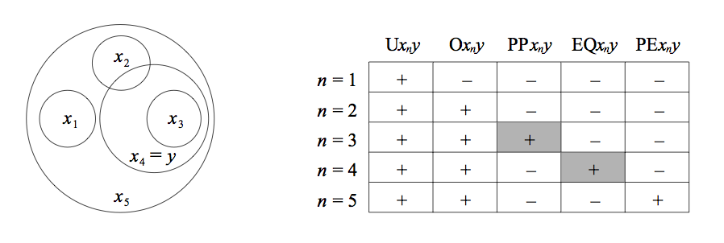
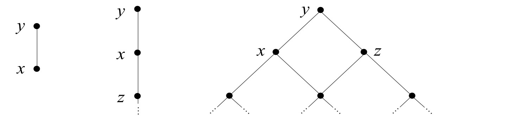
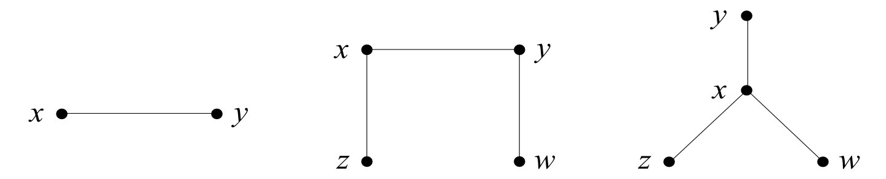
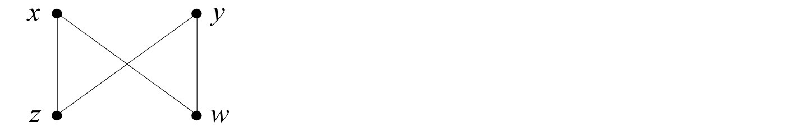
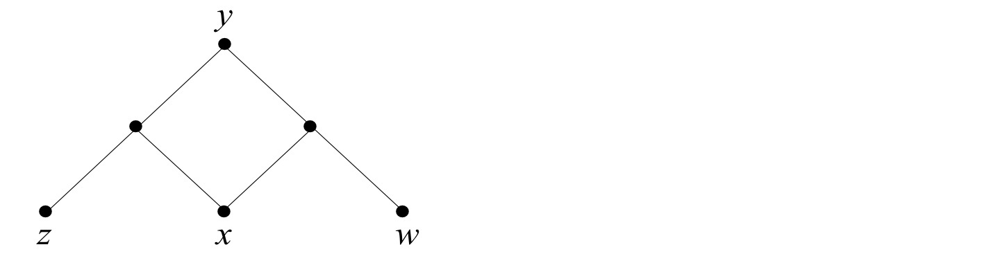
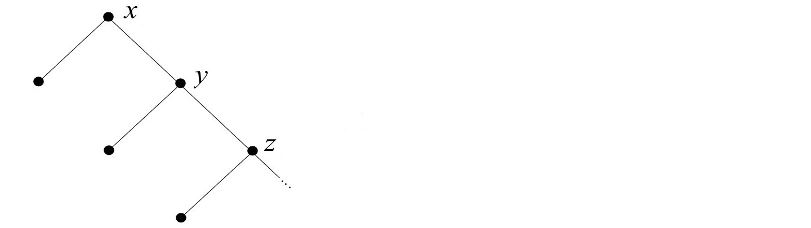
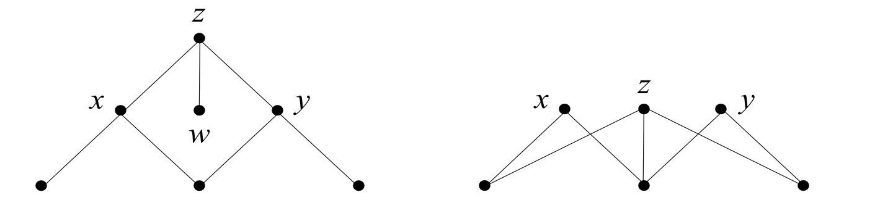
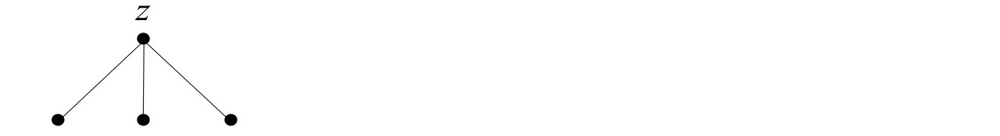
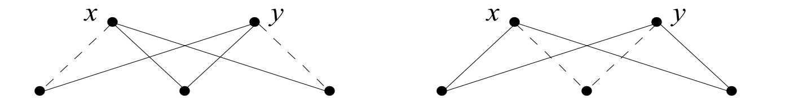

# Mereology
**First published Tue May 13, 2003; substantive revision Sat Jun 27, 2026**

*Varzi, Achille*

Mereology (from the Greek μερος, ‘part’) is a field of inquiry devoted to the study of parthood relations: of the relations of part to whole and the relations of part to part within a whole.[^note-1] Its roots can be traced back to the early days of philosophy, beginning with the Presocratic disputes on the divisibility of being and continuing throughout the writings of Plato (the one and the many), Aristotle (the whole is greater than the sum of its parts), the Stoics (can a thing gain new parts or lose old ones?), and the Neoplatonists, especially Proclus and Boethius (author of the first mereological treatise, *De Divisione*). Mereological questions occupy a prominent role also in the works of early medieval Buddhist thinkers, particularly Nāgārjuna and Vasubandhu, and of the Islamic philosophers engaged in the atomism/anti-atomism debate, and were taken up extensively by the Scholastics: from Garland the Computist and Peter Abelard to Thomas Aquinas, William of Sherwood, John Duns Scotus, Walter Burley, William of Ockham, Jean Buridan, and many others, up to Francisco Suárez. They were, moreover, of chief interest among modern philosophers. Galileo Galilei’s thought experiment on falling bodies (*Discourses*, 1638), for example, rested crucially on part-whole considerations; Margareth Cavendish’s orderly universe hung suspended between the lures of an atomistic foundation (*Poems and Fancies*, 1653) and its rejection (*Philosophical and Physical Opinions*, 1655); Gottfried Leibniz presented his *Ars combinatoria* (1666) as a metaphysical doctrine of the whole and its parts; and David Hume’s arguments on infinite divisibility in the *Treatise* (1739) and in the *Enquiry* (1748) were mostly mereological. We also find mereological concerns in Immanuel Kant, from the early writings (e.g., the *Gedanken* of 1747 and the *Monadologia physica* of 1756) to the famous Second Antinomy in the *Critique of Pure Reason* (1781–1787). It wouldn’t be an exaggeration, therefore, to say that mereological theorizing forms a central chapter of philosophy throughout its history and across traditions.[^note-2] As a formal study of parthood relations as such, however, mereology made its way into our times mainly through the work of Franz Brentano and of his pupils, especially Edmund Husserl’s third *Logical Investigation* (1901). The latter may rightly be considered the first attempt at a formulation of a systematic theory, though in a format that makes it difficult to disentangle the analysis of mereological concepts from that of other ontologically relevant notions (such as the relation of ontological dependence).[^note-3] It is not until Stanisław Leśniewski’s *Foundations of the General Theory of Sets* (1916) and its thorough follow-up, *On the Foundations of Mathematics* (1927–1931), that a pure theory of part-relations was given an exact formulation.[^note-4] And because Leśniewski’s work was largely inaccessible to non-speakers of Polish, it is only with the publication of Henry Leonard and Nelson Goodman’s *The Calculus of Individuals* (1940), partly under the influence of Alfred North Whitehead, that mereology has become a subject of central interest for contemporary ontologists and metaphysicians.[^note-5]

In the following we focus mostly on formulations of mereology as they grew out of these recent theories—Leśniewski’s and Leonard and Goodman’s. Indeed, although such theories come in different logical guises, they are sufficiently similar to be recognized as a common basis for most subsequent developments. To properly assess the relative strengths and weaknesses, however, it will be convenient to proceed in steps. First we consider some core mereological notions and principles. Then we proceed to an examination of the stronger theories that can be erected on that basis.

## 1. ‘Part’ and Parthood

A preliminary caveat is in order. It concerns the very notion of ‘part’ that mereology is about, which does not have an exact counterpart in ordinary language. Broadly speaking, in English we can use ‘part’ to indicate any portion of a given entity. The portion may itself be attached to the remainder, as in (1), or detached, as in (2); it may be cognitively or functionally salient, as in (1)–(2), or arbitrarily demarcated, as in (3); self-connected, as in (1)–(3), or disconnected, as in (4); homogeneous or otherwise well-matched, as in (1)–(4), or gerrymandered, as in (5); material, as in (1)–(5), or immaterial, as in (6); extended, as in (1)–(6), or unextended, as in (7); spatial, as in (1)–(7), or temporal, as in (8); and so on.

| (1) | The handle is part of the mug. |
| --- | --- |
| (2) | The remote-control unit is part of the stereo system. |
| (3) | The left half is your part of the cake. |
| (4) | The cutlery is part of the tableware. |
| (5) | The contents of this bag are only part of what I bought. |
| (6) | That area is part of the living room. |
| (7) | The outermost points are part of the perimeter. |
| (8) | The first act was the best part of the play. |

All of these uses illustrate the general notion of ‘part’ that forms the focus of mereology, regardless of any internal distinctions. (For more examples and tentative taxonomies, see Winston *et al.* 1987, Iris *et al.* 1988, Gerstl and Pribbenow 1995, Pribbenow 2002, Westerhoff 2004, and Simons 2013.)[^gerstl-1995][^iris-1988][^pribbenow-2002][^simons-2013][^westerhoff-2004][^westerhoff-2013][^winston-1987] Sometimes, however, the English word is used in a more restricted sense. For instance, it can be used to designate only the cognitively salient relation of parthood illustrated in (1), the relevant notion of salience being determined by Gestalt factors (Rescher and Oppenheim 1955, Bower and Glass 1976, Palmer 1977, Hoffman and Richards 1984)[^bower-1976][^hoffman-1984][^palmer-1977][^rescher-1955][^rescher-1955-2] or other perceptual and cognitive factors at large (Tversky 2005)[^tversky-2005]. Or it may designate only the functional relation reflected in the parts list included in the user’s manual of a machine, or of a ready-to-assemble product, as in (2), in which case the parts of an object *x* are just its “components”, i.e., those parts that are available as individual units regardless of their actual interaction with the other parts of *x*. (A component is *a part* of an object, rather than just *part* of it; see e.g., Krecz 1986, Tversky 1989, Simons and Dement 1996.)[^krecz-1986][^simons-1996][^tversky-1989] Clearly, the properties of such restricted relations may not coincide with those of parthood understood more broadly, and it will be apparent that pure mereology is only concerned with the latter.

On the other hand, the English word ‘part’ is sometimes used in a broader sense, too, for instance to designate the relation of material constitution, as in (9), or the relation of mixture composition, as in (10), or the relation of group membership, as in (11):

| (9) | The clay is part of the statue. |
| --- | --- |
| (10) | Gin is part of martini. |
| (11) | The goalie is part of the team. |

The mereological status of these relations, however, is controversial. For instance, although the constitution relation exemplified in (9) was included by Aristotle in his threefold taxonomy of parthood (*Metaphysics*, Δ, 1023b), many contemporary authors would rather construe it as a *sui generis*, non-mereological relation (see e.g., Wiggins 1980, Lowe 1983, Rea 1995, Baker 1997, Evnine 2011)[^baker-1997][^evnine-2011][^lowe-1983][^rea-1995][^wiggins-1980][^note-6] or else as the relation of identity (Noonan 1993, Pickel 2010, Almotahari 2014)[^almotahari-2014][^noonan-1993][^pickel-2010], possibly contingent or occasional identity (Gibbard 1975, Robinson 1982, Gallois 1998)[^gallois-1998][^gibbard-1975][^robinson-1982]. Similarly, the ingredient-mixture relationship exemplified in (10) is of dubious mereological status, as the ingredients may undergo significant chemical transformations that alter the structural characteristics they have in isolation (Sharvy 1983, Bogen 1995, Fine 1995a, Needham 2007, Nicolas 2021)[^bogen-1995][^fine-1995a][^fine-2007][^needham-2007][^nicolas-2021][^sharvy-1983]. As for cases such as (11), there is disagreement concerning whether teams and other groups should be regarded as genuine mereological wholes, and while there are philosophers who think so (from Oppenheim and Putnam 1958 to Quinton 1976, Copp 1984, Martin 1988, Hawley 2017, and Strohmaier 2018)[^copp-1984][^hawley-2017][^martin-1988][^oppenheim-1958][^quinton-1976][^strohmaier-2018][^martin-1988-2], others would rather construe the relation of group membership as fundamentally distinct from parthood (see e.g., Simons 1980, Ruben 1983, Meixner 1997, Uzquiano 2004, 2018, Sheehy 2006, Effingham 2010b, Ritchie 2013, and Epstein 2015: ch. 10 for different proposals)[^effingham-2010b][^epstein-2015][^meixner-1997][^ritchie-2013][^ruben-1983][^sheehy-2006][^simons-1980][^simons-2004][^simons-2018][^uzquiano-2004][^uzquiano-2006][^uzquiano-2018]. For all these reasons, here we shall take mereology to be concerned mainly with the principles governing the relation exemplified in (1)–(8), leaving it open whether one or more such broader uses of ‘part’ may themselves be subjected to mereological treatments of some sort.

Finally, it is worth stressing that mereology assumes no ontological restriction on the field of ‘part’. In principle, the relata can be as different as material bodies, events, geometric entities, or spatio-temporal regions, as in (1)–(8), as well as abstract entities such as properties, propositions, types, or kinds, as in the following examples:

| (12) | Rationality is part of personhood. |
| --- | --- |
| (13) | The antecedent is the ‘if’ part of the conditional. |
| (14) | The letter ‘m’ is part of the word ‘mereology’. |
| (15) | Carbon is part of methane. |

This is not uncontentious. For instance, to some philosophers the thought that such abstract entities may be structured mereologically cannot be reconciled with their being universals. To adapt an example from Lewis (1986a)[^lewis-1986a], if the letter-type ‘m’ is part of the word-type ‘mereology’, then so is the letter-type ‘e’. But there are two occurrences of ‘e’ in ‘mereology’. Shall we say that the letter is part of the word twice over? Likewise, if *carbon* is part of *methane*, then so is *hydrogen*. But each methane molecule consists of one carbon atom and four hydrogen atoms. Shall we say that *hydrogen* is part of *methane* four times over? What could that possibly mean? How can one thing be part of another more than once? These are pressing questions, and the friend of structured universals may want to respond by conceding that the relevant building relation is not parthood but, rather, a non-mereological mode of composition (Armstrong 1986, 1988)[^armstrong-1986][^armstrong-1988]. However, other options are open, including some that take the difficulty at face value from a mereological standpoint (see e.g., Bigelow and Pargetter 1989, Hawley 2010, Mormann 2010, Sharpe 2012, Bader 2013, Forrest 2013, 2016, and Azzano 2021; see also Fisher 2018 for a general overview and K. Bennett 2013, Fisher 2013, Cotnoir 2013b: §4, 2015, Garbacz 2017, Sattig 2021, and Tarbouriech *et al.* 2024 for explicit discussion of the idea of being part-related “many times over”). Whether such options are viable may be controversial. Yet their availability is indicative of the full generality of the notion of parthood that mereology seeks to characterize. In this sense, the point to be stressed is metaphilosophical. For while Leśniewski’s and Leonard and Goodman’s original formulations betray a nominalistic stand, reflecting a conception of mereology as an ontologically parsimonious alternative to set theory, there is no necessary link between the analysis of parthood relations and the philosophical position of nominalism.[^note-7] As a formal theory (in Husserl’s sense of ‘formal’, i.e., as opposed to ‘material’) mereology is simply an attempt to lay down the general principles underlying the relationships between an entity and its constituent parts, whatever the nature of the entity, just as set theory is an attempt to lay down the principles underlying the relationships between a set and its members. Unlike set theory, mereology is not committed to the existence of *abstracta*: the whole can be as concrete as the parts. But mereology carries no nominalistic commitment to *concreta* either: the parts can be as abstract as the whole.

Whether this way of conceiving of mereology as a general and topic-neutral theory holds water is a question that will not be further addressed here. It will, however, be in the background of much that follows. Likewise, little will be said here about the important question of whether one should countenance different (primitive) part-whole relations to hold among different kinds of entity (as urged e.g., by Nigel 1952, Sharvy 1980, McDaniel 2004, 2009, and Mellor 2006)[^mcdaniel-2004][^mcdaniel-2006][^mcdaniel-2009][^mellor-2006][^sharvy-1980], or perhaps even among entities of the same kind (Fine 1994, 2010)[^fine-1994][^fine-2010]. Such a question will nonetheless be relevant to the assessment of certain mereological principles discussed below, whose generality may be claimed to hold only in a restricted sense, or on a limited understanding of ‘part’. For further issues concerning the alleged universality and topic-neutrality of mereology, see also Johnston (2005, 2006)[^johnston-2005][^johnston-2006], Varzi (2010)[^varzi-2010], Donnelly (2011)[^donnelly-2011], Hovda (2014b)[^hovda-2014b], Johansson (2015)[^johansson-2015], and Wallace (2021)[^wallace-2021]. (Some may even think that there are no parthood relations whatsoever, e.g., because there are no causally inert non-logical properties or relations, and parthood would be one such; for a defense of this sort of mereological anti-realism, see Cowling 2014.)[^cowling-2014]

## 2. Core Principles

With these provisos, and barring for the moment the complications arising from the consideration of intensional factors (such as time and modalities), we may proceed to review some core mereological notions and principles. Ideally, we may distinguish here between (a) those principles that are simply meant to fix the intended meaning of the relational predicate ‘part’, and (b) a variety of additional, more substantive principles that go beyond the obvious and aim at greater theoretical sophistication and descriptive power. Exactly where the boundary between (a) and (b) should be drawn, however, or even whether a boundary of this sort can be drawn at all, is by itself a matter of controversy.

### 2.1 Parthood as a Partial Ordering

The usual starting point is this: regardless of how one feels about matters of ontology, if ‘part’ stands for the general relation exemplified by (1)–(8) above, and perhaps also (12)–(15), then it stands for a partial ordering—a reflexive, transitive, antisymmetric relation:

| (16) | Everything is part of itself. |
| --- | --- |
| (17) | Any part of any part of a thing is itself part of that thing. |
| (18) | No two things are part of each other. |

As it turns out, most theories put forward in the literature accept (16)–(18). Some misgivings are nonetheless worth mentioning that may, and occasionally have been, raised against these principles.

Concerning reflexivity (16), two sorts of worry may be distinguished. The first is that many legitimate senses of ‘part’ just fly in the face of saying that a whole is part of itself. For instance, Rescher (1955)[^rescher-1955][^rescher-1955-2] famously objected to Leonard and Goodman’s theory on these grounds, citing the biologists’ use of ‘part’ for the functional subunits of an organism as a case in point: no organism is a functional subunit of itself. This is a legitimate worry, but it appears to be of little import. The assumption of reflexivity simply amounts to regarding identity as a limit (improper) case of parthood. A stronger relation of proper parthood, whereby nothing counts as part of itself, can obviously be defined in terms of the weaker relation (see Section 2.2 below). Vice versa, one could frame a mereological theory by taking proper parthood as a primitive instead. As already Lejewski (1957)[^lejewski-1957] noted, this is merely a question of choosing a suitable primitive, so nothing substantive follows from it. (Of course, if one thinks that there are or might be objects that are not self-*identical*, then such objects would not be part of themselves either, yielding genuine counterexamples to (16). Here, however, we stick to a notion of identity that obeys traditional wisdom, which is to say a notion whereby identity is an equivalence relation subject to Leibniz’s law.) The second sort of worry is more serious, for it constitutes a genuine challenge to the idea that (16) expresses a mere stipulation about the intended meaning of ‘part’, as opposed to a substantive metaphysical thesis about parthood. Following Kearns (2011)[^kearns-2011], consider for instance a scenario in which an enduring wall, W, is shrunk down to the size of a brick and eventually brought back in time so as to be used to build (along with other bricks) the original W. Or suppose wall W is bilocated to my left and to my right, and I shrink it to the size of a brick on the left and then use it to replace a brick from W on the right. In such cases, one might think that W ends up being part of itself in a sense in which ordinary walls are not, hence that either parthood is not reflexive or proper parthood is not irreflexive. For another example (also by Kearns), if shapes are construed as abstract universals, then self-similar shapes such as fractals may very well be said to contain themselves as parts in a sense in which other shapes do not. Whether such scenarios are indeed possible is by itself a controversial issue, as it depends on a number of background metaphysical questions concerning persistence through time, location in space, and the nature of shapes. But precisely insofar as the scenarios are not obviously *im*possible, the generality and metaphysical neutrality of (16) may be questioned. (For more examples and critical discussion, see Cotnoir and Varzi 2021: §3.1.)[^cotnoir-2021][^cotnoir-2021-2][^cotnoir-2021-3]

Similar considerations apply to the transitivity principle, (17). On the one hand, several authors have observed that many legitimate senses of ‘part’ are non-transitive, fostering the study of mereologies in which (17) may fail (Pietruszczak 2013, 2014; Seibt 2015)[^pietruszczak-2013][^pietruszczak-2014][^seibt-2015][^pietruszczak-2013-2]. Examples would include: (i) a biological subunit of a cell is not a part of the organ(ism) of which that cell is a part; (ii) a handle can be part of a door and the door of a house, though a handle is never part of a house; (iii) my fingers are part of me and I am part of the team, yet my fingers are not part of the team. (See again Rescher 1955 along with Cruse 1979 and Winston *et al.* 1987, respectively; for other examples see Iris *et al.* 1988, Moltmann 1997, Hossack 2000, Johnston 2002, 2005, Johansson 2004, 2006, Guizzardi 2009, and Fiorini *et al.* 2014)[^cruse-1979][^fiorini-2014][^guizzardi-2009][^hossack-2000][^iris-1988][^johansson-2004][^johansson-2006][^johnston-2002][^johnston-2005][^johnston-2006][^moltmann-1997][^rescher-1955][^rescher-1955-2][^winston-1987][^moltmann-1997-2]. Arguably, however, such misgivings stem again from the ambiguity of the English word ‘part’. What counts as a biological subunit of a cell may not count as a subunit, i.e., a *distinguished* part of the organ, but that is not to say that it is not part of the organ at all. Similarly, if there is a sense of ‘part’ in which a handle is not part of the house to which it belongs, or my fingers not part of my team, it is a restricted sense: the handle is not a *functional* part of the house, though it is a functional part of the door and the door a functional part of the house; my fingers are not *directly* part of the team, though they are directly part of me and I am directly part of the team. (Concerning this last case, some authors actually read (iii) as a *reductio* of the very idea that the group-membership relation is a genuine case of parthood, as mentioned above *ad* (11); see e.g., Schmitt 2003: 34, Uzquiano 2004: 136–137, and Effingham 2010b: 255.) It is obvious that if the interpretation of ‘part’ is narrowed by additional conditions, e.g., by requiring that parts make a functional or direct contribution to the whole, then transitivity may fail. In general, if *x* is a φ-part of *y* and *y* is a φ-part of *z*, *x* need not be a φ-part of *z*: the predicate modifier ‘φ’ may not distribute over parthood. But that shows the non-transitivity of ‘φ-part’, not of ‘part’ (Simons 1987: 107f)[^simons-1987][^simons-1987-2], and within a sufficiently general framework this can easily be expressed with the help of explicit predicate modifiers (Varzi 2006a; Vieu 2006; Garbacz 2007)[^garbacz-2007][^varzi-2006a][^vieu-2006]. On the other hand, there is again a genuine worry that, regardless of any ambiguity concerning the intended interpretation of ‘part’, (17) expresses a substantive metaphysical thesis and cannot, therefore, be taken for granted. For example, it turns out that time-travel and multi-location scenarios such as those mentioned in relation to (16) may also result in violations of the transitivity of both parthood (Effingham 2010a)[^effingham-2010a] and proper parthood (Gilmore 2009; Kleinschmidt 2011)[^gilmore-2009][^kleinschmidt-2011]. And the same could be said of cases that involve no such *exotica*. For instance, Keller (2013, §3.2) and Gilmore (2014)[^gilmore-2014] bring attention to the popular theory of structured propositions originated with Russell (1903)[^russell-1903]. Already Frege (1976: 79)[^frege-1976] pointed out that if the constituents of a proposition are construed mereologically as (proper) parts, then we have a problem: assuming that Mount Etna is literally part of the proposition that Etna is higher than Vesuvius, each individual piece of solidified lava that is part of Etna would also be part of that proposition, which is absurd. Too bad for Russell’s theory of structured propositions, said Frege. Too bad, one could reply, for the transitivity of parthood (short of claiming that the argument involves yet another equivocation on ‘part of’).

Concerning the antisymmetry postulate (18), the picture is even more complex. For one thing, some authors maintain that the relationship between an object and the stuff it is made of provides a perfectly ordinary counterexample of the antisymmetry of parthood. According to Thomson (1998)[^thomson-1998], for example, a statue and the amount of clay that constitutes it are part of each other, yet distinct. (See also Cotnoir 2020 and, for discussion, Walters 2019.)[^cotnoir-2019][^cotnoir-2019-2][^walters-2019] This is not a popular view: as already mentioned, most contemporary authors would either deny that material constitution is a relation of parthood or else treat it as *improper* parthood, i.e., identity, which is trivially antisymmetric (and symmetric). Moreover, those who regard constitution as a genuine case of proper parthood tend to follow Aristotle’s hylomorphic conception and deny that the relation also holds in the opposite direction: the clay would be part of the statue but not vice versa (see e.g., Haslanger 1994, Koslicki 2008, Lowe 2013, Sutton 2022)[^haslanger-1994][^koslicki-2008][^lowe-2013][^sutton-2022][^koslicki-2008-2]. Still, insofar as Thomson’s view is a legitimate option, it represents a challenge to the putative generality of (18). Second, one may wonder about the possibility of *unordinary* cases of symmetric parthood relationships. Sanford (1993: 222)[^sanford-1993] refers to Borges’s Aleph as a case in point: “I saw the earth in the Aleph and in the earth the Aleph once more and the earth in the Aleph …”. One might dismiss the example on the grounds that literary fantasy delivers no guidance to metaphysical possibility (van Inwagen 1993: 229)[^inwagen-1993], but not everyone would concur (see e.g., J. Parsons 2013b and Smid 2023)[^parsons-2013b][^smid-2023]. Moreover, other cases are clearly harder to dismiss. Consider, for instance, the “Net of Indra” of Huayan Buddhism, in which each jewel has every other jewel as part (Jones 2009, 2010; Priest 2015)[^jones-2009][^jones-2010][^priest-2015]. Or consider the Christian doctrine of perichoresis as applied to the interpenetration of the three Persons of the Trinity: surely this was meant as a genuine piece of theology, not mere literary fiction (Cotnoir 2017; Molto 2018)[^cotnoir-2017][^molto-2018]. Or again, consider the possibility of time travel: if time-traveling wall W ends up being one of the bricks that compose (say) its own bottom half, H, then we have a conceivable scenario in which W is part of H and H is part of W while W ≠ H (Kleinschmidt 2011)[^kleinschmidt-2011]. Third, it may be argued that antisymmetry is also at odds with theories that have been found acceptable on quite independent grounds. Take again the theory of structured propositions. If *A* is the proposition that the universe exists—where the universe is something of which everything is part—and if *A* is true, then on such a theory the universe would be a proper part of *A*; and since *A* would in turn be a proper part of U, antisymmetry would be forfeit (Tillman and Fowler 2012; Yablo 2016: 143)[^tillman-2012][^yablo-2016]. Likewise, if *A* is the proposition that *B* is true, and *B* the proposition that *A* is contingent, then again *A* and *B* would be part of each other even though *A* ≠ *B* (Cotnoir 2013b)[^cotnoir-2013b]. Finally, and more generally, it may be observed that the possibility of mereological loops is to be taken seriously for the same sort of reasons that led to the development of set theories tolerating cases of self-membership and, more generally, of membership circularities (see the entry on *non-wellfounded set theory*). This is especially significant in view of the possibility of reformulating set theory itself in mereological terms—a possibility that is extensively worked out in the works of Bunt (1985)[^bunt-1985] and especially Lewis (1991, 1993b)[^lewis-1991][^lewis-1993b][^lewis-1991-2] (see also Burgess 2015, Hamkins and Kikuchi 2016, and Uzquiano 2024)[^burgess-2015][^hamkins-2016][^uzquiano-2024][^uzquiano-2024-2]. For all these reasons, the antisymmetry postulate (18) can hardly be regarded as constitutive of the basic meaning of ‘part’, and some authors have begun to engage in the systematic study of “non-wellfounded mereologies” in which (18) may fail (Cotnoir 2010; Cotnoir and Bacon 2012; Obojska 2013a, 2013b; Maffezioli 2016; Mancini 2023)[^cotnoir-2010][^cotnoir-2012][^maffezioli-2016][^mancini-2023][^obojska-2013a][^obojska-2013b].

In the following we aim at a critical survey of mereology as standardly understood, so we shall mainly confine ourselves to theories that do in fact accept the antisymmetry postulate along with both reflexivity and transitivity. However, the above considerations should not be dismissed. On the contrary, they are crucially relevant in assessing the scope of mereology and the degree to which its standard formulations and extensions betray intuitions that may be found too narrow, false, or otherwise problematic. Indeed, they are crucially relevant also in assessing the ideal desideratum mentioned at the beginning of this section—the desideratum of a neat demarcation between core principles that are simply meant to fix the intended meaning of ‘part’ and principles that reflect more substantive theses concerning the parthood relation. Classical mereology takes the former to include the threefold claim that ‘part’ stands for a reflexive, transitive, and antisymmetric relation, but this is not to say that “anyone who seriously disagrees with them had failed to understand the word” (Simons 1987: 11)[^simons-1987][^simons-1987-2], just as departure from the basic principles of classical logic need not amount to a “change of subject” (Quine 1970: 81)[^quine-1970]. And just as the existence of widespread and diversified disagreement concerning the laws of logic may lead one to conclude that “the only inference left in the intersection of (unrestricted) *all* logics might be the *identity* inference: From *A* to infer *A*” (Beall and Restall 2006: 92)[^beall-2006], and perhaps not even that much (G. Russell 2018; Cotnoir 2019)[^cotnoir-2019][^cotnoir-2019-2][^russell-2018], so one might take the above considerations and the corresponding development of non-classical mereologies to indicate that there may be “no reason to assume that any useful core mereology […] functions as a common basis for all plausible metaphysical theories” (Donnelly 2011: 246)[^donnelly-2011].

### 2.2 Other Mereological Concepts

It is convenient at this point to introduce some degree of formalization. This avoids ambiguities stemming from ordinary language and facilitates comparisons and developments. For definiteness, we assume here a standard first-order language with identity, supplied with a distinguished binary predicate constant, ‘P’, to be interpreted as the parthood relation.[^note-8] Taking the underlying logic to be the classical predicate calculus with identity,[^note-9] the requisites on parthood discussed in Section 2.1 may then be regarded as forming a first-order theory characterized by the following proper axioms for ‘P’:

| (P.1) | *Reflexivity* P*xx* |
| --- | --- |
| (P.2) | *Transitivity* (P*xy* ∧ P*yz*) → P*xz* |
| (P.3) | *Antisymmetry* (P*xy* ∧ P*yx*) → *x*=*y*. |

(Here and in the following we simplify notation by dropping all initial universal quantifiers. Unless otherwise specified, all formulas are to be understood as universally closed.) We may call such a theory *Core Mereology*—**M** for short[^note-10]—since it represents the common starting point of all standard theories.

Given (P.1)–(P.3), a number of additional mereological predicates can be introduced by definition. For example:

| (19) | *Equality* EQ*xy* =_{df} P*xy* ∧ P*yx* |
| --- | --- |
| (20) | *Proper Parthood* PP*xy* =_{df} P*xy* ∧ ¬*x*=*y* |
| (21) | *Proper Extension* PE*xy* =_{df} P*yx* ∧ ¬*x*=*y* |
| (22) | *Overlap* O*xy* =_{df} ∃*z*(P*zx* ∧ P*zy*) |
| (23) | *Underlap* U*xy* =_{df} ∃*z*(P*xz* ∧ P*yz*). |

An intuitive model for these relations, with ‘P’ interpreted as spatial inclusion, is given in Figure 1.

> **Figure 1**. Basic patterns of mereological relations. (Shaded cells indicate parthood).

Note that ‘U*xy*’ is bound to hold if one assumes the existence of a “universal entity” of which everything is part. Conversely, ‘O*xy*’ would always hold if one assumed the existence of a “null item” that is part of everything. Both assumptions, however, are controversial and we shall come back to them below.

Note also that the definitions imply that EQ, O, and U are all symmetric and, by (P.1), reflexive. In addition, given (P.2), EQ is also transitive—an equivalence relation. By contrast, PP and PE are irreflexive and, by (P.3), asymmetric, and it follows from (P.2) that both are also transitive—so they are strict partial orderings. Since the following biconditional is also a straightforward consequence of the axioms (specifically, of (P.1)),

| (24) | P*xy* ↔ (PP*xy* ∨ *x*=*y*), |
| --- | --- |

it should now be obvious that one could in fact use proper parthood as an alternative starting point for the development of classical mereology, using the right-hand side of (24) as a definiens for ‘P’. This is, for instance, the option followed in Simons (1987)[^simons-1987][^simons-1987-2], as also in Leśniewski’s original theory (1916), where the partial ordering axioms for ‘P’ are replaced by the strict ordering axioms for ‘PP’.[^note-11] Ditto for ‘PE’, which was in fact the primitive relation in Whitehead’s (1919)[^whitehead-1919] semi-formal treatment of the mereology of events (and which is just the converse of ‘PP’). Other options are in principle possible, too. For example, Goodman (1951)[^goodman-1951] used ‘O’ as a primitive and Leonard and Goodman (1940) used its opposite:[^note-12]

| (25) | *Disjointness* D*xy* =_{df} ¬O*xy*. |
| --- | --- |

However, the relations corresponding to such predicates are strictly weaker than PP and PE and no biconditional is provable in **M** that would yield a corresponding definiens of ‘P’ (though one could define ‘P’ in terms of ‘O’ or ‘D’ in the presence of further axioms; see below *ad* (31)). Thus, other things being equal, ‘P’, ‘PP’, and ‘PE’ appear to be the only reasonable options. Here we shall stick to ‘P’, referring to J. Parsons (2014)[^parsons-2014] for further discussion.

Finally, note that identity could itself be introduced by definition, due to the following obvious consequence of the antisymmetry postulate (P.3):

| (26) | *x*=*y* ↔ EQ*xy*. |
| --- | --- |

Accordingly, theory **M** could be formulated in a pure first-order language by assuming (P.1) and (P.2) and replacing (P.3) with the following variant of the Leibniz axiom schema for identity (where φ is any formula in the language):

| (P.3′) | *Indiscernibility* EQ*xy* → (φ*x* ↔ φ*y*). |
| --- | --- |

One may in fact argue on these grounds that the parthood relation is in some sense conceptually prior to the identity relation (as in Sharvy 1983: 234 and Smid 2017a)[^sharvy-1983][^smid-2017a], and since ‘EQ’ is not definable in terms of ‘PP’ or ‘PE’ alone except in the presence of stronger axioms (such as (27) below), the argument would also provide evidence in favor of ‘P’ as the most fundamental primitive. As we shall see in Section 3.2, however, the link between parthood and identity is philosophically problematic. In order not to compromise our exposition, we shall therefore keep to a language containing both ‘P’ and ‘=’ as primitives. This will also be convenient in view of the previous remarks concerning the controversial status of Antisymmetry, on which (26) depends.

The last remark is also relevant to the definition of ‘PP’ given above. That is the classical definition used by Leśniewski and by Leonard and Goodman and corresponds *verbatim* to the intuitive characterization of proper parthood used in the previous section. However, in some treatments (including earlier versions of this entry[^note-13]), ‘PP’ is defined directly in terms of ‘P’, without using identity, as per the following variant of (20):

| (20′) | *(Strict) Proper Parthood* PP*xy* =_{df} P*xy* ∧ ¬P*yx*. |
| --- | --- |

(See e.g., Goodman 1951: 35; Eberle 1967: 272; Simons 1991a: 286; Casati and Varzi 1999: 36; Niebergall 2011: 274)[^casati-1999][^eberle-1967][^goodman-1951][^niebergall-2011][^simons-1991a][^casati-1999-2]. Similarly for ‘PE’. In **M** the difference is immaterial, since the relevant definientia are provably equivalent. Yet the equivalence in question depends crucially on Antisymmetry. Absent (P.3), the variant definition is strictly stronger: any two things that are mutually P-related would count as proper parts of each other according to (20) but not, obviously, according to (20′), which forces PP to be asymmetric. Indeed, given only (P.1) and (P.2), the latter definition is still strong enough to deliver a strict partial ordering, whereas (20) does not even yield a transitive relation. Another important difference is that, absent (P.3), the biconditional in (24) continues to hold only if ‘PP’ is defined as in (20). If (20′) is used instead, the left-to-right direction of the biconditional fails whenever *x* and *y* are distinct mutual parts, which means that an object might have parts other than itself that are not proper parts (what Null 1997 calls *irregular* parts)[^null-1997]. In view of the above remarks concerning the doubtful status of (P.3), it is therefore convenient to work with the weaker definition. Standardly it makes no difference, but some of the definitions and results presented below would not extend to non-wellfounded mereology if (20′) were used instead. (See e.g. Cotnoir 2010 and Gilmore 2025, with discussion in Carrara and Smid 2022a.)[^carrara-2022a][^cotnoir-2010][^gilmore-2025] Furthermore, since both definitions force PP to be irreflexive, it should be noted that the only way to develop a non-wellfounded mereology that allows for strict mereological loops, i.e., things that are proper part of themselves, is to rely on yet another definition or else take ‘PP’ as a primitive (as in Cotnoir and Bacon 2012, where PP is axiomatized as transitive but neither irreflexive nor asymmetric)[^cotnoir-2012].

## 3. Decomposition Principles

**M** is standardly viewed as embodying the common core of any mereological theory. Not just any partial ordering qualifies as a part-whole relation, though, and establishing what further principles should be added to (P.1)–(P.3) is precisely the question a good mereological theory is meant to answer. It is here that philosophical issues begin to multiply, over and above the general concerns mentioned in Section 2.1.

Generally speaking, such further principles may be divided into two main groups. On the one hand, one may extend **M** by means of *decomposition principles* that take us from a whole to its parts. For example, one may consider the idea that whenever something has a proper part, it has more than one—i.e., that there is always some *mereological difference* (a “remainder”) between a whole and its proper parts. This need not be true in every model for **M**: a world with only two items, only one of which is part of the other, would be a counterexample, though not one that could be illustrated with the sort of geometric diagram used in Figure 1. On the other hand, one may extend **M** by means of *composition principles* that go in the opposite direction—from the parts to the whole. For example, one may consider the idea that whenever there are some things, there exists something wholly composed of them—i.e., a *mereological sum* (or “fusion”) of those things and nothing besides. Again, this need not be true in a model for **M**, and it is a matter of much controversy whether the idea should hold unrestrictedly.

### 3.1 Supplementation

Let us begin with the first sort of extension. And let us start by taking a closer look at the intuition according to which a whole cannot be decomposed into a single proper part. There are various ways in which one can try to capture this intuition. Consider the following (from Simons 1987: 26–28)[^simons-1987][^simons-1987-2]:

| (P.4ₐ) | *Company* PP*xy* → ∃*z*(PP*zy* ∧ ¬*z*=*x*) |
| --- | --- |
| (P.4_{b}) | *Strong Company* PP*xy* → ∃*z*(PP*zy* ∧ ¬P*zx*) |
| (P.4) | *Supplementation*[^note-14] PP*xy* → ∃*z*(P*zy* ∧ ¬O*zx*). |

The first principle, (P.4ₐ), is a literal rendering of the idea in question: every proper part must be accompanied by another. However, there is an obvious sense in which (P.4ₐ) only captures the letter of the idea, not the spirit: it rules out the unintended model mentioned above (see Figure 2, left) but not, for example, an implausible model with an infinitely descending chain in which the additional proper parts do not leave any remainder at all (Figure 2, center).

The second principle, (P.4_{b}), is stronger: it rules out both models as unacceptable. However, (P.4_{b}) is still too weak to capture the intended idea. For example, it is satisfied by a model in which a whole can be decomposed into several proper parts all of which overlap one another (Figure 2, right), and it may be argued that such models do not do justice to the meaning of ‘proper part’: after all, the idea is that the removal of a proper part should leave a remainder, but it is by no means clear what would be left of *x* once *z* (along with its parts) is removed.

> **Figure 2**. Three unsupplemented models. (Here and in the diagrams below, straight lines represent transitive parthood relationships, with proper parthood running upwards or horizontally.)

It is only the third principle, (P.4), that appears to provide a full formulation of the idea that a whole cannot be decomposed into a single proper part. According to this principle, which implies both (P.4ₐ) and (P.4_{b}), every proper part must be “supplemented” by another, *disjoint* part, and it is this last qualification that captures the notion of a remainder. Should (P.4), then, be incorporated into **M** as a further fundamental principle on the meaning of ‘part’?

Most authors, including Simons himself, would say so. (For a history, see Cotnoir and Varzi 2021: §4.3.1.)[^cotnoir-2021][^cotnoir-2021-2][^cotnoir-2021-3] Yet here there is room for genuine disagreement. In fact, it is not difficult to conceive of mereological scenarios that violate not only (P.4), but also (P.4_{b}) and even (P.4ₐ). A case in point would be Brentano’s (1933)[^brentano-1933] theory of accidents. On that theory, a substance (Socrates) is a proper part of an accident (sitting Socrates) even though nothing needs to be added to the former to get the latter. (See Chisholm 1978, Baumgartner and Simons 1993.)[^baumgartner-1993][^chisholm-1978] Similarly, following Fine (2007: 162)[^fine-2007], one may hold that Socrates is a proper part of his own singleton even though the latter has no proper part that is not a part of Socrates. Another interesting example is provided by Whitehead’s (1929)[^whitehead-1929] theory of extensive connection, where no boundary elements are included in the domain of quantification: on this theory, a topologically closed region includes its open interior as a proper part in spite of there being no boundary elements to distinguish them—the domain only consists of extended regions. (See Clarke 1981 for a rigorous formulation, Randell *et al.* 1992 for developments.)[^clarke-1981][^randell-1992] Finally, consider the view, arguably held by Aquinas, according to which the human person survives physical death along with their soul (see Brown 2005, Stump 2006, and Brower 2014 *pace* Toner 2009, 2010)[^brower-2014][^brown-2005][^stump-2006][^toner-2009][^toner-2010]. On the understanding that persons are hylomorphic composites, and that two things cannot become one, the view implies that upon losing their body a person will continue to exist, pre-resurrection, with only one proper part—the soul. (This is also the view of some contemporary philosophers; see e.g., Oderberg 2005 and Hershenov and Koch-Hershenov 2006.)[^hershenov-2006][^oderberg-2005] Indeed, any case of material coincidence resulting from mereological diminution, as in the Stoic puzzle of Dion and Theon (Sedley 1982)[^sedley-1982] and its modern variants of Tibbles and Tib (Wiggins 1968)[^wiggins-1968], Charlie and Sam (R. Cartwright 1975)[^cartwright-1975][^cartwright-1975-2], and Descartes and Descartes-minus (van Inwagen 1981)[^inwagen-1981], would seem to be at odds with Supplementation: after the diminution, there is nothing that makes up for the difference between what was a proper part and the whole with which it comes to coincide, short of holding that the part has become identical to the whole (Gallois 1998)[^gallois-1998], or has ceased to exist (Burke 1994)[^burke-1994], or did not exist in the first place (van Inwagen 1981)[^inwagen-1981]. One may rely on the intuitive appeal of (P.4) to discard all of the above theories and scenarios as implausible. But one may as well turn things around and regard the plausibility of such theories as a good reason not to accept (P.4) unrestrictedly, as argued e.g., by Forrest (2002)[^forrest-2002], D. Smith (2009)[^smith-2009], Oderberg (2012)[^oderberg-2012], Lowe (2013)[^lowe-2013], or Cotnoir (2021)[^cotnoir-2021][^cotnoir-2021-2][^cotnoir-2021-3]. As things stand, it therefore seems appropriate to regard such a principle as providing a minimal but substantive addition to (P.1)–(P.3), one that goes beyond the basic characterization of ‘part’ provided by **M**. We shall label the resulting mereological theory **MM**, for *Minimal Mereology*.

Actually **MM** is now redundant, as Supplementation turns out to entail Antisymmetry so long as parthood is transitive and reflexive: if *x* and *y* were proper parts of each other, contrary to (P.3), then every *z* that is part of one would also be part of—hence overlap—the other, contrary to (P.4). For ease of reference, we shall continue to treat (P.3) as an axiom. Yet the entailment is worth emphasizing, for it explains why Supplementation tends to be *explicitly* rejected by those who do not endorse Antisymmetry, over and above the more classical examples mentioned above. For instance, whoever thinks that a statue and the corresponding lump of clay are part of each other will find Supplementation unreasonable: after all, such parts are coextensive; why should we expect anything to be left over when, say, the clay is “subtracted” from the statue? (Bigelow 2010: 474; Donnelly 2011: 230)[^bigelow-2010][^donnelly-2011]. Supplementation has recently run into trouble also in connection with the other axioms of **M**, especially in the context of time-travel and multilocation scenarios such as those already mentioned in Section 2.1 (see Effingham and Robson 2007, Gilmore 2007, Eagle 2010, Kleinschmidt 2011, Daniels 2014)[^daniels-2014][^eagle-2010][^effingham-2007][^gilmore-2007][^gilmore-2014][^kleinschmidt-2011][^kleinschmidt-2014]. As a result, a question that is gaining increasing attention is whether there are any ways of capturing the supplementation intuition that are strong enough to rule out the models of Figure 2 and yet sufficiently weaker than (P.4) to be acceptable to those who do not endorse some **M**-axiom or other—be it Antisymmetry, Transitivity, or Reflexivity.

Two sorts of answer may be offered in this regard (see e.g., Gilmore 2025)[^gilmore-2025]. The first is to weaken the Supplementation conditional by strengthening the antecedent. For instance, one may simply rephrase (P.4) in terms of the stricter notion of proper parthood defined in (20′), i.e., effectively:

| (P.4_{c}) | *Strict Supplementation* (P*xy* ∧ ¬P*yx*) → ∃*z*(P*zy* ∧ ¬O*zx*). |
| --- | --- |

In **M** this is equivalent to (P.4). Yet it is logically weaker, and it is easy to see that this suffices to block the inference to Antisymmetry even in the presence of Reflexivity and Transitivity (just consider a two-element model with mutual parthood, as in Figure 3, left). Still, (P.4_{c}) is sufficiently stronger than (P.4ₐ) and (P.4_{b}) to rule out all three patterns in Figure 2, and it obviously preserves the spirit of (P.4)—if not the letter. The second sort of answer is to weaken Supplementation by adjusting the consequent. There are various ways of doing this, the most natural of which appears to be the following:

| (P.4_{d}) | *Quasi-supplementation* PP*xy* → ∃*z*∃*w*(P*zy* ∧ P*wy* ∧ ¬O*zw*). |
| --- | --- |

This principle says, literally, that if something has a proper part, then it has at least *two* disjoint parts, which Simons (1987: 27)[^simons-1987][^simons-1987-2] takes to express the same intuition captured by (P.4). And indeed, (P.4_{d}) is strong enough to rule out the unsupplemented patterns in Figure 2. Yet (P.4_{d}) is weaker than (P.4), since it admits the non-antisymmetric model in Figure 3, middle, and for that reason it may be deemed more suitable in the context of theories that violate (P.3). Note also that (P.4_{d}) does not admit the symmetric model in Figure 3, left, so in a way it is stronger than (P.4_{c}). In another way, however, it is weaker, since it admits the model in Figure 3, right, which (P.4_{c}) rules out (and which someone who thinks that, say, the clay is part of the statue, but not vice versa, might want to retain).

> **Figure 3**. More unsupplemented patterns.

There are other options, too. For instance, in some standard treatments, the Supplementation principle (P.4) is formulated using ‘PP’ also in the consequent, in analogy to the Company principles:

| (P.4′) | *Proper Supplementation*[^note-15] PP*xy* → ∃*z*(PP*zy* ∧ ¬O*zx*). |
| --- | --- |

This formulation is logically stronger than (P.4), though the difference dissolves as soon as P is assumed to be reflexive. On the other hand, again, one may rely on the alternative definition of ‘PP’ to obtain variants of (P.4′) that are stronger than (P.4_{c}) but weaker than (P.4). Similarly for (P.4_{d}), which may be further weakened or strengthened by tampering with the parthood predicates occurring in the antecedent and in the consequent.[^note-16]

### 3.2 Strong Supplementation and Extensionality

We may also ask the opposite question: Are there any stronger ways of expressing the supplementation intuition besides (P.4)? In classical mereology, the standard answer is in the affirmative, the main candidate being the following:

| (P.5) | *Strong Supplementation* ¬P*yx* → ∃*z*(P*zy* ∧ ¬O*zx*). |
| --- | --- |

Intuitively, this says that if an object *fails* to include another among its parts, then there must be a remainder, something that makes up for the difference. The consequent is the same as in (P.4), but the antecedent is weaker so long as parthood is antisymmetric. Thus, in **M** (P.5) entails (P.4), which means that any **M**-theory violating (P.4) will *a fortiori* violate (P.5). For instance, on Whitehead’s boundary-free theory of extensive connection, a closed region is not part of its interior even though each part of the former overlaps the latter. The converse entailment, however, may fail. The diagram in Figure 4 illustrates an **M**-model in which (P.4) is satisfied, since each proper part counts as a supplement of the other; yet (P.5) is false.

> **Figure 4**. A supplemented model violating Strong Supplementation.

The theory obtained by adding (P.5) to the ordering axioms (P.1)–(P.3) is thus a proper extension of **MM**. (In this theory (P.3) is no longer redundant, as it is needed to prove (P.4), though (P.1) is now derivable from (P.5) and (P.2) and could therefore be dropped.) We label this stronger theory **EM**, for *Extensional Mereology*, the attribute ‘extensional’ being justified precisely by the exclusion of models that, like the one in Figure 4, contain distinct objects with the same proper parts. In fact, it is a theorem of **EM** that *no* composite objects with the same proper parts can be distinguished:

| (27) | (∃*z*PP*zx* ∨ ∃*z*PP*zy*) → (*x*=*y* ↔ ∀*z*(PP*zx* ↔ PP*zy*)). |
| --- | --- |

This goes far beyond the intuition that lies behind the basic Supplementation principle (P.4). Does it go too far?

On the face of it, it is not difficult to envisage scenarios that would correspond to the diagram in Figure 4. For example, we may take *x* and *y* to be the sets {{*z*}, {*z*, *w*}} and {{*w*},{*z*, *w*}}, respectively (i.e., the ordered pairs ⟨*z*, *w*⟩ and ⟨*w*, *z*⟩), interpreting ‘P’ as the ancestral of the improper membership relation (i.e., of the union of ∈ and =). But sets are abstract entities, and the ancestral relation does not generally satisfy (P.4) (the singleton of the empty set, for instance, or the singleton of any urelement, would have only one proper part on the suggested construal of ‘P’). Can we also envisage similar scenarios in the domain of concrete, spatially extended entities, granting (P.4) in its generality? Admittedly, it is difficult to *picture* two concrete objects mereologically structured as in Figure 4. It is difficult, for example, to draw two extended objects composed of the same proper parts because drawing something *is* drawing its proper parts; once the parts are drawn, there is nothing left to be done to get a drawing of the whole. Yet this only proves that pictures are biased towards (P.5). Are there any philosophical reasons to resist the extensional force of (P.5) beyond the domain of abstract entities, and in the presence of (P.4)?

Two kinds of reason are worth examining. On the one hand, it is often noted that concrete objects can lose some of their proper parts, or gain new ones, without ceasing to be what they are. When a cat survives the loss of its tail, for example, we have a tailed cat *x* (before the loss) and a tailless cat *y* (after the loss) that are numerically identical despite having different proper parts (Wiggins 1980)[^wiggins-1980]. Similarly in cases of mereological increase (Olson 2006b)[^olson-2006b]. If so, then it would appear that sameness of proper parts is not *necessary* for identity, contrary to the left-to-right direction of the consequent of (27). On the one hand, it is sometimes argued that sameness of proper parts is not *sufficient* for the identity of composite objects, contrary to the right-to-left direction. The cases of material coincidence mentioned above (the statue, the clay) are often cited as counterexamples, but several other cases have been considered in this regard. For example: (i) two sentences can be made up of the same words (Rescher 1955: 10)[^rescher-1955][^rescher-1955-2], two words of the same letters (Harte 2002: 16)[^harte-2002][^harte-2002-2], two tunes of the same notes (Rosen and Dorr 2002: 154)[^rosen-2002], etc.; or (ii) a bouquet of flowers is sensitive to their proper arrangement and so is not the same as their “mere” collection (Eberle 1970: §2.10)[^eberle-1970][^eberle-1970-2] as a watch is not “just” a pile of springs and gears (Maudlin 1998: 47)[^maudlin-1998], a ham sandwich an aggregate of bread and ham (Fine 1999)[^fine-1999], a motorcycle a supply of parts (Koslicki 2008)[^koslicki-2008][^koslicki-2008-2], a molecule a bunch of atoms (Harré and Llored 2011, 2013)[^harré-2011][^harré-2013], and so on; or (iii) a cat is more than the sheer sum of its bodily parts, for the former can undergo mereological change whereas the latter cannot by definition (Wiggins 1968)[^wiggins-1968]—and similarly for other cases inspired by Aristotle‘s dictum that an individual substance “is something besides the parts” (as in Lowe 1989: ch.6, Johnston 1992, Meirav 2003, Sanford 2003, and Crane 2012, *inter alia*)[^crane-2012][^johnston-1992][^lowe-1989][^meirav-2003][^sanford-2003][^meirav-2003-2].[^note-17] If any of these claims is accepted, then clearly (27) is too strong a principle to be imposed on the parthood relation. And since (27) follows from the interaction between (P.5) and the ordering axioms, it might be concluded that **EM** is on the wrong track.

Let us examine these two lines of reasoning separately. Concerning the necessity aspect of (27), i.e., the left-to-right conditional

| (28) | *x*=*y* → ∀*z*(PP*zx* ↔ PP*zy*), |
| --- | --- |

it is perhaps enough to observe that the difficulty is not peculiar to extensional mereology. The objection proceeds from the consideration that ordinary concrete objects may survive mereological change. This is a natural thought, unless one is prepared to accept a rigid form of “mereological essentialism” (Chisholm 1973, 1975, 1976; Plantinga 1975; Wiggins 1979)[^chisholm-1973][^chisholm-1975][^chisholm-1976][^plantinga-1975][^wiggins-1979] or to endorse an “occasional identity” metaphysics (Myro 1985; Gallois 1998)[^gallois-1998]. However, the same can be said of other types of change as well: bananas ripen, furniture ages, people move and change their shapes and positions all the time. How can such objects preserve their identity, i.e., continue to be the same things, if they are not quite the same? Indeed, (28) is but an instance of the Leibniz axiom schema

| (ID) | *x*=*y* → (φ*x* ↔ φ*y*), |
| --- | --- |

and it is well known that this schema—the Indiscernibility of Identicals—runs into trouble when ‘=’ is given a diachronic reading. (See the entries on *change* and *identity over time*.) The problem is a general one. Whatever solution one favors, one should therefore expect it to apply to the present case as well, and in this sense the worry about (28) can be defused. For example, the problem dissolves immediately if material objects are construed as four-dimensional worms, composed of spatio-temporal parts that follow one another in time as they line up in space (Heller 1984, Lewis 1986b, Sider 2001)[^heller-1984][^lewis-1986b][^sider-2001]. Alternatively, on a more traditional, three-dimensional conception of material objects, it is customary to handle the problem by relativizing properties and relations to times, rewriting (ID) along the following lines:

| (ID′) | *x*=*y* → ∀*t*(φ*ₜx* ↔ φ*ₜy*). |
| --- | --- |

(See e.g., the papers in Haslanger and Kurtz 2006, Part III.)[^haslanger-2006] If so, then parthood itself may be relativized to times, and one would expect a suitable relativized version of the mereological axioms to warrant only a corresponding variant of (28):

| (28′) | *x*=*y* → ∀*t*∀*z*(PP*ₜzx* ↔ PP*ₜzy*). |
| --- | --- |

(This strategy was first advocated by Thomson 1983. Followers include Simons 1987: §5.2, Masolo 2009, and Giaretta and Spolaore 2011, whereas Kazmi 1990 and Hovda 2013 opt for tensed variants. See also the extensive treatments in Sider 2001: §3.2 and in Cotnoir and Varzi 2021: §6.2.2.)[^cotnoir-2021][^cotnoir-2021-2][^giaretta-2011][^hovda-2013][^kazmi-1990][^masolo-2009][^sider-2001][^simons-1987][^thomson-1983][^cotnoir-2021-3][^simons-1987-2] The need to relativize parthood to time, and perhaps to other parameters such as spatial locations, possible worlds, etc., has also been motivated on independent grounds, from the so-called “problem of the many” (Hudson 2001)[^hudson-2001] to material constitution (Bittner and Donnelly 2007)[^bittner-2007], modal realism (McDaniel 2004)[^mcdaniel-2004], vagueness (Donnelly 2009)[^donnelly-2009], relativistic spacetime (Balashov 2008)[^balashov-2008], or the general theory of location (Gilmore 2009, Donnelly 2010)[^donnelly-2010][^gilmore-2009]. One way or the other, then, such revisions may be regarded as indicative of the limited ontological neutrality of extensional mereology. But their independent motivation also bears witness to the fact that controversies about (28) stem from genuine and fundamental philosophical conundrums and can hardly be assessed by appealing to our intuitions about the meaning of ‘part’.

The worry about the sufficiency aspect of mereological extensionality, i.e., the right-to-left conditional

| (29) | ∀*z*(PP*zx* ↔ PP*zy*) → *x*=*y*, |
| --- | --- |

is more to the point. However, here too there are various ways of responding. To begin with, counterexamples based on material coincidence could be dismissed as ultimately misfiring. For there are three possible cases, depending on whether (a) each of the coinciding entities, *x* and *y*, is part of the other, (b) only one is part of the other, or (c) neither is part of the other. In case (a) we already have a counterexample to the Antisymmetry axiom (P.3), so the problem lies elsewhere (see Section 2.1). Similarly, in case (b) *x* and *y* will have the same proper parts only if the one that is part of the other is a proper part of itself, contradicting the Irreflexivity of PP and hence the reflexivity of identity, so again the problem lies elsewhere. (Note that both cases are also incompatible with the Supplementation principle (P.4), as emphasized e.g., in Olson 2006a: 743, though there is no need to go that far.) The only possible counterexample to (29) can arise in case (c), as when it is claimed that the relation of material constitution relating an object (e.g., a statue) and the matter it is made of (some clay) is not mereological. But then—one could argue—whatever reasons one might have to distinguish the two coinciding entities would warrant a similar distinction between some of their proper parts—e.g., a statue’s nose and the corresponding amount of matter. (This is widely acknowledged: see e.g. Doepke 1982: 51, Baker 2000: 181, Lowe 2001: 148, Fine 2003: 198, Varzi 2008: §3, and Walters 2019: §2. See also Lipman 2024 for the radical view that the two entities share no parts at all.)[^baker-2000][^doepke-1982][^fine-2003][^lipman-2024][^lowe-2001][^varzi-2008][^varzi-2019][^walters-2019] If so, then *x* and *y* would not have the same parts after all, and the relevant instance of (29) would be vacuously true.

As for the other putative counterexamples listed in (i)–(iii) above, details may vary. Consider (i)—say, two words made up of the same letters, as in ‘vile’ and ‘evil’. If these are taken as word-types, then we are back to a counterexample involving abstract entities, like sets. Moreover, much depends on how exactly one construes such things mereologically, and one might either meet the challenge by shifting to a more adequate logical framework (e.g., plural quantification, as in Carrara and Smid 2022b)[^carrara-2022b] or dismiss it altogether by rejecting the dime-store thought that word-types are letter-type composites (see above *ad* (14)). On the other hand, suppose the items in question are taken as word-tokens. Then presumably they are made up of distinct letter-tokens, so again there is no violation of (29), hence no reason to reject (P.5) on these grounds. To be sure, we may also suppose that one of the two word-tokens is obtained from the other by rearranging the *same* letter-tokens. If so, however, the issue becomes once again one of diachronic non-identity, with all that it entails, and it is not obvious that we have a counterexample to (29). (See Lewis 1991: 78f.)[^lewis-1991][^lewis-1991-2] What if our letter-tokens are suitably arranged so as to form both words at the same time? For example, suppose they are arranged in a circle (Simons 1987: 114)[^simons-1987][^simons-1987-2]. In this case one might be inclined to say that we have a genuine counterexample. But one may equally well insist that we have got just one concrete circular inscription that, curiously, can be read as two different words depending on where we start—a duck-rabbit ambiguity rather than a genuine counterexample to mereological extensionality.

The other cases may be more challenging; yet there too the friends of extensionality will have things to say in response (Varzi 2000, 2008; Lando 2017, Smid 2021, 2025, Canavotto and Giordani 2022)[^canavotto-2022][^lando-2017][^smid-2021][^smid-2025][^varzi-2000][^varzi-2008][^lando-2017-2]. Even when the challenge goes beyond ordinary intuition and appeals to considerations from the hard sciences, as with certain type-(ii) and type-(iii) cases inspired by quantum physics, there are counterarguments one could offer on behalf of extensionality (see e.g. Calosi *et al.* 2011 in response to Maudlin 1998)[^calosi-2011][^maudlin-1998].[^note-18] Indeed, some may be inclined to dismiss all cases outright simply on account of the “crazy arithmetic” they appear to involve—a phrase that Plutarch used to mock the Stoics’ dualist doctrines (*De communibus notitiis*, 1083f) and that the extensional mereologist might readily embrace. “No distinction of entities without a distinction of content”, says Goodman (1951: 26)[^goodman-1951]. “No difference without a difference-maker”, echoes Lewis (1991: 78)[^lewis-1991][^lewis-1991-2].

Be that as it may, let it be stressed that the extensional character of **EM** is not due exclusively to the Strong Supplementation principle (P.5). The extensionalist thesis (27) follows from (P.5) only in the presence of the ordering axioms. Specifically, the derivation requires the Antisymmetry postulate (P.3). If an anti-extensionalist is already unhappy with the latter postulate, there is therefore no need to fault (P.5) as well.[^note-19] For example, the non-wellfounded mereology of Cotnoir and Bacon (2012), which lacks (P.3), is not extensional even if it includes (P.5) among its axioms. Similarly for the non-extensional mereology of Obojska (2012, 2013b)[^obojska-2012][^obojska-2013b].

This last point is particularly important in view of the fact that Strong Supplementation has several attractive properties that hold regardless of Antisymmetry, and that one might find attractive. Most notably, it is easily seen that, given Reflexivity, (P.5) entails the conditional

| (30) | ∀*z*(O*zy* → O*zx*) → P*yx*. |
| --- | --- |

As Parsons (2014: §2) notes, this suggests a reading of Strong Supplementation as giving expression to a kind of supervenience principle: no two things can differ regarding what parts they have (or what they are parts of) without differing regarding what they overlap. Moreover, since the converse of (30) is an immediate consequence Transitivity, one can obtain the biconditional

| (31) | P*yx* ↔ ∀*z*(O*zy* → O*zx*). |
| --- | --- |

This means that, given only (P.1) and (P.2), the assumption of (P.5) makes it possible to adopt ‘O’ as a primitive and define ‘P’ accordingly, as in Goodman (1951)[^goodman-1951]. And because disjointness is just the opposite of overlap, one could likewise define ‘P’ in term of ‘D’, as in Leonard and Goodman (1940). Indeed, it is also easy to see that, given only (P.1), (31) entails (P.5). Thus, in the context of symmetric and transitive mereologies, (P.5) is not only sufficient but also necessary to characterize the parthood in terms of these other relations.

### 3.3 Complementation

There are ways of expressing the supplementation intuition that are even stronger than (P.5). The main one corresponds to the following thesis, which differs from (P.5) in the consequent:

| (P.6) | *Complementation*[^note-20] ¬P*yx* → ∃*z*∀*w*(P*wz* ↔ (P*wy* ∧ ¬O*wx*)). |
| --- | --- |

Whereas (P.5) simply states that whenever *y* is not part of *x* there must be *some* remainder, i.e., some part of *y* that is disjoint from *x*, (P.6) requires the existence of a *maximal* remainder, i.e., a remainder comprising *all* such parts (and nothing else)—what we may call the *difference* or relative *complement* between *y* and *x*. It is easily checked that this principle implies (P.5). On the other hand, the diagram in Figure 5 shows that the converse does not hold: there are two parts of *y* in this diagram that do not overlap *x*, namely *z* and *w*, but there is nothing that consists exactly of such parts, so we have a model of (P.5))—indeed, a model of **EM**—in which (P.6) fails.

> **Figure 5**. A strongly supplemented model violating Complementation.

Any misgivings about (P.5) may of course be raised against (P.6). But what if one agrees with the above arguments in support of (P.5)? Do they also give us reason to accept the stronger principle (P.6)? The answer is no. Plausible as it may initially sound, (P.6) has consequences that even an extensionalist may be unwilling to accept. For example, it may be argued that although the base and the stem of a wine glass jointly compose a larger part of the glass itself, and similarly for the stem and the bowl, there is nothing composed just of the base and the bowl (= the difference between the glass and the stem), since these two pieces are standing apart. More generally, it appears that (P.6) would force one to accept the existence of a wealth of “scattered” entities, such as the aggregate consisting of your body minus your torso, or the aggregate of all Andean peaks above twelve thousand feet. Entities such as these lack the sort of unity that is characteristic of ordinary objects. And since V. Lowe (1953)[^lowe-1953], many authors have expressed discomfort with such entities *regardless* of extensionality. (One philosopher who explicitly accepts extensionality but feels uneasy about scattered entities is Chisholm 1987.)[^chisholm-1987] As it turns out, the extra strength of (P.6) is therefore best appreciated in terms of the sort of mereological aggregates that this principle would force us to accept, aggregates that are composed of two or more parts of a given whole. This suggests that any additional misgivings about (P.6), besides its extensional implications, are in fact misgivings about matters of composition. We shall accordingly postpone their discussion to Section 4, where we attend to these matters more fully. For the moment, let us simply say that (P.6) is not, on the face of it, a principle that can be added to **M** as a mere strengthening of (P.5).

### 3.4 Atomism, Gunk, and Other Options

One last important family of decomposition principles concerns the question of atomism. Mereologically, an atom (or “simple”) is an entity with no proper parts, regardless of whether it is point-like or has spatial (and/or temporal) extension:

| (32) | *Atom* A*x* =_{df} ¬∃*y*PP*yx*. |
| --- | --- |

By definition of ‘PP’, all atoms are pairwise disjoint and can only overlap things of which they are part. Are there any such entities? And, if there are, is everything entirely composed of atoms? Is everything comprised of at least some atoms? Or is everything made up of atomless “gunk”—as Lewis (1991: 20)[^lewis-1991][^lewis-1991-2] calls it—that divides forever into smaller and smaller parts? These are deep and difficult questions, which have been the focus of philosophical investigation since the early days of philosophy and throughout the medieval and modern debate on anti-divisibilism, up to Kant’s antinomies in the *Critique of Pure Reason* (see the entries on *ancient atomism* and *atomism from the 17th to the 20th century*). Along with nuclear physics and Russell’s (1918–1919) logical atomism, they made their way into contemporary mereology mainly through Nicod’s (1924)[^nicod-1924] “geometry of the sensible world”, Tarski’s (1929)[^tarski-1929] “geometry of solids”, and Whitehead’s (1929)[^whitehead-1929] theory of “extensive connection” mentioned in Section 3.1, and are now center stage in many mereological disputes at the intersection between metaphysics and the philosophy of space and time (see the papers collected in Hudson 2004 along with Sider 1993, Zimmerman 1996, Markosian 1998a, Schaffer 2003, Hudson 2007a, McDaniel 2007b, J. Russell 2008, Kovacs 2014, and Chen 2020 *inter alia*; see also Sobociński 1971 and Eberle 1967 for some early treatments of these questions in the spirit of Leśniewski’s *Mereology* and of Leonard and Goodman’s *Calculus of Individuals*, respectively). Here we shall confine ourselves to a brief examination.

The two main options, to the effect that everything is ultimately made up of atoms, or that there are no atoms at all, are typically expressed by the following postulates, respectively:

| (P.7) | *Atomicity* ∃*y*(A*y* ∧ P*yx*) |
| --- | --- |
| (P.8) | *Atomlessness* ∃*y*PP*yx*. |

(See e.g., Simons 1987: 42.)[^simons-1987][^simons-1987-2] These postulates are mutually incompatible, but taken in isolation they can consistently be added to any standard mereological theory **X** considered here. Adding (P.7) yields a corresponding *Atomistic* version, **AX**; adding (P.8) yields an *Atomless* version, **ĀX**. Since finitude together with the antisymmetry of parthood (P.3) jointly imply that mereological decomposition must eventually come to an end, it is clear that any finite model of **M**—and *a fortiori* of any extension of **M**—must be atomistic. Accordingly, an atomless mereology **ĀX** admits only models of infinite cardinality. An example of such a model, establishing the consistency of the atomless versions of most standard mereologies considered in this survey, is provided by the regular open sets of a Euclidean space, with ‘P’ interpreted as set-inclusion (Tarski 1935)[^tarski-1935]. On the other hand, the consistency of an atomistic theory is typically guaranteed by the trivial one-element model (with ‘P’ interpreted as identity), though one can also have models of atomistic theories that allow for infinite domains. A case in point is provided by the closed intervals on the real line, or the closed sets of a Euclidean space (Eberle 1970)[^eberle-1970][^eberle-1970-2]. In fact, it turns out that even when **X** is as strong as the full calculus of individuals, corresponding to the theory **GEM** of Section 4.4, there is *no* purely mereological formula that says whether there are finitely or infinitely many atoms, i.e., that is true in every finite model of **AX** but in no infinite model (Hodges and Lewis 1968)[^hodges-1968].

Concerning Atomicity, two further remarks are in order. The first is that (P.7) does not quite say that everything is ultimately *composed of* atoms; it merely says that everything *has* atomic parts.[^note-21] As such it rules out gunky worlds, but one may wonder whether it fully captures the atomistic intuition. In a way, the answer is in the affirmative. For, assuming Reflexivity and Transitivity, (P.7) implies the following

| (33) | P*zx* → ∃*y*(A*y* ∧ P*yx* ∧ O*yz*), |
| --- | --- |

which is logically equivalent to

| (34) | ((A*y* ∧ P*yx*) → P*yx*) ∧ (P*zx* → ∃*y*(A*y* ∧ P*yx* ∧ O*yz*)) |
| --- | --- |

(adding a tautological conjunct), which is an instance of the general schema

| (35) | (φ*y* → P*yx*) ∧ (P*zx* → ∃*y*(φ*y* ∧ O*yz*)). |
| --- | --- |

And (35) is the closest we can get to saying that *x* is composed of the φs, i.e., of all and only those entities that satisfy a given condition φ (in the present case: being an atomic part of *x*): every φ is part of *x*, and any part of *x* overlaps some φ. Indeed, provided the φs are pairwise disjoint, this is the standard definition of what it means for something *x* to be composed of the φs (from van Inwagen 1990: 29)[^inwagen-1990], and surely enough, if the φs are all atomic, then they are pairwise disjoint. Thus, although (P.7) does not *say* that everything is ultimately composed of atoms, it implies as much—at least in the presence of (P.1) and (P.2). (Of course, non-standard mereologies in which either postulate is rejected may not warrant the implication, so in such theories (33) might be a better way to express the assumption of atomism. See also Giordani and Calosi 2023 vs. Varzi 2017 on the implications of different no-tions of composition.) In another way, however, there remains a sense that something is amiss with (P.7) and (33). For if the domain is infinite, these theses admit of models that seem to run afoul of the atomistic doctrine. A simple example is a descending chain of decomposition that never “bottoms out”, as in Figure 6: here *x* is ultimately composed of atoms, but the pattern of decomposition that goes down the right branch “looks” awfully similar to a gunky precipice. For a concrete example (from Eberle 1970: 75)[^eberle-1970][^eberle-1970-2], consider the set of all subsets of the natural numbers, with parthood modeled by the subset relation. In such a universe, each singleton {*n*} will count as an atom and each infinite set {*m*: *m* > *n*} will be “composed” of atoms. Yet the set of all such infinite sets will be infinitely descending. Similar examples are discussed in Cotnoir (2013c)[^cotnoir-2013c], Shiver (2015)[^shiver-2015], Tsai and Varzi (2016)[^varzi-2016], and Tsai (2017)[^tsai-2017]. Models of this sort do not violate the idea that everything is ultimately composed of atoms. However, they violate the idea that everything can be *decomposed into* its ultimate constituents. And this may be found problematic if atomism is meant to carry the weight of metaphysical grounding: as J. Schaffer puts it, the atomist’s ontology seems to drain away “down a bottomless pit” (2007: 184); being is “infinitely deferred, never achieved” (2010: 62).

> **Figure 6**. An infinitely descending atomistic model. (The ellipsis indicates repetition of the branching pattern.)

Are there any ways for the atomist to avoid this charge? One option would simply be to require that every model be finite, or that it involve only a finite set of atoms. Yet such requirements, besides being philosophically costly and controversial even among atomists, cannot be formally implemented in first-order mereology: the former for well-known model-theoretic reasons, and the latter in view of the above-mentioned result by Hodges and Lewis (1968). The only reasonable option would seem to be a genuine strengthening of Atomicity in the spirit of what Cotnoir (2013c)[^cotnoir-2013c] calls “superatomism”, by analogy with superatomic Boolean algebras (Roitman 1989)[^roitman-1989]. Given any object *x*, the Atomicity axiom (P.7) guarantees the existence of *some* parthood chain that bottoms out at an atom; a Superatomicity axiom would instead require that *every* parthood chain of *x* bottoms out—a property that fails in the model of Figure 6. Unfortunately, this strategy, too, can hardly be implemented in first-order mereology, as a proper formulation of the axiom would involve quantification over classes. Moreover, to the extent that it can be formulated at all, superatomism faces several challenges when combined with mereological theories stronger than **EM**, as detailed in Uzquiano (2017)[^uzquiano-2017] and Dixon (2020)[^dixon-2020]. For example, in the context of the full calculus of individuals—the theory **GEM** of Section 4.4—the existence of infinitely many atoms forces the existence of infinite descending proper-parthood chains, hence the assumption of superatomism would entail a commitment to finitism. As already noted, this is hardly a negligible cost even for an atomist.

The second important remark is that, independently of their philosophical motivations and formal limitations, atomistic mereologies admit of significant simplifications in the axioms. For instance, **AEM** can be simplified by replacing (P.5) and (P.7) with

| (P.5′) | *Atomistic Supplementation* ¬P*xy* → ∃*z*(A*z* ∧ P*zx* ∧ ¬P*zy*), |
| --- | --- |

which in turns implies the following atomistic variant of the extensionality thesis (27):

| (27′) | *x*=*y* ↔ ∀*z*(A*z* → (P*zx* ↔ P*zy*)). |
| --- | --- |

Thus, any atomistic extensional mereology is truly “hyperextensional” in Goodman’s (1958)[^goodman-1958] sense: things built up from exactly the same atoms are identical. In particular, if the domain of an **AEM**-model has only finitely many atoms, the domain itself is bound to be finite. An interesting question, discussed at some length in the late 1960’s (Yoes 1967, Eberle 1968, Schuldenfrei 1969)[^eberle-1968][^schuldenfrei-1969][^yoes-1967] and taken up more recently by Simons (1987: 44f) and Engel and Yoes (1996), is whether there are atomless analogues of (27′). Is there any predicate that can play the role of ‘A’ in an atomless mereology? Such a predicate would identify the “base” (in the topological sense) of the system and thereby enable mereology to cash out Goodman’s hyperextensional intuitions even in the absence of atoms. The question is therefore significant especially from a nominalistic perspective, but it also has deep ramifications in other fields, for instance, if we wish to preserve point-geometric intuitions in a point-free theory of space (Forrest 1996a, Roeper 1997, Cohn and Varzi 2003, Gruszczyński and Pietruszczak 2009)[^cohn-2003][^forrest-1996a][^gruszczyński-2009][^roeper-1997][^varzi-2009], or if we are interested in some “middleist” form of grounding (Calosi and Costa 2025)[^calosi-2025] or in Lewis’s (1986b)[^lewis-1986b] doctrine of “Humean supervenience” (Borghini and Lando 2020)[^borghini-2020]. In special cases there is no difficulty in providing a positive answer. For example, in the **ĀEM** model consisting of the open regular subsets of the real line, the open intervals with rational endpoints form a base in the relevant sense. It is unclear, however, whether a general answer can be given that applies to any sort of domain. If not, then the only option would appear to be an account where the notion of a “base” is relativized to entities of a given sort. In Simons’s terminology, we could say that the ψers form a base for the φers if and only if the following variants of (P.5′) and (P.7) are satisfied:

| (P.5_{φ/ψ}) | *Relative Supplementation* (φ*x* ∧ φ*y*) → (¬P*xy* → ∃*z*(ψ*z* ∧ P*zx* ∧ ¬P*zy*)) |
| --- | --- |
| (P.7_{φ/ψ}) | *Relative Atomicity* φ*x* → ∃*y*(ψ*y* ∧ P*yx*). |

An atomistic mereology would then correspond to the limit case where ‘ψ’ is identified with the predicate ‘A’ for every choice of ‘φ’. In an atomless mereology, by contrast, the choice of the base would depend each time on the level of “granularity” set by the relevant specification of ‘φ’.

Concerning atomless mereologies, one more remark is in order. For just as (P.7) is too weak to rule out unpleasant atomistic models, so too the formulation of (P.8) may be found too weak to capture the intended idea of a gunky world. For one thing, as it stands (P.8) presupposes Antisymmetry. Absent (P.3), even the finite, two-element loop in Figure 3, left, would qualify as atomless, contrary to the intended notion. To rule out such models independently of (P.3), one should understand (P.8) in terms of the stronger notion of ‘PP’ given in (20′), i.e.,

| (P.8′) | *Proper Atomlessness* ∃*y*(P*yx* ∧ ¬P*xy*). |
| --- | --- |

Likewise, note that the infinitely descending pattern in Figure 2, middle, will qualify as a model of (P.8) unless Supplementation is assumed (or at least Quasi-Supplementation or Strong Company), though again such a pattern doesn’t quite correspond to what philosophers ordinarily have in mind when they talk about gunk. It is indeed an interesting question whether some form of supplementation is in some sense presupposed by the ordinary concept of gunk (see Gilmore 2025)[^gilmore-2025]. To the extent that it is, however, then again one may want to be explicit, in which case the relevant axiomatization may be simplified. For instance, **ĀMM** can be simplified by merging (P.4) and (P.8) into a single axiom:

| (P.4′′) | *Atomless Supplementation* P*xy* → ∃*z*(PP*zy* ∧ (O*zx* → *x*=*y*)). |
| --- | --- |

There is, in addition, another, more important sense in which (P.8) may seem too week. After all, infinite divisibility is loose talk. Given (P.8) (and also given (P.8′)), gunk may have denumerably many, possibly continuum-many parts; but can it have more? Is there an upper bound on the cardinality on the number of pieces of gunk? Should it be allowed that for *every* cardinal number there may be more than that many pieces of gunk? (P.8) is silent on these questions. Yet these are certainly aspects of atomless mereology that deserve scrutiny. It may even be thought that the world is not mere gunk but “hypergunk”, as Nolan (2004: 305)[^nolan-2004] calls it—gunk such that, for any set of its parts, there is a set of strictly greater cardinality containing only its parts. It is not known whether such a theory is consistent (though Nolan conjectured that a model can be constructed using the resources of standard set theory with Choice and urelements together with some inaccessible cardinal axioms), and even if it were, there is philosophical disagreement concerning whether the possibility of hypergunk is merely logical (Hazen 2004)[^hazen-2004] or genuinely metaphysical (Reeder 2020)[^reeder-2020]. It is also unclear whether hypergunk—or some such stronger notion of gunk—can be properly characterized in nominalistically acceptable terms, without appealing to sets (J. T. Russell 2016)[^russell-2016]. Nonetheless, these questions are indicative of the sort of leeway that (P.8) leaves, and that one might want to regiment.

So much for the two main options, corresponding to atomicity and atomlessness. What about theories that lie somewhere between these two extremes? Surely it may be held that there are atoms, though not everything need be made up of atoms; or it may be held that there is atomless gunk, though not everything need be gunky. (The latter position is defended e.g., by Zimmerman 1996.)[^zimmerman-1996] Formally, these possibilities can be put again in terms of suitable restrictions on (P.7) and (P.8), by requiring that the relevant conditions hold exclusively of certain entities:

| (P.7_{φ}) | φ-*Atomicity* φ*x* → ∀*y*(P*yx* → ∃*z*(A*z* ∧ P*zy*)) |
| --- | --- |
| (P.8_{φ}) | φ-*Atomlessness* φ*x* → ∀*y*(P*yx* → ∃*z*PP*zy*). |

And the options in question would correspond to endorsing (P.7_{φ}) or (P.8_{φ}) for specific values of ‘φ’. At present, no thorough formal investigation has been pursued in this spirit (though see Masolo and Vieu 1999 and Hudson 2007b for relevant material)[^hudson-2007b][^masolo-1999]. Yet the issue is particularly pressing when it comes to the mereology of the spatio-temporal world. For example, it is a plausible thought that while the question of atomism may be left open with regard to the mereological structure of material objects (pending empirical findings from physics), one might be able to settle it (independently) with regard to the structure of space-time itself. This would amount to endorsing a version of either (P.7_{φ}) or (P.8_{φ}) in which ‘φ’ is understood as a condition that is satisfied exclusively by regions of space-time. Some may find it hard to conceive of a world in which an atomistic space-time is inhabited by entities that can be decomposed indefinitely (*pace* McDaniel 2006)[^mcdaniel-2006], in which case accepting (P.7_{φ}) for regions would entail the stronger principle (P.7). However, (P.8_{φ}) would be genuinely independent of (P.8) unless it is assumed that every mereologically atomic entity should be spatially unextended—an assumption that is not part of definition (32) and that has been challenged by contemporary mereologists at least since van Inwagen (1981)[^inwagen-1981], both on metaphysical grounds (e.g., Markosian 1998a, Olson 1998, Scala 2002, J. Parsons 2004, Hudson 2006a, McDaniel 2007a, Spencer 2010, Dumsday 2015)[^dumsday-2015][^hudson-2006a][^hudson-2007a][^markosian-1998a][^mcdaniel-2007a][^mcdaniel-2010][^olson-1998][^olson-2006a][^parsons-2004][^scala-2002][^spencer-2010] and on physical grounds (e.g. Tognazzini 2006, Braddon-Mitchell and Miller 2006, D. Baker 2016, Goodsell *et al.* 2020, Baron and LeBihan 2021)[^baker-2016][^baron-2021][^braddon-mitchell-2006][^goodsell-2020][^tognazzini-2006]. More generally, such issues depend on the broader question of whether the mereological structure of a thing should always “mirror” or be in perfect “harmony” with that of its spatial or spatio-temporal receptacle, a question addressed in Simons (2004)[^simons-2004], J. Parsons (2007)[^parsons-2007], and Varzi (2007: §3.3) and extensively discussed in Schaffer (2009)[^schaffer-2009], Uzquiano (2011)[^uzquiano-2011], Saucedo (2011)[^saucedo-2011], and M. Leonard (2016)[^leonard-2016]. (For more on this, see also Kleinschmidt 2016, Calosi 2023a, 2024, and the entry *location and mereology*.)[^calosi-2023a][^calosi-2024][^kleinschmidt-2016]

Similar considerations apply to other decomposition principles that may come to mind at this point. For example, one may consider a requirement to the effect that ‘PP’ forms a dense ordering, as already Whitehead (1919)[^whitehead-1919] had it:

| (P.9) | *Density* PP*xy* → ∃*z*(PP*xz* ∧ PP*zy*). |
| --- | --- |

As a general decomposition principle, (P.9) might be deemed too strong, especially in an atomistic setting. (Whitehead’s own theory assumes Atomlessness.) However, it is plausible to suppose that (P.9) should hold at least with respect to the domain of spatio-temporal regions, regardless of whether these are construed as atomless gunk or as aggregates of spatio-temporal atoms. (For more on this, see Eschenbach and Heydrich 1995 and Varzi 2007: §3.2.)[^eschenbach-1995][^varzi-2007]

Finally, it is worth noting that if one assumed the existence of a “null item” that is part of everything, corresponding to the postulate

| (P.10) | *Bottom* ∃*x*∀*y*P*xy*, |
| --- | --- |

then such an entity would perforce be an atom. Accordingly, no atomless mereology is compatible with this assumption. But it bears emphasis that (P.10) is at odds with a host of other theories as well. For if there is something that is part if everything, then everything overlaps everything, which means that the Supplementation postulate (P.4) cannot be satisfied except in models whose domain includes a single element. Indeed, this is also true of weaker decomposition postulates, such as Quasi-supplementation (P.4_{d}). It follows, therefore, that the result of adding (P.10) to any mereology including such postulates, and a fortiori to **MM** and any extension thereof, will immediately collapse to triviality in view of the following corollary:

| (36) | ∃*x*∀*y x*=*y*. |
| --- | --- |

‘Triviality’ may seem the wrong word here. After all, there have been and continue to be philosophers who hold radically monistic ontologies—from the Eleatics (Rea 2001)[^rea-2001] to Spinoza (J. Bennett 1984)[^bennett-1984] all the way to contemporary authors such as Horgan and Potrč (2000) or Cornell (2016)[^cornell-2016], for whom the whole material cosmos is but one huge extended atom. (See the entry on *monism*, Section 2.) . For all we know, it may even be that the best ontology for quantum mechanics, if not for Newtonian mechanics, consists in a lonely atom speeding through configuration-space (Albert 1996)[^albert-1996]. None of this is trivial. However, none of this corresponds to fully endorsing (36), either. For such philosophical theories do not, strictly speaking, assert the existence of one single *entity*—which is what (36) says—but only the existence of a single material substance along with entities of other kinds, such as properties or spatio-temporal regions. In other words, they only endorse a sortally restricted version of (36). In its full generality, (36) is much stronger and harder to swallow, and most mereologists (possibly with the exception of Della Rocca 2020)[^della-2020] would rather avoid it. The bottom line, therefore, is that theories endorsing (P.10) are likely to be highly non-standard, *pace* Carnap’s persuasion that the null item would be a “natural and convenient choice” for certain purposes (such as providing a referent for all defective descriptions; see 1947: 37). A few authors have indeed gone that way, beginning with Martin (1943, 1965)[^martin-1943][^martin-1965] and Bunge (1966)[^bunge-1966], who even countenances several null items, and eventually Fine (2017)[^fine-2017]. Other notable exceptions include Bunt (1985)[^bunt-1985] and Meixner (1997)[^meixner-1997] and, more recently, Hudson (2006) and Segal (2014)[^segal-2014], both of whom express sympathy for the null individual at the cost of foregoing unrestricted (Quasi-)Supplementation. See also Priest (2014a and 2014b: §6.13), Weber and Cotnoir (2015)[^cotnoir-2015], and Casati and Fujikawa (2019), who avoid (36) through a paraconsistent recasting of the underlying logic. Still another option would be to treat the null item as a mere algebraic “fiction” and to amend the entire mereological machinery accordingly, carefully distinguishing between trivial cases of parthood and overlap (those that involve the infectious null item) and genuine, non-trivial ones:

| (37) | *Genuine Parthood* GP*xy* =_{df} P*xy* ∧ ¬∀*z*P*xz* |
| --- | --- |
| (38) | *Genuine Overlap* GO*xy* =_{df} ∃*z*(GP*zx* ∧ GP*zy*). |

The basic **M**-axioms need not be affected by this distinction. But stronger principles such as Supplementation could give way to their “genuine” counterparts, as in

| (P.4_{G}) | *Genuine Supplementation* PP*xy* → ∃*z*(GP*zy* ∧ ¬GO*zx*), |
| --- | --- |

and this would suffice to block the inference to (36) while keeping with the spirit of standard mereology. This strategy is not uncommon, especially in the mathematically oriented literature (see e.g., Mormann 2000, Pontow and Schubert 2006, Janicki and Lê 2007, and Vakarelov 2017)[^janicki-2007][^mormann-2000][^pontow-2006][^vakarelov-2017], and we shall return to it in Section 4.4 below. In general, however, mereologists tend to side with traditional wisdom and steer clear of (P.10) altogether.

## 4. Composition Principles

Let us now consider the second way of extending **M** mentioned at the beginning of Section 3. Just as we may want to regiment the behavior of P by means of decomposition principles that take us from a whole to its parts, we may look at composition principles that go in the opposite direction—from the parts to the whole. More generally, we may consider the idea that the domain of the theory ought to be closed under mereological operations of various sorts: not only mereological sum, but also product, difference, and more.

### 4.1 Upper Bounds

Conditions on composition are many. Beginning with the weakest, one may consider a principle to the effect that any pair of suitably related entities must underlap, i.e., have an upper bound:

| (P.11_{ξ}) | ξ-*Bound* ξ*xy* → ∃*z*(P*xz* ∧ P*yz*). |
| --- | --- |

Exactly how the relational clause ‘ξ’ should be construed is, of course, an important question in its own right—a version of what van Inwagen (1987, 1990)[^inwagen-1987][^inwagen-1990] calls the “Special Composition Question” (though see Hestevold 1981 for an earlier formulation)[^hestevold-1981]. A natural option would be to identify ξ with mereological overlap, the rationale being that such a relation establishes an important tie between what may count as two parts of a larger whole (Simons 1987: 33; Bochman 1990: 79f)[^bochman-1990][^simons-1987][^simons-1987-2]. As we shall see (Section 4.5), with ξ so construed (P.11_{ξ}) is indeed rather uncontroversial. By contrast, the most liberal option would be to identify ξ with the universal relation, in which case (P.11_{ξ}) would reduce to its consequent and assert the existence of an upper bound for *any* pair of entities *x* and *y*. An axiom of this sort was used, for instance, in Whitehead’s (1919, 1920)[^whitehead-1919][^whitehead-1920] mereology of events.[^note-22] In any case, and regardless of any specific choice, it is apparent that (P.11_{ξ}) does not express a strong condition on composition, as the consequent is trivially satisfied in any domain that includes a universal entity of which everything is part, or any entity sufficiently large to include both *x* and *y* as parts regardless of how they are related.

### 4.2 Sums

A stronger condition would be to require that any pair of suitably related entities have a mereological “sum”, or “fusion”,[^note-23] i.e., a larger entity composed of exactly their parts and nothing else. The precise meaning of this notion, however, stands in need of clarification. Consider the following definitions:

| (39₁) | *Sum*₁[^note-24] S₁*zxy* =_{df} P*xz* ∧ P*yz* ∧ ∀*w*((P*xw* ∧ P*yw*) → P*zw*) |
| --- | --- |
| (39₂) | *Sum*₂ S₂*zxy* =_{df} P*xz* ∧ P*yz* ∧ ∀*w*(P*wz* → (O*wx* ∨ O*wy*)) |
| (39₃) | *Sum*₃ S₃*zxy* =_{df} ∀*w*(O*zw* ↔ (O*wx* ∨ O*wy*)) |

(‘S*ᵢzxy*’ may be read: ‘*z* is a sum_{*i*} of *x* and *y*’. The first notion is found, e.g., in Eberle 1967 and van Benthem 1983; the second in Tarski 1935 and Lewis 1991, following Leśniewski; the third in Simons 1987, Casati and Varzi 1999, and Niebergall 2011, following Leonard and Goodman.)[^casati-1999][^eberle-1967][^lewis-1991][^niebergall-2011][^simons-1987][^tarski-1935][^benthem-1983][^casati-1999-2][^lewis-1991-2][^simons-1987-2] Then, for each *i* ∈ {1, 2, 3}, one could extend **M** by adding a corresponding axiom as follows, where again ξ specifies a suitable binary condition:

| (P.12_{ξ,*i*}) | ξ-*Sumᵢ* ξ*xy* → ∃*z*S*ᵢzxy*. |
| --- | --- |

The first option, (P.12_{ξ,1}), might seem the obvious choice, corresponding to the idea that a sum of two objects is just a *minimal* upper bound relative to P (a partial ordering). However, absent other postulates, this condition may be regarded as too weak to capture the intended notion of a mereological sum. For example, with ξ construed as overlap, or even as the universal relation, (P.12_{ξ,1}) is satisfied by the model of Figure 7, left: here *z* is a minimal upper bound of *x* and *y*, yet *z* hardly qualifies as a sum *composed of* *x* and *y*, since its parts include also a third, disjoint item *w*. Indeed, it is a simple fact about partial orderings that among finite models (P.12_{ξ,1}) is equivalent to (P.11_{ξ}), hence just as weak.

By contrast, (P.12_{ξ,2}) corresponds to a notion of sum that may seem too strong. In a way, it literally says that any pair of suitably ξ-related entities *x* and *y* compose something, in the sense already discussed in connection with (35): they have an upper bound all parts of which overlap either *x* or *y*. Thus, it rules out the model on the left of Figure 7, precisely because *w* is disjoint from both *x* and *y*. However, it also rules out the model on the right, which depicts a situation in which *z* may be viewed as an entity truly made up of *x* and *y* insofar as it is ultimately composed of atoms to be found either in *x* or in *y*. Of course, such a situation violates the Strong Supplementation principle (P.5), but that’s precisely the sense in which (P.12_{ξ,2}) may seem too strong: an anti-extensionalist endorsing **M** might want to have a notion of sum that does not presuppose Strong Supplementation.

The formulation in (P.12_{ξ,3}) might therefore seem the natural compromise. Informally, it says that for any pair of suitably ξ-related entities *x* and *y* there is something that overlaps exactly those things that overlap either *x* or *y*. This is strong enough to rule out the model on the left, yet weak enough to be compatible with the model on the right. However, this formulation is also compatible with models where *z* can hardly count as being composed of *x* and *y*, such as the middle and right unsupplemented models of Figure 2 above (where *z* is actually a proper part of *y*). Thus, there is also a sense in which (P.12_{ξ,3}) is too weak unless **M** is extended with a suitable supplementation principle.

> **Figure 7**. A sum₁ that is not a sum₃, and a sum₃ that is not a sum₂.

What this shows is that the three notions of sum defined in (39₁)–(39₃) give rise to compositional principles that work properly only in the presence of other postulates, which is to say, only when the parthood relation is sufficiently well-behaved. It is an interesting question, then, under what specific assumptions the relevant notions of sum coincide. We won’t go through all possible cases here, but consider, for example, the last two. It can be shown that S₂*zxy* implies S₃*zxy* so long as Transitivity holds, whereas the converse implication requires also the Strong Supplementation principle (P.5). Similarly, it turns out that, given Transitivity, S₃*zxy* implies S₁*zxy* so long as *z* qualifies as an upper bound of *x* and *y*, whereas the converse implication requires that *z* be something that overlaps only things that overlap either *x* or *y*. Obviously, these implications will be reflected in the relative strengths of the three ξ-Sum_{*i*} principles in (P.12_{ξ,*i*}). (For a general picture, from which these results follow, see Pietruszczak 2000a: §§3–5 and Cotnoir and Varzi 2021: §5.1.2)[^cotnoir-2021][^cotnoir-2021-2][^pietruszczak-2000a][^cotnoir-2021-3]. Moreover, it is worth noting that if the stronger Complementation axiom (P.6) is assumed, then all of these principles are trivially satisfied in any domain in which there is a universal entity: in that case, regardless of ξ, the sum of any two entities is unique and amounts to the complement of the difference between the complement of one minus the other. (Such is the strength of (P.6), a genuine cross between decomposition and composition principles.)

The intuitive idea behind these principles is in fact best appreciated in mereologies that enjoy the extensionality property (29), or any property sufficient to guarantee uniqueness of the relevant sums. Thus, consider the following definition, where *i* ∈ {1, 2, 3} and ‘℩’ is the definite descriptor):

| (40_{*i*}) | *x* +*ᵢ y* =_{df} ℩*z*S*ᵢzxy*. |
| --- | --- |

In the context of **EM**, each (P.12_{ξ,*i*}) would then imply that the corresponding sum operator has all the “Boolean” properties one might expect (Breitkopf 1978)[^breitkopf-1978]. For example, as long as the arguments satisfy the relevant condition ξ,[^note-25] each +*ᵢ* is idempotent, commutative, and associative,

| (41) | *x* = *x* +*ᵢ x* |
| --- | --- |
| (42) | *x* +*ᵢ y* = *y* +*ᵢ x* |
| (43) | *x* +*ᵢ* (*y* +*ᵢ z*) = (*x* +*ᵢ y*) +*ᵢ z*, |

and well-behaved with respect to parthood:

| (44) | P*x*(*x* +*ᵢ y*) |
| --- | --- |
| (45) | P*xy* → P*x*(*y* +*ᵢ z*) |
| (46) | P(*x* +*ᵢ y*)*z* → P*xz* |
| (47) | P*xy* ↔ *x* +*ᵢ y* = *y*. |

(Note that (47) would warrant defining ‘P’ in terms of ‘+*ᵢ*’, treated as primitive. For *i*=3, this option was actually endorsed by Leonard in the initial formulation of the *Calculus of Individuals* included in his 1930 dissertation, p. 190. Other authors who define parthood this way include Link 1983: 307, Krifka 1998: 199, and, more recently, Ketland and Schindler 2016: 215 and Kleinschmidt 2019: 700.)

Indeed, here there is room for further developments. For example, just as the principles in (P.12_{ξ,*i*}) assert the existence of a mereological sum for any pair of suitably related entities, one may also assert the conditional existence of a mereological “product”, i.e., something whose parts are exactly those parts the relevant entities have in common (if any). In the present context, such an additional claim can be expressed by the following principle:

| (P.13_{ξ}) | ξ-*Product* ξ*xy* → ∃*z*R*zxy*, |
| --- | --- |

where

| (48) | *Product* R*zxy* =_{df} ∀*w*(P*wz* ↔ (P*wx* ∧ P*wy*)), |
| --- | --- |

(read: ‘*z* is a product of *x* and *y*’) and ‘ξ’ is at least as strong as ‘O’ (unless one assumes the Bottom principle (P.10)). In **EM**, one could then introduce the corresponding binary operator,

| (49) | *x* × *y* =_{df} ℩*z*R*zxy*, |
| --- | --- |

and it turns out that, again, such an operator would have the properties one might expect. For example, provided the arguments satisfy the relevant condition ξ, × is idempotent, commutative, and associative, and interacts with each +*ᵢ* in conformity with the usual distribution laws:

| (50) | *x* +*ᵢ* (*y* × *z*) = (*x* +*ᵢ* *y*) × (*x* +*ᵢ* *z*) |
| --- | --- |
| (51) | *x* × (*y* +*ᵢ* *z*) = (*x* × *y*) +*ᵢ* (*x* × *z*). |

Now, obviously (P.13_{ξ}) does not qualify as a composition principle in the main sense that we have been considering here, i.e., as a principle that yields a whole out of suitably ξ-related parts. Still, in a derivative sense it does. It asserts the existence of a whole composed of parts that are shared by suitably related entities. Additionally, it should be noted that such a principle is not innocuous unless ‘ξ’ expresses a condition stronger than mere overlap. For instance, we have said that overlap may be a natural option if one is unwilling to countenance arbitrary scattered sums. It would not, however, be enough to avoid embracing scattered products. Think of two C-shaped objects overlapping at both extremities; their sum would be a one-piece O-shaped object, but their product would consist of two disjoint, separate parts (Bostock 1979: 125)[^bostock-1979]. Moreover, and independently, if ξ were just overlap, then (P.13_{ξ}) might be problematic for someone unwilling to embrace mereological extensionality. For it turns out that the Strong Supplementation principle (P.5) would then be derivable from the weaker Supplementation principle (P.4) using only the partial ordering axioms for ‘P’ (in fact, using only Reflexivity and Transitivity; see Simons 1987: 30f)[^simons-1987][^simons-1987-2]. Thus, unless ‘ξ’ expresses a condition stronger than overlap, **MM** plus (P.13_{ξ}) would *automatically* include **EM**. This is perhaps even more remarkable, for on first thought the existence of products would seem to have nothing to do with matters of *de*composition, let alone a decomposition principle that is committed to extensionality. On second thought, however, mereological extensionality is really a double-barreled thesis: it says that two wholes cannot be decomposed into the same proper parts but also, by the same token, that two wholes cannot be composed out of the same proper parts. So it is not entirely surprising that as long as proper parthood obeys Supplementation, extensionality might pop up like this in the presence of substantive composition principles. (It is, however, noteworthy that it already pops up as soon as Supplementation is combined with a seemingly innocent thesis such as the existence of products, so the anti-extensionalist should keep that in mind.)

### 4.3 Infinitary Bounds and Sums

One can get even stronger composition principles by considering infinitary bounds and sums. For example, (P.11_{ξ}) can be generalized to a principle to the effect that any non-empty *set* of (two or more) entities satisfying a suitable condition ψ has an upper bound. Strictly speaking, there is a difficulty in expressing such a principle in a standard first-order language. Some early theories, such as those of Tarski (1929)[^tarski-1929] and Leonard and Goodman (1940), require explicit quantification over sets (see Niebergall 2009a, 2009b)[^niebergall-2009a][^niebergall-2009b]. Others, such as Lewis’s (1991)[^lewis-1991][^lewis-1991-2], resort to the machinery of plural quantification of Boolos (1984)[^boolos-1984], which in turn is close to the original treatment of Leśniewski (1927–1931) if we tried to do justice to the peculiarities of its underlying logical system.[^note-26] One can, however, avoid all this and achieve a sufficient degree of generality by relying on an axiom schema where sets are identified by predicates or open formulas, following Goodman (1951)[^goodman-1951]. Since an ordinary first-order language has a denumerable supply of open formulas, at most denumerably many sets (in any given domain) can be specified in this way. But for most purposes this limitation is negligible, as normally we are only interested in those sets of objects that we are able to specify. Thus, for most purposes the following axiom schema will do, where ‘φ’ is any formula in the language and ‘ψ’ expresses the condition in question:

| (P.14_{ψ}) | *General* ψ-*Bound* (∃*w*φ*w* ∧ ∀*w*(φ*w* → ψ*w*)) → ∃*z*∀*w*(φ*w* → P*wz*). |
| --- | --- |

(The first conjunct in the antecedent is simply to guarantee that ‘φ’ picks out a *non-empty* set, while in the consequent the variable ‘*z*’ is assumed not to occur free in ‘ψ’.) The three binary sum axioms corresponding to the schema in (P.12_{ξ,*i*}) can be strengthened in a similar fashion as follows:

| (P.15_{ψ,*i*}) | *General* ψ-*Sumᵢ* (∃*w*φ*w* ∧ ∀*w*(φ*w* → ψ*w*)) → ∃*z*S*ᵢz*φ*w*, |
| --- | --- |

where

| (52₁) | *General Sum*₁[^note-27] S₁*z*φ*w* =_{df} ∀*w*(φ*w* → P*wz*) ∧ ∀*v*(∀*w*(φ*w* → P*wv*) → P*zv*) |
| --- | --- |
| (52₂) | *General Sum*₂ S₂*z*φ*w* =_{df} ∀*w*(φ*w* → P*wz*) ∧ ∀*v*(P*vz* → ∃*w*(φ*w* ∧ O*vw*)) |
| (52₃) | *General Sum*₃ S₃*z*φ*w* =_{df} ∀*v*(O*vz* ↔ ∃*w*(φ*w* ∧ O*vw*)). |

(Here, ‘S*ᵢz*φ*w*’ may be read: ‘*z* is a sum_{*i*} of every *w* such that φ*w*’, or simply ‘*z* is a sum_{*i*} of the φers’, and, again, ‘*z*’ and ‘*v*’ are assumed not to occur free in φ; similar restrictions will apply below.) Thus, each (P.15_{ψ,*i*}) says that if there are some φers, and if every φer satisfies condition ψ, then the φers have a sum of the relevant type. It can be checked that each variant of (P.15_{ψ,*i*}) includes the corresponding finite principle (P.12_{ψ,*i*}) as a special case, taking ‘φ*w*’ to be the formula ‘*w*=*x* ∨ *w*=*y*’ and ‘ψ*w*’ the condition ‘(*w*=*x* → ξ*wy*) ∧ (*w*=*y* → ξ*xw*)’. And, again, while these stronger principles are not logically equivalent, they may entail one another in the presence of suitable postulates. For example, it turns out that, again, Transitivity and Strong Supplementation are sufficient to secure the entailments from (P.15_{ψ,2}) to (P.15_{ψ,3}) and vice versa, respectively.

One could also consider, here, a generalized version of the Product principle (P.13_{ξ}), asserting the conditional existence of a maximal common part—a shared “nucleus”, in the terminology of Leonard and Goodman (1940)—for any non-empty set of entities satisfying a suitable condition. Adapting from Goodman (1951: 37)[^goodman-1951], such a principle could be stated as follows:

| (P.16_{ψ}) | *General* ψ-*Product* (∃*w*φ*w* ∧ ∀*w*(φ*w* → ψ*w*)) → ∃*z*R*z*φ*w*, |
| --- | --- |

where

| (53) | *General Product* R*z*φ*w* =_{df} ∀*v*(P*vz* ↔ ∀*w*(φ*w* → P*vw*)) |
| --- | --- |

(read: ‘*z* is a product of the φers’) and ‘ψ*w*’ expresses a condition at least as strong as ‘∀*x*(φ*x* → O*wx*)’ (again, unless one assumes the Bottom postulate (P.10)). This principle includes the finitary version (P.13_{ξ}) as a special case, taking ‘φ*w*’ and ‘ψ*w*’ as above, so the remarks we made in connection with the latter principle apply here. An additional remark, however, is in order. For there is a sense in which (P.16_{ψ}) might be thought redundant in the presence of the infinitary sum principles in (P.15_{ψ,*i*}). Intuitively, a product of any set of overlapping entities is simply a sum of their common parts; that is precisely the sense in which a product principle qualifies as a composition principle. Thus, intuitively, each of the infinitary sum principles above should have a substitution instance yielding (P.16_{ψ}) as a *theorem*, at least when ‘ψ*w*’ is as strong as indicated and P a partial order. However, it turns out that this is not generally the case. (P.16_{ψ}) does follow from the first general sum principle, (P.15_{ψ,1}), since Reflexivity and Transitivity guarantee the expected equivalence between the definiens in (53) and the requirement that *z* be a sum₁ of the relevant common parts. Indeed, just as a sum₁ is essentially a minimal upper bound relative to P, a product is a maximal lower bound, and the equivalence in question reflects a general fact governing these notions in every partial order. However, insofar as the other notions of sum diverge from sum₁, neither (P.15_{ψ,2}) nor (P.15_{ψ,3}) entails (P.16_{ψ}) except under much stronger assumptions concerning P (see Pontow 2004)[^pontow-2004]. For instance, taking ‘ξ*xy*’ and ‘ψ*w*’ to express just the requirement of overlap—i.e., the conditions ‘O*xy*’ and ‘∀*x*(φ*x* → O*wx*)’, respectively—both entailments fail in the (non-extensional) **MM**-model diagrammed in Figure 4: in that model, the two top elements lack a product and so (P.13_{ξ}) is false; yet each of those elements qualifies as a sum₂ and as a sum₃ (though not a sum₁) of their common parts. Of course, one could *define* a product to be a sum of the common parts. That would result in three distinct notions of product, one for each sum*ᵢ*, and the entailment would then be automatic also for *i*=2 and *i*=3. In the literature, however, this move is rarely entertained. It appears only in the context of mereologies as strong as the full calculus of individuals, or **GEM** (next section), as in Tarski (1937: 162)[^tarski-1937] and Simons (1987: 37)[^simons-1987][^simons-1987-2]—and there it is immaterial, since all notions of sum come to coincide.

In the literature, this fact has been neglected until recently (Pontow 2004)[^pontow-2004]. It is, nonetheless, of major significance for a full understanding of (the limits of) non-extensional mereologies. As we shall see in the next section, it is also important when it comes to the axiomatic structure of mereology, including the axiomatics of the most classical theories.

### 4.4 Unrestricted Composition

The strongest versions of all these composition principles are obtained by asserting them as axiom schemas holding for *every* condition ψ, i.e., effectively, by foregoing any reference to ψ altogether. Formally, this amounts in each case to dropping the second conjunct of the antecedent, i.e., to asserting the schema expressed by the relevant consequent with the sole proviso that there are some φers. In particular, the following schema is the unrestricted version of (P.15_{ψ,*i*}), to the effect that every specifiable non-empty set of entities has a sum_{*i*}:

| (P.15_{*i*}) | *Unrestricted Sum*_{*i*} ∃*w*φ*w* → ∃*z*S*ᵢz*φ*w*. |
| --- | --- |

For *i*=3, the extension of **EM** obtained by adding every instance of this schema has a distinguished pedigree and is known in the literature as *General Extensional Mereology*, or **GEM**. It corresponds to the classical systems of Leśniewski and of Leonard and Goodman, modulo the underlying logic and choice of primitives, and is therefore also known as *Classical Mereology*. (For details, see Cotnoir and Varzi 2021: §2.4.)[^cotnoir-2021][^cotnoir-2021-2][^cotnoir-2021-3] The same theory can be obtained by taking *i*=2. Indeed, in this case one can add the instances of (P.15₂) directly to **MM**, as in Leśniewski’s initial formulation, since the Strong Supplementation principle (P.5) is then derivable. By contrast, extending either **MM** or **EM** with (P.15₁) would result in a weaker theory (Figure 8), though one can still recover the full strength of **GEM** with the help of further axioms. For example, Hovda (2009)[^hovda-2009] suggests adding the following:[^note-28]

| (P.17) | *Filtration* (S₁*z*φ*w* ∧ P*xz*) → ∃*w*(φ*w* ∧ O*wx*). |
| --- | --- |

(in which case Transitivity and Supplementation are enough, i.e., **GEM** = (P.2) + (P.4) + (P.15₁) + (P.17)) whereas Cotnoir and Varzi (2019)[^varzi-2019] show that replacing (Strong) Supplementation with the Complementation postulate (P.6) suffices.

> **Figure 8**. A model of **EM** + (P.15₁) but not of **GEM**.

It bears emphasis that, once we arrive at **GEM**, all initial differences dissolve and something qualifies as a general sum in one sense if and only if it qualifies as a sum in the others. However, the foregoing remarks also show that the path to **GEM** differs depending on the notion of sum one adopts, as the interaction between composition and decomposition principles varies accordingly. In particular, taking Core Mereology as our starting point, the three options just mentioned are not only sufficient but also exhaustive among the postulates under consideration:

| — | Supplementation + Unrestricted Sum₂ |
| --- | --- |
| — | Strong Supplementation + Unrestricted Sum₃ |
| — | Complementation + Unrestricted Sum₁ |

Any other pairing is either redundant or inadequate (Hovda 2009)[^hovda-2009]. A notable case is Supplementation + Unrestricted Sum₃: the **M**-extension obtained by adding these two principles does *not* amount to **GEM**, contrary to an influential characterization due to Simons (1987: 37)[^simons-1987][^simons-1987-2] and inherited by much subsequent literature, including Casati and Varzi (1999) and the first edition of this entry.[^note-29] A simple counterexample (from Pietruszczak 2000a: §7.3 and Pontow 2004: §5.2)[^pietruszczak-2000a][^pontow-2004] is the non-extensional model we met in Figure 4, which satisfies both (P.4) and (P.15₃). Beyond its bearing on the proper characterization of **GEM**, this fact has independent philosophical significance, for it suggests that the package Supplementation + Unrestricted Sum₃ might provide an attractive option for the anti-extensionalist. On the other hand, a friend of extensionality may welcome this result as an argument in favor of adopting (P.15₂) instead of (P.15₃), as we have already noted that, in **MM**, that way of sanctioning unrestricted composition suffices to entail Strong Supplementation and, with it, the extensionality property (27). (See Varzi 2009, with discussion in Rea 2010, Cotnoir 2016a, Calosi 2020, Loss 2022a, and Calosi and Giordani 2023.)[^calosi-2020][^calosi-2023][^cotnoir-2016a][^giordani-2023][^loss-2022a][^rea-2010][^varzi-2009][^varzi-2010]

In addition to the three direct extensions of **M** mentioned above, there are other noteworthy ways of axiomatizing **GEM**. A particularly elegant one, due to Tarski (1929)[^tarski-1929],[^note-30] is obtained by taking just the Transitivity axiom (P.2) together with following strengthening of (P.15₂), to the effect that every specifiable non-empty set of entities has a *unique* sum₂:

| (P.18) | *Unique Unrestricted Sum*₂ ∃*x*φ*x* → ∃*y*∀z(S₂*z*φ*w* ↔ *z*=*y*). |
| --- | --- |

Alternatively, Tarski (1937)[^tarski-1937] notes that, given Transitivity, one could instead keep (P.15₂) and adopt the following supplementary axiom, requiring that everything is identical to its own sum₂:

| (P.19) | *Singular Sum*₂ S₂*z*(*w*=*x*) → *z*=*x*. |
| --- | --- |

For another example, we saw that **EM**—and hence **GEM**—supports the adoption of ‘O’ as a primitive, thanks to the biconditional (31). That was the approach of Goodman (1951)[^goodman-1951], and it can be checked that the theory defined by taking (31) itself as an axiom together with Antisymmetry (P.3) and the Unrestricted Sum₃ schema (P.15₃) is tantamount to **GEM** (Eberle 1967)[^eberle-1967]. Similarly with ‘D’ as a primitive, in view of the biconditional

| (54) | P*xy* ↔ ∀*z*(D*zy* → D*zx*). |
| --- | --- |

And similarly for several other primitives one could adopt at this point, including a sum operator ‘+*ᵢ*’, thanks to the biconditionals in (47) (Ketland and Schindler 2016)[^ketland-2016],[^note-31] and the product operator ‘×’, thanks to the following analogue of (47) (Cotnoir and Varzi 2021: §2.4.4)[^cotnoir-2021][^cotnoir-2021-2][^cotnoir-2021-3]:

| (55) | P*xy* ↔ *x* × *y* = *x*. |
| --- | --- |

Lastly, and perhaps most importantly, it is worth noting that there are ways of axiomatizing **GEM** that do not even require an axiom schema—hence, effectively, an infinity of axioms—to secure the unrestricted existence of mereological sums. Not only is this a viable option for someone willing to resort to second-order or plural quantification, as mentioned at the beginning of Section 4.3. **GEM** is finitely axiomatizable even within a standard first-order setting. An elegant formulation of this result is due to Tsai (2018)[^tsai-2018].[^note-32] With ‘P’ as a primitive, one obtains a complete axiomatization by extending **EM** with just the following four axioms, the last of which is a single instance of the Unrestricted Sum₃ schema (P.15₃) with ‘A’ instantiating ‘φ’:[^note-33]

| (P.20) | *Top* ∃*x*∀*y*P*yx* |
| --- | --- |
| (P.21) | *Strong Complementation* ¬∀*y*P*yx* → ∃*z*∀*w*(P*wz* ↔ ¬O*wx*) |
| (P.22) | *Unrestricted Finitary Sum*₃ ∃*z*S₃*zxy*. |
| (P.23) | *Sum₃ of Atoms* ∃*x*A*x* → ∃*z*S₃*z*A*z*. |

This variety of axiomatic options attests to the theoretical tightness and robustness of **GEM**. It is a powerful theory, and it was meant to be so by its nominalistic forerunners, who conceived of mereology as an alternative to set theory. It is also decidable (Tsai 2013a)[^tsai-2013a], whereas for example, **M**, **MM**, and **EM**, and several extensions thereof, turn out to be undecidable. (For a comprehensive picture of decidability in mereology, see also Tsai 2009, 2011, 2013b.)[^tsai-2009][^tsai-2011][^tsai-2013b] Just how powerful is **GEM**?

To answer this question, consider the following generalized sum operator:

| (56) | *General Sum* σ*x*φ*x* =_{df} ℩*z*S*z*φ*w*. |
| --- | --- |

We can write ‘S’ without subscript because in **GEM** the three notions of sum defined in (52₁)–(52₃) concide, and since **GEM** is extensional, we can be sure that σ is well defined whenever the φers have a sum. Thus, the definiendum in (56) can be read unambiguously as ‘the sum of every *w* such that φ*w*’, or simply ‘the sum of all φers’. The compositional strength of **GEM** is then captured by the following variant of (P.18):

| (57) | ∃*x*φ*x* → ∃*z*(*z*=σ*x*φ*x*), |
| --- | --- |

and we can introduce the following definitions:

| (58) | *Sum* *x* + *y* =_{df} σ*z*(P*zx* ∨ P*zy*) |
| --- | --- |
| (59) | *Product* *x* × *y* =_{df} σ*z*(P*zx* ∧ P*zy*) |
| (60) | *Difference* *x* − *y* =_{df} σ*z*(P*zx* ∧ D*zy*) |
| (61) | *Complement* ~*x* =_{df} σ*z*D*zx* |
| (62) | *Universe* *U* =_{df} σ*z*P*zz*. |

Note that (58) and (59) yield the same binary operators defined in (40₃) (for any *i* ∈ {1, 2, 3}) and (49). Moreover, in **GEM** the General ψ-Product principle (P.16_{ψ}) is also derivable as a theorem, with ‘ψ’ as weak as the condition of shared overlap, and we can introduce a corresponding operator as follows:

| (63) | *General Product* π*x*φ*x* =_{df} σ*z*∀*x*(φ*x* → P*zx*). |
| --- | --- |

The full strength of the theory can then be appreciated by considering that its models are closed under each of these operators, modulo the satisfiability of the relevant conditions. To be explicit: the condition ‘D*zx*’ is unsatisfiable when *x*=*U*, so *U* cannot have a complement. Likewise, products are defined only for overlappers and differences only for pairs that leave a remainder. In all other cases, however, (58)–(63) yield perfectly well-behaved operators. Since such operators are the natural mereological analogues of the familiar set-theoretic operators, with ‘σ’ in place of set abstraction, it follows that the parthood relation axiomatized by **GEM** has virtually the same properties as the inclusion relation in standard set theory. More precisely, it is virtually isomorphic to the inclusion relation restricted to the set of all non-empty subsets of a given set, which is to say a complete Boolean algebra with the zero element removed—a result that can be traced back to Tarski (1935: n. 4) and first proved in Grzegorczyk (1955: §4).[^note-34]

Would we get a *full* Boolean algebra by supplementing **GEM** with the Bottom axiom (P.10), i.e., by positing the mereological equivalent of the empty set? One immediate way to answer this question is in the affirmative, but only in a trivial sense: we have already seen in Section 3.4 that, under the axioms of **MM**, (P.10) only admits of degenerate one-element models. Such is the might of the null item. On the other hand, suppose we rely on the “non-trivial” notions of genuine parthood and genuine overlap defined in (37)–(38). And suppose we introduce a corresponding family of “non-trivial” operators for sum, product, etc. Then it can be shown that the theory obtained from **GEM** by adding (P.10) and modifying all decomposition and composition axioms accordingly is indeed a full Boolean algebra under the new operators. For example, Pontow and Schubert (2006) give a detailed proof of this result relative to the theory obtained by replacing (P.5) and (P.15₃) with the following non-trivial counterparts:[^note-35]

| (P.5_{G}) | *Genuine Strong Supplementation* ¬P*yx* → ∃*z*(GP*zy* ∧ ¬GO*zx*) |
| --- | --- |
| (P.15_{3G}) | *Genuine Unrestricted Sum*₃ ∃*w*φ*w* → ∃*z*∀*v*(GO*zv* ↔ ∃*w*(φ*w* ∧ GO*wv*)) |

This shows that, mathematically, mereology does indeed have the resources to stand as a robust yet nominalistically acceptable alternative to set theory, the real source of difference being the attitude towards the nature of singletons (as already emphasized by Leśniewski 1916 and eventually clarified in Lewis 1991)[^leśniewski-1916][^lewis-1991][^lewis-1991-2].[^note-36] As already mentioned, however, the philosophical costs of the Bottom axiom are not negligible. The null item would have to be something that exists “nowhere and nowhen” (as Geach 1949: 522 put it)[^geach-1949], or perhaps “everywhere and everywhen” (as in Efird and Stoneham 2005)[^efird-2005], and that is hard to swallow. One may try to justify the gulp in various ways, perhaps by construing the null item as a non-existing individual (Bunge 1966)[^bunge-1966], an abstract object that encodes no properties (Zalta 1983)[^zalta-1983], a Meinongian article lacking all nuclear features (Giraud 2013)[^giraud-2013], a Heideggerian nothing that nothings (Priest 2014a, 2014b)[^priest-2014a][^priest-2014b], the complement of the fusion of all existing and nonexisting objects (Casati and Fujikawa 2019)[^casati-2019], or even the ultimate incarnation of divine omnipresent simplicity (Hudson 2006b, 2009)[^hudson-2006b][^hudson-2009], if not the omnipresent devil (Oppy 1997b: n. 19)[^oppy-1997b]. Few philosophers, however, would be willing to go ahead and swallow the null item for the sole purpose of neatening up the algebra. As the title of Valore (2015)[^valore-2015] has it, “Nothing is part of everything”—but with ‘nothing’ construed as a quantifier, not as a singular term.

Finally, it is worth recalling that the assumption of atomism generally allows for significant simplifications in the axiomatics of mereology. For instance, we have already seen that **AEM** can be simplified by subsuming (P.5) and (P.7) under a single Atomistic Supplementation principle, (P.5′). Likewise, it is easy to see that **GEM** is compatible with the assumption of Atomicity (just consider the one-element model), and the resulting theory has some attractive features. In particular, it turns out that **AGEM** can be simplified by replacing any of the Unrestricted Sum postulates in (P.15_{*i*}) with the more perspicuous

| (P.15_{*i*}′) | *Atomistic Sum*_{*i*} ∃*w*φ*w* → ∃*z*S*ᵢz*(A*v* ∧ ∃*w*(φ*w* ∧ P*vw*)), |
| --- | --- |

which asserts, for any specifiable non-empty set of entities, the existence of a sum_{*i*} composed exactly of the atoms that are part of those entities. Indeed, **GEM** also provides the resources to overcome the limits of the Atomicity axiom (P.7) discussed in Section 3.4. For on the one hand, the infinitely descending chain depicted in Figure 6 is not a model of **AGEM**, since it is missing all sorts of sums. On the other, in **GEM** one can actually strengthen (P.7) in such a way as to require explicitly that everything be ultimately composed of some atoms, namely, its atomic parts:

| (P.7′) | *Strong Atomicity* *x* = σ*y*(A*y* ∧ P*yx*). |
| --- | --- |

It should be noted, however, that such advantages come at a cost. For regardless of the number of atoms one begins with, the axioms of **AGEM** impose a fixed relationship between that number, κ, and the overall number of things, which is going to be 2^{κ}–1. As Simons (1987: 17)[^simons-1987][^simons-1987-2] pointed out, this means that the possible cardinality of an **AGEM**-model is restricted. There are models with 1, 3, 7, 15, 2^{ℵ₀}, and many more cardinalities, but no models with, say, cardinality 2, 4, 6, or ℵ₀. Obviously, this is not a consequence of (P.15_{*i*}) alone but also of the other axioms of **GEM**. (The unsupplemented pattern in Figure 2, left, satisfies (P.15_{*i*}) for each *i* and has 2 elements, and can be expanded at will to get models of any finite cardinality, or indefinitely to get a model with ℵ₀ elements, as in Figure 2, center; see also Figure 8 for a supplemented non-filtrated model of (P.15₁) with 4 elements and Figure 7, right, for a supplemented non-extensional model of (P.15₃) with 6 elements.) Still, it is a fact that in the presence of such axioms each (P.15_{*i*}) rules out a large number of *prima facie* possibilities. In particular, every finite model of **AGEM**—hence of **GEM**—is bound to involve massive violations of what Comesaña (2008)[^comesaña-2008] calls “primitive cardinality”, namely, the intuive thesis that, for any integer *n*, there could be exactly *n* things. And since the size of any atomistic domain can always be reached from below by taking powers, it also follows that **AGEM** cannot have infinite models of strongly inaccessible cardinality. Such is, as Uzquiano (2006)[^uzquiano-2006] calls it, the “price of universality” in the context of Atomicity. (For more on this, see Hewitt 2015, Wallace 2023, and Calosi 2023b.)[^calosi-2023b][^hewitt-2015][^wallace-2023][^wallace-2023-2]

What about **ĀGEM**, the result of adding the Atomlessness axiom (P.8)? Obviously the above limitation does not apply, and the Tarski model mentioned in Section 3.4 will suffice to establish consistency. However, note that every **GEM** model—hence every **ĀGEM** model—is still necessarily bound at the top, owing to the existence of the universal entity *U*. This is not by itself problematic: while the existence of *U* is the dual the Bottom axiom, a top jumbo of which everything is part has none of the formal and philosophical oddities of a bottom atom that is part of everything (though see Section 4.5 for qualifications). Nonetheless, a philosopher who believes in infinite divisibility, or at least in its possibility, might feel the same about infinite composability. Just as everything could be made of atomless gunk that divides forever into smaller and smaller parts, everything might be mereological “junk”—as Schaffer (2010: 64)[^schaffer-2010] calls it—that composes forever into greater and greater wholes.[^note-37] (One philosopher who held such a view is, again, Whitehead, whose mereology of events includes both the Atomlessness principle and its upward dual, i.e.:

| (P.24) | *Ascent*[^note-38] ∃*y*PP*xy*. |
| --- | --- |

See Whitehead 1919: 101; 1920: 76). **GEM** is compatible with the former possibility, and **ĀGEM** makes it into a universal necessity. But neither has room for the latter. Indeed, the possibility of junk might be attractive also from an atomistic perspective. After all, already Theophilus thought that even though everything is composed of monads, “there is never an infinite whole in the world, though there are always wholes greater than others *ad infinitum*” (Leibniz, *New Essays*, I-xiii-21). Is this a serious limitation of **GEM**? More generally, is it a serious limitation of any theory in which the existence of *U* is a theorem—effectively, any theory endorsing at least the unrestricted version of (P.14_{ψ})? Some authors argue that it is, given that junk is at least conceivable (Bohn 2009a, 2009b, 2010; Tallant 2013)[^bohn-2009a][^bohn-2009b][^bohn-2010][^tallant-2013] and admits of plausible cosmological and mathematical models (Morganti 2009; Mormann 2014)[^morganti-2009][^mormann-2014]. Others argue that it isn’t, because junk is metaphysically impossible (Schaffer 2010; Watson 2010)[^schaffer-2010][^watson-2010]. Others still are openly dismissive about the question (Simons 1987: 83)[^simons-1987][^simons-1987-2]. One may also take the issue to be symptomatic of the sorts of trouble that affect any theory that involves quantification over absolutely everything, as the Unrestricted Sum principles in (P.15_{*i*}) obviously do (see Spencer 2012, though his remarks focus on mereological theories formulated in terms of plural quantification)[^spencer-2012]. One way or the other, from a formal perspective the incompatibility with Ascent may be viewed as an unpleasant consequence of (P.15_{*i*}), and a reason to go for weaker theories. In particular, two options suggest themselves naturally. One is to renounce unrestricted composition in its full generality and endorse only unrestricted *finitary* sums, as with (P.22) and its S₁- and S₂-counterparts. (See Contessa 2012 and Bohn 2012: 216 for suggestions in this spirit.)[^bohn-2012][^contessa-2012] This would preserve a liberal stance on composition while being consistent with the existence of junky worlds as well as gunky ones. However, the retreat would not be costless. Among other things, it has been argued that (P.22) and its counterparts are in tension with the Complementation principle (P.6), and that although they are compatible with junky *worlds*—i.e., models that fully satisfy the Ascent axiom (P.24)—these finitary composition principles remain in tension with the possibility of worlds containing junky structures alongside other, disjoint elements. (See Cotnoir 2014b and Giberman 2015, respectively, with responses in D. C. Smith 2019; see also Vogt and Werner 2024 for the proposal to overcome these difficulties by admitting unrestricted *countable* sums, or sums up to a certain cardinality anyway.)[^cotnoir-2014b][^cotnoir-2015][^giberman-2015][^smith-2019][^vogt-2024] Alternatively, a second option is to retain the full resources of infinitary sums, but only for *bounded* collections, i.e., things that already share an upper bound (as in the mereology of Bostock 1979 or, more recently, Yao 2023)[^bostock-1979][^yao-2023]. Formally, this means retreating from (P.15*ᵢ*) to (P.15_{ψ,*i*}), with ‘ψ’ construed as shared underlap. Yet the resulting theory would still reflect a **GEM**-like liberal attitude toward composition: adding an axiom such as Top (P.20) is all that’s needed to recover classical strength.

### 4.5 Composition, Existence, and Identity

The algebraic strength of **GEM**, and of its weaker finitary and infinitary variants, merits emphasis, but it also rests on substantive mereological commitments that remain controversial well beyond the gunk/junk dispute. Indeed, *all* composition principles turn out to be controversial, just like the decomposition principles examined in Section 3. For, on the one hand, it appears that the weaker, restricted formulations, from (P.11_{ξ}) to (P.15_{ψ,*i*}), are just not doing enough work: not only do they depend on the specification of the relevant limiting conditions, as expressed by the predicates ‘ξ’ and ‘ψ’; they also treat such conditions as merely sufficient for the existence of bounds and sums, whereas ideally we are interested in conditions that are both sufficient and necessary. On the other hand, the stronger, unrestricted formulations appear to go too far, for while they rule out the possibility of junky worlds, they also commit the theory to the existence of a large variety of *prima facie* implausible, unheard-of mereological composites—a large variety of “junk” in the good old sense of the word.

Concerning the first sort of worry, one could of course construe every restricted composition principle as a biconditional expressing both a sufficient *and* a necessary condition for the existence of an upper bound, or a sum, of a given pair or set of entities. But then the question of how such conditions should be construed becomes crucial, on pain of turning a weak sufficient condition into an exceedingly strong requirement. For example, with regard to (P.11_{ξ}) we have mentioned the idea of construing ‘ξ’ as ‘O’, the rationale being that mereological overlap establishes an important connection between what may count as two distinct parts of a larger (integral) whole. However, as a necessary condition overlap is obviously too stringent. The top half of my body and the bottom half do not overlap, yet they do form an integral whole. The topological relation of contact, i.e., overlap *or* abut, might be a better candidate condition. Yet even that would be too stringent. We may have misgivings about the existence of scattered entities consisting of totally disconnected parts, such as my umbrella and your laptop or, worse, the head of this trout and the body of that turkey (Lewis 1991: 7–8)[^lewis-1991][^lewis-1991-2]. Yet in other cases it appears perfectly natural to countenance wholes that are composed of two or more disconnected entities: a bikini, a token of the lowercase letter ‘i’, my copy of *The Encyclopedia of Philosophy* (R. Cartwright 1975; Chisholm 1987)[^cartwright-1975][^cartwright-1975-2][^chisholm-1987]—indeed any garden-variety material object, insofar as it turns out to be a swarm of spatially isolated elementary particles (van Inwagen 1990)[^inwagen-1990]. Similarly for some events, such as Dante’s writing of *Inferno* versus the sum of Sebastian’s stroll in Bologna and Caesar’s crossing of Rubicon (Thomson 1977: 53f)[^thomson-1977]. More generally, intuition and common sense suggest that *some* mereological composites exist, not all; yet the question of *which* composites exist seems to be up for grabs. Consider a series of nearly identical mereological aggregates that begins with a case where composition appears to obtain (e.g., the sum of all body cells that currently make up my body, the relative distance between any two neighboring ones being less than 1 nanometer) and ends in a case where composition would seem not to obtain (e.g., the sum of all body cells that currently make up my body, after their relative distance has been increased to 1 kilometer). Where should we draw the line? In other words—and to limit ourselves to (P.15_{ψ,*i*})—what value of *n* would mark a change of truth-value in the soritical sequence generated by the schema

| (64) | The set of all φers has a sum_{*i*} if and only if every φ is ψ, |
| --- | --- |

when ‘φ’ picks out my body cells and ‘ψ’ expresses the condition of being less than *n*+1 nanometers apart from another φer? Some may think that this is not a question admitting a principled answer: it may well be that whenever some entities compose a larger whole, it is just a brute fact that they do so (Markosian 1998b)[^markosian-1998b], perhaps a matter of contingent fact (Nolan 2005 2005: 36; Cameron 2007; Miller 2010; J. Parsons 2013a)[^cameron-2007][^nolan-2005][^parsons-2013a]. Some may even take the question to be factually empty (Balaguer 2018)[^balaguer-2018] and any ensuing dispute merely verbal (Hirsch 2005)[^hirsch-2005], if not ultimately illegitimate (Putnam 1987)[^putnam-1987]. This is why the debate has often taken place at the meta-ontological level (see e.g., Inwagen 2002a, 2002b, Dorr 2005, McGrath 2008, Thomasson 2009, Miller 2014, and Bailey and Brenner 2020)[^bailey-2020][^dorr-2005][^mcgrath-2008][^miller-2014][^thomasson-2009][^inwagen-2002a][^inwagen-2002b]. But if we do find the question legitimate—if we feel the pressure for a principled way of drawing the line, of specifying the circumstances under which the facts obtain—then the challenge is genuine. It is, effectively, a primary instance of van Inwagen’s “Special Composition Question” mentioned in Section 4.1: Under what conditions does composition obtain?[^note-39] For the most part, the extensive literature on this topic has focused on the compositional conditions for material bodies, from van Inwagen’s own “organicist” account—according to which the fundamental condition is that the activity of the φers constitutes a life (1990: ch. 9)—to more stringent biological criteria (Merricks 2001; Olson 2007: ch. 9)[^merricks-2001][^olson-2007] to a variety of alternatives appealing, e.g., to functional unity (Hoffman and Rosenkrantz 1997)[^hoffman-1997], physical bonding (Husmann and Näger 2018)[^husmann-2018], spatial occupation (Markosian 2014)[^markosian-2014], causal dispositions (Gabriel 2015)[^gabriel-2015], teleology (Bowers 2019)[^bowers-2019], patterning (Petersen 2019)[^petersen-2019], or conditions informed directly by the physical sciences (about which see Healey 2013, Morganti 2013: ch. 5, Caulton 2015, McKenzie and Muller 2017, Waechter and Ladyman 2019, and Calosi 2022)[^calosi-2022][^caulton-2015][^healey-2013][^mckenzie-2017][^morganti-2013][^waechter-2019]. Occasionally, the question has also been discussed in relation to events (Savellos 2000)[^savellos-2000], actions (Chant 2006)[^chant-2006], phenomenal states (Goff 2011)[^goff-2011], or non-individual entities such as universals and states of affairs (McDaniel 2009)[^mcdaniel-2009]. In its most general form, however, the Special Composition Question may be asked with respect to any domain of entities whatsoever, and it remains a matter of debate whether the answer may differ across kinds.

Concerning the second worry, to the effect that the *unrestricted* sum principles in (P.15_{*i*}) would go too far, its earliest formulations are almost as old as the principles themselves (see e.g., V. Lowe 1953 and Rescher 1955 on the *Calculus of Individuals*, with replies in Goodman 1956, 1958)[^goodman-1956][^goodman-1958][^lowe-1953][^rescher-1955][^rescher-1955-2]. Here, one popular line of response, inspired by Quine (1981: 10)[^quine-1981], is simply to insist that the pattern in (P.15_{*i*}) is the only plausible option, disturbing as this might sound. Granted, common sense and intuition dictate that some and only some mereological composites exist; but we have just seen that it is hard to draw a principled line. On pain of accepting brute facts, it would appear that any attempt to do away with odd sums by restricting composition would have to do away with too much else besides the odd entities; for oddness comes in degrees whereas parthood and existence cannot be a matter of degree (though we shall return to this issue in Section 5). As Lewis (1986b: 213)[^lewis-1986b] puts it, no restriction on composition can be vague, but unless it is vague, it cannot fit the intuitive *desiderata*. Thus, no restriction on composition could serve the intuitions that motivate it; any restriction would be arbitrary, hence gratuitous. And if that is the case, then either mereological composition never obtains or else the only non-arbitrary, non-brutal answer to the question, under what conditions does a plurality of things have a sum_{*i*}?, would be the radical one afforded by (P.15_{*i*}): under any condition whatsoever. (This line of reasoning is known as the “argument from vagueness” and is further elaborated in Lewis 1991: 79ff and Sider 2001: §4.9. Other proponents include Heller 1990, Jubien 1993, Cleve 2008, and Lando. For reservations and critical responses, see e.g., Merricks 2005, D. Nolan 2006, Smith 2006, Tahko 2009, Effingham 2011b and the critical overviews in Korman 2010 and 2015: ch. 9.[^note-40]) Besides, it might be observed that any complaints about the counterintuitiveness of unrestricted composition rest on psychological biases that should have no bearing on the question of how the world is actually structured. Granted, we may feel uneasy about treating umbrella-laptops and trout-turkeys as *bona fide* entities, but that is no ground for doing away with them altogether. We may ignore such entities when we tally up the things we care about in ordinary contexts, but that is not to say they do not *exist*. Even if one came up “with a formula that jibed with all ordinary judgments about what counts as a unit and what does not” (Van Cleve 1986: 145)[^van-1986], what would that show? The psychological factors that guide our judgments of unity simply do not have the sort of ontological significance that should be guiding our construction of a good mereological theory, short of thinking that composition itself is merely a secondary quality (as in Kriegel 2008)[^kriegel-2008]. In the words of Thomson (1998: 167)[^thomson-1998]: reality is like “an over-crowded attic”, with some interesting contents and a lot of junk, in the ordinary sense of the term. We can ignore the junk and leave it to gather dust; but it is there and it won’t go away. (One residual problem, that such observations do not quite address, concerns the status of *cross-categorial* sums. Absent any restriction, a pluralist ontology might involve umbrella-laptops and trout-turkeys along with umbrella-virtues, trout-promenades, color-numbers, and what not. It is certainly possible to conceive of *some* such things, as in the theory of structured propositions mentioned in Section 2.1, or in certain neo-Aristotelian metaphysics that construe objects as mereological sums of a “material” and a “formal” part; see e.g., Fine 1999, 2010, Koslicki 2007, 2008, and Toner 2013. There are also theories that allow for composite objects consisting of both “positive” and “negative” parts, e.g., a donut, as in Hoffman and Richards 1984. At the limit, however, the universal entity *U* would involve parts of *all* ontological kinds. And there would seem to be nothing arbitrary, let alone any psychological biases, in the thought that at least such monsters—such “ontological chimeras”, as Forrest (2007: 238)[^forrest-2007] calls them—should be banned. For a statement of this view, see Simons 2003, 2006; for a reply, see Varzi 2006b.)

A third worry, which applies to all (restricted or unrestricted) composition principles, is this. Mereology is supposed to be ontologically “neutral”. But it is a fact that the models of a theory *cum* composition principles tend to be more densely populated than those of the corresponding composition-free theories. If the ontological commitment of a theory is measured in Quinean terms—*via* the dictum “to be is to be a value of a bound variable” (1939: 708)—it follows that such theories involve greater ontological commitments than their composition-free counterparts. This is particularly worrying in the absence of extensionality (27), for then the ontological exuberance of such theories may yield massive multiplication. But the worry is a general one: composition, whether restricted or unrestricted, is not an ontologically “innocent” operation.

There are two main lines of response to this worry (whose earliest formulations go as far back as V. Lowe 1953; for recent versions, see e.g., Forrest 1996b, Yi 1999, Harte 2002: §1.4, Koslicki 2008: §7.2.11, Carrara and Martino 2011, and Feldbacher-Escamilla 2019)[^carrara-2011][^feldbacher-escamilla-2019][^forrest-1996b][^forrest-2002][^harte-2002][^koslicki-2008][^lowe-1953][^harte-2002-2][^koslicki-2008-2]. First, one might observe that the ontological exuberance associated with the relevant composition principles is not substantive: the increase of entities in the domain of a mereological theory *cum* composition principles involves no substantive commitments beyond those already present in the underlying theory *without* composition. This is obvious in the case of modest principles in the spirit of (P.11_{ξ}) and (P.14_{ψ}), to the effect that all suitably related entities must have an upper bound. After all, there are small things and there are large things, and to say that we can always find a large thing encompassing any given small things of the right sort is not to say much. But a similar point applies to those stronger principles that require the large thing to be composed *exactly* of the small things—to be their mereological sum in some sense or other. At least, this seems reasonable in the presence of extensionality. For in that case it can be argued that even a sum is, in an important sense, nothing *over and above* its constituent parts. The sum is just the parts “taken together” (Baxter 1988a: 193)[^baxter-1988a]; it is the parts “counted loosely” (Baxter 1988b: 580)[^baxter-1988b]; it is, effectively, “the same portion of Reality” (Lewis 1991: 81)[^lewis-1991][^lewis-1991-2], which is strictly a multitude and loosely a single thing. That is why, if you proceed with a six-pack of beer to the six-items-or-fewer checkout line at the grocery store, the cashier is not supposed to protest on the ground that you have seven items: either they’ll count the six bottles, or they’ll count the one pack. This view is known in the literature as “Composition as Identity”,[^note-41] and in recent years has received several rigorous formulations (see Wallace 2013, Smid 2017b, and the essays in Cotnoir and Baxter 2014; other proposals include Cotnoir 2013a, Bricker 2016, Lechthaler 2020, Bohn 2021, Botti 2021, Carrara and Lando 2021, Loss 2021a, 2022b, Payton 2021, and Schumm *et al.* 2026)[^baxter-2014][^bohn-2021][^botti-2021][^bricker-2016][^carrara-2021][^carrara-2022b][^cotnoir-2013a][^cotnoir-2021][^cotnoir-2014][^cotnoir-2021-2][^lechthaler-2020][^lechthaler-2021][^loss-2021a][^loss-2022b][^payton-2021][^schumm-2026][^smid-2017b][^wallace-2013][^wallace-2014][^carrara-2021-2][^cotnoir-2014-2][^cotnoir-2021-3].[^note-42] It is by no means an uncontroversial view, especially insofar as its conjunction with the necessity of identity would entail mereological essentialism (Merricks 1999)[^merricks-1999]. Some critics even question its coherence (van Inwagen 1994, Yi 2014, 2021, Lipman 2021)[^lipman-2021][^inwagen-1994],[^note-43] while others have argued that, taken literally, it precipitates a collapse of crucial mereological distinctions (Sider 2007, Gruszczyński 2015, Calosi 2016a, with variants in Calosi 2016b, 2018, Loss 2018, and Yi 2026)[^calosi-2016a][^calosi-2016b][^calosi-2018][^gruszczyński-2015][^loss-2018][^sider-2007]. These concerns can hardly be dismissed. Nonetheless, defenders of the view have things to say in response; some of the most recent formulations have been designed precisely with an aim to overcome these criticisms. And once some form of the view is endorsed, one can see how it may be used to undermine the charge of ontological exuberance. For if composition is in some sense a many-one identity relation, then the entities postulated by the sum axioms would not be a genuine addition to being; they would be, in Armstrong’s phrase, an “ontological free lunch” (1997: 13). In fact, on this view the charge of ontological extravagance discussed in connection with unrestricted composition loses its force, too. For if a sum is nothing over and above its constituent proper parts, whatever they are, and if the latter are acceptable, then there is nothing extravagant in countenancing the former: it just is those very parts, whatever they are. (This is not to say that unrestricted composition is *entailed* by Composition as Identity; indeed, see McDaniel 2010, Cameron 2012, and Falls 2021 for explicit arguments to the effect that it is not, *contra* Merricks 2005: 630 and Bohn 2014. See also Spencer 2017 and Lechthaler 2021 for related discussion.)

The second line of response is that the objection in question bites at the wrong level. If, given some entities, positing their sum were to count as further ontological commitment, then, given a composite entity, positing its proper parts should likewise count as further commitment. After all, every entity is distinct from its proper parts. But then the worry has nothing to do with the composition axioms; it is, rather, a question of whether there is any point in countenancing a whole together with its proper parts *or* vice versa (Varzi 2000, 2014; Smid 2015)[^smid-2015][^varzi-2000][^varzi-2014]. And if the answer is in the negative, then there seems to be little use for mereology *tout court*. From the standpoint of the present worry, the only thoroughly parsimonious account would appear to be one that rejects *any* mereological complex whatsoever. Philosophically, such an account is certainly defensible. It reflects a venerable form of ontological minimalism that can be traced back to Greek atomism and early Buddhist nominalism,[^note-44] and the corresponding postulate,

| (P.25) | *Simplicity* A*x*, |
| --- | --- |

is certainly compatible with **M** (up to **EM** and more). Yet the immediate corollary

| (65) | P*xy* ↔ *x*=*y* |
| --- | --- |

says it all: nothing would be part of anything else and parthood would collapse to identity. (Following van Inwagen 1990, this account is generally known as mereological *nihilism*, in contrast to the mereological *universalism* expressed by (P.15_{*i*}).[^note-45] In recent literature, it has been urged by Hossack 2000 and by Rosen and Dorr 2002, and endorsed by a growing number of philosophers, including Grupp 2006, Liggins 2008, Cameron 2010, Sider 2013, Contessa 2014, Goldwater 2015, Brenner 2015, 2017, Caves 2018, Kantin 2020, and Dershowitz 2020. See also Thunder 2023 and Trueman and Thunder 2025 for a variant view, *manyism*, according to which putative composite objects are simply their many parts, and Florio and Linnebo 2021: ch. 5 for related ideas.)

Over the years, further worries have been raised concerning mereological theories with substantive composition principles—particularly in connection with the full strength of **GEM**. Among other things, it has been argued that unrestricted composition is in tension with certain fundamental intuitions about persistence through time (van Inwagen 1990: 75ff)[^inwagen-1990], that it rules out certain plausible theories of space (Forrest 1996b)[^forrest-1996b], that it is incompatible with the possibility of plenitudinous colocation (Hawthorne and Uzquiano 2011)[^hawthorne-2011][^uzquiano-2011], that it conflicts with the demands of metaphysical grounding (Saenz 2018)[^saenz-2018], or that it is prone to paradoxes similar to those afflicting naïve set theory (Bigelow 1996)[^bigelow-1996]. A detailed examination of all these arguments is beyond the scope of this entry. For some discussion of the first issue, however, see Rea (1998)[^rea-1998], McGrath (1998, 2001)[^mcgrath-1998][^mcgrath-2001], Hudson (2001: 93ff), and Eklund (2002: §7). On the second, see Oppy (1997a)[^oppy-1997a] and Mormann (1999)[^mormann-1999]. On the third, Cotnoir (2016b)[^cotnoir-2016b]. On the fourth, Kappes (2019)[^kappes-2019]. On the last, Cotnoir and Varzi (2021: §5.4.1) and references therein.

## 5. Indeterminacy and Fuzziness

We conclude with some remarks on a question that was briefly mentioned above in connection with the Special Composition Question, but that pertains more generally to the underlying notion of parthood that mereology seeks to systematize. All the theories examined so far, from **M** to **GEM** and its variants, appear to assume that parthood is a fully determinate relation: given any two entities *x* and *y*, there is always an objective, determinate fact of the matter as to whether or not *x* is part of *y*. However, in some cases this seems problematic. Perhaps there is no room for indeterminacy in the idealized mereology of space and time as such; but when it comes to the mereology of ordinary spatio-temporal particulars (for instance), the picture looks different. Think of objects such as clouds, forests, heaps of sand. What exactly are their constitutive parts? What are the mereological boundaries of a desert, a river, a mountain? Some stuff is positively part of Mount Everest and some positively not part of it, but there is borderline stuff whose mereological relationship to Everest seems indeterminate. Even living organisms may, on closer look, give rise to indeterminacy issues. Surely Tibbles’s body comprises his tail and surely it does not comprise Pluto’s. But what about the whisker that is coming loose? It used to be a firm part of Tibbles and soon it will drop off for good, yet meanwhile its mereological relation to the cat is dubious. And what goes for material bodies goes for everything. What are the mereological boundaries of a shadow, a neighborhood, a human figure in an impressionist canvas? What about the boundaries of events such as promenades, concerts, wars? What about the extensions of such ordinary concepts as baldness, wisdom, personhood?

These worries are of no little import, and it might be thought that some of the principles discussed above would have to be revisited accordingly—not because of their ontological import but because of their classical, bivalent presuppositions. For example, the extensionality theorem of **EM**, (27), says that composite things with the same proper parts are identical, but in the presence of indeterminacy this may call for qualifications. The model in Figure 9, left, depicts *x* and *y* as non-identical by virtue of their having distinct determinate parts; yet one might prefer to describe a situation of this sort as one in which the identity between *x* and *y* is itself indeterminate, owing to the partly indeterminate status of the two outer atoms. Conversely, in the model on the right *x* and *y* have the same determinate proper parts, yet again one might prefer to suspend judgment concerning their identity, owing to the indeterminate status of the middle atom.

> **Figure 9**. Objects with indeterminate parts (dashed lines).

As it turns out, a lot here depends on how exactly one understands the relevant notion of indeterminacy. There are, in fact, two ways of understanding a claim of the form

| (66) | It is indeterminate whether *a* is part of *b*, |
| --- | --- |

depending on whether the phrase ‘it is indeterminate whether’ is assigned wide scope, as in (66a), or narrow scope, as in (66b):

| (66a) | It is indeterminate whether *b* is such that *a* is part of it. |
| --- | --- |
| (66b) | *b* is such that it is indeterminate whether *a* is part of it. |

On the first understanding, the indeterminacy is merely *de dicto*: perhaps ‘*a*’ or ‘*b*’ are vague terms, or perhaps ‘part’ is a vague predicate, but it doesn’t follow that that such vagueness is due to objective deficiencies in the underlying reality. If so, it need not affect the apparatus of our mereological theory, at least insofar as the theory is meant to capture structural features of the world regardless of how we talk about it. For example, the statement

| (67) | The loose whisker is part of Tibbles |
| --- | --- |

may owe its indeterminacy to the semantic indeterminacy of ‘Tibbles’: our linguistic practices do not, on closer look, specify exactly which portion of reality is currently picked out by that name. In particular, they do not specify whether the name picks out something whose current parts include the whisker that is coming loose and, as a consequence, the truth conditions of (67) are not fully determined. But this is not to say that the stuff out there is mereologically indeterminate. Each one of a large variety of slightly distinct chunks of reality has an equal claim to being the referent of the vaguely introduced name ‘Tibbles’, and each such thing has a perfectly precise mereological structure: some of them currently include the lose whisker among their parts, others do not. (Proponents of this view, which also affords a way of dealing with the so-called “problem of the many” of Unger 1980 and Geach 1980, include Lewis 1986b, 1993a, Hughes 1986, Heller 1990, McGee 1997, Varzi 2001, Bittner and Smith 2003, and others.)[^bittner-2003][^geach-1980][^heller-1990][^hughes-1986][^lewis-1986b][^lewis-1993a][^mcgee-1997][^unger-1980][^varzi-2001] Alternatively, one could hold that the indeterminacy of (67) is due, not to the semantic indeterminacy of ‘Tibbles’, but to that of ‘part’ (as in Donnelly 2014)[^donnelly-2014]: there is no one parthood relation; rather, several slightly different relations are equally eligible as extension of the parthood predicate, and while some such relations connect the loose whisker to Tibbles, others do not. In this sense, the dashed lines in Figure 9 would be “defects” in the models, not in the reality that they are meant to represent. Either way, it is apparent that, on a *de dicto* understanding, mereological indeterminacy need not be due to the way the world is (or isn’t): it may just be an instance of a more general and widespread phenomenon of indeterminacy that affects our language and our conceptual apparatus at large. As such, it can be accounted for in terms of whatever theory—semantic, pragmatic, or even epistemic—one finds best suited for dealing with the phenomenon in its generality. (See the entry on vagueness.) The principles of mereology, understood as a theory of the parthood *relation*, or of all the relations that qualify as admissible interpretations of the parthood predicate, would hold regardless.[^note-46]

By contrast, on the second way of understanding claims of the form (64), corresponding to (66b), the relevant indeterminacy is genuinely *de re*: there is no objective fact of the matter as to whether *a* is part of *b*, regardless of the words we use to describe the situation. For example, on this reading (67) would be indeterminate, not because of the vagueness of ‘Tibbles’, but because of the vagueness of Tibbles itself: there simply would be no fact of the matter as to whether the whisker that is coming loose is part of the cat. Similarly, the dashed lines in Figure 9 would not reflect a “defect” in the models but a genuine, objective deficiency in the mereological organization of the situations they depict. This *de re* conception has long been questioned: already Russell (1923)[^russell-1923] argued that the very idea of worldly indeterminacy betrays a “fallacy of verbalism”, and some have gone as far as saying that it is simply not “intelligible” (Dummett 1975: 314)[^dummett-1975], if not ruled out *a priori* (Jackson 2001: 657)[^jackson-2001]. Nonetheless, several philosophers feel otherwise and the idea that the world may include vague entities relative to which the parthood relation is not fully determined has received increasing attention in the literature, from Johnsen (1989)[^johnsen-1989], Tye (1990)[^tye-1990], and van Inwagen (1990: ch. 17) to Akiba (2000, 2004)[^akiba-2000][^akiba-2004], Morreau (2002)[^morreau-2002], McKinnon (2003)[^mckinnon-2003], N. Smith (2005)[^smith-2005], Hyde (2008: §5.3), Barnes and Williams (2011), Sattig (2013, 2014)[^sattig-2013][^sattig-2014], and others. Even those who do not find that thought attractive might wonder whether an *a priori* ban on it might be unwarranted—a “deep-seated metaphysical prejudice”, as Burgess (1990: 263)[^burgess-1990] puts it. (Dummett himself withdrew his earlier remark and spoke of a “prejudice” in his 1981: 440.) It is therefore worth asking: How would such a thought impact on the mereological theses considered in the preceding sections?

There is no straightforward way to answer this question. Broadly speaking, two main sorts of answer may be considered, depending on whether (i) one simply takes the indeterminacy of the parthood relation to result in certain mereological statements being *neither true nor false*, or (ii) one construes the indeterminacy as allowing a mereological statement to be *true to some degree*. Both options, however, may be articulated in a variety of ways.

On option (i) (initially favored by such authors as Johnsen and Tye), it could once again be argued that no modification of the basic mereological machinery is strictly necessary, as long as each postulate is taken to characterize the parthood relation insofar as it behaves in a determinate fashion. Thus, on this approach, (P.1) should be understood as asserting that everything is definitely part of itself, (P.2) that any definite part of any definite part of a thing is itself a definite part of that thing, (P.3) that things that are definitely part of each other are identical, and so on, and the truth of such principles is not affected by the consideration that parthood *need not* be fully determinate. There is, however, some leeway as to how such basic postulates could be integrated with further principles concerning explicitly the indeterminate cases. For example, do objects with indeterminate parts have indeterminate identity? Following Evans (1978)[^evans-1978], many philosophers have taken the answer to be obviously in the affirmative. Others, such as M. Cook (1986)[^cook-1986], Sainsbury (1989)[^sainsbury-1989], Tye (2000)[^tye-2000], Edgington (2000)[^edgington-2000], or Paganini (2017)[^paganini-2017], hold the opposite view: vague objects are mereologically elusive, but they have the same precise identity conditions as any other object. Still others maintain that the answer depends on the strength of the underlying mereology. For instance, T. Parsons (2000: §5.6.1) argues that on a theory such as **EM** with unrestricted binary sums,[^note-47] the *de re* indeterminacy of (67) would be inherited by

| (68) | Tibbles is identical with the sum of Tibbles and the loose whisker. |
| --- | --- |

A related question is: Does countenancing objects with indeterminate parts entail that composition is indeterminate, i.e., that there is sometimes no matter of fact whether some things make up a whole? A popular view, much influenced by van Inwagen (1990: ch. 18), says that it does. Others, such as Morreau (2002: 338)[^morreau-2002], argue instead that the link between vague parthood and vague composition is unwarranted: perhaps the *de re* indeterminacy of (67) is inherited by some instances of

| (69) | Tibbles is composed of *x* and the loose whisker. |
| --- | --- |

(for example, *x* could be something that is just like Tibbles except that the whisker is determinately not part of it); yet this would not amount to saying that composition is vague, for the following might nonetheless be true:

| (70) | There is something composed of *x* and the loose whisker. |
| --- | --- |

(For more on these and related matters, see also Hawley 2002, Donnelly 2009, Barnes and Williams 2009, Carmichael 2011, Kovacs 2022, Wu 2023, and Saucedo forthcoming.)[^barnes-2009][^barnes-2011][^carmichael-2011][^donnelly-2009][^donnelly-2011][^hawley-2002][^kovacs-2022]

Finally, there is of course the general question of how one should handle logically complex statements concerning, at least in part, mereologically indeterminate objects. A natural choice is to rely on a three-valued semantics of some sort, the third value being, strictly speaking, not a truth value but rather a truth-value gap. In this spirit, both Johnsen (1989)[^johnsen-1989] and Tye (1990)[^tye-1990] endorse the truth-tables of Kleene (1938)[^kleene-1938] while Hyde (2008)[^hyde-2008], for instance, those of Łukasiewicz (1920). However, other options are available, including non-truth-functional accounts. For example, Akiba (2000)[^akiba-2000] and Morreau (2002)[^morreau-2002] recommend a form of “supervaluationism”. This was originally put forward by Fine (1975)[^fine-1975] as a theory for dealing with *de dicto* indeterminacy, the idea being that a statement involving vague expressions should count as true (false) if and only it is true (false) on every “precisification” of those expressions. Still, a friend of *de re* indeterminacy may exploit the same idea by speaking instead of precisifications of the underlying reality—what Sainsbury (1989)[^sainsbury-1989] calls “approximants”, Cohn and Gotts (1996) “crispings”, and T. Parsons (2000)[^parsons-2000] “resolutions” of vague objects. (See also Williams 2008, E. Barnes 2010, and Abasnezhad and Hosseini 2014 for related proposals.)[^abasnezhad-2014][^barnes-2010][^williams-2008] As a result, one would be able to explain why, for example, (71) appears to be true and (72) false (assuming that Tibbles’s head is definitely part of Tibbles), whereas both conditionals would be equally indeterminate on Kleene’s semantics and equally true on Łukasiewicz’s:

| (71) | If the loose whisker is part of the head and the head is part of Tibbles, then the whisker itself is part of Tibbles. |
| --- | --- |
| (72) | If the loose whisker is part of the head and the head is part of Tibbles, then the whisker itself is not part of Tibbles. |

As for option (ii)—to the effect that *de re* mereological indeterminacy is a matter of degree—the picture is different. Here the main motivation is that whether or not something is part of something else is really not an all-or-nothing affair. If Tibbles has two whiskers that are coming loose, then we may want to say that neither is a definite part of Tibbles. But if one whisker is looser than the other, then it would seem plausible to say that the first is part of Tibbles to a *lesser* degree than the second, and one may want the postulates of mereology to be sensitive to such distinctions. This is, for example, van Inwagen’s (1990)[^inwagen-1990] view of the matter, which results in a “fuzzification” of parthood that parallels in many ways the fuzzification of membership in Zadeh’s (1965)[^zadeh-1965] set theory, and it is this sort of intuition that also led to the development of such formal theories as Polkowski and Skowron’s (1994) “rough mereology”, N. Smith’s (2005)[^smith-2005] “concrete mereology”, or Sadegh-Zadeh’s (2012)[^sadegh-zadeh-2012] “fuzzy mereology”. Again, there is room for some leeway concerning matters of detail, but in this case the main features of the approach are fairly clear and uniform across the literature. For let π be the characteristic function associated with the parthood relation denoted by the basic mereological primitive, ‘P’. Then, if classically this function is bivalent, which can be expressed by saying that π(*x*, *y*) always takes, say, the value 1 or the value 0 according to whether or not *x* is part of *y*, to say that parthood may be indeterminate is to say that π need not be fully bivalent. And whereas option (i) simply takes this to mean that π may sometimes be undefined, option (ii) can be characterized by saying that the range of π may include values intermediate between 0 and 1, i.e., effectively, values in the closed real interval [0, 1]. In other words, on this latter approach π is still a perfectly standard, total function, and the only serious question that needs to be addressed is the genuinely mereological question of what conditions should be assumed to characterize its behavior—a question that does not differ in kind from the one that we have considered for the bivalent case throughout the preceding sections.

This is not to say that the question is an easy one. As it turns out, the “fuzzification” of the core theory **M** is rather straightforward, but its extensions give rise to various issues. Thus, consider the partial ordering axioms (P.1)–(P.3). Classically, these correspond to the following conditions on π :

| (P.1_{π}) | π(*x*, *x*) = 1 |
| --- | --- |
| (P.2_{π}) | π(*x*, *z*) ≥ min(π(*x*, *y*), π(*y*, *z*)) |
| (P.3_{π}) | If π(*x*, *y*) = 1 and π(*y*, *x*) = 1, then *x* = *y*, |

and one could argue that the very same conditions may be taken to fix the basic properties of parthood regardless of whether π is bivalent. Perhaps one may consider weakening the Transitivity axiom (P.2_{π}) as follows (Polkowski and Skowron 1994)[^polkowski-1994]:

| (P.2_{π}′) | If π(*y*, *z*) = 1, then π(*x*, *z*) ≥ π(*x*, *y*), |
| --- | --- |

or as follows (Sadegh-Zadeh 2012)[^sadegh-zadeh-2012]:

| (P.2_{π}′′) | If π(*x*, *y*) > 0 and π(*y*, *z*) > 0, then π(*x*, *z*) > 0. |
| --- | --- |

Or one may consider strengthening the Antisymmetry axiom (P.3_{π}) as follows (N. Smith 2005)[^smith-2005]:[^note-48]

| (P.3_{π}′) | If π(*x*, *y*) > 0 and π(*y*, *x*) > 0, then *x* = *y*. |
| --- | --- |

But that is about it: there is little room for further adjustments. Things immediately get complicated, though, as soon as we move beyond **M**. Take, for instance, the Supplementation principle (P.4) of **MM**. One natural way of expressing it in terms of π is as follows:

| (P.4_{π}) | If π(*x*, *y*) = 1 and *x* ≠ *y*, then π(*z*, *y*) = 1 for some *z* such that, for all *w*, either π(*w*, *z*) = 0 or π(*w*, *x*) = 0. |
| --- | --- |

There are, however, fifteen other ways of expressing (P.4) in terms of π, obtained by re-writing one or both occurrences of ‘= 1’ as ‘> 0’ and one or both occurrences of ‘= 0’ as ‘< 1’. In the presence of bivalence, these would all be equivalent ways of saying the same thing. However, such alternative formulations would not coincide if π is allowed to take non-integral values, and the question of which version(s) best reflect the supplementation intuition would have to be carefully examined. (See e.g., the discussion in N. Smith 2005: 397.)[^smith-2005] And this is just the beginning: it is clear that similar issues arise with most other principles discussed in the previous sections, such as Complementation, Density, or the various composition principles. (See e.g., Polkowski and Skowron 1994: 86 for a fuzzification of the Unrestricted Sum axiom (P.15₂) and Tsai 2012: 472 for a fuzzification of (P.15₃).)

On the other hand, it is worth noting that precisely because the difficulty is mainly technical—the framework itself being fairly firm—now some of the questions raised in connection with option (i) tend to be less open to controversy. For example, the question of whether mereological indeterminacy implies vague identity is generally answered in the negative, especially if one adheres to the spirit of extensionality. For then it is natural to say that non-atomic objects are identical if and only if they have exactly the same proper parts to the same degree—and that need not be a vague matter (a point already made in Williamson 1994: 255)[^williamson-1994]. Similarly for the question of whether mereological indeterminacy implies vague composition or vague existence: insofar as a fuzzified composition principle can be stated in terms of ordinary quantifiers, the answer is generally in the negative. (An exception is N. Smith’s mereology, which allows a set of things to have a sum to a limited degree, and thus sum itself to exist to a degree; see 2005: 399ff.)

The one question that remains wide open is whether a framework of this kind really constitutes an account of mereological indeterminacy. After all, fuzzifying the characteristic function π amounts to requiring that there always be an exact degree—perhaps 0.5, perhaps 0.49, perhaps 0.50009—to which anything counts as part of anything else. The concern is that this may fail to capture the original thought that parthood might not always be as precise as standard mereology assumes. Indeed, this is not just a concern but a standard objection to the approach, memorably formulated by Sanford (1976: 201)[^sanford-1976] and repeatedly echoed by Tye (1994a: 11; 1994b: 190): modeling vagueness in terms of precise numerical degrees risks replacing indeterminacy with “the most refined and incredible precision”.

## References（引用注释）

> 原文参考文献已转为脚注引用：文内“作者-年份”引用组后附 [^key] 标记，完整条目见本文末脚注定义。

### Cited Works

### Monographs and Collections

## Academic Tools

> |   | [How to cite this entry](https://plato.stanford.edu/cgi-bin/encyclopedia/archinfo.cgi?entry=mereology). |
> | --- | --- |
> |   | [Preview the PDF version of this entry](https://leibniz.stanford.edu/friends/preview/mereology/) at the [Friends of the SEP Society](https://leibniz.stanford.edu/friends/). |
> |   | [Look up topics and thinkers related to this entry](https://www.inphoproject.org/entity?sep=mereology&redirect=True) at the Internet Philosophy Ontology Project (InPhO). |
> |   | [Enhanced bibliography for this entry](https://philpapers.org/sep/mereology/) at [PhilPapers](https://philpapers.org/), with links to its database. |

## Other Internet Resources

- [Bibliography on the work of Stanisław Leśniewski](https://www.ontology.co/biblio/lesniewski-biblio.htm), maintained by Raul Corazzon.
- [ Browse papers on mereology](https://philpapers.org/browse/mereology/), at *PhilPapers.org*.

## Related Entries

artifact | atomism: 17th to 20th century | atomism: ancient | Boolean algebra: the mathematics of | boundary | change: and inconsistency | chemistry, philosophy of | fundamentality | Goodman, Nelson | grounding, metaphysical | identity | identity: over time | Leśniewski, Stanisław | Lewis, David | location and mereology | logic: and ontology | logic: fuzzy | many, problem of | mass expressions: logic of | mass expressions: metaphysics of | material constitution | mereology: medieval | metaphysics | monism | nominalism: in metaphysics | object | ontological commitment | ordinary objects | plural quantification | propositions: structured | set theory | set theory: non-wellfounded | temporal parts | vagueness

### Acknowledgments

The author would like to thank Claudio Calosi, Ben Caplan, Aaron Cotnoir, Maureen Donnelly, Jørgen Dyrstad, Pawel Garbacz, Cody Gilmore, Alessandro Giordani, Paolo Maffezioli, Casey McGinnis, Oliver Seidl, Anthony Shiver, Daniel Sirtes, and anonymous referees for helpful comments and suggestions.

## Notes（原文脚注）

[^note-1]: The term was coined in 1927, in Polish, by Stanisław Leśniewski (see below), probably as a variant of the term ‘merology’ originally used to indicate the field of anatomy concerned with body fluids and elementary tissues; see Simons (1997a: 90, n. 4). In some literature, ‘mereology’ is also used with reference to work in General Systems Theory devoted to the study of system decomposition, as in Mesarović *et al.* (1970), or for the school of ecological thought that seeks to explain higher levels of organization in terms of individual organisms, following Hutchinson (1978: 214ff). Such uses are not covered in this entry.

[^note-2]: For more on the history of mereology, see Burkhardt and Dufour (1991) and the historical entries in Burkhardt *et al.* (2017). On ancient theories, especially Plato’s and Aristotle’s, see also Barnes (1988)[^barnes-1988], Harte (2002)[^harte-2002][^harte-2002-2], Koslicki (2006, 2008)[^koslicki-2006][^koslicki-2008][^koslicki-2008-2], and Arci (2012)[^arci-2012][^arci-2012-2], whereas Oosthout (2025)[^oosthout-2025][^oosthout-2025-2] focuses on the Neoplatonists. On the medieval period, see Andrew Arlig’s entry *medieval mereology* and references therein. On modern views, see Costa (2022)[^costa-2022] along with e.g., Gruszczyński (2022)[^gruszczyński-2022] on Galileo; Peterman (2019)[^peterman-2019] on Cavendish; Burkhardt and Degen (1990), R. Cook (2000)[^cook-2000], Mugnai (2019)[^mugnai-2019], and Costantini (2025)[^costantini-2025] on Leibniz; and Baxter (1988c)[^baxter-1988c] and Holden (2002)[^holden-2002] on Hume. On Kant, see e.g., Marschall (2019)[^marschall-2019].

[^note-3]: For detailed treatments of Husserl’s formal theory of parts and wholes, see Simons (1982a)[^simons-1982a], Null (1983)[^null-1983], Blecksmith and Null (1991), Fine (1995b)[^fine-1995b], Casari (2000, 2007)[^casari-2000][^casari-2007], Ridder (2002: §VI.2), and Correia (2004)[^correia-2004]. On Brentano’s views, see Baumgartner and Simons (1993), Baumgartner (2013)[^baumgartner-2013], Salice (2017)[^salice-2017], and Kriegel (2018: §1.6). Brentano’s views, in turn, have been influenced by Bernand Bolzano’s, about whose mereology see Krickel (1995)[^krickel-1995][^krickel-1995-2].

[^note-4]: Detailed expositions of Leśniewski’s mereology may be found in Simons (1987: §2.6; 2018), Ridder (2002: §I.1.2), and Urbaniak (2014: ch. 5). For comprehensive surveys and historical background, see also Luschei (1962)[^luschei-1962][^luschei-1962-2], Clay (1980)[^clay-1980], Miéville (1984)[^miéville-1984][^miéville-1984-2], Gessler (2005)[^gessler-2005][^gessler-2005-2], and Pietruszczak (2024)[^pietruszczak-2024] as well as the entry on *Leśniewski*. The first presentation of Leśniewski’s mereology in English was given by Tarski (1937)[^tarski-1937].

[^note-5]: An early version of the Calculus was developed in ch. 4 of Leonard’s (1930)[^leonard-1930] doctoral dissertation, written under Whitehead’s supervision. The joint version was first presented by Leonard and Goodman at the 1936 meeting of the Association for Symbolic Logic in Cambridge, MA. For a comprehensive account, see Eberle (1970)[^eberle-1970][^eberle-1970-2] and Breitkopf (1978)[^breitkopf-1978]. For an historical reconstruction, see Cohnitz and Rossberg (2006: ch. 4), Rossberg (2009)[^rossberg-2009], and the supplement *The Calculus of Individuals in its different versions* in the entry *Nelson Goodman*. On Whitehead’s precursory work, see Simons (1991b, 2017)[^simons-1991b][^simons-2017], Ridder (2001, 2002: §IV.3), and Richard (2011)[^richard-2011].

[^note-6]: Strictly speaking, here one could also draw a distinction between the matter of which an object is made (e.g., clay) and the specific portion or lump of matter that actually constitutes the object. We shall set such details aside, but see H. M. Cartwright (1970, 1975)[^cartwright-1970][^cartwright-1975][^cartwright-1975-2], Chappell (1971)[^chappell-1971], Laycock (1975)[^laycock-1975], Grandy (1975)[^grandy-1975], and Burge (1977)[^burge-1977] for some classic works on the distinction and the entry on the *Metaphysics of Mass Expressions* for a comprehensive survey.

[^note-7]: Actually, the original Calculus of Individuals had variables for classes; a class-free, nominalistic version of the system appeared later in Goodman (1951)[^goodman-1951]. On the link between mereology and nominalism, see Eberle 1970. For a recent characterization, see Meyers (2014)[^meyers-2014].

[^note-8]: In the literature, the parthood relation is often represented by non-alphabetic symbols supporting infix notation, such as ‘≤’ or ‘<’ (the notation used in Leonard and Goodman 1940 and favored by Simons 1987)[^leonard-1940][^simons-1987][^simons-1987-2] and the like. The same applies to the non-primitive mereological relations defined in the remainder of this entry. For instance, proper parthood is sometimes symbolized as ‘≪’ (but also, again, as ‘<’), overlap as ‘○’ or ‘≬’, disjointness as ‘⥍’, ‘≀’, ‘†’, ‘|’, or ‘)(’, etc. This has resulted in a plethora of different notations that is both overwhelming and confusing, as no canonical choice has been settled upon. Here we stick to the safer practice of sacrificing all infix notation in favor of ordinary, mnemonic upper-case letters (single or compound), with the only exception of the identity predicate.

[^note-9]: This choice of logic is not without consequences. Particularly when it comes to the mereological operators of sum, product, etc. defined in Sections 4.2–4.4, a free logic would arguably provide a more adequate background (see Eberle 1970, Simons 1991a, Tennant 2013, and Link 2014: §13.3)[^eberle-1970][^link-2014][^simons-1991a][^simons-2013][^tennant-2013][^eberle-1970-2], as would a logic equipped with the apparatus of plural quantification (following Lewis 1991)[^lewis-1991][^lewis-1991-2]. However, here we shall go along with the simplifications afforded by the assumption of a classic logical background (with descriptive terms treated *à la* Russell 1905)[^russell-1905].

[^note-10]: The labels follow Varzi (1996)[^varzi-1996] and Casati and Varzi (1999: ch. 3).

[^note-11]: That this is just a matter of “choosing a suitable primitive” is confirmed by the fact that in 1920 Leśniewski himself provided an alternative axiomatization of Mereology based on ‘P’ (see 1927–1931: ch. VII). It should be noted, however, that throughout his writings Leśniewski used ‘part’ (*część*) in the sense in which we are using ‘proper part’ (PP). His word for our use of ‘part’ (P) was ‘ingredient’ (*ingredyens*), apparently following a suggestion by Lucjan Zarzecki. See Leśniewski (1916: §2).

[^note-12]: The version of the Calculus of Individuals presented in Leonard’s (1930)[^leonard-1930] dissertation used yet another primitive, corresponding to the sum operator defined in (40_{*i*}) below (with *i*=3). The idea of using ‘D’ as a primitive may also be found in Leśniewski, who provided an axiomatization of Mereology based on this predicate—in his terminology: ‘exterior’ (*zewnętrzny*)—already in 1921; see Leśniewski (1927–1931: ch. X).

[^note-13]: Up to the Winter 2012 edition.

[^note-14]: In the literature, (P.4) is sometimes called ‘Weak Supplementation’, in contrast to the Strong Supplementation principle (P.5) discussed in Section 3.2. This is also Simons’s terminology. (To be precise, Simons’s formulation of (P.4) uses ‘PP’ also in the consequent, as in (P.4′) below, but in a standard setting the difference is immaterial owing to the reflexivity of P.) As for (P.4ₐ) and (P.4_{b}), the nomenclature is from Varzi (2007: 955)[^varzi-2007]. Other authors speak of ‘Non-identity Supplementation’ and ‘Non-parthood Supplementation’, respectively (e.g., Bynoe 2011: 93f)[^bynoe-2011].

[^note-15]: In this form, the principle is also known as ‘Witness’ (Landman 1991)[^landman-1991], ‘Separation’ (Pietruszczak 2000a)[^pietruszczak-2000a], ‘Leftover’ (Yablo 2014)[^yablo-2014], or ‘Remainder’ (B. Smith 1997; Hudson 2002)[^hudson-2002][^smith-1997], though this last term is more commonly used for a stronger principle, corresponding to (P.6) below.

[^note-16]: Further options remain. For example, some authors have considered the following strengthening of Strong Company, known as “Very Strong Companionship” (Koons 2014: 174)[^koons-2014], “Super-Strong Company” (Cotnoir and Varzi 2021: 131)[^cotnoir-2021][^cotnoir-2021-2][^cotnoir-2021-3], or “Full Company” (Loss 2022a: 250)[^loss-2022a]:

|   | PP*xy* → ∃*z*(PP*zy* ∧ ¬P*zx* ∧ ¬P*xz*). |
| --- | --- |

As Loss (*ibid.*) notes, the conjunction of this principle with Quasi-Supplementation is equivalent to the following, which he calls “Minimal Supplementation” and which is still weaker than Supplementation:

|   | PP*xy* → ∃*z*(PP*zy* ∧ ¬P*zx* ∧ ¬P*xz* ∧ ∃*w*∃*u*(PP*wx* ∧ PP*uz* ∧ ¬O*wu*)). |
| --- | --- |

Loss (2021b: §3) further considers the following “Mild Supplementation” principle:

|   | ¬PP*xy* → (∀*z*(O*zx* → O*zy*) → ∀*z*(O*zy* → O*zx*)). |
| --- | --- |

This turns out to be stronger than Supplementation, though weaker than the Strong Supplementation principle (P.5) introduced below.

[^note-17]: See *Metaphysics*, Η, 1045a10. Some of these arguments are closely related to the arguments from material coincidence, as one may similarly distinguish an object from its constituting matter by virtue of their differing mereological rigidity. See Zimmerman (1995)[^zimmerman-1995], Koslicki (1999)[^koslicki-1999], Barnett (2004)[^barnett-2004], Kleinschmidt (2007)[^kleinschmidt-2007], Donnelly and Bittner (2008), Tanksley (2010)[^tanksley-2010], and Laycock (2011)[^laycock-2011] for relevant discussion.

[^note-18]: The development of formal systems designed to capture part-whole relationships in the context of quantum theory is in itself a challenging and expanding research area, further complicated by the loss of individuality characteristic of the quantum domain. We do not cover these developments here, but see Krause (2011, 2017)[^krause-2011][^krause-2017], Calosi and Tarozzi (2014), da Costa and Holik (2015), Obojska (2019)[^obojska-2019], Banchetti-Robino (2020)[^banchetti-robino-2020], Holik and Jorge (2023), Näger and Strobach (2025), and Wilhelm (forthcoming) for further representative contributions.

[^note-19]: Recall that, given (P.1) and (P.2), Antisymmetry follows from Supplementation, but Supplementation does not follow from Strong Supplementation unless Antisymmetry is independently assumed. (Compare the model in Figure 3, middle.) In this sense, the appellation ‘strong’ is somewhat misleading.

[^note-20]: (P.6) is also known as ‘Remainder’, following Simons (1987: 88)[^simons-1987][^simons-1987-2] and Cotnoir and Varzi (2019, 2021)[^varzi-2019]. Sometimes the label ‘Super-Strong Supplementation’ is also used (e.g., Cotnoir 2016). However, this label—or its variant ‘Strong Super-Supplementation’—is more commonly associated with the following principle, which is equivalent to (P.6) only under Reflexivity and Transitivity:

|   | ¬P*yx* → ∃*z*(P*zy* ∧ ¬O*zx* ∧ ∀*w*((P*wy* ∧¬O*wx*) → P*wz*)). |
| --- | --- |

See Gruszczyński and Pietruszczak (2014)[^pietruszczak-2014] and Pietruszczak (2013: §3.6), though the principle itself comes from Grzegorczyk (1955: 91)[^grzegorczyk-1955] and can ultimately be traced to an unpublished 1920s axiomatization of Leśniewski’s Mereology due to Jan Drewnowski (see Świętorzecka and Łyczak 2020).

[^note-21]: On this point, I am thankful to Anthony Shiver and Aaron Cotnoir for helpful discussion.

[^note-22]: In Whitehead (1920: 76)[^whitehead-1920] the axiom is initially assumed to hold only for finite events, but the restriction is dropped in “reading over the proofs” (pp. 197–198).

[^note-23]: The first term comes from Leśniewski (in Polish: *suma*, first used in part V of 1927–1931) whereas the second is from Leonard and Goodman (1940). In most current literature they are used interchangeably, though some authors reserve ‘sum’ specifically for the notion corresponding to (39₂) (or its infinitary extension (52₂) discussed below), which corresponds to Leśniewski’s definition, and ‘fusion’ for the notion corresponding to (39₃) (or (52₃)), which corresponds to Leonard and Goodman’s. For details, see Gruszczyński and Pietruszczak (2010) and Gruszczyński (2013)[^gruszczyński-2013].

[^note-24]: Given Reflexivity and Transitivity, the definiens in (39₁) is equivalent to

|   | ∀*w*(P*zw* ↔ (P*xw* ∧ P*yw*)). |
| --- | --- |

This is how the notion of a sum₁ is sometimes defined in the literature, for ease of comparison with sum₃. See Bostock (1979: 114)[^bostock-1979]. For definitions that do not presuppose Transitivity, see Pietruszczak (2014)[^pietruszczak-2014].

[^note-25]: If the condition is not satisfied, the sum may not exist, in which case the standard treatment of descriptive terms that we are assuming implies that the corresponding instances of the principles that follow are false. Strictly speaking, (41)–(47) should therefore be in conditional form. For instance, (41) should read

|   | ξ*xx* → *x* = *x* +_{*i*} *x*. |
| --- | --- |

On this understanding, we use the non-conditional form for perspicuity. Ditto for (50)–(51) below.

[^note-26]: The logical system underlying Leśniewski’s formal presentation of *Mereology* (*Ontology*) employs quantifiable terms that admit singular as well as plural interpretations (see especially Leśniewski, 1927–1931, part xi: ‘On ‘singular’ propositions of the type ‘*A*ε*b*’’)[^leśniewski-1927]. For details, see Simons (1982b; 1987: §§4.3–4.5; 1992) and, for explicit comparisons with contemporary plural logic, Simons (1997b)[^simons-1997b].

[^note-27]: As with (39₁), under Reflexivity and Transitivity the definiens in (52₁) is equivalent to

|   | ∀*v*(P*zv* ↔ ∀*w*(φ*w* → P*wv*)). |
| --- | --- |

[^note-28]: Strictly speaking, (P.17) does more than advertised, admitting instances that are false in some models of **GEM**. The intended result requires that Filtration be restricted to those cases when ∃*w*φ*w* holds, like each (P.15_{*i*}). See Varzi (2019: §3).

[^note-29]: June 2003 edition. The inaccuracy was corrected in the Spring 2009 edition.

[^note-30]: Actually, the axioms appear in the 1956 English translation but not the French 1929 original. For details, see Betti (2013)[^betti-2013] and Tennant (2019: §2.1).

[^note-31]: The idea of axiomatizing mereology using a sum operator as primitive may already be found in Leśniewski (1927–1931: thm. CCLXIV), based on the following variant of (47):

|   | P*xy* ↔ ∃*z*(*x* + *ᵢz*=*x*). |
| --- | --- |

One could also use a primitive notion of general sum, though a proper treatment requires a stronger logical setting, e.g., plural quantification (Łyczak 2024) or quantification over sets (Gruszczyński and Li 2025)[^gruszczyński-2025].

[^note-32]: A similar result is stated in Niebergall (2009b: 343; 2011: 288), with unpublished proof in Niebergall (2009c)[^niebergall-2009c]. An even earlier finite axiomatization along these lines, ignored in subsequent literature, was given by Pietruszczak (2000b: §vi.9, orig. §vi.7).

[^note-33]: Tsai’s presentation also includes the ‘O’ instance of the ξ-Product schema (P.13_{ξ}), though this further axiom is not needed. See Cotnoir and Varzi (2021: 234, n. 9).

[^note-34]: We say ‘virtually’ because, strictly speaking, Tarski’s result refers to a stronger version of **GEM** in which the unrestricted existence of mereological sums is secured by means of an axiom that quantifies explicitly over sets. This is of course a relevant difference, for the reasons mentioned at the beginning of Section 4.3. For set-free formulations which, like those considered here, strictly adhere to a standard first-order language, the correct way of summarizing the algebraic strength of **GEM** is this: Any model of this theory is isomorphic to a Boolean subalgebra of a complete Boolean algebra with the zero element removed—a subalgebra that is not necessarily complete if Zermelo-Frankel set theory with Choice is consistent. See Pontow and Schubert (2006), Theorem 34, for details and proof. For other presentations of Tarski’s result, based on different ways axiomatizations of **GEM**, see Pietruszczak (2000b: chs. 3 and 6), Ridder (2002: ch. 3), Hovda (2009: §4), and Cotnoir and Varzi (2021: §§2.2–2.3. For a detailed historical reconstruction, see Loeb (2014)[^loeb-2014].

[^note-35]: Strictly speaking, Pontow and Schubert’s (2006) axiomatization does not include (P.10). Since the null item qualifies as a sum₃—in the relevant sense—of the empty set, its existence is secured simply by dropping the antecedent in (P.15_{3G}).

[^note-36]: This is not to say that classical mereology can really serve as a substitute for set theory in the foundations of mathematics, *pace* Leśniewski’s endeavors. See e.g., Niebergall (2007)[^niebergall-2007] and Hamkins and Kikuchi (2016).

[^note-37]: Some authors prefer the term ‘knug’, the reverse spelling of ‘gunk’ (J. Parsons 2007: 209; Sorensen 2016: 71)[^parsons-2007][^sorensen-2016]. Note that ‘junk’ is sometimes used with a different meaning, as in Van Cleve (2008: 323)[^van-2008], where it refers to the rich ontology that comes with the acceptance of unrestricted composition.

[^note-38]: In some literature, this principle is also known as ‘Downwards Seriality’ (Lucas 2000: §9.12)[^lucas-2000], ‘Inverse Gunkness’ (Adžić and Arsenijević 2014: §2)[^arsenijević-2014], ‘Coatomlessness’ (Cotnoir and Varzi 2021: §5.5)[^cotnoir-2021][^cotnoir-2021-2][^cotnoir-2021-3], or simply ‘Junk’ (e.g., Cotnoir 2014b)[^cotnoir-2014b].

[^note-39]: The label is meant to mark a contrast with the “General Composition Question”, which asks: What *is* composition? (1987: 24; 1990: 39).

[^note-40]: This literature is even more extensive if one considers that the argument has found application in several other areas of metaphysics. For example, Sider (2001)[^sider-2001] uses it to support a four-dimensionalist view of persistence and Wallace (2014)[^wallace-2014] to support five-dimensionalism (the view that objects have modal parts), whereas Effingham (2009)[^effingham-2009] and Wake (2011)[^wake-2011] challenge it from the standpoint of supersubstantivalism (the view that material objects are spacetime regions). Moreover, there is an extensive literature on whether the argument withstands particular theories of vagueness, such as epistemicism (Hudson 2001: ch. 3; Kurtsal Steen 2014; Magidor 2018)[^hudson-2001][^kurtsal-2014][^magidor-2018]. We will not examine such ramifications, but see the entry on *ordinary objects*, Section 2.2, for a concise guided tour.

[^note-41]: The label is from Lewis (1991: §3.6), though the thesis itself has a long history and goes back to Plato. See Harte (2002: ch. 2), Pasnau (2011: §28.5), Arlig (2012)[^arlig-2012], Normore and Brown (2014), and Cotnoir and Varzi (2021: §5.2.3).

[^note-42]: It should be noted that most formulations resort to formalisms that go beyond the resources of a standard first-order language, e.g. languages with plural terms and quantifiers. For details, see Cotnoir (2014a)[^cotnoir-2014a] and Hovda (2014a)[^hovda-2014a].

[^note-43]: Primarily due to its apparent conflict with Leibniz’s law: what is true of the many is not exactly what is true of the one. Lewis himself finds this troubling (1991: 87) whereas Baxter (2014)[^baxter-2014] explicitly disavows the indiscernibility of identicals, though see e.g., Kim (2019, 2026)[^kim-2019][^kim-2026] for a proposed resolution. Other critics raise broader objections—for example, that Composition as Identity precludes the possibility of strongly emergent properties (McDaniel 2008)[^mcdaniel-2008] or that it sits uneasily with widely held views about grounding (Bailey 2011, Turner 2013)[^bailey-2011][^turner-2013] or with evidence from quantum mechanics (Calosi and Morganti 2016)[^calosi-2016].

[^note-44]: Even Democritus, far from holding the atomistic conception of composition one often attributes to him, might have been a minimalist of this sort: “The first principles are atoms and void; everything else exists only in opinion” (Diogenes Laërtius, *Lives*, ix, 44). On Buddhist minimalism, especially in relation to contemporary mereology, see Westerhoff (2013)[^westerhoff-2013], Jones (2021)[^jones-2021], and Siderits (2022: ch. 4).

[^note-45]: To be precise, van Inwagen uses ‘universalism’ for the thesis that any plurality of *material objects* has a sum (specifically, an S₂-sum) and ‘super-universalism’ for the stronger thesis corresponding to (P.15₂) (1987: 35, 1990: 74). Some authors use ‘universalism’ in an even narrower sense, corresponding to the thesis that distinct material objects always compose a further *material object* (see e.g., Effingham 2011a)[^effingham-2011a]. Today, however, it is customary to use the term for any thesis covered by (P.15_{*i*}). In this general sense, universalism is also known as ‘conjunctivism’ (Van Cleve 1986, Chisholm 1987)[^chisholm-1987][^van-1986], ‘collectivism’ (Hoffman and Rosenkrantz 1999)[^hoffman-1999], or ‘maximalism’ (Simons 2006)[^simons-2006]. Nihilism, in turn, is also known as ‘monadism’ (Hoffman and Rosenkrantz 1997)[^hoffman-1997], ‘minimalism’ (Simons 2006)[^simons-2006], or ‘eliminativism’ (Merricks 2001)[^merricks-2001].

[^note-46]: Of course, which mereological principles should hold remains controversial, and may depend on the specific *de dicto* account one endorses. See e.g., Donnelly (2014: 56ff) on the status of the Unrestricted Sum₂ principle.

[^note-47]: Strictly speaking, Parsons relies on the notion of a sum₁, hence unrestricted minimal upper bounds, but the argument also applies under the other construals of that notion examined in Section 4.2.

[^note-48]: Strictly speaking, Smith works with a notion of (concrete) part that involves a double world-time index, but for the simple principles under discussion here both indices can be omitted as irrelevant.

[^abasnezhad-2014]: Abasnezhad, A. and Hosseini, D., 2014, ‘Vagueness in the World: A Supervaluationist Approach’, in K. Akiba and A. Abasnezhad (eds.), *Vague Objects and Vague Identity: New Essays on Ontic Vagueness*, Dordrecht: Springer, pp. 239–255.

[^akiba-2000]: Akiba, K., 2000, ‘Vagueness as a Modality’, *The Philosophical Quarterly*, 50: 359–370.

[^akiba-2004]: –––, 2004, ‘Vagueness in the World’, *Noûs*, 38: 407–429.

[^albert-1996]: Albert, D. Z, 1996, ‘Elementary Quantum Metaphysics’, in J. T. Cushing *et al.* (eds.), *Bohmian Mechanics and Quantum Theory: An Appraisal*, Dodrecht: Kluwer, pp. 277–284.

[^almotahari-2014]: Almotahari, M., 2014, ‘The Identity of a Material Thing and its Matter’, *The Philosophical Quarterly*, 64: 387–406.

[^arci-2012]: Arci, A., 2012, *Parti diafane: Introduzione alla mereologia di Aristotele*, Cologno Monzese: Lampi di stampa.

[^arlig-2012]: Arlig, A. W., 2012, ‘Parts, Wholes and Identity’, in J. Marenbon (ed.), *The Oxford Handbook of Medieval Philosophy*, New York: Oxford University Press, pp. 445–467.

[^armstrong-1986]: Armstrong, D. M., 1986, ‘In Defence of Structural Universals’, *Australasian Journal of Philosophy*, 64: 85–88.

[^armstrong-1988]: –––, 1988, ‘Are Quantities Relations? A Reply to Bigelow and Pargetter’, *Philosophical Studies*, 54: 305–316.

[^armstrong-1997]: –––, 1997, *A World of States of Affairs*, Cambridge: Cambridge University Press.

[^arsenijević-2014]: Arsenijević, M. and Adžić, M., 2014, ‘Gunkology and Pointilism: Two Mutually Supervening Models of the Region-Based and the Point-Based Theory of the Infinite Two-Dimensional Continuum’, in G. Macchia *et al.* (eds.), *Space and Time: A Priori and a Posteriori Studies*, Berlin: De Gruyter, pp. 137–170.

[^azzano-2021]: Azzano, L., 2021, ‘Structural Properties, Mereology, and Modal Magic’, *Synthese*, 198 (suppl. 18): 4303–4329.

[^bader-2013]: Bader, R., 2013, ‘Multiple-Domain Supervenience for Non-Classical Mereologies’, in M. Hoeltje *et al.* (eds.), *Varieties of Dependence*, Munich: Philosophia, pp. 347–368.

[^bailey-2011]: Bailey, A. M., 2011, ‘The Incompatibility of Composition as Identity, Priority Pluralism, and Irreflexive Grounding’, *Analytic Philosophy*, 52: 171–174.

[^bailey-2020]: Bailey, A. M. and Brenner A., 2020, ‘Why Composition Matters’, *Canadian Journal of Philosophy*, 50: 934–949.

[^baker-2016]: Baker, D., 2016, ‘Does String Theory Posit Extended Simples?’, *Philosopher’s Imprint*, 16: 1–15.

[^baker-1997]: Baker, L. R., 1997, ‘Why Constitution Is Not Identity’, *The Journal of Philosophy*, 94: 599–621.

[^baker-2000]: –––, 2000, *Persons and Bodies: A Constitution View*, Cambridge: Cambridge University Press.

[^balaguer-2018]: Balaguer, M., 2018, ‘Why the Debate about Composition Is Factually Empty (or Why There’s No Fact of the Matter Whether Anything Exists)’, *Synthese*, 195: 3975–4008.

[^balashov-2008]: Balashov, Y., 2008, ‘Persistence and Multilocation in Spacetime’, in D. Dieks (ed.), *The Ontology of Spacetime*, Amsterdam: Elsevier, pp. 59–81.

[^banchetti-robino-2020]: Banchetti-Robino, M.P., 2020, ‘The Limits of Classical Extensional Mereology for the Formalization of Whole-Parts Relations in Quantum Chemical Systems’, *Philosophies*, 5(3): 1–16.

[^barnes-2010]: Barnes, E., 2010, ‘Ontic Vagueness: A Guide for the Perplexed’, *Noûs*, 44: 601–627.

[^barnes-2009]: Barnes, E. and Williams, J. R. G., 2009, ‘Vague Parts and Vague Identity’, *Pacific Philosophical Quarterly*, 90: 176–187.

[^barnes-2011]: –––, 2011, ‘A Theory of Metaphysical Indeterminacy’, *Oxford Studies in Metaphysics*, 6: 103–148.

[^barnes-1988]: Barnes, J., 1988, ‘Bits and Pieces’, in J. Barnes and M. Mignucci (eds.), *Matter and Metaphysics*, Naples: Bibliopolis, pp. 225–294.

[^barnett-2004]: Barnett, D., 2004, ‘Some Stuffs Are Not Sums of Stuff’, *The Philosophical Review*, 113: 89–100.

[^baron-2021]: Baron, S. and LeBihan, B., 2021, ‘Quantum Gravity and Mereology: Not So Simple’, *The Philosophical Quarterly*, 72:19–40

[^baumgartner-2013]: Baumgartner, W., 2013, ‘Franz Brentano’s Mereology’, in D. Fisette and G. Fréchette (eds.), *Themes from Brentano*, Amsterdam: Rodopi, pp. 227–245.

[^baumgartner-1993]: Baumgartner, W. and Simons, P. M., 1993, ‘Brentanos Mereologie’, *Brentano Studien*, 4: 53–77; Eng. trans. by P. M. Simons: ‘Brentano’s Mereology’, *Axiomathes*, 5 (1994): 55–76.

[^baxter-1988a]: Baxter, D. L. M., 1988a, ‘Many–One Identity’, *Philosophical Papers*, 17: 193–216.

[^baxter-1988b]: –––, 1988b, ‘Identity in the Loose and Popular Sense’, *Mind*, 97: 575–582.

[^baxter-1988c]: –––, 1988c, ‘Hume on Infinite Divisibility’, *History of Philosophy Quarterly*, 5: 133–140.

[^baxter-2014]: –––, 2014, ‘Identity, Discernibility, and Composition’, in A. J. Cotnoir and D. L. M. Baxter (eds.), *Composition as Identity*, Oxford: Oxford University Press, pp. 244–253.

[^beall-2006]: Beall, J. and Restall, G., 2006, *Logical Pluralism*, Oxford: Oxford University Press.

[^bennett-1984]: Bennett, J., 1984, *A Study of Spinoza’s Ethics*, Indianapolis: Hackett.

[^bennett-2013]: Bennett, K., 2013, ‘Having a Part Twice Over’, *Australasian Journal of Philosophy*, 91: 83–103.

[^betti-2013]: Betti, A., 2013, ‘Leśniewski, Tarski and the Axioms of Mereology’, in K. Mulligan *et al.* (eds.), *The History and Philosophy of Polish Logic. Essays in Honour of Jan Woleński*, Basingstoke: Palgrave Macmillan, pp. 242–258.

[^bigelow-1996]: Bigelow, J., 1996, ‘God and the New Math’, *Philosophical Studies*, 84: 127–154.

[^bigelow-2010]: –––, 2010, ‘Quine, Mereology, and Inference to the Best Explanation’, *Logique et Analyse*, 53: 465–482.

[^bigelow-1989]: Bigelow, J. and Pargetter, R., 1989, ‘A Theory of Structural Universals’, *Australasian Journal of Philosophy*, 67: 1–11.

[^bittner-2007]: Bittner, T. and Donnelly, M., 2007, ‘A Temporal Mereology for Distinguishing between Integral Objects and Portions of Stuff’, in R. Holte and A. Howe (eds.), *Proceedings of the Twenty-Second AAAI Conference on Artificial Intelligence*, Vancouver: AAAI Press, pp. 287–292.

[^bittner-2003]: Bittner, T. and Smith, B., 2003. ‘Vague Reference and Approximating Judgments’, *Spatial Cognition and Computation*, 3: 137–156.

[^blecksmith-1991]: Blecksmith, R. and Null, G. T., 1991, ‘Matrix Representation of Husserl’s Part-Whole-Foundation Theory’, *Notre Dame Journal of Formal Logic*, 32: 87–111.

[^bochman-1990]: Bochman, A., 1990, ‘Mereology as a Theory of Part-Whole’, *Logique et Analyse*, 33: 75–101.

[^bogen-1995]: Bogen, J., 1995, ‘Fire in the Belly: Aristotelian Elements, Organisms, and Chemical Compounds’, *Pacific Philosophical Quarterly*, 76: 370–404.

[^bohn-2009a]: Bohn, E. D., 2009a, ‘An Argument against the Necessity of Unrestricted Composition’, *Analysis*, 69: 27–31.

[^bohn-2009b]: –––, 2009b, ‘Must There Be a Top Level?’, *The Philosophical Quarterly*, 59: 193–201.

[^bohn-2010]: –––, 2010, ‘The Necessity of Universalism versus the Possibility of Junky Worlds: A Rejoinder’, *Analysis*, 70: 296–298.

[^bohn-2012]: –––, 2012, ‘Monism, Emergence, and Plural Logic’, *Erkenntnis*, 76: 211–223

[^bohn-2021]: –––, 2021, Composition as Identity: Pushing Forward’, *Synthese*, 198: 4595–4607.

[^boolos-1984]: Boolos, G., 1984, ‘To Be Is To Be the Value of a Variable (or To Be Some Values of Some Variables)’, *The Journal of Philosophy*, 81: 430–449.

[^borges-1949]: Borges, J. L., 1949, ‘El Aleph’, in *El Aleph*, Buenos Aires: Losada; Eng. trans. by A. Kerrigan: ‘The Aleph’, in J. L. Borges, *A Personal Anthology*, New York: Grove, 1967.

[^borghini-2020]: Borghini, A. and Lando, G., 2020, ‘Mereological Monism and Humean Supervenience’, *Synthese*, 197: 4745–4765.

[^bostock-1979]: Bostock, D., 1979, *Logic and Arithmetic, Vol. 2: Rational and Irrational Numbers*, Oxford: Clarendon Press.

[^botti-2021]: Botti, M., 2021, ‘Composition as Analysis: The Meta-Ontological Origins (and Future) of Composition as Identity’, *Synthese*, 198: 4545–4570.

[^bower-1976]: Bower, G. H. and Glass, A., 1976, ‘Structural Units and the Redintegrative Power of Picture Fragments’, *Journal of Experimental Psychology: Human Learning and Memory*, 2: 456–466.

[^bowers-2019]: Bowers, J., 2019, ‘A Teleological Answer to the Special Composition Question’, *Dialectica*, 73: 231–246.

[^braddon-mitchell-2006]: Braddon-Mitchell, D. and Miller, K., 2006, ‘The Physics of Extended Simples’, *Analysis*, 66: 222–226.

[^breitkopf-1978]: Breitkopf, A., 1978, ‘Axiomatisierung einiger Begriffe aus Nelson Goodmans *The Structure of Appearance*’, *Erkenntnis*, 12: 229–247.

[^brenner-2015]: Brenner, A., 2015, ‘Mereological Nihilism and Theoretical Unification’, *Analytic Philosophy*, 56: 318–337.

[^brenner-2017]: –––, 2017, ‘Mereological Nihilism and Personal Ontology’, *The Philosophical Quarterly*, 67: 464–485.

[^brentano-1933]: Brentano, F., 1933, *Kategorienlehre*, ed. A. Kastil, Hamburg: Meiner; Eng. trans. by R. M. Chisholm and N. Guterman: *The Theory of Categories*, The Hague: Nijhoff, 1981.

[^bricker-2016]: Bricker, P., 2016, ‘Composition as a Kind of Identity’, *Inquiry*, 59: 264–294.

[^brower-2014]: Brower, J. E., 2014, *Aquinas’s Ontology of the Material World: Change, Hylomorphism, and Material Objects*, Oxford: Oxford University Press.

[^brown-2005]: Brown, C. M., 2005, *Aquinas and the Ship of Theseus*, London: Continuum.

[^bunge-1966]: Bunge, M., 1966, ‘On Null Individuals’, *The Journal of Philosophy*, 63: 776–778.

[^bunt-1985]: Bunt, H. C., 1985, *Mass Terms and Model-Theoretic Semantics*, Cambridge: Cambridge University Press.

[^burge-1977]: Burge, T., 1977, ‘A Theory of Aggregates’, *Noûs*, 11: 97–117.

[^burgess-1990]: Burgess, J. A., 1990, ‘Vague Objects and Indefinite Identity’, *Philosophical Studies*, 59: 263–287.

[^burgess-2015]: Burgess, J. P., 2015, ‘Lewis on Mereology and Set Theory’, in B. Loewer and J. Schaffer (eds.), *A Companion to David Lewis*, Oxford: Wiley-Blackwell, pp. 459–469.

[^burke-1994]: Burke M. B., 1994, ‘Dion and Theon: An Essentialist Solution to an Ancient Puzzle’, *The Journal of Philosophy*, 91: 129–139.

[^burkhardt-1990]: Burkhardt, H. and Degen, W., 1990, ‘Mereology in Leibniz’s Logic and Philosophy’, *Topoi*, 9: 3–13.

[^burkhardt-1991]: Burkhardt, H. and Dufour, C. A., 1991, ‘Part/Whole I: History’, in H. Burkhardt and B. Smith (eds.), *Handbook of Metaphysics and Ontology*, Munich: Philosophia, pp. 663–673.

[^burkhardt-2017]: Burkhardt, H., Seibt, J., Imaguire, G., and Gerogiorgakis, S. (eds.), 2017, *Handbook of Mereology*, Munich: Philosophia.

[^bynoe-2011]: Bynoe, W., 2011, ‘Against the Compositional View of Facts’, *Australasian Journal of Philosophy*, 89: 91–100.

[^calosi-2016a]: Calosi, C., 2016a, ‘Composition Is Identity and Mereological Nihilism’, *The Philosophical Quarterly*, 66: 219–235.

[^calosi-2016b]: –––, 2016b, ‘Composition, Identity, and Emergence’, *Logic and Logical Philosophy*, 25: 429–443.

[^calosi-2018]: –––, 2018, ‘Failure of Boredom: The Pendulum of Composition as Identity’, *American Philosophical Quarterly*, 55: 281–292.

[^calosi-2020]: –––, 2020, ‘An Elegant Universe’, *Synthese*, 197: 4767–4782.

[^calosi-2022]: –––, 2022, ‘The Bound State Answer to the Special Composition Question’, *Philosophy of Science*, 89: 486–503.

[^calosi-2023a]: –––, 2023a, ‘Extended Simples, Unextended Complexes’, *Journal of Philosophical Logic*, 52: 643–668.

[^calosi-2023b]: –––, 2023b, ‘On the Contingency of Universalism’, *Erkenntnis*, 88: 1997–2011.

[^calosi-2024]: –––, 2024, ‘Regions, Extensions, Distances, Diameters’, *Philosophy and Phenomenological Research*, 109: 612–629.

[^calosi-2025]: Calosi, C. and Costa, D., 2025, ‘Pluralisms in Gunky Worlds’, *Philosophical Studies*, 182: 2101–2122.

[^calosi-2011]: Calosi, C., Fano, V. and Tarozzi, G., 2011, ‘Quantum Ontology and Extensional Mereology’, *Foundations of Physics*, 41: 1740–1755.

[^calosi-2023]: Calosi, C. and Giordani, A., 2023, ‘Universalism and Extensionalism Revisited’, *Synthese*, 201(106): 1–18.

[^calosi-2016]: Calosi, C. and Morganti, M., 2016, ‘Humean Supervenience, Composition as Identity and Quantum Wholes’, *Erkenntnis*, 81: 1173–1194.

[^calosi-2014]: Calosi, C. and Tarozzi, G., 2014, ‘Parthood and Composition in Quantum Mechanics’, in C. Calosi and P. Graziani (eds.), *Mereology and the Sciences. Parts and Wholes in the Contemporary Scientific Context*, Berlin: Springer, pp. 53–84.

[^cameron-2007]: Cameron, R. P., 2007, ‘The Contingency of Composition’, *Philosophical Studies*, 136: 99–121.

[^cameron-2010]: –––, 2010, ‘How to Have a Radically Minimal Ontology’, *Philosophical Studies*, 151: 249–264.

[^cameron-2012]: –––, 2012, ‘Composition as Identity Doesn’t Settle the Special Composition Question’, *Philosophy and Phenomenological Research*, 84: 531–554.

[^canavotto-2022]: Canavotto, I. and Giordani, A., 2022, ‘An Extensional Mereology for Structured Entities’, *Erkenntnis*, 87: 2343–2373.

[^carmichael-2011]: Carmichael, C., 2011, ‘Vague Composition without Vague Existence’, *Noûs*, 45: 315–327.

[^carnap-1947]: Carnap, R., 1947, *Meaning and Necessity*, Chicago: University of Chicago Press.

[^carrara-2021]: Carrara, M. and Lando, G., 2021, ‘Contingent Composition as Identity’, *Synthese*, 198: 4411–4440.

[^carrara-2011]: Carrara, M. and Martino, M., 2011, ‘Four Theses on the Alleged Innocence of Mereology’, *Humana.Mente*, 19: 57–77.

[^carrara-2022a]: Carrara, M. and Smid, J., 2022a, ‘On Cotnoir’s Two Notions of Proper Parthood’, *Philosophical Studies*, 179: 2787–2795.

[^carrara-2022b]: –––, 2022b, ‘There Is Overlap in Letters: A Mereological Definition of Word Types’, *Synthese*, 200(178): 1–17.

[^cartwright-1970]: Cartwright, H. M., 1970, ‘Quantities’, *The Philosophical Review*, 79: 25–42.

[^cartwright-1975]: –––, 1975, ‘Amounts and Measures of Amount’, *Noûs*, 9: 143–164.

[^cartwright-1975-2]: Cartwright, R., 1975, ‘Scattered Objects’, in K. Lehrer (ed.), *Analysis and Metaphysics. Essays in Honor of R. M. Chisholm*, Dordrecht: Reidel, pp. 153–171.

[^casari-2000]: Casari, E., 2000, ‘On Husserl’s Theory of Wholes and Parts’, *History and Philosophy of Logic*, 21: 1–43.

[^casari-2007]: –––, 2007, ‘On the Relationship between Parts and Wholes in Husserl’s Phenomenology’, in L. Boi *et al.* (eds.), *Rediscovering Phenomenology*, Berlin: Springer, pp. 67–102.

[^casati-2019]: Casati, F. and Fujikawa, N., 2019, ‘Nothingness, Meinongianism and Inconsistent Mereology’, *Synthese*, 196: 3739–3772.

[^casati-1999]: Casati, R. and Varzi, A. C., 1999, *Parts and Places: The Structures of Spatial Representation*, Cambridge (MA): MIT Press.

[^caulton-2015]: Caulton, A., 2015, ‘Is Mereology Empirical? Composition for Fermions’, in T. Bigaj and C. Wüthrich (eds.), *Metaphysics in Contemporary Physics*, Amsterdam: Rodopi Brill, pp. 293–322.

[^caves-2018]: Caves, R. L. J., 2018, ‘Emergence for Nihilists’, *Pacific Philosophical Quarterly*, 99: 2–28.

[^chant-2006]: Chant, S. R., 2006, ‘The Special Composition Question in Action’, *Pacific Philosophical Quarterly*, 87: 422–441.

[^chappell-1971]: Chappell, V. C., 1971, ‘Stuff and Things’, *Proceedings of the Aristotelian Society*, 71: 61–76.

[^chen-2020]: Chen, L., 2020, ‘Infinitesimal Gunk’, *Journal of Philosophical Logic*, 49: 981–1004.

[^chisholm-1973]: Chisholm, R. M., 1973, ‘Parts as Essential to Their Wholes’, *Review of Metaphysics*, 26: 581–603.

[^chisholm-1975]: –––, 1975, ‘Mereological Essentialism: Further Considerations’, *Review of Metaphysics*, 28: 477–484.

[^chisholm-1976]: –––, 1976, *Person and Object. A Metaphysical Study*, La Salle (IL): Open Court.

[^chisholm-1978]: –––, 1978, ‘Brentano’s Conception of Substance and Accident’, *Grazer Philosophische Studien*, 5: 197–210.

[^chisholm-1987]: –––, 1987, ‘Scattered Objects’, in J. J. Thomson (ed.), *On Being and Saying: Essays for Richard Cartwright*, Cambridge (MA): MIT Press, pp. 167–173.

[^clarke-1981]: Clarke, B. L., 1981, ‘A Calculus of Individuals Based on “Connection”’, *Notre Dame Journal of Formal Logic*, 22: 204–218.

[^clay-1980]: Clay, R. E., 1980, ‘Introduction to Leśniewski’s Logical Systems’, *Annali dell’Istituto di Discipline filosofiche dell’Università di Bologna*, 2: 5–31.

[^cohn-1996]: Cohn, A. G. and Gotts, N., 1996, ‘The “Egg-Yolk” Representation of Regions with Indeterminate Boundaries’, in P. Burrough and A. Frank (eds.), *Geographical Objects with Undetermined Boundaries*, London: Taylor and Francis, pp. 171–187.

[^cohn-2003]: Cohn, A. G. and Varzi, A. C., 2003, ‘Mereotopological Connection’, *Journal of Philosophical Logic*, 32: 357–390.

[^cohnitz-2006]: Cohnitz, D. and Rossberg, M., 2006, *Nelson Goodman*, Chesham: Acumen.

[^comesaña-2008]: Comesaña, J., 2008, ‘Could There Be Exactly Two Things?’, *Synthese*, 162: 31–35.

[^contessa-2012]: Contessa, G., 2012, ‘The Junk Argument: Safe Disposal Guidelines for Mereological Universalists’, *Analysis*, 72: 455–457.

[^contessa-2014]: –––, 2014, ‘One’s a Crowd: Mereological Nihilism without Ordinary-Object Eliminativism’, *Analytical Philosophy*, 55: 199–221.

[^cook-1986]: Cook, M., 1986, ‘Indeterminacy of Identity’, *Analysis*, 46: 179–186.

[^cook-2000]: Cook, R., 2000, ‘Monads and Mathematics: The Logic of Leibniz’s Mereology’, *Studia Leibnitiana*, 32: 1–20.

[^copp-1984]: Copp, D., 1984, ‘What Collectives Are: Agency, Individualism and Legal Theory’, *Dialogue*, 23, 249–269.

[^cornell-2016]: Cornell, D. M., 2016, ‘Taking Monism Seriously’, *Philosophical Studies*, 173: 2397–2415.

[^correia-2004]: Correia, F., 2004, ‘Husserl on Foundation’, *Dialectica*, 58: 349–367.

[^costa-2022]: Costa, E., 2022, ‘Whole-Parts Relations in Early Modern Philosophy’, in D. Jalobeanu and C. T. Wolfe (eds.), *Encyclopedia of Early Modern Philosophy and the Sciences*, Cham: Springer, pp. 2176–2183.

[^costantini-2025]: Costantini, F., 2025, ‘Leibniz’s Mereology: A Logical Reconstruction’, *The Review of Symbolic Logic*, 18: 636–670.

[^cotnoir-2010]: Cotnoir, A. J., 2010, ‘Anti-Symmetry and Non-Extensional Mereology’, *The Philosophical Quarterly*, 60: 396–405.

[^cotnoir-2013a]: –––, 2013a, ‘Composition as General Identity’, *Oxford Studies in Metaphysics*, 8: 294–322.

[^cotnoir-2013b]: –––, 2013b, ‘Strange Parts: The Metaphysics of Non-classical Mereologies’, *Philosophy Compass*, 8/9: 834–845.

[^cotnoir-2013c]: –––, 2013c, ‘Beyond Atomism’, *Thought*, 2: 67–72.

[^cotnoir-2014a]: –––, 2014a, ‘Composition as identity: Framing the Debate’, in A. J. Cotnoir and D. L. M. Baxter (eds.), *Composition as Identity*, Oxford: Oxford University Press, pp. 3–23.

[^cotnoir-2014b]: –––, 2014b, ‘Universalism and Junk’, *Australasian Journal of Philosophy*, 92: 649–664.

[^cotnoir-2015]: –––, 2015, ‘Abelian Mereology’, *Logic and Logical Philosophy*, 24: 429–447.

[^cotnoir-2016a]: –––, 2016a, ‘Does Universalism Entail Extensionalism?’, *Noûs*, 50: 121–132.

[^cotnoir-2016b]: –––, 2016b, ‘How Many Angels Can Be in the Same Place at the Same Time? A Defense of Mereological Universalism’, *Mind*, 125: 959–965.

[^cotnoir-2017]: –––, 2017, ‘Mutual Indwelling’, *Faith and Philosophy*, 34: 123–151.

[^cotnoir-2019]: –––, 2019, ‘Logical Nihilism’, in N. Kellen *et al.* (eds.), *Pluralisms in Truth and Logic*, London: Palgrave Macmillan, pp. 301–329.

[^cotnoir-2021]: –––, 2021, ‘Is Weak Supplementation Analytic?’, *Synthese*, 198: 4229–4245.

[^cotnoir-2012]: Cotnoir, A. J. and Bacon, A., 2012, ‘Non-Wellfounded Mereology’, *The Review of Symbolic Logic*, 5: 187–204.

[^cotnoir-2014]: Cotnoir, A. J. and Baxter, D. L. M. (eds.), 2014, *Composition as Identity*, Oxford: Oxford University Press.

[^cotnoir-2019-2]: Cotnoir, A. J. and Varzi, A. C., 2019, ‘Natural Axioms for Classical Mereology’, *The Review of Symbolic Logic*, 12: 201–208.

[^cotnoir-2021-2]: –––, 2021, *Mereology*, Oxford: Oxford University Press.

[^crane-2012]: Crane, J. K., 2012, ‘Biological-Mereological Coincidence’, *Philosophical Studies*, 161: 309–325.

[^cowling-2014]: Cowling, S., 2014, ‘No Simples, No Gunk, No Nothing’, *Pacific Philosophical Quarterly*, 95: 246–260.

[^cruse-1979]: Cruse, D. A., 1979, ‘On the Transitivity of the Part-Whole Relation’, *Journal of Linguistics*, 15: 29–38.

[^costa-2015]: da Costa, N. C. A. and Holik, F., 2015, ‘A Formal Framework for the Study of the Notion of Undefined Particle Number in Quantum Mechanics’, *Synthese*, 192: 505–523.

[^daniels-2014]: Daniels, P. R., 2014, ‘Occupy Wall: A Mereological Puzzle and the Burdens of Endurantism’, *Australasian Journal of Philosophy*, 92: 91–101.

[^della-2020]: Della Rocca, M., 2020, *The Parmenidean Ascent*, New York: Oxford University Press.

[^dershowitz-2020]: Dershowitz, N., 2020, ‘Nihilism, but Not Necessarily’, *Erkenntnis*, 5: 1–16.

[^dixon-2020]: Dixon, T. S., 2020, ‘Between Atomism and Superatomism’, *Journal of Philosophical Logic*, 49: 1215–1241.

[^doepke-1982]: Doepke, F. C., 1982, ‘Spatially Coinciding Objects’, *Ratio*, 24: 45–60.

[^donnelly-2009]: Donnelly, M., 2009, ‘Mereological Vagueness and Existential Vagueness’, *Synthese*, 168: 53–79.

[^donnelly-2010]: –––, 2010, ‘Parthood and Multi-location’, *Oxford Studies in Metaphysics*, 5: 203–243.

[^donnelly-2011]: –––, 2011, ‘Using Mereological Principles to Support Metaphysics’, *The Philosophical Quarterly*, 61: 225–246.

[^donnelly-2014]: –––, 2014, ‘A Linguistic Account of Mereological Vagueness’, in K. Akiba and A. Abasnezhad (eds.), *Vague Objects and Vague Identity. New Essays on Ontic Vagueness*, Berlin: Springer, pp. 43–65.

[^donnelly-2008]: Donnelly, M. and Bittner, T., 2008, ‘Summation Relations and Portions of Stuff’, *Philosophical Studies*, 143: 167–185.

[^dorr-2005]: Dorr, C., 2005, ‘What We Disagree about When We Disagree about Ontology’, in M. Kalderon (ed.), *Fictionalist Approaches to Metaphysics*, Oxford: Oxford University Press, pp. 234–286.

[^dummett-1975]: Dummett, M., 1975, ‘Wang’s Paradox’, *Synthese*, 30: 265–300.

[^dummett-1981]: –––, 1981, *The Interpretation of Frege’s Philosophy*, London: Duckworth.

[^dumsday-2015]: Dumsday, T., 2015, ‘Atoms vs. Extended Simples: Towards a Dispositionalist Reconciliation’, *Philosophia*, 43: 1023–1033.

[^eagle-2010]: Eagle, A., 2010, ‘Location and Perdurance’, *Oxford Studies in Metaphysics*, 5: 53–94.

[^eberle-1967]: Eberle, R. A., 1967, ‘Some Complete Calculi of Individuals’, *Notre Dame Journal of Formal Logic*, 8: 267–278.

[^eberle-1968]: –––, 1968, ‘Yoes on Non-Atomic Systems of Individuals’, *Noûs*, 2: 399–403.

[^eberle-1970]: –––, 1970, *Nominalistic Systems*, Dordrecht: Reidel.

[^edgington-2000]: Edgington, D., 2000, ‘Indeterminacy *De Re*’, *Philosophical Topics*, 28: 27–44.

[^effingham-2009]: Effingham, N., 2009, ‘Universalism, Vagueness and Supersubstantivalism’, *Australasian Journal of Philosophy*, 87: 35–42.

[^effingham-2010a]: –––, 2010a, ‘Mereological Explanation and Time Travel’, *Australasian Journal of Philosophy*, 88: 333–345.

[^effingham-2010b]: –––, 2010b, ‘The Metaphysics of Groups’, *Philosophical Studies*, 149: 251–267.

[^effingham-2011a]: –––, 2011a, ‘Universalism and Classes’, *Dialectica*, 65: 451–472.

[^effingham-2011b]: –––, 2011b, ‘Sider, Hawley, Sider and the Vagueness Argument’, *Philosophical Studies*, 154: 241–250

[^effingham-2007]: Effingham, N. and Robson, J., 2007, ‘A Mereological Challenge to Endurantism’, *Australasian Journal of Philosophy*, 85: 633–640.

[^efird-2005]: Efird, D. and Stoneham, T., 2005, ‘Genuine Modal Realism and the Empty World’, *European Journal of Analytic Philosophy*, 1: 21–36.

[^eklund-2002]: Eklund, M., 2002, ‘Peter van Inwagen on Material Beings’, *Ratio*, 15: 245–256.

[^engel-1996]: Engel, R. and Yoes, M. G., 1996, ‘Exponentiating Entities by Necessity’, *Australasian Journal of Philosophy*, 74: 293–304.

[^epstein-2015]: Epstein, B., 2015, *The Ant Trap: Rebuilding the Foundations of the Social Sciences*, Oxford: Oxford University Press.

[^eschenbach-1995]: Eschenbach, C. and Heydrich, W., 1995, ‘Classical Mereology and Restricted Domains’, *International Journal of Human-Computer Studies*, 43: 723–740.

[^evans-1978]: Evans, G., 1978, ‘Can There Be Vague Objects?’, *Analysis*, 38: 208.

[^evnine-2011]: Evnine, S., 2011, ‘Constitution and Composition: Three Approaches to Their Relation’, *ProtoSociology*, 27: 212–235.

[^falls-2021]: Falls, E., 2021, ‘Composition as Identity, Universalism, and Generic Quantifiers’, *Erkenntnis*, 86: 1277–1291.

[^feldbacher-escamilla-2019]: Feldbacher-Escamilla, C. J., 2019, ‘Is Mereology Ontologically Innocent? Well, It Depends...’, *Philosophia*, 47: 395–424.

[^fine-1975]: Fine, K., 1975, ‘Vagueness, Truth and Logic’, *Synthese*, 30: 265–300.

[^fine-1994]: –––, 1994, ‘Compounds and Aggregates’, *Noûs*, 28: 137–158.

[^fine-1995a]: –––, 1995a, ‘The Problem of Mixture’, *Pacific Philosophical Quarterly*, 76: 266–369.

[^fine-1995b]: –––, 1995b, ‘Part-Whole’, in B. Smith and D. W. Smith (eds.), *The Cambridge Companion to Husserl*, Cambridge: Cambridge University Press, pp. 463–485.

[^fine-1999]: –––, 1999, ‘Things and Their Parts’, *Midwest Studies in Philosophy*, 23: 61–74.

[^fine-2003]: –––, 2003, ‘The Non-identity of a Material Thing and Its Matter’, *Mind*, 112: 195–234.

[^fine-2007]: –––, 2007, ‘Response to Kathrin Koslicki’, *Dialectica*, 61: 161–166.

[^fine-2010]: –––, 2010, ‘Towards a Theory of Part’, *The Journal of Philosophy*, 107: 559–589.

[^fine-2017]: –––, 2017, ‘A Theory of Truthmaker Content I: Conjunction, Disjunction and Negation’, *Journal of Philosophical Logic*, 46: 625–674.

[^fiorini-2014]: Fiorini, S. R., Gärdenfors, P. and Abel, M., 2014, ‘Representing Part-Whole Relations in Conceptual Spaces’, *Cognitive Processing*, 15: 127–142.

[^fisher-2013]: Fisher, A. R. J., 2013, ‘Bennett on Parts Twice Over’, *Philosophia*, 41: 757–761.

[^fisher-2018]: –––, 2018, ‘Structural Universals’, *Philosophy Compass*, 13: e12518.

[^florio-2021]: Florio, S. and Linnebo, Ø., 2021, *The Many and the One. A Philosophical Study of Plural Logic*, Oxford: Oxford University Press.

[^forrest-1996a]: Forrest, P., 1996a, ‘From Ontology to Topology in the Theory of Regions’, *The Monist*, 79: 34–50.

[^forrest-1996b]: –––, 1996b, ‘How Innocent Is Mereology?’, *Analysis*, 56: 127–131.

[^forrest-2002]: –––, 2002, ‘Nonclassical Mereology and Its Application to Sets’, *Notre Dame Journal of Formal Logic*, 43: 79–94.

[^forrest-2007]: –––, 2007, ‘Mereological Summation and the Question of Unique Fusion’, *Analysis*, 67: 237–242.

[^forrest-2013]: –––, 2013, ‘Exemplification and Parthood’, *Axiomathes*, 23: 323–341.

[^forrest-2016]: –––, 2016, ‘The Mereology of Structural Universals’, *Logic and Logical Philosophy*, 25: 259–283.

[^frege-1976]: Frege, G., 1976, *Wissenschaftlicher Briefwechsel* (ed. by G. Gabriel *et al.*), Hamburg: Meiner; cited from the Eng. trans. by H. Kaal, *Philosophical and Mathematical Correspondence*, Oxford: Blackwell, 1980.

[^gabriel-2015]: Gabriel, J., 2015, ‘From Unity to Wholeness’, *Metaphysica*, 16: 1–24.

[^gallois-1998]: Gallois, A., 1998, *Occasions of Identity. The Metaphysics of Persistence, Change, and Sameness*, Oxford: Clarendon Press.

[^garbacz-2007]: Garbacz, P., 2007, ‘A First-Order Theory of Functional Parthood’, *Journal of Philosophical Logic*, 36: 309–337.

[^garbacz-2017]: –––, 2017, ‘Slot Mereology Revised’, *Australasian Journal of Philosophy*, 95: 171–177.

[^geach-1949]: Geach, P. T., 1949, ‘On Rigour in Semantics’, *Mind*, 58: 518–522.

[^geach-1980]: –––, 1980, *Reference and Generality*, 3rd edition, Ithaca: Cornell University Press.

[^gerstl-1995]: Gerstl, P. and Pribbenow, S., 1995, ‘Midwinters, End Games, and Bodyparts. A Classification of Part-Whole Relations’, *International Journal of Human-Computer Studies*, 43: 865–889.

[^gessler-2005]: Gessler, N., 2005, *Introduction à l’oeuvre de S. Leśniewski, Fascicule III: La méréologie*, Neuchâtel: Centre de Recherches Sémiologiques.

[^giaretta-2011]: Giaretta, P. and Spolaore, G., 2011, ‘A Mereology for the Change of Parts’, in M. Trobok *et al.* (eds.), *Between Logic and Reality: Modeling Inference, Action and Understanding*, Berlin: Springer, pp. 243–259.

[^gibbard-1975]: Gibbard, A., 1975, ‘Contingent Identity’, *Journal of Philosophical Logic*, 4: 187–221.

[^giberman-2015]: Giberman, D., 2015, ‘Junky Non-Worlds’, *Erkenntnis*, 80: 437–443.

[^gilmore-2007]: Gilmore, C., 2007, ‘Time Travel, Coinciding Objects, and Persistence’, *Oxford Studies in Metaphysics*, 3: 177–198.

[^gilmore-2009]: –––, 2009, ‘Why Parthood Might Be a Four-Place Relation, and How It Behaves If It Is’, in L. Honnefelder *et al.* (eds.), *Unity and Time in Metaphysics*, Berlin: de Gruyter, pp. 83–133.

[^gilmore-2014]: –––, 2014, ‘Parts of Propositions’, in S. Kleinschmidt (ed.), *Mereology and Location*, Oxford: Oxford University Press, pp. 156–208.

[^gilmore-2025]: –––, 2025, ‘Quasi-Supplementation, Plenitudinous Coincidentalism, and Gunk’, *Philosophies*, 10(84): 1–29

[^giordani-2023]: Giordani, A., Calosi, C., 2023, ‘Atoms, Combs, Syllables and Organisms’, *Philosophical Studies*, 180: 1995–2024.

[^giraud-2013]: Giraud, T., 2013, ‘An Abstract Mereology for Meinongian Objects’, *Humana.Mente*, 25: 177–210.

[^goff-2011]: Goff, P., 2011, ‘There Is No Combination Problem’, in M. Blamauer (ed.), *The Mental as Fundamental: New Perspectives on Panpsychism*, Frankfurt: Ontos, pp. 131–140.

[^goldwater-2015]: Goldwater, J. P. B., 2015, ‘No Composition, No Problem: Ordinary Objects as Arrangements’, *Philosophia*, 43: 367–379.

[^goodman-1951]: Goodman, N., 1951, *The Structure of Appearance*, Cambridge (MA): Harvard University Press (3rd ed. Dordrecht: Reidel, 1977).

[^goodman-1956]: –––, 1956, ‘A World of Individuals’, in J. M. Bochenski, A. Church, and N. Goodman, *The Problem of Universals. A Symposium*, Notre Dame: University of Notre Dame Press, pp. 13–31.

[^goodman-1958]: –––, 1958, ‘On Relations that Generate’, *Philosophical Studies*, 9: 65–66.

[^goodsell-2020]: Goodsell, Z., Duncan, M., and Miller, K., 2020, ‘What Is an Extended Simple Region?’, *Philosophy and Phenomenological Research*, 101: 649–659.

[^grandy-1975]: Grandy, R., 1975, ‘Stuff and Things’, *Synthese*, 31: 479–485.

[^grupp-2006]: Grupp, J., 2006, ‘Mereological Nihilism: Quantum Atomism and the Impossibility of Material Constitution’, *Axiomathes*, 16: 245–386.

[^gruszczyński-2013]: Gruszczyński, R., 2013, ‘Mereological Fusion as an Upper Bound’, *Bulletin of the Section of Logic*, 42: 135–150.

[^gruszczyński-2015]: –––, 2015, ‘On Mereological Counterparts of Some Principle for Sets’, *Logique et Analyse*, 58: 535–546.

[^gruszczyński-2022]: –––, 2022, ‘Parts of Falling Objects: Galileo’s Thought Experiment in Mereological Setting’, *Erkenntnis*, 87: 1583–1604.

[^gruszczyński-2025]: Gruszczyński, R. and Li, D., 2025, ‘The Sum Relation as a Primitive Concept of Mereology’, *Studia Logica*, 113: 601–617.

[^gruszczyński-2009]: Gruszczyński, R. and Pietruszczak, A., 2009, ‘Space, Points and Mereology. On Foundations of Point-free Euclidean Geometry’, *Logic and Logical Philosophy*, 18: 145–188.

[^gruszczyński-2010]: –––, 2010, ‘How To Define A Mereological (Collective) Set’, *Logic and Logical Philosophy*, 19: 309–328.

[^gruszczyński-2014]: –––, 2014, ‘The Relations of *Supremum* and *Mereological Sum* in Partially Ordered Sets’, in C. Calosi and P. Graziani (eds.), *Mereology and the Sciences. Parts and Wholes in the Contemporary Scientific Context*, Berlin: Springer, pp. 123–140.

[^grzegorczyk-1955]: Grzegorczyk , A., 1955, ‘The Systems of Leśniewski in Relation to Contemporary Logical Research’, *Studia Logica*, 3: 77–97.

[^guizzardi-2009]: Guizzardi, G., 2009, ‘The Problem of Transitivity of Part–Whole Relations in Conceptual Modeling Revisited’, in P. van Eck *et al.* (eds.), *Advanced Information Systems Engineering: Proceedings of the 21st International Conference*, Berlin: Springer, pp. 94–109.

[^hamkins-2016]: Hamkins, J. D. and Kikuchi, M., 2016, ‘Set-Theoretic Mereology’, *Logic and Logical Philosophy*, 25: 285–308.

[^harré-2011]: Harré, R. and Llored, J.-P., 2011, ‘Mereologies as the Grammars of Chemical Discourses’, *Foundations of Chemistry*, 13: 63–76.

[^harré-2013]: –––, 2013, ‘Molecules and Mereology’, *Foundations of Chemistry*, 15: 127–144.

[^harte-2002]: Harte, V., 2002, *Plato on Parts and Wholes. The Metaphysics of Structure*, New York: Oxford University Press.

[^haslanger-1994]: Haslanger, S., 1994, ‘Parts, Compounds, and Substantial Unity’, in T. Scaltsas *et al.* (eds.), *Unity and Identity of Aristotelian Substances*, Oxford: Oxford University Press, pp. 129–170.

[^haslanger-2006]: Haslanger, S. and Kurtz, R. M. (eds.), 2006, *Persistence: Contemporary Readings*, Cambridge (MA): MIT Press.

[^hawley-2002]: Hawley, K., 2002, ‘Vagueness and Existence’, *Proceedings of the Aristotelian Society*, 102: 125–140.

[^hawley-2010]: –––, 2010, ‘Mereology, Modality, and Magic’, *Australasian Journal of Philosophy*, 88: 117–133.

[^hawley-2013]: –––, 2013, ‘Cut the Pie Any Way You Like? Cotnoir on General Identity’, *Oxford Studies in Metaphysics*, 8: 323–330.

[^hawley-2017]: –––, 2017, ‘Social Mereology’, *Journal of the American Philosophical Association*, 3: 395–411.

[^hawthorne-2011]: Hawthorne, J. and Uzquiano, G., 2011, ‘How Many Angels Can Dance on the Point of a Needle? Transcendental Theology Meets Modal Metaphysics’, *Mind*, 120: 53–81.

[^hazen-2004]: Hazen, A. P., 2004, ‘Hypergunk’, *The Monist*, 87: 322–338.

[^healey-2013]: Healey, R., 2013, ‘Physical Composition’, *Studies in History and Philosophy of Modern Physics*, 44: 48–62.

[^heller-1984]: Heller, M., 1984, ‘Temporal Parts of Four Dimensional Objects’, *Philosophical Studies*, 46: 323–334.

[^heller-1990]: –––, 1990, *The Ontology of Physical Objects: Four-Dimensional Hunks of Matter*, Cambridge: Cambridge University Press.

[^hershenov-2006]: Hershenov, D. B. and Koch-Hershenov, R., 2006, ‘Personal Identity and Purgatory’, *Religious Studies*, 42: 439–451.

[^hestevold-1981]: Hestevold, H. S., 1981, ‘Conjoining’, *Philosophy and Phenomenological Research*, 41: 371–383.

[^hewitt-2015]: Hewitt, S., 2015, ‘A Cardinal Worry for Permissive Metaontology’, *Metaphysica*, 16: 159–165.

[^hirsch-2005]: Hirsch, E., 2005, ‘Physical-Object Ontology, Verbal Disputes, and Common Sense’, *Philosophy and Phenomenological Research*, 70: 67–97.

[^hodges-1968]: Hodges, W. and Lewis, D. K., 1968, ‘Finitude and Infinitude in the Atomic Calculus of Individuals’, *Noûs*, 2: 405–410.

[^hoffman-1984]: Hoffman, D. D. and Richards, W. A., 1984, ‘Parts of Recognition’, *Cognition*, 18: 65–96.

[^hoffman-1997]: Hoffman, J. and Rosenkrantz, G., 1997, *Substance: Its Nature and Existence*, London: Routledge.

[^hoffman-1999]: –––, 1999, ‘Mereology’, in R. Audi (ed.), *The Cambridge Dictionary of Philosophy*, 2nd Edition, Cambridge: Cambridge University Press, pp. 557–558.

[^holden-2002]: Holden, T., 2002, ‘Infinite Divisibility and Actual Parts in Hume’s *Treatise*’, *Hume Studies*, 28: 3–25.

[^holik-2023]: Holik, F. and Jorge, J. P., 2023, ‘Open Problems in the Development of a Quantum Mereology’, in J. R. B. Arenhart and R. Arroyo (eds.), *Non-Reflexive Logics, Non-Individuals and the Philosophy of Quantum Mechanics: Essays in Honor of the Philosophy of Décio Krause*, Cham: Springer, pp. 157–176.

[^horgan-2000]: Horgan, T. and Potrč, M., 2000, ‘Blobjectivism and Indirect Correspondence’, *Facta Philosophica*, 2: 249–270.

[^hossack-2000]: Hossack, K., 2000, ‘Plurals and Complexes’, *British Journal for the Philosophy of Science*, 51: 411–443.

[^hovda-2009]: Hovda, P., 2009, ‘What Is Classical Mereology?’, *Journal of Philosophical Logic*, 38: 55–82.

[^hovda-2013]: –––, 2013, ‘Tensed Mereology’, *Journal of Philosopical Logic*, 42: 241–283.

[^hovda-2014a]: –––, 2014a, ‘Logical Considerations on Composition as Identity’, in A. J. Cotnoir and D. L. M. Baxter (eds.), *Composition as Identity*, Oxford: Oxford University Press, pp. 192–219.

[^hovda-2014b]: –––, 2014b, ‘Natural Mereology and Classical Mereology’, in C. Calosi and P. Graziani (eds.), *Mereology and the Sciences. Parts and Wholes in the Contemporary Scientific Context*, Berlin: Springer, pp. 141–159.

[^hudson-2001]: Hudson, H., 2001, *A Materialist Metaphysics of the Human Person*, Ithaca: Cornell University Press.

[^hudson-2002]: –––, 2002, ‘The Liberal View of Receptacles’, *Australasian Journal of Philosophy*, 80: 432–439.

[^hudson-2004]: ––– (ed.), 2004, *Simples*, special issue of *The Monist*, 87: 303–451.

[^hudson-2006a]: –––, 2006a ‘Simple Statues’, *Philo*, 9: 40–46.

[^hudson-2006b]: –––, 2006b ‘Confining Composition’, *The Journal of Philosophy*, 103: 631–651.

[^hudson-2007a]: –––, 2007a, ‘Simples and Gunk’, *Philosophy Compass*, 2: 291–302.

[^hudson-2007b]: –––, 2007b, ‘Lesser Kinds Quartet’, *The Monist*, 90: 333–348.

[^hudson-2009]: –––, 2009, ‘Omnipresence’, in T. P. Flint and M. Rea (eds.), *The Oxford Handbook of Philosophical Theology*, Oxford: Oxford University Press, pp. 199–216.

[^hughes-1986]: Hughes, C., 1986, ‘Is a Thing Just the Sum of Its Parts?’, *Proceedings of the Aristotelian Society*, 86: 213–233.

[^husmann-2018]: Husmann, J. and Näger, P. M., 2018, ‘Physical Composition by Bonding’, in L. Jansen and P. M. Näger (eds.), *Peter van Inwagen: Materialism, Free Will and God*, Cham: Springer, pp. 65–96.

[^husserl-1900]: Husserl, E., 1900/1901, *Logische Untersuchungen. Zweiter Band. Untersuchungen zur Phänomenologie und Theorie der Erkenntnis*, Halle: Niemeyer; 2nd ed. 1913; Eng. trans. by J. N. Findlay: *Logical Investigations, Volume Two*, London: Routledge & Kegan Paul, 1970.

[^hutchinson-1978]: Hutchinson, G. E., 1978, *An Introduction to Population Ecology*, New Haven (CT): Yale University Press.

[^hyde-2008]: Hyde, D., 2008, *Vagueness, Logic and Ontology*, Aldershot: Ashgate.

[^iris-1988]: Iris, M. A., Litowitz, B. E. and Evens, M., 1988, ‘Problems of the Part-Whole Relation’, in M. Evens (ed.), *Relations Models of the Lexicon*, Cambridge: Cambridge University Press, pp. 261–288.

[^jackson-2001]: Jackson, F., 2001, ‘Responses’, *Philosophy and Phenomenological Research*, 62: 653–664.

[^janicki-2007]: Janicki, R. and Lê, D. T. M., 2007, ‘Towards a Pragmatic Mereology’, *Fundamenta Informaticae*, 75: 295–314.

[^johansson-2004]: Johansson, I., 2004, ‘On the Transitivity of Parthood Relations’, in H. Hochberg and K. Mulligan (eds.), *Relations and Predicates*, Frankfurt: Ontos/Lancaster, pp. 161–181.

[^johansson-2006]: –––, 2006, ‘Formal Mereology and Ordinary Language. Reply to Varzi’, *Applied Ontology*, 1: 157–161.

[^johansson-2015]: –––, 2015, ‘Applied Mereology’, *Metascience*, 24: 239–245.

[^johnsen-1989]: Johnsen, B., 1989, ‘Is Vague Identity Incoherent?’, *Analysis*, 49: 103–112.

[^johnston-1992]: Johnston, M., 1992, ‘Constitution Is Not Identity’, *Mind*, 101: 89–105.

[^johnston-2002]: –––, 2002, ‘Parts and Principles. False Axioms in Mereology’, *Philosophical Topics*, 30: 129–166.

[^johnston-2005]: –––, 2005, ‘Constitution’, in F. Jackson and M. Smith (eds.), *The Oxford Handbook of Contemporary Philosophy*, Oxford: Oxford University Press, pp. 636–675.

[^johnston-2006]: –––, 2006, ‘Hylomorphism’, *The Journal of Philosophy*, 103: 652–698.

[^jones-2009]: Jones, N. J., 2009, ‘Fazang’s Total Power Mereology: An Interpretive Analytic Reconstruction’, *Asian Philosophy*, 19: 199–211.

[^jones-2010]: –––, 2010, ‘Mereological Heuristics for Huayan Buddhism’, *Philosophy East and West*, 60: 355–368.

[^jones-2021]: –––, 2021, ‘Mereological Composition in Analytic and Buddhist Perspective’, *Journal of the American Philosophical Association*, 7: 173–194.

[^jubien-1993]: Jubien, M., 1993, *Ontology, Modality, and the Fallacy of Reference*, Cambridge: Cambridge University Press.

[^kantin-2020]: Kantin, H., 2020, ‘Why Compositional Nihilism Dissolves Puzzles’, *Synthese*, 197: 4319–4340.

[^kappes-2019]: Kappes, Y., 2019, ‘On the Grounds of Sums: Reply to Saenz’, *Australasian Journal of Philosophy*, 97: 824–829.

[^kazmi-1990]: Kazmi, A., 1990, ‘Parthood and Persistence’, *Canadian Journal of Philosophy* (Supplement), 16: 227–250.

[^kearns-2011]: Kearns, S., 2011, ‘Can a Thing Be Part of Itself?’, *American Philosophical Quarterly*, 48: 87–93.

[^keller-2013]: Keller, L., 2013, ‘The Metaphysics of Propositional Constituency’, *Canadian Journal of Philosophy*, 43: 655–678.

[^ketland-2016]: Ketland, J. and Schindler, T., 2016, ‘Arithmetic with Fusions’, *Logique et Analyse*, 59: 207–226.

[^kim-2019]: Kim, J., 2019, ‘Plural Identity’, *Philosophy and Phenomenological Research*, 102: 87–105.

[^kim-2026]: –––, 2026, ‘The Relativity of Plural Identity’, *Inquiry*, first online 10 January 2026. doi:10.1080/0020174X.2025.2603514

[^kleene-1938]: Kleene, S. C., 1938, ‘On a Notation for Ordinal Numbers’, *The Journal of Symbolic Logic*, 3: 150–155.

[^kleinschmidt-2007]: Kleinschmidt, S., 2007, ‘Some Things About Stuff’, *Philosophical Studies*, 135: 407–423.

[^kleinschmidt-2011]: –––, 2011, ‘Multilocation and Mereology’, *Philosophical Perspectives*, 25: 253–276.

[^kleinschmidt-2016]: –––, 2016, ‘Placement Permissivism and Logics of Location’, *The Journal of Philosophy*, 113: 117–136.

[^kleinschmidt-2019]: –––, 2019, ‘Fusion First’, *Noûs*, 53: 689–707.

[^koons-2014]: Koons, R. C., 2014, ‘Staunch vs. Faint-Hearted Hylomorphism: Toward an Aristotelian Account of Composition’, *Res Philosophica*, 91: 151–177.

[^korman-2010]: Korman, D. Z., 2010, ‘The Argument from Vagueness’, *Philosophy Compass*, 5: 891–901.

[^korman-2015]: –––, 2015, *Objects: Nothing Out of the Ordinary*, Oxford: Oxford University Press.

[^koslicki-1999]: Koslicki, K., 1999, ‘The Semantics of Mass Predicates’, *Noûs*, 33: 46–91.

[^koslicki-2006]: –––, 2006, ‘Aristotle’s Mereology and the Status of Form’, *The Journal of Philosophy*, 103: 715–736.

[^koslicki-2007]: –––, 2007, ‘Towards a Neo-Aristotelian Mereology’, *Dialectica*, 61: 127–159.

[^koslicki-2008]: –––, 2008, *The Structure of Objects*, Oxford: Oxford University Press.

[^kovacs-2014]: Kovacs, D. M., 2014, ‘What Do We Want to Know When We Ask the Simple Question?’, *The Philosophical Quarterly*, 64: 254–266.

[^kovacs-2022]: –––, 2022, ‘Against the Status Response to the Argument from Vagueness’, *Synthese*, 200(6): 1–20.

[^krause-2011]: Krause, D., 2011, ‘A Calculus of Non-Individuals (Ideas for a Quantum Mereology)’, in L. H. de A. Dutra and A. M. Luz (eds.), *Linguagem, Ontologia e Ação*, Florianópolis: NEL/UFSC, pp. 92–106.

[^krause-2017]: –––, 2017, ‘Quantum Mereology’, in H. Burkhard *et al.* (eds.), *Handbook of Mereology*, Munich: Philosophia, pp. 469–472.

[^krecz-1986]: Krecz, C. A., 1986, ‘Parts and Pieces’, *Philosophy and Phenomenological Research*, 46: 381–400.

[^krickel-1995]: Krickel, F., 1995, *Teil und Inbegriff: Bernard Bolzanos Mereologie*, Sankt Augustin: Academia Verlag.

[^kriegel-2008]: Kriegel, U., 2008, ‘Composition as a Secondary Quality’, *Pacific Philosophical Quarterly*, 89: 359–383.

[^kriegel-2018]: –––, 2018, *Brentano’s Philosophical System: Mind, Being, Value*, Oxford: Oxford University Press.

[^krifka-1998]: Krifka, M., 1998, ‘The Origins of Telicity’, in S. Rothstein (ed.), *Events and Grammar*, Dordrecht: Kluwer, pp. 197–235.

[^kurtsal-2014]: Kurtsal Steen, I., 2014, ‘Almost-Ontology: Why Epistemicism Cannot Help Us Avoid Unrestricted Composition or Diachronic Plenitude’, *Pacific Philosophical Quarterly*, 95: 130–139.

[^landman-1991]: Landman, F., 1991, *Structures for Semantics*, Dordrecht: Kluwer.

[^lando-2017]: Lando, G., 2017, *Mereology: A Philosophical Introduction*, London: Bloomsbury.

[^laycock-1975]: Laycock, H., 1975, ‘Theories of Matter’, *Synthese*, 31: 411–442.

[^laycock-2011]: –––, 2011, ‘Any Sum of Parts which Are Water Is Water’, *Humana.Mente*, 19: 41–55.

[^lechthaler-2020]: Lechthaler, M., 2020, ‘Intensional Composition as Identity’, *Grazer Philosophische Studien*, 97: 294–318.

[^lechthaler-2021]: –––, 2021, ‘No Universalism Without Gunk? Composition as Identity and the Universality of Identity’, *Synthese*, 198: 4441–4452.

[^lejewski-1957]: Lejewski, C., 1957, Review of Rescher (1955), *The Journal of Symbolic Logic*, 22: 213–214.

[^leonard-1930]: Leonard, H. S., 1930, *Singular Terms*, Cambridge, MA: Harvard University, Ph.D. Dissertation.

[^leonard-1940]: Leonard, H. S. and Goodman, N., 1940, ‘The Calculus of Individuals and Its Uses’, *The Journal of Symbolic Logic*, 5: 45–55.

[^leonard-2016]: Leonard, M., 2016, ‘What Is Mereological Harmony?’, *Synthese*, 193: 1949–1965.

[^leśniewski-1916]: Leśniewski, S., 1916, *Podstawy ogólnej teoryi mnogości. I*, Moskow: Popławski; Eng. trans. by D. I. Barnett: ‘Foundations of the General Theory of Sets. I’, in S. Leśniewski, *Collected Works* (ed. by S. J. Surma *et al.*), Dordrecht: Kluwer, 1992, Vol. 1, pp. 129–173.

[^leśniewski-1927]: –––, 1927–1931, ‘O podstawach matematyki’, *Przegląd Filozoficzny*, 30: 164–206; 31: 261–291; 32: 60–101; 33: 77–105; 34: 142–170; Eng. trans. by D. I. Barnett: ‘On the Foundations of Mathematics’, in S. Leśniewski, *Collected Works* (ed. by S. J. Surma *et al.*), Dordrecht: Kluwer, 1992, Vol. 1, pp. 174–382.

[^lewis-1986a]: Lewis, D. K., 1986a, ‘Against Structural Universals’, *Australasian Journal of Philosophy*, 64: 25–46.

[^lewis-1986b]: –––, 1986b, *The Plurality of Worlds*, Oxford: Blackwell.

[^lewis-1991]: –––, 1991, *Parts of Classes*, Oxford: Blackwell.

[^lewis-1993a]: –––, 1993a, ‘Many, but Almost One’, in J. Bacon *et al.* (eds.), *Ontology, Causality, and Mind*, Cambridge: Cambridge University Press, pp. 23–38.

[^lewis-1993b]: –––, 1993b, ‘Mathematics Is Megethology’, *Philosophia Mathematica*, 3: 3–23.

[^liggins-2008]: Liggins, D., 2008, ‘Nihilism Without Self-Contradiction’, *Philosophy*, 83: 177–196.

[^link-1983]: Link, G., 1983, ‘The Logical Analysis of Plural and Mass Terms: A Lattice-Theoretical Approach’, in R. Bäuerle *et al.* (eds.), *Meaning, Use, and Interpretation of Language*, Berlin: de Gruyter, pp. 303–323.

[^link-2014]: –––, 2014, *Collegium Logicum: Logische Grundlagen der Philosophie und der Wissenschaften, Band 2* , Münster: Mentis.

[^lipman-2021]: Lipman, M.A., 2021, ‘On Relativist Approaches to Many-One Identity’, *Synthese*, 198: 4453–4465.

[^lipman-2024]: –––, 2024, ‘In Defense of Disjointism’, *Inquiry*, 67: 3007–3030.

[^loeb-2014]: Loeb, I., 2014, ‘From Mereology to Boolean Algebra: The Role of Regular Open Sets in Alfred Tarski’s Work’, in K. Mulligan *et al.* (eds.), *The History and Philosophy of Polish Logic. Essays in Honour of Jan Woleński*, Basingstoke: Palgrave Macmillan, pp. 259–277.

[^loss-2018]: Loss, R., 2018, ‘A Sudden Collapse to Nihilism’, *The Philosophical Quarterly*, 68: 370–375.

[^loss-2021a]: –––, 2021a, ‘On Atomic Composition as Identity’, *Synthese*, 198: 4519–4542.

[^loss-2021b]: –––, 2021b, ‘Two Notions of Fusion and the Landscape of Extensionality’, *Philosophical Studies*, 178: 3443–3463.

[^loss-2022a]: –––, 2022a, ‘Universalism Doesn’t Entail Extensionalism’, *Analysis*, 82: 246–255.

[^loss-2022b]: –––, 2022b, ‘Composition as Identity and the Innocence of Mereology’, *Philosophy and Phenomenological Research*, 105: 128–143.

[^lowe-1983]: Lowe, E. J., 1983, ‘Instantiation, Identity and Constitution’, *Philosophical Studies*, 44: 45–59.

[^lowe-1989]: –––, 1989, *Kinds of Being: A Study of Individuation, Identity and the Logic of Sortal terms*, Oxford: Blackwell.

[^lowe-2001]: –––, 2001, ‘Identity, Composition and the Self’, in K. Corcoran (ed.), *Soul, Body and Survival*, Ithaca (NY): Cornell University Press, pp. 139–158.

[^lowe-2013]: –––, 2013, ‘Mereological Extensionality, Supplementation, and Material Constitution’, *The Monist*, 96: 131–148.

[^lowe-1953]: Lowe, V., 1953, ‘Professor Goodman’s Concept of an Individual’, *The Philosophical Review*, 62: 117–126.

[^lucas-2000]: Lucas, J. R., 2000, *The Conceptual Roots of Mathematics*, London: Routledge.

[^mereology-1920]: Łukasiewicz, J., 1920, ‘O logice trojwartosciowej’, *Ruch Filozoficny*, 5: 169–171; Eng. trans. by H. Hiż: ‘On Three-Valued Logic’, in S. McCall (ed.), *Polish Logic 1920–1939*, Oxford: Oxford University Press, 1967, pp. 15–18.

[^luschei-1962]: Luschei, E. C., 1962, *The Logical Systems of Leśniewski*, Amsterdam: North-Holland.

[^mereology-2024]: Łyczak, M., 2024, ‘Classical Mereology Is Axiomatizable Using Primitive Fusion in Two-Sorted Logic’, *Notre Dame Journal of Formal Logic*, 65: 357–365.

[^maffezioli-2016]: Maffezioli, P., 2016, ‘Sequents for Non-Wellfounded Mereology’, *Logic and Logical Philosophy*, 25: 351–369.

[^magidor-2018]: Magidor, O., 2018. ‘Epistemicism, Distribution, and the Argument from Vagueness’, *Noûs*, 52: 144–170.

[^mancini-2023]: Mancini, F. 2023, *Gluons, Rejection, and Other Dialetheic Issues: New Perspectives*, Padua: Padova University Press.

[^markosian-1998a]: Markosian, N., 1998a, ‘Simples’, *Australasian Journal of Philosophy*, 76: 213–228.

[^markosian-1998b]: –––, 1998b, ‘Brutal Composition’, *Philosophical Studies*, 92: 211–249.

[^markosian-2014]: –––, 2014, ‘A Spatial Approach to Mereology’, in S. Kleinschmidt (ed.), *Mereology and Location*, Oxford: Oxford University Press, pp. 69–90.

[^marschall-2019]: Marschall, B., 2019, ‘Conceptualizing Kant’s Mereology’, *Ergo*, 6: 374–404.

[^martin-1943]: Martin, R. M., 1943, ‘A Homogeneous System for Formal Logic’, *The Journal of Symbolic Logic*, 8: 1–23.

[^martin-1965]: –––, 1965, ‘Of Time and the Null Individual’, *The Journal of Philosophy*, 62: 723–736.

[^martin-1988]: –––, 1988, *Metaphysical Foundations: Mereology and Metalogic*, Munich: Philosophia.

[^masolo-2009]: Masolo, C., 2009, ‘Parthood Simpliciter vs. Temporary Parthood’, in G. Lakemeyer *et al.* (eds.), *Commonsense 2009. Proceedings of the Ninth International Symposium on Logical Formalizations of Commonsense Reasoning*, Sydney, UTSePress, pp. 97–102.

[^masolo-1999]: Masolo, C. and Vieu, L., 1999, ‘Atomicity vs. Infinite Divisibility of Space’, in C. Freksa and D. Mark (eds.), *Spatial Information Theory. Proceedings of COSIT ’99*, Berlin: Springer, pp. 235–250.

[^maudlin-1998]: Maudlin, T., 1998, ‘Part and Whole in Quantum Mechanics’, in E. Castellani (ed.), *Interpreting Bodies*, Princeton: Princeton University Press, pp. 46–60.

[^mcdaniel-2004]: McDaniel, K., 2004, ‘Modal Realism with Overlap’, *Australasian Journal of Philosophy*, 82: 137–152.

[^mcdaniel-2006]: –––, 2006, ‘Gunky Objects in a Simple World’, *Philo*, 9: 39–46.

[^mcdaniel-2007a]: –––, 2007a, ‘Extended Simples’, *Philosophical Studies*, 133: 131–141.

[^mcdaniel-2007b]: –––, 2007b, ‘Brutal Simples’, *Oxford Studies in Metaphysics*, 3: 233–265.

[^mcdaniel-2008]: –––, 2008, ‘Against Composition as Identity’, *Analysis*, 68: 128–133.

[^mcdaniel-2009]: –––, 2009, ‘Structure-Making’, *Australasian Journal of Philosophy*, 87: 251–274.

[^mcdaniel-2010]: –––, 2010, ‘Composition as Identity Does Not Entail Universalism’, *Erkenntnis*, 73: 97–100.

[^mcgee-1997]: McGee, V., 1997, ‘“Kilimanjaro”’, *Canadian Journal of Philosophy* (Supplement), 23: 141–195.

[^mcgrath-1998]: McGrath, M., 1998, ‘Van Inwagen’s Critique of Universalism’, *Analysis*, 58: 116–121.

[^mcgrath-2001]: –––, 2001, ‘Rea on Universalism’, *Analysis*, 61: 69–76.

[^mcgrath-2008]: –––, 2008, ‘Conciliatory Metaontology and the Vindication of Common Sense’, *Noûs*, 42: 482–508.

[^mckenzie-2017]: McKenzie, K. and Muller, F. A., 2017, ‘Bound States and the Special Composition Question’, in M. Massimi *et al.* (eds.), *EPSA15 Selected Papers: The 5th Conference of the European Philosophy of Science Association*, Cham: Springer, pp. 233–241

[^mckinnon-2003]: McKinnon, N., 2003, ‘Vague Simples’, *Pacific Philosophical Quarterly*, 84: 394–397.

[^meirav-2003]: Meirav, A., 2003, *Wholes, Sums and Unities*, Dordrecht: Kluwer.

[^meixner-1997]: Meixner, U., 1997, *Axiomatic Formal Ontology*, Dordrecht: Kluwer.

[^mellor-2006]: Mellor, D. H., 2006, ‘Wholes and Parts: The Limits of Composition’, *South African Journal of Philosophy*, 25: 138–145.

[^merricks-1999]: Merricks, T., 1999, ‘Composition as Identity, Mereological Essentialism, and Counterpart Theory’, *Australasian Journal of Philosophy*, 77: 192–195.

[^merricks-2001]: –––, 2001, *Objects and Persons*, Oxford: Oxford University Press.

[^merricks-2005]: –––, 2005, ‘Composition and Vagueness’, *Mind*, 114: 615–637.

[^mesarović-1970]: Mesarović, M. D., Macko, D. and Takahara, Y., 1970, *Theory of Hierarchical, Multilevel, Systems*, New York: Academic Press.

[^meyers-2014]: Meyers, J., 2014, ‘What is Nominalistic Mereology?’, *Journal of Philosophical Logic*, 43: 71–108.

[^miéville-1984]: Miéville, D., 1984, *Un développement des systèmes logiques de Stanisław Leśniewski. Protothétique - Ontologie - Méréologie*, Berne: Lang.

[^miller-2014]: Miller, K. L., 2014, ‘Defending Substantivism about Disputes in the Metaphysics of Composition’, *The Journal of Philosophy*, 111: 529–556.

[^moltmann-1997]: Moltmann, F., 1997, *Parts and Wholes in Semantics*, Oxford: Oxford University Press.

[^molto-2018]: Molto, D., 2018, ‘The Mereology of Latin Trinitarianism’, *Religious Studies*, 54: 395–418.

[^morganti-2009]: Morganti, M., 2009, ‘Ontological Priority, Fundamentality and Monism’, *Dialectica*, 63: 271–288.

[^morganti-2013]: –––, 2013, *Combining Science and Metaphysics: Contemporary Physics, Conceptual Revision and Common Sense*, London: Palgrave Macmillan.

[^mormann-1999]: Mormann, T., 1999, ‘Neither Mereology Nor Whiteheadian Account of Space Yet Convicted’, *Analysis*, 59: 174–182.

[^mormann-2000]: –––, 2000, ‘Topological Representations of Mereological Systems’, *Poznan Studies in the Philosophy of the Sciences and the Humanities*, 76: 463–486.

[^mormann-2010]: –––, 2010, ‘Structural Universals as Structural Parts: Toward a General Theory of Parthood and Composition’, *Axiomathes*, 20: 209–227.

[^mormann-2014]: –––, 2014, ‘Set Theory, Topology, and the Possibility of Junky Worlds’, *Notre Dame Journal of Formal Logic*, 55: 79–90.

[^morreau-2002]: Morreau, M., 2002, ‘What Vague Objects Are Like’, *The Journal of Philosophy*, 99: 333–361.

[^mugnai-2019]: Mugnai, M., 2019, ‘Leibniz’s Mereology in the Essays on Logical Calculus of 1686-1690’, in V. De Risi (ed.), *Leibniz and the Structure of Sciences*, Cham: Springer, pp. 47–69.

[^myro-1986]: Myro, G., 1986, ‘Identity and Time’, in R. E. Grandy and R. Warner (eds.), *Philosophical Grounds of Rationality: Intentions, Categories, Ends*, Oxford: Clarendon Press, pp. 383–409.

[^nagel-1952]: Nagel, E., 1952, ‘Wholes, Sums, and Organic Unities’, *Philosophical Studies*, 3: 17–32.

[^näger-2025]: Näger, P. M. and Strobach, N., 2025, ‘A Taxonomy for the Mereology of Entangled Quantum Systems’, *Journal for General Philosophy of Science*, 56: 393–415.

[^needham-2007]: Needham, P., 2007, ‘Macroscopic Mixtures’, *The Journal of Philosophy*, 104: 26–52.

[^nicod-1924]: Nicod, J., 1924, *La géométrie dans le monde sensible*, Paris: Alcan; Eng. trans. by J. Bell and M. Woods: ‘Geometry in the Sensible World’, in *Geometry and Induction*, Berkeley: University of California Press, 1970.

[^nicolas-2021]: Nicolas, D., 2021, ‘Mixtures and Mass Terms’, *Dialectica*, 75: 1–14.

[^niebergall-2007]: Niebergall, K.-G., 2007, ‘Zur logischen Stärke von Individuenkalkülen‘, in H. Bohse and S. Walter (eds.), *Ausgewählte Sektionsbeiträge der GAP.6: Sechster Internationaler Kongress der Gesellschaft für Analytische Philosophie*, Paderborn: Mentis, pp. 85–103.

[^niebergall-2009a]: –––, 2009a, ‘On 2nd Order Calculi of Individuals’, *Theoria*, 65: 169–202.

[^niebergall-2009b]: –––, 2009b, ‘Calculi of Individuals and Some Extensions: An Overview’, in A. Hieke and H. Leitgeb (eds.), *Reduction, Abstraction, Analysis. Proceedings of the 31th International Wittgenstein Symposium*, Frankfurt: Ontos, pp. 335–354.

[^niebergall-2009c]: –––, 2009c, ‘Zur Metatheorie mereologischer Theorien’, Unpublished ms.

[^niebergall-2011]: –––, 2011, ‘Mereology’, in R. Pettigrew and L. Horsten (eds.), *The Continuum Companion to Philosophical Logic*, London: Continuum, pp. 271–298.

[^nolan-2004]: Nolan, D., 2004, ‘Classes, Worlds, and Hypergunk’, *The Monist*, 87: 303–321.

[^nolan-2005]: –––, 2005, *David Lewis*, Chesham: Acumen.

[^nolan-2006]: –––, 2006, ‘Vagueness, Multiplicity and Parts’, *Noûs*, 40: 716–737.

[^noonan-1993]: Noonan, H., 1993, ‘Constitution Is Identity’, *Mind*, 102: 133–146.

[^normore-2014]: Normore, C. G. and Brown, D. J., 2014. ‘On Bits and Pieces in the History of Philosophy’, in A. J. Cotnoir and D. L. M. Baxter (eds.), *Composition as Identity*, Oxford: Oxford University Press, pp. 24–43.

[^null-1983]: Null, G. T., 1983, ‘A First-Order Axiom System for Non-Universal Part-Whole and Foundational Relations’, in L. Embree (ed.), *Essays in Memory of Aron Gurwitsch*, Washington, DC: University Press of America, pp. 463–484.

[^null-1997]: –––, 1997, ‘Conditional Identity and Irregular Parts’, in J. C. Evans and R. S. Stufflebeam (eds.), *To Work at the Foundations: Essays in Memory of Aron Gurwitsch*, Dordrecht: Kluwer, pp. 65–128.

[^obojska-2012]: Obojska, L., 2012, ‘Algebraiczne aspekty mereologii nieekstensjonalnej’, *Roczniki Filozoficzne*, 60: 105–124.

[^obojska-2013a]: –––, 2013a, *U źródeł zbiorów kolektywnych: O mereologii nieantysymetrycznej*, Siedlce: Wydawnictwo Uniwersytetu Przyrodniczo-Humanistycznego.

[^obojska-2013b]: –––, 2013b, ‘Some Remarks on Supplementation Principles in the Absence of Antisymmetry’, *The Review of Symbolic Logic*, 6: 343–347.

[^obojska-2019]: –––, 2019, ‘The Parthood of Indiscernibles’, *Axiomathes*, 29: 427–439.

[^oderberg-2005]: Oderberg, D. S., 2005, ‘Hylemorphic Dualism’, in E. F. Paul *et al.* (eds.), *Personal Identity*, Cambridge: Cambridge University Press, pp. 70–99.

[^oderberg-2012]: –––, 2012, ‘Survivalism, Corruptionism, and Mereology’, *European Journal for Philosophy of Religion*, 4: 1–26.

[^olson-1998]: Olson, E. T., 1998, ‘Human Atoms’, *Australasian Journal of Philosophy*, 76: 396–406.

[^olson-2006a]: –––, 2006a, ‘Temporal Parts and Timeless Parthood’, *Noûs*, 40: 738–752.

[^olson-2006b]: –––, 2006b, ‘The Paradox of Increase’, *The Monist*, 89: 390–417.

[^olson-2007]: –––, 2007, *What Are We? A Study in Personal Ontology*, New York: Oxford University Press.

[^oosthout-2025]: Oosthout, A., 2025, *Proclus on Whole and Part: A Reappraisal of Mereology in Neoplatonic Metaphysics*, Leiden: Brill.

[^oppenheim-1958]: Oppenheim, P. and Putnam, H., 1958, ‘Unity of Science as a Working Hypothesis’, *Minnesota Studies in the Philosophy of Science*, 2: 3–36.

[^oppy-1997a]: Oppy, G., 1997a, ‘Countable Fusion Not Yet Proven Guilty: It May Be the Whiteheadian Account of Space Whatdunnit’, *Analysis*, 57: 249–253.

[^oppy-1997b]: –––, 1997b, ‘Pantheism, Quantification and Mereology’, *The Monist*, 80: 320–337.

[^paganini-2017]: Paganini, E., 2017, ‘Vague Objects within Classical Logic and Standard Mereology, and without Indeterminate Identity’, *Journal of Philosophical Logic*, 46: 457–465.

[^palmer-1977]: Palmer, S. E., 1977, ‘Hierarchical Structure in Perceptual Representation’, *Cognitive Psychology*, 9: 441–474.

[^parsons-2004]: Parsons, J., 2004, ‘Dion, Theon, and DAUP’, *Pacific Philosophical Quarterly*, 85: 85–91.

[^parsons-2007]: –––, 2007, ‘Theories of Location’, *Oxford Studies in Metaphysics*, 3: 201–232.

[^parsons-2013a]: –––, 2013a, ‘Conceptual Conservatism and Contingent Composition’, *Inquiry*, 56: 327–339.

[^parsons-2013b]: –––, 2013b, ‘The Earth and the Aleph’, Unpublished ms.

[^parsons-2014]: –––, 2014, ‘The Many Primitives of Mereology’, in S. Kleinschmidt (ed.), *Mereology and Location*, Oxford: Oxford University Press, pp. 3–12.

[^parsons-2000]: Parsons, T., 2000, *Indeterminate Identity. Metaphysics and Semantics*, Oxford: Clarendon Press.

[^pasnau-2011]: Pasnau, R., 2011, *Metaphysical Themes, 1274–1671*, Oxford: Clarendon Press.

[^payton-2021]: Payton, J. D., 2021, ‘How to Identify Wholes with Their Parts’, *Synthese*, 198: 4571–4593.

[^peterman-2019]: Peterman, A., 2019, ‘Margaret Cavendish on Motion and Mereology’, *Journal of the History of Philosophy*, 57: 471–499.

[^petersen-2019]: Petersen, S., 2019, ‘Composition as Pattern’, *Philosophical Studies*, 176: 1119–1139.

[^pickel-2010]: Pickel, B., 2010, ‘There Is No “Is” of Constitution’, *Philosophical Studies*, 147: 193–211.

[^pietruszczak-2000a]: Pietruszczak, A., 2000a, ‘Kawałki mereologii’, in J. Perzanowski and A. Pietruszczak (eds.), *Logika & Filozofia Logiczna. FLFL 1996–1998*, Toruń: Wydawnictwo Naukowe Uniwersytetu Mikołaja Kopernika, pp. 357–374; revised Eng. trans.: ‘Pieces of Mereology’, *Logic and Logical Philosophy*, 14 (2005): 211–234.

[^pietruszczak-2000b]: –––, 2000b, *Metamereologia*, Toruń: Wydawnictwo Naukowe Uniwersytetu Mikołaja Kopernika; revised and extended Eng. trans. by M. Carmody: *Metamereology*, Toruń: Nicolaus Copernicus University Scientific Publishing House, 2018.

[^pietruszczak-2013]: –––, 2013, *Podstawy teorii części*, Toruń: Wydawnictwo Naukowe Uniwersytetu Mikołaja Kopernika; revised and extended Eng. trans. by M. Carmody: *Foundations of the Theory of Parthood A Study of Mereology*, Cham: Springer, 2020.

[^pietruszczak-2014]: –––, 2014, ‘A General Concept of Being a Part of a Whole’, *Notre Dame Journal of Formal Logic*, 55: 359–381.

[^pietruszczak-2024]: –––, 2024, ‘From the History of Leśniewski’s Mereology’, *Studia Humana*, 13: 5–16.

[^plantinga-1975]: Plantinga, A., 1975, ‘On Mereological Essentialism’, *Review of Metaphysics*, 28: 468–476.

[^polkowski-1994]: Polkowski, L. and Skowron, A., 1994, ‘Rough Mereology’, in Z. W. Ras and M. Zemankova (eds.), *Proceedings of the 8th International Symposium on Methodologies for Intelligent Systems (ISMIS 94)*, Berlin: Springer, pp. 85–94.

[^pontow-2004]: Pontow, C., 2004, ‘A Note on the Axiomatics of Theories in Parthood’, *Data & Knowledge Engineering*, 50: 195–213.

[^pontow-2006]: Pontow, C. and Schubert, R., 2006, ‘A Mathematical Analysis of Theories of Parthood’, *Data & Knowledge Engineering*, 59: 107–138.

[^pribbenow-2002]: Pribbenow, S., 2002, ‘Meronymic Relationships: From Classical Mereology to Complex Part-Whole Relations’, in R. Green *et al*. (eds.), *The Semantics of Relationships. An Interdisciplinary Perspective*, Dordrecht, Kluwer, pp. 35–50.

[^priest-2014a]: Priest, G., 2014a, ‘Much Ado about Nothing’, *Australasian Journal of Logic*, 11: 146–158.

[^priest-2014b]: –––, 2014b, *One. Being an Investigation into the Unity of Reality and of Its Parts, Including the Singular Object which is Nothingness*, Oxford: Oxford University Press.

[^priest-2015]: –––, 2015, ‘The Net of Indra’, in K. Tanaka *et al.* (eds.), *The Moon Points Back*, New York: Oxford University Press, pp. 113–127.

[^putnam-1987]: Putnam, H., 1987, *The Many Faces of Realism*, La Salle (IL): Open Court.

[^quine-1939]: Quine, W. V. O., 1939, ‘Designation and Existence’, *The Journal of Philosophy*, 36: 701–709.

[^quine-1970]: –––, 1970, *Philosophy of Logic*, Englewood Cliffs (NJ): Prentice-Hall (2nd ed. Cambridge (MA): Harvard University Press, 1986).

[^quine-1981]: –––, 1981, ‘Things and Their Place in Theories’, in his *Theories and Things*, Cambridge (MA): Harvard University Press, pp. 1–23.

[^quinton-1976]: Quinton, A., 1976, ‘Social Objects’, *Proceedings of the Aristotelian Society*, 76: 1–27.

[^randell-1992]: Randell, D. A., Cui, Z. and Cohn, A. G., 1992, ‘A Spatial Logic Based on Regions and Connection’, in B. Nebel *et al.* (eds.), *Principles of Knowledge Representation and Reasoning. Proceedings of the Third International Conference*, Los Altos (CA): Morgan Kaufmann, pp. 165–176.

[^rea-1995]: Rea, M., 1995, ‘The Problem of Material Constitution’, *The Philosophical Review*, 104: 525–552.

[^rea-1998]: –––, 1998, ‘In Defense of Mereological Universalism’, *Philosophy and Phenomenological Research*, 58: 347–360.

[^rea-1999]: –––, 1999, ‘McGrath on Universalism’, *Analysis*, 59: 201–204.

[^rea-2001]: –––, 2001, ‘How to Be an Eleatic Monist’, *Philosophical Perspectives*, 15: 129–151.

[^rea-2010]: –––, 2010, ‘Universalism and Extensionalism: A Reply to Varzi’, *Analysis*, 70: 490–496.

[^reeder-2020]: Reeder, P., 2020, ‘Quick and Easy Recipes for Hypergunk’, *Australasian Journal of Philosophy*, 98: 178–191.

[^rescher-1955]: Rescher, N., 1955, ‘Axioms for the Part Relation’, *Philosophical Studies*, 6: 8–11.

[^rescher-1955-2]: Rescher, N. and Oppenheim, P. 1955, ‘Logical Analysis of Gestalt Concepts’, *British Journal for the Philosophy of Science*, 6: 89–106.

[^richard-2011]: Richard, S., 2011, ‘Whitehead’s Mereotopology and the Project of Formal Ontology’, *Logique et Analyse*, 54: 249–285.

[^ridder-2001]: Ridder, L., 2001, ‘Whiteheads Theorie der Ausdehnung’, *Logical Analysis and History of Philosophy*, 4: 143–172.

[^ridder-2002]: –––, 2002, *Mereologie. Ein Beitrag zur Ontologie und Erkenntnistheorie*, Frankfurt: Klostermann.

[^ritchie-2013]: Ritchie, K., 2013, ‘What Are Groups?’, *Philosophical Studies*, 166: 257–272.

[^robinson-1982]: Robinson, D., 1982, ‘Reidentifying Matter’, *The Philosophical Review*, 91: 317–342.

[^roeper-1997]: Roeper, P., 1997, ‘Region-Based Topology’, *Journal of Philosophical Logic*, 26: 251–309.

[^roitman-1989]: Roitman, J., 1989, ‘Superatomic Boolean Algebras’, in J. D. Monk and R. Bonnet (eds.), *Handbook of Boolean Algebras*, Amsterdam: North-Holland, Vol. 3, pp. 719–740.

[^rosen-2002]: Rosen, G. and Dorr, C., 2002, ‘Composition as a Fiction’, in R. Gale (ed.), *The Blackwell Guide to Metaphysics*, Oxford: Blackwell, pp. 151–174.

[^rossberg-2009]: Rossberg, M., 2009, ‘Leonard, Goodman, and the Development of the *Calculus of Individuals*’, in G. Ernst *et al.* (eds.), *From Logic to Art: Themes from Nelson Goodman*, Frankfurt: Ontos, pp. 51–69.

[^ruben-1983]: Ruben, D.-H., 1983, ‘Social Wholes and Parts’, *Mind*, 92: 219–238.

[^russell-1903]: Russell, B., 1903, *The Principles of Mathematics*, Cambridge: Cambridge University Press.

[^russell-1905]: –––, 1905, ‘On Denoting’, *Mind*, 14: 479–493.

[^russell-1918]: –––, 1918–1919, ‘The Philosophy of Logical Atomism’, *The Monist*, 28: 495–527; 29: 33–63, 190–222, 345–380.

[^russell-1923]: –––, 1923, ‘Vagueness’, *Australasian Journal of Psychology and Philosophy*, 1: 84–92.

[^russell-2018]: Russell, G., 2018, ‘Logical Nihilism: Could There Be No Logic?’, *Philosophical Issues*, 28: 308–324.

[^russell-2008]: Russell, J. T., 2008, ‘The Structure of Gunk: Adventures in the Ontology of Space’, *Oxford Studies in Metaphysics*, 4: 248–274.

[^russell-2016]: –––, 2016, ‘Indefinite Divisibility’, *Inquiry*, 59: 239–263.

[^sadegh-zadeh-2012]: Sadegh-Zadeh, K., 2012, ‘Fuzzy Formal Ontology’, in R. Seising and V. Sanz (eds.), *Soft Computing in Humanities and Social Sciences*, Berlin: Springer, pp. 383–400.

[^saenz-2018]: Saenz, N. B., 2018, ‘Sums and Grounding’, *Australasian Journal of Philosophy*, 96: 102–117.

[^sainsbury-1989]: Sainsbury, R. M., 1989, ‘What Is a Vague Object’, *Analysis*, 49: 99–103.

[^salice-2017]: Salice, A., 2017, ‘Brentano, Franz’, in Burkhardt *et al.* (2017), pp. 119–125.

[^sanford-1976]: Sanford, D. H., 1976, ‘Competing Semantics of Vagueness: Many Values versus Super-Truth’, *Synthese*, 33: 195–219.

[^sanford-1993]: –––, 1993, ‘The Problem of the Many, Many Composition Questions, and Naive Mereology’, *Noûs*, 27: 219–228.

[^sanford-2003]: –––, 2003, ‘Fusion Confusion’, *Analysis*, 63: 1–4.

[^sattig-2013]: Sattig, T., 2013, ‘Vague Objects and the Problem of the Many’, *Metaphysica*, 14: 211–223.

[^sattig-2014]: –––, 2014, ‘Mereological Indeterminacy: Metaphysical but Not Fundamental’, in K. Akiba and A. Abasnezhad (eds.), *Vague Objects and Vague Identity. New Essays on Ontic Vagueness*, Berlin: Springer, pp. 25–42.

[^sattig-2021]: –––, 2021, ‘Part, Slot, Ground: Foundations for Neo-Aristotelian Mereology’, *Synthese*, 198 (Suppl. 11): 2735–2749.

[^saucedo-2011]: Saucedo, R., 2011, ‘Parthood and Location’, *Oxford Studies in Metaphysics*, 6: 223–284.

[^saucedo-nd]: –––, forthcoming, ‘Mereological Indeterminacy at Logically Determinate Worlds’, *Australasian Journal of Philosophy*.

[^savellos-2000]: Savellos, E. E., 2000, ‘When Are Events Parts?’, *Philosophical Papers*, 29: 223–247.

[^scala-2002]: Scala, M., 2002, ‘Homogeneous Simples’, *Philosophy and Phenomenological Research*, 64: 393–397.

[^schaffer-2003]: Schaffer, J., 2003, ‘Is There a Fundamental Level?, *Noûs*, 37: 498–517.

[^schaffer-2007]: –––, 2007, ‘From Nihilism to Monism’, *Australasian Journal of Philosophy*, 85: 175–191.

[^schaffer-2009]: –––, 2009, ‘Spacetime the One Substance’, *Philosophical Studies*, 145: 131–148.

[^schaffer-2010]: –––, 2010, ‘Monism: The Priority of the Whole’, *The Philosophical Review*, 119: 31–76.

[^schmitt-2003]: Schmitt, F. F., 2003, ‘Socializing Metaphysics: An Introduction’, in F. F. Schmitt (ed.), *Socializing Metaphysics: The Nature of Social Reality*, Lanham (MD): Rowman & Littlefield, pp. 1–37.

[^schuldenfrei-1969]: Schuldenfrei, R., 1969, ‘Eberle on Nominalism in Non-Atomic Systems’, *Noûs*, 3: 427–430.

[^schumm-2026]: Schumm, A., Rohloff, W., and Piccinini, G., 2026, ‘Composition as Trans-Scalar Identity’, *Acta Analitica*, 41: 321–346.

[^sedley-1982]: Sedley, D., 1982, ‘The Stoic Criterion of Identity’, *Phronesis*, 27: 255–275.

[^segal-2014]: Segal, A., 2014, ‘Causal Essentialism and Mereological Monism’, *Philosophical Studies*, 169: 227–255.

[^seibt-2015]: Seibt, J., 2015, ‘Non-Transitive Parthood, Leveled Mereology, and the Representation of Emergent Parts of Processes’, *Grazer Philosophische Studien*, 91: 165–190.

[^sharpe-2012]: Sharpe, K. W., 2012, ‘Structural Properties and Parthood’, *Southwest Philosophy Review*, 28: 111–120.

[^sharvy-1980]: Sharvy, R., 1980, ‘A More General Theory of Definite Descriptions’, *The Philosophical Review*, 89: 607–624.

[^sharvy-1983]: –––, 1983, ‘Mixtures’, *Philosophy and Phenomenological Research*, 44: 227–239.

[^sheehy-2006]: Sheehy, P., 2006, ‘Sharing Space. The Synchronic Identity of Social Groups’, *Philosophy of the Social Sciences*, 36: 131–148.

[^shiver-2015]: Shiver, A., 2015, ‘How Do You Say “Everything Is Ultimately Composed of Atoms”?’, *Philosophical Studies*, 172: 607–614.

[^sider-1993]: Sider, T., 1993, ‘Van Inwagen and the Possibility of Gunk’, *Analysis*, 53: 285–289.

[^sider-2001]: –––, 2001, *Four-Dimensionalism. An Ontology of Persistence and Time*, New York: Oxford University Press.

[^sider-2007]: –––, 2007, ‘Parthood’, *The Philosophical Review*, 116: 51–91.

[^sider-2013]: –––, 2013, ‘Against Parthood’, *Oxford Studies in Metaphysics*, 8: 237–293.

[^siderits-2022]: Siderits, M., 2022, *How Things Are: An Introduction to Buddhist Metaphysics*, New York: Oxford University Press.

[^simons-1980]: Simons, P. M., 1980, ‘Individuals, Groups and Manifolds’, in R. Haller and W. Grassl (eds.), *Logic, Language and Philosophy*, Vienna: Hölder-Pichler-Tempsky, pp. 483–486.

[^simons-1982a]: –––, 1982a, ‘The Formalization of Husserl’s Theory of Wholes and Parts’, in B. Smith (ed.), *Parts and Moments. Studies in Logic and Formal Ontology*, Munich: Philosophia, pp. 113–159.

[^simons-1982b]: –––, 1982b, ‘On Understanding Leśniewski’, *History and Philosophy of Log-ic*, 3: 165–191.

[^simons-1987]: –––, 1987, *Parts. A Study in Ontology*, Oxford: Clarendon Press.

[^simons-1991a]: –––, 1991a, ‘Free Part-Whole Theory’, in K. Lambert (ed.), *Philosophical Applications of Free Logic*, Oxford: Oxford University Press, pp. 285–306.

[^simons-1991b]: –––, 1991b, ‘Whitehead und die Mereologie’, in M. Hampe and H. Maaßen (eds.), *Die Gifford Lectures und ihre Deutung. Materialien zu Whiteheads Prozess and Realität*, vol. 2, Frankfurt: Suhrkamp, pp. 369–388; revised Eng. trans.: ‘Whitehead and Mereology’, in G. Durand and M. Weber (eds.), *Les principes de la connaissance naturelle d’Alfred North Whitehead*, Frankfurt: Ontos, 2007, pp. 215–233.

[^simons-1992]: –––, 1992, ‘Leśniewskian Term Logic’, *Lingua e Stile*, 27: 23–46.

[^simons-1997a]: –––, 1997a, ‘Bolzano on Collections’, *Grazer Philosophische Studien*, 53: 87–108.

[^simons-1997b]: –––, 1997b, ‘Higher-Order Quantification and Ontological Commitment’, *Dialectica*, 51: 255–271.

[^simons-2003]: –––, 2003, ‘The Universe’, *Ratio*, 16: 237–250.

[^simons-2004]: –––, 2004, ‘Extended Simples: A Third Way between Atoms and Gunk’, *The Monist*, 87: 371–384.

[^simons-2006]: –––, 2006, ‘Real Wholes, Real Parts: Mereology without Algebra’, *The Journal of Philosophy*, 103: 597–613.

[^simons-2013]: –––, 2013, ‘Varieties of Parthood: Ontology Learns from Engineering’, in D. P. Michelfelder *et al.* (eds.), *Philosophy and Engineering: Reflections on Practice, Principles and Process*, Berlin, Springer, pp. 151–163.

[^simons-2017]: –––, 2017, ‘Whitehead, Alfred North’, in Burkhardt *et al.* (2017), pp. 593–598.

[^simons-2018]: –––, 2018, ‘Leśniewski and Mereology’, in Á. Garrido and U. Wybraniec-Skardowska (eds.), *The Lvov-Warsaw School: Past and Present*, Basel: Birkhäuser, pp. 337–359.

[^simons-1996]: Simons, P. M. and Dement, C. W., 1996, ‘Aspects of the Mereology of Artifacts’, in R. Poli and P. M. Simons (eds.), *Formal Ontology*, Dordrecht: Kluwer, pp. 255–276.

[^smid-2015]: Smid, J., 2015, ‘The Ontological Parsimony of Mereology’, *Philosophical Studies*, 172: 3253–3271.

[^smid-2017a]: –––, 2017a, ‘“Identity” as a Mereological Term’, *Synthese*, 194: 2367–2385.

[^smid-2017b]: –––, 2017b, ‘What Does “Nothing Over and Above Its Parts” Actually Mean?’, *Philosophy Compass*, 12(1), e12391.

[^smid-2021]: –––, 2021, ‘Extensionality for Fusions and Pluralities’, *Synthese*, 198: 4355–4374.

[^smid-2023]: –––, 2023, ‘The Aleph and Other Alleged Mereological Curiosities’, *Australasian Journal of Philosophy*, 101: 564–574.

[^smid-2025]: –––, 2025, ‘Wholes Are Fusions’, *Inquiry*, 68, 3881–3902.

[^smith-1997]: Smith, B., 1997, ‘Boundaries: An Essay in Mereotopology’, in L. H. Hahn (ed.), *The Philosophy of Roderick Chisholm*, La Salle, IL: Open Court, pp. 534–561.

[^smith-1982]: Smith, B. and Mulligan, K., 1982, ‘Pieces of a Theory’, in B. Smith (ed.), *Parts and Moments. Studies in Logic and Formal Ontology*, Munich: Philosophia, pp. 15–109.

[^smith-2006]: Smith, D., 2006, ‘The Vagueness Argument for Mereological Universalism’, *Pacific Philosophical Quarterly*, 87: 357–368.

[^smith-2009]: –––, 2009, ‘Mereology without Weak Supplementation’, *Australasian Journal of Philosophy*, 87: 505–511.

[^smith-2019]: Smith, D. C., 2019, ‘Gunky Objects, Junky Worlds, and Weak Mereological Universalism’, *Erkenntnis*, 84: 41–55.

[^smith-2005]: Smith, N. J. J., 2005, ‘A Plea for Things That Are Not Quite All There’, *The Journal of Philosophy*, 102: 381–421.

[^sobociński-1971]: Sobociński, B., 1971, ‘Atomistic Mereology’, *Notre Dame Journal of Formal Logic*, 12: 89–103 and 203–213.

[^sorensen-2016]: Sorensen, R. A., 2016, *A Cabinet of Philosophical Curiosities*, New York: Oxford University Press.

[^spencer-2010]: Spencer, J., 2010, ‘A Tale of Two Simples’, *Philosophical Studies*, 148: 167–181.

[^spencer-2012]: –––, 2012 ‘All Things Must Pass Away’, *Oxford Studies in Metaphysics*, 7: 67–92.

[^spencer-2017]: –––, 2017, ‘Counting on Strong Composition as Identity to Settle the Special Composition Question’, *Erkenntnis*, 82: 857–872.

[^strohmaier-2018]: Strohmaier, D., 2018, ‘Group Membership and Parthood’, *Journal of Social Ontology*, 4: 121–135.

[^stump-2006]: Stump, E., 2006, ‘Resurrection, Reassembly, and Reconstitution: Aquinas on the Soul’, in B. Niederbacher and E. Runggaldier (eds.), *Die Menschliche Seele: Brauchen wir den Dualismus?*, Frankfurt: Ontos, pp. 151–171.

[^sutton-2022]: Sutton, C., 2022, ‘Reducing Constitution to Composition’, *Metaphysica*, 23: 81–94.

[^mereology-2020]: Świętorzecka, K. and Łyczak, M., 2020, ‘Mereology with Super-Supplementation Axioms. A Reconstruction of the Unpublished Manuscript of Jan F. Drewnowski’, *Logic and Logical Philosophy*, 29: 189–211.

[^tahko-2009]: Tahko, T. E., 2009, ‘Against the Vagueness Argument’, *Philosophia*, 37: 335–340.

[^tallant-2013]: Tallant, J., 2013, ‘Problems of Parthood for Proponents of Priority’, *Analysis*, 73: 429–438.

[^tanksley-2010]: Tanksley, C., 2010, ‘The Mereological Constancy of Masses’, *The Philosophical Quarterly*, 60: 343–354.

[^tarbouriech-2024]: Tarbouriech, C., Vieu, L., Barton, A., and Ethier, J.-F., 2024, ‘From Slot Mereology to a Mereology of Slots’, *Applied Ontology*, 19: 181–230.

[^tarski-1929]: Tarski, A., 1929, ‘Les fondements de la géométrie des corps’, *Ksiega Pamiatkowa Pierwszkego Polskiego Zjazdu Matematycznego*, suppl. to *Annales de la Société Polonaise de Mathématique*, 7: 29–33; Eng. trans. by J. H. Woodger: ‘Foundations of the Geometry of Solids’, in A. Tarski, *Logics, Semantics, Metamathematics. Papers from 1923 to 1938*, Oxford: Clarendon Press, 1956, pp. 24–29.

[^tarski-1935]: –––, 1935, ‘Zur Grundlegung der Booleschen Algebra. I’, *Fundamenta Mathematicae*, 24: 177–198; Eng. trans. by J. H. Woodger: ‘On the Foundations of the Boolean Algebra’, in A. Tarski, *Logics, Semantics, Metamathematics, Papers from 1923 to 1938*, Oxford: Clarendon Press, 1956, pp. 320–341.

[^tarski-1937]: –––, 1937, ‘Appendix E’, in J. E. Woodger, *The Axiomatic Method in Biology*, Cambridge: Cambridge University Press, 161–172.

[^tennant-2013]: Tennant, N., 2013, ‘Parts, Classes and *Parts of Classes*: An Anti-realist Reading of Lewisian Mereology’, *Synthese*, 190: 709–742.

[^tennant-2019]: –––, 2019, ‘On Tarski’s Axiomatization of Mereology’, *Studia Logica*, 107: 1089–1102.

[^thomasson-2009]: Thomasson, A. L., 2009, ‘Answerable and Unanswerable Questions’, in D. Chalmers *et al.* (eds.), *Metametaphysics: New Essays on the Foundations of Ontology*, Oxford: Clarendon Press, pp. 444–471.

[^thomson-1977]: Thomson, J. J., 1977, *Acts and Other Events*, Ithaca (NY): Cornell University Press.

[^thomson-1983]: –––, 1983, ‘Parthood and Identity Across Time’, *The Journal of Philosophy*, 80: 201–220.

[^thomson-1998]: –––, 1998, ‘The Statue and the Clay’, *Noûs*, 32: 149–173.

[^thunder-2023]: Thunder, S., 2023, ‘Composite Objects Are Mere Manys’, *Oxford Studies in Metaphysics*, 13: 20–50.

[^tillman-2012]: Tillman, C. and Fowler, G., 2012, ‘Propositions and Parthood: The Universe and Antisymmetry’, *Australasian Journal of Philosophy*, 90: 525–539.

[^tognazzini-2006]: Tognazzini, N. A., 2006, ‘Simples and the Possibility of Discrete Space’, *Australasian Journal of Philosophy*, 84: 117–128.

[^toner-2009]: Toner, P., 2009, ‘On Hylemorphism and Personal Identity’, *European Journal of Philosophy*, 19: 454–473.

[^toner-2010]: –––, 2010, ‘St. Thomas Aquinas on Death and the Separated Soul’, *Pacific Philosophical Quarterly*, 91: 587–599.

[^toner-2013]: –––, 2013, ‘On Aristotelianism and Structures as Parts’, *Ratio*, 26: 148–161.

[^trueman-2025]: Trueman, R. and Thunder, S., 2025, ‘Manyism as Mereologicism’, *Synthese*, 206(99): 1–35.

[^tsai-2009]: Tsai, H., 2009, ‘Decidability of Mereological Theories’, *Logic and Logical Philosophy*, 18: 45–63.

[^tsai-2011]: –––, 2011, ‘More on the Decidability of Mereological Theories’, *Logic and Logical Philosophy*, 20: 251–265.

[^tsai-2012]: –––, 2012, ‘First-Order Axiomatization of Rough Mereology’, in T. Y. Lin *et al.* (eds.), *Proceedings of the 2012 IEEE International Conference on Granular Computing*, Washington (DC): IEEE Computer Society, pp. 471–474.

[^tsai-2013a]: –––, 2013a, ‘Decidability of General Extensional Mereology’, *Studia Logica*, 101: 619–636.

[^tsai-2013b]: –––, 2013b, ‘A Comprehensive Picture of the Decidability of Mereological Theories’, *Studia Logica*, 101: 987–1012.

[^tsai-2017]: –––, 2017, ‘Infinite ‘Atomic’ Mereological Structures’, in S. C.-M. Yang *et al.* (eds.), *Philosophical Logic, Current Trends in Asia: Proceedings of AWPL-TPLC 2016*, Singapore: Springer, pp. 287–296.

[^tsai-2018]: –––, 2018, ‘General Extensional Mereology Is Finitely Axiomatizable’, *Studia Logica*, 106: 809–826.

[^tsai-2016]: Tsai, H.-C. and Varzi, A. C., 2016, ‘Atoms, Gunk, and the Limits of “Composition”’, *Erkenntnis*, 81: 231–235.

[^turner-2013]: Turner, J., 2013, ‘Existence and Many-One Identity’, *The Philosophical Quarterly*, 63: 313–329.

[^tversky-1989]: Tversky, B., 1989, ‘Parts, Partonomies, and Taxonomies’, *Developmental Psychology*, 25: 983–995.

[^tversky-2005]: –––, 2005, ‘On Exploring Parts and Wholes’, in J. S. Gero and M. L. Maher (eds.), *Computational and Cognitive Models of Creative Design VI. Preprints of the International Conference*, Sydney: Key Centre of Design Computing and Cognition, pp. 3–16.

[^tye-1990]: Tye, M., 1990, ‘Vague Objects’, *Mind*, 99: 535–557.

[^tye-1994a]: –––, 1994a, ‘Vagueness: Welcome to the Quicksand’, *Southern Journal of Philosophy*, 33 (supplement): 1–22.

[^tye-1994b]: –––, 1994b, ‘Sorites Paradoxes and the Semantics of Vagueness’, *Philosophical Perspectives*, 8: 189–206.

[^tye-2000]: –––, 2000, ‘Vagueness and Reality’, *Philosophical Topics*, 28: 195–209.

[^unger-1980]: Unger, P., 1980, ‘The Problem of the Many’, *Midwest Studies in Philosophy*, 5: 411–467.

[^urbaniak-2014]: Urbaniak, R., 2014, *Leśniewski’s Systems of Logic and Foundations of Mathematics*, Berlin: Springer.

[^uzquiano-2004]: Uzquiano, G., 2004, ‘The Supreme Court and the Supreme Court Justices: A Metaphysical Puzzle’, *Noûs*, 38: 135–153.

[^uzquiano-2006]: –––, 2006, ‘The Price of Universality’, *Philosophical Studies*, 129: 137–169.

[^uzquiano-2011]: –––, 2011, ‘Mereological Harmony’, *Oxford Studies in Metaphysics*, 6: 199–224.

[^uzquiano-2017]: –––, 2017, ‘Atomism and Composition’, *Thought*, 6: 232–240.

[^uzquiano-2018]: –––, 2018, ‘Groups: Toward a Theory of Plural Embodiment’, *The Journal of Philosophy*, 115: 423–452.

[^uzquiano-2024]: –––, 2024, *The Mereology of Classes*, Cambridge: Cambridge University Press.

[^vakarelov-2017]: Vakarelov, D., 2017, ‘Actual Existence Predicate in Mereology and Mereotopology’, in L., Polkowski *et al.* (eds.), *Rough Sets: International Joint Conference, Proceedings of IJCRS 2017*, Cham: Springer, Part 2, pp. 138–157.

[^valore-2015]: Valore, P., 2015, ‘Nothing Is Part of Everything’, in F. Fraisopi (ed.), *Ontologie: Storia e prospettive della domanda sull’ente*, Milan: Mimesis, pp. 407–420.

[^benthem-1983]: van Benthem, J., 1983, *The Logic of Time*, Dordrecht: Reidel. (2nd ed. 1991).

[^van-1986]: Van Cleve, J., 1986, ‘Mereological Essentialism, Mereological Conjunctivism, and Identity Through Time’, *Midwest Studies in Philosophy*, 11: 141–156.

[^van-2008]: –––, 2008, ‘The Moon and Sixpence: A Defense of Mereological Universalism’, in T. Sider *et al.* (eds.), *Contemporary Debates in Metaphysics*, Oxford: Blackwell, pp. 321–340.

[^inwagen-1981]: van Inwagen, P., 1981, ‘The Doctrine of Arbitrary Undetached Parts’, *Pacific Philosophical Quarterly*, 62: 123–137.

[^inwagen-1987]: –––, 1987, ‘When Are Objects Parts?’, *Philosophical Perspectives*, 1: 21–47.

[^inwagen-1990]: –––, 1990, *Material Beings*, Ithaca (NY): Cornell University Press.

[^inwagen-1993]: –––, 1993, ‘Naive Mereology, Admissible Valuations, and Other Matters’, *Noûs*, 27: 229–234.

[^inwagen-1994]: –––, 1994, ‘Composition as Identity’, *Philosophical Perspectives*, 8: 207–220.

[^inwagen-2002a]: –––, 2002a, ‘The Number of Things’, *Philosophical Issues*, 12: 176–196.

[^inwagen-2002b]: –––, 2002b, ‘“Carnap” and “the Polish Logician”’, *Acta Analytica*, 17: 7–17.

[^varzi-1996]: Varzi, A. C., 1996, ‘Parts, Wholes, and Part-Whole Relations: The Prospects of Mereotopology’, *Data & Knowledge Engineering*, 20: 259–286.

[^varzi-2000]: –––, 2000, ‘Mereological Commitments’, *Dialectica*, 54: 283–305.

[^varzi-2001]: –––, 2001, ‘Vagueness in Geography’, *Philosophy and Geography*, 4: 49–65.

[^varzi-2006a]: –––, 2006a, ‘A Note on the Transitivity of Parthood’, *Applied Ontology*, 1: 141–146.

[^varzi-2006b]: –––, 2006b, ‘The Universe Among Other Things’, *Ratio*, 19: 107–120.

[^varzi-2007]: –––, 2007, ‘Spatial Reasoning and Ontology: Parts, Wholes, and Locations’, in M. Aiello *et al.* (eds.), *Handbook of Spatial Logics*, Berlin: Springer, pp. 945–1038.

[^varzi-2008]: –––, 2008, ‘The Extensionality of Parthood and Composition’, *The Philosophical Quarterly*, 58: 108–133.

[^varzi-2009]: –––, 2009, ‘Universalism Entails Extensionalism’, *Analysis*, 69: 599–604.

[^varzi-2010]: –––, 2010, ‘On the Boundary between Material and Formal Ontology’, in B. Smith *et al.* (eds.), *Interdisciplinary Ontology, Vol. 3: Proceedings of the Third Interdisciplinary Ontology Meeting*, Tokyo: Keio University, pp. 3–8.

[^varzi-2014]: –––, 2014, ‘Counting and Countenancing’, in A. J. Cotnoir and D. L. M. Baxter (eds.), *Composition as Identity*, Oxford: Oxford University Press, pp. 47–69.

[^varzi-2017]: –––, 2017, ‘On Being Ultimately Composed of Atoms’, *Philosophical Studies*, 174: 2891–2900.

[^varzi-2019]: –––, 2019, ‘On Three Axiom Systems for Classical Mereology’, *Logic and Logical Philosophy*, 28: 203–207.

[^vieu-2006]: Vieu, L., 2006, ‘On the Transitivity of Functional Parthood’, *Applied Ontology*, 1: 147–155.

[^vogt-2024]: Vogt, L. and Werner, J., 2024, ‘Cardinal Composition’, *Erkenntnis*, 89: 1457–1479.

[^waechter-2019]: Waechter, J. and Ladyman, J., 2019, ‘In Defence of Ordinary Objects and a Naturalistic Answer to the Special Composition Question’, in J. Cumpa and B. Brewer (eds.), *The Nature of Ordinary Objects*, Cambridge: Cambridge University Press, pp. 82–128.

[^wake-2011]: Wake, A. W., 2011, ‘Spacetime and Mereology’, *Erkenntnis*, 74: 17–35.

[^wallace-2013]: Wallace, M., 2013, ‘Composition as Identity’, *Philosophy Compass*, 6: 804–816 and 817–827.

[^wallace-2014]: –––, 2014, ‘The Argument from Vagueness for Modal Parts’, *Dialectica*, 68: 355–373.

[^wallace-2021]: –––, 2021, ‘The Polysemy of “Part”’, *Synthese*, 198 (suppl. 18): 4331–4354.

[^wallace-2023]: –––, 2023, *Parts and Wholes: Spatial to Modal*, Cambridge: Cambridge University Press.

[^walters-2019]: Walters, L., 2019, ‘Are the Statue and the Clay Mutual Parts?’, *Noûs*, 53: 23–50.

[^watson-2010]: Watson, D., 2010, ‘An Argument Against an Argument Against the Necessity of Universal Mereological Composition’, *Analysis*, 70: 78–82.

[^weber-2015]: Weber, Z. and Cotnoir, A. J., 2015, ‘Inconsistent Boundaries’, *Synthese*, 192: 1267–1294.

[^westerhoff-2004]: Westerhoff, J., 2004, ‘A Taxonomy of Composition Operations’, *Logique and Analyse*, 47: 375–393.

[^westerhoff-2013]: –––, 2013, ‘Metaphysical Issues in Indian Buddhist Thought’, in S. M. Emmanuel (ed.), *A Companion to Buddhist Philosophy*, Oxford: Wiley-Blackwell, pp. 129–150.

[^whitehead-1919]: Whitehead, A. N., 1919, *An Enquiry Concerning the Principles of Natural Knowledge*, Cambridge: Cambridge University Press.

[^whitehead-1920]: –––, 1920, *The Concept of Nature*, Cambridge: Cambridge University Press.

[^whitehead-1929]: –––, 1929, *Process and Reality. An Essay in Cosmology*, New York: Macmillan.

[^wiggins-1968]: Wiggins, D., 1968, ‘On Being in the Same Place at the Same Time’, *The Philosophical Review*, 77: 90–95.

[^wiggins-1979]: –––, 1979, ‘Mereological Essentialism: Asymmetrical Essential Dependence and the Nature of Continuants’, *Grazer Philosophische Studien*, 7/8: 297–315

[^wiggins-1980]: –––, 1980, *Sameness and Substance*, Oxford: Blackwell.

[^wilhelm-nd]: Wilhelm, I., forthcoming, ‘Wavefunction Mereology’, *The British Journal for the Philosophy of Science*. doi:10.1086/735531

[^williams-2008]: Williams, J. R. G., 2008, ‘Multiple Actualities and Ontically Vague Identity’, *The Philosophical Quarterly*, 58: 134–154.

[^williamson-1994]: Williamson, T., 1994, *Vagueness*, London: Routledge.

[^winston-1987]: Winston, M., Chaffin, R. and Herrmann, D., 1987, ‘A Taxonomy of Part-Whole Relations’, *Cognitive Science*, 11: 417–444.

[^wu-2023]: Wu, X., 2023, ‘Boolean Mereology’, *Journal of Philosophical Logic*, 52: 731–766.

[^yablo-2014]: Yablo, S., 2014, *Aboutness*, Princeton (NJ): Princeton University Press.

[^yablo-2016]: –––, 2016, ‘Parts and Differences’, *Philosophical Studies*, 173: 141–157.

[^yao-2023]: Yao, B., 2023, ‘Reflective Mereology’, *Journal of Philosophical Logic*, 52: 1171–1196.

[^yi-1999]: Yi, B.-U., 1999, ‘Is Mereology Ontologically Innocent?’, *Philosophical Studies*, 93: 141–160.

[^yi-2014]: –––, 2014, ‘Is There a Plural Object?’, in A. J. Cotnoir and D. L. M. Baxter (eds.), *Composition as Identity*, Oxford: Oxford University Press, pp. 169–191.

[^yi-2021]: –––, 2021, ‘Is Composition Identity?’, *Synthese*, 198: 4467–4501.

[^yi-2026]: –––, 2026, ‘Composition and Plural Identity’, in K. Sano *et al.* (eds.), *Exploring Negation, Modality and Proof. 6th Asian Workshop on Philosophical Logic*, Singapore: Springer, pp. 345–364.

[^yoes-1967]: Yoes, M. G., 1967, ‘Nominalism and Non-Atomic Systems’, *Noûs*, 1: 193–200.

[^zadeh-1965]: Zadeh, L., 1965, ‘Fuzzy Sets’, *Information and Control*, 8: 338–353.

[^zalta-1983]: Zalta, E. N., 1983, *Abstract Objects. An Introduction to Axiomatic Metaphysics*, Dordrecht: Reidel.

[^zimmerman-1995]: Zimmerman, D. W., 1995, ‘Theories of Masses and Problems of Constitution’, *The Philosophical Review*, 104: 53–110.

[^zimmerman-1996]: –––, 1996, ‘Could Extended Objects Be Made Out of Simple Parts? An Argument for “Atomless Gunk”’, *Philosophy and Phenomenological Research*, 56: 1–29.

[^adger-2025]: Adger, D., 2025, *Mereological Syntax: Phrase Structure, Cyclicity, and Islands*, Cambridge (MA): MIT Press.

[^albertazzi-1994]: Albertazzi, L. and Libardi, M. (eds.), 1994, *Mereologies*, special issue of *Axiomathes*, 5: 1–175.

[^amerini-2019]: Amerini, F., Binini, I., and Mugnai, M. (eds.), 2019, *Mereology in Medieval Logic and Metaphysics: Proceedings of the 21st European Symposium of Medieval Logic and Semantics*, Pisa: Edizioni della Normale.

[^arci-2012-2]: Arci, A., 2012, *Parti diafane: Introduzione alla mereologia di Aristotele*, Cologno Monzese: Lampi di stampa.

[^asenjo-1962]: Asenjo, F. G., 1962, *El todo y las partes: Estudios de ontología formal*, Madrid: Editorial Tecnos.

[^austin-2024]: Austin, C. J., Marmodoro, A., and Roselli, R. (eds.), 2024, *Powers, Parts and Wholes: Essays on the Mereology of Powers*, London: Routledge.

[^burkhardt-2017-2]: Burkhardt, H., Seibt, J., Imaguire, G., and Gerogiorgakis, S. (eds.), 2017, *Handbook of Mereology*, Munich: Philosophia.

[^calosi-2014-2]: Calosi, C. and Graziani, P. (eds.), 2014, *Mereology and the Sciences. Parts and Wholes in the Contemporary Scientific Context*, Berlin: Springer.

[^carrara-2021-2]: Carrara, M. and Lando, G. 2021, *Mereology and Identity*, special issue of *Synthese*, 198: 4205–4626.

[^casati-1999-2]: Casati, R. and Varzi, A. C., 1999, *Parts and Places: The Structures of Spatial Representation*, Cambridge (MA): MIT Press.

[^champollion-2017]: Champollion, L., 2017, *Parts of a Whole: Distributivity as a Bridge between Aspect and Measurement*, Oxford: Oxford University Press.

[^coppola-2013a]: Coppola, C. and Gerla, G. (eds.), 2013a, *Mereology and Point-Free Geometry, Part I*, special issue of *Logic and Logical Philosophy*, 22: 139–251.

[^coppola-2013b]: –––, 2013b, *Mereology and Point-Free Geometry, Part II*, special issue of *Logic and Logical Philosophy*, 22: 255–363.

[^cotnoir-2014-2]: Cotnoir, A. J. and Baxter, D. L. M. (eds.), 2014, *Composition as Identity*, Oxford: Oxford University Press.

[^cotnoir-2021-3]: Cotnoir, A. J. and Varzi, A. C., 2021, *Mereology*, Oxford: Oxford University Press.

[^d’anna-2019]: D’Anna, G., Massimilla, E., Piro, F., Sanna, M., and Toto, F. (eds.), 2019, *Morfologie del rapporto parti-tutto: Totalità e complessità nelle filosofie dell’età moderna*, Milan: Mimesis.

[^dipert-2013]: Dipert, R., and Hershenov, D. (eds.), 2013, *Constitution and Composition*, special issue of *The Monist*, 96: 3–171.

[^eberle-1970-2]: Eberle, R. A., 1970, *Nominalistic Systems*, Dordrecht: Reidel.

[^gessler-2005-2]: Gessler, N., 2005, *Introduction à l’oeuvre de S. Leśniewski, Fascicule III: La méréologie*, Neuchâtel: Centre de Recherches Sémiologiques.

[^górska-1999]: Górska, E., 1999, *On Parts and Wholes: A Cognitive Study of English Schematic Part Terms*, Warsaw: Zakład Graficzny Uniwersytetu Warszawskiego.

[^gorzka-2013]: Gorzka, C., 2013, *Mereologia a topologia i geometria bezpunktowa*, Toruń: Wydawnictwo Naukowe Uniwersytetu Mikołaja Kopernika.

[^grize-1972]: Grize, J. B., 1972, *Notes sur l’ontologie et la méréologie de Leśniewski*, Neuchâtel: Centre de Recherches Sémiologiques.

[^guarino-1996]: Guarino, N., Pribbenov, S., and Vieu, L. (eds.), 1996, *Modeling Parts and Wholes*, special issue of *Data & Knowledge Engineering*, 20: 257–415.

[^hackett-2018]: Hackett, P. M. W. (ed.), 2018, *Mereologies, Ontologies, and Facets. The Categorial Structure of Reality*, Lanham (MD): Lexington.

[^harte-2002-2]: Harte, V., 2002, *Plato on Parts and Wholes. The Metaphysics of Structure*, New York: Oxford University Press.

[^henry-1991]: Henry, D., 1991, *Medieval Mereology*, Amsterdam: Grüner.

[^hudson-2004-2]: Hudson, H. (ed.), 2004, *Simples*, special issue of *The Monist*, 87: 303–451.

[^inman-2018]: Inman, R. D., 2018, *Substance and the Fundamentality of the Familiar: A Neo-Aristotelian Mereology*, London: Routledge.

[^kleinschmidt-2014]: Kleinschmidt, S. (ed.), 2014, *Mereology and Location*, Oxford: Oxford University Press.

[^klima-2018]: Klima, G. and Hall, A. (eds.), 2018, *Hylomorphism and Mereology: Proceedings of the Society for Medieval Logic and Metaphysics*, Newcastle u. Tyne: Cambridge Scholars Publishing.

[^koslicki-2008-2]: Koslicki, K., 2008, *The Structure of Objects*, Oxford: Oxford University Press.

[^krickel-1995-2]: Krickel, F., 1995, *Teil und Inbegriff: Bernard Bolzanos Mereologie*, Sankt Augustin: Academia Verlag.

[^lambrix-2000]: Lambrix, P. 2000, *Part-Whole Reasoning in an Object-Centered Framework*, Berlin: Springer.

[^lando-2017-2]: Lando, G., 2017, *Mereology: A Philosophical Introduction*, London: Bloomsbury.

[^lerner-1963]: Lerner, D. (ed.), 1963, *Parts and Wholes. The Hayden Colloquium on Scientific Method and Concept*, New York: Free Press of Glencoe.

[^lewis-1991-2]: Lewis, D. K., 1991, *Parts of Classes*, Oxford: Blackwell.

[^libardi-1990]: Libardi, M., 1990, *Teorie delle parti e dell’intero. Mereologie estensionali*, Trento: Quaderni del Centro Studi per la Filosofia Mitteleoropea.

[^link-1998]: Link, G., 1998, *Algebraic Semantics in Language and Philosophy*, Stanford (CA): CSLI Publications.

[^luschei-1962-2]: Luschei, E. C., 1962, *The Logical Systems of Leśniewski*, Amsterdam: North-Holland.

[^mann-2006]: Mann, W. R. and Varzi, A. C. (eds.), 2006, *Parts and Wholes*, special issue of *The Journal of Philosophy*, 103: 593–754.

[^martin-1988-2]: Martin, R., 1988, *Metaphysical Foundations: Mereology and Metalogic*, Munich: Philosophia.

[^martin-1992]: –––, 1992, *Logical Semiotics and Mereology*, Amsterdam: Benjamins.

[^meirav-2003-2]: Meirav, A., 2003, *Wholes, Sums and Unities*, Dordrecht: Kluwer.

[^miéville-1984-2]: Miéville, D., 1984, *Un développement des systèmes logiques de Stanisław Leśniewski. Protothétique - Ontologie - Méréologie*, Berne: Lang.

[^miéville-2001]: ––– (ed.), 2001, *Méréologie et modalités. Aspects critiques et développements*, special issue of *Travaux de logique*, 14: 1–171.

[^miéville-1996]: Miéville, D. and Vernant, D. (eds.), 1996, *Stanislaw Lesniewski aujourd’hui*, Grenoble: Groupe de recherches sur la philosophie et le langage.

[^moltmann-1997-2]: Moltmann, F., 1997, *Parts and Wholes in Semantics*, Oxford: Oxford University Press.

[^obojska-2013]: Obojska, L., 2013, *U źródeł zbiorów kolektywnych: O mereologii nieantysymetrycznej*, Siedlce: Wydawnictwo Uniwersytetu Przyrodniczo-Humanistycznego.

[^oosthout-2025-2]: Oosthout, A., 2025, *Proclus on Whole and Part: A Reappraisal of Mereology in Neoplatonic Metaphysics*, Leiden: Brill.

[^oosthout-2024]: Oosthout, A., Kiosoglou, S.-A., and Lejeune, T. (eds.), 2024, *Part and Whole in Antiquity*, special issue of *Méthexis*, 36: 3–112.

[^pietruszczak-2000]: Pietruszczak, A., 2000, *Metamereologia*, Toruń: Wydawnictwo Naukowe Uniwersytetu Mikołaja Kopernika; revised Eng. trans. by M. Carmody: *Metamereology*, Toruń: Nicolaus Copernicus University Scientific Publishing House, 2018.

[^pietruszczak-2013-2]: –––, 2013, *Podstawy teorii części*, Toruń: Wydawnictwo Naukowe Uniwersytetu Mikołaja Kopernika; revised Eng. trans. by M. Carmody: *Foundations of the Theory of Parthood A Study of Mereology*, Cham: Springer, 2020.

[^polkowski-2001]: Polkowski, L. T., 2001, *Approximate Reasoning by Parts: An Introduction to Rough Mereology*, Berlin: Springer.

[^ridder-2002-2]: Ridder, L., 2002, *Mereologie. Ein Beitrag zur Ontologie und Erkenntnistheorie*, Frankfurt: Klostermann.

[^sällström-1983]: Sällström, P. (ed.), 1983–1986, *Parts & Wholes: An Inventory of Present Thinking about Parts and Wholes*, 4 vols., Stockholm: Forskningsrådsnämnden.

[^simons-1987-2]: Simons, P. M., 1987, *Parts. A Study in Ontology*, Oxford: Clarendon Press.

[^sinisi-1983]: Sinisi, V. F. (ed.), 1983, *Leśniewski’s Philosophy of Mathematics*, special issue of *Topoi*, 2: 1–119.

[^skowron-2021]: Skowron, B., 2021, *Część i całość: W stronę topoontologii*, Warsaw: Oficyna Wydawnicza Politechniki Warszawskiej.

[^spencer-2026]: Spencer, J. (ed.), 2026, *Mereology in Metaphysics, Science and Logic*, special issue of *Philosophies*, forthcoming.

[^srzednicki-1984]: Srzednicki, J. T. J. and Rickey, V. F. (eds.), 1984, *Leśniewski’s Systems: Ontology and Mereology*, The Hague: Nijhoff.

[^tranöy-1959]: Tranöy, K. E., 1959, *Wholes and Structures: An Attempt at a Philosophical Analysis*, Copenhagen: Munksgaard.

[^urbaniak-2014-2]: Urbaniak, R., 2014, *Leśniewski’s Systems of Logic and Foundations of Mathematics*, Berlin: Springer.

[^uzquiano-2024-2]: Uzquiano, G., 2024, *The Mereology of Classes*, Cambridge: Cambridge University Press.

[^varzi-2015]: Varzi, A. C. and Gruszczyński, R. (eds.), 2015, *Mereology and Beyond, Part I*, special issue of *Logic and Logical Philosophy*, 24: 409–553.

[^varzi-2016]: ––– (eds.), 2016, *Mereology and Beyond, Part II*, special issue of *Logic and Logical Philosophy*, 25: 245–443.

[^wallace-2023-2]: Wallace, M., 2023, *Parts and Wholes: Spatial to Modal*, Cambridge: Cambridge University Press.

[^ward-2014]: Ward, T. M., 2014, *John Duns Scotus on Parts, Wholes, and Hylomorphism*, Leiden: Brill.

[^werner-2015]: Werner, P., 2015, *David Lewis und seine mereologische Interpretation der Zermelo-Fraenkelschen Mengenlehre: Eine Rekonstruktion*, Berlin: De Gruyter.
