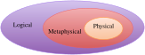

# The Epistemology of Modality
**First published Wed Dec 5, 2007; substantive revision Fri Jul 7, 2023**

*Mallozzi, Antonella, Vaidya, Anand, Wallner, Michael*

*Actual* facts are facts about how things are. For example, Mary *actually* wore her white dress to the party. *Modal* facts, by contrast, are facts about how things could, must, or could not have been. For example, Mary *could have* worn her red dress; but she *couldn’t have* worn a dress that is red and green all over at the same time. Modal reasoning is central to human cognition, since it is pervasive both in philosophy and in every-day contexts. It involves investigating and evaluating claims about what is possible, impossible, essential, necessary, and contingent. Some things could have been different than they actually are, other things could not have been. And some things could have more easily been true than other things. Here are some examples of different kinds of modal claims:

1. Although Antonella, Michael, and Anand are philosophers, they *could have been* musicians in a band called *Supervenience*.
2. While Hillary Clinton lost the 2016 election, she could have won.
3. It is impossible for Franco to have parents other than Mario and Emilia, since Franco’s parents are essential to him.
4. Necessarily, if it is raining, then it is raining.
5. It is impossible for something to fall under both the concept of a bachelor and the concept of a married male at the same time.
6. Mark must be in the room, since I hear him in there.
7. It is not possible for material objects to move faster than the speed of light.
8. One cannot travel from Rome to New York in less than 3 hours.
9. Lisa can fit both a beach umbrella and a beach chair into the trunk of her car.
10. Italy could more easily have been in the 2018 World Cup Final than the U.S.

Sentences (1)–(10) instantiate different kinds of modality. (1–3) are most naturally interpreted to be about *metaphysical* modality; (4) about *logical* modality, (5) about *conceptual* modality, (6) about *epistemic* modality, (7) about *physical* modality, (8) about *technological* modality, and (9–10) about *practical* modality.

Further examples of modal claims are found at crucial places in philosophical arguments, either in the set of premises or as the conclusion.

- (St. Anselm) It is necessary that God exists.
- (Descartes) It is possible for the mind to exist without the body.
- (Berkeley) It is impossible for anything to exist unperceived.

The epistemology of modality investigates how we can know statements like (1)–(10), as well as modal premises or conclusions in philosophical arguments, such as we find in St. Anselm, Descartes, and Berkeley. Traditionally, the central focus of the discipline has been on knowledge of *metaphysical modality*. More precisely, the epistemology of modality seeks to provide answers to the following question.

- *General question:* How can we come to know, or be justified in believing, what is necessary, possible, contingent, essential, and accidental?

Recently, Vaidya and Wallner (2021) have further refined the *General question* by splitting it into two different questions:

- *Access question*: How can we epistemically access the modal realm?
- *Navigation question*: How should we navigate from one kind of modality to another?

The Access question investigates how we *initially* gain epistemic access to modal propositions, such as those in (1)–(10) or in philosophical arguments.

The Navigation question presupposes that we have *some* modal knowledge, and then investigates how we can move from one kind of modality to another, such as, e.g., from conceptual to metaphysical modality. In other words, it asks how we come to know that some proposition $p$ is, say, metaphysically necessary, given that we already know that $p$ is, say, conceptually necessary. While the Navigation question focuses on how we can have a certain kind of modal knowledge given that we already have another kind of modal knowledge, the Access question targets the issue of how we can have modal knowledge in the first place.

This entry surveys the current state of the field by paying particular attention to how theories of modal knowledge have addressed the Access question and the Navigation question. (For other surveys: Gendler & Hawthorne 2002; McLeod 2005; Evnine 2008; Strohminger and Yli-Vakkuri 2017; Mallozzi 2021c.)[^evnine-2008][^gendler-2002][^mallozzi-2021c][^mcleod-2005][^strohminger-2017] For each theory we discuss, we propose a number of *critical questions*. These questions serve a dual purpose. They recapitulate the central points for the theories and raise concerns about them.

## 1. Varieties of Modality and the Target of the Epistemology of Modality

The broad focus of the epistemology of modality is the so-called “alethic” or “objective” modalities. These are usually identified with those modalities that respect the T axiom of modal logic, $\Box p \rightarrow p$ (if a proposition is necessary, then it is true, where the box stands for necessity). Non-alethic modalities, such as deontic modality (which has to do with obligations and permissions, namely what is *obligatory for one to do* and what one *is permitted to do*, according to, e.g., the moral norms, or the law), do not obey the T axiom, since, e.g., even if one is obligated to do $p$, they might not do $p$. Although epistemic modalities do respect the T axiom (if one knows that $p$, then $p$ is true) they are usually ruled out “by hand”, so to speak, *qua* non-alethic and non-objective, since they are thought to be dependent on the epistemic subject.

Among the alethic (or objective) modalities we find logical, physical, and metaphysical modality. Where $p$ is a proposition, *logical* and *physical* modality are standardly defined as follows:

- $p$ is *logically possible* iff $p$ is consistent with the laws of logic.
- $p$ is *logically necessary* iff $p$ follows from the laws of logic.
- $p$ is *physically possible* iff $p$ is consistent with the laws of nature.
- $p$ is *physically necessary* iff $p$ follows from the laws of nature.

It is more controversial how one should define *metaphysical* modality. The traditional approach appeals to alternative ways the world might have been, called “possible worlds”.

- $p$ is *metaphysically possible* iff $p$ is true in at least one possible world.
- $p$ is *metaphysically necessary* iff $p$ is true in all possible worlds.

Alternatively, philosophers have defined metaphysical modality in terms of *laws of metaphysics* (see, e.g., Kment 2014, 2021; for discussion: Wilsch 2015, 2020)[^kment-2014][^kment-2021][^wilsch-2015][^wilsch-2020].

- $p$ is *metaphysically possible* iff $p$ is consistent with the laws of metaphysics.
- $p$ is *metaphysically necessary* iff $p$ follows from the laws of metaphysics.

In addition, metaphysical modality has often been characterized as the *widest*, *strongest*, *most unrestricted*, or *absolute* modality (e.g., Kripke 1980; Lewis 1986; Stalnaker 2003; van Inwagen 1998; Hale 2013; Williamson 2016)[^hale-2013][^kripke-1980][^lewis-1986][^stalnaker-2003][^inwagen-1998][^williamson-2016]. While these are metaphorical labels (and recently the target of several criticisms, e.g., Clarke-Doane 2019a, 2019b; Mallozzi 2023a)[^clarke-doane-2019a][^clarke-doane-2019b][^mallozzi-2023a], the core idea is that metaphysical modality is not restricted by the laws of nature and is more substantive than logical-conceptual modality. As such, it is plausibly the modality of philosophical thinking *par excellence*.

A helpful diagram to understand the relationship between the three main alethic modalities, namely logical, physical, and metaphysical modality, is the nesting model. The model depicts a nesting relation among those modalities, such that what is physically possible is also metaphysically possible, and what is metaphysically possible is also logically possible (see fig. 1).

*Fig. 1:* Nesting model for *possibility*.

Conversely, what is logically necessary is metaphysically necessary, and what is metaphysically necessary is also physically necessary. Other kinds of modality can be suitably added to the model, as well, such as practical possibility. Practical possibilities would be within the physical possibilities. Importantly, some philosophers question whether metaphysical modality is a distinct and irreducible modality. Alternative accounts include *inflationism, deflationism*, and *skepticism*. Inflationists, such as David Chalmers (2002)[^chalmers-2002], hold “Modal Monism”, the view that there is only one modal notion or primitive, such that metaphysical and logical modality coincide (more below, §4.1). Deflationists, such as Sydney Shoemaker (1998)[^shoemaker-1998], argue that metaphysical modality coincides with physical modality. Skeptics, such as Graham Priest (2021)[^priest-2021], question whether there is a notion of metaphysical necessity that is distinct from both, *analytic* necessity (which corresponds to conceptual necessity) and *physical* necessity.

*Metaphysical modality* is the modality that is typically at stake in philosophical argumentation (e.g., St. Anselm’s Ontological Argument, Rene Descartes’ Argument for Mind-Body Dualism, George Berkeley’s Argument for Idealism). Accordingly, the Access Question in the epistemology of modality focuses on how we can access metaphysical modality. Besides investigating the modal status of philosophical propositions, modal epistemologists are also interested in answering common every-day modal questions, such as, *could the couch be on the other side of the room? Can Mary climb the tree? Can the cup fit in the drawer?*

Some philosophers have recently approached the epistemology of metaphysical modality by first investigating whether some every-day propositions are *practically possible* (as opposed to metaphysically possible) (e.g., Strohminger 2015 and Vetter 2023)[^strohminger-2015][^vetter-2023]. Whether some proposition $p$ is *practically possible* hinges on some specific circumstances that are held fixed in a situation—for example, given a particular subject’s physical abilities, or certain environmental conditions. While it seems uncontroversial that it is metaphysically possible to get the couch to the other side of the room, a specific subject might wonder whether it is practically possible for her to do so, given certain circumstances.

This raises a Navigation Question: How are we to epistemically navigate from practical modality to metaphysical modality? Given that we know that $p$ is practically possible, how do we come to know that it is metaphysically possible? Is this done via some (implicit or explicit) inferential transition? If so, does that imply that we need knowledge of some bridge principle between practical and metaphysical possibility?

Here it is useful to see the contrast between the Access Question and the Navigation Question again. While the former asks how we initially get epistemic access to the modal realm without relying on modal premises, the latter asks about how we epistemically navigate from one “sphere” or kind of modality to another. We will see that while the Access Question has traditionally been the main focus in the literature, some recent accounts (like, e.g., Strohminger’s (2015)[^strohminger-2015], Vetter’s (2023)[^vetter-2023], and, in a sense, Chalmers’ (2002)) a Navigation Question takes center stage.

## 2. Classification Schemes in the Epistemology of Modality

There are many theories of modal knowledge, and many ways to classify them. In this article we proceed based on the following main categories:

### 2.1 Mental Capacities and Inferential Methods

The distinction between *mental capacities* and *inferential methods* is a natural starting point for addressing the Access Question. The *mental capacities* that are most discussed in the epistemology of modality are: *conceivability, understanding, imagination, intuition*, and *perception*. The *inferential methods* are: *deduction, induction*, and *abduction*. We will see how those notions are spelled out more precisely in the different theories. Mental capacities and/or inferential methods that are central to a theory of modal knowledge offer a main criterion for classifying theories. Furthermore, theories of modal knowledge need not restrict themselves to adopting only one mental capacity or inferential method. In fact, they sometimes combine them in various ways.

Theories should not only investigate which specific capacities and methods are involved with modal knowledge, but also in virtue of what such capacities and methods yield the correct results. Mallozzi (2021e)[^mallozzi-2021e] accordingly distinguishes between *descriptive* and *normative* tasks with regard to modal reasoning and modal knowledge. The descriptive task involves identifying and describing the belief-formation processes and methods that subjects actually carry out in modal reasoning (for example counterfactual reasoning, or deductive inference). The descriptive task does not in itself involve answering the question of *how* the processes are truth-conducive. This question takes center stage in the normative task, which targets the correctness conditions for such processes and methods. More precisely, a chief normative task for the epistemology of modality is to elucidate what constrains such processes or methods, i.e., in virtue of what their outputs are correct or incorrect. As a normative inquiry, the epistemology of modality is centrally concerned with what Vaidya and Wallner (2021) call the *Problem of Modal Epistemic Friction (PMEF).* This problem concerns the normative restrictions on candidate capacities or methods. Take, e.g., *imagination* as a candidate mental capacity in our pursuit for modal knowledge. In order for us to be properly guided to modal knowledge, we cannot apply imagination in a completely *unrestricted* manner. If no restrictions would apply, we could imagine all sorts of impossible things like water without hydrogen, transparent iron etc. Hence, some restrictions, or “*epistemic friction creators*”, as Vaidya and Wallner call them, have to be in place. The PMEF asks what the epistemic friction creators are and how we come to know them or at least how we come to adequately deploy them in our application of various capacities and methods in order to be properly guided to modal knowledge.

While descriptive tasks and normative tasks are distinct, they need not be pursued independently. Normative modal epistemology may, for example, be informed by empirical psychology (the study of counterfactuals is a prominent example), and vice-versa.

### 2.2 Necessity-First vs. Possibility-First

Hale (2002)[^hale-2002] draws an important distinction between two different architectures one can use in building an epistemology of modality. *Necessity-first* accounts hold that we first acquire knowledge of necessity and then arrive at knowledge of possibility by inferring what is *consistent* with what we know to be necessary. *Possibility-first accounts*, by contrast, hold that we first acquire knowledge of possibility from which we then generalize to knowledge of necessity. Most conceivability-based accounts (§4.1) implement a possibility-first approach. So do dispositionalist approaches as well as Roca-Royes’ similarity-based account, as they all prioritize possibilities (§7). Counterfactual-based accounts such as Williamson’s (§4.2) seem instead more neutral concerning the distinction. Finally, essence-based accounts (§5) are usually necessity-first. (For discussion see: Hale (2013)[^hale-2013], Roca-Royes (2017)[^roca-royes-2017], and Fischer (2017)[^fischer-2017][^fischer-2017-2]).

### 2.3 Modal Rationalism vs. Modal Empiricism

Kant famously argued that what is *a priori* coincides with what is necessary, thereby ruling out the category of *a posteriori necessities*. However, Kripke (1971)[^kripke-1971] pointed out that there are necessary truths that can only be known *a posteriori*. The contemporary distinction between modal rationalism and modal empiricism moves off of Kripke’s (1971)[^kripke-1971] deduction model for knowledge of *a posteriori* necessities. According to Kripke, we proceed based on the conditional “If $p$, then necessarily $p$”, where “$p$” stands for some fact we can discover via empirical investigation. For example,

**(K1)**

If Hesperus = Phosphorus, then necessarily (Hesperus = Phosphorus)

**(K2)**

Hesperus = Phosphorus

**(K3)**

Necessarily, (Hesperus = Phosphorus)

(K1)—one of the so-called “Kripke conditionals”—is a modal premise that instantiates “If $p$, then necessarily $p$”, which he suggests is something we know “by *a priori* philosophical analysis” (1971: 180; 1980: 108). On the other hand, (K2) is a non-modal, factual premise that we may come to know empirically. It was an empirical discovery that the celestial body that we call “Hesperus” for its evening sightings was the same one as the one we call “Phosphorus” for its morning sightings, namely the planet Venus. As a consequence of the empirical contribution of (K2), the conclusion of the argument, (K3), is also *a posteriori*. (For further discussion, see Casullo 1977, 2010; Peacocke 1999)[^casullo-1977][^casullo-2010][^peacocke-1999]. Note that not all instances of “If $p$, then necessarily $p$” will be true. In this paradigm case, $p$ is an identity statement involving rigid designators on both sides. These statements are such that if true, they are necessarily true, which is something most philosophers hold we can know *a priori*. (See also the entry on rigid designation).

Modal rationalists accept and accommodate Kripkean *a posteriori* necessities by emphasizing that in a Kripkean inference (K1)–(K3), the modal part, (K1), is known *a priori.* Not all epistemologists endorse a deductive picture.

In general, *modal rationalists* prioritize *a priori* methods for acquiring knowledge of metaphysical modality.

By contrast, *modal empiricists* pursue *a posteriori* accounts of knowledge of metaphysical modality. Often they still acknowledge that *a priori* methods might contribute to modal knowledge. (See Fischer & Leon 2017)[^fischer-2017][^fischer-2017-2]

Some philosophers have challenged the philosophical significance of the *a priori*/*a posteriori* distinction (e.g., Hawthorne 2007; Sosa 2013; Williamson 2007, 2013; for discussion: Casullo 2015)[^casullo-2015][^hawthorne-2007][^sosa-2013][^williamson-2007][^williamson-2013]. We discuss Williamson’s version of the challenge in §4.2.

## 3. Skepticism and Knowability

Skepticism about modal knowledge has received attention in the literature since van Inwagen’s (1998)[^inwagen-1998] seminal paper. In this entry we largely assume that one can have some knowledge (or *justified belief*) about modality. We will only briefly present the issues and refer to the relevant literature for further discussion.

There are two broadly skeptical challenges in the contemporary literature.

*The Integration Challenge* (Peacocke 1999)[^peacocke-1999]: This challenge is modelled after the Benacerraf Problem for Platonism in the philosophy of mathematics. According to Benacerraf (1973)[^benacerraf-1973] any robustly realist (platonist) stance about mathematical objects like numbers regards them as abstract entities outside of space and time, i.e., as “platonic” entities. As such, they seem inaccessible to us. Unlike ordinary perceptible objects, to which we have a causal connection, it is unclear how we might detect platonic entities in order to know about them, since we have no causal connection to them. The possibilities and necessities that modal statements are about also seem to be outside of space and time and thus our epistemic access to them seems mysterious. So, on a par with the Benacerraf Problem in the philosophy of mathematics, the Integration Challenge in the philosophy of modality consists in providing a plausible account of how we know modal statements, which at the same time fits our modal metaphysics (see, e.g., Bueno & Shalkowski 2000; Fischer 2018; Roca-Royes 2020 for discussion)[^bueno-2000][^fischer-2018][^roca-royes-2020].

*The Reliability Challenge* (Nozick 2001)[^nozick-2001]: If we are to be justified in believing modal statements, we must have a reliable faculty or a set of reliable faculties working together for forming beliefs of that sort, the existence of which is best explained by evolutionary theory. No ad hoc modality-detecting faculty is allowed for explaining modal knowledge. The Reliability Challenge instantiates the desiderata of what is sometimes called “anti-exceptionalism” in modal epistemology, according to which

> our knowledge of metaphysical modality is *continuous* with our everyday knowledge about the world. (Vetter 2016: 766)[^vetter-2016]

Skepticism about *extraordinary* or *philosophical* cases varies across theories. Van Inwagen (1998)[^inwagen-1998] voices skepticism about extraordinary cases by an analogy with vision. We do and should withhold judgment concerning what we see, when it is outside the range of reliability in our field of vision. For the farther out objects are in our field of vision, the less reliable we are at judging them. Similarly, we ought to withhold judgment concerning what we conceive or imagine or infer about modal reality, when they are outside the range of reliability of the specified capacity or method (for discussion: Barnes 2002, Geirsson 2005, and Strohminger & Yli-Vakkuri 2018)[^barnes-2002][^geirsson-2005][^strohminger-2018].

Van Inwagen’s moderate skepticism draws attention to the issue of the *scope* of our modal knowledge. Which modal propositions are knowable, if any? We can ask whether a certain account targets knowledge of just one kind of modality, or more. Focusing on one kind of modality, we can also ask whether a given theory aims to account for our access to *the whole range of* (knowable) modal propositions (from the every-day ones to the philosophical ones, from those about abstracta to those about concreta, etc.), or merely to some of them. In the former case the theory might be labeled *ambitious*, in the latter, *modest* (see Wirling 2020)[^wirling-2020]. Some modest theories, for instance, aim to offer an account of ordinary modal knowledge, which involves what is possible and necessary for couches and cups, say; but they are either skeptical or silent about extraordinary or philosophical cases, such as whether the number 2 could have been the number 3 or whether there could have been philosophical zombies—i.e., a creature that is physically identical in every respect to a human being but lacks all phenomenal consciousness.

## 4. Conceivability, Imagination, Intuition, and Understanding

Historically, the notions of *imagination, conceivability, intuition*, and *understanding* have been prominent in explaining modal knowledge. For Descartes, the source of our modal knowledge is a distinctive sort of intellectual grasp based on understanding, which might be interpreted as a kind of conceiving, or intuiting. For Hume, it is imagination as an experientially-informed cognitive faculty that is a guide to knowledge of possibility (see Gendler & Hawthorne 2002)[^gendler-2002]. This Humean tradition has been pursued in the early stages of post-Kripkean discussions of the epistemology of modality by a number of authors, and it has maintained a central role in more recent discussions.

### 4.1 Conceivability

In ordinary pre-theoretical talk, “conceiving” and “imagining” may well be used interchangeably; and often philosophers, too, treat those terms roughly as synonymous. In the literature on the epistemology of modality, however, *conceivability* is a technical notion, which may be defined in different ways. These are mainly stipulative choices, but it is important to flag terminological variations across different theories.

Both Stephen Yablo (1993)[^yablo-1993] and David Chalmers (1996, 2002, 2004, 2010: Ch. 6) have developed independent accounts of conceivability as a source of modal knowledge (for yet another account based on *response-dependence*, see Menzies 1998)[^menzies-1998]. Yablo holds that, when adequately understood, conceivability provides defeasible evidence for possibility. In Yablo’s account, the relevant notion of conceivability involves the *imaginability* of a situation in which a conceived *proposition is taken to be true by the subject in question*. Yablo offers the following two conditionals for describing the appropriate *philosophical* notion of conceivability which provides evidence of possibility (1993: 29)

**(CON)**

$p$ is conceivable for $X$, if $X$ can imagine a world that $X$ takes to verify $p$.

**(INC)**

$p$ is inconceivable for $X$, if $X$ cannot imagine any world that $X$ takes to verify $p$.

Yablo’s *philosophical conceivability* (CON), involves imagining a world that one takes to verify some proposition $p$. Note that when imagining a world, we don’t need to specify all the details in the world in imagination. The imagining provides *prima facie* evidence for the possibility of $p$ because it involves what Yablo calls an “*appearance of possibility*” (i.e., it seems as if $p$ is possible, given the imagined world). “[T]o imagine an $X$ is thereby to enjoy the appearance that an $X$ could exist” (1993: 30).

Importantly, for Yablo, conceivability, thus understood, helps address a pressing challenge from the post-Kripkean literature, namely the issue of *modal error*. This is the issue of explaining what the sources of our erroneous modal judgments are (see, e.g., Bealer 2004 and Yablo 2006)[^bealer-2004][^yablo-2006]. While modal error can in principle affect both *a priori* and empirical modal reasoning, Yablo focuses on the challenge to conceivability as a guide to possibility that arises from Kripke’s cases of the necessary *a posteriori*. Not being aware of the fact that Hesperus is Phosphorus, I might find it conceivable that one exists without the other; thereby I conclude that it is possible for Hesperus to exist without Phosphorus. But that is a modal error. So how does Yablo’s conceivability do us any good? For him, conceivability-based evidence is positive defeasible evidence of possibility. When properly understood as specified by (CON), conceivability confers *prima facie* justification for the modal belief in question. Yablo draws an analogy with *perception*, which is also a fallible source of knowledge. He argues that in the case of perception, the possibility of error and illusions does not keep us from assigning *prima facie* justification for beliefs based on perception. Similarly, the possibility of modal error in conceivability does not undermine the thesis that conceivability provides *prima facie* evidence for possibility. Although for Yablo there is a difference between conceivability and perception that makes the former provide more doubtful evidence, the difference is not a matter of fallibility or likelihood of error. Rather, the difference for Yablo lies in the fact that we have a much better story of how perceptual error comes about compared to modal error (see also van Inwagen’s 1998 discussion of modal skepticism based on the analogy with vision, as well as Bealer 2004 for discussion of the sources of modal error)[^bealer-2004][^inwagen-1998]. This is also true of debates about intuition as a source of justification (see Weinberg 2007)[^weinberg-2007]. However, while Yablo’s notion of philosophical conceivability can answer criticism based on the possibility of modal error, he concedes that more work needs to be done to produce an exhaustive account of modal error that will best guard us against it.

Chalmers (1996, 2002, 2010: Ch. 6) affirms an even stronger link between conceivability and possibility than Yablo. When adequately understood, conceivability *entails* possibility, as opposed to merely providing evidence for possibility. More precisely, the main thesis of Chalmers’ *Weak Modal Rationalism* is

**(WMR)**

*Ideal, positive, primary conceivability entails primary possibility:*

(WMR) is constructed out of three distinctions:

1. *prima facie* vs. *ideal* conceivability
2. *positive* vs. *negative* conceivability
3. *primary* vs. *secondary* conceivability and possibility

*Prima facie* conceivability is one’s initial assessment of whether a described hypothesis is possible, without engaging in careful reasoning about the hypothesis. Better reasoning often gives one reason to doubt *prima facie* conceivability. *Ideal* conceivability, by contrast, involves a kind of reasoning that cannot be weakened by further reasoning. If some proposition is ideally conceivable, then that proposition is the case from the perspective of a hypothetical reasoner who is “free of all cognitive limitations” (Chalmers 2002: 148)[^chalmers-2002] and free from error due to lack of attention. For Chalmers this is sufficient for ideal reasoning to be safe from modal error. This is why, for Chalmers, an *entailment* link between conceivability and possibility can be forged only when *ideal* conceivability is in play.

*Positive* conceivability amounts to coherently imagining a scenario in which something is the case. The aim is to “form some sort of clear and distinct conception of a situation in which the hypothesis is true” (Chalmers 2010: 144)[^chalmers-2010]. It need not be a *complete* description of a scenario, but it must be sufficiently detailed so as to verify the statement being considered. By contrast, *negative* conceivability is the inability to *a priori* rule out a certain scenario. That is, negative conceivability amounts to one’s inability to rule out a possibility as incoherent based on what one knows. This is often weaker than positive conceivability, since it often derives from ignorance of the relevant facts. For example, if one does not know that water is H₂O, they may find the statement “water might not contain hydrogen” conceivable because they cannot rule out the statement as *a priori* incoherent. Conceiving of water without hydrogen in the *positive* sense, on the other hand, requires constructing a scenario in which water is present without hydrogen at the relevant depth of detail required to verify the claim. Arguably, that sort of scenario cannot be constructed once one knows the relevant empirical facts, since if they are attentively engaged in the construction they will notice a contradiction between water being H₂O and hydrogen being absent.

Finally, the distinction between *primary* and *secondary* conceivability and possibility pertains to Chalmers’ version of Two-Dimensional Semantics. His *Epistemic Two-Dimensional Semantics* (E2-D) proposes a way to address the challenge posed by Kripkean *a posteriori necessities*, namely the apparent problem that *a posteriori* impossibilities like “water is not H₂O” seem conceivable. In response, Chalmers holds that “water is not H₂O” is not *secondarily* conceivable, though it is still *primarily* conceivable. What exactly does this mean?

The main idea of (E2-D) is that there are two different ways in which we can evaluate statements across possible worlds, i.e., two different ways of conceiving hypothetical situations, based on two different constraints.

The first constraint binds what is true in some possible world to what one knows *a priori*. A statement is primarily conceivable if nothing that is knowable *a priori* is incompatible with the statement being true. As Chalmers explains, that captures a kind of *epistemic* possibility. Consider again the statement “water is not H₂O”. The actual chemical composition of water, H₂O, is not knowable *a priori*. So this fact does not constrain what is true in the possible worlds in which the existence of water is *a priori* conceivable. Accordingly, “water is not H₂O” is *primarily conceivable*. As Chalmers also puts it, primary conceivability amounts to coherently conceiving the situation described as *actual*, namely as a way the world might turn out to be.

By contrast, it has been discovered empirically that water is H₂O. The second constraint binds what is true at other possible worlds to facts about how things actually are. As Chalmers explains, that captures a kind of *subjunctive* possibility. Since chemical composition is arguably essential to substances, such as water, it is not *secondarily conceivable* that water is not H₂O. As Chalmers also puts it, secondary conceivability amounts to coherently conceiving the situation described as *counterfactual*, namely as a way the world might have been, given how our world is. Thus:

**(PrimC)**

A statement $S$ is *primarily* conceivable when it is conceivable that the situation described in $S$ is *actually* the case.

**(SecC)**

A statement $S$ is *secondarily* conceivable when it is conceivable that the situation described in $S$ might *counterfactually* have been the case. (cf. Chalmers 2002: 157)[^chalmers-2002]

To further clarify, for Chalmers expressions have two dimensions of meaning or content: a *primary intension* and a *secondary intension*. In the case of sentences describing Kripkean a posteriori necessities like “water is H₂O”, these are two different propositions. The primary intension of an expression like, e.g., “water”, picks out a referent at a world considered as actual; namely, roughly based on the descriptive content that a speaker *a priori* associates with the expression. Thus, at any world we consider, the primary intension of “water” picks out whatever substance satisfies some description such as “the liquid drinkable stuff in lakes and rivers etc.” (or, otherwise put, whatever plays the water role). At any world we consider as actual, “water” will pick out such a substance. Secondary intensions, by contrast, pick out the referent of an expression at a world considered as counterfactual, namely based on the way a speaker evaluates a given expression *counterfactually*, given how the actual world is. That requires acknowledging that water is H₂O. Assuming, as usual, that having a certain chemical composition is essential to being a certain kind of substance, the secondary intension of “water” picks out H₂O compounds at all worlds (otherwise put, it picks out what actually plays the water role). At any world we consider as counterfactual, “water” will pick out H₂O. Accordingly, sentences like “water is H₂O” are *secondarily* necessary but *primarily* contingent. For, while it is possible that the liquid drinkable stuff in rivers and lakes etc. is not H₂O, it is not possible that water isn’t H₂O. Thus, according to Chalmers, ideal positive primary conceivability allows us to access a specific kind of possibility, namely primary possibility, which are sometimes secondarily impossible. While there is a primary possibility in which water isn’t H₂O, there is no secondary possibility in which water isn’t H₂O.

However, primary possibility is no less “real” than secondary possibility. Chalmers argues that there is only one space of worlds or that “conceptual=logical=metaphysical possibility (at the level of worlds)” (1999: 478). This is what he calls “Modal Monism”. What varies, within modal space, is not the *kind* of worlds we are considering (namely “merely” logically-conceptually possible versus “genuinely” metaphysically possible); but rather the truth-values of the expressions under examination at a given world, depending on whether we consider their primary or secondary intensions. Because of Modal Monism, within Chalmers’ framework every primary possibility is thus a *metaphysical* possibility, though it might not be a secondary possibility. “Water is not H₂O” is ideally positively primarily conceivable, and therefore primary possible. Given Modal Monism, Chalmers can thus argue that “water is not H₂O” is a *metaphysical* possibility, while also resisting the challenge posed by the Kripkean *a posteriori* necessities. For “water is not H₂O” is a primary possibility but not a secondary possibility, given that “water” actually picks out H₂O.

So, by adopting Modal Monism, Chalmers places primary possibility within the same modal realm as secondary possibility. This guarantees that primary possibility is no less “real” or “genuine” than secondary possibility (indeed, as Chalmers puts it, “these worlds are all first-class metaphysical possibilities” [2002: 165]) Thus, the kind of possibility that is entailed by primary, positive, ideal conceivability, is a metaphysical one.

#### Critical Questions for Conceivability

**The Connection Question:** This is the central question that conceivability theorists like Yablo and Chalmers try to answer. How is conceivability connected to possibility? Given that metaphysical modality is an objective modality that is mind-independent, while conceivability is subject-sensitive and mind-dependent, how are the two connected such that conceivability may entail, or at least provide evidence for possibility? Answering the Connection Question should thus clarify how mind-dependent conceivability may provide one with justification for believing that something is mind-independently possible.

**The Scope Question:** This question further specifies the Connection Question, by asking how conceivability can effectively cast light on matters of *metaphysical* possibility, as opposed to *logical-conceptual* possibility. Remember that primary conceivability is a purely *a priori* exercise based on considerations of (ideal) logical and conceptual coherence of a described scenario. What ensures that conceivability exercises so constrained successfully capture metaphysical modality? Within Chalmers’ framework: what ensures that primary possibilities are themselves metaphysical possibilities? Several philosophers have argued that assuming Modal Monism is not a satisfying answer (for discussion: Soames 2004; Vaidya 2008; Mallozzi 2021b)[^mallozzi-2021b][^soames-2004][^vaidya-2008].

**The Navigation Question:** Granted (WMR), we might still wonder about knowledge of *secondary* possibility. Is there any *a priori* way of inferring secondary possibility from primary possibility? Simply put: can we *navigate a priori* from primary to secondary possibility? Chalmers thinks that in some special cases we can. Such cases require that an expression’s primary and secondary intensions *coincide.* Candidate examples include, most notably, the class of phenomenal truths as well as mathematical and analytic truths (Chalmers 2010: ch. 6)[^chalmers-2010]. However, that raises a worry that on Chalmers’ conceivability theory we won’t be able to have *a priori* access to most of the modal metaphysical realm. Conceivability seems a limited resource for knowledge of metaphysical modality.

**The Dependence Question:** Suppose conceivability does provide justification for believing that something is possible. Does it succeed in doing so because conceivability operates on some prior beliefs about the considered scenario? For example, does conceivability guide one to the belief that a round square is impossible because one knows what squares and circles are, and by examining their definition one can arrive safely at the conclusion that such objects are impossible? Similarly, does one simply find water in the absence of hydrogen possible because one either suppresses the knowledge that water contains hydrogen or one does not know that water does contain hydrogen? In the first case, conceivability would seem to depend, to an important extent on, underlying linguistic or conceptual knowledge (along the lines of analytic accounts of the *a priori* more generally). In the second case, conceivability would depend on both linguistic or conceptual knowledge and empirical knowledge. In both cases, additional essentialist knowledge might be needed (e.g., Kment 2021; Goff 2021; and Roca-Royes 2011a)[^goff-2021][^kment-2021][^roca-royes-2011a]. In Vaidya and Wallner’s (2021), (§2), the critical point of the Dependence Question is the following: In order for our conceivability exercises to appropriately justify our modal judgments, those conceivability exercises need to be constrained by some crucial information about the (essence of) the entities involved in them, creating the needed *epistemic friction* for conceivability. In effect, the Dependence Question is concerned with the issue of the source of modal knowledge. Is conceivability an *ultimate* source of modal knowledge, or is it derivative, namely dependent on another source, such as linguistic or conceptual knowledge and essentialist knowledge? (see also Berto & Schoonen 2018)[^berto-2018][^berto-2018-2].

**The Human Capacity Question**: Conceivability theorists hold that, under appropriate conditions, conceivability provides justification for believing that something is possible. We saw how Yablo and Chalmers spell out such conditions in presenting their respective notions of conceivability. But clarifying what the relevant conditions are for conceivability to yield modal knowledge still leaves open an important question. Do humans ever satisfy those conditions? For example, one might agree with Chalmers that some ideal sort of conceivability entails possibility, but also question whether we can satisfy the requirements of *ideal* rational reflection (see, e.g., Worley 2003 and Martínez 2013)[^martínez-2013][^worley-2003].

**The Relevant Depth Question**: This targets the content of the imagined situation or world that the subject takes to verify some proposition $p$. In what *detail* do we have to imagine a world $w$ in order for the fact that $p$ seems true in $w$ to confer evidence for the possibility of $p$? (see van Inwagen 1998)[^inwagen-1998] The issue of *relevant depth* has to do with what imagined details are needed to justify a possibility judgment, e.g., is it enough to imagine a human brain functioning normally while not having any experiences to justify the possibility of a philosophical zombie?

**The Self-Defeat Question:** Suppose that some thesis according to which a certain sort of conceivability entails a certain sort of possibility—call it (CP)—is true. Is it then *conceivable* that (CP) is false? If that is conceivable, or so Howell (2008)[^howell-2008] and Mizrahi and Morrow (2015) have argued, then, by (CP), it is possible that (CP) is false. However, if (CP) is possibly false, (CP) is actually false. For a counterexample to the entailment relation falsifies the entailment relation. Thus, if we can conceive of (CP) failing, it follows that (CP) is self-defeating.

### 4.2 Counterfactual Imagination

Timothy Williamson (2007)[^williamson-2007] has developed a theory of modal knowledge based on our capacity for counterfactual reasoning, which distinctively deploys *imagination* in the development of a counterfactual. The topic of imagination has gained widespread attention in contemporary debates within philosophy, logic, and the cognitive sciences. The focus has been on the epistemic uses of imagination for both quotidian non-modal knowledge (e.g., knowledge of others’ mental states, learning, planning and decision making) as well as various kinds of modal knowledge (see, e.g., Currie & Ravenscroft 2002; Kind & Kung 2016; Kind 2020; Badura & Kind 2021; Kosslyn, Ganis, & Thompson 2003; Nichols 2006)[^badura-2021][^currie-2002][^kind-2020][^kind-2016][^kosslyn-2003][^nichols-2006]. Theories of modal epistemology that rely to various extents on imagination need not be rationalist; in fact, they are often empiricist. Here we only discuss Williamson’s counterfactual imagination account. For further work on imagination-based accounts, whether rationalist or empiricist, see, e.g., Gregory (2004, 2010, 2020)[^gregory-2004][^gregory-2010][^gregory-2020], Byrne (2007)[^byrne-2007], Kung (2010)[^kung-2010], Ichikawa and Jarvis (2012), Casullo (2012a)[^casullo-2012a], and Lam (2018)[^lam-2018] (On the other hand, note that Hill 2006, Kroedel 2012, and Kment 2014 have offered theories of modal knowledge that variously appeal to counterfactuals and counterfactual reasoning, which do not centrally involve imagination)[^hill-2006][^kment-2014][^kroedel-2012].

Williamson’s central thesis is that knowledge of metaphysical modality is a “special case” of knowledge of counterfactual conditionals. As he puts it,

> the ordinary cognitive capacity to handle counterfactual conditionals carries with it the cognitive capacity to handle metaphysical modality. (2007: 136)

The capacity for modal knowledge can thus be thought of as a byproduct of our capacity for counterfactual thinking. For Williamson counterfactual thinking is largely imaginative thinking. When we assess a given counterfactual, we evaluate the consequent on the supposition of the antecedent by developing the supposition through an *imaginative* exercise. This typically involves the “offline” application of our cognitive capacities. More precisely, Williamson holds that in imagination we often transpose “online” cognitive skills that are originally developed in perception into corresponding offline cognitive skills (2013).

Williamson supports the thesis that knowledge of metaphysical modality is a special case of imaginative counterfactual knowledge with logical equivalences between sentences using counterfactual operators and modal operators, aimed at showing that statements of possibility and necessity can be reformulated in counterfactual terms in a straightforward way:

**(NEC)**

$\Box A \text{ iff } (\neg A \boxarrow \bot)$ (it is necessary that $A$ *iff* if it were not the case that $A$ a contradiction would follow)

**(POS)**

$\Diamond A \text{ iff } \neg (A \boxarrow \bot)$ (it is possible that $A$ *iff* it is not the case that if $A$ were true a contradiction would follow)

Thus, we can identify the following two key theses in Williamson’s counterfactual theory:

- *Logical Equivalence*: metaphysical possibility and necessity can be proven to be logically equivalent to counterfactual conditionals.
- *Epistemic Pathway*: the method of counterfactual development carried out in imagination can provide one with knowledge of metaphysical modality.

The two are importantly interconnected in that *Epistemic Pathway* is partly based on *Logical Equivalence.* As Williamson puts it,

> modulo the implicit recognition of this equivalence, the epistemology of metaphysically modal thinking is tantamount to a special case of the epistemology of counterfactual thinking. (2007: 158)

Relying on equivalences (POS) and (NEC), we come to know about possibility and necessity by developing counterfactual suppositions in imagination in a search for a contradiction.

In order to see how this works, let us first look at an evaluation of an “ordinary” every-day counterfactual. Consider the following example from Williamson:

> Suppose that you are in the mountains. As the sun melts the ice, rocks embedded in it are loosened and crash down the slope. You notice one rock slide into a bush. You wonder where it would have ended if the bush had not been there. A natural way to answer the question is by visualizing the rock sliding without the bush there, then bouncing down the slope into the lake at the bottom. Under suitable background conditions, you thereby come to know the counterfactual:
>
> **(Rock)**
>
> *If the bush had not been there, the rock would have ended in the lake* (2007: 142)

As Williamson explains, the general procedure we use to arrive at (Rock) is the following:

> [O]ne supposes the antecedent and develops the supposition, adding further judgments within the supposition by reasoning, offline predictive mechanisms, and other offline judgments. The imagining may but need not be perceptual imagining. All of one’s background beliefs are available from within the scope of the supposition as a description of one’s actual circumstances for the purposes of comparison with the counterfactual circumstances… Some but not all of one’s background knowledge and beliefs are also available within the scope of the supposition as a description of the counterfactual circumstances, according to complex criteria… To a first approximation: one asserts the counterfactual conditional if and only if the development [of the antecedent] eventually leads one to add the consequent. (2007: 152–153)

The same procedure can be applied to evaluate the counterfactuals that figure in (NEC) and (POS), in order to gain modal knowledge. Based on the logical equivalence in (POS), we can come to know “$\diamond A$” by knowing “$\neg(A \boxarrow \bot)$”. And we know the latter through a counterfactual development, much like in the (Rock) example. For example, we might assess whether it is *metaphysically possible* for the rock to have ended in the lake, by using the logical equivalence (POS). The simple procedure will be to counterfactually suppose that the rock did end in the lake and check whether a contradiction would follow, as we develop that supposition in imagination as “realistically” as we can (2007: 142).

**(Rock-POS)**

If the rock had ended in the lake no contradiction would have followed.

If (Rock-POS) is true, we are warranted in asserting that it is metaphysically possible for the rock to have ended in the lake.

In addition, based on the logical equivalence (NEC), we can come to know “$\Box A$” by knowing “$\neg A \boxarrow \bot$”. And we know the latter through a counterfactual development of the antecedent of the counterfactual (“$\neg A$”), much like in the (Rock) example. If the counterfactual development of “$\neg A$” yields a contradiction (i.e., the consequent of the counterfactual in question), we assent to the counterfactual and thereby come to know that A is necessary. To take another example from Williamson:

> If we know enough chemistry, our counterfactual development of the supposition that gold is [not] the element with atomic number 79 will generate a contradiction. (2007: 164)

We thereby come to know that it is necessary that gold is the element with atomic number 79.

On Williamson’s account we can generally trust our capacity for assessing counterfactual conditionals in imagination, as this is informed and disciplined by a great amount of background knowledge concerning the workings of nature. This background information includes general knowledge of chemical, physical, and other basic scientific facts, as well as some grasp of the causal and natural laws. On any given occasion, we keep some of this background knowledge fixed within the scope of the supposition as we carry out our counterfactual evaluations. Goodman’s (1955)[^goodman-1955] classical *problem of cotenability* concerns the question of *which* facts or beliefs are cotenable with the antecedent of the counterfactual conditional. That is, which facts or beliefs are to be held fixed in a counterfactual development? As we will see, many have raised concerns about what to count as cotenable when evaluating a counterfactual supposition. Crucially, background knowledge also involves some grasp of “constitutive” facts, as Williamson sometimes calls them. These apparently include essentialist facts and principles—for example, Williamson mentions Kripke’s principle of the necessity of origins, which holds that the material origins of an entity are essential to it.

There is also a more general reason why Williamson’s method for modal knowledge should be reliable. Williamson stresses that knowledge of counterfactuals is pervasive for human decision-making, planning, and theory construction in science (2007). In his (2016) he further conjectures that imagination as a source of knowledge might even have given us an evolutionary advantage as a species, as opposed to being a mere accidental byproduct of our evolutionary history. Thus, insofar as modal knowledge proceeds via the reliable method of counterfactual development in imagination, we should also rest assured that we will get at the right answers concerning matters of metaphysical modality. (Note that this may offer an answer against Nozick’s 2001 evolution-based skepticism about our knowledge of metaphysical modality)[^nozick-2001].

Furthermore, for Williamson modal knowledge typically has a special epistemic status which is *in between* the *a priori* and *a posteriori* categories. In Williamson’s terminology, the kind of knowledge in question is “armchair”. That is, on the one hand, the knowledge in question isn’t strictly *a posteriori*, since apparently we can’t fully derive it from empirical experience. And, on the other hand, such knowledge doesn’t fit the model of *a priori* knowledge, either, since arguably background information from science, and experiential contribution more generally, plays a role that goes beyond merely enabling concept possession and use. Williamson also contends that the *a priori / a posteriori* distinction is in general too superficial or it “doesn’t cut at the epistemic joints” (2013: 8. For discussion, see e.g. Boghossian 2011, Boghossian and Williamson 2020; Casullo 2013; Jenkins 2008; Mallozzi 2021d; Malmgren 2011)[^boghossian-2011][^boghossian-2020][^casullo-2013][^casullo-2013-2][^jenkins-2008][^mallozzi-2021d][^malmgren-2011].

Williamson’s view straddles the division between *rationalist* and *empiricist* accounts. Thus, for Williamson we can gain knowledge of metaphysical modality thanks to a combination of

1. our capacity for carrying out counterfactual reasoning in imagination, as constrained by our background knowledge of the world (*Epistemic Pathway*),

together with

1. suitable logical equivalences that guarantee that modal statements are equivalent to counterfactual statements (*Logical Equivalence*).

#### Critical Questions for Counterfactual Theory

We can divide the central critical questions for Williamson’s counterfactual theory based on whether they target (*Epistemic Pathway*) or (*Logical Equivalence*) more specifically. We start with the latter.

##### Against (*Logical Equivalence*)

**The Counterpossibles Question:** Some philosophers question Williamson’s purported logical equivalence between counterfactual statements and modal statements (Berto, French, Priest, & Ripley 2018; Jago 2021)[^berto-2018][^berto-2018-2][^jago-2021]. Particularly, in order for (NEC) to hold, one has to accept that all counterpossibles (namely counterfactual conditionals with impossible antecedents) are vacuously true. But this is controversial. Many have given arguments defending false counterpossibles based on modal semantics that include impossible worlds (e.g., Berto et al. 2018; Brogaard & Salerno 2013; Jago 2013; Nolan 1997; Restall 1997)[^berto-2018][^berto-2018-2][^brogaard-2013][^jago-2013][^nolan-1997][^restall-1997]. Questioning the truth of Williamson’s logical equivalences might constitute a challenge for the overall theory of modal knowledge, since, as we saw, (*Epistemic Pathway*) is partly based on (*Logical Equivalence*).

##### Against (*Epistemic Pathway*)

**The Epistemic Fallacy Question:** Some contend that even if Williamson’s purported equivalences are true, it doesn’t follow that we know metaphysical modality through the same cognitive processes by which we know counterfactual conditionals (Jenkins 2008; Casullo 2012b; for discussion see Yli-Vakkuri 2013)[^casullo-2012b][^jenkins-2008][^yli-vakkuri-2013]. Modal reasoning might well require using different cognitive-epistemic methods than those we supposedly employ in counterfactual reasoning. For example, imagination might not play an epistemic role in the acquisition of modal knowledge. Appealing to a logical equivalence, while perhaps necessary, is not sufficient for establishing the correct epistemology. Otherwise put, (*Logical Equivalence*) doesn’t suffice for (*Epistemic Pathway*).

**The Circularity Question:** Several authors have critically pointed out that Williamson’s method of counterfactual evaluation appears to rely on pre-existing knowledge of what Williamson sometimes calls “constitutive facts”. These are most commonly taken as facts about the *essence* of objects. Now, if we take essentialist facts to be modal in that the essence of something is the way it must be, this reliance is problematic for it might make Williamson’s epistemology of modality circular (see, e.g., Boghossian 2011; Tahko 2012; Roca-Royes 2011b)[^boghossian-2011][^roca-royes-2011b][^tahko-2012]. In response, Williamson might contend that his account is not meant to reduce modal knowledge to counterfactual knowledge, but rather only to clarify how the one may be a special case or byproduct of the other (Morato 2019)[^morato-2019]. Furthermore, Williamson might hold that subjects need not have explicit modal knowledge in order to carry out their counterfactual evaluations, namely they need not know that some facts are necessary. Instead, subjects only need to be somehow reliably sensitive to those facts (Yli-Vakkuri 2013; for discussion see Vaidya & Wallner 2021)[^vaidya-2021][^yli-vakkuri-2013].

**The Normative Constraints Question:** Let us assume that there is no real threat of circularity for Williamson’s account. Several authors point out that the background knowledge that one needs to keep fixed in our counterfactual evaluations is still problematic in a number of ways. One classical question concerning the evaluation of counterfactuals is the *problem of cotenability*. Which facts or beliefs are *cotenable* with the antecedent of the counterfactual conditional? Which background knowledge or information do we hold fixed? For example, to investigate the counterfactual “If the bush had not been there, the rock would have bounced into the lake” we imaginatively consider what would happen to the rock if the bush had not been there. To do this, we imagine a scenario without the bush. That is, we dispense with the fact that the *bush* blocks the rock. However, do we also dispense with the fact that *something* (else) blocks the rock? We might hypothesize that some other obstacle gets in the way. If we retain this fact as we develop the scenario, then the rock would have stopped anyway. Yet the truth in the story that Williamson is assuming is that the rock would have bounced into the lake. So we must not hold fixed the fact about an obstacle. Why not, though? What principle determines that in Williamson’s example it is a mistake to hold fixed the obstacle fact but correct to hold fixed facts like the momentum of the rock and the presence of the lake?

Williamson broadly appeals to our “sense of how nature works”, which includes for example some general knowledge of chemistry and physics (“folk” physics as Williamson says), some grasp of the causal laws, as well as, more tentatively, certain constitutive or essentialist facts or principles. But it is not clear what exactly goes into this list, and most importantly in virtue of what. Williamson’s account arguably leaves the Problem of Modal Epistemic Friction (see §2) unanswered. In addition, Tahko (2012)[^tahko-2012] wonders how we should select the relevant background knowledge and constitutive facts when that involves deciding between rival scientific hypotheses. Similarly, Roca-Royes (2011b, 2012)[^roca-royes-2011b][^roca-royes-2012] questions not only whether we possess constitutive knowledge (say, of atomic numbers); she also remarks that, even if we do possess such knowledge, it is unclear what cognitive mechanisms are responsible for us reliably telling apart the constitutive facts from the non-constitutive facts. More generally, Mallozzi (2021e)[^mallozzi-2021e] argues that while Williamson’s account offers an important empirical hypothesis concerning the cognitive (imaginative) processes involved with modal reasoning, it overlooks crucial normative questions for the epistemology of modality, which involve clarifying what the relevant constraints on modal reasoning are, and why they count as correct.

**The Scope Question:** Several authors doubt that Williamson’s theory successfully accounts for knowledge of metaphysical modality, particularly as opposed to causal-nomological modality. For example, Lowe (2012)[^lowe-2012] argues that since counterfactual knowledge is strictly causal-nomological knowledge, Williamson’s theory may only explain the latter, and not knowledge of metaphysical modality. The idea is that Williamson can’t really explain how we know that water is necessarily H₂O unless he explicitly brings in extra principles—e.g., essentialist principles (for further arguments to the same effect see, e.g., Deng 2016; Gregory 2017; Tahko 2012; and Thomasson 2021)[^deng-2016][^gregory-2017][^tahko-2012][^thomasson-2021].

### 4.3 Intuition and Understanding

The epistemology of modality is importantly connected to the epistemology of the *a priori*, as many believe that at least some modal knowledge is purely *a priori* (*modal rationalism*). Some philosophers have proposed that either intuition or understanding, or both of them combined, can provide an account of *a priori* knowledge and justification, which may be fruitfully applied to the epistemology of modality. Others have explicitly offered an intuition-based or understanding-based account of modal knowledge. (For an empirically informed discussion of intuition see entry on experimental philosophy.)

Philosophers such as Bealer (1998, 1999a,b ), BonJour (1997)[^bonjour-1997], Pust (2000)[^pust-2000], Huemer (2001, 2005)[^huemer-2001][^huemer-2005], Koksvik (2011)[^koksvik-2011], and Chudnoff (2013)[^chudnoff-2013], have developed accounts of the *a priori* that appeal to intuition as the source of *a priori* knowledge and justification. Most of them take intuition to form a natural kind of *seeming* state that is non-reducible to either belief or inclinations to believe; rather it is *sui generis*. On the other hand, philosophers like Boghossian (1996, 2000)[^boghossian-1996][^boghossian-2000][^boghossian-2000-2], Jackson (2000)[^jackson-2000]; Hale and Wright (2000); and Peacocke (1999, 2000)[^peacocke-1999] have highlighted various ways in which appealing to understanding of meaning may contribute to explaining *a priori* knowledge and justification. Here we discuss a few accounts that directly connect the epistemology of the *a priori* with the epistemology of modality.

According to BonJour, intuition is a direct grasp or “rational insight” into “the necessary character of reality” (1997: 107). This occurs when we “see or grasp or apprehend in a seemingly direct and unmediated way” (1997: 101) the necessity of a proposition. This grasping “depends upon nothing beyond an understanding of the propositional content itself” (1997: 102). By explicitly providing knowledge of necessity, intuition, as cashed out by BonJour, is thus a main source of modal knowledge.

Importantly, many that defend intuition hold that they are fallible and revisable, and arguably only reliable in certain domains. Still, intuitions minimally provide *prima facie justification*, which might be defeated by further reasoning or empirical evidence. As applied to modal knowledge, intuitions provide at least *prima facie a priori* justification for our modal beliefs and/or for some basic essentialist principles. For example, consider (RG):

**(RG)**

Nothing can be red all over and green all over at the same time.

BonJour maintains that we directly grasp the necessity of (RG). For him, (RG) is self-evident or just *seems* necessarily true. So, on the view that intuitions justify, our intuitions provide at least *prima facie* justification for (RG). (See Levin 2007 for skepticism about the justificatory status of intuitions in relation to essentialism, such as the essentiality of origins or fundamental kind; for further discussion see [arguments for origin essentialism](https://plato.stanford.edu/entries/essential-accidental/origin-essentialism.html) in the entry on essential vs. accidental properties.)

George Bealer (1996, 1998, 1999a,b, 2002; Bealer in Bealer & Strawson 1992)[^bealer-1992] integrates understanding and intuition in order to explain knowledge of modality. As an intuitionist, Bealer takes intuitions to count as (*prima facie*) evidence. According to Bealer’s *Modal Reliabilism* “something is a basic source of evidence iff it has an appropriate kind of reliable tie to the truth” (Bealer 1999a: 34)[^bealer-1999a]. He articulates a notion of *determinate understanding* (or determinate concept possession) that casts light on how our modal intuitions can be appropriately truth-tracking and, thus *reliable*. Roughly, *determinate understanding* (or concept possession) excludes any partial misunderstanding or incomplete understanding of the concept(s) in question. It ultimately amounts to a form of understanding that is *incorrigible* by improvement of the subject’s cognitive condition or conceptual repertoire (see Bealer 2002: 104)[^bealer-2002]. So, if we determinately understand a specific concept, we will have truth-tracking intuitions (and therefore also truth-tracking *modal intuitions*) about propositions in which this concept is involved. For example, it is because one determinately understands the concepts of a *square* and a *triangle*, that their intuition that nothing can be both a square and a triangle is truth-tracking and, thus, provides them with evidence that it is *impossible* for something to be both a square and a triangle.

Christopher Peacocke (1999, 2002)[^peacocke-1999][^peacocke-2002] explicitly puts forward an account of modal knowledge that appeals to understanding and tacit knowledge of certain modal principles, while it eschews the role of intuition. Peacocke tackles the Integration Challenge and, in particular, the fact that we lack a causal connection to modal facts and properties as commonly understood in the metaphysical framework of possible worlds. He believes that the best way to solve the problem is to adopt Moderate Rationalism, which

> seeks to explain cases of *a priori* knowledge by appeal to the nature of the concepts that feature in contents that are known *a priori* (2004: 199).

More precisely, Peacocke holds that understanding of metaphysical modality, namely the concepts of possibility and necessity, consists in having *implicit knowledge* of what he calls *Principles of Possibility*, which include principles concerning the rules of concept use, as well as constitutive (or essentialist) principles. These principles govern understanding and evaluation of modal discourse and accordingly are implicitly known and deployed by subjects that correctly understand the modal concepts. Crucially, for Peacocke, these principles are *necessary* truths, and understanding and being able to deploy them is essential to modal thinking and evaluation. As he puts it,

> we must be able to identify some of [these principles] if reasoning within the scope of counterfactual suppositions is to proceed. (1999: 173)

Talk of a subject’s *tacit knowledge* of the Principles of Possibility might suggest that Peacocke’s theory is modelled on the way in which principles of grammaticality govern how normal adult speakers understand and evaluate grammaticality in their native language. Classic Chomskian theory holds that adult speakers have some grasp or tacit knowledge of certain principles of grammar governing correct expression and communication in our natural language. However, Peacocke makes an important qualification to the analogy with the Chomskian view. Although an ordinary thinker might not be able to state the Principles of Possibility explicitly, she will have *reasons* supporting her modal judgements, i.e., some way of articulating the beliefs or conceptions supporting her judgments of possibility and necessity. In this sense, Principles of Possibility “bear a much closer relation to [one’s] personal-level modal thought than do the principles of grammar to his thought about his own language” (1999: 164).

For a recent view that combines understanding of meaning and intuition for knowledge of modality, see Boghossian Ch. 13 in Boghossian and Williamson 2020.

#### Critical Questions for Intuition- and Understanding-Based Accounts

**The Causal Connection Question:** One might wonder *how* intuition might justify beliefs about modal facts and properties that we are not causally or spatio-temporally connected to. How can intuition yield knowledge of modality if there is no causal connection between possible worlds and minds? If there is no causal connection between the mind and the modal fact, what kind of epistemic connection could an intuition provide us with? (For discussion see Bealer 2002)[^bealer-2002].

**The Justification for Implicit Knowledge Question:** Sonia Roca-Royes (2010)[^roca-royes-2010] draws attention to the following problem in Peacocke’s epistemology of modality. On Peacocke’s account, it appears that our knowledge or understanding of modality is parasitic on our knowledge of the Principles of Possibility, which are the principles anyone who possesses the concept of possibility tacitly knows. But how do we know such principles in the first place, or, equivalently, how does one manage to possess the right possibility-concept? We determine that something is possible or necessary for an entity in part through our tacit knowledge of them, which includes knowledge of what is constitutive of the entity, namely what it is to be the kind of thing in question. As a consequence of the relation between the role of constitutive principles and our evaluation of specific modal claims for the purposes of generating modal knowledge, a comprehensive account of modal knowledge is incomplete without a picture of how we come to know the relevant constitutive principles involved in our evaluations of modal knowledge. Peacocke has taken up this challenge in recent work (2020). More recently, Roca-Royes (2019)[^roca-royes-2019] has generalized similar concerns to any account of modal knowledge that rests on concept possession and understanding.

**The Implicit to Explicit Knowledge Question:** We said that for Peacocke our knowledge or understanding of modality is parasitic on our knowledge of the Principles of Possibility. However, it seems somewhat unclear *how* our tacit knowledge of Principles of Possibility exactly gives us explicit knowledge of modal facts. In other words, it seems that Peacocke owes us an answer to the following question: How exactly are we to epistemically move from (implicit) knowledge of Principles of Possibility to (explicit) knowledge of modal facts or propositions so that knowledge is transmitted? In answer to this question Peacocke offers the following:

> If it is granted that implicit knowledge of the Principles of Possibility is appropriately employed in reaching modal judgement, we can see how the judgement so reached is knowledge. Provided that any non-modal principles upon which she relies are known, a thinker’s modal judgements reached by the proper use of the implicit knowledge of the Principles of Possibility will, in the nature of the case, be knowledge. This is not only a matter of reliability. The judgement of the modal truth is explained by the thinker’s implicit grasp of principles which make the modal truth hold. (1999: 162)

However, this leaves open what it means exactly to appropriately employ the Principles of Possibility. Finally, thinking of the debate between internalism and externalism in epistemology, it is relevant to ask whether our implicit knowledge of the Principles of Possibility guides our judgment in a way such that this is *accessible* to the subject.

## 5. Varieties of Essentialism

Essentialism has recently become a major area of investigation in the epistemology of modality. Essentialist accounts of modal knowledge draw on results from recent metaphysical debates about essence. Generally, metaphysical essentialism is the thesis that, in addition to mere *accidental properties*, entities also have *essential properties*. Traditionally, essential properties have been analyzed as those that *necessarily* belong to the objects that they pertain to. In his influential (1994) article, however, Kit Fine has argued against this analysis or reduction of essence to necessity. Fine provides counterexamples to the traditional view by pointing out that there are properties that an entity $x$ has necessarily, though it is plausible that they do not belong to the essence of $x.$ The notion of essence that Fine is working with is a broadly Aristotelian notion, according to which the essence of an entity $x$ is the *real definition* of $x$. Real definitions are contrasted against nominal definitions. *Nominal* definitions define words that stand for entities in the world, while *real* definitions define entities themselves by telling us what is essential to them. (Note that the explanation of essence in terms of real definition is not intended to be a reductive one.) For example, the nominal definition of “water” is, say, the drinkable liquid that is found in rivers and lakes on Earth, while the real definition of water is H₂O. (Note that, besides Aristotle, this *definitional* notion of essence is already present in Locke and Husserl.)

Most essentialist accounts in the epistemology of modality rely on this Finean (or Neo-Aristotelian) notion of definitional essence. The rejection of the traditional account of essence, according to which essence reduces to necessity, paved the way for what can be called *Finean Essentialism* (FE), a very influential view in the metaphysics of modality.

**(FE)**

Metaphysically necessities are true in virtue of (or: are *grounded* in) essentialist truths.

Since our focus here is on essentialism as it is employed in the *epistemology* of modality, we refer readers interested in metaphysical issues concerning (FE) elsewhere. (For discussion in favor of (FE), see Lowe 2008, 2012; Hale 2002, 2013, 2018; Kment 2014, 2021; Rosen 2015; Jago 2021; Tahko 2017, 2018; Wallner 2020; Wallner & Vaidya 2020; and Wilsch 2017. For criticism, see Della Rocca 1996a,b; Gorman 2005; Zalta 2006; Correia 2007; Cowling 2013; Wildman 2013; and Livingstone-Banks 2017; as well as Leech 2018; Mackie 2020; Noonan 2018; Romero 2019; Van Cleve 2018; and Wildman 2021.)

The core idea of essentialist accounts in the epistemology of modality is that we acquire modal knowledge on the basis of *knowledge of essence*. But note that (FE), i.e., the fact that essences *metaphysically ground* modality, by no means *entails* that knowledge of modality must proceed via knowledge of essence. Otherwise put, metaphysical priority doesn’t require epistemic priority. Nonetheless, on the basis of (FE) essentialists identify knowledge of essence as one chief pathway to modal knowledge.

One of the reasons for the growth of interest in essentialism in the epistemology of modality stems from the criticism or incompleteness of other accounts based on understanding, conceivability, or counterfactual reasoning. An understanding-based theory such as Peacocke’s, for example, naturally integrates an essentialist component by identifying the constitutive principles for modal knowledge with essentialist principles. Likewise, theories of conceivability such as Chalmers’ and Yablo’s, as well as Williamson’s counterfactual theory, have been criticized for failing to take adequate account of the role of essences in the acquisition of modal knowledge (e.g., Roca-Royes 2011a,b; Tahko 2012; Vaidya & Wallner 2021)[^roca-royes-2011a][^tahko-2012][^vaidya-2021].

The essentialist claim *that our modal knowledge depends on our essentialist knowledge* raises two main questions:

1. How do we *gain* knowledge of essences in the first place?
2. How do we *transition* from essentialist knowledge to modal knowledge?

Following Fine, E.J. Lowe (2008, 2012)[^lowe-2008][^lowe-2012] characterizes the essence of $x$ as the real definition of $x$. Lowe’s answer to (a) is thus straightforward: we know the essence of $x$ simply by *understanding what x is*. Unfortunately, Lowe does not elaborate on his notion of *understanding* (see Tahko 2017, 2018 for discussion)[^tahko-2017][^tahko-2018]. Instead, he puts forward a transcendental argument for the claim that we have knowledge of essence. According to this,

> Knowing an entity’s essence is simply knowing what that entity is. And at least in the case of *some* entities, we must be able to know *what they are*, because otherwise it would be hard to see how we could know anything at all about them. (Lowe 2012: 944; see Sgaravatti 2016 for criticism)[^lowe-2012][^sgaravatti-2016]

Crucially, “*knowing what things are*” is meant to capture knowledge of properties without which the object in question would not be the thing it is. That is to say, Lowe does not talk about mere contingent classifications (such as, say, *being a gift* or *being located at the doorstep*) but essential properties that figure in the real definition of a thing.

Bob Hale’s (2013, 2021)[^hale-2013][^hale-2021] answer to (a) is twofold. He distinguishes between *a priori* and *a posteriori* knowledge of essence. In the case of *a priori* knowledge of essence, essentialist knowledge is based on knowledge of *meaning*. Hale acknowledges the difference between *real* and *nominal definitions.* He then argues that sometimes both a nominal and a real definition of an entity $x$ can be given by using the same words. For example, Hale argues that knowing the nominal definition of the word “rectangle”, namely knowing the necessary and sufficient conditions for the application of the word, suffices for knowing *a priori* the real definition or essence of being a rectangle (i.e., *a four-sided closed figure consisting of four right angles*).

Additionally, Hale maintains that even where there is no *explicit* nominal definition for a word, like for example in the case of basic logical constants, such as “and”,

> knowing what [the word] “and” means is sufficient for knowledge of the essence of truth-functional conjunction. (Hale 2013: 258)[^hale-2013]

So, for Hale we can gain knowledge of essence *a priori* via both implicit and explicit knowledge of meaning.

On the other hand, with regard to *a posteriori* knowledge of essence, Hale relies on a Kripke-style deduction model.

**(H1)**

If some $x$ is $F$, then it is essential to $x$ that it is $F$.

**(H2)**

$x$ is $F$.

**(H3)**

Thus, it is essential to $x$ that it is $F$.

Of course, (H1) is not going to be true for all instances of $x$ and *F*. However, Hale thinks that one can come to know in an *a priori* manner claims such as *if x is human, then it is essential to x that it is human*. Similarly, we know that it is *not* true that *if $x$ is a musician, then it is essential to $x$ that she is a musician*. According to Hale, this is done by distinguishing between *pure* and *impure sortals* (2013: 270–275). So, for Hale, the major premise in (H1) is known *a priori*. The minor premise in (H2) might be a piece of *a posteriori* knowledge, such as, e.g., that Joanie is a human. When (H2) is *a posteriori*, the conclusion (H3) is also *a posteriori*, since the combination of an *a priori* premise and an *a posteriori* premise always yields an *a posteriori* conclusion.

In sum, Hale holds that knowledge of essences can be gained from knowledge of meaning as well as from knowledge that is established via empirical investigation. By contrast, for Lowe the source of knowledge of essence is understanding, which is different from both knowledge of meaning and empirical investigation. (Still, Lowe doesn’t mean to rule out that *a posteriori* knowledge may contribute to our knowledge of essence, especially concerning kinds. See Tahko (2017, 2018)[^tahko-2017][^tahko-2018] for discussion of Lowe’s view concerning empirical knowledge of essence.) Although Hale and Lowe’s views on how we may gain knowledge of essences differ, they agree on how knowledge of essences can give us in turn modal knowledge, namely by deductive inference. The argument is as follows:

**(E1)**

If it is essential to $x$ that it is $F$, then it is necessary that $x$ is F.

**(E2)**

It is essential to $x$ that it is $F$.

**(E3)**

Thus, it is necessary that $x$ is $F$.

As we saw, inferring (H3) from (H1) and (H2) yields knowledge of essence. Then, inferring (E3) from (E1) and (E2) is to use knowledge of essence to gain knowledge of necessity.

Boris Kment (2021)[^kment-2021] puts forward an account of modal knowledge based on his own modal metaphysics (2014). On Kment’s metaphysical framework, modal facts are partially grounded in what he calls *metaphysical laws*, which also comprise *essentialist truths*. Thereby, much of our modal knowledge for Kment depends on knowledge of the metaphysical laws, including essentialist truths. Kment discusses two ways in which we may acquire knowledge of such laws (i.e., two ways to answer question (b) above). First, *abductively*, via inference to the best explanation (IBE). Second, we may come to know the metaphysical laws by relying on our *conceptual or linguistic competence*.

As to the first method, Kment holds that metaphysical laws (including essentialist principles) play a crucial role in both metaphysical and causal explanation. Accounting for what grounds or causes some non-fundamental fact crucially involves making assumptions about metaphysical laws. As for IBE, Kment holds that

> an abductive inference that establishes the account [of grounding or causation] will support these assumptions about metaphysical laws as well. (Kment 2021: S1969)[^kment-2021]

For example, according to our best explanation, the fact that my cup of coffee is hotter than your glass of iced tea is grounded in the fact that the mean molecular kinetic energy of the former is higher than that of the latter. Within Kment’s framework, this account entails that there is a certain metaphysical covering law that is instantiated in this particular instance of grounding. In this case, the law in question is the real definition or essence of *being-hotter-than*: one object is hotter than another iff the mean molecular kinetic energy of the former exceeds that of the latter. In effect, for Kment, the epistemology of metaphysical (essentialist) laws is a *byproduct* of the abductive epistemology of grounding and causation.

As for the method of *conceptual competence*, Kment remarks that competence with a term often requires (at least implicit) knowledge of part or all of the *real definition* of the thing picked out by the term. For Kment, real definitions are a type of essentialist truths. To have competence in using the notions of metaphysical necessity and possibility, one must know, at least tacitly, that metaphysical modality is connected to metaphysical laws, including laws that govern what is essential. (For a similar view, see Peacocke 1999, §4.3 above. The role of linguistic competence in the acquisition of essentialist knowledge has also been stressed by Hale 2013, 2021)[^hale-2013][^hale-2021][^peacocke-1999].

Thus, Kment’s theory answers question (a) by appealing to IBE and conceptual competence. But what is his answer to question (b), namely, how are essentialist knowledge and modal knowledge connected? By contrast with Lowe and Hale, who appeal to deductive inference from knowledge of essence to knowledge of necessity, Kment holds that essentialist knowledge contributes to our modal knowledge by restricting methods such as conceiving and counterfactual reasoning, in other words, by providing *epistemic friction*, in the terminology introduced above. His account, thus, indicates a possible answer to (PMEF) (see §2).

Mark Jago (2021)[^jago-2021] also offers an essentialist account of modal knowledge. According to Jago, we can explain our knowledge of metaphysical modality by way of our (implicit or explicit) knowledge of essence. Like others, Jago aims to refute long-standing skepticism against essences; to do so, he lays out a metaphysical account according to which essences are simply bundles of located properties:

> Essences are *constitutive* of material objects. Located properties “bundle” together to form a material object; and each property in the bundle is essential to the material object thereby constituted. Each material object is numerically identical to a located bundle of its essential properties. (Jago 2021: S1987; see also Barker & Jago 2017)[^jago-2021]

Moreover, for Jago we can refer and single out these bundles straightforwardly, in thought or language, by conceptualizing them under kinds. According to Jago,

> there is a tendency linking (i) reference to a material object, (ii) our conceptualising that object under some kind $F$, and (iii) our belief that that object is essentially $F$. (2021: S1992)

Notwithstanding some exceptions to this tendency, Jago takes it to be appropriately reliable and safe from nearby error. On Jago’s *externalist* epistemology of essence, a belief constitutes knowledge if it has an appropriate connection to reality. He takes reliability and safety to constitute such an appropriate connection to reality. Hence, Jago concludes that

> [w]hen one has a referent $a$ in mind and conceptualises it under some kind $F$, and thereby believes it to be essentially $F$, that belief will often constitute knowledge that $a$ is essentially $F$. (Jago 2021: S1992)[^jago-2021]

Knowledge of essence is thus secured by a reliable connection with reality, which is due in part to the way we think about objects and form beliefs about them. Knowledge of essence, in turn, leads us to knowledge of necessity and possibility via a conceptual connection between essence and necessity. For Jago, “it is a conceptual truth that whatever is essentially $F$ is necessarily $F$”; (2021: S1994) thereby, possessing the concepts of “essence” and “necessity”, together with the relevant essentialist knowledge jointly results in knowledge of necessity.

An account pairing essentialism with modal empiricism comes out of Antonella Mallozzi’s (2021a, 2021e)[^mallozzi-2021a][^mallozzi-2021e] work. According to Mallozzi, we can clarify what the normative constraints on good modal reasoning are by appealing to essences. Specifically, she maintains that essences are special core properties that have distinctive explanatory powers in accounting for how things are—as she puts it, essences are *superexplanatory*. Mallozzi focuses on examples involving kinds and illustrates how essences typically cause and explain many properties and behaviors that consistently co-occur in the instances of kinds. For example, the atomic constitution of a chemical element, say silver, explains why all samples of silver share a whole host of properties, such as density, electrical and thermal conductivity, disposition to combine chemically, and so on. Atomic number is, thus, the essence or “nature” of silver, for Mallozzi, because of its powerful role in explaining the properties shared by all samples of silver. Accordingly, given (FE), silver necessarily has that atomic constitution. Against long-standing skepticism against essences, Mallozzi emphasizes that such superexplanatory one-to-many causal structures helps clarify in what sense essences are held to constitute the “nature” of things, as well as how we can know about them. (Godman, Mallozzi, & Papineau 2020 further investigate the metaphysics of kinds in terms of superexplanatory properties, particularly for biological kinds.)[^godman-2020] Mallozzi gives a moderate empiricist answer to question (a) above. In most cases we acquire knowledge of essence empirically, largely via scientific investigation aimed at discovering the relevant causal and explanatory information. As to question (b), Mallozzi holds that once we have knowledge of essence, we may then proceed to gain knowledge of metaphysical necessity inferentially, via a fundamental Kripkean bridge-principle (“*If $X$ is essentially $F$, then necessarily $X$ is $F$*”).

Vaidya (2010)[^vaidya-2010] has proposed an account of our knowledge of essence that is influenced by Husserl’s (1973)[^husserl-1973] method of *eidetic variation*, according to which we get access to the essence of an object by varying its features in imagination. If a feature is seen to be invariant, then it is an essence. In contrast to other essentialists discussed here, Vaidya explicitly targets *understanding* and not *knowledge* of essence. (Following Kvanvig 2009, Vaidya takes understanding [but not knowledge] to be compatible with epistemic luck.)[^kvanvig-2009] Taking Husserl’s ideas only as a point of departure, Vaidya holds that we can gain understanding of the essence of some object $x$ by varying properties of $x$ in our imagination. Of those properties that are invariant over the multiplicity of variations, we judge that they are essential to $x$. (See Wallner 2023 for a discussion of Husserl’s epistemology of essence in contrast to that of Lowe and Hale, and Michels (2020)[^michels-2020] for a critical discussion of Vaidya.)

### Critical Questions for Essentialism

**The Existence Question:** Some are skeptical that there is a real distinction between accidental and essential properties. Quine (1953 [1961], 1960) argued that whether or not a property is essential to an object depends on how we refer to it. More recently, Sidelle (1989)[^sidelle-1989] has provided an anti-realist view of essences. Mackie (2006)[^mackie-2006] and Ásta (2008, 2010, 2013)[^ásta-2008][^ásta-2010][^ásta-2013] have offered a critique of realist approaches to essences. Further criticism of essences comes from recent philosophy of science. Particularly, several philosophers of biology have criticized biological essentialism (e.g., Ereshefsky 2010; Leslie 2013; Okasha 2002; for discussion: Devitt 2021; Dumsday 2012)[^devitt-2021][^dumsday-2012][^ereshefsky-2010][^leslie-2013][^okasha-2002].

**The Metaphysics of Essence Question:** If knowledge of modality depends on (or crucially involves) knowledge of essence, then what essences are metaphysically influences any story about how we know about essence and, hence, modality. Hence, the following metaphysical questions concerning essences are crucial for the epistemology of essence: What are essences? Are they the sum of the essential properties of a given entity, or kind? Are essences distinct entities from those things that they are essences of? Is (knowledge of) essence linked to (knowledge of) *de dicto* or *de re* necessity (or both)? Are there *individual essences* which uniquely identify a certain entity or only general essences that pertain to kinds of entities? Do all entities have exactly the same kind of essence? For example, do social kinds have the same kind of essence that natural kinds, or mathematical kinds have?

Nonetheless, on the basis of (FE) essentialists identify knowledge of essence as one chief pathway to modal knowledge.

**The Transition Question:** A central question for essentialism concerns the transition between knowledge of essence and knowledge of modality (see question (b) above). For deduction theories that deploy the inference from (E1) and (E2) to (E3), one should ask: how is the bridge-principle connecting essence to modality, (E1), known? Horvath (2014)[^horvath-2014] argues that it isn’t clear how we come to know the bridge principle (E1). As Horvath remarks, a (purportedly non-modal) real definition or essence-statement (like “gold is *essentially* the element with the atomic number 79”) doesn’t make any explicit claim about metaphysical possibility or necessity. Because of that, definitional essences do not seem generally capable of explaining or grounding metaphysical modality. As Mackie (2020)[^mackie-2020] puts it:

> It looks as if the account of essence in terms of real definition is intended to deliver a modal rabbit out of a non-modal hat. And I don’t see how this can be done.

Recently, however, Wallner and Vaidya (2020) have proposed a *non-reductive* interpretation of Finean Essentialism, according to which (E1) follows from the essence of essences in virtue of the fact that essences have modal bearing. Essences via their modal bearing constrain what is objectively necessary and possible for a given entity. Hence, their view might provide an answer to this question.

**The Language to Essence Question:** Some essentialist accounts hold that knowledge of meaning or conceptual competence importantly contributes to knowledge of essence (e.g., Hale’s and Kment’s). This raises a more specific transition question concerning how we get to knowledge of essence via linguistic or conceptual competence. It might be argued that we acquire knowledge of essence by *reflecting* on our conceptual-linguistic practices. However, how could our conceptual or linguistic practices tell us what are the essential natures of mind-independent things? Most theorists appeal to *implicit* knowledge of essence. But what does this mean, exactly? Particularly, how do we find out what we know implicitly?

**The Completeness Question:** According to Hale’s epistemology of essence, we can come to know essentialist facts by deducing them from essentialist principles (like in the inference from (H1) and (H2) to (H3)). However, one might ask whether knowledge of the essentialist principle in (H1) is not itself already essentialist knowledge. In other words, it might be questioned whether such an account of essentialist knowledge can be complete (for discussion: Wallner 2023)[^wallner-2023]. Wallner (2023)[^wallner-2023] also points out that in order for us to successfully employ Hale’s distinction between pure and impure sortals that is supposed to differentiate essential from inessential properties, we might have to presuppose essentialist knowledge.

## 6. Perception

Traditionally, modal epistemologists have assumed that we cannot gain knowledge of modality by investigating what is actually the case (see, e.g., Craig 1985; Peacocke 1999)[^craig-1985][^peacocke-1999]. In particular, it seems that our perceptual capacities *on their own* cannot yield knowledge of what is possible and necessary. Perception, so the story goes, shows us at best how things are, not how they could have been or must be. If necessity is truth in *all possible worlds*, and perception only provides us with evidence for how the actual world is, how can we perceive necessity? Similarly, if non-actualized possibilities have no truth-maker in the actual world, since they are non-actualized, how can we perceive possibility? One might *infer* from how things are that they might be a certain way, but how can one perceive how things *merely could be*? In light of these considerations, perception has been thought to be categorically inappropriate for gaining modal knowledge. Recently, modal epistemologists have challenged the traditional stance. In particular, some have switched the focus of the epistemology of modality from far out claims about the possibility of zombie worlds to every-day modal claims, such as whether the couch could make it up the stairs, or that Joel can climb the boulder.

Margot Strohminger (2015)[^strohminger-2015] uses practical examples of modal knowledge to challenge the idea that we cannot perceive possibility. For example, at least in some instances we seem to be able to *see* that we *can* climb a tree (even if we have not yet climbed it), or that we can reach a certain mug (even though we have not yet tried). In Strohminger’s view, one literally perceives the possibility, rather than seeing something first and then making a (possibly tacit) inference on the basis of what one sees. Importantly, a defense of the pure perception of possibility requires a view of perception where something more than low level properties, such as color and shape, are present in perception. One class of views on which perception provides more than just low-level properties are affordance theories, due to Gibson (1979)[^gibson-1979]. On an affordance view, one may hold that possibility is part of what we perceive. For example, Iris sees that *the door knob can be turned*.

Barbara Vetter has recently expanded her work on the metaphysics of potentiality (2015) and developed a perceptual account of modal knowledge based on every-day cases and affordance views of perception (see Gibson 1966; see also Nanay 2011, 2013)[^gibson-1966][^nanay-2011][^nanay-2013]. According to Vetter (2021), we literally see potentialities or possibilities as part of the content of our perception. In her (2023) she emphasizes that her account is *ambitious*. In her view, all of our modal knowledge is based on knowledge of our own abilities and dispositions, as well as the dispositions and affordances of objects around us. Modal knowledge is, thus, for Vetter, distinctively empirical, in that it requires experiencing such dispositions and affordances.

While Strohminger and Vetter focus on knowledge of non-actual possibilities, Catherine Legg and James Franklin (2017) hold that one can perceive *necessities* visually through certain kinds of diagrams, such as picture proofs in mathematics. The diagrams themselves provide us with a perceptual path to seeing that certain kinds of truths are necessary (see also Legg 2012)[^legg-2012].

### Critical Questions for Perceptual Theories

**The Is-It-Really-Perception Question:** Does sensory perceptual experience on its own really give knowledge of what is possible or necessary, or does the knowledge use rational intuition about the perceived content as well? If we literally see that something is possible, what does its possibility look like? What is a visual appearance of being possible?

**The Modal Kind Question:** What kind of modality does one perceive? For example, when I see that I can reach a mug, what kind of modality is it that I see? One view is that what I see is practical possibility. And if that is so, this raises the *Navigation question* of how one is to *epistemically navigate* from practical possibility to metaphysical possibility. Do we navigate from practical to metaphysical possibility by (tacit) inference via the background assumption that whatever is practically possible is also metaphysically possible? Or does this background assumption inform our perceptual practices to the effect that we indeed directly perceive metaphysical possibility?

## 7. Induction and Abduction

In this section we will discuss the work of Sonia Roca-Royes, Bob Fischer, Stephen Biggs, and Jessica Wilson. Roca-Royes and Fischer both take a modest approach to the epistemology of modality. Roca-Royes (2017, 2018)[^roca-royes-2017][^roca-royes-2018] divides the space of epistemological investigation via the ontological distinction between concrete and abstract entities. In her 2017 work she offers a similarity-based account of our knowledge of *de re* modality for concrete entities. And in her (2018) she offers an account of modal knowledge for abstract entities. Fischer (2017)[^fischer-2017][^fischer-2017-2] divides the space of epistemological investigation via a topical distinction between *ordinary* and *extraordinary* claims.

Roca-Royes aims to answer the question: how can we come to know what is possible for a particular entity? A starting point for her account is the following example:

> I know that the wooden table in my office, Messy, is not broken. How do I know that? I see it. Although not broken, Messy can break. How do I know that? Because the table I had before Messy, which we may call “Twin-Messy”, was a twin-sister of Messy, and it broke; and I know that Twin-Messy broke because I saw it. (Roca-Royes 2017: 226)[^roca-royes-2017]

Her account can be unfolded as follows:

**(RR1)**

$S$ knows (via perception, say) that Twin-Messy actually broke.

**(RR2)**

$S$ knows that what is actual is possible.

**(RR3)**

*So, $S$ can warrantedly transition to:* It is possible that Twin-Messy breaks.

**(RR4)**

$S$ knows that “objects similarly made out of the same sort of materials are susceptible to similar effect” (2017: 227).

**(RR5)**

$S$ knows that Messy is similarly made out of the same sort of materials as Twin-Messy was made.

**(RR6)**

*So, $S$ can warrantedly transition to:* It is possible that Messy breaks.

Crucial to Roca-Royes’s account is the notion of an *epistemic counterpart*, whereby $a$ is an epistemic counterpart of $b$ just in case there’s a point in each of $a$’s and $b$’s timelines where they are relevantly similar (e.g., made from the same kind of materials) and, in virtue of this, what has happened to *a informs* us of what could happen to $b$. In the example: Twin-Messy’s breaking informs us that Messy can break. Premise (RR4) plays a major role in Roca-Royes’ account. She calls the knowledge at stake here *nomic-like* (2017: 229) and clarifies that it is supported *inductively*, since it heavily relies on the uniformity of nature.

Fischer (2017)[^fischer-2017][^fischer-2017-2] proposes a *Theory-Based Epistemology of Modality*, TEM, for extraordinary or philosophical modal claims. The basic idea is that we are justified in believing an extraordinary modal claim, $m$, only if we are justified in believing a theory $T$ from which $m$ follows. For example, we are justified in believing that mind-body dualism is metaphysically possible only if we are justified in believing a theory $T$ from which mind-body dualism follows. Importantly, Fischer holds that *abductive* methods for theory choice, such as using theoretical virtues like simplicity, are central to being justified in believing a theory. If the theory $T$ from which one would be justified in believing that mind-body dualism is metaphysically possible is *not* the simplest theory, all else being equal, then one would *not* be justified in believing it, and thus not be justified in believing that mind-body dualism is metaphysically possible.

Biggs (2011)[^biggs-2011] also proposes an abductive approach to the epistemology of modality. On his account, for any subject *s*, theory *T*, explanandum *e*, and proposition *p*, if *s* has justification for believing that *T* best explains *e*, and that *T* implies that *p* is possible (necessary), then *s* has (at least *prima facie*) justification for believing that *p* is possible (necessary). The theories at issue might be or imply modal propositions themselves. In a series of papers, Biggs and Wilson develop this approach by arguing for four claims. (i) The epistemic value of abduction is *a priori* (Biggs and Wilson 2017)[^biggs-2017][^biggs-2017-2]. (ii) An abduction-based epistemology of modality has clear precursors in Kant’s (1781/1965) notion of the synthetic (ampliative) *a priori* and Carnap’s (1950, 1963)[^carnap-1950][^carnap-1963] understanding of conceptual analysis as involving (ampliative) explication (Biggs and Wilson 2016, 2019)[^biggs-2016]. (iii) An abduction-based epistemology provides a new way of implementing the epistemic two-dimensionalist approach for identifying (post-Kripke) necessary truths (Biggs and Wilson 2021)[^biggs-2021]. (iv) An abduction-based epistemology of modality has multiple advantages over a conceiving-based epistemology of modality (Biggs and Wilson 2019.

For other discussions involving abduction see Hanrahan (2017)[^hanrahan-2017].

### Critical Questions for Induction and Abduction

**The Relevant Similarity Question:** Generalizing (RR4) above, Roca-Royes speaks of relevant similarity of an object with its counterpart. But what are the relevant respects of similarity, and how do we know that? This seems to be the most crucial question in Roca-Royes’ account. Roca-Royes addresses the issue of relevant and irrelevant similarity for the concrete cases she discusses in her 2017 work (like Messy and Twin-Messy). However, Roca-Royes concedes that the details for the generalizability of these considerations about relevant similarity are still to be worked out in full detail. (For further critical discussion of Roca-Royes’ account see Prelević 2015)[^prelević-2015]

**The Priority Question:** Fischer’s TEM makes it seem that our justification for extraordinary modal claims always comes by way of having a theory first. However, one might wonder if sometimes we have justification for extraordinary modal claims prior to building theories that would justify them. Consider the following:

1. For Berkeley, it is inconceivable for a tree to exist unperceived by anyone.
2. If $p$ is inconceivable for $S$, then $S$ has justification for believing that p is impossible.
3. So, Berkeley has justification for believing that it is impossible for a tree to exist, or anything for that matter, unperceived by anyone.
4. Idealism is the view that existence depends on perception. *Esse est percipe*.
5. So, Berkeley has justification for idealism.

However, Fischer’s TEM appears to hold that Berkeley must first believe with justification Idealism, for him to believe that a tree cannot exist unperceived by anyone. This result appears to contradict how we sometimes use conceivability to gain justification in order to believe a theory. (For further critical discussion of Fischer’s account, see Biggs 2017 and Wirling 2020)[^biggs-2017][^biggs-2017-2][^biggs-2020][^fischer-2017][^fischer-2017-2][^wirling-2020].

**The Completeness Question:** Biggs and Wilson admit that the theories themselves might contain or imply modal propositions. As a consequence, one might wonder if the account in Biggs (2011)[^biggs-2011], which is later developed, is a complete account of the epistemology of modality. If some theories already contain modal propositions, is it true that all modal propositions gain *prima facie* justification for a subject through the method Biggs offers? Is abduction the best explanation for all instances of modal knowledge or just a competitor to other accounts such as conceivability?

## 8. Modalism and Normativism

Some authors have recently tried to solve the Integration and the Reliability Challenge by rejecting well-established views in modal metaphysics.

Otávio Bueno and Scott Shalkowski (2015) adopt *modalism* about modality. They maintain that there is no reductive analysis of modality in terms of non-modal facts or properties. For arguably one cannot reduce the truth of “It is possible that $P$” to “It is true in some world, $w$, that $P$” without wondering whether or not $w$ itself is possible or impossible. The epistemological task for Bueno and Shalkowski is thus to provide an account of how we come to know modal truths while accepting a primitivist view of modality. In this way, Bueno and Shalkowski aim to meet the Integration Challenge.

Bueno and Shalkowski describe their account of our knowledge of non-actual possibilities as follows:

> On our account, what grounds modal knowledge is ultimately our knowledge of the relevant modal properties of the objects under consideration. … Suppose we are trying to determine whether we know that the table Hemingway used to write on in his Key West house would have broken had a 26,000-pound giant African bull elephant sat on it. …On our account, we know that it would have broken simply by knowing the properties that such an elephant has and the properties the table has, modal in character as they already are. (2015: 680).

The core idea is that in many cases we arrive at modal knowledge by investigating the relevant properties and objects in question rather than turning to some special epistemic capacity, such as being conceivable. For example, one can know that it is possible for an unbroken table to break because it is breakable. How do we come to know this piece of ordinary modal knowledge? We do so on the basis of our knowledge of wood, chemical bonds, and the physical relations the table can find itself in, such as having a giant bull elephant sit on it.

Amie Thomasson (2021)[^thomasson-2021] contends that we should reject a widespread *descriptivist* picture of modality. According to descriptivism, the primary function of modal discourse is to track and describe modal facts and properties, which supposedly exist independently of our expressive capacities and make true our modal statements. Instead, according to Thomasson’s *Modal Normativism* (MN), modal discourse is distinctively *normative*, in that it

> serves the function of expressing, teaching, conveying, or (re-) negotiating semantic rules (or their consequences) in particularly advantageous ways. (2021: S2087)

Possibility and necessity are thus to be explained by reference to semantic rules, not to some mind-independent modal reality. For example, according to Thomasson, the fact that *necessarily, all bachelors are unmarried* shouldn’t be explained in terms of some modal fact involving male humans that are bachelors; but rather in terms of the rules for correct application of the terms ‘bachelor’ and ‘unmarried’; particularly, the rule that “One may only apply ‘bachelor’ where ‘unmarried’ may be applied”. Once (MN) is in place, for Thomasson we can then explain modal knowledge in a straightforward way. Speakers who can use the semantic rules correctly show *implicit* modal knowledge. Whereas, speakers have *explicit* modal knowledge when they develop the ability to explicitly convey in the object language and indicative mood the semantic rules: in our example, when they are able to express: “Necessarily, all bachelors are unmarried”. Importantly, for Thomasson, we can still talk about modal truth. From the sentence “Necessarily, all bachelors are unmarried” we can infer “‘Necessarily, all bachelors are unmarried’ *is true*” by applying the (deflationist) equivalence schema “$\langle p \rangle$ is true iff $p$” (see Thomasson 2021)[^thomasson-2021].

### Critical Questions for Modalism and Normativism

**The Completeness Question:** On Bueno and Shalkowski’s view we arrive at knowledge of modal propositions through knowledge of modal properties. But how do we gain knowledge of modal properties in the first place? For Bueno and Shalkowski properties are understood in a deflationary way, that is, they are not characterized in terms of universals or abstract entities. They are simply traits of objects. We know that the vase is fragile because it is made out of glass and glass *can* be broken if struck. But knowledge of the fact that glass can be broken is itself modal knowledge. Hence, some knowledge of *modal* properties is yet to be accounted for.

**The Scope Question and its Consequences:** One might question whether Thomasson’s Modal Normativism succeeds in explaining knowledge of *metaphysical* modality, particularly as opposed to *conceptual* modality or *epistemic analyticity*. Arguably, mastering the semantic rules determining the actual application conditions of, say, “water”, and possessing the relevant empirical information, won’t suffice to settle whether it is metaphysically possible for water to be XYZ or contain carbon. As a consequence, because of its sole focus on semantic rules, Modal Normativism might imply that classical metaphysical debates in philosophy are merely a matter of verbal disagreement and negotiation. While it is not clear whether this constitutes a problem, in the eyes of the modal normativist, it does raise an important point of disagreement. For example, are participants in the debate on the mind-body problem really discussing the nature of consciousness in relation to the physical body or are they just renegotiating our rules for “mind”, “body”, and “conscious” etc.? For some the mind-body problem is not about the words “mind” and “body” but about minds and bodies (for discussion, see Mallozzi 2023b)[^mallozzi-2023b].

## References（引用注释）

> 原文参考文献已转为脚注引用：文内“作者-年份”引用组后附 [^key] 标记，完整条目见本文末脚注定义。

## Academic Tools

> |   | [How to cite this entry](https://plato.stanford.edu/cgi-bin/encyclopedia/archinfo.cgi?entry=modality-epistemology). |
> | --- | --- |
> |   | [Preview the PDF version of this entry](https://leibniz.stanford.edu/friends/preview/modality-epistemology/) at the [Friends of the SEP Society](https://leibniz.stanford.edu/friends/). |
> |   | [Look up topics and thinkers related to this entry](https://www.inphoproject.org/entity?sep=modality-epistemology&redirect=True) at the Internet Philosophy Ontology Project (InPhO). |
> |   | [Enhanced bibliography for this entry](https://philpapers.org/sep/modality-epistemology/) at [PhilPapers](https://philpapers.org/), with links to its database. |

## Other Internet Resources

- [PhilPapers Link for The Epistemology of Modality Bibliography](http://philpapers.org/browse/modal-epistemology)

## Related Entries

Anselm of Canterbury [Anselm of Bec] | *a priori* justification and knowledge | Berkeley, George | Descartes, René: modal metaphysics | essential vs. accidental properties | experimental philosophy | grounding, metaphysical | Husserl, Edmund | imagination | intuition | Locke, John: on real essence | logic: modal | mathematics, philosophy of: Platonism | modality: medieval theories of | possible worlds | rigid designators | semantics: two-dimensional | zombies

[^ásta-2008]: Ásta Kristjana Sveinsdóttir, 2008, “Essentiality Conferred”, *Philosophical Studies*, 140(1): 135–148. doi:10.1007/s11098-008-9230-4

[^ásta-2010]: –––, 2010, “Siding with Euthyphro: Response-Dependence and Conferred Properties”, *European Journal of Philosophy*, 18(1): 108–125. doi:10.1111/j.1468-0378.2008.00303.x

[^ásta-2013]: –––, 2013, “Knowledge of Essence: The Conferralist Story”, *Philosophical Studies*, 166(1): 21–32. doi:10.1007/s11098-012-0019-0

[^badura-2021]: Badura, Christopher and Amy Kind (eds.), 2021, *Epistemic Uses of Imagination*, (Routledge Studies in Contemporary Philosophy), New York, NY: Routledge. doi:10.4324/9781003041979

[^barker-2018]: Barker, Stephen and Mark Jago, 2018, “Material Objects and Essential Bundle Theory”, *Philosophical Studies*, 175(12): 2969–2986. doi:10.1007/s11098-017-0990-6

[^barnes-2002]: Barnes, Gordon, 2002, “Conceivability, Explanation, and Defeat”, *Philosophical Studies*, 108(3): 327–338. doi:10.1023/A:1015713218949

[^bealer-1996]: Bealer, George, 1996, “*A Priori* Knowledge and the Scope of Philosophy”, *Philosophical Studies*, 81(2–3): 121–142. doi:10.1007/BF00372777

[^bealer-1998]: –––, 1998, “Intuition and the Autonomy of Philosophy”, in *Rethinking Intuition: The Psychology of Intuition and Its Role in Philosophical Inquiry*, Michael DePaul and William Ramsey (eds.), Indiana: Rowman and Littlefield, 201–240.

[^bealer-1999a]: –––, 1999a, “The *A Priori*”, in *The Blackwell Guide to Epistemology*, John Greco and Ernest Sosa (eds.), New York: Blackwell Publishing, 243–270. doi:10.1002/9781405164863.ch11

[^bealer-1999b]: –––, 1999b, “A Theory Of The *A Priori*”, *Philosophical Perspectives*, 13: 29–55. doi:10.1111/0029-4624.33.s13.2

[^bealer-2002]: –––, 2002, “Modal Epistemology and the Rationalist Renaissance”, in Gendler and Hawthorne 2002: 71–125.

[^bealer-2004]: –––, 2004, “The Origins of Modal Error”, *Dialectica*, 58(1): 11–42. doi:10.1111/j.1746-8361.2004.tb00290.x

[^bealer-1992]: Bealer, George and P F. Strawson, 1992, “The Incoherence of Empiricism”, *Aristotelian Society Supplementary Volume*, 66(1): 99–144. doi:10.1093/aristoteliansupp/66.1.99

[^benacerraf-1973]: Benacerraf, Paul, 1973, “Mathematical Truth”, *The Journal of Philosophy*, 70(19): 661–679. doi:10.2307/2025075

[^berto-2018]: Berto, Francesco and Tom Schoonen, 2018, “Conceivability and Possibility: Some Dilemmas for Humeans”, *Synthese*, 195(6): 2697–2715. doi:10.1007/s11229-017-1346-7

[^berto-2018-2]: Berto, Francesco, Rohan French, Graham Priest, and David Ripley, 2018, “Williamson on Counterpossibles”, *Journal of Philosophical Logic*, 47(4): 693–713. doi:10.1007/s10992-017-9446-x

[^biggs-2011]: Biggs, Stephen, 2011, “Abduction and Modality”, *Philosophy and Phenomenological Research*, 83(2): 283–326.

[^biggs-2017]: –––, 2017, “Review of Modal Justification via Theories, by Bob Fischer”, *Notre Dame Philosophical Reviews*, 23 June 2017, URL = <[https://ndpr.nd.edu/reviews/modal-justification-via-theories-3/](https://ndpr.nd.edu/reviews/modal-justification-via-theories-3/)>

[^biggs-2016]: Biggs, Stephen, and Wilson, Jessica, 2016, “Carnap, the necessary *a posteriori*, and metaphysical anti-realism”, in S. Blatti and S. LaPointe (Eds.), *Ontology after Carnap*: 81–104. Oxford: Oxford University Press.

[^biggs-2017-2]: –––, 2017, “The apriority of abduction”, *Philosophical Studies*, 174: 735–758.

[^biggs-2020]: –––, 2020, “Abductive two-dimensionalism: A new route to the *a priori* identification of necessary truths”, *Synthese* 197: 59–93.

[^biggs-2021]: –––, 2021, “Abduction versus Conceiving in Modal Epistemology”, *Synthese*, 198(S8): S2045–S2076.

[^boghossian-1996]: Boghossian, Paul Artin, 1996, “Analyticity Reconsidered”, *Noûs*, 30(3): 360–391. doi:10.2307/2216275

[^boghossian-2000]: –––, 2000, “Knowledge of Logic”, in Boghossian and Peacocke 2000: 229–254. doi:10.1093/0199241279.003.0010

[^boghossian-2011]: –––, 2011, “Williamson on the *A Priori* and the Analytic”, *Philosophy and Phenomenological Research*, 82(2): 488–497. doi:10.1111/j.1933-1592.2010.00395.x

[^boghossian-2000-2]: Boghossian, Paul and Christopher Peacocke (eds.), 2000, *New Essays on the A Priori*, Oxford: Oxford University Press. doi:10.1093/0199241279.001.0001

[^boghossian-2020]: Boghossian, Paul and Timothy Williamson, 2020, *Debating the A Priori*, Oxford: Oxford University Press. doi:10.1093/oso/9780198851707.001.0001

[^bonjour-1997]: BonJour, Laurence, 1997, *In Defense of Pure Reason: A Rationalist Account of A Priori Justification*, Cambridge: Cambridge University Press. doi:10.1017/CBO9780511625176

[^brogaard-2013]: Brogaard, Berit and Joe Salerno, 2013, “Remarks on Counterpossibles”, *Synthese*, 190(4): 639–660. doi:10.1007/s11229-012-0196-6

[^bueno-2000]: Bueno, Otávio and Scott A. Shalkowski, 2000, “A Plea for a Modal Realist Epistemology”, *Acta Analytica*, 15(24): 175–193.

[^bueno-2015]: –––, 2015, “Modalism and Theoretical Virtues: Toward an Epistemology of Modality”, *Philosophical Studies*, 172(3): 671–689. doi:10.1007/s11098-014-0327-7

[^bueno-2020]: –––, 2020, *The Routledge Handbook of Modality*, New York: Routledge. doi:10.4324/9781315742144

[^byrne-2007]: Byrne, Alex, 2007, “Possibility and Imagination”, *Philosophical Perspectives*, 21(1): 125–144. doi:10.1111/j.1520-8583.2007.00123.x

[^carnap-1950]: Carnap, Rudolph, 1950, “Empiricism, semantics, and ontology”, *Revue Internationale de Philosophie* 4: 20–40.

[^carnap-1963]: –––,1963, “P.F. Strawson on linguistic naturalism”, in P. A. Schlipp (ed.), *Encyclopedia of Philosophy*. La Salle, Illinois: Cambridge University Press.

[^casullo-1977]: Casullo, Albert, 1977, “The Definition of A Priori Knowledge”, *Philosophy and Phenomenological Research*, 38(2): 220–224. doi:10.2307/2107163

[^casullo-2010]: –––, 2010, “Knowledge and Modality”, *Synthese*, 172(3): 341–359. doi:10.1007/s11229-008-9396-5

[^casullo-2012a]: –––, 2012a, “Conceivability and Modal Knowledge”, in his 2012c: 271–288.

[^casullo-2012b]: –––, 2012b, “Counterfactuals and Modal Knowledge”, in 2012c: 251–270.

[^casullo-2012c]: –––, 2012c, *Essays on A Priori Knowledge and Justification*, Oxford: Oxford University Press. doi:10.1093/acprof:oso/9780199777860.001.0001

[^casullo-2013]: –––, 2013, “Articulating the A Priori–A Posteriori Distinction1”, in Casullo and Thurow 2013: 248–271. doi:10.1093/acprof:oso/9780199695331.003.0012

[^casullo-2015]: –––, 2015, “Four Challenges to the a Priori—a Posteriori Distinction”, *Synthese*, 192(9): 2701–2724. doi:10.1007/s11229-013-0341-x

[^casullo-2013-2]: Casullo, Albert and Joshua C. Thurow (eds.), 2013, *The A Priori in Philosophy*, Oxford: Oxford University Press. doi:10.1093/acprof:oso/9780199695331.001.0001

[^chalmers-1996]: Chalmers, David J., 1996, *The Conscious Mind*, Oxford: Oxford University Press.

[^chalmers-1999]: –––, 1999, “Materialism and the Metaphysics of Modality”, *Philosophy and Phenomenological Research*, 59: 473–496.

[^chalmers-2002]: –––, 2002, “Does Conceivability Entail Possibility”, in Gendler and Hawthorne 2002: 145–200.

[^chalmers-2004]: –––, 2004, “Epistemic Two-Dimensional Semantics”, *Philosophical Studies*, 118(1/2): 153–226. doi:10.1023/B:PHIL.0000019546.17135.e0

[^chalmers-2010]: –––, 2010, *The Character of Consciousness*, New York: Oxford University Press. doi:10.1093/acprof:oso/9780195311105.001.0001

[^chudnoff-2013]: Chudnoff, Elijah, 2013, *Intuition*, Oxford: Oxford University Press. doi:10.1093/acprof:oso/9780199683000.001.0001

[^clarke-doane-2019a]: Clarke-Doane, Justin, 2019a, “Modal Objectivity”, *Noûs*, 53(2): 266–295

[^clarke-doane-2019b]: –––, 2019b, “Metaphysical and absolute possibility”, *Synthese*, 198 (Supplement 8): 1861–1872.

[^contim-2012]: Contim, Filipe Drapeau Vieira Contim and Sébastien Motta, 2012, *Modal Matters*, special issue of *Philosophia Scientiæ*, 16(2).

[^correia-2007]: Correia, Fabrice, 2007, “(Finean) Essence and (Priorean) Modality”, *Dialectica*, 61(1): 63–84. doi:10.1111/j.1746-8361.2006.01079.x

[^cowling-2013]: Cowling, Sam, 2013, “The Modal View of Essence”, *Canadian Journal of Philosophy*, 43(2): 248–266. doi:10.1080/00455091.2013.827395

[^craig-1985]: Craig, Edward, 1985, “Review of *Scepticism, Rules and Language*, by G. P. Baker and P. M. S. Hacker ”, *The Philosophical Quarterly*, 35(139): 212–214. doi:10.2307/2219352

[^currie-2002]: Currie, Gregory and Ian Ravenscroft, 2002, *Recreative Minds*, Oxford: Oxford University Press. doi:10.1093/acprof:oso/9780198238089.001.0001

[^della-1996a]: Della Rocca, Michael, 1996a, “Essentialism: Part 1”, *Philosophical Books*, 37(1): 1–13. doi:10.1111/j.1468-0149.1996.tb02508.x

[^della-1996b]: –––, 1996b, “Essentialism: Part 2”, *Philosophical Books*, 37(2): 81–89. doi:10.1111/j.1468-0149.1996.tb02954.x

[^deng-2016]: Deng, Duen-Min, 2016, “On the Alleged Knowledge of Metaphysical Modality”, *Philosophia*, 44: 479–495.

[^devitt-2021]: Devitt, Michael, 2021, “Defending Intrinsic Biological Essentialism”, *Philosophy of Science*, 88(1): 67–82. doi:10.1086/710029

[^dumitru-2020]: Dumitru, M. (ed.), 2020, *Metaphysics, Meaning, and Modality: Themes from Kit Fine*. Oxford: Oxford University Press. doi:10.1093/oso/9780199652624.001.0001

[^dumsday-2012]: Dumsday, Travis, 2012, “A New Argument For Intrinsic Biological Essentialism”, *The Philosophical Quarterly*, 62(248): 486–504. doi:10.1111/j.1467-9213.2012.00048.x

[^ereshefsky-2010]: Ereshefsky, Marc, 2010, “What’s Wrong with the New Biological Essentialism”, *Philosophy of Science*, 77(5): 674–685. doi:10.1086/656545

[^evnine-2008]: Evnine, Simon, 2008, “Modal Epistemology: Our Knowledge of Necessity and Possibility”, *Philosophy Compass*, 3(4): 664–684. doi:10.1111/j.1747-9991.2008.00147.x

[^fine-1994]: Fine, Kit, 1994, “Essence and Modality: The Second Philosophical Perspectives Lecture”, *Philosophical Perspectives*, 8: 1–16. doi:10.2307/2214160

[^fischer-2017]: Fischer, Bob [Robert], 2017, “Theory Selection in Modal Epistemology”, *American Philosophical Quarterly*, 52(4): 381–395.

[^fischer-2018]: –––, 2018, “C. I. Lewis and the Benacerraf Problem”, *Episteme*, 15(2): 154–165. doi:10.1017/epi.2016.52

[^fischer-2017-2]: Fischer, Bob and Felipe Leon (eds.), 2017, *Modal Epistemology After Rationalism*, (Synthese Library 378), Cham: Springer International Publishing. doi:10.1007/978-3-319-44309-6

[^geirsson-2005]: Geirsson, Hemir, 2005, “Conceivability and Defeasible Modal Justification”, *Philosophical Studies*, 122(3): 279–304. doi:10.1007/s11098-005-6522-9

[^gendler-2002]: Gendler, Tamar Szabó and John Hawthorne (eds.), 2002, *Conceivability and Possibility*, Oxford: Clarendon Press.

[^gibson-1966]: Gibson, James J., 1966, *The Senses Considered as Perceptual Systems*, Boston: Houghton-Mifflin.

[^gibson-1979]: –––, 1979, *The Ecological Approach to Visual Perception*. Boston: Houghton-Mifflin.

[^godman-2020]: Godman, Marion, Antonella Mallozzi, and David Papineau, 2020, “Essential Properties Are Super-Explanatory: Taming Metaphysical Modality”, *Journal of the American Philosophical Association*, 6(3): 316–334. doi:10.1017/apa.2019.48

[^goff-2021]: Goff, Philip, 2021, “Essentialist Modal Rationalism”, *Synthese*, 198(S8): S2019–S2027. doi:10.1007/s11229-019-02109-9

[^goodman-1955]: Goodman, Nelson, 1955, *Fact, Fiction, and Forecast*, Cambridge, MA: Harvard University Press.

[^gorman-2005]: Gorman, Michael, 2005, “The Essential and the Accidental”, *Ratio*, 18(3): 276–289. doi:10.1111/j.1467-9329.2005.00290.x

[^gregory-2004]: Gregory, Dominic, 2004, “Imagining Possibilities”, *Philosophy and Phenomenological Research*, 69(2): 327–348. doi:10.1111/j.1933-1592.2004.tb00397.x

[^gregory-2010]: –––, 2010, “Conceivability and Apparent Possibility”, in *Modality. Metaphysics, Logic, and Epistemology*, Bob Hale and Aviv Hoffman (eds), Oxford: Oxford University Press, 319–341.

[^gregory-2017]: –––, 2017, “Counterfactual Reasoning and Knowledge of Possibilities”, *Philosophical Studies*, 174(4): 821–835. doi:10.1007/s11098-016-0707-2

[^gregory-2020]: –––, 2020, “Imagery and Possibility”, *Noûs*, 54(4): 755–773. doi:10.1111/nous.12275

[^hale-1996]: Hale, Bob, 1996, “Absolute Necessities”, *Philosophical Perspectives*, 10: 93–117. doi:10.2307/2216238

[^hale-2002]: –––, 2002, “The Source Of Necessity”, *Philosophical Perspectives*, 16:: 299–319. doi:10.1111/1468-0068.36.s16.11

[^hale-2003]: –––, 2003, “Knowledge of Possibility and of Necessity”, *Proceedings of the Aristotelian Society*, 103: 1–20. doi:10.1111/j.0066-7372.2003.00061.x

[^hale-2012]: –––, 2012, “What is Absolute Necessity?”, *Philosophia Scientiæ*, 16(2): 117–148. doi:10.4000/philosophiascientiae.743

[^hale-2013]: –––, 2013, *Necessary Beings: An Essay on Ontology, Modality, and the Relations Between Them*, Oxford: Oxford University Press. doi:10.1093/acprof:oso/9780199669578.001.0001

[^hale-2021]: –––, 2021, “Essence and Definition by Abstraction”, *Synthese*, 198(S8): S2001–S2017. doi:10.1007/s11229-018-1726-7

[^hale-2000]: Hale, Bob and Crispin Wright, 2000, “Implicit Definition and the A Priori”, in Boghossian and Peacocke 2000: 286–319. doi:10.1093/0199241279.003.0012

[^hanrahan-2017]: Hanrahan, Rebecca, 2017, “Imagination, Possibility, and Plovers”, in Fischer and Leon 2017, 197–220. doi:10.1007/978-3-319-44309-6_11

[^hawthorne-2007]: Hawthorne, John, 2007, “A Priority and Externalism”, in Sanford C. Goldberg (ed.), *Internalism and Externalism in Semantics and Epistemology*, Oxford: Oxford University Press, 201–218.

[^hill-2006]: Hill, Christopher, 2006, “Modality, Modal Epistemology, and the Metaphysics of Consciousness”, in Nichols 2006: 205–236.

[^horvath-2014]: Horvath, Joachim, 2014, “Lowe on Modal Knowledge”, *Thought: A Journal of Philosophy*, 3(3): 208–217. doi:10.1002/tht3.135

[^howell-2008]: Howell, Robert, 2008, “The Two-Dimensionalist Reductio”, *Pacific Philosophical Quarterly*, 89(3): 348–358. doi: 10.1111/j.1468-0114.2008.00325.x

[^huemer-2001]: Huemer, Michael, 2001, *Skepticism and the Veil of Perception*, Lanham, MD: Rowman and Littlefield. doi:10.5040/9798216401605

[^huemer-2005]: –––, 2005, *Ethical Intuitionism*, London: Palgrave Macmillan. doi:10.1057/9780230597051

[^husserl-1973]: Husserl, Edmund, 1973, *Experience and Judgment. Investigations in a Genealogy of Logic*, revised and edited by Ludwig Landgrebe, translated by James S. Churchill and Karl Ameriks, London: Routledge & Kegan Paul.

[^ichikawa-2012]: Ichikawa, Jonathan and Benjamin Jarvis, 2012, “Rational Imagination and Modal Knowledge: Rational Imagination and Modal Knowledge”, *Noûs*, 46(1): 127–158. doi:10.1111/j.1468-0068.2010.00811.x

[^jackson-2000]: Jackson, Frank, 2000, “Representation, Scepticism, and the A Priori”, in Boghossian and Peacocke 2000: 320–332. doi:10.1093/0199241279.003.0013

[^jago-2013]: Jago, Mark, 2013, “Impossible Worlds”, *Noûs*, 47(3): 713–728. doi:10.1111/nous.12051

[^jago-2021]: –––, 2021, “Knowing How Things Might Have Been”, *Synthese*, 198(S8): S1981–S1999. doi:10.1007/s11229-018-1869-6

[^jenkins-2008]: Jenkins, Carrie S., 2008, “Modal Knowledge, Counterfactual Knowledge and the Role of Experience”, *The Philosophical Quarterly*, 58(233): 693–701. doi:10.1111/j.1467-9213.2008.579.x

[^kant-1965]: Kant, Immanuel, 1965, *Critique of Pure Reason. trans 2nd edition, published in 1787*. St. Martin’s Press: New York.

[^kment-2014]: Kment, Boris, 2014, *Modality and Explanatory Reasoning*, Oxford: Oxford University Press. doi:10.1093/acprof:oso/9780199604685.001.0001

[^kment-2021]: –––, 2021, “Essence and Modal Knowledge”, *Synthese*, 198(S8): S1957–S1979. doi:10.1007/s11229-018-01903-1

[^kind-2020]: Kind, Amy, 2020, “Imaginative experience”, in Uriah Kriegel (ed.), *The Oxford Handbook of Philosophy of Consciousness*, Oxford: Oxford University Press, 124–141. doi:10.1093/oxfordhb/9780198749677.013.6

[^kind-2016]: Kind, Amy and Peter Kung (eds.), 2016, *Knowledge Through Imagination*, Oxford: Oxford University Press. doi:10.1093/acprof:oso/9780198716808.001.0001

[^koksvik-2011]: Koksvik, Ole, 2011, *Intuition*, Ph.D. Thesis, Canberra: Australian National University. [[Koksvik 2011 available online](http://www.koksvik.net/)].

[^kosslyn-2003]: Kosslyn, Stephen M., Giorgio Ganis, and William L. Thompson, 2003, “Mental Imagery: Against the Nihilistic Hypothesis”, *Trends in Cognitive Sciences*, 7(3): 109–111. doi:10.1016/S1364-6613(03)00025-1

[^kripke-1971]: Kripke, Saul, 1971, “Identity and Necessity”, in *Identity and Individuation*, M.K. Munitz (ed.), New York: New York University Press, 135–164.

[^kripke-1980]: –––, 1980, *Naming and Necessity*, Cambridge, MA: Harvard University Press.

[^kroedel-2012]: Kroedel, Thomas, 2012, “Counterfactuals and the Epistemology of Modality”, *Philosophers’ Imprint*, 12: art. 12. [[Kroedel 2012 available online](http://hdl.handle.net/2027/spo.3521354.0012.012)]

[^kvanvig-2009]: Kvanvig, Jonathan, 2009, “The Value of Understanding”, in D. Pritchard, A. Haddock, & A. Millar (eds.), *Epistemic Value*, Oxford: Oxford University Press, 95–112.

[^kung-2010]: Kung, Peter, 2010, “Imagining as a Guide to Possibility”, *Philosophy and Phenomenological Research*, 81(3): 620–663. doi:10.1111/j.1933-1592.2010.00377.x

[^lam-2018]: Lam, Derek, 2018, “Is Imagination Too Liberal for Modal Epistemology?”, *Synthese*, 195(5): 2155–2174. doi:10.1007/s11229-017-1329-8

[^leech-2018]: Leech, Jessica, 2018, “Essence and Mere Necessity”, *Royal Institute of Philosophy Supplement*, 82: 309–332. doi:10.1017/S1358246118000139

[^legg-2012]: Legg, Catherine, 2012, “The Hardness of the Iconic Must: Can Peirce’s Existential Graphs Assist Modal Epistemology?”, *Philosophia Mathematica*, 20(1): 1–24. doi:10.1093/philmat/nkr005

[^legg-2017]: Legg, Catherine and James Franklin, 2017, “Perceiving Necessity”, *Pacific Philosophical Quarterly*, 98(3): 320–343. doi:10.1111/papq.12133

[^leslie-2013]: Leslie, Sarah-Jane, 2013, “Essence and Natural Kinds: When Science Meets Preschooler Intuition”, in *Oxford Studies in Epistemology, Volume 4*, Tamar Szabó Gendler and John Hawthorne (eds.), Oxford: Oxford University Press, 108–165. doi:10.1093/acprof:oso/9780199672707.003.0005

[^levin-2007]: Levin, Janet, 2007, “Can Modal Intuitions Be Evidence for Essentialist Claims?”, *Inquiry*, 50(3): 253–269. doi:10.1080/00201740701356154

[^lewis-1986]: Lewis, David, 1986, *On the Plurality of Worlds*, Oxford: Blackwell Press.

[^livingstone-banks-2017]: Livingstone-Banks, Jonathan, 2017, “In Defence of Modal Essentialism”, *Inquiry*, 60(8): 816–838. doi:10.1080/0020174X.2016.1276855

[^lowe-2008]: Lowe, E. J., 2008, “Two Notions of Being: Entity and Essence”, *Royal Institute of Philosophy Supplement*, 62: 23–48. doi:10.1017/S1358246108000568

[^lowe-2012]: –––, 2012, “What Is the Source of Our Knowledge of Modal Truths?”, *Mind*, 121(484): 919–950. doi:10.1093/mind/fzs122

[^mackie-2006]: Mackie, Penelope, 2006, *How Things Might Have Been: Individuals, Kinds, and Essential Properties*, Oxford: Oxford University Press. doi:10.1093/0199272204.001.0001

[^mackie-2020]: –––, 2020, “Can Metaphysical Modality be Based on Essence?”, in *Metaphysics, Meaning, and Modality. Themes from Kit Fine*, in Dumitru 2020, 247–264. doi:10.1093/oso/9780199652624.003.0013

[^mallozzi-2021a]: Mallozzi, Antonella, 2021a, “Putting Modal Metaphysics First”, *Synthese*, 198(S8): S1937–S1956. doi:10.1007/s11229-018-1828-2

[^mallozzi-2021b]: –––, 2021b, “Two Notions of Metaphysical Modality”, *Synthese*, 198(S6): 1387–1408. doi:10.1007/s11229-018-1702-2

[^mallozzi-2021c]: –––, 2021c, “Special Issue of Synthese on New Directions in the Epistemology of Modality: Introduction”, *Synthese*, 198(S8): S1841–S1859. doi:10.1007/s11229-019-02358-8

[^mallozzi-2021d]: –––, 2021d, “Imagination, Inference, and Apriority”, in Badura and Kind 2021. doi:10.4324/9781003041979-11

[^mallozzi-2021e]: –––, 2021e, “Superexplanations for Counterfactual Knowledge”, *Philosophical Studies*, 178(4): 1315–1337. doi:10.1007/s11098-020-01477-0

[^mallozzi-2023a]: –––, 2023a, “What is Absolute Modality?”, *Inquiry*, 1–26. doi:10.1080/0020174X.2023.2221670

[^mallozzi-2023b]: –––, 2023b, “Semantic Rules, Modal Knowledge, and Analyticity”, in Vaidya and Prelević 2023, 65–283. doi:10.4324/9781003002192-15

[^malmgren-2011]: Malmgren, Anna-Sara, 2011, “Rationalism and the Content of Intuitive Judgements”, *Mind*, 120(478): 263–327. doi:10.1093/mind/fzr039

[^martínez-2013]: Martínez, Manolo, 2013, “Ideal Negative Conceivability and the Halting Problem”, *Erkenntnis*, 78(5): 979–990. doi:10.1007/s10670-012-9363-x

[^mcleod-2005]: McLeod, Stephen K., 2005, “Modal Epistemology”, *Philosophical Books*, 46(3): 235–245. doi:10.1111/j.1468-0149.2005.00371.x

[^menzies-1998]: Menzies, Peter, 1998, “Possibility and Conceivability: A Response-Dependent Account of Their Connections”, in *European Review of Philosophy*, Roberto Casati and Christine Tappolet (eds), 3: 255–277.

[^michels-2020]: Michels, Robert, 2020, “Husserlian Eidetic Variation and Objectual Understanding as a Basis for an Epistemology of Essence”, *Logos & Episteme*, 11(3): 333–353. doi:10.5840/logos-episteme202011325

[^mizrahi-2015]: Mizrahi, Moti and David R. Morrow, 2015, “Does Conceivability Entail Metaphysical Possibility?”, *Ratio*, 28(1): 1–13. doi:10.1111/rati.12047

[^morato-2019]: Morato, Vittorio, 2019, “Conceivability, Counterfactual Thinking and Philosophical Exceptionality of Modal Knowledge”, *Topoi*, 38(4): 821–833. doi:10.1007/s11245-017-9464-x

[^nanay-2011]: Nanay, Bence, 2011, “Do We See Apples as Edible?”, *Pacific Philosophical Quarterly*, 92(3): 305–322. doi:10.1111/j.1468-0114.2011.01398.x

[^nanay-2013]: –––, 2013, *Between Perception and Action*, Oxford: Oxford University Press. doi:10.1093/acprof:oso/9780199695379.001.0001

[^nichols-2006]: Nichols, Shaun (ed.), 2006, *The Architecture of the Imagination: New Essays on Pretence, Possibility, and Fiction*, Oxford: Oxford University Press. doi:10.1093/acprof:oso/9780199275731.001.0001

[^nolan-1997]: Nolan, Daniel, 1997, “Impossible Worlds: A Modest Approach”, *Notre Dame Journal of Formal Logic*, 38(4): 535–572. doi:10.1305/ndjfl/1039540769

[^noonan-2018]: Noonan, Harold W., 2018, “The New Aristotelian Essentialists”, *Metaphysica*, 19(1): 87–93. doi:10.1515/mp-2018-0004

[^nozick-2001]: Nozick, Robert, 2001, *Invariances*, Cambridge, MA: Harvard University Press.

[^okasha-2002]: Okasha, Samir, 2002, “Darwinian Metaphysics: Species and the Question of Essentialism”, *Synthese*, 131(2): 191–213. doi:10.1023/A:1015731831011

[^peacocke-1999]: Peacocke, Christopher, 1999, *Being Known*, Oxford: Oxford University Press. doi:10.1093/0198238606.001.0001

[^peacocke-2002]: –––, 2002, “Principles for Possibilia”, *Noûs*, 36(3): 486–508. doi:10.1111/1468-0068.00381

[^peacocke-2004]: –––, 2004, *The Realm of Reason*, Oxford: Oxford University Press.

[^peacocke-2020]: –––, 2020, “Epistemology, the Constitutive, and the Principle-Based Account of Modality”, in Bueno and Shalkowski 2020: 180–187.

[^prelević-2015]: Prelević, Duško, 2015, “Modal Empiricism and Knowledge of De Re Possibilities: A Critique of Roca-Royes’ Account”, *Organon F: Medzinárodný Časopis Pre Analytickú Filozofiu*, 22(4): 488–498. [[Prelević 2015 available online](http://www.klemens.sav.sk/fiusav/doc/organon/2015/4/488-498.pdf)]

[^priest-2021]: Priest, Graham, 2021, “Metaphysical Necessity: A Skeptical Perspective”, *Synthese*, 198(S8): S1873–S1885. doi:10.1007/s11229-018-1885-6

[^pust-2000]: Pust, Joel, 2000, *Intuitions as Evidence*, New York: Routledge. doi:10.4324/9780203824122

[^quine-1953]: Quine, W.V.O., 1953 [1961], “Reference and Modality”, in his *From a Logical Point of View*, Cambridge, MA: MIT Press, 139–159. Second revised edition, 1961.

[^quine-1960]: –––, 1960, *Word and Object*, Cambridge, MA: MIT Press.

[^restall-1997]: Restall, Greg, 1997, “Ways Things Can’t Be”, *Notre Dame Journal of Formal Logic*, 38(4): 583–596. doi:10.1305/ndjfl/1039540771

[^roca-royes-2010]: Roca-Royes, Sònia, 2010, “Modal Epistemology, Modal Concepts and the Integration Challenge”, *Dialectica*, 64(3): 335–361. doi:10.1111/j.1746-8361.2010.01236.x

[^roca-royes-2011a]: –––, 2011a, “Conceivability and De Re Modal Knowledge”, *Noûs*, 45(1): 22–49. doi:10.1111/j.1468-0068.2010.00757.x

[^roca-royes-2011b]: –––, 2011b, “Modal Knowledge and Counterfactual Knowledge”, *Logique et Analyse*, 54(216): 537–552.

[^roca-royes-2012]: –––, 2012, “Essentialist Blindness Would Not Preclude Counterfactual Knowledge”, *Philosophia Scientiæ*, 16(2): 149–172. doi:10.4000/philosophiascientiae.745

[^roca-royes-2017]: –––, 2017, “Similarity and Possibility: An Epistemology of *de re* Possibility for Concrete Entities”, in Fischer and Leon 2017: 221–245. doi:10.1007/978-3-319-44309-6_12

[^roca-royes-2018]: –––, 2018, “Rethinking the Epistemology of Modality for Abstracta”, in Ivette Fred-Rivera and Jessica Leech (eds.), *Being Necessary. Themes of Ontology and Modality from the Work of Bob Hale*, Oxford: Oxford University Press, 245–265. doi:10.1093/oso/9780198792161.003.0012

[^roca-royes-2019]: –––, 2019, “Concepts and the Epistemology of Essence”, *Dialectica*, 73(1–2): 3–29. doi:10.1111/1746-8361.12266

[^roca-royes-2020]: –––, 2020, “The Integration Challenge”, in Bueno and Shalkowski 2020: 157–166.

[^romero-2019]: Romero, Carlos, 2019, “Modality is Not Explainable by Essence”, *The Philosophical Quarterly*, 69(274): 121–141. doi:10.1093/pq/pqy043

[^rosen-2015]: Rosen, Gideon, 2015, “Real Definition”, *Analytic Philosophy*, 56(3): 189–209. doi:10.1111/phib.12067

[^shoemaker-1998]: Shoemaker, Sydney, 1998, “Causal and Metaphysical Necessity”, *Pacific Philosophical Quarterly*, 79(1): 59–77. doi:10.1111/1468-0114.00050

[^sgaravatti-2016]: Sgaravatti, Daniele, 2016, “Is Knowledge of Essence Required for Thinking about Something?”, *Dialectica*, 70(2): 217–228. doi:10.1111/1746-8361.12141

[^sidelle-1989]: Sidelle, Alan, 1989, *Necessity, Essence, and Individuation*, Ithaca, NY: Cornell University Press. doi:10.7591/9781501746260

[^soames-2004]: Soames, Scott, 2004, *Reference and Description*, Princeton, NJ: Princeton University Press. doi:10.1515/9781400826452

[^sosa-2013]: Sosa, Ernest, 2013, “Intuitions and Foundations”, in Casullo and Thurow 2013: 186–200. doi:10.1093/acprof:oso/9780199695331.003.0009

[^stalnaker-2003]: Stalnaker, Robert C., 2003, *Ways a World Might Be: Metaphysical and Anti-Metaphysical Essays*, Oxford: Oxford University Press. doi:10.1093/0199251487.001.0001

[^strohminger-2015]: Strohminger, Margot, 2015, “Perceptual Knowledge of Nonactual Possibilities”, *Philosophical Perspectives*, 29(1): 363–375. doi:10.1111/phpe.12069

[^strohminger-2017]: Strohminger, Margot and Juhani Yli-Vakkuri, 2017, “The Epistemology of Modality”, *Analysis*, 77(4): 825–838. doi:10.1093/analys/anx058

[^strohminger-2018]: –––, 2018, “Moderate Modal Skepticism”, In *Knowledge, Belief, and God*, Matthew A. Benton, John Hawthorne, and Dani Rabinowitz (eds.), Oxford: Oxford University Press, 302–321.

[^tahko-2012]: Tahko, Tuomas E., 2012, “Counterfactuals and Modal Epistemology”, *Grazer Philosophische Studien*, 86: 93–115. doi:10.1163/9789401209182_007

[^tahko-2017]: –––, 2017, “Empirically-Informed Modal Rationalism”, in Fischer and Leon 2017: 29–45. doi:10.1007/978-3-319-44309-6_3

[^tahko-2018]: –––, 2018 “The epistemology of essence”, in *Ontology, Modality, Mind: Themes from the Metaphysics of E. J. Lowe*, Alexander Carruth, Sophie Gibb, and John Heil (eds), Oxford: Oxford University Press, 93–110. doi:10.1093/oso/9780198796299.003.0007

[^thomasson-2021]: Thomasson, Amie L., 2021, “How Can We Come to Know Metaphysical Modal Truths?”, *Synthese*, 198(S8): S2077–S2106. doi:10.1007/s11229-018-1841-5

[^vaidya-2008]: Vaidya, Anand Jayprakash, 2008, “Modal Rationalism and Modal Monism”, *Erkenntnis*, 68(2): 191–212. doi:10.1007/s10670-007-9093-7

[^vaidya-2010]: –––, 2010, “Understanding and Essence”, *Philosophia*, 38(4): 811–833. doi:10.1007/s11406-010-9243-z

[^vaidya-2023]: Vaidya, Anand Jayprakash and Dusko Prelević (eds.), 2023, *The Epistemology of Modality and Philosophical Methodology*, New York: Routledge. doi:10.4324/9781003002192

[^vaidya-2021]: Vaidya, Anand Jayprakash and Michael Wallner, 2021, “The Epistemology of Modality and the Problem of Modal Epistemic Friction”, *Synthese*, 198(S8): S1909–S1935. doi:10.1007/s11229-018-1860-2

[^van-2018]: Van Cleve, James, 2018, “Brute Necessity”, *Philosophy Compass*, 13(9): e12516. doi:10.1111/phc3.12516

[^inwagen-1998]: van Inwagen, Peter, 1998, “Modal Epistemology”, *Philosophical Studies*, 92(1/2): 67–84. doi:10.1023/A:1017159501073

[^vetter-2015]: Vetter, Barbara, 2015, *Potentiality: From Dispositions to Modality*, Oxford: Oxford University Press. doi:10.1093/acprof:oso/9780198714316.001.0001

[^vetter-2016]: –––, 2016, “Williamsonian Modal Epistemology, Possibility-Based”, *Canadian Journal of Philosophy*, 46(4–5): 766–795. doi:10.1080/00455091.2016.1170652

[^vetter-2020]: –––, 2020, “Perceiving Potentiality: A Metaphysics for Affordances”, *Topoi*, 39(5): 1177–1191. doi:10.1007/s11245-018-9618-5

[^vetter-2023]: –––, 2023, “An Agency-Based Approach to Modal Epistemology”, in Vaidya and Prelević 2023, 44–69. doi:10.4324/9781003002192-4

[^wallner-2020]: Wallner, Michael, 2020, “The Structure of Essentialist Explanations of Necessity”, *Thought: A Journal of Philosophy*, 9(1): 4–13. doi:10.1002/tht3.436

[^wallner-2023]: –––, 2023, “In Search of a Structurally Complete Epistemology of Essence”, in Vaidya and Prelević 2023, 150–175. doi:10.4324/9781003002192-9

[^wallner-2020-2]: Wallner, Michael and Anand Vaidya, 2020, “Essence, Explanation, and Modality”, *Philosophy*, 95(4): 419–445. doi:10.1017/S0031819120000200

[^weinberg-2007]: Weinberg, Jonathan, 2007, “How To Challenge Intuitions Empirically Without Risking Skepticism”, *Midwest Studies in Philosophy*, 31(1): 318–343. doi:10.1111/j.1475-4975.2007.00157.x

[^williamson-2007]: Williamson, Timothy, 2007, *The Philosophy of Philosophy*, Oxford: Blackwell Publishing. doi:10.1002/9780470696675

[^williamson-2013]: –––, 2013, “How Deep Is the Distinction between A Priori and A Posteriori Knowledge?”, in Casullo and Thurow 2013: 291–309. doi:10.1093/acprof:oso/9780199695331.003.0014

[^williamson-2016]: –––, 2016, “Modal Science”, *Canadian Journal of Philosophy*, 46(4–5): 453–492. doi:10.1080/00455091.2016.1205851

[^wildman-2013]: Wildman, Nathan, 2013, “Modality, Sparsity, and Essence”, *The Philosophical Quarterly*, 63(253): 760–782. doi:10.1111/1467-9213.12059

[^wildman-2021]: –––, 2021, “Against the Reduction of Modality to Essence”, *Synthese*, 198(S6): 1455–1471. doi:10.1007/s11229-017-1667-6

[^wilsch-2015]: Wilsch, Tobias, 2015, “The Nomological Account of Ground”, *Philosophical Studies*, 172(12): 3293–3312. doi:10.1007/s11098-015-0470-9

[^wilsch-2017]: –––, 2017, “Sophisticated Modal Primitivism”, *Philosophical Issues*, 27(1): 428–448. doi:10.1111/phis.12100

[^wilsch-2020]: –––, 2020, “Laws of Metaphysics”, in *The Routledge Handbook of Metaphysical Ground*, Michael J. Raven (ed.), New York: Routledge, 425–436. doi:10.4324/9781351258845-41

[^wirling-2020]: Wirling, Ylwa Sjölin, 2020, “Non‐uniformism about the Epistemology of Modality: Strong and Weak”, *Analytic Philosophy*, 61(2): 152–173. doi:10.1111/phib.12172

[^worley-2003]: Worley, Sara, 2003, “Conceivability, Possibility and Physicalism”, *Analysis*, 63(1): 15–23. doi:10.1093/analys/63.1.15

[^yablo-1993]: Yablo, Stephen, 1993, “Is Conceivability a Guide to Possibility?”, *Philosophy and Phenomenological Research*, 53(1): 1–42. doi:10.2307/2108052

[^yablo-2006]: –––, 2006, “No Fools Cold: Notes on Illusions of Possibility”, in *Two-Dimensional Semantics*, Manuel García-Carpintero and Josep Macià, Oxford: Clarendon Press, 327–346. doi:10.1093/oso/9780199271955.003.0015

[^yli-vakkuri-2013]: Yli-Vakkuri, Juhani, 2013, “Modal Skepticism and Counterfactual Knowledge”, *Philosophical Studies*, 162(3): 605–623. doi:10.1007/s11098-011-9784-4

[^zalta-2006]: Zalta, Edward N., 2006, “Essence and Modality”, *Mind*, 115(459): 659–694. doi:10.1093/mind/fzl659
