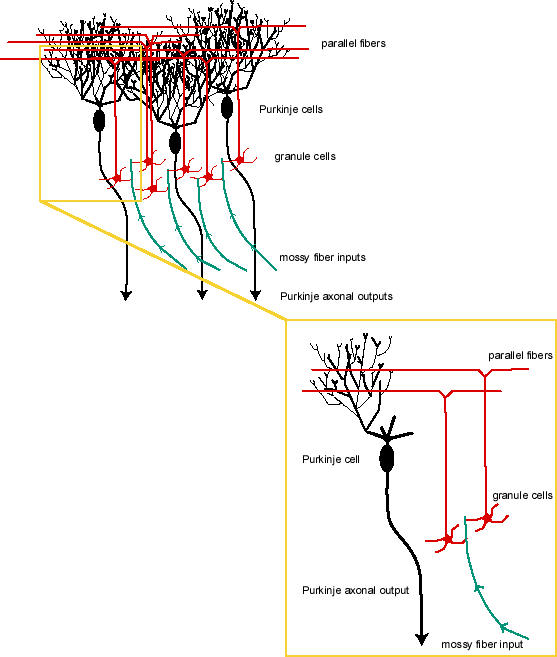

# neuroscience — figure1（supplement）

> （《neuroscience》词条补充材料，源：plato.stanford.edu/entries/neuroscience/figure1.html）

#### Supplement to The Philosophy of Neuroscience

## Figure 1: Architecture of a cerebellar network

See text for full details (adapted with revisions from Paul Churchland 1987).

Long description: Two images one of which is a close up look of part of the main image. The main image is, from the top to bottom, a mass of black squiggly lines converging below on three black ovals labeled “Purkinje cells”. From each Purkinje cell descends a black line ending in an arrowhead and labeled “Purkinje axonal outputs”.

In addition coming from the bottom of the main image are four green lines labeled “mossy fiber inputs” which end in a collection of six red circles each with four short line segments extending (visually just below the black ovals). The red circles with segments are labeled “granule cells”. The green mossy fiber inputs each touch two or more of the red line segments (either of the same or different cells). From each of the granule cells extends a red line upwards that ends in a red horizontal line in the mass of black squiggly lines. The horizontal red lines are labeled “parallel fibers”.

The close up look is of one Purkinje cell, one mossy fiber input, and two granule cells and associated parallel fibers.
