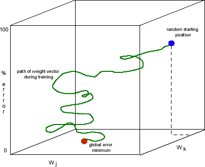

# neuroscience — figure2（supplement）

> （《neuroscience》词条补充材料，源：plato.stanford.edu/entries/neuroscience/figure2.html）

#### Supplement to The Philosophy of Neuroscience

## Figure 2: Learning characterized as gradient descent in error-synaptic weight space

One axis (y) reflects the global error measure of the network output to a given input. The other axes reflect weight values of two synapses in the network.

The complete error weight space will have *n*+1 dimensions where *n* is the number of synapses in the network.

See text for full details. (Adapted from Paul Churchland 1987.)

Long description: A three dimensional Cartesian graph with an x-axis labeled *Wⱼ*, a z-axis labeled *Wₖ*, and a y-axis labeled “% error”. Near the max of the x and z axes and about 70% of the y axes is a blue sphere labeled “random starting position”. From it descends a squiggly green line labeled “path of weight vector during training” that generally heads down (on the y-axis) until reaching a red sphere labeled “global error minimum”.
