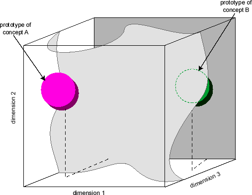

# neuroscience — figure3（supplement）

> （《neuroscience》词条补充材料，源：plato.stanford.edu/entries/neuroscience/figure3.html）

#### Supplement to The Philosophy of Neuroscience

## Figure 3: Representational content (concepts) characterized as partitions in high-dimensional vector state-species

A prototype of the concept is the center point or subvolume in the partition.

See text for full details. (Adapted from Paul Churchland 1989.)

A three dimensional Cartesian graph with axes labeled “dimension 1”, “dimension 2”, and “dimension 3”. partitioning the graph along dimension 3 is an irregular surface. On one side of the surface is a purple sphere labeled “prototype of concept A” and on the other a green sphere labeled “prototype of concept B”.
