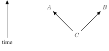
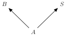
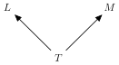
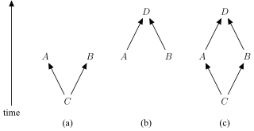
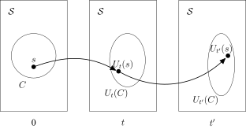
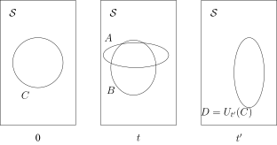
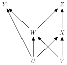

# Reichenbach’s Common Cause Principle
**First published Mon Jan 13, 2020**

*Hitchcock, Christopher, Rédei, Miklós*

The *Common Cause Principle* was introduced by Hans Reichenbach, in *The Direction of Time*, which was published posthumously in 1956. Suppose that two events *A* and *B* are positively correlated: $p(A\cap B)>p(A)p(B)$. Suppose, moreover, that neither event is a cause of the other. Then, Reichenbach’s Common Cause Principle (RCCP) states that *A* and *B* will have a common cause that renders them conditionally independent. Reichenbach incorporated his RCCP into a new probablistic theory of causation, and used it to describe a (purported) macrostatistical temporal asymmetry in analogy with the second law of thermodynamics. The principle is significant because it posits a connection between causal structure and probabilistic correlations, thus facilitating causal inference from observed correlations. However, RCCP has been controversial, and a number of counterexamples have been proposed. RCCP is often seen as an antecedent of the *Causal Markov Condition*, which plays a central role in causal modeling and causal inference. RCCP has also been taken to capture assumptions about the behavior of classical systems that appear to be violated in quantum mechanics.

## 1. Introduction

The *Common Cause Principle* (RCCP) was introduced by Hans Reichenbach, in *The Direction of Time*, which was published posthumously in 1956. The principle posits a connection between causal structure and probabilistic correlations between events. After presenting the principle in Section 2, we will provide some historical background in Section 3. The following two sections present some illustrations and alleged counterexamples to RCCP. Section 6 discusses Reichenbach’s *fork asymmetry*, a (putative) temporal asymmetry in macrostatistical patterns that he associated with RCCP. Section 7 presents the *Causal Markov Condition*, which plays a central role in causal modeling methods. The Causal Markov Condition is often seen as a modern successor of RCCP, and its relationship to RCCP will be examined. Section 8 will develop RCCP in a formal setting that is suitable for examining the status of RCCP in quantum mechanics. Section 9 and Section 10 will then consider whether RCCP is compatible with quantum physics.

## 2. Reichenbach’s Common Cause Principle

Let *A* and *B* be events. A storm, a person getting sick, a soccer player scoring a goal, and a scientific measurement yielding a specific result are all examples of events. Assume we can meaningfully assign probabilities to these events occurring. Reichenbach himself developed a sophisticated frequency interpretation of probability (Reichenbach 1949)[^reichenbach-1949], but we will assume only that some kind of objective probability can be meaningfully applied. Suppose that events *A* and *B* are positively probabilistically correlated:

$$\tag{1} \label{introcorr} p(A\cap B)>p(A)p(B).$$

That is, the probability that *both* *A* and *B* occur is greater than the product of the individual probabilities. Reichenbach’s Common Cause Principle says that when such a probabilistic correlation between *A* and *B* exists, this is because one of the following causal relations exists: *A* is a cause of *B*; *B* is a cause of *A*; or *A* and *B* are both caused by a third factor, *C*. In the last case, the common cause *C* occurs prior to *A* and *B*, and must satisfy the following four independent conditions:

$$ \begin{align} \tag{2} p(A\cap B|C) &= p(A|C)p(B|C) \label{off1}\\ \tag{3} p(A\cap B|\overline{C})&= p(A|\overline{C})p(B|\overline{C}) \label{off2}\\ \tag{4} p(A|C)&> p(A|\overline{C}) \label{nagy1}\\ \tag{5} p(B|C)&> p(B|\overline{C})\label{nagy2} \end{align}$$

where

$$ p(X|Y)\doteq\frac{p(X\cap Y)}{p(Y)} $$

denotes the conditional probability of *X* on condition *Y*, $\overline{C}$ denotes the absence of event *C* (the negation of the proposition that *C* happens) and it is assumed that neither *C* nor $\overline{C}$ has probability zero. Line (2) says that *A* and *B* are *conditionally independent*, given *C*. In Reichenbach’s terminology, *C* screens *A* off from *B*. Line (3) says that $\overline{C}$ also screens *A* off from *B*. Lines (4) and (5) say that *A* and *B* are more probable, conditional on *C*, than conditional on the absence of *C*. These inequalities are natural consequences of *C* being a cause of *A* and of *B*. Together, conditions (2) through (5) mathematically entail (1). The common cause can thus be understood to explain the correlation in (1). The probability relations described in lines (1) through (3) exhibit a version of *Simpson’s Paradox*. For more about this probabilistic phenomenon, see the entry on Simpson’s Paradox.

It will often be helpful to represent such a common cause structure diagrammatically, as in Figure 1. Arrows indicate causal relationships, and the vertical dimension represents time (with later times appearing higher up).

*Figure 1:* A common cause structure. *C* occurs earlier than *A* and *B*, and *C* is a cause of *A* and *B*.

RCCP says that probabilistic correlations are ultimately derived from causal relationships. That is, if $p(A\cap B)>p(A)p(B)$, that is either because one of these events causes the other, or else the inequality can be derived from other inequalities $p(A|C) > p(A|\overline{C})$ and $p(B|C) > p(B|\overline{C})$ where *C* is a cause of *A* and *B*. The principle is significant because it posits a connection between causal structure and probabilistic correlations that licenses inferences to causal relationships from empirically observable correlations.

As formulated above, RCCP assumes that there are only two possible states of the common cause: *C* and $\overline{C}$. That is, *C* is a binary event that is either present or absent. A natural extension of RCCP would be to allow the common cause to be a random variable *Z* with many possible values $z_1,\dots,z_n$. In this case we would expect that $Z = z_i$ screens off *A* from *B* for $i=1,\dots,n$. However, this does not imply that we can divide the values of *Z* into two sets $\mathbf{S}$ and $\mathbf{S^\prime}$ such that $Z\in \mathbf{S}$ (corresponding to *C*) and $Z \in \mathbf{S^\prime}$ (corresponding to $\overline{C}$) each screen off *A* and *B*. More generally, we would not expect coarsenings of *Z* to yield events that screen off *A* and *B*.

One corollary of this generalization is that if *A* and *B* have two distinct binary common causes *C* and *D*, we would expect each of $CD, C\overline{D}, \overline{C}D, \overline{CD}$ to screen off *A* and *B*, but would not expect *C* and *D* to screen off *A* and *B*. For example, even if we condition on the common cause *C*, we would expect *A* and *B* to be correlated because of the further common cause *D*.

We can further generalize to allow the correlated effects to be random variables instead of binary events. The fully general version of RCCP then reads as follows:

- Suppose *X* and *Y* are random variables that are correlated; i.e., there exist values $x_i$ and $y_j$ such that $$p(X=x_i \cap Y=y_j) \neq p(X=x_i)p(Y=y_j).$$ Then there exists a set of variables $Z_1,\dots,Z_m$, such that each variable is a cause of *X* and *Y*, and $$\begin{align} p(X=x_i \cap Y=y_j |& Z_1 = z_{k_1},\dots,Z_m = z_{k_m}) =\\ &p(X=x_i | Z_1 = z_{k_1},\dots,Z_m = z_{k_m})\\ &\times p(Y=y_j | Z_1 = z_{k_1},\dots,Z_m = z_{k_m}) \end{align}$$ for all $i,j,k_1,\dots,k_m$

With this generalization of RCCP, it is trickier to formulate analogs for conditions 4 and 5 that capture in probabilistic terms the idea that each variable $Z_k$ is a cause of both *X* and *Y*. In addition, this set of conditions will not strictly imply that *X* and *Y* are probabilistically correlated. We will return to these issues in Section 7.

## 3. Historical Background

*The Direction of Time* (Reichenbach 1956)[^reichenbach-1956] was unfinished at the time of Reichenbach’s death in 1953. The manuscript was edited by his wife Maria Reichenbach, and published posthumously in 1956. The book was concerned with temporally asymmetric phenomena—phenomena that we associate with the distinction between the past and the future. It included major sections on the role of time in classical physics, thermodynamics, statistical mechanics, and quantum mechanics. It also included a section on temporal asymmetries in macrostatistics. Reichenbach had plans to include a final section on the subjective experience of time.

The book makes a number of important and original contributions. It contains a detailed investigation into the philosophical foundations of statistical mechanics, especially examining the status of the second law of thermodynamics, which states that the entropy of a closed system can increase, but never decrease. Reichenbach explored connections between statistical mechanics and the new field of information theory—Shannon and Weaver’s classic book (1949) on the topic had been published just a few years earlier. In addition to the asymmetry of entropy increase described by the second law of thermodynamics, the book examined other temporally asymmetric phenomena. One of these was the asymmetry of records: We have detailed records of past events, including human memories and human made documents such as records and history books, but also including natural phenomena such as fossils, tree rings, and geological strata. These records provide us with a rich source of information about the past. We have no comparable source of information about the future, although we can reliably predict certain events, such as solar eclipses.

A third important temporal asymmetry is the asymmetry of cause and effect. Causes invariably precede their effects in time. Reichenbach attempted to analyze causal direction in terms of macrostatistics or probability. He appealed to his notion of screening-off to define a relation of causal betweenness, and also to define causal direction. It is in this latter context that the RCCP was introduced. The connection between RCCP and causal direction will be discussed in Section 6 below. Reichenbach also formulated a probabilistic theory of causation, and explored the connections between these new ideas and the *mark method* for distinguishing causal direction, which he had proposed much earlier (Reichenbach 1958)[^reichenbach-1958].

RCCP connects with a number of threads in Reichenbach’s thought. Reichenbach had developed and defended a frequency interpretation of probability (Reichenbach 1949)[^reichenbach-1949], as well as a thoroughgoing probabilistic epistemology (Reichenbach 1938)[^reichenbach-1938] He had also explored the connection between probability and causation in earlier works (Reichenbach 1925 [1978], 1930 [1978])[^reichenbach-1925]. *The Direction of Time* takes the project further in developing a probabilistic metaphysics. Reichenbach had also explored the connection between causation and the direction of time in Reichenbach (1925 [1978]) and Reichenbach (1958)[^reichenbach-1958]. The latter work developed a causal theory of time in the context of relativity theory.

## 4. Illustrations

**Example 1.** The barometer and the storm (Jeffrey 1969)[^jeffrey-1969].

*Figure 2:* The barometer and the storm. $A =$ drop in atmospheric pressure; $B =$ drop in mercury level in barometer; $S =$ storm.

A drop in the level of mercury in a barometer is frequently followed by a storm. Call these events *B* and *S*, respectively. Since storms in general are not so frequent, these events are probabilistically correlated: $p(B \cap S) > p(B)p(S)$. The behavior of one barometer doesn’t affect the weather, so *B* is not a cause of *S*; rather, *B* and *S* have a common cause: a drop in atmospheric pressure *A* (see Figure 2). *A* increases the probability of both *B* and *S*:

$$p(B|A) > p(B|\overline{A}) \textrm{ and }p(S|A) > p(S|\overline{A}). $$

Moreover, *A* will screen off *B* from *S*:

$$p(B \cap S|A) = p(B|A)p(S|A)$$

and

$$p(B \cap S|\overline{A}) = p(B|\overline{A})p(S|\overline{A}).$$

For example, if the atmospheric pressure drops, but the column of mercury in the barometer does not drop because the barometer is malfunctioning, the probability of a storm is the same as it would be if the barometer were functioning properly.

**Example 2.** *The theatre troupe* (Reichenbach 1956)[^reichenbach-1956].

A small theatre troupe travels around the country putting on performances. Occasionally, the leading man becomes seriously ill—call this event *M*—and an understudy must take his place. The same thing sometimes happens to the leading lady—*L*. Although both events are rare, they tend to occur together: $p(L \cap M) > p(L)p(M)$. The reason is that the actors usually eat together at the same restaurants, where they occasionally share tainted food—*T*. See Figure 3.

*Figure 3:* The theatre troupe. $T =$ food tainted at restaurant patronized by actors; $L =$ leading lady gets sick; $M =$ leading man gets sick.

Suppose the probabilities are as follows:

$$\begin{align} p(T) & = .1\\ p(L|T) = p(M|T) & = .8\\ p(L|\overline{T}) = p(M|\overline{T}) & = .1\\ \end{align}$$

Then we can compute:

$$\begin{align} p(L \cap M|T) = p(L|T)p(M|T) &= .64\\ p(L \cap M|\overline{T}) = p(L|\overline{T})p(M|\overline{T}) &= .01\\ \end{align}$$

These calculations make use of the fact that *T* and $\overline{T}$ screen *L* off from *M*. We can also compute:

$$\begin{align} p(L) = p(L|T)p(T) + p(L|\overline{T})p(\overline{T}) & = .17 = p(M)\\ p(L \cap M) = p(L \cap M|T)p(T) + p(L \cap M|\overline{T})p(\overline{T}) & = .073\\ \end{align}$$

Thus

$$.073 = p(L \cap M) > p(L)p(M) = .17^{2} = .0289.$$

*L* and *M* are probabilistically correlated.

Suppose that, on a given night, both the leading man and the leading lady are seriously ill. Can we infer that they ate tainted food? From the probabilities above, we can compute

$$p(T|L \cap M) = \frac{.064}{.073} \cong .877.$$

While it is probable that they ate tainted food, it is by no means a certainty. This example shows that the Common Cause Principle, by itself, does not license *token-level* causal inferences. That is, it does *not* tell us that when two effects *A* and *B* occur on a particular occasion, then their common cause *C* also occurred on this occasion. Instead, the Common Cause Principle licenses the inference from a probabilistic correlation to the existence of a *type-level* common cause.

**Example 3.** *Language descent.*

Common words in English that start with the letter ‘F’ often have counterparts in Spanish that start with the letter ‘P’: ‘foot’/‘pie’, ‘fish’/‘pez’, ‘father’/‘padre’, etc. One could quantify this by looking at canonical wordlists from both languages, and seeing how often words begin with ‘F’ in English and with ‘P’ in Spanish. By treating the relative frequencies in this list as probabilities, one would discover that there is indeed a probabilistic correlation between the English word-initial ‘F’ and Spanish word-initial ‘P’.

The explanation for this correlation is that English and Spanish are descended from a common language, called *Proto-Indo-European*. Some, but not all, words in Proto-Indo-European began with a consonant we can label [P/F], which evolved into ‘P’ in Romance languages (including Spanish), and ‘F’ in Germanic languages (including English). (Note that it is the phonetic pronunciation, rather than the spelling that is of interest here; for example, many German words whose spelling begins with ‘V’ are counted for this purpose.) In the separate lineages leading from Proto-Indo-European to English and to Spanish, Proto-Indo-European roots were retained for some words, but replaced for others. The roots were retained often enough that the correlation can still be detected. Moreover, the two lineages evolved more or less independently after splitting from Proto-Indo-European. Note that the common cause is not the Proto-Indo-European language as a whole, and the effects are not English and Spanish. It would make little sense to assign probabilities to these languages (let alone a joint probability to English and Spanish). Rather, the common cause is an initial consonant [P/F] in Proto-Indo-European; the effects are initial ‘F’ in English and initial ‘P’ in Spanish. It makes sense to assign probabilities to these sounds, since we can count the frequency with which words in these languages start with these sounds. See Figure 4.

![The phrase 'PIE[P/F]' with an arrow pointing from it up and to the left to the phrase 'English F' and another arrow pointing up and to the right to the phrase 'Spanish P'](../assets/physics-Rpcc/figure4.svg)

*Figure 4:* The descent of words with initial consonant ‘F’ in English and initial consonant ‘P’ in Spanish, from words with initial consonant [P/F] in Proto-Indo-European.

Note that the evidence of common descent between the two languages is the *correlation* between the two sounds, rather than any phonetic similarity between them. For example, there is a recognized correlation between the Latin ‘du’ and Armenian ‘erk’, as in ‘duo’/‘erku’ (‘two’). Despite the differences in these sounds, the correlation is evidence of common descent (both are also Indo-European languages).

For further discussion of this example, see Hitchcock (1998)[^hitchcock-1998].

**Example 4.** *Fried fish.*

Both the British and the Japanese eat battered seafood that has been deep-fried in oil: the British in the form of fish and chips, and the Japanese in the form of tempura. The technique of battering and deep-frying seafood seems to have originated with Moors in the Iberian Peninsula in the thirteenth century, where the dish was called *mu’affar*. It spread to the Jewish and Christian inhabitants of Spain and Portugal. In the sixteenth century, Sephardic Jews fleeing persecution took the recipe to Britain, and Portuguese traders carried it to Japan.

While it might be reasonable to call *mu’affar* the common cause of fish and chips and tempura, this is not an instance of the Common Cause Principle. There are no probabilities involved in this example, and there is no clear sense in which the British and Japanese both eating fried seafood is a probabilistic correlation. Perhaps one could construct a probabilistic model of global food distribution that would supply such probabilities, but in the absence of such a model, we do not have an instance of RCCP.

## 5. (Putative) Counterexamples

A number of authors have proposed counterexamples to the Common Cause Principle. A counterexample would involve two events *A* and *B* such that

- *A* and *B* are probabilistically correlated,
- neither event is a cause of the other, and
- the correlation between *A* and *B* cannot be explained by a common cause, either because they have no common cause, or because their common cause does not screen them off from one another.

One type of case that is often said to violate the Common Cause Principle involves entangled states in quantum mechanics, such as those found in Einstein-Podolski-Rosen (EPR) thought experiment. We will discuss this case in detail in Section 10 below. The present section will consider several other examples. As we shall see, these examples typically raise questions about the proper scope and interpretation of the Common Cause Principle, rather than refuting the principle outright.

**Example 5.** *Cartwright’s factory.*

Cartwright (1999: 108–109)[^cartwright-1999] asks us to imagine a factory that produces a chemical, *C*, that is used in sewage treatment. The factory employs a genuinely indeterministic process, so that when the process is initiated, *I*, there is a probability of .8 that the chemical is produced. However, whenever the chemical is produced, the factory also releases a pollutant, *P* as a by-product. Thus

$$.8 = p(C \cap P|I) > p(C|I)p(P|I) = .64$$

Neither *C* nor *P* cause the other.

Glymour (1999)[^glymour-1999] objects that such a factory is nowhere to be found. This raises a question about the status of the Common Cause Principle. If the principle is intended to be a conceptual truth about the relationship between causation and probability, then we could undermine the principle by showing that a causal structure that violates it can be clearly conceived. On the other hand, if the principle is intended to be an empirical generalization about the relationship between causation and probability in the actual world, then Glymour is right to demand more than a hypothetical example.

**Example 6.** *Random darts.*

Suppose that darts are shot at a dart board using an indeterministic process that can hit any part of the board. (If the reader is not comfortable with indeterministic darts, she may imagine photons hitting a scintillation screen after passing through a narrow slit.) Suppose that A and B are two regions of the dart board such that A is fully contained within B, and B does not fill the entire board (see Figure 5(a)). Let *A* be the event corresponding to the dart landing in region A, and analogously for *B*. Then we will have:

$$p(A \cap B) = p(A) > p(A)p(B).$$

This follows because $A \cap B = A$ and $p(B) < 1$. While the throw of the dart (or whatever process launches the dart) is a common cause of *A* and *B*, this will not screen them off. And if the process is genuinely indeterministic, there will be no cause that screens them off.

*Figure 5:* The large circle represents the dart board. Circles A and B are regions of the dartboard. In (a) the region A is entirely contained in the region B. In (b) the regions almost (but not quite) completely overlap.

David Lewis famously tried to analyze causation in terms of counterfactuals (Lewis 1973)[^lewis-1973]. He recognized that in order for his theory to succeed, he needed to restrict the analysis to counterfactual relations among *distinct* events (see especially Lewis 1986)[^lewis-1986]. For instance, we typed the word “Lewis” near the beginning of this paragraph. If we had not typed the letters L-e-w, then we would not have typed the word “Lewis”. But typing the letters L-e-w did not *cause* us to type “Lewis”. Typing L-e-w was *part* of the act of typing “Lewis”. The events *typing L-e-w* and *typing “Lewis”* are not *distinct* from one another in the right kind of way to stand in causal relations to each other. Lewis’s account of distinctness is somewhat involved, but it specifically excludes relations of logical entailment and spatiotemporal inclusion.

It appears that the Common Cause Principle requires a similar restriction to distinct events. In our example of the dart board, the region A is spatially included within the region B; hence, the events *A* and *B* will not be distinct, in Lewis’s sense. This means that there may be correlations between these events that are entirely due to their spatiotemporal relationship, and don’t have any distinctively causal basis.

Now suppose that the regions A and B almost completely overlap, but neither is contained within the other (see Figure 5(b)). Again, the corresponding events *A* and *B* will be correlated, and the earlier common cause may not screen them off. (Arntzenius (1999 [2010: section 2.4]) has an example that has essentially this structure.) It seems that this case, too, is one in which the events *A* and *B* are insufficiently distinct. But now it becomes difficult to formulate a notion of distinctness that is sufficiently general, without ruling out too much. To see the problem, imagine that instead of a literal dartboard, we have a Venn diagram representing the possible states of a system that evolves indeterministically. The spatial regions A and B now represent sets of possible states, corresponding to the states in which events *A* and *B* occur. And the area corresponds to probability. Thus the set of states in which *A* occurs almost completely overlaps with the set of states in which *B* occurs, as measured by the probability distribution over states. Is this a reason to think that *A* and *B* are not distinct? It had better not be, because this is just a representation of the generic case where events *A* and *B* are probabilistically correlated. Thus spelling out the precise notion of *distinctness* at work remains a challenge.

**Example 7.** *Conserved quantities.*

Salmon (1984)[^salmon-1984] and Schurz (2017)[^schurz-2017] argue that systems governed by probabilistic dynamics together with conservation laws will give rise to violations of RCCP. Suppose that a brick weighing 2 kg falls onto a hard, peaked surface. The brick cracks and breaks into two pieces, A and B. Suppose that this process is genuinely chancy. Perhaps the precise point at which the brick strikes the surface, or the precise process of crack formation in the brick, is not determined by earlier states of the system. Let *A* be the event corresponding to piece A weighing some specific amount, say 1.2 kg, and let *B* be the event corresponding to piece B weighing the complementary amount, say 0.8 kg. Since the combined mass must be 2 kg, *A* will occur if and only if *B* occurs. Since the process is chancy, $p(A) = p(B) = r < 1$. However,

$$p(A \cap B) = r > r^2 = p(A)p(B),$$

so *A* and *B* are correlated. No earlier event can screen off this correlation unless it determines that *A* and *B* will occur. Since the process is genuinely chancy, there is no such event. Hence RCCP is violated.

Whether there are any actual violations of RCCP having this form depends on whether there are actual processes governed by probabilistic dynamics and conservation laws. We don’t find such processes described by classical physics. We do encounter this combination already in quantum mechanics, at least on some interpretations (so-called collapse interpretations). However, these cases are further complicated by the role of quantum *entanglement*. We discuss the status of the Common Cause Principle in quantum mechanics in greater detail in sections 9 and 10 below.

**Example 8.** *Time series.*

Sober (2001)[^sober-2001] notes that sea levels in Venice and bread prices in London have both been rising over the past few centuries. Let *V* represent Venetian sea levels higher than some specified level, and *L* London bread prices higher than a given mark. If we sample Venetian sea levels and London bread prices over time, we will find that *V* and *L* are correlated: In years where *V* obtains, *L* tends to obtain as well (since these will tend to be more recent years). However, we have no reason to think that these phenomena share a common cause. They appear to be causally independent.

To understand what is going on in this example, we need to look more closely at the relationship between sample statistics and underlying probability distributions. We frequently think about this in terms of a classic urn model. An urn contains a certain proportion of black and white balls. We draw balls from the urn, and use the frequency of black balls drawn to estimate the proportion of black balls in the urn. Using statistical frequencies to estimate probabilities in this way typically requires an assumption that the samples are probabilistically independent: drawing a black ball does not affect the probability that the next ball drawn will be black. Sober’s example involves what statisticians call a *time series*. When we sample Venetian sea levels over the course of years, we are not drawing probabilistically independent samples from a stable probability distribution. If the sea level is high in a particular year, we can predict that the sea level will be similarly high the following year (they tend not to change dramatically from one year to the next). For this reason, we cannot interpret the relative frequencies that we obtain as estimates of an underlying probability distribution. Thus, even though there is a correlation between *V* and *L* in our samples, it is impossible to interpret this as a probabilistic correlation with $p(V \cap L) > p(V)p(L)$. Not all correlations in statistical samples bespeak *probabilistic* correlations. (See also Hoover 2003 and Steel 2003 for further discussion of Sober’s example.)[^hoover-2003][^steel-2003]

This defense of the Common Cause Principle raises a worry, however. Many cases where we would like to apply the Common Cause Principle may also turn out to behave like time series. For example, consider Reichenbach’s example of the traveling theatre troupe (Example 2 above). It is reasonable to expect that if the leading man is sick on a particular day, then he will be more likely to be sick on the following day—some illnesses last more than a day. And if he is exposed to a particular pathogen at one time, he may gain immunity against that pathogen in the future. If we exclude all such examples, then we run the risk of excluding many of the standard examples that are supposed to lend support to the principle.

## 6. The Fork Asymmetry

Reichenbach’s *Direction of Time* (1956) was centrally concerned with temporally asymmetric phenomena. Much of the work is devoted to the status of the Second Law of Thermodynamics, which says that in a closed system, entropy can increase but will never decrease. But Reichenbach also tried to define a macroscopic statistical asymmetry using the Common Cause Principle. Suppose that events *A* and *B* are correlated, i.e., that $p(A \cap B) > p(A)p(B)$. If there is an event *C* that satisfies conditions (2)–(5) above, Reichenbach called the trio *ACB* a *conjunctive fork*. If *C* occurs earlier than *A* and *B*, and there is no event satisfying (2)–(5) that occurs later than *A* and *B*, then *ACB* is said to form a conjunctive fork *open to the future* (see Figure 6(a)).

*Figure 6:* (a) Conjunctive fork open to the future. (b) Conjunctive fork open to the past. (c) Closed fork. [An extended description of figure 6 is in the supplement.]

Analogously, if there is a later event satisfying (2)–(5), but no earlier event, we have a conjunctive fork *open to the past* (Figure 6(b)). If an earlier event *C* and a later event *D* both satisfy (2)–(5), then *ACBD* forms a *closed fork* (Figure 6(c)). Reichenbach claimed that in our world, there are a great many forks open to the future, but few or none open to the past. Moreover, he proposed that the direction from cause to effect could be grounded in this statistical asymmetry.

Reichenbach saw his fork asymmetry as a macro-statistical analog of the second law of thermodynamics. Suppose we have a system such as a gas that is made up of a large number of particles. Each particle can be in one of many possible states $s_1,\dots,s_n$. Let $p_i$ be proportion of the particles that are in state $s_i$. Then one expression for the *entropy* of the system is $S = {-}\sum_i p_i log(p_i)$. This sum will reach a maximum when the particles are evenly distributed among the *n* states (or distributed as evenly as possible given constraints on the system). The second law of thermodynamics states that the entropy of a closed system can increase but never decrease; hence it will evolve toward a state of maximum entropy. Reichenbach claims that if we find a closed system in a state of low entropy, we can infer that it was recently prepared in that state, before being closed off from the rest of the environment.

Now suppose that we have two events *A* and *B*, and a probability distribution *p* over the four states $AB$, $A\overline{B}$, $\overline{A}B$, $\overline{A} \overline{B}$. We can apply the formula for entropy to this probability distribution; holding the probability of *A* and *B* fixed, the entropy will be highest when *A* and *B* are probabilistically independent. Thus, when we find a correlation between *A* and *B*, this is like finding a system in a state of low entropy, and we should look for some event in the past of *A* and *B* to explain this correlation. This is only a formal analogy, but Reichenbach attempted to show that the same basic principles that give rise to the second law of thermodynamics would also give rise to the Common Cause Principle. For more discussion, see the entry on thermodynamic asymmetry in time.

Reichenbach’s fork asymmetry has been subjected to numerous criticisms. Horwich (1987)[^horwich-1987] argues that our willingness to infer a past interaction often has little to do with entropy. We may infer from a pile of rubble that a city has been bombed. A pile of rubble corresponds to higher entropy than intact buildings; but it is the former, rather than the latter, that leads us to infer that a certain kind of interaction with the city has taken place.

*Figure 7:* $\mathcal{S}$ is the entire state space. Three copies of $\mathcal{S}$ are shown, corresponding to times 0, *t*, and $t^\prime > t$. If the system is in state *s* at time 0, it will be in state $U_t(s)$ at time *t*, and state $U_{t^\prime}(s)$ at time $t^\prime$. The set of states corresponding to event *C* will evolve into $U_t(C)$ and $U_{t^\prime}(C)$. [An extended description of figure 7 is in the supplement.]

Arntzenius (1990)[^arntzenius-1990] points out that the fork asymmetry is highly problematic in the context of classical statistical mechanics within which Reichenbach was working. Let $\mathcal{S}$ be a state-space containing all possible states of a physical system (see Figure 7). The state of a system *s* at a particular time *t* will involve the specification of parameters, such as the positions and momenta of all the particles in the system. The system evolves deterministically, so that for every time time *t*, if the system was in state *s* at time 0, it will be in state $U_t(s)$ at time *t*, where each $U_t$ is a one-one function from $\mathcal{S}$ into itself. An event such as *C* corresponds to a subset of $\mathcal{S}$: the set of states in which *C* occurs. We can then define $U_t(C)$ to be the set of states of the form $U_t(s)$, where $s \in C$.

A probability function *p* on $\mathcal{S}$ at time 0 can then be extended to a probability distribution over trajectories through $\mathcal{S}$, yielding probabilities for events at later times.

Suppose that *C* occurs at time 0, and *A* and *B* occur at later time *t*. Suppose, moreover, that *ACB* forms a conjunctive fork. Then we can evolve the set of microstates in *C* forward to time $t^\prime > t$. Then $D = U_{t^\prime}(C)$ will occur after *A* and *B*, but stand in the same probabilistic relationship to *A* and *B* that *C* does (see Figure 8). Thus *ACBD* will form a closed fork. Since this recipe is perfectly general, it seems that every conjunctive fork *ACB* with *C* earlier than *A* and *B* must belong to a closed fork *ABCD*.

*Figure 8:* Event *D* at time $t^\prime$ results from evolving *C* forward from time 0 to $t^\prime$. It will stand in the same probabilistic relationship to events *A* and *B* at time *t* that *C* did at time 0. [An extended description of figure 8 is in the supplement.]

A natural response to this worry is to propose that the earlier set of states *C* will be sufficiently coherent to form a natural event, while the later set of states *D* will be a heterogeneous collection, having nothing in common except for the fact that they all evolved states in *C*. Such a heterogeneous collection of states would not qualify as an *event*—see, e.g., Lewis (1986)[^lewis-1986] for discussion of what qualifies as a genuine event. Hence, there is an earlier event that screens off *A* and *B*, but no later event that does so. However, the framework of statistical mechanics gives us no principled reason for thinking that in all such cases, the earlier screening off event will be coherent enough to be a proper event, while the later screener will not be. Moreover, Arntzenius (1990)[^arntzenius-1990] offers a counterexample to one way of making this proposal precise.

We will also see in Section 7 that the modern theory of causal modeling does not use conjunctive forks to determine the direction of causation, but rather uses a probabilistic pattern that is essentially the exact opposite of a conjunctive fork.

## 7. The Causal Markov Condition

Reichenbach’s Common Cause Principle is closely related to the *Causal Markov Condition* that is commonly employed in causal modeling. A version of the *Causal Markov Condition* was first proposed by Kiiveri, Speed, and Carlin (1984). Detailed programs in causal modeling featuring the Causal Markov Condition have been developed by Pearl (2009)[^pearl-2009] and Spirtes, Glymour and Scheines (2000).

We will describe here just one kind of causal model, the *causal Bayes net*. A causal Bayes net uses a *directed acyclic graph* (DAG) to represent causal relations among a set of variables, and pairs it with a probability distribution over the set of variables. More precisely, a causal Bayes net is a triple $(\mathbf{V}, \mathcal{G}, p)$, where $\mathbf{V}$ is a set of variables, $\mathcal{G}$ is a directed acyclic graph over $\mathbf{V}$, and *p* is a probability distribution over the field of events generated by $\mathbf{V}$. The variables in $\mathbf{V}$ correspond to the properties of individuals in some population. For example, in a population of American adults, we might have variables representing an individual’s education level, work experience, and present income. A variable can be binary, representing the presence or absence of some property, but it can also be multiple-valued or continuous.

$\mathcal{G}$ is a set of ordered pairs of variables in $\mathbf{V}$. If $(X, Y) \in \mathcal{G}$, we represent this graphically by drawing an arrow from *X* to *Y*, and we say that *X* is a *parent* of *Y*. If there are arrows from $X_{1}$ to $X_{2}$, $X_{2}$ to $X_{3}$,… and $X_{n-1}$ to $X_{n}$, then there is a *directed path* from $X_{1}$ to $X_{n}$. In this case, we say that $X_{n}$ is a *descendant* of $X_{1}$. $\mathcal{G}$ is acyclic if there is no directed path from any variable to itself. Figure 9 shows a DAG on the variable set $\{U, V, W, X, Y, Z\}$. In this DAG, there is a directed path from *U* to *Z*, and *Z* is a descendant of *U*. $\PA(X)$ is the set of all parents of *X* and $\ND(X)$ is the set of all variables in $\mathbf{V}$ other than *X* and its descendants. In Figure 9, $\PA(W) = \{U, V\}$ and $\ND(W) = \{U, V, X\}$.

A DAG represents the qualitative causal structure among the set of variables in an individual from the relevant population. In particular, an arrow from *X* to *Y* indicates that *X* has a causal influence on *Y* that is not mediated by any other variables in the set. In this case, we say that *X* is a direct cause of *Y*.

*Figure 9:* A DAG on the variable set $\{U, V, W, X, Y, Z\}$. $\PA(W) = \{U, V\}$ is the set of parents of *W* and $\ND(W) = \{U, V, X\}$ is the set of non-descendants of *W*. [An extended description of figure 9 is in the supplement.]

The Causal Markov Condition connects the graph $\mathcal{G}$ with the probability distribution *p* over the algebra generated by the variables. It says that *p* must exhibit specific relations of conditional probabilistic independence that are implied by the graph. In the special case where $\mathcal{G}$ is a DAG, the following three formulations of the Causal Markov Condition are equivalent:

1. **Causal Markov Condition: Screening off version.** For every variable *X* in $\mathbf{V}$, and every set of variables $\mathbf{Y} \subseteq \ND(X):$ $$p(X | \PA(X) \cap \mathbf{Y}) = p(X | \PA(X))$$ We employ a notational convention where statements involving variables are understood to involve universal quantification over values of those variables (or over measurable sets of values). This version of the Causal Markov Condition says that the parents of variable *X* screen *X* off from all other variables, except for *X* itself and the descendants of *X*. Given the values of the variables that are parents of *X*, the values of the variables in $\mathbf{Y}$ make no further difference to the probability that *X* will take on any given value. This version of the Causal Markov Condition is closest in form to Reichenbach’s Common Cause Principle, although it is formulated in terms of the parents of *X*, rather than the common cause(s) of *X* and *Y*.
2. **Causal Markov Condition: Factorization version.** Let $\mathbf{V} = \{X_{1}, X_{2}, \dots, X_{n}\}$. Then: $$p(X_{1} \cap X_{2} \cap \dots \cap X_{n}) = \prod_{i} p(X_{i}|\PA(X_{i})).$$ This version tells us that once we know the conditional probability distribution of each variable given its parents, $p(X_{i}|\PA(X_{i}))$, we can compute the complete joint distribution over all of the variables. This captures Reichenbach’s idea that probabilistic correlations between events can ultimately be derived from probabilistic correlations resulting from cause and effect relationships.
3. **Causal Markov Condition: *d*-separation version.** Let $\mathbf{X}, \mathbf{Y},$ and $\mathbf{Z}$ be disjoint subsets of $\mathbf{V}$. Then: $$p(\mathbf{X} \cap \mathbf{Y}|\mathbf{Z}) = p(\mathbf{X}|\mathbf{Z}) \times p(\mathbf{Y}|\mathbf{Z})$$ if $\mathbf{Z}$ *d*-separates $\mathbf{X}$ and $\mathbf{Y}$ in $\mathcal{G}.$ This version introduces the graphical notion of *d*-separation. A path from *X* to *Y* is a sequence of variables $(X = X_{1},\dots, X_{k} = Y)$ such that for each $X_{i}$, $X_{i+1},$ there is either an arrow from $X_{i}$ to $X_{i+1}$ or an arrow from $X_{i+1}$ to $X_{i}$ in $\mathcal{G}$. For example, in Figure 9, $\{U, Y, W, V, X\}$ forms a path. A variable $X_{i}$, $1 < i < k$ is a *collider* on the path just in case there is an arrow from $X_{i-1}$ to $X_{i}$ and from $X_{i+1}$ to $X_{i}$. In other words, $X_{i}$ is a collider just in case the arrows converge on $X_{i}$ in the path: $$X_{i-1} \rightarrow X_i \leftarrow X_{i+1}.$$ in Figure 9, *Y* is a collider on the path $\{U, Y, W, V, X\}.$ Let $\mathbf{X}, \mathbf{Y}$, and $\mathbf{Z}$ be disjoint subsets of $\mathbf{V}$. $\mathbf{Z}$ *d*-separates $\mathbf{X}$ and $\mathbf{Y}$ just in case every path $(X_{1}, \dots, X_{k})$ from a variable in $\mathbf{X}$ to a variable in $\mathbf{Y}$ contains at least one variable $X_{i}$ such that either: (i) $X_{i}$ is a collider, and neither $X_{i}$ nor any descendant of $X_{i}$ is in $\mathbf{Z}$; or (ii) $X_{i}$ is not a collider, and $X_{i}$ is in $\mathbf{Z}$. In Figure 9, $\{U, V\}$ *d*-separates $\{Y\}$ and $\{X\}$. The path $\{Y, W, Z, X\}$ contains a collider at *Z*, and all other paths from *Y* to *X* include *U* or *V* as a non-collider.

The Causal Markov Condition implies the generalized version of RCCP presented in Section 2. This is most easily seen using the *d*-separation version. If variables *X* and *Y* are correlated, then $\{X\}$ and $\{Y\}$ are not *d*-separated by the empty set. This means that at least one path between *X* and *Y* must be without a collider. If we further assume that neither variable is a cause of the other, then there is no directed path between them. It then follows that the collider-free path must contain a common cause: a variable *Z* that has both *X* and *Y* as descendants. Furthermore, the set of all such common causes *d*-separates $\{X\}$ and $\{Y\}$. (The proof is a bit fussy, since a common cause on one path can be a collider on another path.) Hence the set of common causes of *X* and *Y* will screen them off from one another.

Note that the Causal Markov Condition tells us that certain causal structures give rise to relations of conditional probabilistic *in*dependence. The Causal Markov Condition never entails probabilistic *de*pendence. For purposes of causal inference, the Causal Markov Condition is often supplemented by a further principle governing when probabilistic dependence is to be expected. One such principle is the *Faithfulness Condition* (Spirtes et al. 2000)[^spirtes-2000] which says that *only* the probabilistic independencies entailed by the Causal Markov Condition are present. Looked at another way, the Faithfulness Condition says that when we find a relation of conditional probabilistic independence, we should infer a causal structure that entails that independence relation rather than one that doesn’t.

One justification for assuming the Causal Markov Condition is a theorem due to Pearl and Verma (1991). Suppose that we have a variable set $\mathbf{V}$, and DAG $\mathcal{G}$ representing the causal relations among the variables in $\mathbf{V}$. Suppose, in addition, that the value of each variable *X* in $\mathbf{V}$ is a deterministic function of its parents in $\mathbf{V}$, together with an *error variable* $U_{X}$, which represents the influence of any variables that are not included in $\mathbf{V}$. In other words, $X = f_{X}(\PA(X), U_{X})$. Then the values of all of the error variables will uniquely determine the value of all of the variables in $\mathbf{V}$, and a probability distribution $p^{*}$ over the error variables will induce a probability distribution *p* over the variables in $\mathbf{V}$. If the error variables are independent in $p^{*}$, then the induced probability distribution *p* will satisfy the Causal Markov Condition with respect to $\mathcal{G}$. The idea is that if we include enough variables in $\mathbf{V}$ so that any remaining causal influences are probabilistically independent of one another, then the probability distribution over $\mathbf{V}$ will satisfy the Causal Markov Condition.

A set of variables $\mathbf{V}$ is *causally sufficient* if there is no variable *W* omitted from $\mathbf{V}$, such that if it were added to $\mathbf{V}$, it would be a direct cause of two variables in $\mathbf{V}$. In Figure 9, $\{U, W, Y\}$ is causally sufficient (assuming the original DAG is), but $\{U, W, Y, Z\}$ is not, since *W* and *Z* have a common cause, *V*, that is left out of this set.

It is usually assumed that if a variable set is causally sufficient, then the error variables will be probabilistically independent, and the probability distribution over $\mathbf{V}$ will satisfy the Causal Markov Condition with respect to the true causal graph. Note that this assumption is very similar to the Common Cause Principle itself. If *X* and *Y* are variables included in a causally sufficient DAG, and $U_X$ and $U_Y$ are their corresponding error variables, then neither $U_X$ nor $U_Y$ is a cause of the other, and they do not have a common cause. If they had a common cause, this would be a common cause of *X* and *Y*; if $U_X$ is a cause of $U_Y$, then $U_X$ is a common cause of *X* and *Y*. So the causal sufficiency of the variable set implies that $U_X$ and $U_Y$ are causally unrelated. The Common Cause Principle would then imply that they are probabilistically independent. Thus it would be inaccurate to say that the Causal Markov Condition can be used to *justify* the Common Cause Principle: both involve comparable assumptions about the relationship between causation and probability.

Examining the *d*-separation version of the Causal Markov Condition, we see that it is not common causes but rather colliders that give rise to distinctive probabilistic relationships. Suppose that we have a variable set with three variables $\{X, Y, Z\}$, and that the probability distribution *p* satisfies the Causal Markov Condition with respect to the true causal graph. Finally, suppose that *X* and *Z* are correlated, but screened off by *Y*. Then there are three different causal graphs that all imply just this set of probabilistic independence relations:

$$\begin{align} X & \rightarrow Y \rightarrow Z\\ X & \leftarrow Y \leftarrow Z\\ X & \leftarrow Y \rightarrow Z\\ \end{align}$$

The last of these, of course, is the Common Cause Structure characterized by Reichenbach. (However, Reichenbach also postulated that intermediate causes would screen off distal causes from their effects, as indicated in the first two diagrams.) On the other hand, suppose the relations of probabilistic (in)dependence are exactly the opposite. That is: *X* and *Z* are probabilistically independent, but dependent conditional on *Y*. In this case, there is only one causal structure that implies just this set of probabilistic independence relations:

$$X \rightarrow Y \leftarrow Z$$

Indeed, algorithms for inferring causal structure from relations of conditional probabilistic dependence and independence, such as the *PC* algorithm of Spirtes et al. (2000), proceed by searching for this type of probabilistic signature. Thus Reichenbach was mistaken in looking to conjunctive forks to define the direction of causation (see Section 6 above). He would have done better to look to colliders.

## 8. Technical Results on Common Causes Relevant for Assessing the Status of RCCP

A classical probability measure space is a triplet $(X,{\cal S},p)$, where *X* is the set of elementary random events, ${\cal S}$ is a Boolean algebra of some subsets of *X* and *p* is the additive probability measure from ${\cal S}$ into the unit interval $[0,1]$. The probability measure space $(X,{\cal S},p)$ is called *common cause complete* if there exists a common cause *C* in ${\cal S}$ of every correlated pair $(A,B)$ of elements $A,B$ in ${\cal S}$, common cause *incomplete* otherwise. One can show that common cause (in)completeness can be characterized in terms of the measure theoretic (non)atomicity of probability measure spaces: $(X,{\cal S},p)$ is common cause complete if and only if $(X,{\cal S},p)$ contains at most one measure theoretic atom (Gyenis & Rédei 2011)[^gyenis-2011]. A measure theoretic atom is an element $A_0$ in ${\cal S}$ such that $p(A_0)\not=0$, and, if $B\subset A_0$, then $p(B)=0$. In particular measure theoretically purely non-atomic probability measure spaces (i.e., probability spaces that do not contain any measure theoretic atom) are common cause complete (Gyenis & Rédei 2011; Hofer-Szabó et al. 2013; Marczyk & Wroński 2015)[^gyenis-2011][^hofer-szabó-2013][^hofer-szabó-2013-2][^marczyk-2015]. An example of a measure theoretically purely non-atomic probability measure space is the unit interval $[0,1]$ with the uniform probability (Lebesgue measure) on the Lebesgue measurable subsets of $[0,1]$; a class of examples are probability measures on the (Lebesgue measurable subsets of the) real line where the probability is given by a density function with respect to the Lebesgue measure on the real line.

A common cause incomplete probability space $(X,{\cal S},p)$ is called *common cause completable* if it can be embedded into a larger probability space $(X',{\cal S}',p')$ that is common cause complete. An embedding of $(X,{\cal S},p)$ into $(X',{\cal S}',p')$ is an injective Boolean algebra homomorphism *h* from ${\cal S}$ into ${\cal S}'$ such that $p'(h(A))=p(A)$ for all *A* in ${\cal S}$. One can show that every probability space $(X,{\cal S},p)$ can be embedded into a purely nonatomic probability space. This entails that every common cause incomplete probability space is common cause completable (Gyenis & Rédei 2011; Hofer-Szabó et al. 2013; Marczyk & Wroński 2015)[^gyenis-2011][^hofer-szabó-2013][^hofer-szabó-2013-2][^marczyk-2015].

In quantum theory one uses non-classical (quantum) probability spaces to describe quantum physical systems. A general quantum probability space is a pair $({\cal P} ({\cal N}),\phi)$, where ${\cal P} ({\cal N})$ is the orthocomplemented, orthomodular lattice of projections of a non-commutative von Neumann algebra ${\cal N}$ and *φ* is a countably additive probability measure on ${\cal P} ({\cal N})$, which is the restriction to ${\cal P} ({\cal N})$ of a normal state on ${\cal N}$. Rédei & Summers (2007a) provides a brief description of non-commutative probability theory in terms of von Neumann algebras; Landsman (2017)[^landsman-2017] contains an encyclopedic treatment of the algebraic structures relevant for quantum theory; the SEP entry on quantum theory and mathematical rigor gives a very brief informal introduction to some basic facts on von Neumann algebras, including their Murray-von Neumann classification, which is relevant from the perspective of the Common Cause Principle—see below). A special example of a quantum probability space is obtained by taking the set of all bounded operators ${\cal B} ({\cal H} )$ on a (possibly infinite dimensional) Hilbert space ${\cal H}$ as the von Neumann algebra and *φ* a quantum state given by a density matrix. The resulting specific quantum probability space $({\cal P}({\cal B}({\cal H})),\phi)$ is known as the “Hilbert space formalism” of quantum mechanics; this space describes quantum systems of finite degrees of freedom. The orthomodular lattice ${\cal P}({\cal B}({\cal H}))$, frequently denoted as ${\cal P} ({\cal H})$, is the set of all projections on ${\cal H}$, this lattice is also called “Hilbert lattice”.

The concept of correlation between commuting projections $A,B$ in ${\cal P} ({\cal N})$ and the notion of common cause of such correlations as a projection *C* commuting with both *A* and *B* and satisfying the (analogues) of the four Reichenbachian conditions (2)–(5) make perfect sense in quantum probability spaces. So do the concepts of common cause (in)completeness, common cause completability (with a suitably defined embedding of orthomodular lattices), measure theoretic atoms and measure theoretic non-atomicity.

One can show that common cause completeness of such quantum probability spaces can be characterized in terms of measure theoretic atomicity of $({\cal P} ({\cal N}),\phi)$ in complete analogy with the classical case: $({\cal P} ({\cal N}),\phi)$ is common cause complete if it contains at most one measure theoretic atom (Kitajima 2008; Gyenis & Rédei 2014; Kitajima & Rédei 2015)[^gyenis-2014][^kitajima-2008][^kitajima-2015]. This entails that measure theoretically purely non-atomic quantum probability spaces are common cause complete. Specifically, quantum probability spaces $({\cal P} ({\cal N}),\phi)$ with a type III or type II von Neumann algebra ${\cal N}$ are common cause complete because the quantum probability spaces defined by these types of von Neumann algebras are purely measure theoretically non-atomic. The quantum probability space $({\cal P} ({\cal H}),\phi)$ is not purely nonatomic, it contains a lot of measure theoretic atoms: all the rank-one projections (equivalently: one dimensional linear spaces spanned by vectors in ${\cal H}$) are atoms of the Hilbert lattice ${\cal P} ({\cal H})$, hence all rank-one projections that are assigned non-zero probability by state *φ* are also measure theoretic atoms in $({\cal P} ({\cal N}),\phi)$. Thus $({\cal P} ({\cal H}),\phi)$ is not common cause complete. Whether common cause incomplete quantum probability spaces are common cause completable, is not known; results are available on common cause *extendability* of quantum probability spaces only: Every quantum probability space $({\cal P} ({\cal N}),\phi)$ is embeddable into a larger quantum probability space $({\cal P}({\cal N}'),\phi')$ in such a way that every correlation in $({\cal P} ({\cal N}),\phi)$ has a common cause in $({\cal P}({\cal N}'),\phi')$ (Hofer-Szabó, Rédei, & Szabó 1999; 2013: 62, Proposition 6.3)[^hofer-szabó-1999].

The philosophical significance of common cause completability and common cause extendability of (classical and quantum) probability spaces is that they show that it is always possible in principle to explain any correlation, hence also any correlation between causally independent events, in terms of (possibly hidden) common causes—hidden in the sense that the common causes need not be in the probability space that contains the correlation: the common causes can be “hiding” in a larger probability space. Thus these common cause completability and common cause extendability results constrain the possible ways of attempts to falsify the Common Cause Principle: Any attempt at falsification should impose some further conditions on the common causes in addition to the four defining conditions (2)–(5), otherwise falsification can be evaded by referring to hidden common causes. Formulated differently: The Common Cause Principle, as formulated exclusively in terms of the notion of a Reichenbachian common cause, either in a classical or in a quantum probability theory, is not falsifiable. This does not mean that the common cause extendability results can be regarded as proof that the Common Cause Principle is true: Even the weaker question of whether a common cause extendability result can be taken as confirming evidence for the Common Cause Principle depends on whether the extended probability measure space, existence of which is warranted by the mathematical common cause extendability results, is (part of) an empirically confirmed scientific theory.

The significance of common cause complete spaces is that they display a very strong compliance with the Common Cause Principle: An equivalent formulation of the Common Cause Principle is that probability theories describing the world are causally closed in the following sense: if *A* and *B* are correlated and are causally independent, $R_{ind}(A,B)$ in notation, then the correlation has to have a common cause that explains the correlation. Common cause complete spaces are causally closed in the extremely strong sense that the causal independence relation $R_{ind}(A,B)$ can be taken to be the strongest one, containing all correlated events. Thus, if a scientific theory describing some aspect of reality uses a measure theoretically purely non-atomic probability space, such a theory can be regarded as evidence in favor of the Common Cause Principle because that theory contains common causes of all correlations, including correlations that are between events that the theory might regard as causally unrelated (independent). In view of the interpretation of common cause completeness, common cause completability and common cause extendability, it is a relevant question whether our well-confirmed scientific theories are causally closed or common cause extendable. Quantum field theory and standard non-relativistic quantum mechanics are two theories for which this questions has been analyzed extensively.

## 9. Quantum Field Theory and the Common Cause Principle

Relativistic quantum field theory (see entry on quantum field theory) predicts an abundance of correlations between observables that are localized in spacelike separated (hence causally independent) spacetime regions. This is a consequence of prevalence of entanglement and of violation of Bell’s inequality in quantum field theory, which is even more striking than violation of Bell’s inequality by standard, non-relativistic quantum mechanics (Summers 1997; Clifton & Halvorson 2001; Halvorson & Clifton 2000; entry on Bell’s theorem)[^clifton-2001][^halvorson-2000][^summers-1997]. If relativistic quantum field theory is causally closed in the sense of providing common causes of these correlations, then this theory is confirming evidence for the truth of the Common Cause Principle.

The quantum probability spaces describing relativistic quantum field theory are based on type III von Neumann algebras (Haag 1992; Horuzhy 1986 [1990]; Araki 1993 [1999]; entry on quantum field theory; consequently, these quantum probability spaces are measure theoretically purely non-atomic. It follows then from the common cause completeness of such quantum probability spaces that there exists common causes of the correlations between spacelike separated observables. Yet, one cannot conclude from this that quantum field theory satisfies the Common Cause Principle, for the following reason: observables in quantum field theory are explicitly associated with specific spacetime regions. So the common causes also should be required to belong to specific spacetime regions. Given a correlation between observable *A* localized in spacetime region $V_1$ and observable *B* localized in spacetime region $V_2$ spacelike separated from $V_1$, the common cause for this correlation should be localized in a region *V* that is in the intersection of the backward light cones of the spacelike separated spacetime regions $V_1$ and $V_2$. But the mere pure non-atomicity of the quantum probability space of quantum field theory does not entail any such locality of the common causes that exist as a consequence of the non-atomicity of the quantum probability space describing quantum fields. When one imposes this additional localizability constraint on the common causes in quantum field theory, the question of whether such *properly localized* common causes exist according to the theory, becomes a highly non-trivial problem (Rédei 1997)[^rédei-1997]. So non-trivial that the answer to it is still not known—the problem of status of causal completeness of quantum field theory is an open question.

It is known however that quantum field theory is causally complete in the weaker sense of containing common causes localized in the *union* (as opposed to the *intersection*) of the backward light cones of the spacelike separated spacetime regions $V_1$ and $V_2$ that contain the correlated observables (Rédei & Summers 2002, 2007b; Hofer-Szabó et al. 2013)[^hofer-szabó-2013][^hofer-szabó-2013-2][^rédei-2002][^rédei-2007b]. It also is possible logically that the status of the Common Cause Principle in relativistic quantum field theory cannot be decided: The quantum field theory in which the abundance of correlations between spacelike separated observables has been proven is defined by axioms (Haag-Kastler axiomatization). The axioms might just be too weak to give an answer to the question whether all correlations between spacelike separated observables have properly localized common causes. Proving such an independence result would be very interesting. Given how difficult it is to create any model of the Haag-Kastler axioms, attempting such a proof also appears to be extremely difficult because it requires displaying two models, one in which the Common Cause Principle holds (with properly localized common causes), one in which it does not.

One also can consider the problem of the status of the Common Cause Principle in discrete (lattice) quantum field theory. This is a simplified model of quantum field theory in which calculations are frequently easier to carry out. One of the simplifications of this theory is that the algebras of local observables are finite dimensional. The quantum probability spaces determined by such observables are not purely non-atomic and this prevents common causes—localized or not—to exist in these theories (Hofer-Szabó & Vecsernyés 2012a)[^hofer-szabó-2012a]. If, in the quantum context, one allows common causes not to commute with the correlated observables, then “non-commutative” common causes can be shown to exist in lattice quantum field theory (Hofer-Szabó & Vecsernyés 2012b, 2013, 2018)[^hofer-szabó-2013][^hofer-szabó-2012b][^hofer-szabó-2013-2][^hofer-szabó-2018]. One also can raise the problem of the status of the Common Cause Principle in categorial quantum field theory (Brunetti, Fredenhagen, & Verch 2003; Rédei 2014a)[^brunetti-2003][^rédei-2014a]. This requires a reformulation of the concept of common cause in terms of the notions of the categories used in categorial quantum field theory, which is done in Rédei (2014a)[^rédei-2014a]. This then leads to a number of specific questions about the status of the suitable reformulated Common Cause Principle. Most of these questions are open—this is an active area of research.

## 10. EPR Correlations and RCCP

Standard non-relativistic quantum mechanics of finite degrees of freedom predicts the famous EPR correlations (see entry on the Einstein-Podolsky-Rosen argument in quantum theory), which have been observed in sophisticated physical measurements (see entry on Bell’s theorem). These correlations are between events that are spacelike separated (hence causally independent according the special theory of relativity). Thus, they can serve as evidence to assess the status of the Common Cause Principle: These EPR correlations should have common causes if the Common Cause Principle describes the physical world correctly.

The quantum probability space that predicts the EPR correlations does not contain common causes for these correlations because this quantum probability space is defined on a finite dimensional Hilbert space and such a quantum probability space is not purely non-atomic hence not common cause complete. The question of whether “hidden” common causes for such correlations can in principle exist has been extensively discussed in a large literature. The first informal discussion seems to be von Neumann’s letter to Schrödinger in 1935 (Von Neumann 2005: 211–213)[^von-2005]. In this letter von Neumann takes the position that no correlation, including EPR-type quantum correlations, is problematic as long as one can find a common cause for it—although von Neumann does not use the term “common cause”, nor does he define any notion of common cause explicitly (Rédei 2006)[^rédei-2006]. The first technically explicit no-go theorem on common causes of EPR correlations is due to van Fraassen (1982). In this paper it is assumed however that a single common cause explains different correlations—i.e., that common causes are *common* common causes. It turns out however that, given a set $(A_i,B_i)$ ($i=1,2,\ldots$) of pairs of correlated events in a classical probability measure space, requiring the existence of a common cause $C_i$ for each correlated pair $(A_i,B_i)$ is a much weaker assumption than requiring the existence of a single *C* that is the common cause of all correlated pairs $(A_i,B_i)$ ($i=1,2,\ldots$): one can give examples of different correlations in a classical probability measure space that cannot have the same common cause (Hofer-Szabó, Rédei, & Szabó 2002)[^hofer-szabó-2002][^rédei-2002]. Thus if one aims at deriving no-go propositions on the existence of common causes of EPR correlations then one has to either argue that the different correlations in the EPR-situation should have the same common cause or one should impose further conditions on the common causes in addition to those in Reichenbach’s definition (2)–(5).

There are two types of such additional conditions, both motivated by the specific features of the EPR-scenario: “Locality conditions” and requirements expressing what is called “no-conspiracy”. Furthermore, both locality and no-conspiracy come in two varieties: *surface* and *hidden* locality conditions on one hand and *weak* and *strong* no-conspiracy conditions on the other. The content of the surface locality condition is that “… the probability of the outcome in one wing of the EPR correlation experiment is the same no matter in which direction the measurement is carried out in the other wing of the EPR experiment.” (Hofer-Szabó et al. 2013: 143)[^hofer-szabó-2013][^hofer-szabó-2013-2]. The hidden locality conditions require that

> ... given a pair of correlated outcomes of an EPR correlation experiment, the probability of the outcome in one wing of the EPR correlation experiment be the same no matter in which direction the measurement is carried out in the other wing of the EPR experiment *if* the hypothetical common cause of this correlation also has happened. (Hofer-Szabó et al. 2013: 144)[^hofer-szabó-2013][^hofer-szabó-2013-2].
>
> The *weak* no-conspiracy condition requires that any choice of the direction in which a measurement is decided to be carried out in any wing of the EPR experimental setup is probabilistically independent of the hypothetical common cause explaining the correlation in the chosen direction. The *strong no-conspiracy* condition requires that any Boolean *combination* of choices of measurement directions in the two wings of the EPR experiment are probabilistically independent of any Boolean *combination* of the hypothetical common causes. (Hofer-Szabó et al. 2013: 178)[^hofer-szabó-2013][^hofer-szabó-2013-2].

The differences between the different versions of the locality and no-nonspiracy conditions are conceptually significant and they are also crucial from the perspective of whether hypothetical common causes of EPR correlations can be ruled out by no-go theorems: The surface locality conditions are empirically testable due to the fact that all the events involved in it are observable. The hidden locality conditions involve the unobserved, hypothetical common cause events and, as a consequence, these locality conditions are not testable independently of the observation of the common causes. The interpretation of the no-conspiracy conditions is somewhat controversial: it declares as an implausible conspiracy on the part of nature if common causes influenced not only the outcomes of the EPR correlation experiments but also the choices of measuring in particular directions in the wings of the EPR experiment. These choices, we feel, are free, depending on the experimenter’s decision.

One can show that *weakly* non-conspiratorial common cause explanations of EPR correlations satisfying surface locality are possible. But *strongly* non-conspiratorial, *hidden* local common cause explanations of EPR correlations are ruled out (Hofer-Szabó et al. 2013: 152, 163)[^hofer-szabó-2013][^hofer-szabó-2013-2]. These results show that the EPR correlations cannot be regarded as strictly empirical evidence against the Common Cause Principle because the type of common causes that can be ruled out have features by assumption that are not empirically testable (hidden locality and no-conspiracy)—they are metaphysical in character.

## 11. Further Reading

Other accessible overviews of Reichenbach’s Common Cause Principle include Chapter 6 of Salmon (1984)[^salmon-1984] and Arntzenius (1999 [2010]), which is a previous version of the present entry. The entry on Hans Reichenbach provides an overview of Reichenbach’s philosophy. Reichenbach’s probabilistic theory of causation is discussed in the entry on causation, probabilistic. Issues related to temporal asymmetry in thermodynamics are discussed in the entry on thermodynamic asymmetry in time. The Causal Markov Condition is discussed at greater length in the entry on causal models. This encyclopedia contains numerous entries on philosophical issues related to quantum mechanics. Of particular relevance are the Einstein-Podolski-Rosen argument in quantum theory, philosophical issues in quantum theory, quantum logic and probability theory, and Quantum Mechanics.

Two recent book-length treatments of RCCP are Hofer-Szabó et al. (2013) and Wroński (2014)[^wroński-2014]. Further good discussions of the Common Cause Principle include Arntzenius (1990, 1992)[^arntzenius-1990][^arntzenius-1992]; Cartwright (1988)[^cartwright-1988]; Van Fraassen (1982b)[^fraassen-1982b]; Gyenis and Redei (2011, 2014); Henson (2005)[^henson-2005]; Hofer-Szabó et al. (1999, 2002); Marczyk and Wroński (2015); Mazzola (2012, 2013)[^mazzola-2012][^mazzola-2013]; Mazzola and Evans (2017); Rédei (2014b)[^rédei-2014b]; San Pedro (2008)[^pedro-2008]; Sober (1984, 1988 1989, 2008); Spohn (1994)[^spohn-1994]; Suppes (1970, 1984)[^suppes-1970][^suppes-1984]; Uffink (1999)[^uffink-1999]; and Wroński (2010)[^wroński-2010].

Discussion of counterexamples to RCCP are found in Cartwright (1994, 2007)[^cartwright-1994][^cartwright-2007]; Hoover (2003)[^hoover-2003]; Sober (2001)[^sober-2001]; and Steel (2003)[^steel-2003].

Discussions of RCCP in the context of quantum theory include Butterfield (1989, 2007)[^butterfield-1989][^butterfield-2007]; Chang and Cartwright (1992) Kowalski and Placek (1999); Penrose and Percival (1962); Placek (2000a,b); van Fraassen (1982a, 1991)[^fraassen-1982a][^fraassen-1991]; Wüthrich (2004)[^wüthrich-2004]; and Wiseman and Cavalcanti (2017).

## References（引用注释）

> 原文参考文献已转为脚注引用：文内“作者-年份”引用组后附 [^key] 标记，完整条目见本文末脚注定义。

## Academic Tools

> |   | [How to cite this entry](https://plato.stanford.edu/cgi-bin/encyclopedia/archinfo.cgi?entry=physics-Rpcc). |
> | --- | --- |
> |   | [Preview the PDF version of this entry](https://leibniz.stanford.edu/friends/preview/physics-Rpcc/) at the [Friends of the SEP Society](https://leibniz.stanford.edu/friends/). |
> |   | [Look up topics and thinkers related to this entry](https://www.inphoproject.org/entity?sep=physics-Rpcc&redirect=True) at the Internet Philosophy Ontology Project (InPhO). |
> |   | [Enhanced bibliography for this entry](https://philpapers.org/sep/physics-Rpcc/) at [PhilPapers](https://philpapers.org/), with links to its database. |

## Other Internet Resources

[Please contact the author with suggestions.]

## Related Entries

Bell’s Theorem | causal models | causation: probabilistic | quantum mechanics | quantum theory: and mathematical rigor | quantum theory: philosophical issues in | quantum theory: quantum field theory | quantum theory: quantum logic and probability theory | quantum theory: the Einstein-Podolsky-Rosen argument in | Reichenbach, Hans | Simpson’s paradox | time: thermodynamic asymmetry in

### Acknowledgments

The authors would like to thank Wayne Myrvold for helpful comments on an earlier draft of this entry.

[^araki-1993]: Araki, Huzihiro, 1993 [1999], *Ryoshiba no Suri*, Toykyo: Iwanami Shoten. Translated as *Mathematical Theory of Quantum Fields*, Ursula Carow-Watamura (trans.), (International Series of Monograps in Physics 101), Oxford: Oxford University Pressm 1999.

[^arntzenius-1990]: Arntzenius, Frank, 1990, “Physics and Common Causes”, *Synthese*, 82(1): 77–96. doi:10.1007/BF00413670

[^arntzenius-1992]: –––, 1992, “The Common Cause Principle”, *PSA: Proceedings of the Biennial Meeting of the Philosophy of Science Association*, 1992(2): 227–237. doi:10.1086/psaprocbienmeetp.1992.2.192838

[^arntzenius-1999]: –––, 1999 [2010], “Reichenbach’s Common Cause Principle”, *The Stanford Encyclopedia of Philosophy*, (Fall 2010 Edition), Edward N. Zalta (ed.), URL = <[https://plato.stanford.edu/archives/fall2010/entries/physics-Rpcc/](https://plato.stanford.edu/archives/fall2010/entries/physics-Rpcc/)> This is an earlier version of this entry.

[^brunetti-2003]: Brunetti, Romeo, Klaus Fredenhagen, and Rainer Verch, 2003, “The Generally Covariant Locality Principle—A New Paradigm for Local Quantum Field Theory”, *Communications in Mathematical Physics*, 237(1): 31–68. doi:10.1007/s00220-003-0815-7

[^butterfield-1989]: Butterfield, Jeremy, 1989, “A Space-Time Approach to the Bell Inequality”, in Cushing and McMullin 1989: 114–144.

[^butterfield-2007]: Butterfield, Jeremy, 2007, “Stochastic Einstein Locality Revisited”, *The British Journal for the Philosophy of Science*, 58(4): 805–867. doi:10.1093/bjps/axm034

[^cartwright-1988]: Cartwright, Nancy, 1988, “How to Tell a Common Cause: Generalizations of the Conjunctive Fork Criterion”, in *Probability and Causality*, James H. Fetzer (ed.), Dordrecht: Springer Netherlands, 181–188. doi:10.1007/978-94-009-3997-4_8

[^cartwright-1994]: –––, 1994, *Nature’s Capacities and Their Measurement*, Oxford: Oxford University Press. doi:10.1093/0198235070.001.0001

[^cartwright-1999]: –––, 1999, *The Dappled World: A Study of the Boundaries of Science*, Cambridge: Cambridge University Press. doi:10.1017/CBO9781139167093

[^cartwright-2007]: –––, 2007, *Hunting Causes and Using Them: Approaches in Philosophy and Economics*, Cambridge: Cambridge University Press. doi:10.1017/CBO9780511618758

[^chang-1993]: Chang, Hasok and Nancy Cartwright, 1993, “Causality and Realism in the EPR Experiment”, *Erkenntnis*, 38(2): 169–190. doi:10.1007/BF01128978

[^clifton-2001]: Clifton, Rob and Hans Halvorson, 2001, “Entanglement and Open Systems in Algebraic Quantum Field Theory”, *Studies in History and Philosophy of Science Part B: Studies in History and Philosophy of Modern Physics*, 32(1): 1–31. doi:10.1016/S1355-2198(00)00033-2

[^cushing-1989]: Cushing, James T. and Ernan McMullin (eds.), 1989, *Philosophical Consequences of Quantum Theory: Reflections on Bell’s Theorem*, (Studies in Science and the Humanities from the Reilly Center for Science, Technology, and Values 2), Notre Dame, IN: University of Notre Dame Press.

[^fraassen-1982a]: Fraassen, Bas C. van, 1982a, “The Charybdis of Realism: Epistemological Implications of Bell’s Inequality”, *Synthese*, 52(1): 25–38. doi:10.1007/BF00485253

[^fraassen-1982b]: –––, 1982b, “Rational Belief and the Common Cause Principle”, in *What? Where? When? Why?*, Robert McLaughlin (ed.), Dordrecht: Springer Netherlands, 193–209. doi:10.1007/978-94-009-7731-0_9

[^fraassen-1991]: –––, 1991, *Quantum Mechanics: An Empiricist View*, Oxford: Oxford University Press. doi:10.1093/0198239807.001.0001

[^glymour-1999]: Glymour, Clark, 1999, “Rabbit Hunting”, *Synthese*, 121(1/2): 55–78. doi:10.1023/A:1005229730590

[^gyenis-2011]: Gyenis, Zalán and Miklós Rédei, 2011, “Characterizing Common Cause Closed Probability Spaces\*”, *Philosophy of Science*, 78(3): 393–409. doi:10.1086/660302

[^gyenis-2014]: –––, 2014, “Atomicity and Causal Completeness”, *Erkenntnis*, 79(S3): 437–451. doi:10.1007/s10670-013-9456-1

[^haag-1992]: Haag, Rudolf, 1992, *Local Quantum Physics: Fields, Particles, Algebras*, Berlin and New York: Springer Verlag.

[^halvorson-2000]: Halvorson, Hans and Rob Clifton, 2000, “Generic Bell Correlation between Arbitrary Local Algebras in Quantum Field Theory”, *Journal of Mathematical Physics*, 41(4): 1711–1717. doi:10.1063/1.533253

[^henson-2005]: Henson, Joe, 2005, “Comparing Causality Principles”, *Studies in History and Philosophy of Science Part B: Studies in History and Philosophy of Modern Physics*, 36(3): 519–543. doi:10.1016/j.shpsb.2005.04.003

[^hitchcock-1998]: Hitchcock, Christopher, 1998, “The Common Cause Principle in Historical Linguistics”, *Philosophy of Science*, 65(3): 425–447. doi:10.1086/392655

[^hofer-szabó-1999]: Hofer-Szabó, Gábor, Miklós Rédei, and László E. Szabó, 1999, “On Reichenbach’s Common Cause Principle and Reichenbach’s Notion of Common Cause”, *The British Journal for the Philosophy of Science*, 50(3): 377–399. doi:10.1093/bjps/50.3.377

[^hofer-szabó-2002]: –––, 2002, “Common-Causes Are Not Common Common-Causes”, *Philosophy of Science*, 69(20): 623–636. doi:10.1086/344625

[^hofer-szabó-2013]: –––, 2013, *The Principle of the Common Cause*, Cambridge: Cambridge University Press. doi:10.1017/CBO9781139094344

[^hofer-szabó-2012a]: Hofer-Szabó, Gábor and Péter Vecsernyés, 2012a, “Reichenbach’s Common Cause Principle in Algebraic Quantum Field Theory with Locally Finite Degrees of Freedom”, *Foundations of Physics*, 42(2): 241–255. doi:10.1007/s10701-011-9594-8

[^hofer-szabó-2012b]: –––, 2012b, “Noncommuting Local Common Causes for Correlations Violating the Clauser–Horne Inequality”, *Journal of Mathematical Physics*, 53(12): 122301. doi:10.1063/1.4763468

[^hofer-szabó-2013-2]: –––, 2013, “Noncommutative Common Cause Principles in Algebraic Quantum Field Theory”, *Journal of Mathematical Physics*, 54(4): 042301. doi:10.1063/1.4801783

[^hofer-szabó-2018]: –––, 2018, *Quantum Theory and Local Causality*, (SpringerBriefs in Philosophy), Cham: Springer International Publishing. doi:10.1007/978-3-319-73933-5

[^hoover-2003]: Hoover, Kevin D., 2003, “Non-Stationary Time Series, Cointegration and the Principle of the Common Cause”, *The British Journal for the Philosophy of Science*, 54(4): 527–551. doi:10.1093/bjps/54.4.527

[^horuzhy-1986]: Horuzhy, S. S., 1986 [1990], *Vvedenie v algebraicheskuyu kvantovuyu teoriyu polya*, Moscow: Nauka Publishers. Translated as *Introduction to Algebraic Quantum Field Theory*, K.M. Cook (trans.), (Mathematics and Its Applications 19), Dordrecht: Springer Netherlands, 1990. doi:10.1007/978-94-009-1179-6

[^horwich-1987]: Horwich, Paul, 1987, Asymmetries in Time, Cambridge, MA: MIT Press.

[^jeffrey-1969]: Jeffrey, Richard, 1969, “Statistical Explanation and Statistical Inference”, in *Essays in Honor of Carl G. Hempel*, Nicholas Rescher (ed.), Dordrecht: Reidel, 104–113.

[^kiiveri-1984]: Kiiveri, Harri, T. P. Speed, and J. B. Carlin, 1984, “Recursive Causal Models”, *Journal of the Australian Mathematical Society. Series A. Pure Mathematics and Statistics*, 36(1): 30–52. doi:10.1017/S1446788700027312

[^kitajima-2008]: Kitajima, Yuichiro, 2008, “Reichenbach’s Common Cause in an Atomless and Complete Orthomodular Lattice”, *International Journal of Theoretical Physics*, 47(2): 511–519. doi:10.1007/s10773-007-9475-2

[^kitajima-2015]: Kitajima, Yuichiro and Miklós Rédei, 2015, “Characterizing Common Cause Closedness of Quantum Probability Theories”, *Studies in History and Philosophy of Science Part B: Studies in History and Philosophy of Modern Physics*, 52: 234–241. doi:10.1016/j.shpsb.2015.08.003

[^kowalski-1999]: Kowalski, Tomasz and Tomasz Placek, 1999, “Outcomes in Branching Space-Time and GHZ-Bell Theorems”, *The British Journal for the Philosophy of Science*, 50(3): 349–375. doi:10.1093/bjps/50.3.349

[^landsman-2017]: Landsman, Klaas, 2017, *Foundations of Quantum Theory: From Classical Concepts to Operator Algebras*, (Fundamental Theories of Physics 188), Cham: Springer International Publishing. doi:10.1007/978-3-319-51777-3

[^lewis-1973]: Lewis, David, 1973, “Causation”, *Journal of Philosophy*, 70(17): 556–567. doi:10.2307/2025310

[^lewis-1986]: –––, 1986, “Events”, in his *Philosophical Papers, Volume II*, Oxford: Oxford University Press, 241–269.

[^marczyk-2015]: Marczyk, Michal and Leszek Wroński, 2015, “Completion of the Causal Completability Problem”, *The British Journal for the Philosophy of Science*, 66(2): 307–326. doi:10.1093/bjps/axt030

[^mazzola-2012]: Mazzola, Claudio, 2012, “Reichenbachian Common Cause Systems Revisited”, *Foundations of Physics*, 42(4): 512–523. doi:10.1007/s10701-011-9622-8

[^mazzola-2013]: –––, 2013, “Correlations, Deviations and Expectations: The Extended Principle of the Common Cause”, *Synthese*, 190(14): 2853–2866. doi:10.1007/s11229-012-0089-8

[^mazzola-2017]: Mazzola, Claudio and Peter W. Evans, 2017, “Do Reichenbachian Common Cause Systems of Arbitrary Finite Size Exist?”, *Foundations of Physics*, 47(12): 1543–1558. doi:10.1007/s10701-017-0124-1

[^pearl-2009]: Pearl, Judea, 2009, *Causality: Models, Reasoning, and Inference*, second edition, Cambridge: Cambridge University Press.

[^pearl-1991]: Pearl, Judea and Thomas Verma, 1991, “A Theory of Inferred Causation”, in *Principles of Knowledge Representation and Reasoning: Proceedings of the 2nd International Conference*, San Mateo, CA: Morgan Kaufman, 441–452.

[^pedro-2008]: Pedro, I. San, 2008, “The Common Cause Principle and Quantum Correlations”, PhD thesis, Madrid, Spain: Department of Philosophy, Complutensee University.

[^penrose-1962]: Penrose, Oliver and Ian C. Percival, 1962, “The Direction of Time”, *Proceedings of the Physical Society*, 79(3): 605–616. doi:10.1088/0370-1328/79/3/318

[^placek-2000a]: Placek, Tomasz, 2000a, *Is Nature Deterministic?*, Kraków, Poland: Jagiellonian University Press.

[^placek-2000b]: –––, 2000b, “Stochastic Outcomes in Branching Space-Time: Analysis of Bell’s Theorem”, *The British Journal for the Philosophy of Science*, 51(3): 445–475. doi:10.1093/bjps/51.3.445

[^reichenbach-1925]: Reichenbach, Hans, 1925 [1978], “The Causal Structure of the World and the Difference between Past and Future”, reprinted in Reichenbach 1978: 81–119.

[^reichenbach-1930]: –––, 1930 [1978], “Causality and Probability”, reprinted in Reichenbach 1978: 333–344.

[^reichenbach-1938]: –––, 1938, *Experience and Prediction: An Analysis of the Foundations and the Structure of Knowledge*, Chicago, IL: University of Chicago Press.

[^reichenbach-1949]: –––, 1949, *The Theory of Probability*, Berkeley, CA: University of California Press.

[^reichenbach-1956]: –––, 1956, *The Direction of Time*, Los Angeles: University of California Press.

[^reichenbach-1958]: –––, 1958, *The Philosophy of Space and Time*, Maria Reichenbach and John Freund (trans.), New York: Dover Publications.

[^reichenbach-1978]: –––, 1978, *Hans Reichenbach Selected Writings 1909–1953*, volume 2, Maria Reichenbach and Robert S. Cohen (eds.), (Vienna Circle Collection 4b), Dordrecht: D. Reidel. doi:10.1007/978-94-009-9855-1

[^rédei-1997]: Rédei, Miklós, 1997, “Reichenbach’s Common Cause Principle and Quantum Field Theory”, *Foundations of Physics*, 27(10): 1309–1321. doi:10.1007/BF02551514

[^rédei-2006]: –––, 2006, “John Von Neumann on Quantum Correlations”, in *Physical Theory and Its Interpretation: Essays in Honor of Jeffrey Bub*, William Demopoulos and Itamar Pitowsky (eds.), (The Western Ontario Series in Philosophy of Science 72), Springer Netherlands, 241–252. doi:10.1007/1-4020-4876-9_11

[^rédei-2014a]: –––, 2014a, “A Categorial Approach to Relativistic Locality”, *Studies in History and Philosophy of Science Part B: Studies in History and Philosophy of Modern Physics*, 48: 137–146. doi:10.1016/j.shpsb.2014.08.014

[^rédei-2014b]: –––, 2014b, “Assessing the Status of the Common Cause Principle”, in *New Directions in the Philosophy of Science*, Maria Carla Galavotti, Dennis Dieks, Wenceslao J. Gonzalez, Stephan Hartmann, Thomas Uebel, and Marcel Weber (eds.), (The Philosophy of Science in a European Perspective 5), Cham: Springer International Publishing, 433–442. doi:10.1007/978-3-319-04382-1_29

[^rédei-2002]: Rédei, Miklós and Stephen J. Summers, 2002, “Local Primitive Causality and the Common Cause Principle in Quantum Field Theory”, *Foundations of Physics*, 32(3): 335–355. doi:10.1023/A:1014869211488

[^rédei-2007a]: Rédei, Miklós and Stephen Jeffrey Summers, 2007a, “Quantum Probability Theory”, *Studies in History and Philosophy of Science Part B: Studies in History and Philosophy of Modern Physics*, 38(2): 390–417. doi:10.1016/j.shpsb.2006.05.006

[^rédei-2007b]: –––, 2007b, “Remarks on Causality in Relativistic Quantum Field Theory”, *International Journal of Theoretical Physics*, 46(8): 2053–2062. doi:10.1007/s10773-006-9299-5

[^salmon-1984]: Salmon, Wesley C., 1984, *Scientific Explanation and the Causal Structure of the World*, Princeton: Princeton University Press.

[^schurz-2017]: Schurz, Gerhard, 2017, “Interactive Causes: Revising the Markov Condition”, *Philosophy of Science*, 84(3): 456–479. doi:10.1086/692143

[^shannon-1949]: Shannon, Claude and Warren Weaver, 1949, *The Mathematical Theory of Communication*, Urbana, IL: University of Illinois Press.

[^sober-1984]: Sober, Elliott, 1984, “Common Cause Explanation”, *Philosophy of Science*, 51(2): 212–241. doi:10.1086/289178

[^sober-1988]: –––, 1988, “The Principle of the Common Cause”, in *Probability and Causality: Essays in Honor of Wesley C. Salmon*, James H. Fetzer (ed.), Dordrecht: Springer Netherlands, 211–228. doi:10.1007/978-94-009-3997-4_10

[^sober-1989]: –––, 1989, “Independent Evidence about a Common Cause”, *Philosophy of Science*, 56(2): 275–287. doi:10.1086/289487

[^sober-2001]: –––, 2001, “Venetian Sea Levels, British Bread Prices, and the Principle of the Common Cause”, *The British Journal for the Philosophy of Science*, 52(2): 331–346. doi:10.1093/bjps/52.2.331

[^sober-2008]: –––, 2008, *Evidence and Evolution: The Logic behind the Science*, Cambridge: Cambridge University Press. doi:10.1017/CBO9780511806285

[^spirtes-2000]: Spirtes, Peter, Clark Glymour, and Richard Scheines, 2000, *Causation, Prediction, and Search*, second edition, Cambridge, MA: MIT Press.

[^spohn-1994]: Spohn, Wolfgang, 1994, “On Reichenbach’s Principle of the Common Cause”, in *Logic, Language and the Structure of Scientific Theories: Proceedings of the Carnap-Reichenbach Centennial, University of Konstanz, 21–24 May 1991*, Wesley C. Salmon and Gereon Wolters (eds.), Pittsburgh: University of Pittsburgh Press, 211–235.

[^steel-2003]: Steel, Daniel, 2003, “Making Time Stand Still: A Response to Sober’s Counter-Example to the Principle of the Common Cause”, *The British Journal for the Philosophy of Science*, 54(2): 309–317. doi:10.1093/bjps/54.2.309

[^summers-1997]: Summers, Stephen J., 1997, “Bell’s Inequalities”, in *Encyclopaedia of Mathematics: Supplement Volume 1*, M. Hazewinkel (ed.), Dordrecht: Kluwer Academic Publishers, 94–95.

[^suppes-1970]: Suppes, Patrick, 1970, *A Probabilistic Theory of Causality*, Amsterdam: North-Holland.

[^suppes-1984]: –––, 1984, *Probabilistic Metaphysics*, Oxford: Basil Blackwell.

[^uffink-1999]: Uffink, Jos, 1999, “The Principle of the Common Cause Faces the Bernstein Paradox”, *Philosophy of Science*, 66: S512–S525. doi:10.1086/392749

[^von-2005]: Von Neumann, John, 2005, *John von Neumann Selected Letters*, Miklós Rédei (ed.), (History of Mathematics 27), Providence, RI: American Mathematical Society.

[^wiseman-2017]: Wiseman, Howard M. and Eric G. Cavalcanti, 2017, “*Causarum Investigatio* and the Two Bell’s Theorems of John Bell”, in *Quantum [Un]Speakables II: Half a Century of Bell’s Theorem*, Reinhold Bertlmann and Anton Zeilinger (eds.), (The Frontiers Collection), Cham: Springer International Publishing, 119–142. doi:10.1007/978-3-319-38987-5_6

[^wroński-2010]: Wroński, Leszek, 2010, “The Common Cause Principle. Explanation via Screeing Off”, PhD thesis, Kraków, Poland: Institute of Philosophy, Jagiellonian University.

[^wroński-2014]: –––, 2014, *Reichenbach’s Paradise: Constructing the Realm of Probabilistic Common “Causes”*, Berlin: De Gruyter.

[^wüthrich-2004]: Wüthrich, Adrian, 2004, *Quantum Correlations and Common Causes*, (Bern Studies in the History and Philosophy of Science), Bern: Universität Bern.
