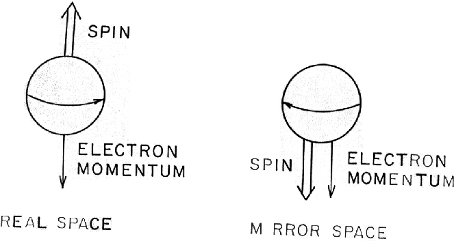
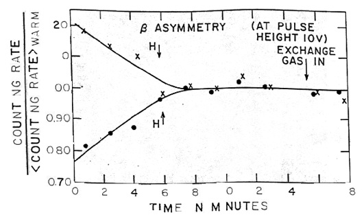

# physics-experiment — app1（supplement）

> （《physics-experiment》词条补充材料，源：plato.stanford.edu/entries/physics-experiment/app1.html）

#### Supplement to Experiment in Physics

## Appendix 1: The Discovery of Parity Nonconservation

Let us consider first an episode in which the relation between theory and experiment was clear and straightforward. This was a “crucial” experiment, one that decided unequivocally between two competing theories, or classes of theory. The episode was that of the discovery that parity, mirror-reflection symmetry or left-right symmetry, is not conserved in the weak interactions. (For details of this episode see Franklin (1986, Ch. 1)). Parity conservation was a well-established and strongly-believed principle of physics. As students of introductory physics learn, if we wish to determine the magnetic force between two currents we first determine the direction of the magnetic field due to the first current, and then determine the force exerted on the second current by that field. We use two Right-Hand Rules. We get exactly the same answer, however, if we use two Left-Hand Rules, This is left-right symmetry, or parity conservation, in electromagnetism.

In the early 1950s physicists were faced with a problem known as the “$\tau - \theta$” puzzle. Based on one set of criteria, that of mass and lifetime, two elementary particles (the tau and the theta) appeared to be the same, whereas on another set of criteria, that of spin and intrinsic parity, they appeared to be different. T.D. Lee and C.N. Yang (1956) realized that the problem would be solved, and that the two particles would be different decay modes of the same particle, if parity were not conserved in the decay of the particles, a weak interaction. They examined the evidence for parity conservation and found, to their surprise, that although there was strong evidence that parity was conserved in the strong (nuclear) and electromagnetic interactions, there was, in fact, no supporting evidence that it was conserved in the weak interaction. It had never been tested.

*Figure 1.* Nuclear spin and momentum of the decay electron in decay in both real space and in mirror space.

Lee and Yang suggested several experiments that would test their hypothesis that parity was not conserved in the weak interactions. One was the *β* decay of oriented nuclei (Figure 1). Consider a collection of radioactive nuclei, all of whose spins point in the same direction. Suppose also that the electron given off in the radioactive decay of the nucleus is always emitted in a direction opposite to the spin of the nucleus In the mirror the electron is emitted in the same direction as the spin. The mirror image of the decay is different from the real decay. This would violate parity conservation, or mirror symmetry. Parity would be conserved only if, in the decay of a collection of nuclei, equal numbers of electrons were emitted in both directions. This was the experimental test performed by C.S. Wu and her collaborators (1957). They aligned Cobalt⁶⁰ nuclei and counted the number of decay electrons in the two directions, along the nuclear spin and opposite to the spin. Their results are shown in Figure 2 and indicate clearly that more electrons are emitted opposite to the spin than along the spin. Parity is not conserved.

*Figure 2.* Relative counting rates for particles from the decay of oriented ⁶⁰Co nuclei for different nuclear orientations (field directions). There is a clear asymmetry with more particles being emitted opposite to the spin direction. From Wu et al. (1957).

Two other experiments, reported at the same time, on the sequential decay pi meson decays to mu meson decays to electron also showed parity nonconservation (Friedman and Telegdi 1957; Garwin, Lederman and Weinrich 1957). These three experiments decided between two classes of theories--that is, between those theories that conserve parity and those that do not. They refuted the theories in which parity was conserved and supported or confirmed those in which it wasn’t. These experiments also demonstrated that charge conjugation, or particle-antiparticle, symmetry was violated in the weak interactions and called for a new theory of decay and the weak interactions. It is fair to say that when a physicist learned the results of these experiments they were convinced that parity was not conserved in the weak interactions.

Return to Experiment in Physics
