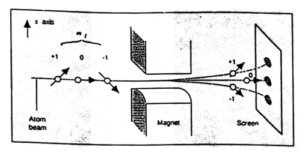
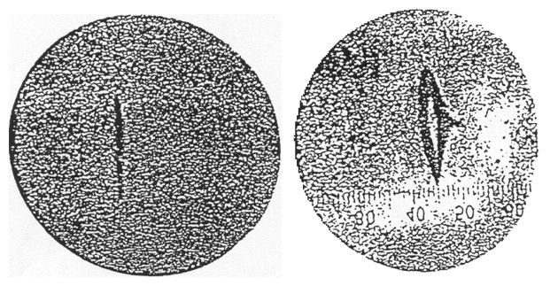

# physics-experiment — app5（supplement）

> （《physics-experiment》词条补充材料，源：plato.stanford.edu/entries/physics-experiment/app5.html）

#### Supplement to Experiment in Physics

## Appendix 5: Right Experiment, Wrong Theory: The Stern-Gerlach Experiment

From the time of Ampere onward, molecular currents were regarded as giving rise to magnetic moments. In the nuclear model of the atom the electron orbits the nucleus. This circular current results in a magnetic moment. The atom behaves as if it were a tiny magnet. In the Stern-Gerlach experiment a beam of silver atoms passed through an inhomogeneous magnetic field (Figure 12). In Larmor’s classical theory there was no preferential direction for the direction of the magnetic moment and so one predicted that the beam of silver atoms would show a maximum in the center of the beam. In Sommerfeld’s quantum theory an atom in a state with angular momentum equal to one $(L = 1)$ would have a magnetic moment with two components relative to the direction of the magnetic field, $\pm eh/4m_e$. (Bohr had argued that only two spatial components were allowed). In an inhomogeneous magnetic field, $\bH$, the force on the magnetic moment $\mu$ will be $\mu_z x$ (Gradient of the magnetic field in the $z$ direction), where $\mu_z = \pm eh/4m_e$, where $e$ is the charge of the electron, $m_e$ is its mass, $h$ is Planck’s constant, and $z$ is the field direction. Thus, depending on the orientation of the magnetic moment relative to the magnetic field there will be either an attractive or repulsive force and the beam will split into two components, exhibiting spatial quantization. There will be a minimum at the center of the beam. “According to quantum theory $\mu_z$ can only be $\pm(e/2m_e)(h/2\pi)$. In this case the spot on the receiving plate will therefore be split into two, each of them having the same size but half the intensity of the original spot” (Stern 1921, p. 252, JM) This difference in prediction between the Larmor and Sommerfeld theories was what Stern and Gerlach planned to use to distinguish between the two theories. Stern remarked that “the experiment, if it can be carried out, (will result) in a clear-cut decision between the quantum-theoretical and the classical view” (Stern 1921, FW).

*Figure 12.* Sketch of the Stern-Gerlach experimental apparatus. The result expected for atoms in an $L = 1$ state (three components) is shown. From Weinert (1995).

Sommerfeld’s theory also acted as an enabling theory for the experiment. It provided an estimate of the size of the magnetic moment of the atoms so that Stern could begin calculations to see if the experiment was feasible. Stern calculated, for example, that a magnetic field gradient of 10⁴ Gauss per centimeter would be sufficient to produce deflections that would give detectable separations of the beam components. He asked Gerlach if he could produce such a gradient. Gerlach responded affirmatively, and said he could do even better. The experiment seemed feasible. A sketch of the apparatus is shown in Figure 12. The silver atoms pass through the inhomogeneous magnetic field. If the beam is spatially quantized, as Sommerfeld predicted, two spots should be observed on the screen. (The sketch shows the beam splitting into three components, which would be expected in modern quantum theory for an atom with angular momentum equal to one). I note that Sommerfeld’s theory was incorrect, illustrating the point that an enabling theory need not be correct to be useful.

*Figure 13.* The experimental result of the Stern-Gerlach experiment. The beam has split into two components. From Gerlach and Stern (1922a).

A preliminary result reported by Stern and Gerlach did not show splitting of the beam into components. It did, however, show a broadened beam spot. They concluded that although they had not demonstrated spatial quantization, they had provided “evidence that the silver atom possesses a magnetic moment.” Stern and Gerlach made improvements in the apparatus, particularly in replacing a round beam slit by a rectangular one that gave a much higher intensity. The results are shown in Figure 13 (Gerlach and Stern 1922a). There is an intensity minimum in the center of the pattern, and the separation of the beam into two components is clearly seen. This result seemed to confirm Sommerfeld’s quantum-theoretical prediction of spatial quantization. Pauli, a notoriously skeptical physicist, remarked, “Hopefully now even the incredulous Stern will be convinced about directional quantization” (in a letter from Pauli to Gerlach 17 February 1922). Pauli’s view was shared by the physics community. Nevertheless the Stern-Gerlach result posed a problem for the Bohr-Sommerfeld theory of the atom. Stern and Gerlach had assumed that the silver atoms were in an angular momentum state with angular momentum equal to one $(L = 1)$. In fact, the atoms are in an $L = 0$ state, for which no splitting of the beam would be expected in either the classical or the quantum theory. Stern and Gerlach had not considered this possibility. Had they done so they might not have done the experiment. The later, or new, quantum theory developed by Heisenberg, Schrodinger, and others, predicted that for an $L = 1$ state the beam should split into three components as shown in Figure 12. The magnetic moment of the atom would be either 0 or $\pm eh/(4\pi x m)$. Thus, if the silver atoms were in an $L = 1$ state as Stern and Gerlach had assumed, their result, showing two beam components, also posed a problem for the new quantum theory. This was solved when Uhlenbeck and Goudsmit (1925, 1926) proposed that the electron had an intrinsic angular momentum or spin equal to $h/4\pi$. This is analogous to the earth having orbital angular momentum about the sun and also an intrinsic angular momentum due to its rotation on its own axis. In an atom the electron will have a total angular momentum $\bJ = \bL + \bS$, where $\bL$ is the orbital angular momentum and $\bS$ is the spin of the electron. For silver atoms in an $L = 0$ state the electron would have only its spin angular momentum and one would expect the beam to split into two components. Goudsmit and Uhlenbeck suggested the idea of electron spin to explain features in atomic spectra such as the anomalous Zeeman effect, the splitting of spectral lines in a magnetic field into more components than could be accommodated by the Bohr-Sommerfeld theory of the atom. Although the Stern-Gerlach results were known, and would certainly have provided strong support for the idea of electron spin, Goudsmit and Uhlenbeck made no mention of the result.

The Stern-Gerlach experiment was initially regarded as a crucial test between the classical theory of the atom and the Bohr-Sommerfeld theory. In a sense it was, because it showed clearly that spatial quantization existed, a phenomenon that could be accommodated only within a quantum mechanical theory. It decided between the two classes of theories, the classical and the quantum mechanical. With respect to the particular quantum theory of Bohr and Sommerfeld, however, it wasn’t crucial, although it was regarded as such at the time, because that theory predicted no splitting for a beam of silver atoms in the ground state $(L = 0)$. The theory had been wrongly applied. The two-component result was also problematic for the new quantum theory, which also predicts no splitting for an angular momentum zero state and three components for an $L = 1$ state. Only after the suggestion of electron spin did the Stern-Gerlach result confirm the new theory.

Although the interpretation of the experimental result was incorrect for a time, the result itself remained quite robust through the theory change from the old to the new quantum theory. It is important to remember that experimental results do not change when accepted theory changes, although certainly, as we have seen, their interpretation may change. Gerlach and Stern emphasized this point themselves.

Apart from any theory, it can be stated, as a pure result of the experiment, and as far as the exactitude of our experiments allows us to say so, that silver atoms in a magnetic field have only *two discrete* values of the component of the magnetic moment in the direction of the field strength; both have the same absolute value with each half of the atoms having a positive and a negative sign respectively (Gerlach and Stern 1924, pp. 690–691, FW)

Experimental results, as well as experiments, also have a life of their own, independent of theory.

Return to Experiment in Physics
