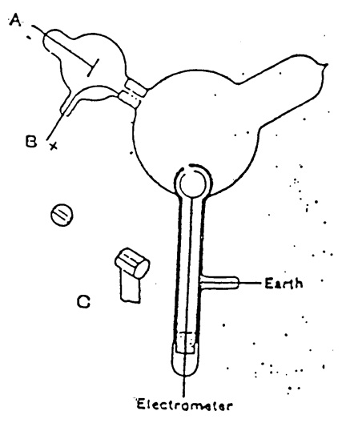
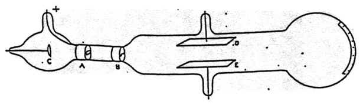

# physics-experiment — app7（supplement）

> （《physics-experiment》词条补充材料，源：plato.stanford.edu/entries/physics-experiment/app7.html）

#### Supplement to Experiment in Physics

## Appendix 7: Evidence for a New Entity: J.J. Thomson and the Electron

In discussing the existence of electrons Ian Hacking has written, “So far as I’m concerned, if you can spray them then they are real” (Hacking 1983, p. 23). He went on to elaborate this view. “We are completely convinced of the reality of electrons when we set out to build—and often enough succeed in building—new kinds of device that use various well-understood causal properties of electrons to interfere in other more hypothetical parts of nature” (p. 265).

Hacking worried that the simple manipulation of the first quotation, the changing of the charge on an oil drop or on a superconducting niobium sphere, which involves only the charge of the electron, was insufficient grounds for belief in electrons. His second illustration, which he believed more convincing because it involved several properties of the electron, was that of Peggy II, a source of polarized electrons built at the Stanford Linear Accelerator Center in the late 1970s. Peggy II provided polarized electrons for an experiment that scattered electrons off deuterium to investigate the weak neutral current. Although I agree with Hacking that manipulability can often provide us with grounds for belief in a theoretical entity,[^note-A7-1] his illustration comes far too late. Physicists were manipulating the electron in Hacking’s sense in the early twentieth century.[^note-A7-2] They believed in the existence of electrons well before Peggy II, and I will argue that they had good reasons for that belief.

The position I adopt is one that might reasonably be called “conjectural” realism. It is conjectural because, despite having good reasons for belief in the existence of an entity or in the truth of a scientific law, we might be wrong. At one time scientists had good reason to believe in phlogiston and caloric, substances we now have good reason to believe don’t exist. My position includes both Sellars’ view that “to have good reason for holding a theory is *ipso facto* to have good reason for holding that the entities postulated by the theory exist” (Sellars 1962, p. 97), and the “entity realism” proposed by Cartwright (1983) and by Hacking (1983). Both Hacking, as noted above, and Cartwright emphasize the manipulability of an entity as a criterion for belief in its existence. Cartwright also stresses causal reasoning as part of her belief in entities. In her discussion of the operation of a cloud chamber she states, “…if there are no electrons in the cloud chamber, I do not know why the tracks are there” (Cartwright, 1983, p.99). In other words, if such entities don’t exist then we have no plausible causal story to tell. Both Hacking and Cartwright grant existence to entities such as electrons, but do not grant “real” status to either laws or theories, which may postulate or apply to such entities.

In contrast to both Cartwright and Hacking, I suggest that we can also have good reasons for belief in the laws and theories governing the behavior of the entities, and that several of their illustrations implicitly involve such laws.[^note-A7-3] I have argued elsewhere for belief in the reality of scientific laws (Franklin 1996). In this section I shall concentrate on the reality and existence of entities, in particular, the electron. I agree with both Hacking and Cartwright that we can go beyond Sellars and have good reasons for belief in entities even without laws. Hacking and Cartwright emphasize experimenting *with* entities. I will argue that experimenting *on* entities and measuring their properties can also provide grounds for belief in their existence.

In this section I will discuss the grounds for belief in the existence of the electron by examining J.J. Thomson’s experiments on cathode rays. His 1897 experiment on cathode rays is generally regarded as the “discovery” of the electron.

The purpose of J.J. Thomson’s experiments was clearly stated in the introduction to his 1897 paper.

The experiments discussed in this paper were undertaken in the hope of gaining some information as to the nature of Cathode Rays. The most diverse opinions are held as to these rays; according to the almost unanimous opinion of German physicists they are due to some process in the aether to which—inasmuch as in a uniform magnetic field their course is circular and not rectilinear—no phenomenon hitherto observed is analogous: another view of these rays is that, so far from being wholly aetherial, they are in fact wholly material, and that they mark the paths of particles of matter charged with negative electricity (Thomson 1897, p. 293).

Thomson’s first order of business was to show that the cathode rays carried negative charge. This had presumably been shown previously by Perrin. Perrin placed two coaxial metal cylinders, insulated from one another, in front of a plane cathode. The cylinders each had a small hole through which the cathode rays could pass onto the inner cylinder. The outer cylinder was grounded. When cathode rays passed into the inner cylinder an electroscope attached to it showed the presence of a negative electrical charge. When the cathode rays were magnetically deflected so that they did not pass through the holes, no charge was detected. “Now the supporters of the aetherial theory do not deny that electrified particles are shot off from the cathode; they deny, however, that these charged particles have any more to do with the cathode rays than a rifle-ball has with the flash when a rifle is fired” (Thomson 1897, p. 294).

Thomson repeated the experiment, but in a form that was not open to that objection. The apparatus is shown in Figure 14. The two coaxial cylinders with holes are shown. The outer cylinder was grounded and the inner one attached to an electrometer to detect any charge. The cathode rays from A pass into the bulb, but would not enter the holes in the cylinders unless deflected by a magnetic field.

*Figure 14.* Thomson’s apparatus for demonstrating that cathode rays have negative charge. The slits in the cylinders are shown. From Thomson (1897).

When the cathode rays (whose path was traced by the phosphorescence on the glass) did not fall on the slit, the electrical charge sent to the electrometer when the induction coil producing the rays was set in action was small and irregular; when, however, the rays were bent by a magnet so as to fall on the slit there was a large charge of negative electricity sent to the electrometer…. If the rays were so much bent by the magnet that they overshot the slits in the cylinder, the charge passing into the cylinder fell again to a very small fraction of its value when the aim was true. *Thus this experiment shows that however we twist and deflect the cathode rays by magnetic forces, the negative electrification follows the same path as the rays, and that this negative electrification is indissolubly connected with the cathode rays* (Thomson 1897, p. 294–295, emphasis added).

This experiment also demonstrated that cathode rays were deflected by a magnetic field in exactly the way one would expect if they were negatively charged material particles.[^note-A7-4]

*Figure 15.* Thomson’s apparatus for demonstrating that cathode rays are deflected by an electric field. It was also used to measure $\bfrac{m}{e}$. From Thomson (1897).

There was, however, a problem for the view that cathode rays were negatively charged particles. Several experiments, in particular those of Hertz, had failed to observe the deflection of cathode rays by an electrostatic field. Thomson proceeded to answer this objection. His apparatus is shown in Figure 15. Cathode rays from C pass through a slit in the anode A, and through another slit at B. They then passed between plates D and E and produced a narrow well-defined phosphorescent patch at the end of the tube, which also had a scale attached to measure any deflection. When Hertz had performed the experiment he had found no deflection when a potential difference was applied across D and E. He concluded that the electrostatic properties of the cathode ray are either *nil* or very feeble. Thomson admitted that when he first performed the experiment he also saw no effect. “on repeating this experiment [that of Hertz] I at first got the same result [no deflection], but subsequent experiments showed that the absence of deflexion is due to the conductivity conferred on the rarefied gas by the cathode rays”.[^note-A7-5] On measuring this conductivity it was found that it diminished very rapidly as the exhaustion increased; it seemed that on trying Hertz’s experiment at very high exhaustion there might be a chance of detecting the deflexion of the cathode rays by an electrostatic force (Thomson 1897, p. 296). Thomson did perform the experiment at lower pressure [higher exhaustion] and observed the deflection.[^note-A7-6]

Thomson concluded:

> As the cathode rays carry a charge of negative electricity, are deflected by an electrostatic force as if they were negatively electrified, and are acted on by a magnetic force in just the way in which this force would act on a negatively electrified body moving along the path of these rays, I can see no escape from the conclusion that they are charges of negative electricity carried by particles of matter. (Thomson 1897, p. 302)[^note-A7-7]

Having established that cathode rays were negatively charged material particles, Thomson went on to discuss what the particles were. “What are these particles? are they atoms, or molecules, or matter in a still finer state of subdivision” (p. 302). To investigate this question Thomson made measurements on the charge to mass ratio of cathode rays. Thomson’s method used both the electrostatic and magnetic deflection of the cathode rays.[^note-A7-8] The apparatus is shown in Figure 15. It also included a magnetic field that could be created perpendicular to both the electric field and the trajectory of the cathode rays.

Let us consider a beam of particles of mass $m$ charge $e$, and velocity $v$. Suppose the beam passes through an electric field F in the region between plates D and E, which has a length $L$. The time for a particle to pass through this region $t = \bfrac{L}{v}$. The electric force on the particle is $Fe$ and its acceleration $a = \bfrac{Fe}{m}$. The deflection d at the end of the region is given by

$$ d = \frac{1}{2} at^2 = \frac{1}{2}\left(\frac{eF}{m}\right)\frac{L^2}{v^{2}}. $$

Now consider a situation in which the beam of cathode rays simultaneously pass through both $F$ and a magnetic field $B$ in the same region. Thomson adjusted $B$ so that the beam was undeflected. thus the magnetic force was equal to the electrostatic force.

$$ evB = eF \text{ or } v = \frac{F}{B}. $$

This determined the velocity of the beam. Thus,

$$ \frac{e}{m} = \frac{2dF}{B^2L^2}. $$

Each of the quantities in the above expression was measured so the $\bfrac{e}{m}$ or $\bfrac{m}{e}$ could be determined.

Using this method Thomson found a value of $\bfrac{m}{e}$ of $(1.29\pm 0.17) \times 10^{-7}$. This value was independent of both the gas in the tube and of the metal used in the cathode, suggesting that the particles were constituents of the atoms of all substances. It was also far smaller, by a factor of 1000, than the smallest value previously obtained, $10^{-4}$, that of the hydrogen ion in electrolysis.

Thomson remarked that this might be due to the smallness of $m$ or to the largeness of $e$. He argued that $m$ was small citing Lenard’s work on the range of cathode rays in air. The range, which is related to the mean free path for collisions, and which depends on the size of the object, was 0.5 cm. The mean free path for molecules in air was approximately $10^{-5}$ cm. If the cathode ray traveled so much farther than a molecule before colliding with an air molecule, Thomson argued that it must be much smaller than a molecule.[^note-A7-9]

Thomson had shown that cathode rays behave as one would expect negatively charged material particles to behave. They deposited negative charge on an electrometer, and were deflected by both electric and magnetic fields in the appropriate direction for a negative charge. In addition the value for the mass to charge ratio was far smaller than the smallest value previously obtained, that of the hydrogen ion. If the charge were the same as that on the hydrogen ion, the mass would be far less. In addition, the cathode rays traveled farther in air than did molecules, also implying that they were smaller than an atom or molecule. Thomson concluded that these negatively charged particles were constituents of atoms. In other words, Thomson’s experiments had given us good reasons to believe in the existence of electrons.

Return to Experiment in Physics
