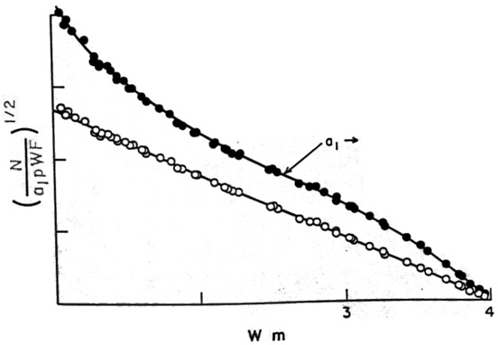
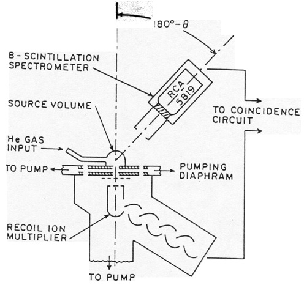
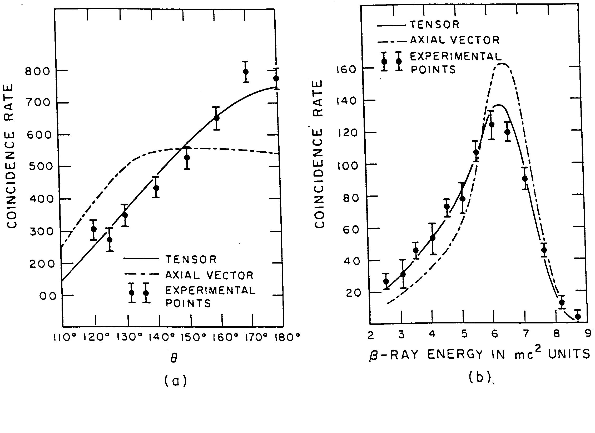
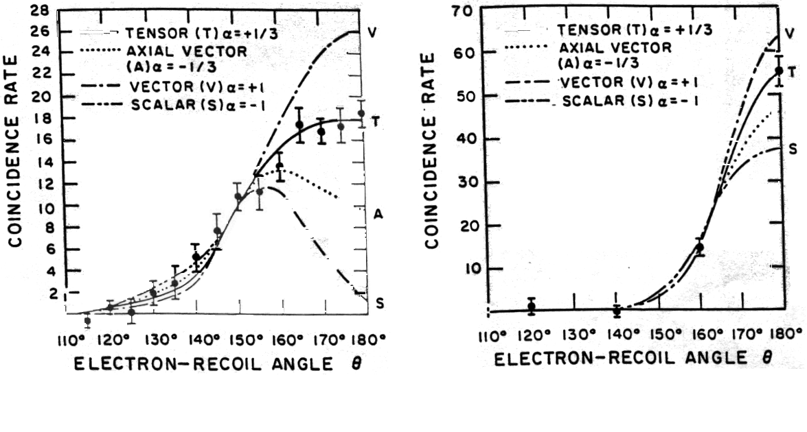
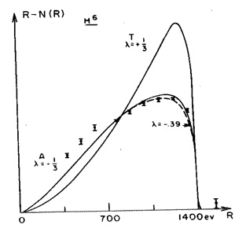

# physics-experiment — app8（supplement）

> （《physics-experiment》词条补充材料，源：plato.stanford.edu/entries/physics-experiment/app8.html）

#### Supplement to Experiment in Physics

## Appendix 8: The Articulation of Theory: Weak Interactions

Radioactivity, the spontaneous decay of a substance, produces alpha (*α*) particles (positively charged helium nuclei), or beta (*β*) particles (electrons), or gamma rays (high energy electromagnetic radiation). It was discovered in 1896 by Henri Becquerel. Experimental work on the energy of the electrons emitted in *β*-decay began in the early twentieth century, and the observed continuous energy spectrum posed a problem. If *β*-decay were a two-body decay (for example, neutron $\rightarrow$ proton $+$ electron) then applying the laws of conservation of energy and of conservation of momentum requires that the energy of the electron have a unique value, not a continuous spectrum.[^note-A8-1] Thus, the observed continuous energy spectrum cast doubt on both of these conservation laws. Physicists speculated that perhaps the electrons lost energy in escaping the substance, with different electrons losing different amounts of energy, thus accounting for the energy spectrum. Careful experiments showed that this was not the case so the problem remained. In the early 1930s Pauli suggested that a low-mass neutral particle, named by Fermi as the neutrino, was also emitted in *β*-decay.[^note-A8-2] This solved the problem of the continuous energy spectrum because in a three-body decay (neutron proton + electron + neutrino) the energy of the electron was no longer required to be unique. The electron could have a continuous energy spectrum and the conservation laws were saved.[^note-A8-3]

In 1934 Fermi proposed a new theory of *β*-decay that incorporated this new particle (Fermi 1934). He added a perturbation energy due to the decay interaction to the Hamiltonian describing the nuclear system. Pauli (1933) had previously shown that the perturbation could have only five different forms if the Hamiltonian is to be relativistically invariant. These are $S$, the scalar interaction; $P$, pseudoscalar; $V$, vector; $A$, axial vector; and $T$, tensor. Fermi knew this but chose, in analogy with electromagnetic theory, to use only the vector interaction. His theory initially received support from the work of Sargent (1932; 1933) and others. There remained, however, the question of whether or not the other forms of the interaction also entered into the Hamiltonian.[^note-A8-4] In this episode we shall see how experiment helped to determine the mathematical form of the weak interaction.

Gamow and Teller (1936) soon proposed a modification of Fermi’s vector theory. Fermi’s theory had originally required a selection rule, the change in $J = 0$, where $J$ is the angular momentum of the nucleus, and did not include the effects of nuclear spin. Gamow and Teller included nuclear spin and obtained selection rules, change in $J = 0 \pm 1$ for allowed transitions, with no $0-0$ transitions allowed. The Gamow-Teller modification required either a tensor or an axial vector form of the interaction. Their theory helped to solve some of the difficulties that arose in assigning nuclear spins using only the Fermi selection rule. At the end of the 1930s there was support for Fermi’s theory with some preference for the Gamow-Teller selections rules and the tensor interaction.

The work of Fierz (1937) helped to restrict the allowable forms of the interaction. He showed that if both $S$ and $V$ interactions were present in the allowed *β*-decay interaction, or both $A$ and $T$, then there would be an interference term of the form $1 + a/W$ in the allowed *β*-decay spectrum, where W is the electron energy. This term vanished if the admixtures were not present. The failure to observe these interference terms showed that the decay interaction did not contain both $S$ and $V$, or both $A$ and $T$.

The presence of either the $T$ or $A$ form of the interaction in at least part of the *β*-decay interaction was shown by Mayer, Moszkowski, and Nordheim (1951). They found twenty five decays for which the change in $J$ was $0\pm 1$, with no parity change. These decays could only occur if the $A$ or $T$ forms were present. Their conclusion depended on the correct assignment of nuclear spins which, although reliable, still retained some uncertainty. Further evidence, which did not depend on knowledge of the nuclear spins, came from an examination of the spectra of unique forbidden transitions.[^note-A8-5] These were n-times forbidden transitions in which the change in nuclear spin was $n + 1$. These transitions require the presence of either $A$ or $T$. In addition, only a single form of the interaction makes any appreciable contribution to the decay. This allows the prediction of the shape of the spectrum for such transitions. Konopinski and Uhlenbeck (1941) showed that for an $n$-times forbidden transition the spectrum would be that of an allowed transition multiplied by an energy dependent term $a_n(W)$. For a first-forbidden transition $a_1 = C[(W^2 - m^2 c^4) + (W_o - W)^2]$. The spectrum for ⁹¹Y measured by Langer and Price (1949) (Figure 16) shows the clear presence of either the A or T forms of the interaction. The spectrum requires the energy-dependent correction.

*Figure 16.* The unique, once-forbidden spectrum of $\ce{^{91}Y}$. The best theoretical fit is that which gives a straight line. The Fermi theory alone, $a_1=1$, does not give a straight line. The correction factor $a_1 = C[(W^2 - m_o c^2) + (W_o - W)^2]$, does give a linear plot. From Konopinski and Langer (1953).

Evidence in favor of the presence of either the $S$ or $V$ forms of the interaction was provided by Sherr, Muether, and White (1949) and by Sherr and Gerhart (1952). They observed the decay of $\ce{^{14}O}$ to an excited state of $\ce{^{14}N}$, $\ce{^{14}N^{\ast}}$. They argued that both $\ce{^{14}O}$ and $\ce{^{14}N^{\ast}}$ had spin 0. This required the presence of either $S$ or $V$ because the decay was forbidden by $A$ and $T$. (Recall that the Gamow-Teller selection rules specified no 0 to 0 transitions).

Further progress in isolating the particular forms of the interaction was made by examining the spectra of once-forbidden transitions. Here too, interference effects, similar to those predicted by Fierz, were also expected. A. Smith (1951) and Pursey (1951) found that the spectrum for these transitions would contain energy dependent terms of the form $G_V G_T / W$, $G_A G_P / W$, and $G_S G_A / W$, where the $G$s are the coupling constants for the various interactions, and $W$ is the electron energy. The linear spectrum found for $\ce{^{147}Pm}$ demonstrated the absence of these terms (Langer, Motz and Price 1950).

Let us summarize the situation. There were five allowable forms of the decay interaction; $S$, $T$, $A$, $V$, $P$. The failure to observe Fierz interference showed that the interaction could not contain both $S$ and $V$ or both $A$ and $T$. Experiments showing the presence of Gamow-Teller selections rules and on unique forbidden transitions had shown that either $A$ or $T$ must be present. The decay of $\ce{^{14}O}$ to $\ce{^{14}N^{\ast}}$ had demonstrated that either $S$ or $V$ must also be present. This restricted the forms of the interaction to $STP$, $SAP$, $VTP$, or $VAP$ or doublets taken from these combinations. The absence of interference terms in the once-forbidden spectra eliminated the $VT$, $SA$, and $AP$ combinations. $VP$ was eliminated because it did not allow Gamow-Teller transitions. This left only the $STP$ triplet or the $VA$ doublet as the possible interactions.

The spectrum of RaE provided the decisive evidence. Petschek and Marshak (1952) analyzed the spectrum of RaE and found that the only interaction that would give a good fit to the spectrum was a combination of $T$ and $P$. This was, in fact, the only evidence favoring the presence of the P interaction. This led Konopinski and Langer (1953), in their 1953 review article on *β*-decay to conclude that, “As we shall interpret the evidence here, the correct law must be what is known as an $STP$ combination (1953, p. 261).”

Unfortunately, the evidence from the RaE spectrum had led the physics community astray. Petschek and Marshak had noted that their conclusion was quite sensitive to assumptions made in their calculation. “Thus, an error in the finite radius correction of approximately 0.1 percent leads to an error of up to 25% in $C_{1(T+P)}$ [the theoretical correction term].” Further theoretical analysis cast doubt on their assumptions, but all of this became moot when $K$. Smith[^note-A8-6] measured the spin of RaE and found it to be one, incompatible with the Petschek-Marshak analysis.

The demise of the RaE evidence removed the necessity of including the $P$ interaction in the theory of *β*-decay, and left the decision between the $STP$ and $VA$ combinations unresolved. The dilemma was resolved by evidence provided by angular-correlation experiments, particularly that from the experiment on $\ce{^{6}He}$ by Rustad and Ruby (1953; 1955)

**(a) Angular Correlation Experiments**. Angular correlation experiments are those in which both the decay electron and the recoil nucleus from *β*-decay are detected in coincidence. The experiments measured the distribution in angle between the electron and the recoil nucleus for a fixed range of electron energy, or measured the energy spectrum of either the electron or the nucleus at a fixed angle between them. These quantities are quite sensitive to the form of the decay interaction and became decisive pieces of evidence in the search for the form of the decay interaction. Hamilton (1947) calculated the form of the angular distribution expected for both allowed and forbidden decays, assuming only one type of interaction ($S$, $V$, $T$, $A$, $P$) was present. He found, for allowed transitions, that the angular distributions for the specific forms of the interaction would be different. A more general treatment was given by de Groot and Tolhoek (1950). They found that the general form of the angular distribution for allowed decays depended on the combination of the particular forms of the interactions in the decay Hamiltonian. For single forms their results agreed with those of Hamilton.

*Figure 17.* Schematic view of the experimental apparatus for the $\ce{^{6}He}$ angular correlation experiment of Rustad and Ruby (1953; 1955).

The most important of the experiments performed at this time was the measurement of the angular correlation in the decay of $\ce{^{6}He}$. This decay was a pure Gamow-Teller transition and thus was sensitive to the amounts of $A$ and $T$ present in the decay interaction. The decisive experiment was that of Rustad and Ruby (1953; 1955). This experiment was regarded as establishing that the Gamow-Teller part of the interaction was predominantly tensor. This was the conclusion reached in several review papers on the nature of *β*-decay. (Ridley 1954; Kofoed-Hansen 1955; Wu 1955). The experimental apparatus is shown in Figure 17. The definition of the decay volume was extremely important. In order to measure the angular correlation one must know the position of the decay so that one can measure the angle between the electron and the recoil nucleus. The decay volume for the helium gas in this experiment was defined by a 180 microgram/cm² aluminum hemisphere and the pumping diaphragm. Rustad and Ruby (1953) presented two experimental results. The first was the coincidence rate as a function of the angle between the electron and the recoil nucleus for electrons in the energy range (2.5–4.0) mc². The second was the energy spectrum of the decay electrons with the angle between the electron and the recoil nucleus fixed at 180°. Both results are shown in Figure 18 along with the predicted results for $A$ and $T$, respectively. The dominance of the tensor interaction is clear. This conclusion was made more emphatic in their 1955 paper which included more details of the experiment and even more data. The later results, shown in Figure 19, clearly demonstrate the superior fit of the tensor interaction.

*Figure 18.* (a) Coincidence counting rate versus angle between the electron and the recoil nucleus, for electrons in the energy range 2.5–4.0 mc². (b) Coincidence counting rate versus electron energy for an angle of 180° between the electron and the recoil nucleus. From Rustad and Ruby (1953).

*Figure 19.* Coincidence counting rate versus angle between the electron and the recoil nucleus for (a) electrons in the energy range 4.5–5.5 mc² and (b) electrons in the energy range 5.5–7.5 mc². From Rustad and Ruby (1955).

The Rustad-Ruby result, along with several others, established that the Gamow-Teller part of the decay interaction was tensor and that the decay interaction was $STP$, or $ST$, rather than $VA$. We have seen clearly in this episode the fruitful interaction between experiment and theory. Theoretical predictions became more precise and were tested experimentally until the form of the weak interaction was found. Fermi’s theory of *β*-decay had been confirmed. It had also been established that the interaction was a combination of scalar, tensor, and pseudoscalar $(STP)$.

*Figure 20.* Energy spectrum of recoil ions from $\ce{^{35}A}$ decay. From (Hermannsfeldt et al. 1958).

**(b) Epilogue**. It would be nice to report that such a simple, satisfying story, with its happy ending was the last word. It wasn’t. Work continued on angular correlation experiments and the happy agreement was soon destroyed (Franklin 1990, Chapter 3). Things became more complex with the discovery of parity nonconservation in the weak interactions, including *β*-decay. Sudarshan and Marshak (1958) and Feynman and Gell-Mann (1958) showed that only a $V-A$ interaction was compatible with parity nonconservation. If there was to be a single interaction describing all the weak interactions then there was a serious conflict between this work and the Rustad-Ruby result. This led Wu and Schwarzschild (1958) to reexamine and reanalyze the Rustad-Ruby experiment. They found, by calculation and by constructing a physical analogue of the gas system, that a considerable fraction of the helium gas (approximately 12%) was not in the decay volume. This changed the result for the angular correlation considerably and cast doubt on the Rustad-Ruby result.[^note-A8-7] The ⁶He angular correlation experiment was redone, correcting the problem with the gas target, and the new result is shown in Figure 20 (Hermannsfeldt et al. 1958). It clearly favors A, the axial vector interaction. Once again, physics was both fallible and corrigible. This new result on $\ce{^{6}He}$ combined with the discovery of parity nonconservation established that the form of the weak interaction was $V-A$.

Return to Experiment in Physics
