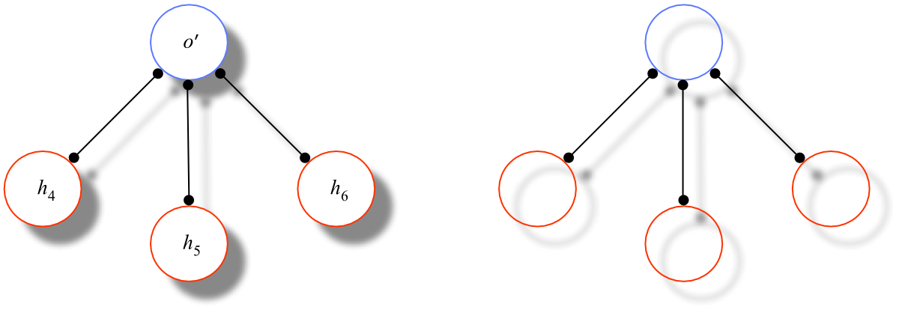

# possible-worlds — problems-combinatorialism（supplement）

> （《possible-worlds》词条补充材料，源：plato.stanford.edu/entries/possible-worlds/problems-combinatorialism.html）

#### Supplement to Possible Worlds

## Further Problems for Combinatorialism

### Problems with Unrestricted Recombination

It is critical to combinatorialism that recombination among simples is unrestricted — any simple object can exemplify any number of simple universals. Any modal qualifications of this principle would undermine combinatorialism's modal reductionism (cf. Bradley 1989, 35–38). Thus, for the combinatorialist, all simple universals must be compatible; for any simple object *o* and any simple univesals **P** and **Q**, there must be a world that includes both [**P**,*o*] and [**Q**,*o*]. On *a priori* grounds alone, this seems implausible; why should it not turn out that some of the simple properties of the simple are simply, primitively incompatible? Likewise, for any simple binary relation **R**, unrestricted recombination requires that, for any distinct simple objects *a* and *b*, there is a world that includes both [**R**,*a*,*b*] and [**R**,*b*,*a*]; there can therefore be no simple, necessarily asymmetric relations. For the same reason there must be a world that includes [**R**,*a*,*a*] and, hence, there can be no simple, necessarily irreflexive relations. Armstrong (1997, 146–7) acknowledges that unrestricted recombination, or *independence*, is ultimately an empirical matter but argues that, so long as it is not empirically refuted, the doctrine is warranted by the simplicity it brings to the theory of modality.

### The Prospect of Infinite Decomposition

The combinatorialist definition of a possible world appears to hinge critically on the assumption that, ultimately, there are simple facts on which all other (first-order) facts supervene. A challenging possibility for the combinatorialist is that this assumption is false. In particular, it seems conceptually possible that there are no simples at all, that every particular comprises yet simpler particular and that every universal is a conjunction of yet simpler universals. Should this be the case, then there are simply no possible worlds the sense of **AW3** or **AW3′**.

Armstrong (1986a, ch. 5) takes up this challenge by introducing the notion of *relative atoms*. The idea is this: Let *s* be any fact, simple or not, and call its constituent objects and universals its atoms (Armstrong 1986, 69):

> The totality of recombinations of these 'atoms' yields a set of possible worlds….If the atoms are genuine atoms [i.e., simples], then no more remains to be done. But if the atoms are not genuinely atomic, then this set is a mere subset of the worlds which can be formed. With one or more of the 'atoms' broken up, we can go on to an enlarged set of worlds. If the breaking-up goes on forever…, then at each point in the break-up new worlds emerge.

Clearly, however, a condition has to be placed on the initial state of affairs **s**. For let **W** be our water molecule from Figure 1 and let **I** be an (actual) hydronium ion, hence one with entirely distinct atomic constituents, as indicated (along with the correpsonding structural universal) in Figure 3.

Figure 3: Hydronium Ion **I** and the Structural Universal **Hydronium** (**H**)

Now, **W** and **I**, according to Armstrong, are both facts, presumably of the form [**Water**,**s**] and [**Hydronium**,**t**], respectively, and **s** and **t** are, respectively, the sums of the constituent atoms of **W** and **I**. Since both **W** and **I** exist, there is the conjunctive state of affairs [**W** & **I**]. If, however, we consider any recombination of the “atomic” universals and particulars constituting **W** and **I** — viz., **Water**, **Hydronium**, **s** and **t** — (together with its totality state of affairs **T**) to count as a (contracted) possible world, then we have in particular the world [[**Water**,**t**] & [**Hydronium**,**s**] & **T**] (hence a world where **t** exemplifies **Water** and **s** exemplifies **Hydronium**), which is clearly impossible for obvious structural reasons (notably, in reality, **W** consists of only two hydrogen atoms and **I** of three).

To avoid this problem, Armstrong places a “non-ovalapping” condition on the recombination of the relative atoms of a world. Say that universals *overlap* if they share a common constituent and that particulars overlap if they share a common part. Then the proposed definition of a possible world is the following

| **AW3R** |   | **w** is a (combinatorial) possible world =_{*def*} **w** is the conjunction of (i) a recombination of some simple fact **f** such that none of **f**'s constituent objects, and none of its constituent universals, overlap and (ii) the totality state of affairs **T_{w}** for that recombination. |
| --- | --- | --- |

As simples by definition do not overlap, **AW3R** obviously generalizes **AW3′**. At the same time, because **Water** and **Hydronium** overlap — **Oxygen** and **Hydrogen** are constituents of both — [[**Water**,**t**] & [**Hydronium**,**s**] & **T**] does not represent a genuine possible world.

Sider (2002) points out that serious problems remain for Armstrong's idea. By **AW3R**, [**Water**,**s**] (together with its totality state of affairs) itself constitutes a (very sparse) possible world **w**. But, as Sider notes, as none of the constituents of **Water** exist in **w**, “its use in representation of a possibility has little to do with its actual nature”; similarly for the (actually) complex object *s*. The world **w** thus does not represent “much of anything, beyond that there exist[s something]…which instantiates a single universal” (*ibid*., 683). Sider then offers up a plausible reconstruction of Armstrong's basic idea of relative atoms that avoids this objection, but this effort leads to an array of further objections to the view.

Return to “Possible Worlds”.
