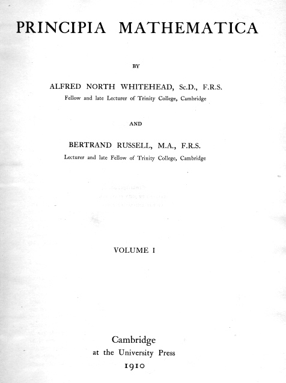

# principia-mathematica — pm1（supplement）

> （《principia-mathematica》词条补充材料，源：plato.stanford.edu/entries/principia-mathematica/pm1.html）

#### Supplement to *Principia Mathematica*

## Title page of the first edition of *Principia Mathematica*, Volume 1 (1910)

(*This image appears courtesy of the* [*Bertrand Russell Archives*](http://www.mcmaster.ca/russdocs/russell.htm) *at McMaster University*.)

The text is:

Principia Mathematica by Alfred North Whitehead, Sc.D., F.R.S. Fellow and late Lecturer of Trinity College, Cambridge and Bertrand Russell, M.A., F.R.S. Lecturer and late Fellow of Trinity College, Cambridge Volume 1 Cambridge at the University Press 1910
