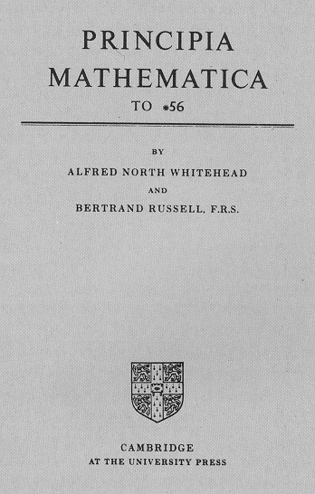

# principia-mathematica — pm2（supplement）

> （《principia-mathematica》词条补充材料，源：plato.stanford.edu/entries/principia-mathematica/pm2.html）

#### Supplement to *Principia Mathematica*

## Cover of the first edition of *Principia Mathematica to \*56* (1962)

(*This image appears courtesy of the* [*Bertrand Russell Archives*](http://www.mcmaster.ca/russdocs/russell.htm) *at McMaster University*.)

The text is:

Principia Mathematica to \*56 by Alfred North Whitehead and Bertrand Russell, F.R.S. Cambridge at the University Press
